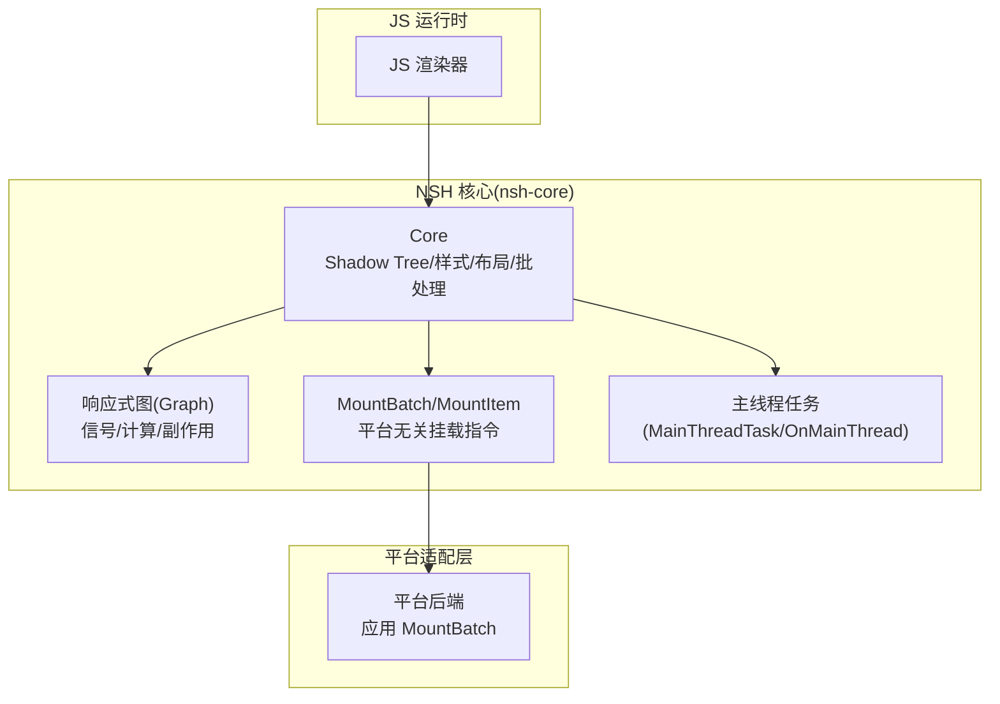
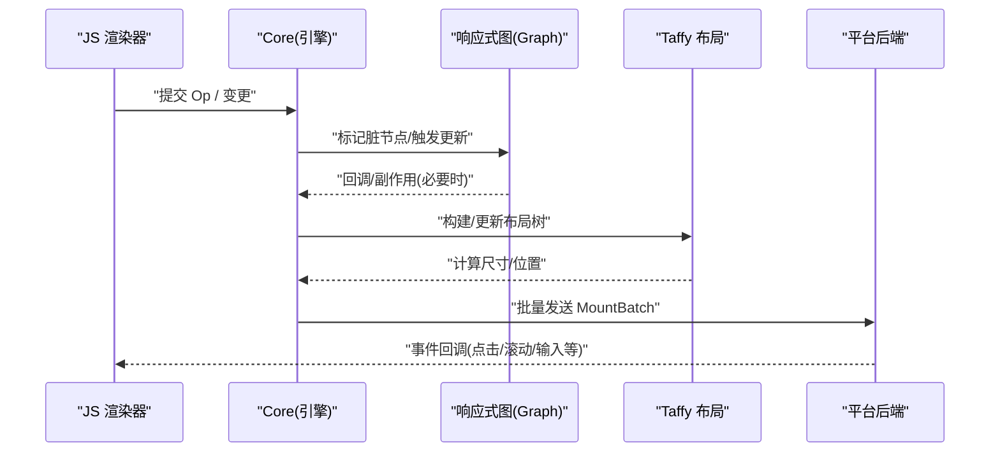
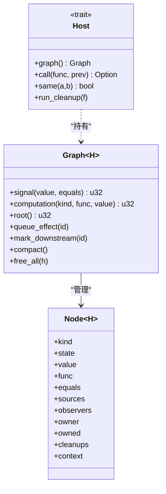
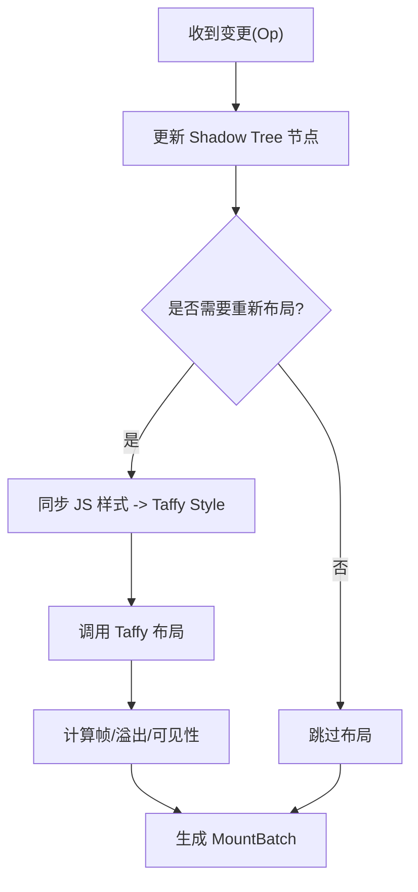
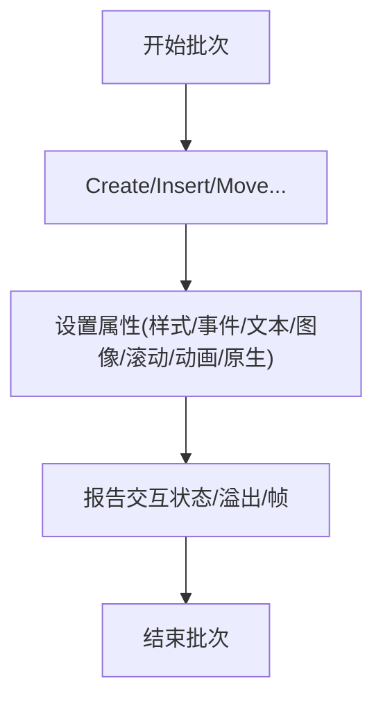
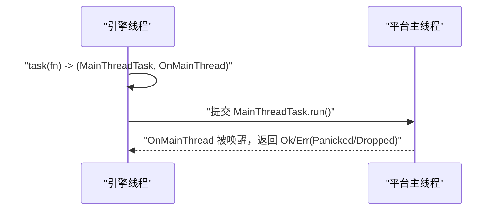
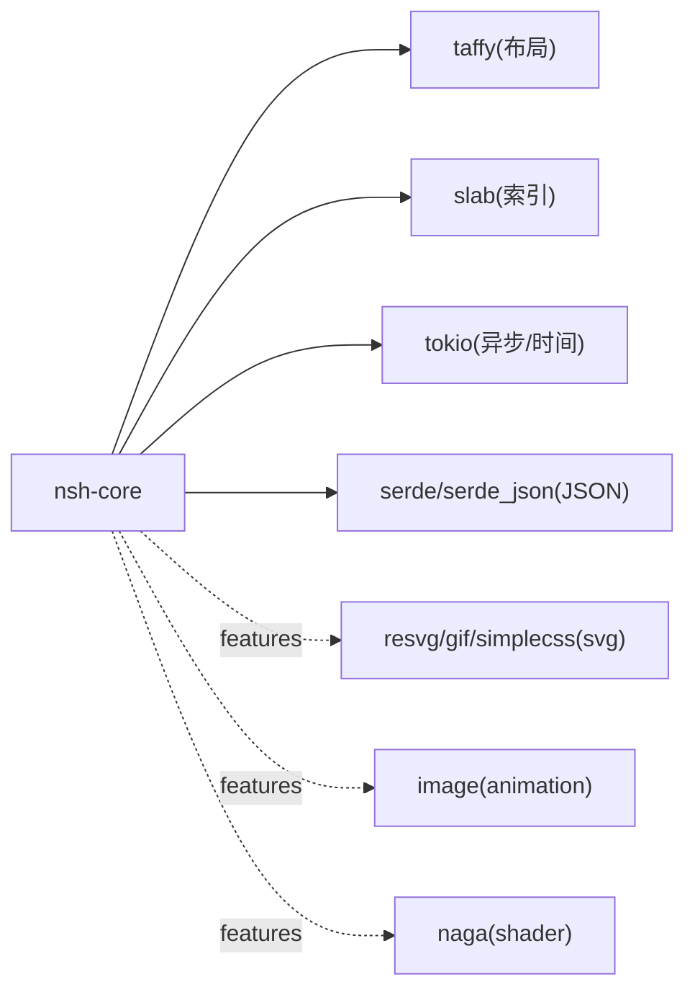

# 核心引擎设计

<cite>
**本文引用的文件**   
- [lib.rs](file://crates/nsh-core/src/lib.rs)
- [main_thread.rs](file://crates/nsh-core/src/main_thread.rs)
- [reactive.rs](file://crates/nsh-core/src/reactive.rs)
- [mount.rs](file://crates/nsh-core/src/mount.rs)
- [core/mod.rs](file://crates/nsh-core/src/core/mod.rs)
- [Cargo.toml](file://crates/nsh-core/Cargo.toml)
</cite>

## 目录
1. [引言](#引言)
2. [项目结构](#项目结构)
3. [核心组件](#核心组件)
4. [架构总览](#架构总览)
5. [详细组件分析](#详细组件分析)
6. [依赖关系分析](#依赖关系分析)
7. [性能与内存优化](#性能与内存优化)
8. [故障排查指南](#故障排查指南)
9. [结论](#结论)

## 引言
本技术文档面向 NSH 核心引擎，聚焦以下目标：
- 解释引擎线程与平台主线程的并发模型、事件分发、状态管理与渲染管线。
- 说明响应式系统（信号、计算值、副作用）的实现原理与调度保证。
- 描述 Shadow Tree 维护、Taffy 布局算法集成与渲染批处理流程。
- 解释 MountBatch 的生成与应用机制，以及平台无关核心如何被各平台适配层消费。
- 总结性能优化策略与内存管理细节。

## 项目结构
nsh-core 是平台无关的核心库，负责接收 JS 渲染器产生的操作指令，维护 Shadow Tree，将样式转换为 Taffy 布局，合并内联文本，执行布局并输出由平台后端应用的 MountBatch。核心运行在单线程上，位于 JS 宿主与平台后端之间，强调分配敏感。

图表来源
- [lib.rs:1-10](file://crates/nsh-core/src/lib.rs#L1-L10)
- [core/mod.rs:47-63](file://crates/nsh-core/src/core/mod.rs#L47-L63)
- [mount.rs:748-800](file://crates/nsh-core/src/mount.rs#L748-L800)
- [main_thread.rs:1-35](file://crates/nsh-core/src/main_thread.rs#L1-L35)

章节来源
- [lib.rs:1-10](file://crates/nsh-core/src/lib.rs#L1-L10)

## 核心组件
- Core：引擎入口，维护 Shadow Tree、样式解析、Taffy 布局、滚动/列表/阴影等子系统，最终产出 MountBatch。
- 响应式系统(Graph)：基于 Solid 调度模型的信号、计算值、副作用与上下文框架，提供细粒度更新与清理。
- 挂载协议(MountBatch/MountItem/ViewKind)：平台无关的视图创建、属性更新、插入移动、状态跟踪等指令集合。
- 主线程任务(MainThreadTask/OnMainThread)：跨线程桥接，允许在引擎线程发起并在平台主线程执行一次性任务，返回结果或错误。

章节来源
- [lib.rs:117-174](file://crates/nsh-core/src/lib.rs#L117-L174)
- [core/mod.rs:47-63](file://crates/nsh-core/src/core/mod.rs#L47-L63)
- [mount.rs:19-58](file://crates/nsh-core/src/mount.rs#L19-L58)
- [main_thread.rs:14-35](file://crates/nsh-core/src/main_thread.rs#L14-L35)

## 架构总览
下图展示从 JS 到平台的端到端数据流：JS 产生 Op，Core 将其应用到 Shadow Tree，驱动响应式图更新，结合 Taffy 完成布局，最后输出 MountBatch 给平台后端应用。

图表来源
- [lib.rs:1-10](file://crates/nsh-core/src/lib.rs#L1-L10)
- [core/mod.rs:47-63](file://crates/nsh-core/src/core/mod.rs#L47-L63)
- [mount.rs:748-800](file://crates/nsh-core/src/mount.rs#L748-L800)

## 详细组件分析

### 响应式系统：信号、计算值与副作用
- 节点类型：Signal、Memo、Effect、UserEffect、Root、Free。
- 调度模型：Solid 风格的 Updates 与 Effects 队列；先更新计算值，再执行渲染副作用，最后执行用户副作用。
- 追踪与传播：读时建立边，写时标记下游为 PENDING，按拓扑顺序重算。
- 生命周期：Owner 体系 + Context Frame；支持清理函数 cleanup；支持 compact 回收空闲槽位。
- 主机抽象：Host trait 定义 Value/Func/Equals/Cleanup/Context/Data，使 JS 与 Rust 共享同一算法。

图表来源
- [reactive.rs:45-136](file://crates/nsh-core/src/reactive.rs#L45-L136)
- [reactive.rs:146-179](file://crates/nsh-core/src/reactive.rs#L146-L179)
- [reactive.rs:242-277](file://crates/nsh-core/src/reactive.rs#L242-L277)
- [reactive.rs:746-764](file://crates/nsh-core/src/reactive.rs#L746-L764)

章节来源
- [reactive.rs:1-17](file://crates/nsh-core/src/reactive.rs#L1-L17)
- [reactive.rs:45-136](file://crates/nsh-core/src/reactive.rs#L45-L136)
- [reactive.rs:242-277](file://crates/nsh-core/src/reactive.rs#L242-L277)
- [reactive.rs:669-724](file://crates/nsh-core/src/reactive.rs#L669-L724)
- [reactive.rs:746-787](file://crates/nsh-core/src/reactive.rs#L746-L787)

### Shadow Tree 与布局(Taffy)
- Shadow Tree 节点(Node)包含 Kind、样式、动画绑定、Canvas/SVG/Shader 状态、滚动/列表/输入等子系统状态，以及与 Taffy 的 LayoutId 关联。
- 布局根：Screen/Modal/HeaderItem/InputAccessory/Overlay 作为独立布局根，使用自身尺寸进行布局。
- 样式派生：部分 Kind 的 Taffy 样式由 JS 样式派生，需保留 base_layout 以便重算。
- 脏标记：dirty 位掩码控制每轮 commit 需要更新的子模块（样式、事件、文本、图像、滚动、动画、输入、屏幕/模态配置等）。

图表来源
- [core/mod.rs:214-324](file://crates/nsh-core/src/core/mod.rs#L214-L324)
- [core/mod.rs:596-776](file://crates/nsh-core/src/core/mod.rs#L596-L776)
- [core/mod.rs:90-135](file://crates/nsh-core/src/core/mod.rs#L90-L135)

章节来源
- [core/mod.rs:214-324](file://crates/nsh-core/src/core/mod.rs#L214-L324)
- [core/mod.rs:596-776](file://crates/nsh-core/src/core/mod.rs#L596-L776)
- [core/mod.rs:90-135](file://crates/nsh-core/src/core/mod.rs#L90-L135)

### 渲染批处理：MountBatch 与 MountItem
- MountItem 是平台后端的原子指令，包括创建视图、插入/移动子节点、设置样式/事件/文本/图像/滚动/动画/原生控件等。
- 指令必须按序应用，因为后续项可能引用前面创建的视图。
- ViewKind 枚举定义了平台可创建的视图种类（View/Text/Image/Scroll/Input/Stack/Screen/Modal/HeaderItem/InputAccessory/Canvas/WebView/Native/Video）。

图表来源
- [mount.rs:748-800](file://crates/nsh-core/src/mount.rs#L748-L800)
- [mount.rs:19-58](file://crates/nsh-core/src/mount.rs#L19-L58)

章节来源
- [mount.rs:748-800](file://crates/nsh-core/src/mount.rs#L748-L800)
- [mount.rs:19-58](file://crates/nsh-core/src/mount.rs#L19-L58)

### 主线程任务：引擎线程与平台主线程协作
- MainThreadTask：封装一次在主线程执行的闭包，平台在其 UI 循环中调用 run。
- OnMainThread<R>：Future，在引擎线程等待结果；若任务未执行即被丢弃，返回 Dropped 错误。
- 异常安全：主线程任务 panic 会被捕获并记录，不会穿透平台运行循环。

图表来源
- [main_thread.rs:14-35](file://crates/nsh-core/src/main_thread.rs#L14-L35)
- [main_thread.rs:69-136](file://crates/nsh-core/src/main_thread.rs#L69-L136)

章节来源
- [main_thread.rs:1-35](file://crates/nsh-core/src/main_thread.rs#L1-L35)
- [main_thread.rs:69-136](file://crates/nsh-core/src/main_thread.rs#L69-L136)

### 事件分发与状态管理
- 事件：Core 通过 EventMask/EventPayload 等与平台交互，平台将点击、滚动、键盘、触摸等事件回传至 JS。
- 状态：节点维护 states/tracked/projected 等位域，用于 Tailwind state 类与平台侧交互状态的同步。
- 滚动与列表：ScrollState/ListState 管理滚动偏移、缩放、粘性单元格、虚拟列表等复杂行为。

章节来源
- [core/mod.rs:596-776](file://crates/nsh-core/src/core/mod.rs#L596-L776)
- [core/mod.rs:356-438](file://crates/nsh-core/src/core/mod.rs#L356-L438)

## 依赖关系分析
- nsh-core 依赖 taffy 进行布局，依赖 slab/sync 等基础库，并通过 Cargo features 控制可选能力（如 svg、animation、loader、shader、websocket、updater）。
- 非 wasm32 目标启用更多原生能力（网络、文件系统、TLS 信任库等），wasm32 则走宿主服务。

图表来源
- [Cargo.toml:15-48](file://crates/nsh-core/Cargo.toml#L15-L48)
- [Cargo.toml:49-81](file://crates/nsh-core/Cargo.toml#L49-L81)
- [Cargo.toml:83-120](file://crates/nsh-core/Cargo.toml#L83-L120)

章节来源
- [Cargo.toml:15-48](file://crates/nsh-core/Cargo.toml#L15-L48)
- [Cargo.toml:49-81](file://crates/nsh-core/Cargo.toml#L49-L81)
- [Cargo.toml:83-120](file://crates/nsh-core/Cargo.toml#L83-L120)

## 性能与内存优化
- 单线程核心：避免锁竞争，减少跨线程开销；所有核心逻辑在引擎线程串行执行。
- 分配敏感：
  - 响应式图使用 arena + free 列表复用槽位，避免频繁分配。
  - compact 在空闲期回收尾部空闲节点，缩小 Vec 容量。
  - Held/Held::free 延迟释放值/函数/比较器/上下文，避免在图借用期间释放。
- 脏标记与增量更新：
  - dirty 位掩码精确控制每轮 commit 的子模块更新范围。
  - 响应式图仅对受影响的 Memo/Effect 重算，避免全量刷新。
- 布局优化：
  - 仅对需要派生样式的 Kind 保留 base_layout，减少重复转换。
  - 独立布局根(Screen/Modal/...)隔离布局边界，降低全局重排成本。
- 批处理：
  - MountBatch 聚合多条指令，减少平台侧调用次数。
  - 指令有序应用，避免中间状态抖动。
- 特性开关：按需编译 svg/image/shader/websocket/updater 等能力，减小二进制体积与启动开销。

章节来源
- [lib.rs:1-10](file://crates/nsh-core/src/lib.rs#L1-L10)
- [reactive.rs:293-315](file://crates/nsh-core/src/reactive.rs#L293-L315)
- [reactive.rs:209-231](file://crates/nsh-core/src/reactive.rs#L209-L231)
- [core/mod.rs:90-135](file://crates/nsh-core/src/core/mod.rs#L90-L135)
- [core/mod.rs:287-324](file://crates/nsh-core/src/core/mod.rs#L287-L324)
- [mount.rs:748-800](file://crates/nsh-core/src/mount.rs#L748-L800)
- [Cargo.toml:49-81](file://crates/nsh-core/Cargo.toml#L49-L81)

## 故障排查指南
- 主线程任务异常：
  - 现象：OnMainThread 返回 Panicked 或 Dropped。
  - 排查：检查主线程任务是否 panic；确认 MainThreadTask 是否被正确 run；确保 Surface 未被提前销毁。
- 响应式无限循环：
  - 现象：flush 超过 MAX_RUNS 上限。
  - 排查：检查 Effect/UserEffect 是否在读取的信号上持续变化；拆分副作用或使用去抖/节流。
- 布局不一致：
  - 现象：视图尺寸/位置异常。
  - 排查：确认 JS 样式是否正确映射到 Taffy Style；检查独立布局根的尺寸来源；查看 dirty 位是否被正确置位。
- 批处理顺序问题：
  - 现象：引用不存在的视图或状态不同步。
  - 排查：确保 MountItem 顺序符合依赖；避免跨批次引用；检查 TrackStates/ProjectStates 的配置。

章节来源
- [main_thread.rs:43-62](file://crates/nsh-core/src/main_thread.rs#L43-L62)
- [main_thread.rs:121-136](file://crates/nsh-core/src/main_thread.rs#L121-L136)
- [reactive.rs:42-44](file://crates/nsh-core/src/reactive.rs#L42-L44)
- [core/mod.rs:90-135](file://crates/nsh-core/src/core/mod.rs#L90-L135)
- [mount.rs:748-800](file://crates/nsh-core/src/mount.rs#L748-L800)

## 结论
NSH 核心引擎以单线程、分配敏感的架构组织，围绕 Shadow Tree、响应式图与 Taffy 布局形成稳定的渲染管线。通过 MountBatch 将平台无关的视图操作高效下发至各平台适配层，同时借助 MainThreadTask/OnMainThread 实现与平台主线程的安全协作。脏标记、增量更新、批处理与特性开关共同保障了性能与可扩展性。理解这些机制有助于在复杂 UI 场景中做出正确的性能优化与问题定位。