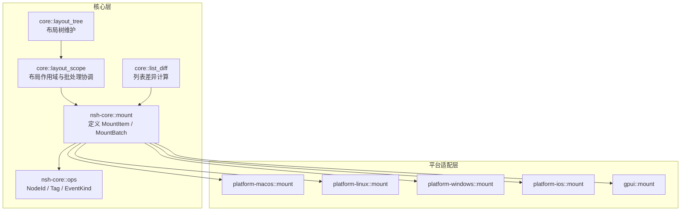
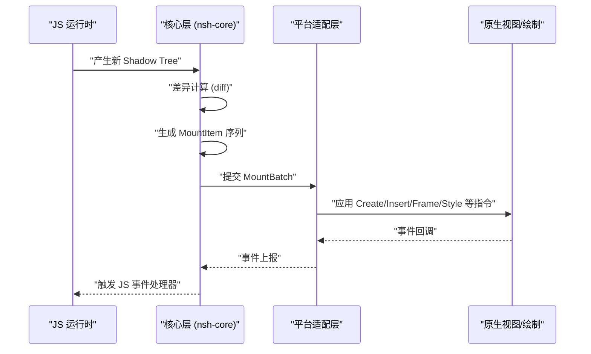
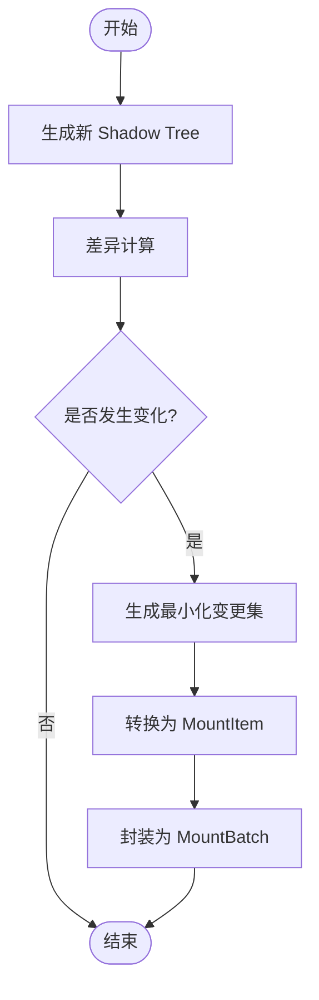
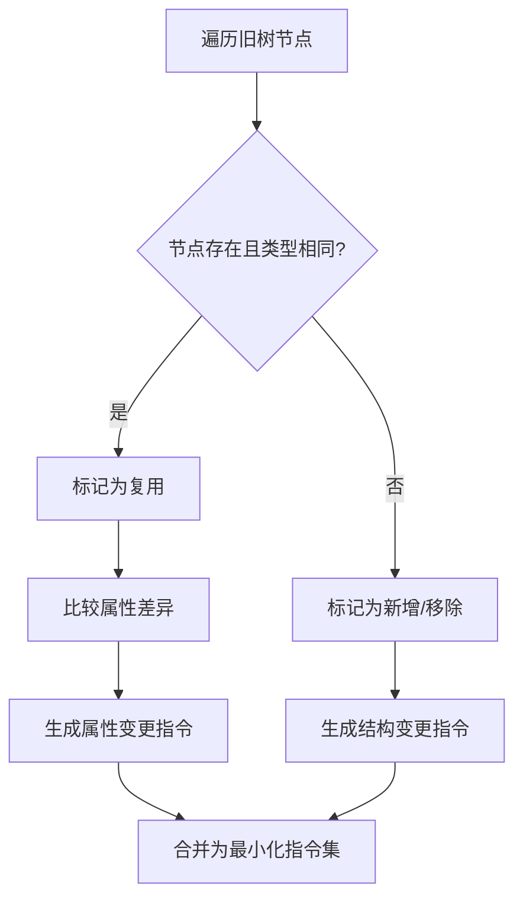
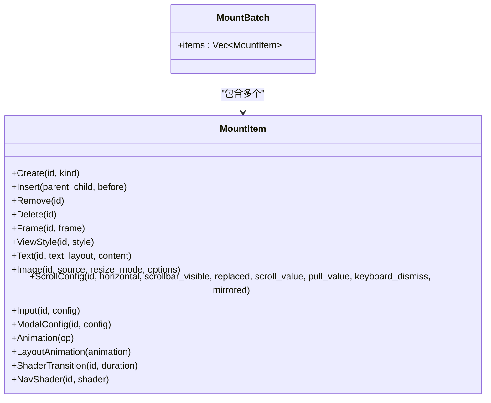
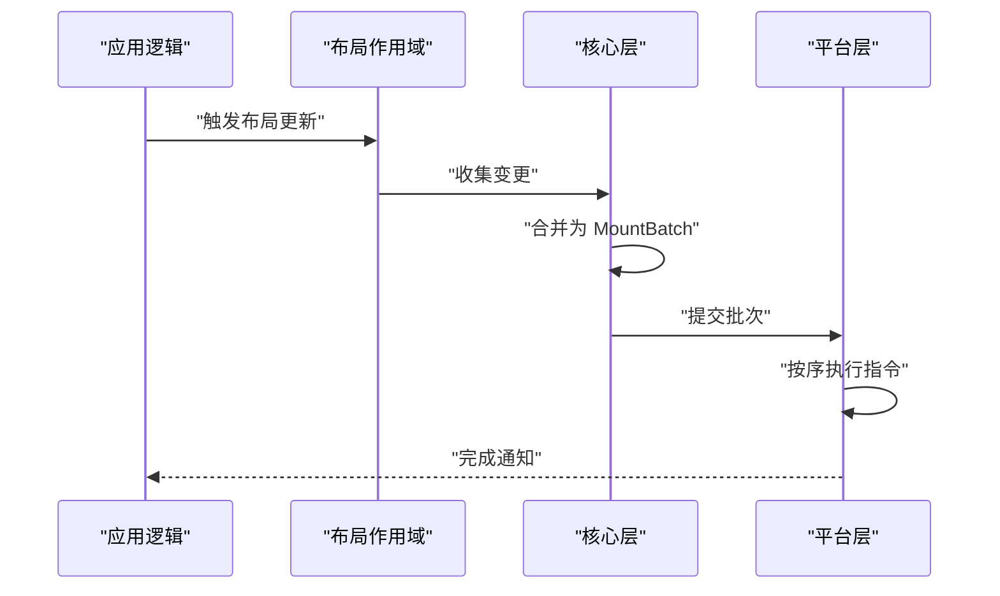
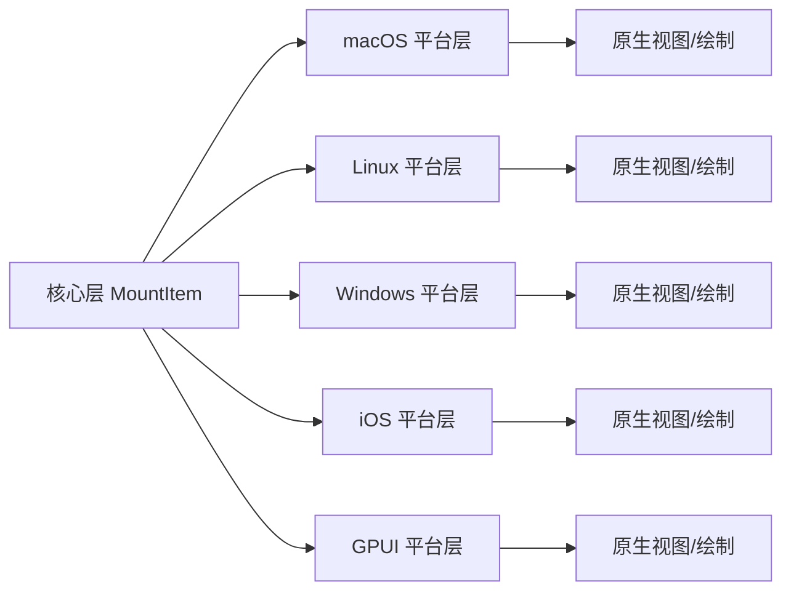
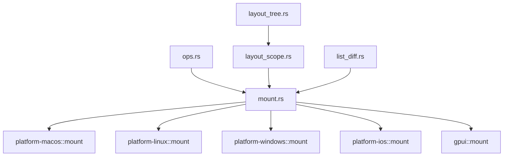

# 渲染管线

<cite>
**本文引用的文件**
- [mount.rs](file://crates/nsh-core/src/mount.rs)
- [ops.rs](file://crates/nsh-core/src/ops.rs)
- [layout_scope.rs](file://crates/nsh-core/src/core/layout_scope.rs)
- [layout_tree.rs](file://crates/nsh-core/src/core/layout_tree.rs)
- [list_diff.rs](file://crates/nsh-core/src/list_diff.rs)
- [diff.rs](file://crates/nsh-base/tests/base/diff.rs)
- [mount.rs](file://crates/nsh-platform-macos/src/mount.rs)
- [mount.rs](file://crates/nsh-platform-linux/src/mount.rs)
- [mount.rs](file://crates/nsh-platform-windows/src/mount.rs)
- [mount.rs](file://crates/nsh-platform-ios/src/mount.rs)
- [mount.rs](file://crates/gpui/nsh-platform-gpui/src/mount.rs)
</cite>

## 目录
1. [简介](#简介)
2. [项目结构](#项目结构)
3. [核心组件](#核心组件)
4. [架构总览](#架构总览)
5. [详细组件分析](#详细组件分析)
6. [依赖关系分析](#依赖关系分析)
7. [性能考量](#性能考量)
8. [故障排查指南](#故障排查指南)
9. [结论](#结论)

## 简介
本文件面向 NSH 渲染管线的实现与使用，聚焦以下目标：
- Shadow Tree 的构建与维护机制，包括元素树的差异计算与最小化更新策略。
- MountBatch 的生成过程，如何将 UI 变更转换为平台无关的渲染指令。
- 渲染批处理优化机制，包括批量提交与异步处理。
- 与平台适配层的交互方式，以及如何确保渲染性能。
- 渲染性能分析与调试技巧。

NSH 的核心渲染路径由“JS 运行时 -> 核心层（nsh-core）-> 平台适配层（各平台 mount 实现）”组成。核心层负责将 JS 侧的 UI 描述转化为平台无关的 MountItem 指令序列，并按帧进行批处理；平台层负责将这些指令映射到具体平台的原生视图或绘制 API。

## 项目结构
围绕渲染管线的关键代码主要分布在以下模块：
- nsh-core：定义节点标识、标签、事件、MountItem、MountBatch 等核心数据结构，以及布局与列表差异算法。
- nsh-base：提供基础 UI 组件与测试用例，包含 diff 相关测试。
- 各平台适配层（macOS/Linux/iOS/GPUI 等）：实现具体的 Mount 执行逻辑，将 MountItem 应用到原生视图或绘制系统。

**图表来源**
- [mount.rs:748-1125](file://crates/nsh-core/src/mount.rs#L748-L1125)
- [ops.rs:13-84](file://crates/nsh-core/src/ops.rs#L13-L84)
- [layout_scope.rs](file://crates/nsh-core/src/core/layout_scope.rs)
- [layout_tree.rs](file://crates/nsh-core/src/core/layout_tree.rs)
- [list_diff.rs](file://crates/nsh-core/src/list_diff.rs)
- [mount.rs](file://crates/nsh-platform-macos/src/mount.rs)
- [mount.rs](file://crates/nsh-platform-linux/src/mount.rs)
- [mount.rs](file://crates/nsh-platform-windows/src/mount.rs)
- [mount.rs](file://crates/nsh-platform-ios/src/mount.rs)
- [mount.rs](file://crates/gpui/nsh-platform-gpui/src/mount.rs)

**章节来源**
- [mount.rs:748-1125](file://crates/nsh-core/src/mount.rs#L748-L1125)
- [ops.rs:13-84](file://crates/nsh-core/src/ops.rs#L13-L84)

## 核心组件
- NodeId 与 Tag：用于标识 DOM 节点与元素类型，是差异计算与指令生成的基础。
- EventKind：统一的事件种类，贯穿平台与核心层的事件分发。
- MountItem：平台无关的渲染指令集合，涵盖创建、插入、删除、样式、文本、图像、滚动、动画、输入、导航、着色器等。
- MountBatch：一次提交的所有 MountItem 的有序集合，保证在单帧内按序应用。

这些组件共同构成 NSH 渲染指令的抽象层，屏蔽平台差异，使上层 UI 变更能够以最小化、可批处理的方式下发到平台。

**章节来源**
- [ops.rs:13-84](file://crates/nsh-core/src/ops.rs#L13-L84)
- [ops.rs:118-282](file://crates/nsh-core/src/ops.rs#L118-L282)
- [mount.rs:748-1125](file://crates/nsh-core/src/mount.rs#L748-L1125)
- [mount.rs:1176-1181](file://crates/nsh-core/src/mount.rs#L1176-L1181)

## 架构总览
NSH 渲染管线的工作流如下：
1. JS 运行时根据 UI 状态变化生成新的虚拟树（Shadow Tree）。
2. 核心层对旧树与新树进行差异计算，得到最小化的变更集。
3. 将变更集转换为 MountItem 指令序列，并封装为 MountBatch。
4. 平台适配层接收 MountBatch，按序执行指令，更新原生视图或调用绘制 API。
5. 平台层将事件回调回核心层，驱动 JS 运行时再次进入渲染循环。

**图表来源**
- [mount.rs:748-1125](file://crates/nsh-core/src/mount.rs#L748-L1125)
- [layout_scope.rs](file://crates/nsh-core/src/core/layout_scope.rs)
- [list_diff.rs](file://crates/nsh-core/src/list_diff.rs)

## 详细组件分析

### Shadow Tree 构建与维护
- Shadow Tree 由 JS 运行时维护，每次 UI 状态变化都会生成新的虚拟树。
- 核心层通过差异算法对比新旧树，识别出新增、移除、移动、属性变更等最小化操作。
- 对于列表等复杂结构，采用专门的差异算法以减少不必要的重排与重绘。

**图表来源**
- [list_diff.rs](file://crates/nsh-core/src/list_diff.rs)
- [diff.rs](file://crates/nsh-base/tests/base/diff.rs)

**章节来源**
- [list_diff.rs](file://crates/nsh-core/src/list_diff.rs)
- [diff.rs](file://crates/nsh-base/tests/base/diff.rs)

### 差异计算与最小化更新策略
- 差异计算基于节点 ID 与类型匹配，优先复用已有节点，避免重复创建。
- 列表项的移动通过稳定 ID 与位置比较进行最小化调整。
- 属性变更仅发送必要的 MountItem，如 ViewStyle、Text、Image 等，减少跨层传输开销。

**图表来源**
- [list_diff.rs](file://crates/nsh-core/src/list_diff.rs)

**章节来源**
- [list_diff.rs](file://crates/nsh-core/src/list_diff.rs)

### MountBatch 生成与指令转换
- MountItem 定义了所有平台无关的渲染指令，包括：
  - 结构操作：Create、Insert、Remove、Delete
  - 样式与内容：ViewStyle、Text、Image、Canvas、Shader
  - 交互与行为：Events、ScrollConfig、Input、ModalConfig
  - 动画与过渡：Animation、LayoutAnimation、ShaderTransition、NavShader
- MountBatch 将这些指令按顺序组织，确保在一次 UI 帧内一致地应用。

**图表来源**
- [mount.rs:748-1125](file://crates/nsh-core/src/mount.rs#L748-L1125)
- [mount.rs:1176-1181](file://crates/nsh-core/src/mount.rs#L1176-L1181)

**章节来源**
- [mount.rs:748-1125](file://crates/nsh-core/src/mount.rs#L748-L1125)
- [mount.rs:1176-1181](file://crates/nsh-core/src/mount.rs#L1176-L1181)

### 渲染批处理优化机制
- 批处理通过 LayoutScope 协调布局与渲染，确保同一帧内的多次变更被合并为单个 MountBatch。
- 平台层在接收到 MountBatch 后，按序执行指令，避免中间状态导致的闪烁或重绘。
- 动画与过渡通过 AnimationOp 与 LayoutAnimation 进行批量化管理，减少频繁的状态切换。

**图表来源**
- [layout_scope.rs](file://crates/nsh-core/src/core/layout_scope.rs)
- [mount.rs:1037-1044](file://crates/nsh-core/src/mount.rs#L1037-L1044)

**章节来源**
- [layout_scope.rs](file://crates/nsh-core/src/core/layout_scope.rs)
- [mount.rs:1037-1044](file://crates/nsh-core/src/mount.rs#L1037-L1044)

### 与平台适配层的交互
- 各平台适配层实现 Mount 接口，将 MountItem 转换为平台特定的 API 调用。
- macOS、Linux、Windows、iOS、GPUI 等平台均遵循相同的指令语义，确保跨平台一致性。
- 平台层负责处理原生视图的生命周期、事件捕获与绘制优化。

**图表来源**
- [mount.rs](file://crates/nsh-platform-macos/src/mount.rs)
- [mount.rs](file://crates/nsh-platform-linux/src/mount.rs)
- [mount.rs](file://crates/nsh-platform-windows/src/mount.rs)
- [mount.rs](file://crates/nsh-platform-ios/src/mount.rs)
- [mount.rs](file://crates/gpui/nsh-platform-gpui/src/mount.rs)

**章节来源**
- [mount.rs](file://crates/nsh-platform-macos/src/mount.rs)
- [mount.rs](file://crates/nsh-platform-linux/src/mount.rs)
- [mount.rs](file://crates/nsh-platform-windows/src/mount.rs)
- [mount.rs](file://crates/nsh-platform-ios/src/mount.rs)
- [mount.rs](file://crates/gpui/nsh-platform-gpui/src/mount.rs)

## 依赖关系分析
- nsh-core 依赖 ops.rs 中的 NodeId、Tag、EventKind 等基础类型。
- 布局与差异计算依赖 layout_scope.rs、layout_tree.rs、list_diff.rs。
- 平台适配层依赖 core 层定义的 MountItem 与 MountBatch。

**图表来源**
- [ops.rs:13-84](file://crates/nsh-core/src/ops.rs#L13-L84)
- [mount.rs:748-1125](file://crates/nsh-core/src/mount.rs#L748-L1125)
- [layout_scope.rs](file://crates/nsh-core/src/core/layout_scope.rs)
- [layout_tree.rs](file://crates/nsh-core/src/core/layout_tree.rs)
- [list_diff.rs](file://crates/nsh-core/src/list_diff.rs)

**章节来源**
- [ops.rs:13-84](file://crates/nsh-core/src/ops.rs#L13-L84)
- [mount.rs:748-1125](file://crates/nsh-core/src/mount.rs#L748-L1125)

## 性能考量
- 最小化更新：通过差异计算与 MountItem 的细粒度指令，避免全量重绘。
- 批处理提交：将多帧内的变更合并为单个 MountBatch，减少跨层通信开销。
- 平台优化：平台层利用原生视图缓存、离屏渲染、GPU 加速等技术提升绘制性能。
- 动画优化：通过 AnimationOp 与 LayoutAnimation 集中管理动画状态，避免频繁状态切换。

[本节为通用性能指导，不直接分析具体文件]

## 故障排查指南
- 检查 MountItem 的顺序：确保 Create 先于 Insert，Insert 先于 Frame 与 Style。
- 验证 NodeId 的一致性：确保节点 ID 在差异计算中保持稳定，避免误判为新增/移除。
- 监控 MountBatch 大小：过大的批次可能导致单次渲染耗时增加，需拆分或优化差异计算。
- 平台层日志：在各平台 mount 实现中添加日志，追踪指令执行路径与异常。

**章节来源**
- [mount.rs:748-1125](file://crates/nsh-core/src/mount.rs#L748-L1125)

## 结论
NSH 渲染管线通过 Shadow Tree 的差异计算与 MountItem 的平台无关指令，实现了高效、一致的跨平台渲染。批处理机制与平台适配层的协作确保了性能与可维护性。在实际开发中，应关注差异计算的准确性、指令的最小化与批次的合理性，并结合平台特性进行进一步优化。