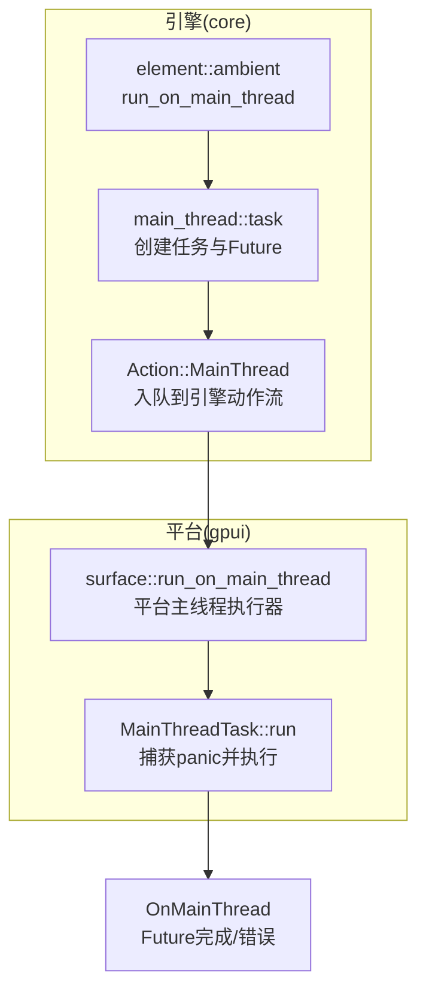
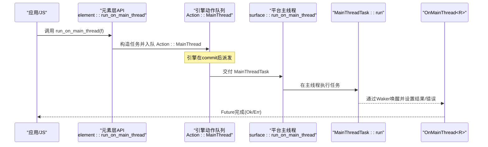
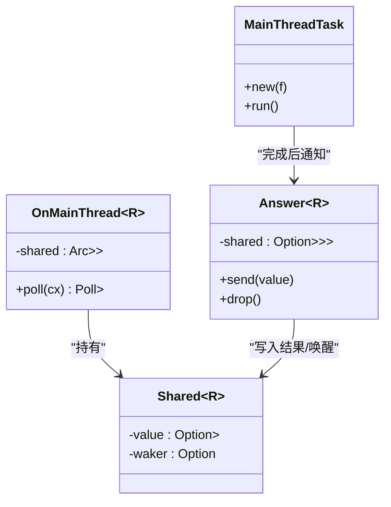
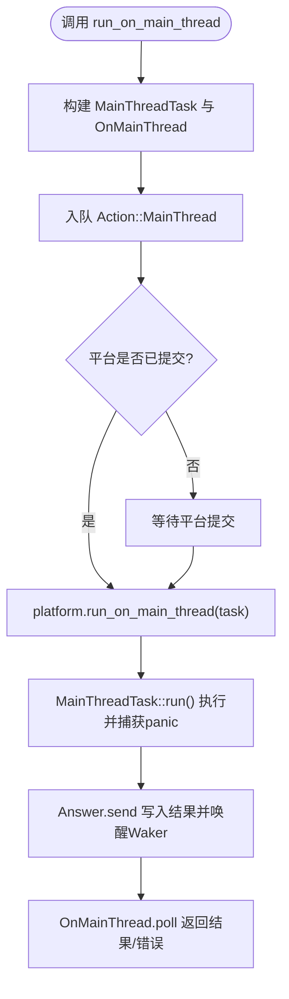
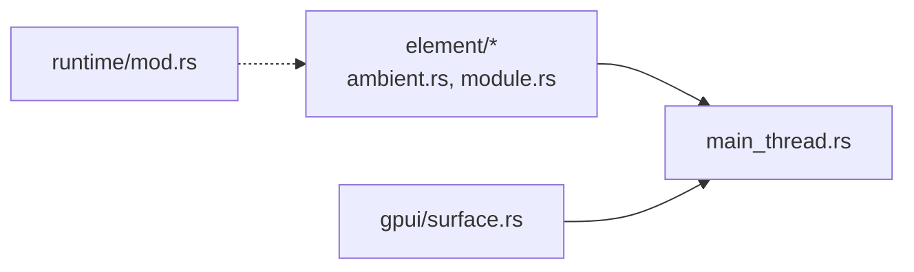

# 线程模型

<cite>
**本文引用的文件**   
- [main_thread.rs](file://crates/nsh-core/src/main_thread.rs)
- [ambient.rs](file://crates/nsh-core/src/element/ambient.rs)
- [module.rs](file://crates/nsh-core/src/element/module.rs)
- [surface.rs](file://crates/gpui/nsh-platform-gpui/src/surface.rs)
- [mod.rs](file://crates/nsh-core/src/runtime/mod.rs)
</cite>

## 目录
1. [简介](#简介)
2. [项目结构](#项目结构)
3. [核心组件](#核心组件)
4. [架构总览](#架构总览)
5. [详细组件分析](#详细组件分析)
6. [依赖关系分析](#依赖关系分析)
7. [性能与并发调优](#性能与并发调优)
8. [故障排查指南](#故障排查指南)
9. [结论](#结论)

## 简介
本文件系统性梳理 NSH 的线程模型，重点说明引擎线程与平台主线程的职责分离、事件分发与消息传递机制、跨线程通信（通道/回调/任务调度）、内存管理策略、状态一致性保证与并发安全实现，并给出多线程环境下的性能调优与死锁预防实践。

## 项目结构
NSH 的线程相关能力主要分布在以下位置：
- 引擎侧提供“在主线程执行任务”的基础设施与 Future 结果类型
- 元素层暴露 run_on_main_thread API，将任务以 Action 形式提交到引擎队列
- 平台侧（GPUI）负责在 UI 主线程上实际执行 MainThreadTask
- 运行时模块注册表用于组织 JS 可见的原生能力（与线程模型无直接耦合，但影响整体运行上下文）

图示来源
- [ambient.rs:1590-1603](file://crates/nsh-core/src/element/ambient.rs#L1590-L1603)
- [main_thread.rs:121-136](file://crates/nsh-core/src/main_thread.rs#L121-L136)
- [surface.rs:105-106](file://crates/gpui/nsh-platform-gpui/src/surface.rs#L105-L106)
- [main_thread.rs:24-35](file://crates/nsh-core/src/main_thread.rs#L24-L35)

章节来源
- [ambient.rs:1590-1603](file://crates/nsh-core/src/element/ambient.rs#L1590-L1603)
- [main_thread.rs:1-168](file://crates/nsh-core/src/main_thread.rs#L1-L168)
- [surface.rs:105-106](file://crates/gpui/nsh-platform-gpui/src/surface.rs#L105-L106)

## 核心组件
- MainThreadTask：封装一次性的可发送闭包，供平台主线程执行；执行过程捕获 panic，避免跨语言栈展开。
- OnMainThread<R>：返回给调用方的 Future，在引擎线程上轮询等待主线程执行结果或错误。
- task(f)：工厂函数，生成 (MainThreadTask, OnMainThread<R>) 对，并通过共享状态 + Waker 实现异步完成。
- element::run_on_main_thread / ModuleCx::run_on_main_thread：对外 API，将任务包装为 Action 并提交到引擎动作队列。
- surface::run_on_main_thread：平台侧入口，由 UI 主线程消费并执行 MainThreadTask。

章节来源
- [main_thread.rs:14-35](file://crates/nsh-core/src/main_thread.rs#L14-L35)
- [main_thread.rs:69-95](file://crates/nsh-core/src/main_thread.rs#L69-L95)
- [main_thread.rs:121-136](file://crates/nsh-core/src/main_thread.rs#L121-L136)
- [ambient.rs:1590-1603](file://crates/nsh-core/src/element/ambient.rs#L1590-L1603)
- [module.rs:335-345](file://crates/nsh-core/src/element/module.rs#L335-L345)
- [surface.rs:105-106](file://crates/gpui/nsh-platform-gpui/src/surface.rs#L105-L106)

## 架构总览
下图展示从应用代码到平台主线程执行的完整时序：

图示来源
- [ambient.rs:1590-1603](file://crates/nsh-core/src/element/ambient.rs#L1590-L1603)
- [main_thread.rs:121-136](file://crates/nsh-core/src/main_thread.rs#L121-L136)
- [surface.rs:105-106](file://crates/gpui/nsh-platform-gpui/src/surface.rs#L105-L106)
- [main_thread.rs:82-95](file://crates/nsh-core/src/main_thread.rs#L82-L95)

## 详细组件分析

### 主线程任务与结果类型
- MainThreadTask：一次性任务封装，run() 中捕获 panic 并记录日志，不向平台运行循环传播异常。
- OnMainThread<R>：Future 实现，内部维护共享状态（值与 Waker），poll 时若已有结果则 Ready，否则挂起并保存 Waker。
- Answer：辅助类型，负责在任务完成后写入结果并唤醒等待者；Drop 时若未回答则返回“被丢弃”错误。

图示来源
- [main_thread.rs:14-35](file://crates/nsh-core/src/main_thread.rs#L14-L35)
- [main_thread.rs:64-95](file://crates/nsh-core/src/main_thread.rs#L64-L95)
- [main_thread.rs:97-119](file://crates/nsh-core/src/main_thread.rs#L97-L119)

章节来源
- [main_thread.rs:14-35](file://crates/nsh-core/src/main_thread.rs#L14-L35)
- [main_thread.rs:64-95](file://crates/nsh-core/src/main_thread.rs#L64-L95)
- [main_thread.rs:97-119](file://crates/nsh-core/src/main_thread.rs#L97-L119)

### 引擎侧提交与平台侧执行
- 引擎侧 API：
  - element::run_on_main_thread：构造任务并作为 Action::MainThread 入队，随后返回 OnMainThread<R>。
  - ModuleCx::run_on_main_thread：模块上下文中的等价 API，同样将任务入队。
- 平台侧执行：
  - surface::run_on_main_thread：平台主线程消费 MainThreadTask 并调用其 run()。

图示来源
- [ambient.rs:1590-1603](file://crates/nsh-core/src/element/ambient.rs#L1590-L1603)
- [module.rs:335-345](file://crates/nsh-core/src/element/module.rs#L335-L345)
- [surface.rs:105-106](file://crates/gpui/nsh-platform-gpui/src/surface.rs#L105-L106)
- [main_thread.rs:121-136](file://crates/nsh-core/src/main_thread.rs#L121-L136)

章节来源
- [ambient.rs:1590-1603](file://crates/nsh-core/src/element/ambient.rs#L1590-L1603)
- [module.rs:335-345](file://crates/nsh-core/src/element/module.rs#L335-L345)
- [surface.rs:105-106](file://crates/gpui/nsh-platform-gpui/src/surface.rs#L105-L106)
- [main_thread.rs:121-136](file://crates/nsh-core/src/main_thread.rs#L121-L136)

### 错误处理与生命周期
- 主线程任务 panic：被捕获并转换为 MainThreadError::Panicked，Future 返回错误。
- 任务未被执行：若 Surface 先被销毁，Answer 在 Drop 时返回 MainThreadError::Dropped。
- 语义约定：OnMainThread 的 drop 不会取消已在队列中的任务，仅影响等待方。

章节来源
- [main_thread.rs:24-35](file://crates/nsh-core/src/main_thread.rs#L24-L35)
- [main_thread.rs:97-119](file://crates/nsh-core/src/main_thread.rs#L97-L119)
- [main_thread.rs:138-167](file://crates/nsh-core/src/main_thread.rs#L138-L167)

## 依赖关系分析
- 元素层依赖 main_thread 提供的任务与 Future 抽象，并通过 Action 机制将任务交给引擎调度。
- 平台层（GPUI）依赖 MainThreadTask 并在 UI 主线程执行。
- 运行时模块注册表（runtime::registries）与线程模型解耦，主要用于 JS 原生模块导出。

图示来源
- [ambient.rs:1590-1603](file://crates/nsh-core/src/element/ambient.rs#L1590-L1603)
- [module.rs:335-345](file://crates/nsh-core/src/element/module.rs#L335-L345)
- [main_thread.rs:121-136](file://crates/nsh-core/src/main_thread.rs#L121-L136)
- [surface.rs:105-106](file://crates/gpui/nsh-platform-gpui/src/surface.rs#L105-L106)
- [mod.rs:55-113](file://crates/nsh-core/src/runtime/mod.rs#L55-L113)

章节来源
- [mod.rs:55-113](file://crates/nsh-core/src/runtime/mod.rs#L55-L113)

## 性能与并发调优
- 减少跨线程同步开销
  - 批量提交：尽量合并多次 run_on_main_thread 调用，降低 Action 入队与平台调度次数。
  - 避免热点路径频繁切换线程：将轻量计算留在引擎线程，仅将必须访问 UI 资源的逻辑放到主线程。
- 合理选择阻塞与后台任务
  - 使用 blocking/fetch 等引擎服务进行 I/O，避免阻塞引擎线程；必要时使用 tokio 的 spawn_blocking。
- 避免不必要的 Future 轮询
  - 仅在需要结果时 await OnMainThread，避免长时间持有引用导致额外轮询。
- 防止死锁与竞态
  - 不要在主线程任务中反向触发需要同步锁的引擎操作；遵循单向依赖（引擎→平台）。
  - 使用单一顺序执行器（平台主线程）串行化 UI 相关操作，避免多写者竞争。
- 资源清理
  - 确保 OnMainThread 的 Drop 语义不被误用为取消；如需取消，应在上层维护任务句柄并主动清理。

[本节为通用指导，不直接分析具体文件]

## 故障排查指南
- 症状：OnMainThread 始终 Pending
  - 检查平台是否调用了 surface::run_on_main_thread 执行 MainThreadTask。
  - 确认 Surface 未被提前销毁导致任务被丢弃。
- 症状：Future 返回 Panicked
  - 查看主线程任务抛出的 panic 信息，定位具体闭包逻辑。
- 症状：UI 卡顿
  - 评估 run_on_main_thread 的使用频率与任务耗时，考虑批量化与异步化。
- 症状：数据不一致
  - 确认所有 UI 状态变更均经主线程执行；避免在其它线程直接修改 UI 相关状态。

章节来源
- [main_thread.rs:24-35](file://crates/nsh-core/src/main_thread.rs#L24-L35)
- [main_thread.rs:97-119](file://crates/nsh-core/src/main_thread.rs#L97-L119)
- [surface.rs:105-106](file://crates/gpui/nsh-platform-gpui/src/surface.rs#L105-L106)

## 结论
NSH 的线程模型通过“引擎线程负责调度与状态更新，平台主线程负责 UI 相关执行”的清晰分工，结合 MainThreadTask/OnMainThread 的 Future 协作模式，实现了安全、可控的跨线程通信。借助 Action 队列与平台主线程执行器，系统避免了复杂的锁竞争，同时提供了完善的错误处理与生命周期语义。在实际使用中，应遵循单写者原则、批量化提交、避免热点路径跨线程切换，并结合阻塞/后台任务机制优化性能与稳定性。