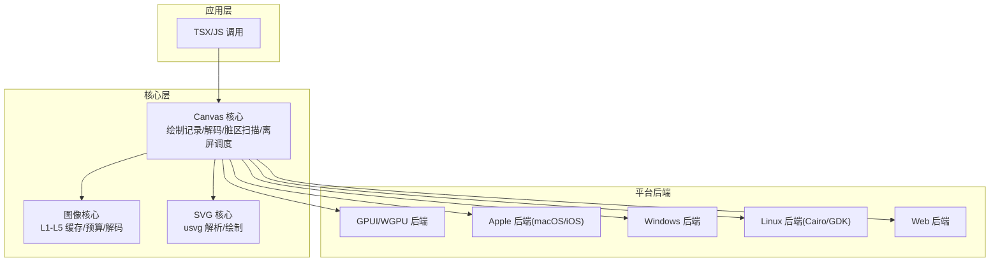
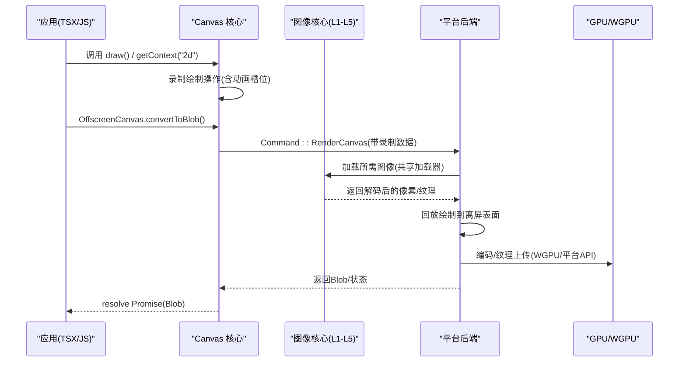
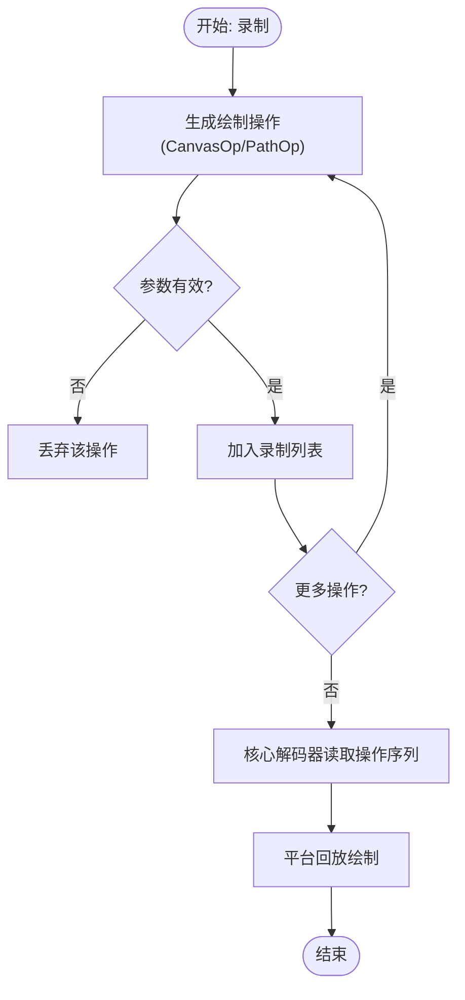
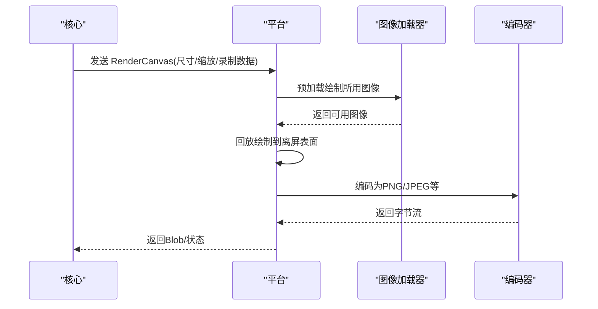
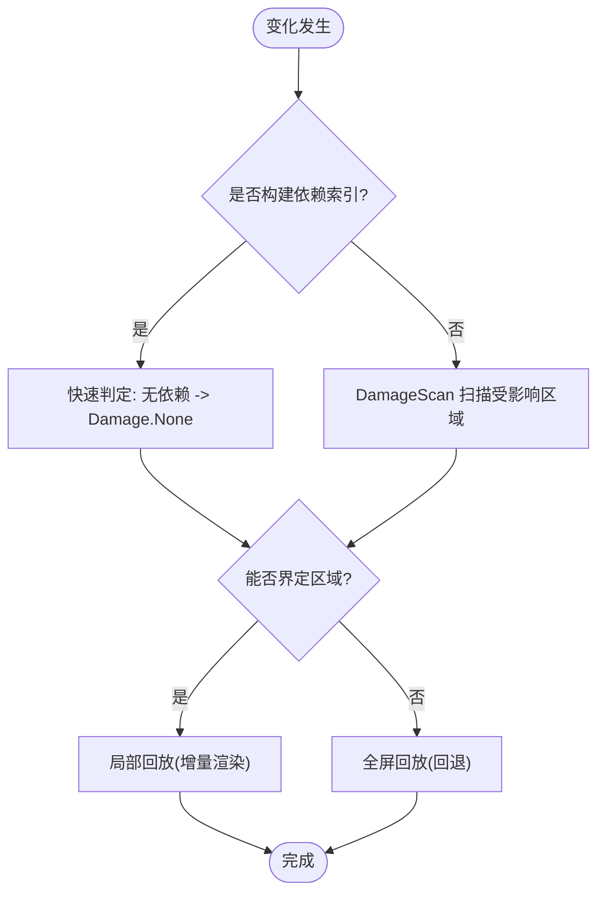
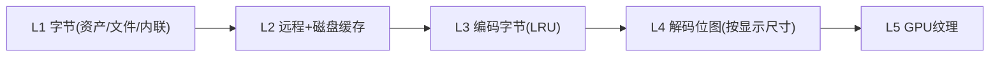
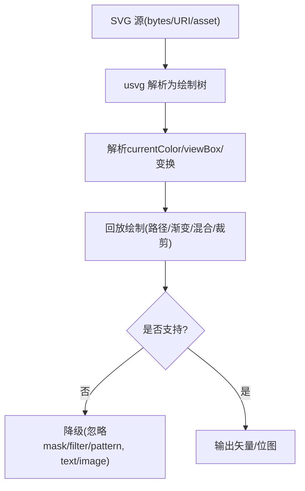
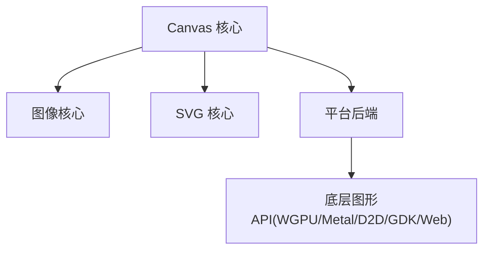

# Canvas渲染系统

<cite>
**本文引用的文件**   
- [docs/dev/canvas.md](file://docs/dev/canvas.md)
- [docs/dev/image-loading-design.md](file://docs/dev/image-loading-design.md)
- [docs/dev/performance.md](file://docs/dev/performance.md)
</cite>

## 目录
1. [引言](#引言)
2. [项目结构](#项目结构)
3. [核心组件](#核心组件)
4. [架构总览](#架构总览)
5. [详细组件分析](#详细组件分析)
6. [依赖关系分析](#依赖关系分析)
7. [性能考量](#性能考量)
8. [故障排查指南](#故障排查指南)
9. [结论](#结论)
10. [附录](#附录)

## 引言
本技术文档聚焦 NSH 的 Canvas 渲染系统，系统性阐述 GPU 加速渲染架构、WGPU/GPUI 后端集成与绘制命令生成、图像加载/解码/缓存机制（含多格式支持与优化）、SVG 矢量渲染（路径、变换、滤镜近似）、脏矩形检测与增量渲染优化，以及跨平台图形 API 抽象设计与性能调优要点。读者无需深入底层即可理解整体流程，同时为开发者提供可落地的优化建议与排障指引。

## 项目结构
Canvas 渲染相关能力横跨核心层与平台后端：
- 核心层负责绘制操作记录、命令解码、脏区扫描、离屏渲染调度与 SVG 解析/绘制。
- 平台后端（macOS/iOS、Windows、Linux、GPUI、Web）将绘制回放至目标表面，并执行编码或纹理上传。
- 图像子系统提供统一的 L1-L5 分层缓存与预算控制，支撑位图与 SVG 资源的高效复用。

图表来源
- [docs/dev/canvas.md:1-182](file://docs/dev/canvas.md#L1-L182)
- [docs/dev/image-loading-design.md:1-223](file://docs/dev/image-loading-design.md#L1-L223)

章节来源
- [docs/dev/canvas.md:1-182](file://docs/dev/canvas.md#L1-L182)
- [docs/dev/image-loading-design.md:1-223](file://docs/dev/image-loading-design.md#L1-L223)

## 核心组件
- Canvas 绘制记录与回放
  - 以“绘制操作列表 + 槽位”形式记录，支持状态保存/恢复、全局透明度、混合模式、线型与虚线、阴影、字体与数字变体、对齐与基线、变换、路径与填充/描边/裁剪、文本测量、命中测试、渐变与图像绘制等。
  - 动画值作为槽位绑定，平台在动画期间按需重绘；无效颜色/字体直接丢弃对应操作。
- 离屏 Canvas
  - 通过统一命令发送到平台进行离屏渲染，返回 Blob；各平台按自身编码器输出 PNG/JPEG 等。
  - 支持重用策略：全清且无剪辑/无保存栈时重置录制，避免历史操作累积。
- 脏矩形与增量渲染
  - 基于已录制操作的 DamageScan 计算受影响区域；对无法界定的变更回退到全屏重绘。
  - Windows 额外构建绘制依赖索引，区分不可移动/不可改变几何的槽位，复用脏区结果。
- 图像加载与缓存
  - 统一 L1-L5 分层：资产/内联字节、远程下载与磁盘缓存、内存中编码字节、按显示尺寸解码的位图、GPU 纹理。
  - 进程级预算、租约机制、优先级队列、取消与限制，保障内存可控。
- SVG 渲染
  - usvg 解析为绘制树，支持路径、纯色、线性/径向渐变、不透明度、组与变换、描边属性、裁剪路径、混合模式；currentColor 由画布视图继承色驱动。
  - 不支持的 mask/filter/pattern 等做降级处理；web 非 svg 特性下回退为 data URI 位图。

章节来源
- [docs/dev/canvas.md:1-182](file://docs/dev/canvas.md#L1-L182)
- [docs/dev/image-loading-design.md:1-223](file://docs/dev/image-loading-design.md#L1-L223)

## 架构总览
Canvas 渲染从 JS/TS 调用进入核心层的绘制记录器，生成紧凑的操作序列；平台侧根据后端能力选择回放路径（GPUI tiny-skia、Apple CoreGraphics、Windows D2D/Direct3D、Linux Cairo/GDK、Web OffscreenCanvas）。离屏渲染通过命令通道下发，平台完成后回调 Blob。

图表来源
- [docs/dev/canvas.md:41-84](file://docs/dev/canvas.md#L41-L84)
- [docs/dev/image-loading-design.md:66-153](file://docs/dev/image-loading-design.md#L66-L153)

## 详细组件分析

### 绘制命令生成与回放
- 录制阶段
  - 所有方法/属性被规范化为 CanvasOp/PathOp 枚举，参数包含数值、动画槽位、路径列表、字符串联合等；无效输入直接丢弃操作。
  - 支持 save/restore、渐变、图像绘制、路径构造与填充/描边/裁剪、文本测量与命中测试。
- 解码与回放
  - 核心解码器读取操作序列；iOS/macOS 回放至原生上下文；Android 使用自定义指令集解释执行；Windows 回放至 D2D 位图并在 GPU 完成查询后读回；Linux 回放至 Cairo ImageSurface；GPUI 回放至 tiny-skia pixmap。
- 动画与槽位
  - 动画值作为槽位绑定，平台在动画期间独立重绘；命中测试中动画值视为 0。

图表来源
- [docs/dev/canvas.md:1-39](file://docs/dev/canvas.md#L1-L39)

章节来源
- [docs/dev/canvas.md:1-39](file://docs/dev/canvas.md#L1-L39)

### 离屏渲染与平台实现
- 通用流程
  - 核心校验尺寸与像素上限，取屏幕像素密度（未显式 scale），向平台发送 RenderCanvas 命令；平台 EventKind::CanvasImage 回调 Promise。
  - 请求 ID 进程唯一，具备超时与最大并发限制，避免热重载后旧响应污染新请求。
- 平台差异
  - macOS/iOS：CGBitmapContext 回放，ImageIO 编码。
  - Android：后台线程 Bitmap 压缩。
  - Windows：UI 线程设备 D2D 位图回放，Direct3D 事件查询 GPU 完成，WIC 编码 PNG。
  - Linux：Cairo Replay 到 ImageSurface，GDK 保存 PNG。
  - GPUI：tiny-skia 回放，仅阴影/合成需要临时 pixmap。
  - Web：OffscreenCanvas 回放，CORS 清理，convertToBlob。

图表来源
- [docs/dev/canvas.md:41-84](file://docs/dev/canvas.md#L41-L84)

章节来源
- [docs/dev/canvas.md:41-84](file://docs/dev/canvas.md#L41-L84)

### 脏矩形检测与增量渲染
- 算法要点
  - DamageScan 基于录制操作推导受影响的区域；若无法界定则回退到全屏。
  - Windows 构建 DamageIndex，记录每个绘制操作依赖的槽位（自身操作数、当前路径/变换粘性、alpha/画笔/线宽/虚线状态），对不可移动/不可改变几何的槽位复用脏区结果。
  - macOS 可将短小的 source-over 动画后缀拆分到独立内容层，保留前序画面；Linux 分块纹理回放受损区域；部分平台对不可见画布延迟绘制。
- 优化策略
  - 跳过透明/空渐变/零 alpha 图像等不影响像素的绘制。
  - 长绘制的前缀（首个动画操作之前）可缓存，减少重复回放。

图表来源
- [docs/dev/canvas.md:85-120](file://docs/dev/canvas.md#L85-L120)

章节来源
- [docs/dev/canvas.md:85-120](file://docs/dev/canvas.md#L85-L120)

### 图像加载、解码与缓存机制
- 分层缓存
  - L1：资产/文件/内联字节（立即可用或按需读取）。
  - L2：远程下载与磁盘缓存（HTTP 语义、去重、优先级、取消、大小限制、重定向检查）。
  - L3：内存中编码字节（小 LRU，避免重复 IO）。
  - L4：按显示尺寸解码的位图（按尺寸桶共享，效果烘焙或绘制期处理），进程级预算与租约管理。
  - L5：GPU 纹理（与 L4 生命周期一致）。
- 关键优化
  - 解码按显示尺寸下采样，避免大图全尺寸解码。
  - 预算超限驱逐未租约条目；内存压力触发 L3/L4 清理。
  - 失败短期缓存，避免频繁重试。
  - SVG 解析结果（Drawing）按源键缓存，位图化时按桶尺寸解码。

图表来源
- [docs/dev/image-loading-design.md:66-153](file://docs/dev/image-loading-design.md#L66-L153)

章节来源
- [docs/dev/image-loading-design.md:1-223](file://docs/dev/image-loading-design.md#L1-L223)

### SVG 渲染实现
- 解析与绘制
  - 通过 usvg 解析为绘制树，支持路径、纯色、线性/径向渐变、不透明度、组与变换、描边属性、裁剪路径、混合模式。
  - currentColor 由画布视图文本色继承，解析时替换为具体颜色；ViewPaint::Fit 将 viewBox 映射到画布框，preserveAspectRatio 默认 xMidYMid meet。
- 不支持项降级
  - 遮罩/滤镜忽略（原样绘制其作用对象），pattern 不绘制（日志提示），text/image 元素不绘制。
  - Web 非 svg 特性下以 data URI 位图展示。
- 尺寸与缩放
  - 向量绘制保持锐利；位图化时按 OVERSAMPLE 每点采样并按缩放比例放大。

图表来源
- [docs/dev/canvas.md:139-166](file://docs/dev/canvas.md#L139-L166)

章节来源
- [docs/dev/canvas.md:139-166](file://docs/dev/canvas.md#L139-L166)

### 跨平台图形 API 抽象与 WGPU/GPUI 集成
- 抽象设计
  - 核心层定义统一的绘制操作与离屏渲染命令，屏蔽平台差异。
  - 平台后端各自实现回放与编码，GPUI 后端使用 tiny-skia 进行光栅化，最终交由 WGPU/Metal/D2D/GDK 等底层 API。
- GPUI 集成要点
  - 回放至 pixmap，阴影/合成使用临时 pixmap；文本轮廓包含在内；与 L4 预算联动，纹理随位图释放。

章节来源
- [docs/dev/canvas.md:74-76](file://docs/dev/canvas.md#L74-L76)
- [docs/dev/image-loading-design.md:139-153](file://docs/dev/image-loading-design.md#L139-L153)

## 依赖关系分析
- 模块耦合
  - Canvas 核心依赖图像核心（加载/解码/缓存）与 SVG 核心（解析/绘制）。
  - 平台后端依赖各自的图形库（CoreGraphics/D2D/Cairo/tiny-skia/WebCanvas）。
- 外部依赖
  - usvg（SVG 解析）、ImageIO/WIC/GDK/OffscreenCanvas（编码/纹理）、tiny-skia（GPUI 光栅化）。
- 潜在循环
  - 核心与平台通过命令/事件解耦，未见直接循环依赖。

图表来源
- [docs/dev/canvas.md:1-182](file://docs/dev/canvas.md#L1-L182)
- [docs/dev/image-loading-design.md:66-153](file://docs/dev/image-loading-design.md#L66-L153)

章节来源
- [docs/dev/canvas.md:1-182](file://docs/dev/canvas.md#L1-L182)
- [docs/dev/image-loading-design.md:1-223](file://docs/dev/image-loading-design.md#L1-L223)

## 性能考量
- 录制与回放成本
  - 绘制操作序列化与平台回放存在开销；iOS/macOS 回放至原生上下文，Android 自定义指令解释，Windows 需等待 GPU 完成查询，Linux 主线程 Cairo 回放。
- 脏区与增量渲染
  - 合理划分动画槽位依赖可减少重绘范围；Windows 依赖索引可显著降低无效扫描。
- 图像解码与缓存
  - 按显示尺寸解码与尺寸桶共享大幅降低内存占用；预算与租约机制避免 OOM。
- 动画与帧率
  - 动画槽位在 iOS/macOS/Windows 上触发局部重绘；GPUI 后端整幅光栅化，注意帧预算。
- 基准与对比
  - 性能文档提供了大量场景下的时序与操作计数，可作为回归基线与优化验证依据。

章节来源
- [docs/dev/canvas.md:37-103](file://docs/dev/canvas.md#L37-L103)
- [docs/dev/performance.md:1-800](file://docs/dev/performance.md#L1-L800)

## 故障排查指南
- 离屏渲染超时/失败
  - 检查 RenderCanvas 请求是否超过超时时间或超出 MAX_SIDE/MAX_PIXELS；确认平台 Environment::canvas_render 已设置。
  - 浏览器端注意 OffscreenCanvas 像素上限与 CORS 限制；丢失上下文或编码器 RangeError 会返回 TooLarge。
- 图像加载问题
  - 远程 URL 被取消或超时时，检查网络池与优先级；失败会被短期缓存，避免频繁重试。
  - 内存压力触发 L3/L4 清理，必要时调整预算或关闭不必要的效果烘焙。
- SVG 渲染异常
  - 确认 currentColor 是否正确继承；viewBox 与 preserveAspectRatio 是否符合预期。
  - 不支持的 mask/filter/pattern 会降级，需在 UI 层面给出替代方案。
- 脏区未生效
  - 检查是否存在 transform/path/lineWidth/dimensions/clip/composite 等导致无法界定的槽位；必要时回退到全屏重绘。

章节来源
- [docs/dev/canvas.md:41-120](file://docs/dev/canvas.md#L41-L120)
- [docs/dev/image-loading-design.md:154-223](file://docs/dev/image-loading-design.md#L154-L223)

## 结论
NSH 的 Canvas 渲染系统在核心层实现了统一的绘制记录、解码与脏区检测，并通过平台后端适配多种图形 API。图像子系统提供分层缓存与预算控制，确保在大图与高并发场景下的内存安全与性能稳定。SVG 渲染以 usvg 为核心，兼顾矢量锐利度与兼容性。脏矩形与增量渲染在多平台上得到差异化优化，GPUI/WGPU 后端提供高效的光栅化路径。结合性能基准与排障要点，可在复杂应用中取得稳定高效的渲染表现。

## 附录
- 术语
  - 槽位：动画值的绑定单元，平台在动画期间按需重绘。
  - 尺寸桶：按显示尺寸划分的解码条目，相似尺寸共享以减少内存。
  - 租约：可见图像持有的引用，防止被驱逐。
- 参考
  - 绘制格式与操作定义参见核心 canvas 模块文档。