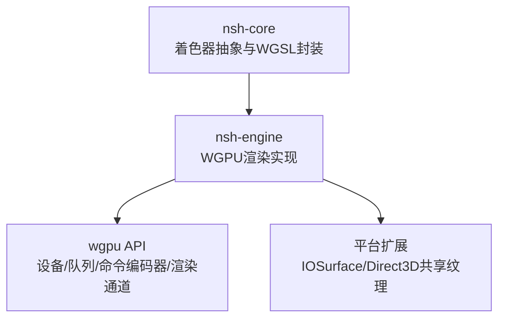
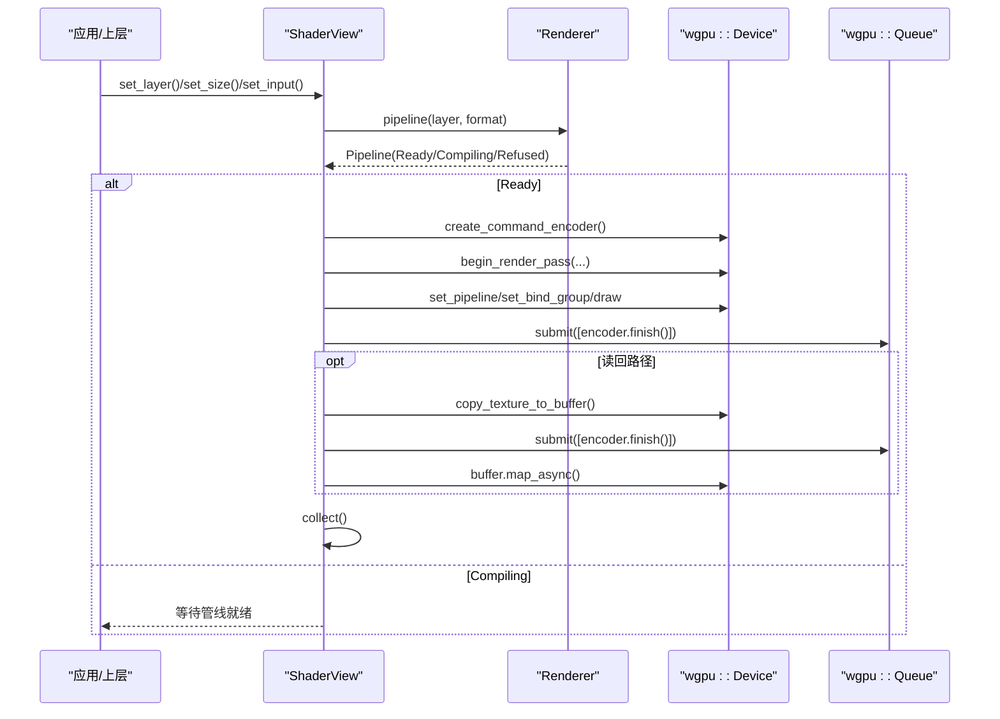
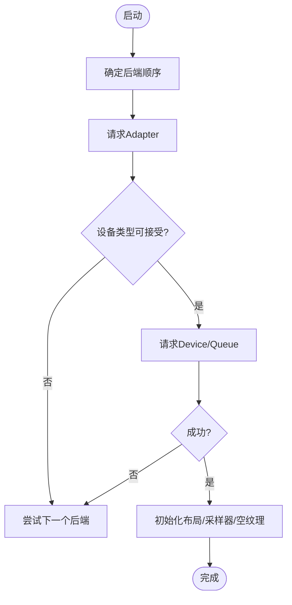
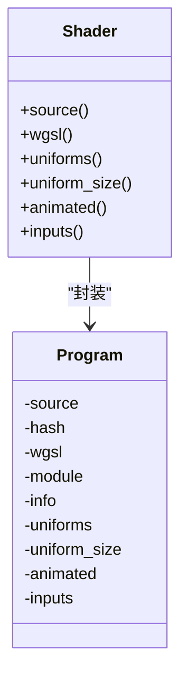
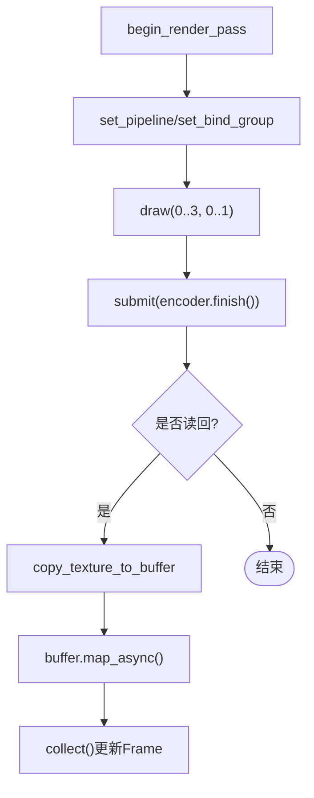
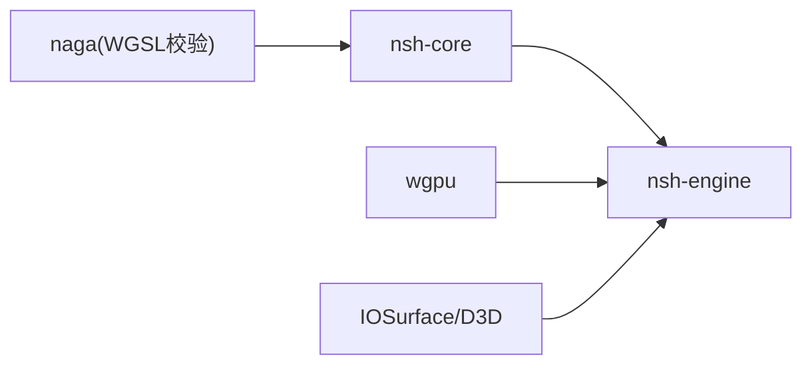

# GPU渲染管线

<cite>
**本文引用的文件**   
- [crates/nsh-engine/src/shader.rs](file://crates/nsh-engine/src/shader.rs)
- [crates/nsh-core/src/shader.rs](file://crates/nsh-core/src/shader.rs)
</cite>

## 目录
1. [引言](#引言)
2. [项目结构](#项目结构)
3. [核心组件](#核心组件)
4. [架构总览](#架构总览)
5. [详细组件分析](#详细组件分析)
6. [依赖关系分析](#依赖关系分析)
7. [性能与优化](#性能与优化)
8. [故障排查与调试](#故障排查与调试)
9. [结论](#结论)

## 引言
本文面向NSH的GPU渲染管线，聚焦WGPU后端的集成方式与实现细节。文档解释设备初始化、命令缓冲区与渲染通道管理；说明绘制命令生成与批处理/状态管理策略；描述着色器程序的编译、加载与管理流程；阐述帧缓冲管理与多目标渲染的实现；并给出性能分析与调试技巧，以及跨平台图形API的抽象设计模式。

## 项目结构
本项目的GPU渲染相关代码主要分布在两个crate：
- nsh-core：定义着色器语言模型、WGSL封装、Uniforms反射、输入采样接口等，是跨后端（原生WGPU与WebGL）共享的抽象层。
- nsh-engine：提供原生后端的WGPU渲染实现，包括设备选择、管线缓存、视图渲染、读回缓冲与平台共享纹理/表面路径。

图表来源
- [crates/nsh-core/src/shader.rs:1-170](file://crates/nsh-core/src/shader.rs#L1-L170)
- [crates/nsh-engine/src/shader.rs:1-145](file://crates/nsh-engine/src/shader.rs#L1-L145)

章节来源
- [crates/nsh-core/src/shader.rs:1-170](file://crates/nsh-core/src/shader.rs#L1-L170)
- [crates/nsh-engine/src/shader.rs:1-145](file://crates/nsh-engine/src/shader.rs#L1-L145)

## 核心组件
- Renderer：持有wgpu::Device与Queue，维护绑定组布局、管线布局、空纹理、采样器、管线缓存与编译工作线程。负责设备打开、后端选择、错误回调、管线查找与异步编译通知。
- ShaderView：每视图的状态机，管理尺寸、缩放、时钟、过渡进度、输入图片、目标纹理与读回缓冲、绑定组、序列号与帧收集。
- Target/Readback：按尺寸管理的渲染目标纹理与双缓冲读回缓冲，负责拷贝到CPU可读缓冲并映射。
- Bindings/Picture：Uniforms与内置常量缓冲、采样器与四路输入纹理的绑定组与资源。
- shader_surfaces（平台扩展）：在Apple上为IOSurface，在Windows上为Direct3D共享纹理，用于零拷贝显示帧。

章节来源
- [crates/nsh-engine/src/shader.rs:125-145](file://crates/nsh-engine/src/shader.rs#L125-L145)
- [crates/nsh-engine/src/shader.rs:612-705](file://crates/nsh-engine/src/shader.rs#L612-L705)
- [crates/nsh-engine/src/shader.rs:1371-1505](file://crates/nsh-engine/src/shader.rs#L1371-L1505)

## 架构总览
WGPU后端通过Renderer统一抽象底层图形API，向上暴露ShaderView进行逐帧渲染。核心流程如下：
- 设备初始化：按平台优先级尝试不同Backends（如Linux优先OpenGL，Windows优先DX12），选择首个可用的Adapter并请求Device/Queue。
- 管线编译：将应用WGSL包装为完整模块，创建RenderPipeline，并在后台线程编译，完成后回调通知。
- 渲染循环：根据视图状态决定是否需要重绘；若需要，则写入Uniforms与Builtins，设置BindGroup，开始RenderPass，绘制一个三角形覆盖目标区域。
- 输出路径：可选择直接渲染到平台共享表面（无CPU回读），或渲染到纹理并通过CopyTextureToBuffer+MapRead回读到CPU侧Frame。

图表来源
- [crates/nsh-engine/src/shader.rs:426-487](file://crates/nsh-engine/src/shader.rs#L426-L487)
- [crates/nsh-engine/src/shader.rs:1071-1301](file://crates/nsh-engine/src/shader.rs#L1071-L1301)

## 详细组件分析

### 设备初始化与后端选择
- 后端顺序：Linux优先OpenGL，Windows优先Direct3D 12，最后回退到PRIMARY|GL组合以兼容软件适配器。
- 设备类型过滤：避免过早使用软件适配器，仅在必要时尝试。
- Device/Queue获取：使用downlevel_webgl2_defaults并调整max_non_sampler_bindings，降低默认内存块大小以提升小对象场景效率。
- 未捕获错误：注册on_uncaptured_error，将验证错误转为日志而非崩溃。

图表来源
- [crates/nsh-engine/src/shader.rs:160-180](file://crates/nsh-engine/src/shader.rs#L160-L180)
- [crates/nsh-engine/src/shader.rs:187-255](file://crates/nsh-engine/src/shader.rs#L187-L255)
- [crates/nsh-engine/src/shader.rs:256-325](file://crates/nsh-engine/src/shader.rs#L256-L325)

章节来源
- [crates/nsh-engine/src/shader.rs:160-180](file://crates/nsh-engine/src/shader.rs#L160-L180)
- [crates/nsh-engine/src/shader.rs:187-255](file://crates/nsh-engine/src/shader.rs#L187-L255)
- [crates/nsh-engine/src/shader.rs:256-325](file://crates/nsh-engine/src/shader.rs#L256-L325)

### 着色器程序编译、加载与管理
- WGSL封装：core层将用户shade函数包装为完整模块，注入built-ins与入口点nsh_vertex/nsh_fragment，并可选注入Uniforms绑定。
- 校验与反射：使用naga对模块进行语法与语义校验，反射Uniforms字段与大小，检测是否读取nsh.time与哪些输入纹理。
- 管线缓存：Renderer按(shader哈希, TextureFormat)缓存已编译的RenderPipeline；首次请求时标记Compiling，后台线程编译完成后回调通知。
- 错误隔离：编译过程使用push_error_scope捕获验证错误，仅影响当前管线。

图表来源
- [crates/nsh-core/src/shader.rs:551-575](file://crates/nsh-core/src/shader.rs#L551-L575)
- [crates/nsh-core/src/shader.rs:640-758](file://crates/nsh-core/src/shader.rs#L640-L758)

章节来源
- [crates/nsh-core/src/shader.rs:1-170](file://crates/nsh-core/src/shader.rs#L1-L170)
- [crates/nsh-core/src/shader.rs:551-758](file://crates/nsh-core/src/shader.rs#L551-L758)
- [crates/nsh-engine/src/shader.rs:489-549](file://crates/nsh-engine/src/shader.rs#L489-L549)

### 命令缓冲区与渲染通道管理
- 命令编码器：每次渲染创建一个CommandEncoder，begin_render_pass配置颜色附件（清空透明）、无深度模板、无多视图。
- 绘制命令：设置pipeline与bind group，draw(0..3, 0..1)绘制一个覆盖目标区域的三角形。
- 提交队列：submit(encoder.finish())将命令提交至Queue。
- 读回路径：copy_texture_to_buffer到MAP_READ缓冲，map_async异步映射，collect阶段复制像素数据到Frame。

图表来源
- [crates/nsh-engine/src/shader.rs:1222-1301](file://crates/nsh-engine/src/shader.rs#L1222-L1301)

章节来源
- [crates/nsh-engine/src/shader.rs:1222-1301](file://crates/nsh-engine/src/shader.rs#L1222-L1301)

### 绘制命令生成与批处理/状态管理
- 批处理机制：每个视图独立绘制一个三角形，没有跨视图合并；但通过复用Target/Bindings减少重复分配。
- 状态管理：
  - Bindings按layout_index与uniform_size变化重建，避免不必要的BindGroup重建。
  - Picture槽位按输入索引缓存，尺寸/格式变化时重建。
  - 目标纹理Target按尺寸缓存，双缓冲Readback避免竞争。
- 跳过渲染：当无可用读回缓冲或共享表面被占用时，跳过该帧，避免阻塞主线程。

章节来源
- [crates/nsh-engine/src/shader.rs:1187-1216](file://crates/nsh-engine/src/shader.rs#L1187-L1216)
- [crates/nsh-engine/src/shader.rs:1381-1505](file://crates/nsh-engine/src/shader.rs#L1381-L1505)
- [crates/nsh-engine/src/shader.rs:1160-1186](file://crates/nsh-engine/src/shader.rs#L1160-L1186)

### 帧缓冲管理与多目标渲染
- 单目标渲染：当前实现为单颜色附件，无多目标渲染（MRT）。
- 帧缓冲组织：
  - Target包含渲染纹理与两个Readback缓冲，按尺寸缓存。
  - 读回缓冲使用原子状态IDLE/MAPPING/MAPPED/FAILED管理生命周期。
  - Frame结构保存最新帧像素、尺寸、步长与序列号。
- 多目标渲染扩展点：可在RenderPassDescriptor中增加多个color_attachments，但需同步扩展BindGroup布局与FragmentTargets。

章节来源
- [crates/nsh-engine/src/shader.rs:627-646](file://crates/nsh-engine/src/shader.rs#L627-L646)
- [crates/nsh-engine/src/shader.rs:1410-1444](file://crates/nsh-engine/src/shader.rs#L1410-L1444)
- [crates/nsh-engine/src/shader.rs:1320-1368](file://crates/nsh-engine/src/shader.rs#L1320-L1368)

### 平台共享表面与零拷贝路径
- Apple：渲染到IOSurface，由窗口系统直接展示，无需CPU回读。
- Windows：渲染到Direct3D共享纹理，后端设备可直接读取；若无法共享则回退到读回路径。
- 帧序列与旧帧保留：尺寸变化时保留上一尺寸的共享纹理，直到新尺寸帧可用，避免闪烁。

章节来源
- [crates/nsh-engine/src/shader.rs:1016-1061](file://crates/nsh-engine/src/shader.rs#L1016-L1061)
- [crates/nsh-engine/src/shader.rs:1093-1143](file://crates/nsh-engine/src/shader.rs#L1093-L1143)
- [crates/nsh-engine/src/shader.rs:1247-1256](file://crates/nsh-engine/src/shader.rs#L1247-L1256)

## 依赖关系分析
- nsh-core依赖naga进行WGSL解析与校验，导出Shader/Uniforms/Inputs等抽象。
- nsh-engine依赖wgpu进行设备/队列/命令编码/渲染通道操作，并可选依赖平台扩展（IOSurface/Direct3D）。
- 耦合度：Renderer与ShaderView强耦合于具体渲染流程；Shader抽象与平台解耦良好。

图表来源
- [crates/nsh-core/src/shader.rs:63-66](file://crates/nsh-core/src/shader.rs#L63-L66)
- [crates/nsh-engine/src/shader.rs:125-145](file://crates/nsh-engine/src/shader.rs#L125-L145)

章节来源
- [crates/nsh-core/src/shader.rs:63-66](file://crates/nsh-core/src/shader.rs#L63-L66)
- [crates/nsh-engine/src/shader.rs:125-145](file://crates/nsh-engine/src/shader.rs#L125-L145)

## 性能与优化
- 设备与内存：
  - 使用MemoryHints::MemoryUsage降低默认分配块大小，适合小纹理/缓冲场景。
  - 调整max_non_sampler_bindings提升大量纹理绑定的能力。
- 管线编译：
  - 后台线程编译，避免阻塞主线程；编译结果缓存，避免重复编译。
  - 错误范围隔离，单个管线失败不影响其他管线。
- 渲染路径：
  - 优先使用平台共享表面（IOSurface/D3D共享纹理）避免CPU回读。
  - 双缓冲Readback与状态机避免竞争与重复映射。
  - 按需重建Bindings与Picture，减少无效分配。
- 调度与跳过：
  - 当无可用目标或GPU落后时跳过帧，保持主线程流畅。
  - when_done回调（Apple）或轮询（其他平台）协调帧收集。

[本节为通用指导，不直接分析具体文件]

## 故障排查与调试
- 设备不可用：
  - 检查backend_order与takes逻辑，确认平台后端优先级与软件适配器策略。
  - 查看日志中的“no GPU adapter/device”信息，定位具体后端失败原因。
- 管线编译失败：
  - 关注push_error_scope捕获的错误日志，检查WGSL语法与Uniforms声明。
  - 使用wait_for_pipelines在测试中等待编译完成。
- 帧缺失或卡顿：
  - 检查when_done回调是否触发；若未触发，回退到poll轮询。
  - 确认共享表面/纹理是否被后端正确释放与信号通知。
- 像素异常：
  - 核对PixelFormat与纹理格式映射（Rgba/Bgra）。
  - 检查picture_fits校验（行步长、尺寸限制）是否拒绝非法输入。

章节来源
- [crates/nsh-engine/src/shader.rs:187-255](file://crates/nsh-engine/src/shader.rs#L187-L255)
- [crates/nsh-engine/src/shader.rs:489-549](file://crates/nsh-engine/src/shader.rs#L489-L549)
- [crates/nsh-engine/src/shader.rs:577-601](file://crates/nsh-engine/src/shader.rs#L577-L601)
- [crates/nsh-engine/src/shader.rs:1016-1061](file://crates/nsh-engine/src/shader.rs#L1016-L1061)

## 结论
NSH的GPU渲染管线通过nsh-core提供跨平台的着色器抽象，并由nsh-engine基于wgpu实现高效的原生渲染。其设计强调：
- 明确的职责分离：抽象层与实现层解耦，便于扩展新的后端。
- 稳健的设备与管线管理：后端选择、错误隔离、后台编译与缓存。
- 灵活的输出路径：支持零拷贝平台表面与CPU回读双路径。
- 可观测性与可调试性：详细的日志与测试用例覆盖关键路径。

未来在多目标渲染方面，可在现有RenderPass基础上扩展color_attachments与FragmentTargets，同时保持BindGroup布局与输入纹理的一致性。

[本节为总结性内容，不直接分析具体文件]