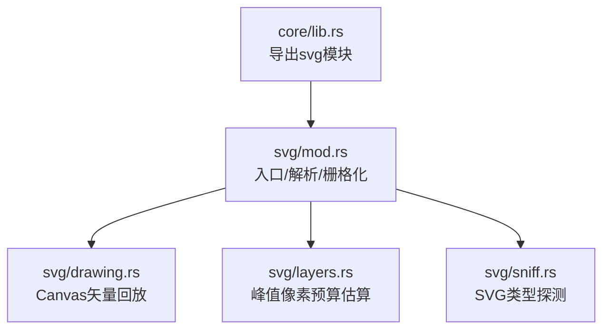
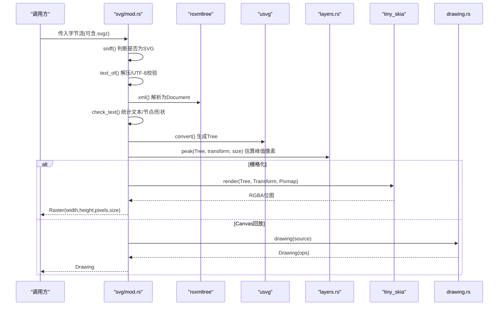
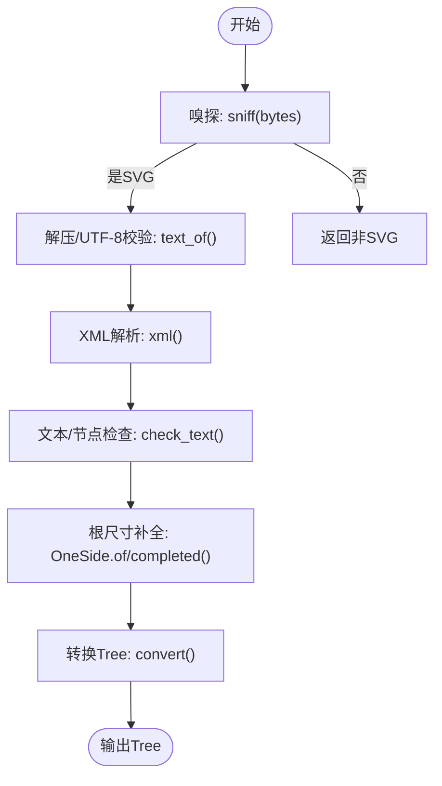
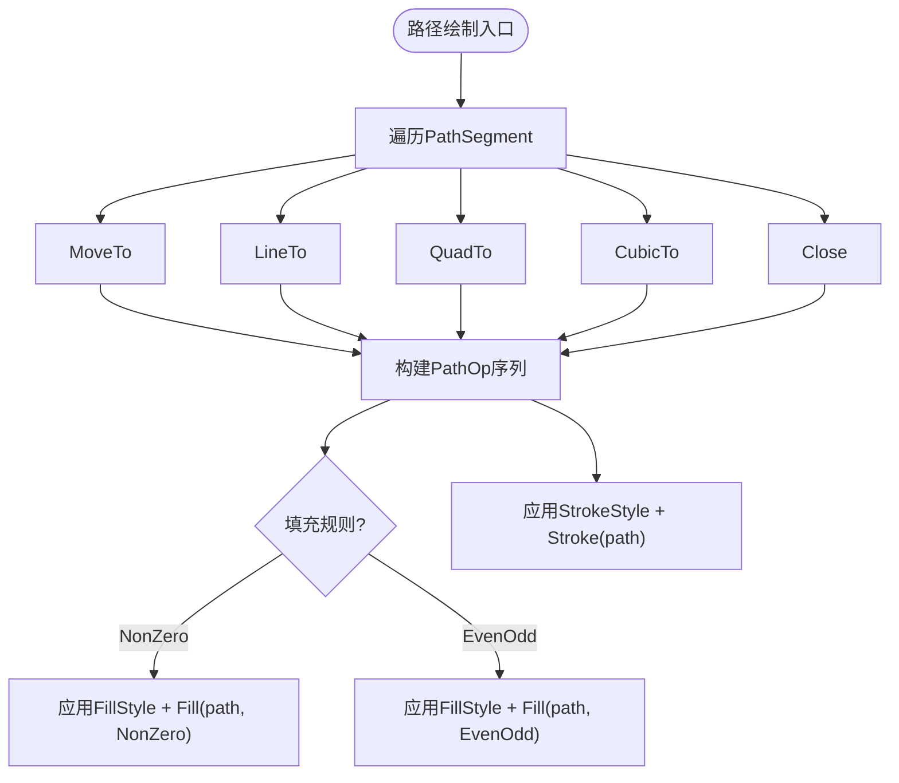
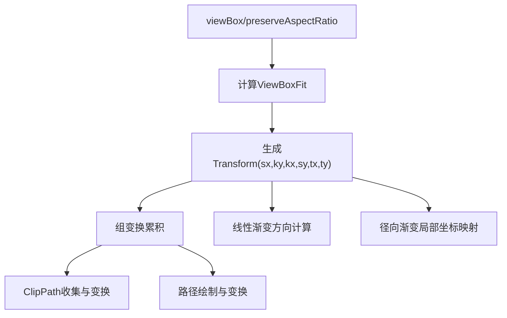
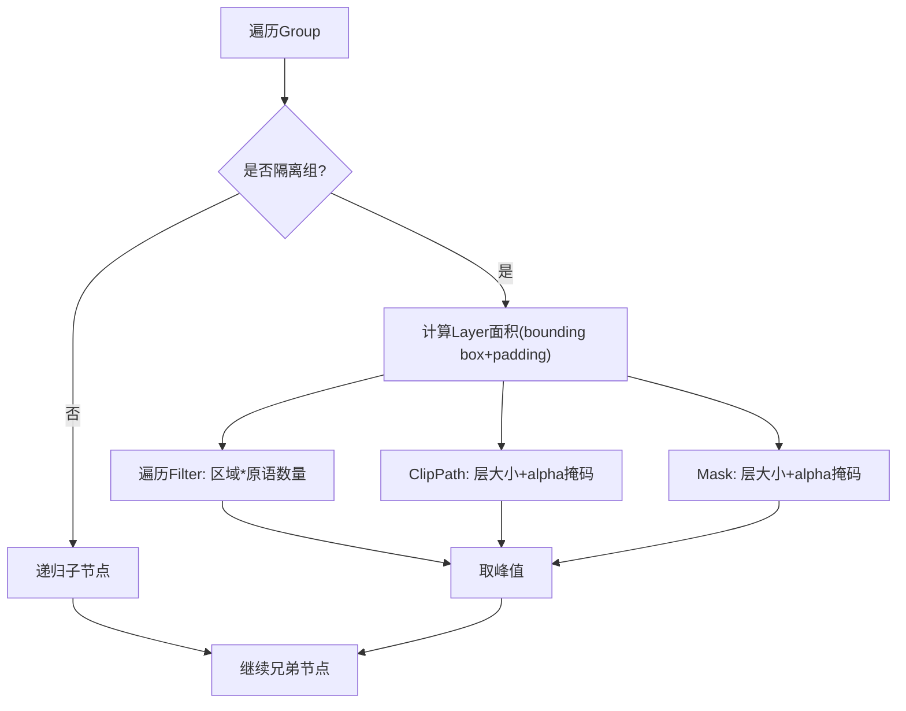
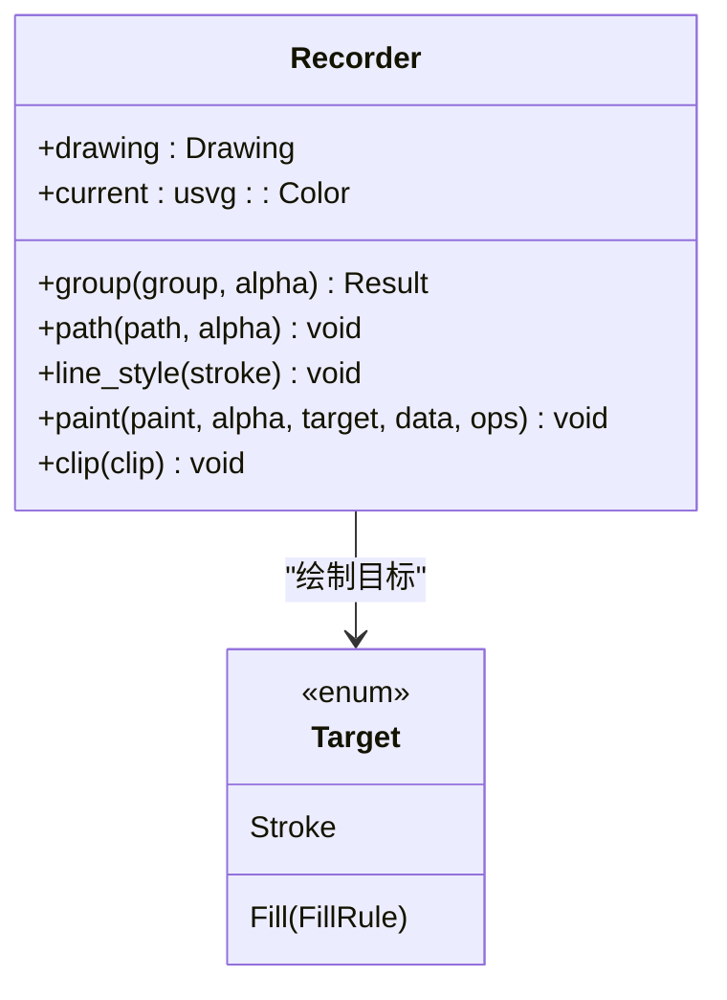
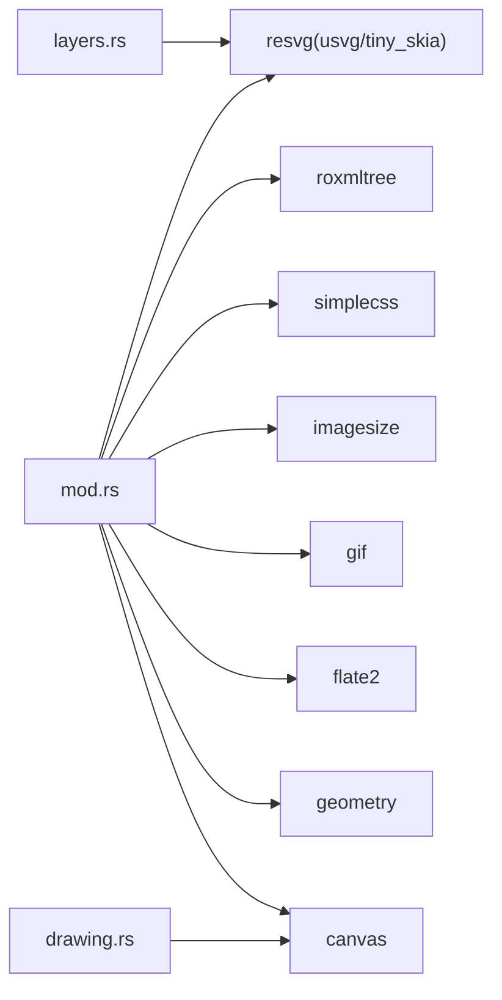

# SVG渲染引擎

<cite>
**本文引用的文件**   
- [mod.rs](file://crates/nsh-core/src/svg/mod.rs)
- [drawing.rs](file://crates/nsh-core/src/svg/drawing.rs)
- [layers.rs](file://crates/nsh-core/src/svg/layers.rs)
- [sniff.rs](file://crates/nsh-core/src/svg/sniff.rs)
- [lib.rs](file://crates/nsh-core/src/lib.rs)
</cite>

## 目录
1. [引言](#引言)
2. [项目结构](#项目结构)
3. [核心组件](#核心组件)
4. [架构总览](#架构总览)
5. [详细组件分析](#详细组件分析)
6. [依赖关系分析](#依赖关系分析)
7. [性能与大型文件处理](#性能与大型文件处理)
8. [故障排查指南](#故障排查指南)
9. [结论](#结论)

## 引言
本文件面向NSH的SVG渲染子系统，系统性说明以下能力：
- SVG解析器实现：XML解析、DOM树构建、安全选项与资源限制。
- 路径绘制算法：贝塞尔曲线处理、填充规则、描边样式与绘制顺序。
- 变换矩阵计算与应用：平移、旋转、缩放、倾斜在视图映射与渐变中的应用。
- 滤镜效果：基于resvg的图层隔离、裁剪、蒙版与滤镜预算估算。
- 图层系统：隔离组、混合模式、透明度与像素预算控制。
- 性能优化与大型文件策略：节点数、文本字符、像素面积、层内存上限等防护机制。

该模块为原生后端提供统一的SVG栅格化与Canvas矢量回放能力，确保跨平台一致性与安全性。

## 项目结构
SVG子模块位于nsh-core中，按职责拆分为：
- mod.rs：入口、解析流程、尺寸计算、栅格化接口、安全限制与错误模型。
- drawing.rs：将SVG树转换为Canvas绘图操作（矢量回放）。
- layers.rs：对resvg渲染过程中的峰值像素占用进行保守估算。
- sniff.rs：轻量级SVG嗅探，无需完整渲染器。

图表来源
- [mod.rs:1-100](file://crates/nsh-core/src/svg/mod.rs#L1-L100)
- [drawing.rs:1-60](file://crates/nsh-core/src/svg/drawing.rs#L1-L60)
- [layers.rs:1-40](file://crates/nsh-core/src/svg/layers.rs#L1-L40)
- [sniff.rs:1-41](file://crates/nsh-core/src/svg/sniff.rs#L1-L41)
- [lib.rs:69-74](file://crates/nsh-core/src/lib.rs#L69-L74)

章节来源
- [lib.rs:69-74](file://crates/nsh-core/src/lib.rs#L69-L74)

## 核心组件
- 解析与文档校验：支持gzip压缩SVG检测、UTF-8校验、XML解析、根元素补全与尺寸推导。
- 栅格化接口：多种目标尺寸策略（最长边、覆盖、缩放、过采样），统一返回预乘RGBA位图。
- Canvas矢量回放：将SVG树记录为Canvas操作，支持渐变、混合模式、裁剪路径与描边样式。
- 预算与限制：文档大小、文本字符数、节点访问次数、最大像素面积、层像素预算。
- 字体与资源：系统字体数据库、仅允许内联data URI图像、拒绝外部资源与嵌套SVG。

章节来源
- [mod.rs:64-105](file://crates/nsh-core/src/svg/mod.rs#L64-L105)
- [mod.rs:192-213](file://crates/nsh-core/src/svg/mod.rs#L192-L213)
- [mod.rs:215-326](file://crates/nsh-core/src/svg/mod.rs#L215-L326)
- [mod.rs:1347-1457](file://crates/nsh-core/src/svg/mod.rs#L1347-L1457)
- [drawing.rs:1-55](file://crates/nsh-core/src/svg/drawing.rs#L1-L55)
- [layers.rs:1-40](file://crates/nsh-core/src/svg/layers.rs#L1-L40)

## 架构总览
SVG渲染由“解析→预算→绘制”三段组成：
- 解析阶段：嗅探→解压→XML解析→安全检查→usvg Tree构建。
- 预算阶段：估算文本展开、节点访问、层像素占用，拒绝超预算文档。
- 绘制阶段：根据用途选择栅格化或Canvas矢量回放；栅格化调用resvg渲染到Pixmap。

图表来源
- [mod.rs:192-213](file://crates/nsh-core/src/svg/mod.rs#L192-L213)
- [mod.rs:328-391](file://crates/nsh-core/src/svg/mod.rs#L328-L391)
- [mod.rs:1202-1218](file://crates/nsh-core/src/svg/mod.rs#L1202-L1218)
- [mod.rs:1432-1457](file://crates/nsh-core/src/svg/mod.rs#L1432-L1457)
- [drawing.rs:55-112](file://crates/nsh-core/src/svg/drawing.rs#L55-L112)
- [layers.rs:35-40](file://crates/nsh-core/src/svg/layers.rs#L35-L40)

## 详细组件分析

### SVG解析器与安全边界
- 嗅探：识别BOM、XML声明、注释、DOCTYPE后是否以`<svg`开头；同时支持`.svgz`前缀检测并部分解压。
- 文本与XML：先解压并校验UTF-8，再使用roxmltree解析，允许DTD但后续通过usvg选项限制资源加载。
- 根属性补全：当根仅有width或height且存在viewBox时，按比例补全缺失边，保证布局一致性。
- 安全选项：禁用resources_dir，仅允许内联data URI图像（JPEG/PNG/GIF/WEBP），拒绝URL与嵌套SVG。
- 字体数据库：仅在需要文本布局时加载系统字体，避免无文本文档的额外开销；为通用字体族回退到可用字体。

图表来源
- [sniff.rs:3-32](file://crates/nsh-core/src/svg/sniff.rs#L3-L32)
- [mod.rs:343-367](file://crates/nsh-core/src/svg/mod.rs#L343-L367)
- [mod.rs:369-391](file://crates/nsh-core/src/svg/mod.rs#L369-L391)
- [mod.rs:1202-1218](file://crates/nsh-core/src/svg/mod.rs#L1202-L1218)

章节来源
- [sniff.rs:1-41](file://crates/nsh-core/src/svg/sniff.rs#L1-L41)
- [mod.rs:192-213](file://crates/nsh-core/src/svg/mod.rs#L192-L213)
- [mod.rs:328-391](file://crates/nsh-core/src/svg/mod.rs#L328-L391)
- [mod.rs:293-326](file://crates/nsh-core/src/svg/mod.rs#L293-L326)
- [mod.rs:215-291](file://crates/nsh-core/src/svg/mod.rs#L215-L291)

### 路径绘制算法与填充规则
- 路径数据：遍历usvg路径段，转换为Canvas PathOp（MoveTo/LineTo/QuadTo/CubicTo/Close）。
- 填充规则：NonZero与EvenOdd映射到Canvas FillRule。
- 描边样式：线宽、端点、连接、斜接限制、虚线与偏移。
- 绘制顺序：支持FillAndStroke与StrokeAndFill两种顺序。
- 当前颜色：根color标记sentinel色，匹配currentColor时延迟到ViewPaint阶段应用。

图表来源
- [drawing.rs:525-543](file://crates/nsh-core/src/svg/drawing.rs#L525-L543)
- [drawing.rs:473-478](file://crates/nsh-core/src/svg/drawing.rs#L473-L478)
- [drawing.rs:262-283](file://crates/nsh-core/src/svg/drawing.rs#L262-L283)
- [drawing.rs:231-260](file://crates/nsh-core/src/svg/drawing.rs#L231-L260)

章节来源
- [drawing.rs:231-365](file://crates/nsh-core/src/svg/drawing.rs#L231-L365)
- [drawing.rs:525-543](file://crates/nsh-core/src/svg/drawing.rs#L525-L543)

### 变换矩阵的计算与应用
- 视图映射：根据viewBox与preserveAspectRatio计算ViewBoxFit，得到从SVG用户空间到Canvas盒子的仿射变换。
- 渐变方向：线性渐变通过逆变换转置方向向量，保持等色线平行；径向渐变在拉伸时局部坐标系重绘。
- 组变换：递归累积group.transform()，应用到ClipPath收集与路径绘制。

图表来源
- [drawing.rs:85-112](file://crates/nsh-core/src/svg/drawing.rs#L85-L112)
- [drawing.rs:428-451](file://crates/nsh-core/src/svg/drawing.rs#L428-L451)
- [drawing.rs:402-423](file://crates/nsh-core/src/svg/drawing.rs#L402-L423)
- [drawing.rs:173-179](file://crates/nsh-core/src/svg/drawing.rs#L173-L179)

章节来源
- [drawing.rs:85-112](file://crates/nsh-core/src/svg/drawing.rs#L85-L112)
- [drawing.rs:428-451](file://crates/nsh-core/src/svg/drawing.rs#L428-L451)
- [drawing.rs:402-423](file://crates/nsh-core/src/svg/drawing.rs#L402-L423)

### 滤镜效果与图层预算
- 隔离组：每个具有opacity、clip-path、mask、filter或blend mode的组被视为隔离层。
- 预算估算：layers::peak对每层的bounding box、滤镜区域、裁剪蒙版、图案平铺、内嵌图像进行像素面积累加，取路径上的最大值。
- 限制阈值：MAX_LAYER_PIXELS限制一次性层像素占用；TooManyNodes限制节点访问次数。
- 实际渲染：resvg在内部为每个隔离组分配pixmap，滤镜原语结果保留至滤镜结束。

图表来源
- [layers.rs:35-40](file://crates/nsh-core/src/svg/layers.rs#L35-L40)
- [layers.rs:91-113](file://crates/nsh-core/src/svg/layers.rs#L91-L113)
- [layers.rs:118-138](file://crates/nsh-core/src/svg/layers.rs#L118-L138)
- [layers.rs:142-200](file://crates/nsh-core/src/svg/layers.rs#L142-L200)

章节来源
- [layers.rs:1-40](file://crates/nsh-core/src/svg/layers.rs#L1-L40)
- [layers.rs:91-220](file://crates/nsh-core/src/svg/layers.rs#L91-L220)

### 图层系统与混合模式、透明度
- 混合模式：usvg BlendMode映射到Canvas Composite（Multiply/Screen/Overlay/Darken/Lighten等）。
- 透明度：组opacity与path fill/stroke opacity相乘，全局alpha在绘制前设置。
- 裁剪路径：多个shape合并为一个Path，按nonzero规则作为裁剪区域。
- 遮罩与滤镜：在矢量回放模式下被忽略并告警；在栅格化模式下由resvg处理，受预算约束。

图表来源
- [drawing.rs:155-179](file://crates/nsh-core/src/svg/drawing.rs#L155-L179)
- [drawing.rs:181-213](file://crates/nsh-core/src/svg/drawing.rs#L181-L213)
- [drawing.rs:215-229](file://crates/nsh-core/src/svg/drawing.rs#L215-L229)
- [drawing.rs:368-389](file://crates/nsh-core/src/svg/drawing.rs#L368-L389)

章节来源
- [drawing.rs:155-213](file://crates/nsh-core/src/svg/drawing.rs#L155-L213)
- [drawing.rs:215-229](file://crates/nsh-core/src/svg/drawing.rs#L215-L229)
- [drawing.rs:287-365](file://crates/nsh-core/src/svg/drawing.rs#L287-L365)

## 依赖关系分析
- 外部库：resvg（usvg/tinyskia）、roxmltree、simplecss、imagesize、gif、flate2。
- 内部依赖：geometry（Points/Size/Bounds）、canvas（Drawing/CanvasOp/Composite等）、style（Color/SvgPaint）。
- 模块耦合：mod.rs协调解析与栅格化；drawing.rs依赖canvas抽象；layers.rs依赖resvg内部结构做预算估算。

图表来源
- [mod.rs:38-49](file://crates/nsh-core/src/svg/mod.rs#L38-L49)
- [drawing.rs:22-34](file://crates/nsh-core/src/svg/drawing.rs#L22-L34)
- [layers.rs:24-30](file://crates/nsh-core/src/svg/layers.rs#L24-L30)

章节来源
- [mod.rs:38-49](file://crates/nsh-core/src/svg/mod.rs#L38-L49)
- [drawing.rs:22-34](file://crates/nsh-core/src/svg/drawing.rs#L22-L34)
- [layers.rs:24-30](file://crates/nsh-core/src/svg/layers.rs#L24-L30)

## 性能与大型文件处理
- 文档大小：MAX_BYTES限制解析输入（含.svgz解压后）；TooLarge错误直接拒绝。
- 文本字符：MAX_TEXT_CHARS限制usvg布局前的文本总量；TooMuchText错误防止二次复杂度。
- 节点访问：MAX_VISITS限制walk与绘制中的节点计数；TooManyNodes错误保护栈与时间。
- 像素面积：MAX_SIDE与MAX_PIXELS限制栅格化尺寸；OverBudget限制层像素占用。
- 过采样：OVERSAMPLE与MAX_OVERSAMPLED_SIDE平衡清晰度与内存。
- 资源限制：禁止外部资源与嵌套SVG，仅允许内联data URI图像，避免隐藏预算。

优化建议
- 优先使用矢量回放（element::svg）以减少栅格化成本，适合动态尺寸与高DPI场景。
- 对复杂滤镜/蒙版/裁剪路径的SVG，尽量简化层级或使用更小的viewBox。
- 避免大量重复use/tref导致的文本与节点膨胀；必要时拆分文档。
- 控制pattern平铺尺寸与transform，避免过大tile面积。
- 合理设置max_px或scale，避免不必要的超大栅格。

章节来源
- [mod.rs:64-105](file://crates/nsh-core/src/svg/mod.rs#L64-L105)
- [mod.rs:393-447](file://crates/nsh-core/src/svg/mod.rs#L393-L447)
- [mod.rs:1432-1457](file://crates/nsh-core/src/svg/mod.rs#L1432-L1457)
- [layers.rs:26-40](file://crates/nsh-core/src/svg/layers.rs#L26-L40)

## 故障排查指南
常见问题与定位
- “无效SVG”：非UTF-8、XML格式错误或根非svg；检查字节流与BOM。
- “文档过大”：超过MAX_BYTES；检查.svgz解压后体积。
- “文本过多”：超过MAX_TEXT_CHARS；减少text/tref/use展开后的字符量。
- “无面积”：root width/height为零或缺失且无法测量；补充viewBox或显式尺寸。
- “无像素”：请求尺寸为0；检查scale或max_px参数。
- “超出预算”：层像素占用超过MAX_LAYER_PIXELS；简化滤镜/蒙版/裁剪路径。
- “节点过多”：节点访问超过MAX_VISITS；减少use/tref链与共享资源引用。
- “渲染器恐慌”：捕获panic并转为Error；检查usvg/resvg版本与输入合法性。

调试步骤
- 先用sniff确认输入是否为SVG。
- 使用size接口获取内在尺寸，验证viewBox与宽高比例。
- 逐步启用rasterize_*系列接口，观察报错位置。
- 若使用Canvas回放，检查混合模式与渐变配置是否符合预期。
- 对复杂滤镜/蒙版，尝试关闭或简化以定位预算瓶颈。

章节来源
- [mod.rs:125-188](file://crates/nsh-core/src/svg/mod.rs#L125-L188)
- [mod.rs:192-213](file://crates/nsh-core/src/svg/mod.rs#L192-L213)
- [mod.rs:1347-1457](file://crates/nsh-core/src/svg/mod.rs#L1347-L1457)

## 结论
NSH的SVG渲染引擎通过严格的解析与预算机制，在保证跨平台一致性的同时，有效抵御恶意或异常输入带来的风险。其设计将“解析→预算→绘制”解耦，既支持高效的Canvas矢量回放，也提供稳健的栅格化路径。对于大型与复杂SVG，建议结合矢量回放、简化滤镜/蒙版、控制尺寸与资源引用，以获得最佳性能与稳定性。