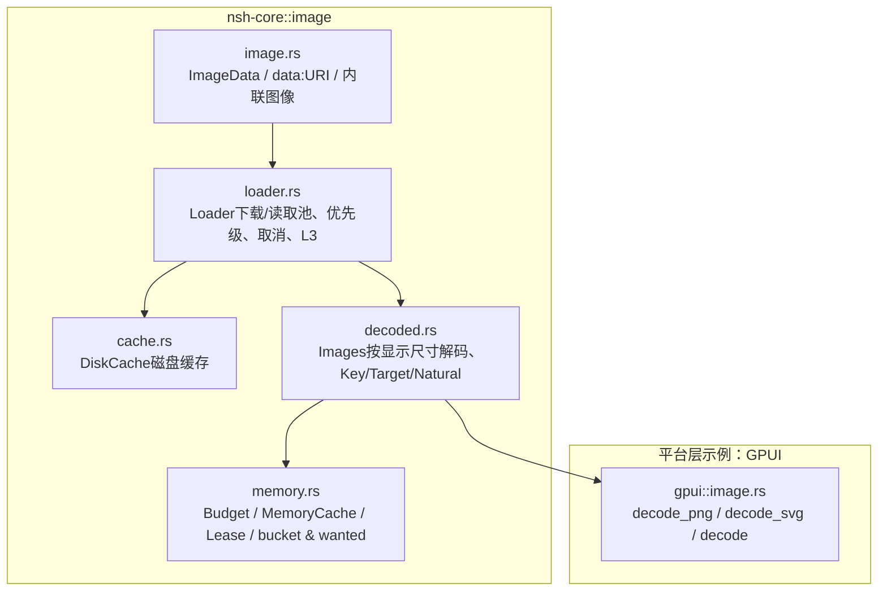
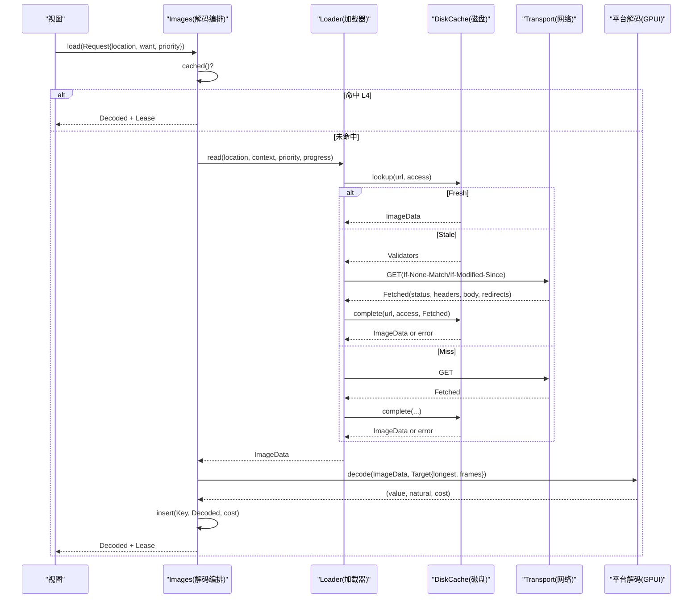
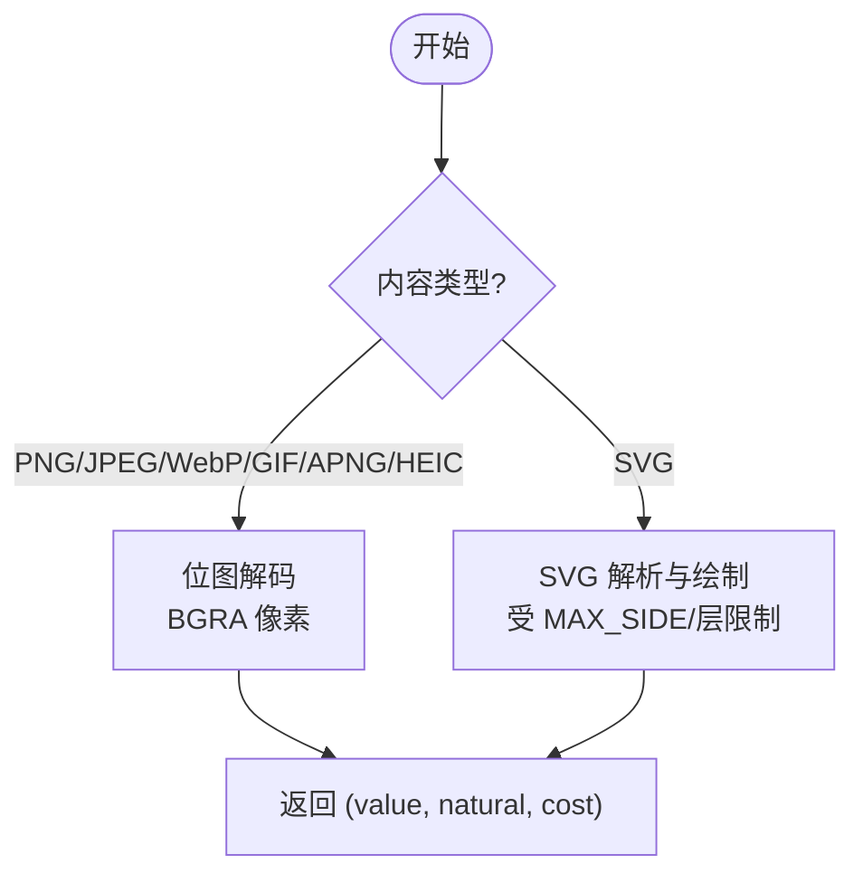
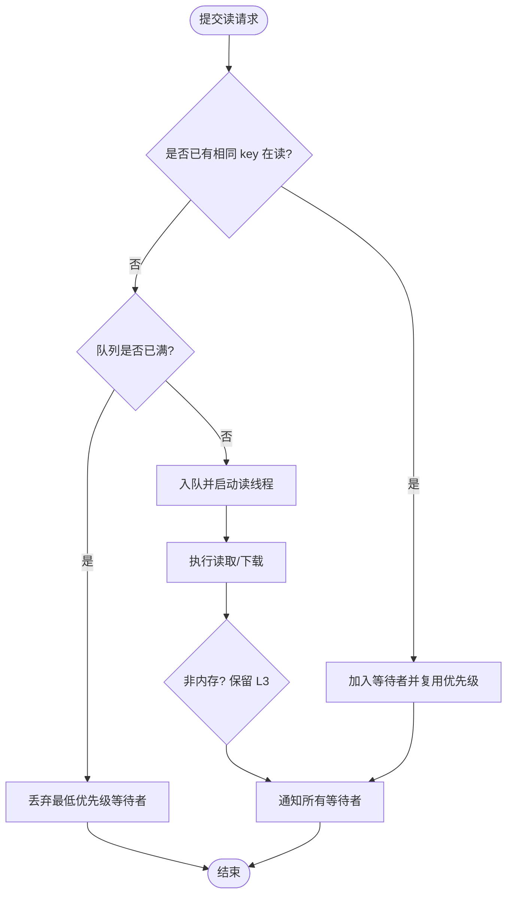
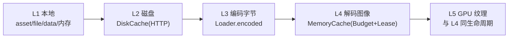
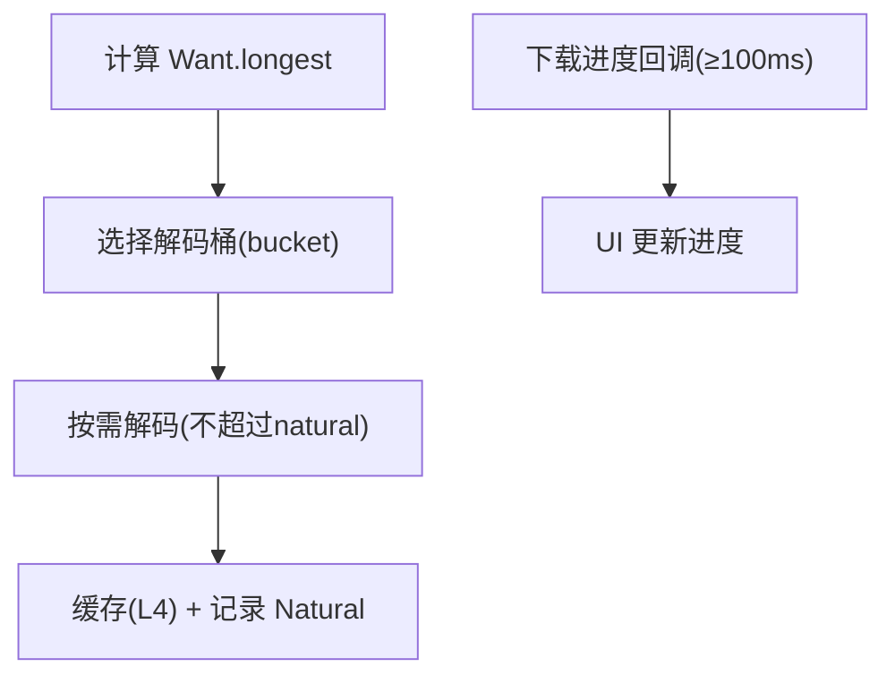
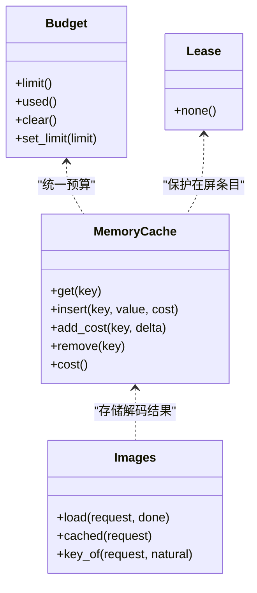
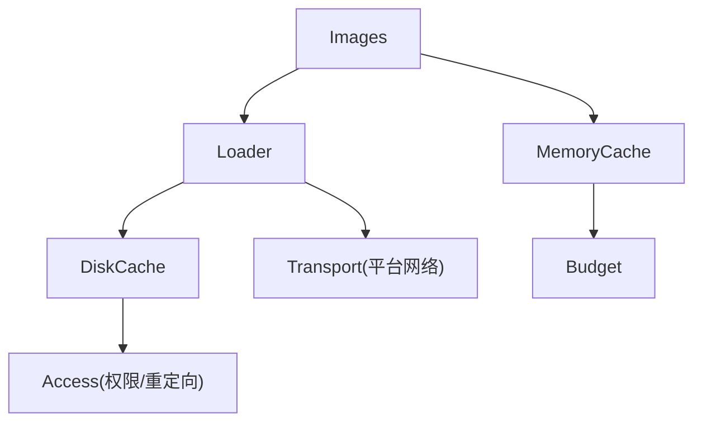

# 图像加载与缓存

<cite>
**本文引用的文件**   
- [image-loading-design.md](file://docs/dev/image-loading-design.md)
- [images-and-assets.md](file://website/docs/images-and-assets.md)
- [image.rs](file://crates/nsh-core/src/image.rs)
- [cache.rs](file://crates/nsh-core/src/image/cache.rs)
- [memory.rs](file://crates/nsh-core/src/image/memory.rs)
- [loader.rs](file://crates/nsh-core/src/image/loader.rs)
- [decoded.rs](file://crates/nsh-core/src/image/decoded.rs)
- [image.rs（GPUI）](file://crates/gpui/nsh-platform-gpui/src/image.rs)
</cite>

## 目录
1. [简介](#简介)
2. [项目结构](#项目结构)
3. [核心组件](#核心组件)
4. [架构总览](#架构总览)
5. [详细组件分析](#详细组件分析)
6. [依赖关系分析](#依赖关系分析)
7. [性能考量](#性能考量)
8. [故障排查指南](#故障排查指南)
9. [结论](#结论)

## 简介
本技术文档围绕 NSH 的图像加载与缓存系统，系统性说明支持的图像格式、解码流程、异步加载机制、多级缓存架构、尺寸计算与色彩空间处理、内存管理策略，以及性能调优与常见问题解决方案。内容基于核心库 nsh-core 的 image 模块与各平台实现（以 GPUI 为例），并结合官方设计文档与用户文档进行交叉验证。

## 项目结构
NSH 图像子系统位于 crates/nsh-core/src/image 下，按职责分层：
- 数据与工具：ImageData、data: URI 解析、内联图像映射、密度解析等
- 磁盘缓存：DiskCache（HTTP 私有缓存语义）
- 内存预算与 LRU：Budget、MemoryCache、Lease、bucket/wanted
- 加载器：Loader（下载/读取池、优先级、取消、失败缓存、L3 编码字节缓存）
- 解码编排：Images（按显示尺寸解码、自然尺寸缓存、帧选择）
- 平台解码：各平台将 ImageData 转为纹理/像素（如 GPUI 的 decode_*）

图表来源
- [image.rs](file://crates/nsh-core/src/image.rs)
- [cache.rs](file://crates/nsh-core/src/image/cache.rs)
- [memory.rs](file://crates/nsh-core/src/image/memory.rs)
- [loader.rs](file://crates/nsh-core/src/image/loader.rs)
- [decoded.rs](file://crates/nsh-core/src/image/decoded.rs)
- [image.rs（GPUI）](file://crates/gpui/nsh-platform-gpui/src/image.rs)

章节来源
- [image-loading-design.md:1-223](file://docs/dev/image-loading-design.md#L1-L223)
- [images-and-assets.md:1-445](file://website/docs/images-and-assets.md#L1-L445)

## 核心组件
- 图像数据与内联资源
  - ImageData：共享字节或 RGBA 像素缓冲；支持从 RGBA 生成 PNG 以便后端使用
  - InlineImages：仅持有弱引用，随源生命周期释放
  - density()：文件名 @Nx 密度解析
- 磁盘缓存 DiskCache
  - HTTP 私有缓存语义（RFC 9111 简化版）：fresh/stale/revalidate/no-store/Vary/ETag/Last-Modified
  - 原子写入、CRC 校验、LRU 清理、重定向访问控制
- 内存预算与缓存 Budget/MemoryCache/Lease
  - 进程级预算，跨所有缓存统一计数；Lease 保证“在屏”条目不被驱逐
  - bucket/wanted：按显示尺寸选择解码桶，避免过度解码
- 加载器 Loader
  - 下载/读取池（并发数、每主机限制）、解码线程池分离
  - 优先级队列（Visible > Normal > Prefetch）、最大排队数、超时/大小/重定向限制
  - L3 编码字节缓存（默认 16/32 MiB），失败结果短期缓存
- 解码编排 Images
  - 按 Key=(source, longest, frames) 组织解码结果，保持 Natural 尺寸元数据
  - 与 MemoryCache 协作，按目标 longest 解码，支持动画帧选择

章节来源
- [image.rs:1-557](file://crates/nsh-core/src/image.rs#L1-L557)
- [cache.rs:1-800](file://crates/nsh-core/src/image/cache.rs#L1-L800)
- [memory.rs:1-745](file://crates/nsh-core/src/image/memory.rs#L1-L745)
- [loader.rs:1-800](file://crates/nsh-core/src/image/loader.rs#L1-L800)
- [decoded.rs:1-547](file://crates/nsh-core/src/image/decoded.rs#L1-L547)

## 架构总览
NSH 图像管线采用五级分层：
- L1：本地资源（asset:/、file、data:、内存）
- L2：远程下载与磁盘缓存（HTTP 私有缓存）
- L3：编码字节内存缓存（避免重复 IO）
- L4：解码图像内存缓存（按显示尺寸、按帧、按效果变体）
- L5：GPU 纹理（与 L4 条目同生命周期）

图表来源
- [decoded.rs:321-445](file://crates/nsh-core/src/image/decoded.rs#L321-L445)
- [loader.rs:553-774](file://crates/nsh-core/src/image/loader.rs#L553-L774)
- [cache.rs:370-527](file://crates/nsh-core/src/image/cache.rs#L370-L527)
- [image.rs（GPUI）:270-348](file://crates/gpui/nsh-platform-gpui/src/image.rs#L270-L348)

## 详细组件分析

### 支持的图像格式与解码流程
- 位图格式：PNG、JPEG(.jpg/.jpeg)、WebP、HEIC、GIF（含动画）
- 矢量格式：SVG（含自包含 raster data: 子图）
- 数据来源：asset:/、file、http(s)、data:、内存 RGBA
- 平台解码（以 GPUI 为例）：
  - decode_still：静态位图解码为 BGRA 像素
  - decode_svg：SVG 矢量化绘制（受尺寸/节点/层限制）
  - decode：根据内容类型分发到具体解码器

图表来源
- [image.rs（GPUI）:270-348](file://crates/gpui/nsh-platform-gpui/src/image.rs#L270-L348)
- [images-and-assets.md:93-113](file://website/docs/images-and-assets.md#L93-L113)

章节来源
- [images-and-assets.md:50-113](file://website/docs/images-and-assets.md#L50-L113)
- [image.rs（GPUI）:270-348](file://crates/gpui/nsh-platform-gpui/src/image.rs#L270-L348)

### 异步图像加载机制（请求队列与错误处理）
- 去重：同一 source key 仅一个读任务，后续请求等待
- 优先级：Visible > Normal > Prefetch；滚动时动态调整
- 并发：DOWNLOADS=6 个读线程，decoders() 个解码线程（≤4）
- 限流：MAX_QUEUED=512；单主机 PER_HOST=4；超时 TIMEOUT=60s；响应上限 MAX_BYTES=64MiB；重定向最多 20 次且禁止 https→http
- 取消：Ticket 析构即取消等待；无人等待的任务被丢弃
- 失败缓存：FAILURE_TTL=30s，避免列表项反复重试

图表来源
- [loader.rs:553-774](file://crates/nsh-core/src/image/loader.rs#L553-L774)

章节来源
- [loader.rs:52-88](file://crates/nsh-core/src/image/loader.rs#L52-L88)
- [loader.rs:553-774](file://crates/nsh-core/src/image/loader.rs#L553-L774)

### 多级缓存架构（内存、磁盘、共享）
- L1 本地：asset:/、file、data:、内存 RGBA
- L2 磁盘：DiskCache（HTTP 私有缓存，256MiB 默认，LRU 清理至 75%）
- L3 编码字节：Loader.encoded（默认 16/32 MiB），避免重复 IO
- L4 解码图像：MemoryCache（进程级 Budget，按 Key 分桶，Lease 保护在屏条目）
- L5 GPU：纹理对象与 L4 条目同生命周期

图表来源
- [image-loading-design.md:66-143](file://docs/dev/image-loading-design.md#L66-L143)
- [cache.rs:1-800](file://crates/nsh-core/src/image/cache.rs#L1-L800)
- [memory.rs:1-745](file://crates/nsh-core/src/image/memory.rs#L1-L745)
- [loader.rs:1-800](file://crates/nsh-core/src/image/loader.rs#L1-L800)

章节来源
- [image-loading-design.md:66-143](file://docs/dev/image-loading-design.md#L66-L143)
- [cache.rs:76-800](file://crates/nsh-core/src/image/cache.rs#L76-L800)
- [memory.rs:32-204](file://crates/nsh-core/src/image/memory.rs#L32-L204)
- [loader.rs:73-88](file://crates/nsh-core/src/image/loader.rs#L73-L88)

### 图像解码优化策略（渐进式与按需解码）
- 渐进式：下载进度回调（至少每 100ms 上报一次），用于 UI 反馈
- 按需解码：按 Want.longest 选择解码桶，避免全尺寸解码；SVG 限制最大边长
- 帧选择：Frames::All/First，减少动画帧内存占用
- 自然尺寸缓存：Natural 在 L4 条目存在期间保留，避免重复解析

图表来源
- [decoded.rs:99-116](file://crates/nsh-core/src/image/decoded.rs#L99-L116)
- [memory.rs:561-599](file://crates/nsh-core/src/image/memory.rs#L561-L599)
- [loader.rs:81-88](file://crates/nsh-core/src/image/loader.rs#L81-L88)

章节来源
- [decoded.rs:99-116](file://crates/nsh-core/src/image/decoded.rs#L99-L116)
- [memory.rs:561-599](file://crates/nsh-core/src/image/memory.rs#L561-L599)
- [loader.rs:81-88](file://crates/nsh-core/src/image/loader.rs#L81-L88)

### 图像尺寸计算、色彩空间与内存管理
- 尺寸计算
  - wanted(mode, size, natural)：根据 objectFit 计算显示像素边长
  - bucket(natural, wanted)：按 √2 幂次选择解码桶，不超过 natural
  - Density：@Nx 文件名决定像素密度
- 色彩空间
  - RGBA 直存（非预乘），平台可直接消费；iOS/Android/Web 需先转 PNG
  - GPUI 解码输出 BGRA 像素
- 内存管理
  - Budget：进程级预算，自动回收未租用的最旧条目
  - Lease：视图持有 Lease 防止被驱逐；超大条目随最后 Lease 释放
  - add_cost：GPU 副本增量计入预算

图表来源
- [memory.rs:32-204](file://crates/nsh-core/src/image/memory.rs#L32-L204)
- [memory.rs:216-490](file://crates/nsh-core/src/image/memory.rs#L216-L490)
- [memory.rs:561-599](file://crates/nsh-core/src/image/memory.rs#L561-L599)
- [decoded.rs:177-311](file://crates/nsh-core/src/image/decoded.rs#L177-L311)

章节来源
- [memory.rs:32-204](file://crates/nsh-core/src/image/memory.rs#L32-L204)
- [memory.rs:561-599](file://crates/nsh-core/src/image/memory.rs#L561-L599)
- [image.rs:48-132](file://crates/nsh-core/src/image.rs#L48-L132)
- [image.rs（GPUI）:270-348](file://crates/gpui/nsh-platform-gpui/src/image.rs#L270-L348)

## 依赖关系分析
- 组件耦合
  - Images 依赖 Loader 获取字节，依赖 MemoryCache 保存解码结果
  - Loader 依赖 DiskCache 做 HTTP 缓存，依赖 Transport 完成网络请求
  - DiskCache 依赖 Access 校验重定向策略
  - MemoryCache 通过 Budget 统一管理多缓存的内存占用
- 外部依赖
  - 平台解码（GPUI）将 ImageData 转换为平台纹理/像素
  - 系统 API（Linux glibc malloc_trim、macOS sysctl、Windows GlobalMemoryStatusEx）用于内存回退与物理内存探测

图表来源
- [decoded.rs:177-311](file://crates/nsh-core/src/image/decoded.rs#L177-L311)
- [loader.rs:140-209](file://crates/nsh-core/src/image/loader.rs#L140-L209)
- [cache.rs:370-527](file://crates/nsh-core/src/image/cache.rs#L370-L527)
- [memory.rs:32-204](file://crates/nsh-core/src/image/memory.rs#L32-L204)

章节来源
- [decoded.rs:177-311](file://crates/nsh-core/src/image/decoded.rs#L177-L311)
- [loader.rs:140-209](file://crates/nsh-core/src/image/loader.rs#L140-L209)
- [cache.rs:370-527](file://crates/nsh-core/src/image/cache.rs#L370-L527)
- [memory.rs:32-204](file://crates/nsh-core/src/image/memory.rs#L32-L204)

## 性能考量
- 下载与解码分离：避免慢网络阻塞解码线程
- 解码尺寸桶化：按 √2 幂次选择解码尺寸，减少冗余解码
- 预算与驱逐：进程级预算统一管控，优先驱逐未租用条目
- L3 编码缓存：避免重复 IO，提升二次解码与 getSize/prefetch 性能
- 失败缓存：短 TTL 抑制热点失败 URL 的重试风暴
- 进度上报节流：至少 100ms 一次，降低 UI 刷新开销
- 内存回退：Linux glibc 上定期调用 malloc_trim 归还空闲页

章节来源
- [loader.rs:81-88](file://crates/nsh-core/src/image/loader.rs#L81-L88)
- [memory.rs:43-56](file://crates/nsh-core/src/image/memory.rs#L43-L56)
- [memory.rs:561-599](file://crates/nsh-core/src/image/memory.rs#L561-L599)
- [loader.rs:553-774](file://crates/nsh-core/src/image/loader.rs#L553-L774)

## 故障排查指南
- 图片不显示或频繁重试
  - 检查网络能力与重定向策略（Access.media_redirect），确认未被拒绝
  - 查看失败缓存 TTL（30s），避免短时间内重复请求
- 内存过高
  - 检查 Budget 限额与 used 值，必要时 set_limit
  - 关注 GPU 副本成本（add_cost），确保 on_evict 正确释放纹理
- 解码缓慢
  - 确认解码桶选择合理（wanted/bucket），避免全尺寸解码
  - 检查 decoders() 线程数是否充分利用
- 磁盘缓存异常
  - 校验 CRC/URL 匹配，损坏条目会被删除
  - 检查 Vary:* 与 no-store 策略导致不缓存
- SVG 过大或渲染异常
  - 遵循文档中的文档/层/侧长限制，必要时导出轮廓文本

章节来源
- [cache.rs:470-527](file://crates/nsh-core/src/image/cache.rs#L470-L527)
- [loader.rs:70-88](file://crates/nsh-core/src/image/loader.rs#L70-L88)
- [memory.rs:150-204](file://crates/nsh-core/src/image/memory.rs#L150-L204)
- [images-and-assets.md:93-113](file://website/docs/images-and-assets.md#L93-L113)

## 结论
NSH 图像加载与缓存系统通过清晰的分层架构与严格的预算控制，实现了高性能、可预测的内存占用与浏览器级的远端加载体验。其关键优势包括：
- 统一的源类型与管线（image/svg 共用）
- 多级缓存（磁盘/编码字节/解码图像）与进程级预算
- 异步加载（去重、优先级、取消、失败缓存）
- 按显示尺寸解码与尺寸桶化，兼顾清晰度与性能
- 平台解耦（以 GPUI 为代表）便于扩展到其他平台

建议在生产环境中：
- 合理设置 Budget 与 DiskCache 大小
- 对热点图片启用 prefetch
- 监控内存与解码耗时，结合 bucket/wanted 优化展示尺寸
- 严格配置 network 能力与重定向策略，保障安全与一致性