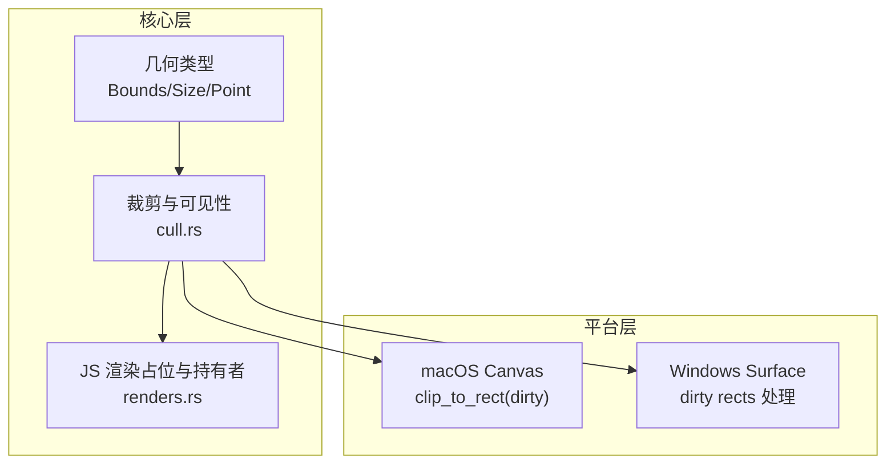
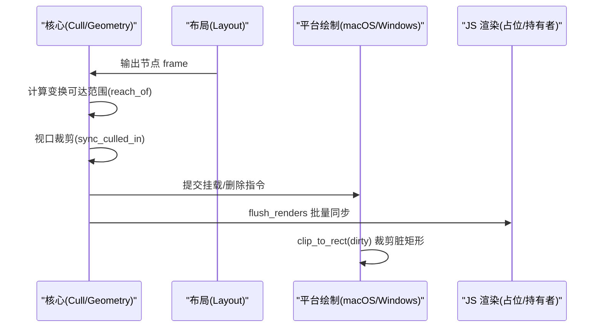
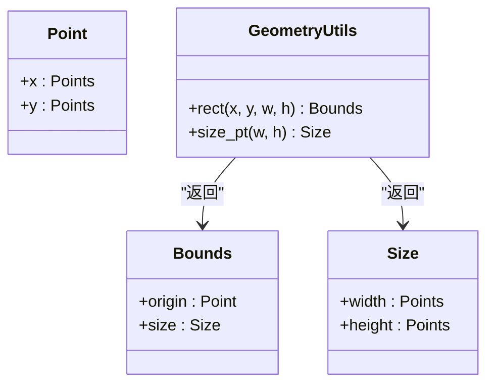
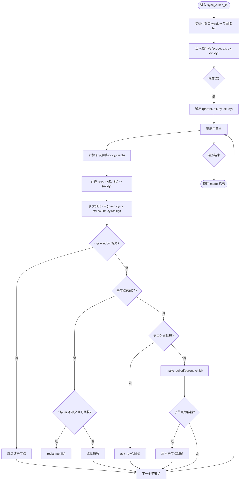
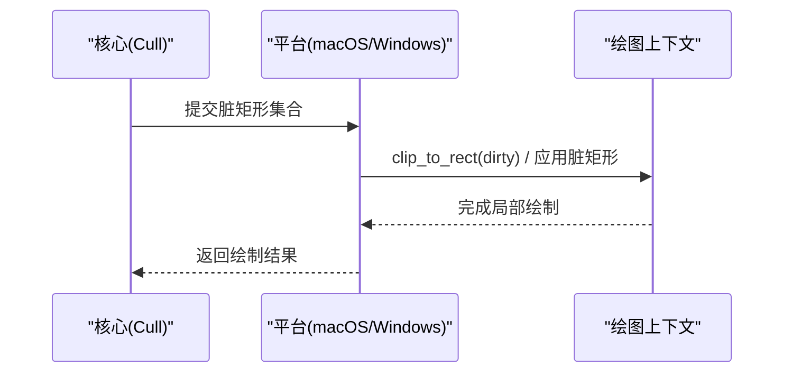
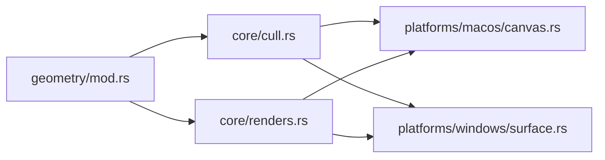

# 脏矩形检测

<cite>
**本文引用的文件**   
- [crates/nsh-core/src/core/cull.rs](file://crates/nsh-core/src/core/cull.rs)
- [crates/nsh-core/src/core/renders.rs](file://crates/nsh-core/src/core/renders.rs)
- [crates/nsh-core/src/element/renderer.rs](file://crates/nsh-core/src/element/renderer.rs)
- [crates/nsh-core/src/geometry/mod.rs](file://crates/nsh-core/src/geometry/mod.rs)
- [crates/nsh-platform-macos/src/canvas.rs](file://crates/nsh-platform-macos/src/canvas.rs)
- [crates/nsh-platform-windows/src/surface.rs](file://crates/nsh-platform-windows/src/surface.rs)
</cite>

## 目录
1. [简介](#简介)
2. [项目结构](#项目结构)
3. [核心组件](#核心组件)
4. [架构总览](#架构总览)
5. [详细组件分析](#详细组件分析)
6. [依赖关系分析](#依赖关系分析)
7. [性能考量](#性能考量)
8. [故障排查指南](#故障排查指南)
9. [结论](#结论)

## 简介
本技术文档聚焦 NSH 的“脏矩形检测与增量重绘”体系，围绕以下目标展开：
- 解释脏区域跟踪算法：增量更新检测、区域合并策略。
- 详细说明裁剪算法：视口裁剪、重叠检测、变换可达范围对脏区域的放大。
- 描述脏矩形的数据结构设计与存储优化。
- 说明脏区域传播机制：父子元素间的脏状态传递。
- 解释脏矩形合并算法：减少不必要的重绘区域。
- 给出性能监控指标、优化建议与复杂场景调试方法。

NSH 的核心渲染管线通过布局、裁剪（culling）、挂载（mount）与平台绘制协同工作；脏矩形在平台层被用于限制重绘范围，而核心层通过“可见性窗口 + 变换可达范围”决定哪些子树需要创建或回收，从而间接控制脏区域的产生与收敛。

## 项目结构
与脏矩形相关的代码主要分布在核心几何、核心裁剪与平台绘制三个层面：
- 核心几何：统一的点、尺寸、边界等类型定义，保证零开销表示与转换。
- 核心裁剪：滚动视口内的内容裁剪、变换可达范围计算、占位符行与回收策略。
- 平台绘制：macOS 与 Windows 等平台将脏矩形传递给底层绘图上下文进行裁剪。



**图表来源**
- [crates/nsh-core/src/geometry/mod.rs:1-56](file://crates/nsh-core/src/geometry/mod.rs#L1-L56)
- [crates/nsh-core/src/core/cull.rs:1-702](file://crates/nsh-core/src/core/cull.rs#L1-L702)
- [crates/nsh-core/src/core/renders.rs:1-292](file://crates/nsh-core/src/core/renders.rs#L1-L292)
- [crates/nsh-platform-macos/src/canvas.rs:544-641](file://crates/nsh-platform-macos/src/canvas.rs#L544-L641)
- [crates/nsh-platform-windows/src/surface.rs:786-786](file://crates/nsh-platform-windows/src/surface.rs#L786-L786)

**章节来源**
- [crates/nsh-core/src/geometry/mod.rs:1-56](file://crates/nsh-core/src/geometry/mod.rs#L1-L56)
- [crates/nsh-core/src/core/cull.rs:1-702](file://crates/nsh-core/src/core/cull.rs#L1-L702)
- [crates/nsh-core/src/core/renders.rs:1-292](file://crates/nsh-core/src/core/renders.rs#L1-L292)

## 核心组件
- 几何类型与工具函数：提供 Bounds、Size、Point 等类型以及 rect/size_pt 等构造器，确保核心布局与裁剪路径上的零开销操作。
- 裁剪子系统：负责滚动视口内内容的创建/回收、占位符行估算、变换可达范围计算、不可见子树的回收判定。
- JS 渲染占位与持有者：管理组件的 JS 渲染槽位、占位符与持有者视图的生命周期，驱动 flush_renders 批量同步。
- 平台绘制接口：macOS 使用 CGContext::clip_to_rect 将脏矩形传给绘图上下文；Windows 表面层接收并处理脏矩形列表。

**章节来源**
- [crates/nsh-core/src/geometry/mod.rs:1-56](file://crates/nsh-core/src/geometry/mod.rs#L1-L56)
- [crates/nsh-core/src/core/cull.rs:1-702](file://crates/nsh-core/src/core/cull.rs#L1-L702)
- [crates/nsh-core/src/core/renders.rs:1-292](file://crates/nsh-core/src/core/renders.rs#L1-L292)
- [crates/nsh-platform-macos/src/canvas.rs:544-641](file://crates/nsh-platform-macos/src/canvas.rs#L544-L641)
- [crates/nsh-platform-windows/src/surface.rs:786-786](file://crates/nsh-platform-windows/src/surface.rs#L786-L786)

## 架构总览
脏矩形检测与增量重绘的整体流程如下：
- 布局阶段产出每个节点的 frame（包含位置与尺寸）。
- 裁剪阶段根据滚动视口与变换可达范围，决定节点是否需要创建或回收。
- 平台层在绘制时依据脏矩形进行裁剪，仅重绘受影响区域。
- JS 渲染占位与持有者在 commit 后批量同步，避免频繁跨语言调用。



**图表来源**
- [crates/nsh-core/src/core/cull.rs:92-127](file://crates/nsh-core/src/core/cull.rs#L92-L127)
- [crates/nsh-core/src/core/cull.rs:304-420](file://crates/nsh-core/src/core/cull.rs#L304-L420)
- [crates/nsh-core/src/core/renders.rs:234-292](file://crates/nsh-core/src/core/renders.rs#L234-L292)
- [crates/nsh-platform-macos/src/canvas.rs:544-641](file://crates/nsh-platform-macos/src/canvas.rs#L544-L641)

## 详细组件分析

### 几何类型与工具函数
- 统一单位与形状：Points、Size、Bounds、Point 等类型在核心路径上零开销。
- 构造器：rect(x,y,w,h) 与 size_pt(w,h) 为布局与裁剪提供便捷 API。
- 设计要点：所有长度/角度在平台边界处转换，核心内部保持 f32 精度与比较语义。



**图表来源**
- [crates/nsh-core/src/geometry/mod.rs:1-56](file://crates/nsh-core/src/geometry/mod.rs#L1-L56)

**章节来源**
- [crates/nsh-core/src/geometry/mod.rs:1-56](file://crates/nsh-core/src/geometry/mod.rs#L1-L56)

### 裁剪子系统（视口裁剪与重叠检测）
- 可达范围计算：reach_of 遍历 transform ops，考虑动画 bound，返回 (dx, dy) 作为矩形扩大的量；无法界定的变换（缩放、旋转、透视、无界平移）返回 None，导致整棵子树不被裁剪。
- 视口窗口与回收阈值：OVERSCAN 与 RECLAIM 分别定义“近窗扩大区”和“远窗回收区”，结合 window/far 两个矩形判断是否创建或回收。
- 容器遍历与栈式扫描：sync_culled_in 使用栈遍历子树，按父级累积变换可达范围 ex/ey，并对子节点 frame 做扩大 r = (cx-rx, cy-ry, cx+cw+rx, cy+ch+ry)。
- 重叠检测：meets(w) 判断扩大后的矩形是否与视口窗口相交，决定是否创建或跳过。
- 占位符行：placeholder 与 ask_row 配合，先以固定高度估算，再根据已渲染行的平均尺寸动态调整。



**图表来源**
- [crates/nsh-core/src/core/cull.rs:304-420](file://crates/nsh-core/src/core/cull.rs#L304-L420)
- [crates/nsh-core/src/core/cull.rs:92-127](file://crates/nsh-core/src/core/cull.rs#L92-L127)
- [crates/nsh-core/src/core/cull.rs:584-607](file://crates/nsh-core/src/core/cull.rs#L584-L607)

**章节来源**
- [crates/nsh-core/src/core/cull.rs:1-702](file://crates/nsh-core/src/core/cull.rs#L1-L702)

### JS 渲染占位与持有者（脏区域传播与增量更新）
- 占位映射：places 将 NodeId 映射到 RenderPlace，slots 维护 (host, prop, key) 的状态，holders 记录 JS 创建的 holder 与其插入位置。
- 增量更新：update_render 比较 old/new RenderAt，若 host/prop/key 相同但值不同，则仅标记 dirty 并等待 flush_renders。
- 生命周期：forget_render_place 移除占位，insert/remove_render_holder 管理 holder 的挂载与卸载。
- 批量同步：flush_renders 遍历 dirty slots，向 JS 发送 Render/Unrender 事件，并将 holder 插入对应 placeholder。

```mermaid
classDiagram
class Renders {
-places : FxHashMap<NodeId, RenderPlace>
-slots : FxHashMap<(NodeId, Arc~str~), RenderSlot>
-holders : FxHashMap<NodeId, (Arc~str~, NodeId)>
-dirty : Vec<(NodeId, Arc~str~)>
+is_empty() bool
+is_place(id) bool
+update_render(id, old, new) void
+forget_render_place(id) void
+set_render_holder(id, slot) void
+insert_render_holder(host, holder) void
+remove_render_holder(holder, released) void
+cells_awaiting_renders(out) void
+flush_renders() void
}
class RenderPlace {
+host : NodeId
+prop : &static str
+key : SharedString
+value : Rc<dyn RenderValue>
+func : Option<Rc<dyn CallbackHandle>>
+slot() Arc~str~
}
class RenderSlot {
+prop : &static str
+key : SharedString
+places : Vec<NodeId>
+sent : Option<Rc<dyn RenderValue>>
+holder : Option<NodeId>
}
Renders --> RenderPlace : "映射"
Renders --> RenderSlot : "状态"
```

**图表来源**
- [crates/nsh-core/src/core/renders.rs:30-67](file://crates/nsh-core/src/core/renders.rs#L30-L67)
- [crates/nsh-core/src/core/renders.rs:69-110](file://crates/nsh-core/src/core/renders.rs#L69-L110)
- [crates/nsh-core/src/core/renders.rs:112-133](file://crates/nsh-core/src/core/renders.rs#L112-L133)
- [crates/nsh-core/src/core/renders.rs:135-199](file://crates/nsh-core/src/core/renders.rs#L135-L199)
- [crates/nsh-core/src/core/renders.rs:234-292](file://crates/nsh-core/src/core/renders.rs#L234-L292)

**章节来源**
- [crates/nsh-core/src/core/renders.rs:1-292](file://crates/nsh-core/src/core/renders.rs#L1-L292)
- [crates/nsh-core/src/element/renderer.rs:161-185](file://crates/nsh-core/src/element/renderer.rs#L161-L185)
- [crates/nsh-core/src/element/renderer.rs:236-275](file://crates/nsh-core/src/element/renderer.rs#L236-L275)

### 平台层脏矩形裁剪（macOS/Windows）
- macOS：在绘制回调中使用 CGContext::clip_to_rect(dirty) 将脏矩形传入绘图上下文，限制后续绘制区域。
- Windows：surface 层接收脏矩形列表并进行相应处理（例如构建绘制命令或缓冲更新）。



**图表来源**
- [crates/nsh-platform-macos/src/canvas.rs:544-641](file://crates/nsh-platform-macos/src/canvas.rs#L544-L641)
- [crates/nsh-platform-windows/src/surface.rs:786-786](file://crates/nsh-platform-windows/src/surface.rs#L786-L786)

**章节来源**
- [crates/nsh-platform-macos/src/canvas.rs:544-641](file://crates/nsh-platform-macos/src/canvas.rs#L544-L641)
- [crates/nsh-platform-windows/src/surface.rs:786-786](file://crates/nsh-platform-windows/src/surface.rs#L786-L786)

## 依赖关系分析
- 几何模块被裁剪子系统广泛使用，提供统一的坐标与尺寸类型。
- 裁剪子系统依赖布局输出的 frame 与样式信息，同时与 JS 渲染系统交互（占位符行与 holder 生命周期）。
- 平台层依赖核心提交的挂载/删除指令与脏矩形集合，执行实际绘制裁剪。



**图表来源**
- [crates/nsh-core/src/geometry/mod.rs:1-56](file://crates/nsh-core/src/geometry/mod.rs#L1-L56)
- [crates/nsh-core/src/core/cull.rs:1-702](file://crates/nsh-core/src/core/cull.rs#L1-L702)
- [crates/nsh-core/src/core/renders.rs:1-292](file://crates/nsh-core/src/core/renders.rs#L1-L292)
- [crates/nsh-platform-macos/src/canvas.rs:544-641](file://crates/nsh-platform-macos/src/canvas.rs#L544-L641)
- [crates/nsh-platform-windows/src/surface.rs:786-786](file://crates/nsh-platform-windows/src/surface.rs#L786-L786)

**章节来源**
- [crates/nsh-core/src/geometry/mod.rs:1-56](file://crates/nsh-core/src/geometry/mod.rs#L1-L56)
- [crates/nsh-core/src/core/cull.rs:1-702](file://crates/nsh-core/src/core/cull.rs#L1-L702)
- [crates/nsh-core/src/core/renders.rs:1-292](file://crates/nsh-core/src/core/renders.rs#L1-L292)

## 性能考量
- 变换可达范围：对可界定的平移与分数平移进行累加，避免对缩放/旋转/透视等不可界定变换进行裁剪，防止大面积重绘。
- OVERSCAN/RECLAIM：合理设置过扫与回收阈值，减少频繁创建/销毁视图带来的抖动。
- 占位符行估算：先用固定高度占位，再根据已渲染行的平均尺寸动态调整，降低布局抖动与二次测量成本。
- 批量同步：flush_renders 聚合 dirty slots，减少跨语言调用次数。
- 回收判定：reclaimable 检查节点是否持有状态（输入、WebView、Video、Native、Canvas、Shader、Scroll、List、Stack、Root、Component、Animation、交互态、覆盖层等），避免误回收导致状态丢失。

优化建议：
- 尽量使用可界定的变换（如 TranslateX/Y 与有限范围的动画），以便裁剪生效。
- 对大型列表启用 content culling，并结合合理的 OVERSCAN/RECLAIM 参数。
- 避免在高频更新路径中触发不可界定的变换，必要时拆分 UI 层级以降低影响范围。
- 使用占位符行与平均尺寸估算，减少布局抖动。

[本节为通用指导，不直接分析具体文件]

## 故障排查指南
常见问题与定位方法：
- 脏区域过大：检查是否存在不可界定的变换（缩放/旋转/透视），或使用了手势/滚动值导致的 reach_of 返回 None。
- 视图未创建：确认是否在视口窗口内，或是否被 never_culled 排除（sticky/follow/decoration/overlay/layout root）。
- 视图过早回收：检查 reclaimable 条件，确认节点是否持有状态或处于交互态。
- JS 渲染未同步：查看 flush_renders 是否被调用，dirty slots 是否正确更新，holder 是否成功插入 placeholder。

调试步骤：
- 打印 reach_of 返回值，确认变换可达范围是否符合预期。
- 观察 sync_culled_in 中的 meets(window)/meets(far) 判断，确认视口窗口与回收阈值。
- 检查占位符行 ask_row 与 size_placeholders 的执行顺序，确认平均尺寸估算是否生效。
- 在平台层断点 clip_to_rect(dirty)，验证脏矩形集合是否合理。

**章节来源**
- [crates/nsh-core/src/core/cull.rs:92-127](file://crates/nsh-core/src/core/cull.rs#L92-L127)
- [crates/nsh-core/src/core/cull.rs:304-420](file://crates/nsh-core/src/core/cull.rs#L304-L420)
- [crates/nsh-core/src/core/cull.rs:511-582](file://crates/nsh-core/src/core/cull.rs#L511-L582)
- [crates/nsh-core/src/core/renders.rs:234-292](file://crates/nsh-core/src/core/renders.rs#L234-L292)
- [crates/nsh-platform-macos/src/canvas.rs:544-641](file://crates/nsh-platform-macos/src/canvas.rs#L544-L641)

## 结论
NSH 的脏矩形检测与增量重绘体系通过几何类型抽象、核心裁剪逻辑与平台绘制裁剪三者协作，实现了高效的局部重绘。关键要点包括：
- 使用 reach_of 精确计算变换可达范围，避免不必要的全局重绘。
- 基于 OVERSCAN/RECLAIM 的视口窗口与回收阈值，平衡性能与体验。
- 占位符行与平均尺寸估算降低布局抖动。
- JS 渲染占位与持有者的批量同步减少跨语言调用开销。
- 平台层 clip_to_rect 与脏矩形集合确保绘制仅在受影响区域进行。

在实际工程中，应优先保证变换的可界定性、合理配置裁剪参数，并利用占位符行与批量同步机制提升整体性能。对于复杂场景，可通过日志与断点逐步定位脏区域异常与视图生命周期问题。