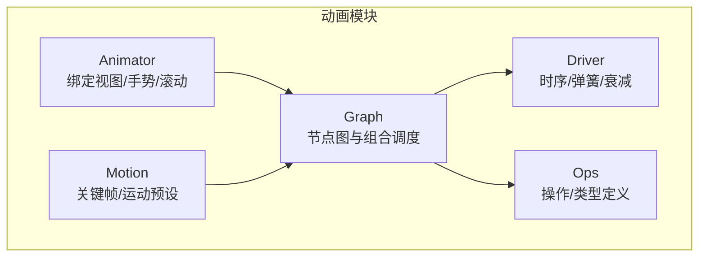
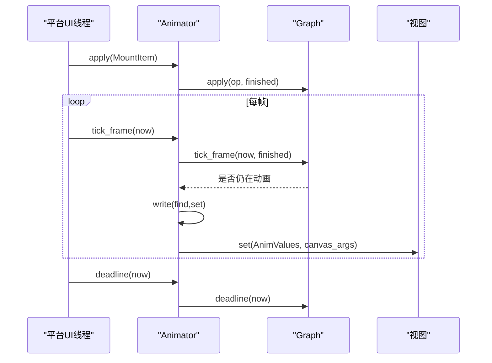
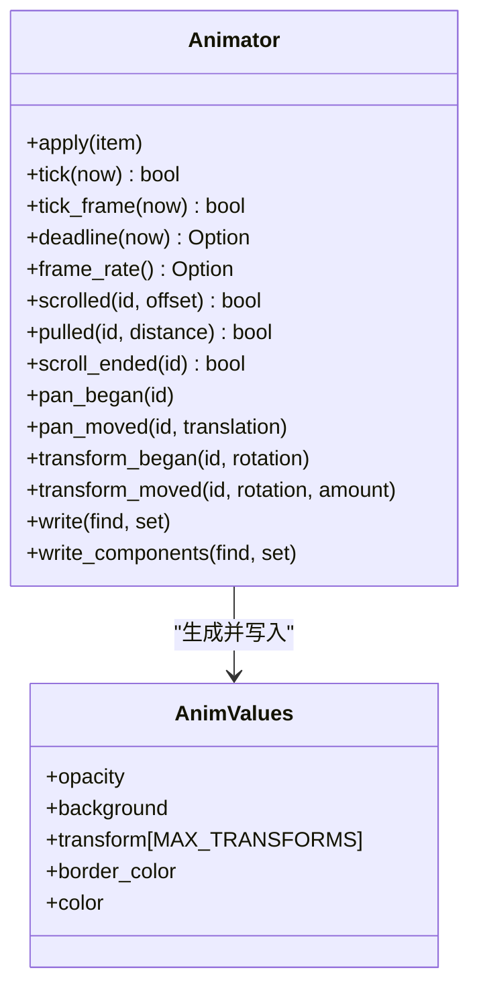
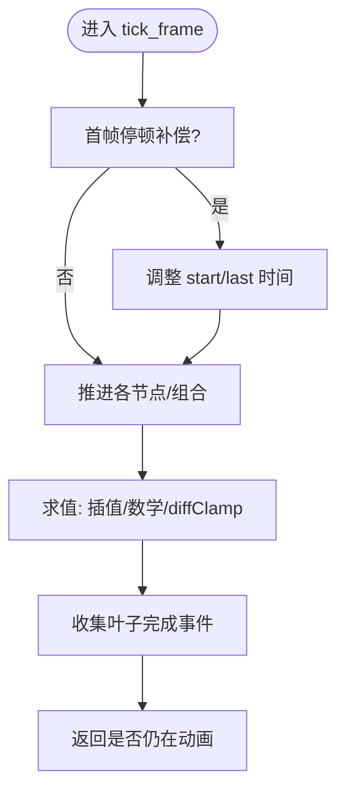
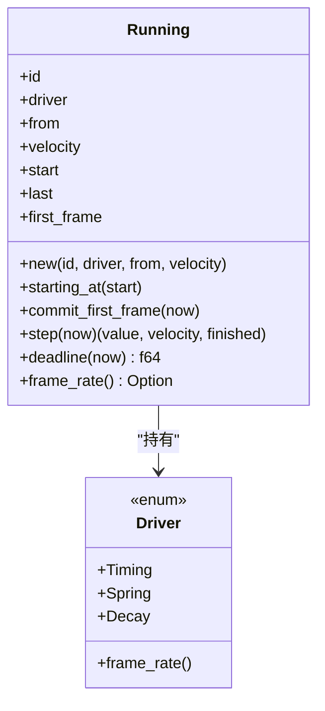
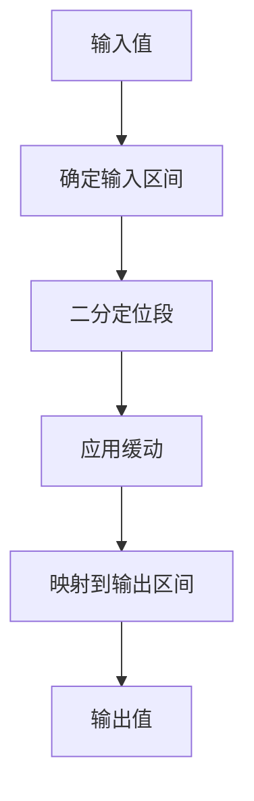
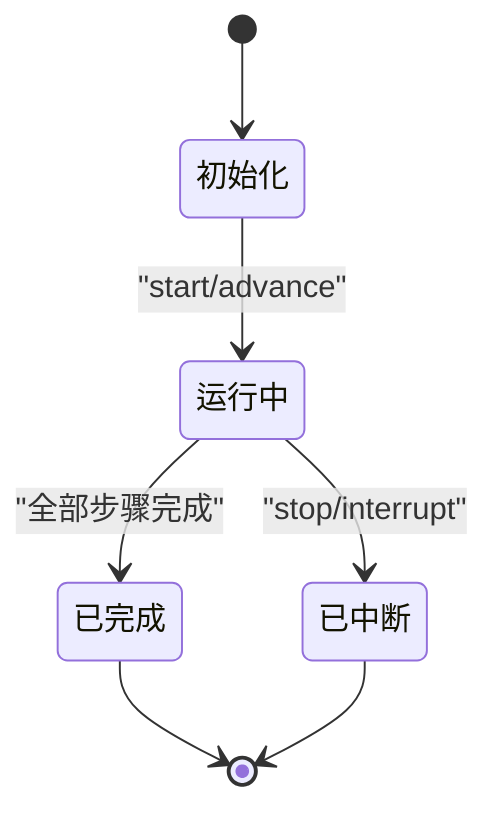
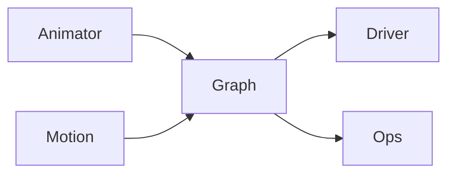
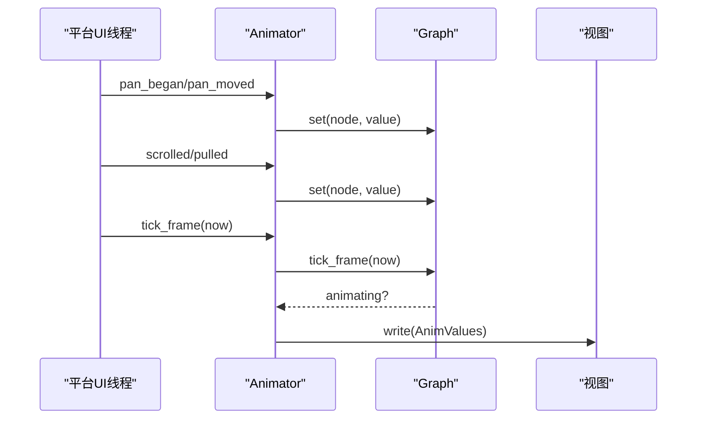

# 动画器核心

<cite>
**本文引用的文件**   
- [animator.rs](file://crates/nsh-core/src/animation/animator.rs)
- [driver.rs](file://crates/nsh-core/src/animation/driver.rs)
- [graph.rs](file://crates/nsh-core/src/animation/graph.rs)
- [mod.rs](file://crates/nsh-core/src/animation/mod.rs)
- [ops.rs](file://crates/nsh-core/src/animation/ops.rs)
- [motion.rs](file://crates/nsh-core/src/animation/motion.rs)
- [animation.md](file://docs/dev/animation.md)
</cite>

## 目录
1. [简介](#简介)
2. [项目结构](#项目结构)
3. [核心组件](#核心组件)
4. [架构总览](#架构总览)
5. [详细组件分析](#详细组件分析)
6. [依赖关系分析](#依赖关系分析)
7. [性能与帧率优化](#性能与帧率优化)
8. [平台集成与异步更新](#平台集成与异步更新)
9. [故障排查指南](#故障排查指南)
10. [结论](#结论)
11. [附录：使用示例路径](#附录使用示例路径)

## 简介
本文件面向 NSH 动画器的核心实现，聚焦 Animator 类的架构设计、Driver 接口模式、动画值计算流程（插值与缓动）、以及动画器与平台 UI 线程的集成方式。文档同时给出关键流程图与时序图，帮助读者理解动画生命周期管理、状态跟踪和性能监控机制。

## 项目结构
动画子系统位于 nsh-core 的 animation 模块中，采用“数据驱动 + 原生执行”的设计：JS 或 Rust 构建动画节点与组合树，UI 线程每帧在原生侧推进并回写视图属性。

**图示来源**  
- [animator.rs:40-65](file://crates/nsh-core/src/animation/animator.rs#L40-L65)  
- [graph.rs:158-194](file://crates/nsh-core/src/animation/graph.rs#L158-L194)  
- [driver.rs:1-25](file://crates/nsh-core/src/animation/driver.rs#L1-L25)  
- [mod.rs:1-20](file://crates/nsh-core/src/animation/mod.rs#L1-L20)

**章节来源**  
- [mod.rs:1-20](file://crates/nsh-core/src/animation/mod.rs#L1-L20)

## 核心组件
- Animator：桌面后端主线程上的动画器，负责将 Graph 的计算结果写入视图属性，处理手势、滚动与粘性单元等输入，并收集已完成的动画事件。
- Graph：动画节点图与组合调度器，维护数值节点、插值、数学运算、diffClamp、组合序列/并行/循环等，提供 tick/tick_frame/deadline/frame_rate 等能力。
- Driver：采样驱动抽象，包含 Timing/Spring/Decay 三类闭形式驱动，提供 step/deadline/frame_rate 等接口，以及参数清洗与曲线采样。
- Ops/Motion：动画操作与类型定义、关键帧与运动预设的数据模型，统一转换为组合树由 Graph 运行。

**章节来源**  
- [animator.rs:17-65](file://crates/nsh-core/src/animation/animator.rs#L17-L65)  
- [graph.rs:158-194](file://crates/nsh-core/src/animation/graph.rs#L158-L194)  
- [driver.rs:40-54](file://crates/nsh-core/src/animation/driver.rs#L40-L54)  
- [mod.rs:22-36](file://crates/nsh-core/src/animation/mod.rs#L22-L36)

## 架构总览
Animator 作为平台无关的“图形-视图”桥接层，接收来自布局/手势/滚动的 MountItem，调用 Graph.apply 应用动画操作；每帧通过 tick/tick_frame 推进 Graph，再 write/write_components 将 AnimValues 写回视图。

**图示来源**  
- [animator.rs:67-186](file://crates/nsh-core/src/animation/animator.rs#L67-L186)  
- [graph.rs:158-194](file://crates/nsh-core/src/animation/graph.rs#L158-L194)

**章节来源**  
- [animator.rs:67-186](file://crates/nsh-core/src/animation/animator.rs#L67-L186)

## 详细组件分析

### Animator：视图绑定、手势与滚动集成
- 职责
  - 解析 MountItem：动画操作、组件槽位、动画绑定、手势、滚动配置、粘性单元格、删除等。
  - 推进动画：tick/tick_frame 委托给 Graph，收集 Finished 事件。
  - 时间截止：deadline 用于非帧驱动的截止时间点（如定时结束、弹簧收敛）。
  - 帧率协商：frame_rate 汇总运行中的最高需求。
  - 输入接入：scrolled/pulled/scroll_ended 将滚动偏移映射到绑定的值节点；pan/transform 直接驱动值节点。
  - 输出写入：write 将 opacity/background/border_color/color/transform/canvas 等属性写入视图；write_components 仅当值变化时通知原生组件槽位。

- 关键数据结构
  - AnimValues：每个视图的动画属性集合（透明度、背景色、边框色、文本色、变换项、画布参数）。
  - bindings/gestures/scrolls/pulls/sticky/component_slots/component_values：各类绑定与状态表。

**图示来源**  
- [animator.rs:17-65](file://crates/nsh-core/src/animation/animator.rs#L17-L65)  
- [animator.rs:67-362](file://crates/nsh-core/src/animation/animator.rs#L67-L362)

**章节来源**  
- [animator.rs:67-362](file://crates/nsh-core/src/animation/animator.rs#L67-L362)

### Graph：节点图、组合调度与 diffClamp
- 节点类型
  - Value：带 offset/velocity 的数值节点，可附着 Running 驱动。
  - Interpolate：分段插值，支持外推策略与缓动。
  - DiffClamp：差分钳制，支持 snap 吸附（滚动停止后向最近边界收敛）。
  - Math：二元算术节点。
- 组合调度 Step
  - Run/Sequence/Parallel/Delay/Loop：组合动画树，精确衔接无帧间隙，支持 stop_together、reset、iterations 等语义。
- 帧与截止时间
  - tick/tick_frame：区分首帧停顿补偿与真实时间推进。
  - deadline：为无需逐帧推进的动画（如定时结束、弹簧收敛）提供下一次检查点。
  - frame_rate：聚合所有运行步骤的最高帧率需求。
- diffClamp 吸附
  - scroll_ended 触发 settle，使跟随滚动值的 diffClamp 平滑收敛至边界。

**图示来源**  
- [graph.rs:158-194](file://crates/nsh-core/src/animation/graph.rs#L158-L194)  
- [graph.rs:224-259](file://crates/nsh-core/src/animation/graph.rs#L224-L259)  
- [graph.rs:325-450](file://crates/nsh-core/src/animation/graph.rs#L325-L450)

**章节来源**  
- [graph.rs:158-194](file://crates/nsh-core/src/animation/graph.rs#L158-L194)  
- [graph.rs:224-259](file://crates/nsh-core/src/animation/graph.rs#L224-L259)  
- [graph.rs:325-450](file://crates/nsh-core/src/animation/graph.rs#L325-L450)

### Driver：采样驱动器与缓动函数
- 驱动类型
  - Timing：基于时长与缓动的线性插值。
  - Spring：阻尼弹簧（欠阻尼/临界阻尼/过阻尼），闭环公式计算位移与速度。
  - Decay：衰减运动，支持 clamp 与 bounce 反弹。
- 参数清洗 sanitized
  - 对非法参数进行安全降级（如负阻尼归零、NaN 延迟视为无延迟、无穷大目标等），并在启动时告警一次。
- 采样与绘制
  - sample_easing/samples_driver：按固定步长采样曲线，供预览绘制与调试。
- 首帧停顿补偿 first_frame_stall
  - 当 UI 线程被阻塞导致首帧延迟较大时，自动将动画起点向后平移，避免跳变。

**图示来源**  
- [driver.rs:40-54](file://crates/nsh-core/src/animation/driver.rs#L40-L54)  
- [driver.rs:56-120](file://crates/nsh-core/src/animation/driver.rs#L56-L120)  
- [driver.rs:173-243](file://crates/nsh-core/src/animation/driver.rs#L173-L243)  
- [driver.rs:315-382](file://crates/nsh-core/src/animation/driver.rs#L315-L382)

**章节来源**  
- [driver.rs:1-25](file://crates/nsh-core/src/animation/driver.rs#L1-L25)  
- [driver.rs:56-120](file://crates/nsh-core/src/animation/driver.rs#L56-L120)  
- [driver.rs:173-243](file://crates/nsh-core/src/animation/driver.rs#L173-L243)  
- [driver.rs:315-382](file://crates/nsh-core/src/animation/driver.rs#L315-L382)

### 动画值计算流程：插值与缓动
- 插值 Interpolate
  - 输入范围与输出映射，支持 extrapolate/extrapolateLeft/extrapolateRight。
  - 断点有序，二分查找段内插值。
- 缓动 Easing
  - 支持 CSS 关键词、贝塞尔曲线、steps、React Native 曲线族。
  - ease(easing, p) 提供单调且边界固定的映射。
- 数学节点 Math
  - add/sub/mul/div/mod 等运算，支持节点与常量混合。

**图示来源**  
- [graph.rs:64-101](file://crates/nsh-core/src/animation/graph.rs#L64-L101)  
- [driver.rs:582-695](file://crates/nsh-core/src/animation/driver.rs#L582-L695)

**章节来源**  
- [graph.rs:64-101](file://crates/nsh-core/src/animation/graph.rs#L64-L101)  
- [driver.rs:582-695](file://crates/nsh-core/src/animation/driver.rs#L582-L695)

### 组合动画与生命周期
- 组合类型
  - Sequence：顺序执行，上一步结束即下一步开始，无帧间隙。
  - Parallel：并行执行，可选 stop_together 同步终止。
  - Delay：延时等待。
  - Loop：循环，支持迭代次数与 reset 初始值恢复。
- 生命周期
  - start：创建叶子驱动并记录 started 节点。
  - advance：推进当前步骤，收集 leaf_ends。
  - stop：中断未执行的后续步骤，必要时保留速度以衔接新驱动。
  - finish：向 JS 报告 Finished（含 finished 标志与读取值）。

**图示来源**  
- [graph.rs:224-259](file://crates/nsh-core/src/animation/graph.rs#L224-L259)  
- [graph.rs:325-450](file://crates/nsh-core/src/animation/graph.rs#L325-L450)

**章节来源**  
- [graph.rs:224-259](file://crates/nsh-core/src/animation/graph.rs#L224-L259)  
- [graph.rs:325-450](file://crates/nsh-core/src/animation/graph.rs#L325-L450)

### 关键帧与运动（Motion）
- MotionSpec/PRESETS：声明式的关键帧与通道（透明度、平移、旋转、缩放），统一转为 Composite 树。
- Keyframes：Web Animations API 风格的关键帧，自动解析偏移、顺序与反向播放。
- Stagger：交错延迟，支持从首/尾/中心/索引计数。
- Reduced motion：低电量/无障碍模式下退化为瞬时过渡。

**章节来源**  
- [motion.rs](file://crates/nsh-core/src/animation/motion.rs)  
- [animation.md:80-110](file://docs/dev/animation.md#L80-L110)

## 依赖关系分析
- Animator 依赖 Graph 进行求值与调度，依赖 ops 提供的类型与操作。
- Graph 依赖 driver 的 Running/Easing 进行具体驱动步进与曲线计算。
- Motion 将高层描述编译为 Composite，交由 Graph 运行。
- 平台侧通过 Animator.apply/tick_frame/write 与动画系统交互。

**图示来源**  
- [animator.rs:40-65](file://crates/nsh-core/src/animation/animator.rs#L40-L65)  
- [graph.rs:158-194](file://crates/nsh-core/src/animation/graph.rs#L158-L194)  
- [driver.rs:40-54](file://crates/nsh-core/src/animation/driver.rs#L40-L54)  
- [mod.rs:22-36](file://crates/nsh-core/src/animation/mod.rs#L22-L36)

**章节来源**  
- [animator.rs:40-65](file://crates/nsh-core/src/animation/animator.rs#L40-L65)  
- [graph.rs:158-194](file://crates/nsh-core/src/animation/graph.rs#L158-L194)  
- [driver.rs:40-54](file://crates/nsh-core/src/animation/driver.rs#L40-L54)  
- [mod.rs:22-36](file://crates/nsh-core/src/animation/mod.rs#L22-L36)

## 性能与帧率优化
- 首帧停顿补偿：当 UI 线程被阻塞导致首帧延迟超过阈值时，自动平移动画起点，避免视觉跳变。
- 截止时间驱动：对已知结束时间的动画（Timing）或可解析收敛点的动画（Spring/Decay）使用 deadline 减少无效帧。
- 帧率协商：各驱动声明所需最高帧率，Graph 聚合后由平台按需降低刷新率。
- 采样上限：曲线与驱动采样设置 MAX_SAMPLES，防止预览绘制开销过大。
- diffClamp 吸附：滚动停止后快速收敛至边界，减少持续计算。

**章节来源**  
- [driver.rs:12-24](file://crates/nsh-core/src/animation/driver.rs#L12-L24)  
- [driver.rs:34-38](file://crates/nsh-core/src/animation/driver.rs#L34-L38)  
- [driver.rs:505-537](file://crates/nsh-core/src/animation/driver.rs#L505-L537)  
- [graph.rs:16-20](file://crates/nsh-core/src/animation/graph.rs#L16-L20)  
- [animation.md:179-186](file://docs/dev/animation.md#L179-L186)

## 平台集成与异步更新
- 桌面后端：Animator 在主线程上运行，每帧调用 tick_frame 推进 Graph，再将 AnimValues 写回视图；deadlines 由平台定时器驱动，确保隐藏窗口也能按时结束。
- 移动端：样式过渡与布局动画走平台原生管线（Core Animation/ValueAnimator），但动画值仍由 Graph 计算；颜色过渡在移动端的处理方式与桌面端一致。
- Web：布局动画与转场使用 Web Animations/CSS，动画值仍在 Rust 侧计算。
- 手势与滚动：Animator.pan_* / transform_* / scrolled / pulled / scroll_ended 将用户输入直接映射到值节点，保证“指针跟随”的即时性。

**图示来源**  
- [animator.rs:194-290](file://crates/nsh-core/src/animation/animator.rs#L194-L290)  
- [animator.rs:292-327](file://crates/nsh-core/src/animation/animator.rs#L292-L327)

**章节来源**  
- [animator.rs:194-327](file://crates/nsh-core/src/animation/animator.rs#L194-L327)  
- [animation.md:153-178](file://docs/dev/animation.md#L153-L178)

## 故障排查指南
- 参数越界告警：sanitized 会将非法参数安全降级，并在动画启动时告警一次（例如负阻尼、无穷大持续时间、NaN 延迟等）。
- 溢出保护：若中间计算溢出，动画会立即停在目标或起始位置，避免传播 NaN。
- diffClamp 吸附异常：确认 scroll_ended 是否被正确调用；检查 min/max 是否形成有效有限区间。
- 首帧跳变：若出现首帧跳变，检查是否存在长时间 UI 线程阻塞；必要时启用首帧停顿补偿逻辑。
- 循环不结束：检查 Loop 是否设置了 iterations；若无，需外部干预或确保内部步骤有结束条件。

**章节来源**  
- [driver.rs:315-382](file://crates/nsh-core/src/animation/driver.rs#L315-L382)  
- [driver.rs:465-475](file://crates/nsh-core/src/animation/driver.rs#L465-L475)  
- [graph.rs:137-153](file://crates/nsh-core/src/animation/graph.rs#L137-L153)

## 结论
NSH 动画器以 Graph 为核心，结合 Animator 的平台绑定与 Driver 的闭形式驱动，实现了高性能、跨平台的动画系统。其设计强调：
- 数据驱动的组合树与原生执行分离
- 首帧停顿补偿与截止时间驱动提升稳定性
- 帧率协商与采样上限控制性能
- 手势/滚动直连值节点保证响应性
- diffClamp 吸附与 Motion 预设增强体验

## 附录：使用示例路径
以下示例展示如何创建与管理动画实例（路径引用，不含代码内容）：
- 创建数值与插值节点、组合动画、绑定到视图属性
  - [animator.rs:372-446](file://crates/nsh-core/src/animation/animator.rs#L372-L446)
- 使用 keyframes 与 motion 预设
  - [motion.rs](file://crates/nsh-core/src/animation/motion.rs)
  - [animation.md:80-110](file://docs/dev/animation.md#L80-L110)
- 采样曲线与驱动用于预览
  - [driver.rs:505-537](file://crates/nsh-core/src/animation/driver.rs#L505-L537)