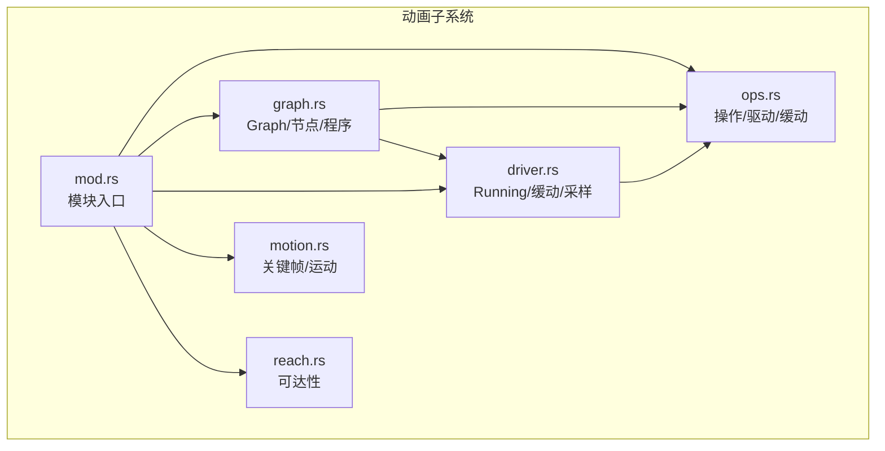
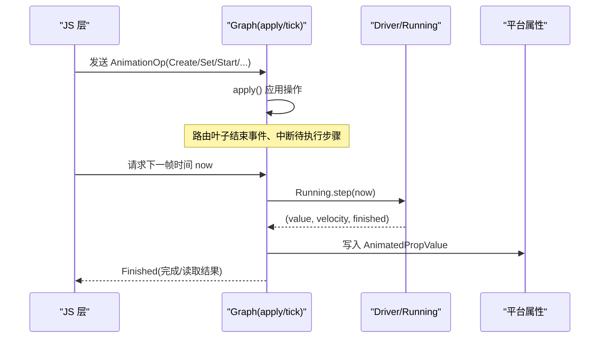
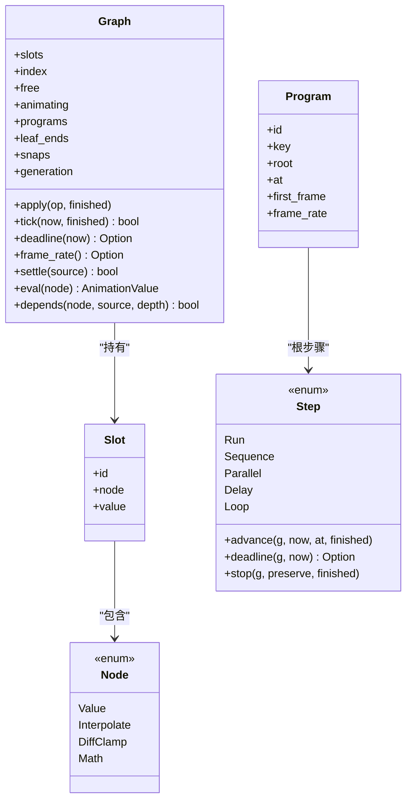
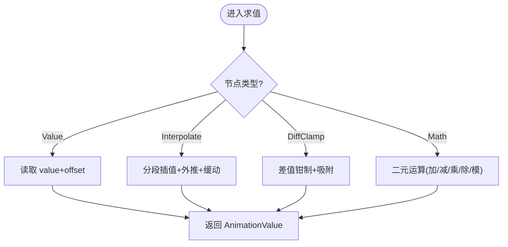
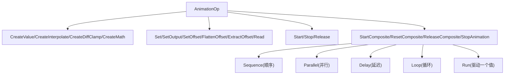
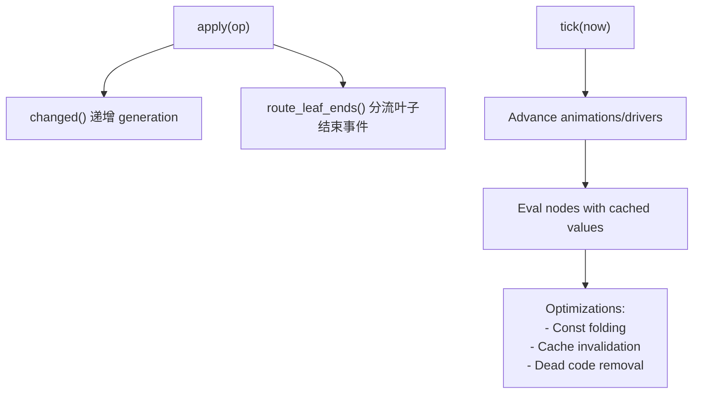

# 动画图系统

<cite>
**本文引用的文件**   
- [graph.rs](file://crates/nsh-core/src/animation/graph.rs)
- [ops.rs](file://crates/nsh-core/src/animation/ops.rs)
- [driver.rs](file://crates/nsh-core/src/animation/driver.rs)
- [mod.rs](file://crates/nsh-core/src/animation/mod.rs)
</cite>

## 目录
1. [引言](#引言)
2. [项目结构](#项目结构)
3. [核心组件](#核心组件)
4. [架构总览](#架构总览)
5. [详细组件分析](#详细组件分析)
6. [依赖关系分析](#依赖关系分析)
7. [性能与优化](#性能与优化)
8. [故障排查指南](#故障排查指南)
9. [结论](#结论)
10. [附录：构建示例与调试技巧](#附录构建示例与调试技巧)

## 引言
本技术文档面向 NSH 动画图系统，聚焦以下目标：
- 解释 Graph 类的设计：节点管理、依赖关系图、执行顺序控制。
- 说明 AnimationValue 类型系统：基础值、复合值与派生值的处理机制。
- 描述 AnimationOp 操作集：数学运算、条件分支（通过组合动画实现）与循环控制。
- 解释图的编译与优化：常量折叠、死代码消除等策略。
- 提供图序列化与反序列化的实现细节与扩展建议。
- 给出实际的动画图构建示例与调试技巧。

该动画子系统是平台无关的：JS 层声明值、派生节点和动画；UI 线程每帧在原生侧评估并驱动视图属性更新。

## 项目结构
动画子系统位于 crates/nsh-core/src/animation 下，关键文件如下：
- mod.rs：模块入口，导出公共 API。
- ops.rs：定义动画操作、驱动、缓动、输出等类型。
- graph.rs：Graph 主类，负责节点生命周期、依赖图、执行调度与求值。
- driver.rs：具体动画驱动（Timing/Spring/Decay）、缓动曲线与采样工具。
- motion.rs：关键帧、交错、运动预设等数据模型（与本主题相关但不展开）。
- reach.rs：可达性分析辅助（用于依赖判断）。

图表来源
- [mod.rs:1-37](file://crates/nsh-core/src/animation/mod.rs#L1-L37)
- [ops.rs:1-550](file://crates/nsh-core/src/animation/ops.rs#L1-L550)
- [graph.rs:1-1600](file://crates/nsh-core/src/animation/graph.rs#L1-L1600)
- [driver.rs:1-800](file://crates/nsh-core/src/animation/driver.rs#L1-L800)

章节来源
- [mod.rs:1-37](file://crates/nsh-core/src/animation/mod.rs#L1-L37)

## 核心组件
- Graph：动画图的核心运行时，维护节点槽位、索引、运行中的动画、组合动画程序、diffClamp 吸附状态、帧率协商与时间推进。
- Node：节点抽象，包括 Value、Interpolate、DiffClamp、Math 四类。
- Step/Program：组合动画的执行状态机，支持 Sequence/Parallel/Delay/Loop/Run。
- Driver/Running：具体动画驱动与运行时，封装 Timing/Spring/Decay 的闭式解与步进。
- AnimationOp/Composite：JS→Core 的操作协议与组合动画规格。
- AnimationValue/AnimatedPropValue：图内值与平台属性值的桥接类型。

章节来源
- [graph.rs:1-260](file://crates/nsh-core/src/animation/graph.rs#L1-L260)
- [ops.rs:1-550](file://crates/nsh-core/src/animation/ops.rs#L1-L550)
- [driver.rs:1-300](file://crates/nsh-core/src/animation/driver.rs#L1-L300)

## 架构总览
下图展示从 JS 到 UI 的属性更新流程：JS 发送 AnimationOp，Graph.apply 应用变更，tick 推进时间，最终将计算结果映射为 AnimatedPropValue 给平台属性。

图表来源
- [graph.rs:950-1174](file://crates/nsh-core/src/animation/graph.rs#L950-L1174)
- [driver.rs:167-243](file://crates/nsh-core/src/animation/driver.rs#L167-L243)
- [ops.rs:39-75](file://crates/nsh-core/src/animation/ops.rs#L39-L75)

## 详细组件分析

### Graph 类设计：节点管理、依赖图与执行顺序
Graph 使用“槽位+索引”的结构存储节点，避免频繁分配与移动：
- slots：按槽位存放 Slot（包含 Node 与缓存的 value）。
- index：NodeId → slot 索引的哈希表。
- free：释放节点的槽位复用池。
- animating：当前有运行中动画的值节点集合。
- programs：运行中的组合动画 Program 列表。
- leaf_ends：组合动画叶子结束事件队列。
- snaps：diffClamp 吸附过渡节点。
- generation：图版本，用于失效缓存的 value。

节点类型：
- Value：可设置、可动画的基础值，附带 offset、velocity、running。
- Interpolate：分段线性插值，支持颜色或数值输出，带左右外推与缓动。
- DiffClamp：差值钳制，支持 snap 吸附到边界。
- Math：二元数学运算（Add/Sub/Mul/Div/Mod），操作数可为节点或常量。

依赖关系与求值：
- Input 缓存最近一次查找到的槽位，减少重复查找开销。
- depends(node, source, depth) 递归检查是否依赖某源节点，限制最大深度防环。
- eval 对节点进行惰性求值，结合 generation 保证一致性。

执行顺序控制：
- tick(now, finished)：推进所有运行中的动画，合并 diffClamp 吸附，收集完成事件。
- deadline(now)：返回下一个需要被推进的时间点（叶子动画、组合步骤、吸附结束）。
- is_animating/is_finishing/frame_rate：对外暴露运行状态与帧率协商。

图表来源
- [graph.rs:158-260](file://crates/nsh-core/src/animation/graph.rs#L158-L260)
- [graph.rs:196-221](file://crates/nsh-core/src/animation/graph.rs#L196-L221)
- [graph.rs:223-259](file://crates/nsh-core/src/animation/graph.rs#L223-L259)

章节来源
- [graph.rs:158-260](file://crates/nsh-core/src/animation/graph.rs#L158-L260)
- [graph.rs:950-1174](file://crates/nsh-core/src/animation/graph.rs#L950-L1174)
- [graph.rs:1367-1450](file://crates/nsh-core/src/animation/graph.rs#L1367-L1450)
- [graph.rs:1460-1563](file://crates/nsh-core/src/animation/graph.rs#L1460-L1563)

### AnimationValue 类型系统：基础值、复合值与派生值
- AnimationValue：图内值，Number(f32) 或 Color(u32)，并提供 number() 便捷访问。
- AnimatedPropValue：平台属性值，Number(f64) 或 Color(u32)，与 AnimationValue 之间可转换，注意颜色字节序差异。
- Output：插值输出，Numbers(Vec<f32>) 或 Colors(Vec<u32>)，长度需与输入断点一致。
- Operand/MathOp：数学节点的操作数与运算类型，支持模、加减乘除。

处理机制：
- 插值节点根据输入范围与外推策略计算输出，支持逐段缓动。
- diffClamp 节点保持输入变化量在[min,max]区间，支持吸附到较近边界。
- 数学节点对两个操作数求值后执行相应运算，除零保护。

图表来源
- [graph.rs:21-39](file://crates/nsh-core/src/animation/graph.rs#L21-L39)
- [ops.rs:288-331](file://crates/nsh-core/src/animation/ops.rs#L288-L331)
- [ops.rs:333-478](file://crates/nsh-core/src/animation/ops.rs#L333-L478)

章节来源
- [graph.rs:21-39](file://crates/nsh-core/src/animation/graph.rs#L21-L39)
- [ops.rs:288-331](file://crates/nsh-core/src/animation/ops.rs#L288-L331)
- [ops.rs:333-478](file://crates/nsh-core/src/animation/ops.rs#L333-L478)

### AnimationOp 操作集：数学运算、条件分支与循环控制
AnimationOp 是 JS→Core 的操作协议，涵盖：
- 创建节点：CreateValue、CreateInterpolate、CreateDiffClamp、CreateMath。
- 修改节点：SetOutput、Set、SetOffset、FlattenOffset、ExtractOffset、Read。
- 启动/停止动画：Start、Stop、Release。
- 组合动画：StartComposite、ResetComposite、ReleaseComposite、StopAnimation。

条件分支与循环：
- 条件分支通过 Composite::Sequence/Parallel 与 Stop/StopAnimation 的组合实现（例如先并行多个 Run，再根据某个节点值决定是否继续）。
- 循环由 Composite::Loop 提供，支持迭代次数、reset 初始值恢复。

图表来源
- [ops.rs:333-510](file://crates/nsh-core/src/animation/ops.rs#L333-L510)

章节来源
- [ops.rs:333-510](file://crates/nsh-core/src/animation/ops.rs#L333-L510)

### 图的编译与优化：常量折叠与死代码消除
虽然未显式提供“编译器”，但 Graph 在运行时实现了多项优化：
- 常量折叠：Arg::Const 直接参与求值，无需查节点；Math 节点对 Const 操作数短路。
- 惰性求值与缓存：Slot.value 缓存最近一次 evaluated 的结果，配合 generation 失效；Input.slot 缓存最近槽位。
- 死代码消除：
  - remove(id) 释放节点，清理索引与槽位，必要时收缩内存。
  - interrupt_pending 取消尚未开始或处于等待状态的步骤，避免无效工作。
  - frame_rate 协商：若任一动画要求最高帧率，则整体不降频；否则取最高需求。
- 复杂度考量：
  - depends(node, source, depth) 以 MAX_DEPTH=64 限制递归深度，防止环导致的无限遍历。
  - Step.advance 对 Loop 内部最多 64 次快速迭代，避免零时长循环卡死。

图表来源
- [graph.rs:950-962](file://crates/nsh-core/src/animation/graph.rs#L950-L962)
- [graph.rs:1226-1272](file://crates/nsh-core/src/animation/graph.rs#L1226-L1272)
- [graph.rs:1380-1398](file://crates/nsh-core/src/animation/graph.rs#L1380-L1398)
- [graph.rs:1545-1563](file://crates/nsh-core/src/animation/graph.rs#L1545-L1563)

章节来源
- [graph.rs:950-962](file://crates/nsh-core/src/animation/graph.rs#L950-L962)
- [graph.rs:1226-1272](file://crates/nsh-core/src/animation/graph.rs#L1226-L1272)
- [graph.rs:1380-1398](file://crates/nsh-core/src/animation/graph.rs#L1380-L1398)
- [graph.rs:1545-1563](file://crates/nsh-core/src/animation/graph.rs#L1545-L1563)

### 图序列化和反序列化：实现细节与扩展建议
当前仓库未提供直接的 Graph 序列化/反序列化 API。基于现有类型，可扩展如下：
- 序列化：
  - 遍历 slots/index，输出 Node 枚举及其字段（Value/Interpolate/DiffClamp/Math）。
  - 输出 programs 与 baselines（组合动画键与基线值）。
  - 输出 snaps 与 preserved_velocities（可选，视是否需要保留运行时状态）。
- 反序列化：
  - 重建 slots/index，恢复 Node 实例。
  - 重建 programs 与 baselines，恢复组合动画上下文。
  - 恢复 snaps/preserved_velocities（谨慎，可能影响稳定性）。
- 注意事项：
  - NodeId/AnimationId 跨进程/持久化需重新映射。
  - Cell<Cell<Option<(f32,f32)>> 等运行时状态不应持久化。
  - 建议在顶层增加版本号与校验和，确保兼容性。

（本节为概念性扩展建议，不直接分析具体文件）

## 依赖关系分析
- Graph 依赖 ops 提供的类型（AnimationOp、Composite、Driver、Easing、Output 等）。
- Graph 依赖 driver 提供的 Running、ease、warn_out_of_range 等。
- ops 独立于 graph，仅定义类型与工具函数（如 highest_frame_rate）。
- driver 依赖 ops 的类型，实现动画物理与缓动。

图表来源
- [mod.rs:15-20](file://crates/nsh-core/src/animation/mod.rs#L15-L20)
- [graph.rs:5-11](file://crates/nsh-core/src/animation/graph.rs#L5-L11)
- [driver.rs:1-5](file://crates/nsh-core/src/animation/driver.rs#L1-L5)

章节来源
- [mod.rs:15-20](file://crates/nsh-core/src/animation/mod.rs#L15-L20)
- [graph.rs:5-11](file://crates/nsh-core/src/animation/graph.rs#L5-L11)
- [driver.rs:1-5](file://crates/nsh-core/src/animation/driver.rs#L1-L5)

## 性能与优化
- 帧率协商：
  - Driver.frame_rate 与 Composite.frame_rate 汇总最高需求，Graph.frame_rate 返回 None 表示使用屏幕最高帧率。
  - 当存在 snapping diffClamp 时，强制使用最高帧率以保证吸附平滑。
- 时间推进：
  - deadline 精确计算下一次推进时间，避免无意义调用。
  - first_frame_stall 补偿首帧卡顿，使动画从可见帧开始计数。
- 内存与对象复用：
  - slots/free/index 复用槽位，降低分配压力。
  - Input.slot 缓存最近槽位，减少哈希查找。
- 数值稳定性：
  - sanitized 修正非法参数（NaN/Inf），避免崩溃或发散。
  - spring/decay 闭式解避免累积误差。

章节来源
- [graph.rs:1380-1398](file://crates/nsh-core/src/animation/graph.rs#L1380-L1398)
- [driver.rs:34-38](file://crates/nsh-core/src/animation/driver.rs#L34-L38)
- [driver.rs:315-382](file://crates/nsh-core/src/animation/driver.rs#L315-L382)

## 故障排查指南
常见问题与定位方法：
- 动画参数越界：
  - 现象：动画立即结束或行为异常。
  - 原因：sanitized 替换了非法参数（如负阻尼、非有限目标）。
  - 处理：查看 warn_out_of_range 日志，修正 Driver 参数。
- 组合动画未结束：
  - 现象：is_finishing 始终为真。
  - 原因：存在 Loop 无迭代次数或 Parallel 中仍有未完成分支。
  - 处理：检查 Composite::Loop.iterations 与 Parallel.stop_together。
- diffClamp 吸附异常：
  - 现象：吸附不到边界或抖动。
  - 原因：输入未稳定或 bounds 无效。
  - 处理：确认 settle(source) 调用时机与 min/max 有效性。
- 性能瓶颈：
  - 现象：帧率低或掉帧。
  - 原因：过多高帧率动画或复杂插值链。
  - 处理：降低 Driver.frame_rate，简化插值链，合并数学节点。

章节来源
- [driver.rs:465-475](file://crates/nsh-core/src/animation/driver.rs#L465-L475)
- [graph.rs:1400-1450](file://crates/nsh-core/src/animation/graph.rs#L1400-L1450)
- [graph.rs:1460-1563](file://crates/nsh-core/src/animation/graph.rs#L1460-L1563)

## 结论
NSH 动画图系统以 Graph 为核心，结合 ops 与 driver，提供了高性能、平台无关的动画运行时。其设计强调：
- 明确的节点类型与操作协议。
- 高效的依赖求值与缓存机制。
- 灵活的组合动画与循环控制。
- 稳健的参数清洗与数值稳定性保障。
- 可扩展的序列化框架（需自行实现）。

在实际工程中，建议优先使用组合动画表达复杂时序，利用 diffClamp 与插值节点构建流畅交互，并通过 frame_rate 协商平衡性能与体验。

## 附录：构建示例与调试技巧
- 构建简单动画图：
  - 使用 CreateValue 创建基础值节点。
  - 使用 CreateInterpolate 将滚动位置映射为透明度或颜色。
  - 使用 CreateMath 组合多个值（如缩放与旋转）。
  - 使用 Start 启动单个动画，或使用 StartComposite 编排 Sequence/Parallel/Loop。
- 调试技巧：
  - 使用 Read 获取任意节点当前值，便于验证中间结果。
  - 观察 Finished 回调，确认动画完成或被中断。
  - 打印 warn_out_of_range 日志，快速定位非法参数。
  - 使用 sample_driver 与 sample_easing 可视化动画曲线与缓动效果。

（本节为实践指导，不直接分析具体文件）