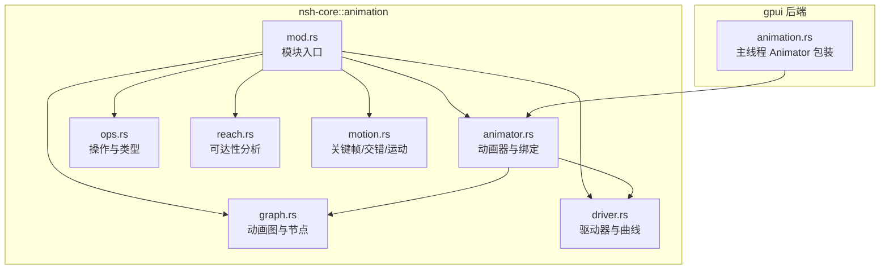
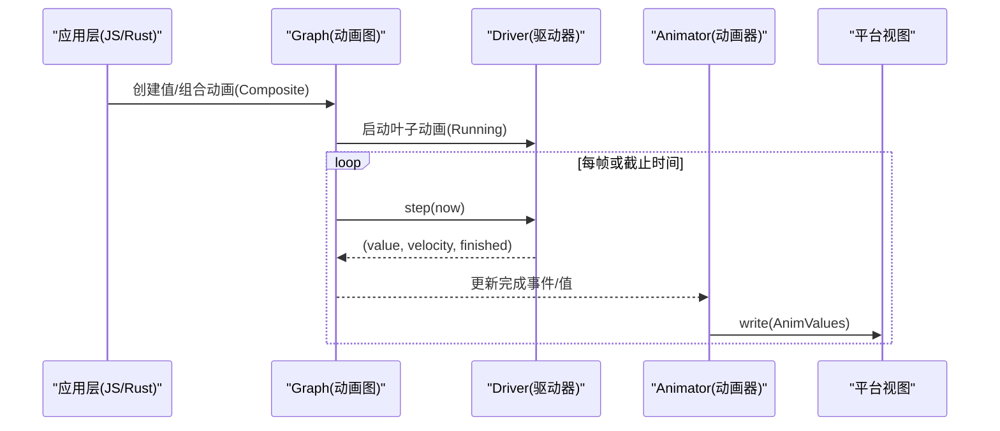
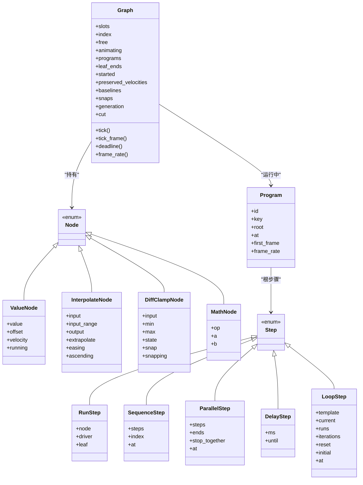
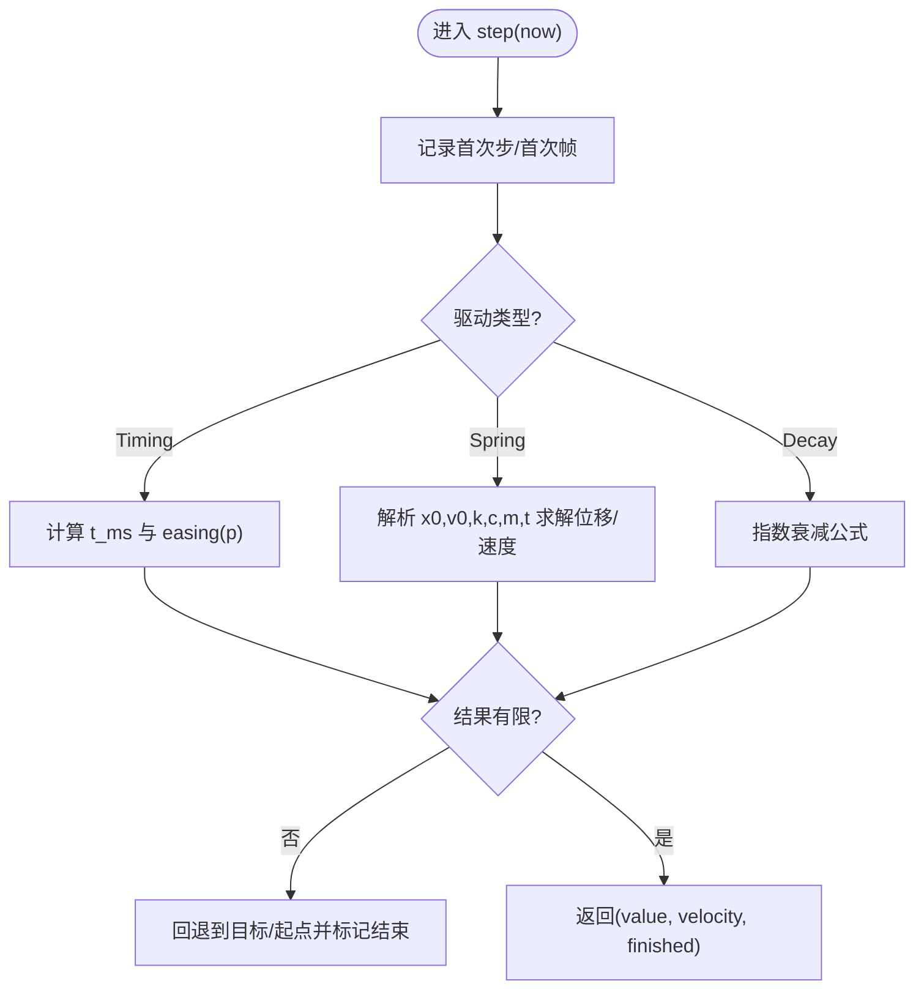
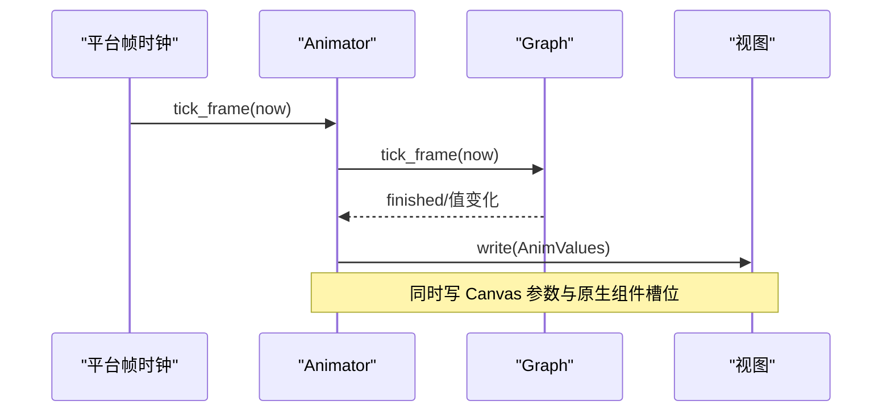
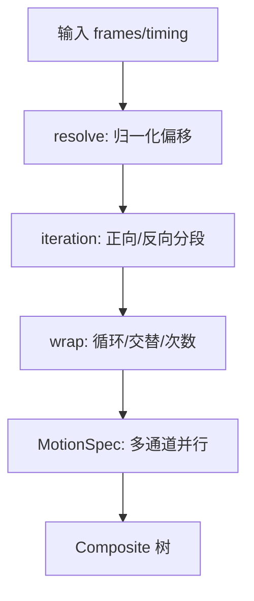
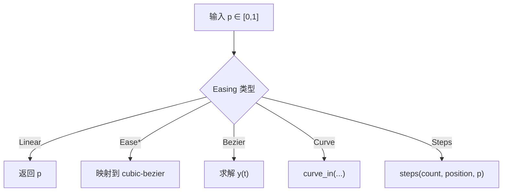
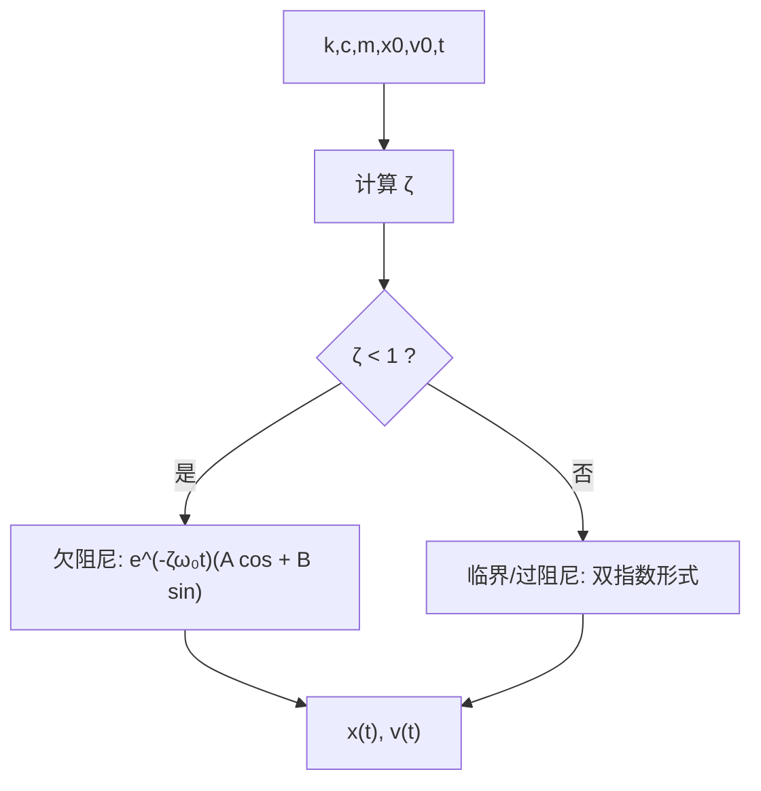
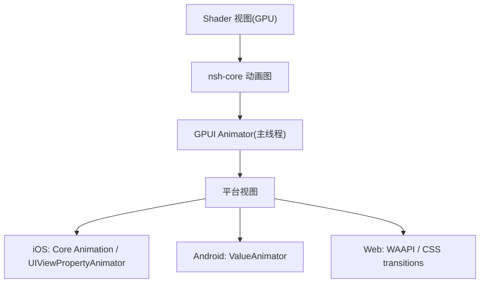
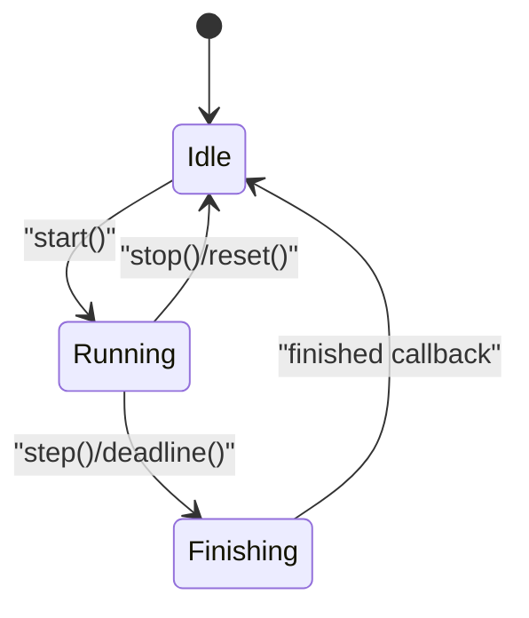

# 动画系统

<cite>
**本文引用的文件**   
- [animation.md](file://docs/dev/animation.md)
- [mod.rs](file://crates/nsh-core/src/animation/mod.rs)
- [animator.rs](file://crates/nsh-core/src/animation/animator.rs)
- [graph.rs](file://crates/nsh-core/src/animation/graph.rs)
- [driver.rs](file://crates/nsh-core/src/animation/driver.rs)
- [motion.rs](file://crates/nsh-core/src/animation/motion.rs)
- [ops.rs](file://crates/nsh-core/src/animation/ops.rs)
- [reach.rs](file://crates/nsh-core/src/animation/reach.rs)
- [animation.rs](file://crates/gpui/nsh-platform-gpui/src/animation.rs)
</cite>

## 目录
1. [引言](#引言)
2. [项目结构](#项目结构)
3. [核心组件](#核心组件)
4. [架构总览](#架构总览)
5. [详细组件分析](#详细组件分析)
6. [依赖关系分析](#依赖关系分析)
7. [性能与优化](#性能与优化)
8. [故障排查指南](#故障排查指南)
9. [结论](#结论)
10. [附录](#附录)

## 引言
本文件为 NSH 动画系统的技术文档，聚焦以下目标：
- 解释动画框架的架构设计，包括动画器、驱动器和时间管理。
- 说明插值算法的实现，包括缓动函数、关键帧动画和物理模拟。
- 描述硬件加速的实现方式，包括 GPU 动画与原生动画的集成。
- 解释动画状态管理与生命周期控制。
- 包含动画性能优化策略，如批量处理与延迟执行机制。

NSH 的动画系统以“平台无关的动画图”为核心：JS 声明值、派生节点（插值、数学运算）和动画一次，由 UI 线程在显示帧上求值，从而让动画、手势与滚动联动效果不等待 JS。关键帧、交错与运动（motion）被编译为统一的 Composite 树，由同一引擎运行，无需平台特定代码。

**章节来源**
- [animation.md:1-187](file://docs/dev/animation.md#L1-L187)

## 项目结构
动画系统位于 `nsh-core` 的 `animation` 模块，并由 GPUI 后端桥接至具体视图。



**图表来源**
- [mod.rs:1-37](file://crates/nsh-core/src/animation/mod.rs#L1-L37)
- [animator.rs:1-65](file://crates/nsh-core/src/animation/animator.rs#L1-L65)
- [graph.rs:1-194](file://crates/nsh-core/src/animation/graph.rs#L1-L194)
- [driver.rs:1-25](file://crates/nsh-core/src/animation/driver.rs#L1-L25)
- [motion.rs:1-16](file://crates/nsh-core/src/animation/motion.rs#L1-L16)
- [animation.rs:1-29](file://crates/gpui/nsh-platform-gpui/src/animation.rs#L1-L29)

**章节来源**
- [mod.rs:1-37](file://crates/nsh-core/src/animation/mod.rs#L1-L37)

## 核心组件
- 动画图 Graph：维护所有节点、运行中的程序、叶子动画结束队列、差分约束等，负责求值、步进、截止时间计算与帧率聚合。
- 驱动器 Driver：时间到值的闭式函数，包括 timing、spring、decay，提供采样与边界安全化。
- 动画器 Animator：将图与视图、手势、滚动值绑定，输出 AnimValues 给平台绘制。
- 关键帧与运动 Keyframes/Motion：数据驱动的 Composite 树生成器，支持交错、方向、循环、弹簧通道等。
- 操作与类型 Ops：Composite、Easing、Operand、Output 等基础类型与常量。
- 可达性 Reach：用于分析节点依赖，避免重复求值与检测环。

**章节来源**
- [graph.rs:158-194](file://crates/nsh-core/src/animation/graph.rs#L158-L194)
- [driver.rs:40-91](file://crates/nsh-core/src/animation/driver.rs#L40-L91)
- [animator.rs:40-65](file://crates/nsh-core/src/animation/animator.rs#L40-L65)
- [motion.rs:20-16](file://crates/nsh-core/src/animation/motion.rs#L20-L16)
- [mod.rs:22-36](file://crates/nsh-core/src/animation/mod.rs#L22-L36)

## 架构总览
动画系统采用“声明式图 + 运行时步进”的架构：
- JS/Rust 构建 Composite 树（Sequence/Parallel/Delay/Loop/Run）。
- Graph 维护节点与运行状态，按时间推进；每个叶子 Run 对应一个 Running 实例。
- Animator 将节点值写入视图属性（透明度、颜色、变换、文本色等），并处理手势与滚动联动。
- 平台侧通过 Animator 在主线程驱动帧时钟，必要时使用截止时间调度非帧动画。



**图表来源**
- [graph.rs:207-259](file://crates/nsh-core/src/animation/graph.rs#L207-L259)
- [driver.rs:167-183](file://crates/nsh-core/src/animation/driver.rs#L167-L183)
- [animator.rs:292-327](file://crates/nsh-core/src/animation/animator.rs#L292-L327)

**章节来源**
- [animation.md:1-187](file://docs/dev/animation.md#L1-L187)

## 详细组件分析

### 动画图 Graph：节点、程序与时间推进
Graph 是动画系统的运行时核心，负责：
- 节点类型：Value、Interpolate、DiffClamp、Math。
- 运行程序 Program：保存 Composite 根、起始时间、帧率需求等。
- 步骤 Step：Run/Sequence/Parallel/Delay/Loop，支持停止、截止时间、位移修正等。
- 差分约束 DiffClamp：支持 snap 行为，与滚动联动后自动收敛到边界。
- 帧率聚合：根据运行中的动画汇总最高帧率需求。



**图表来源**
- [graph.rs:158-194](file://crates/nsh-core/src/animation/graph.rs#L158-L194)
- [graph.rs:196-259](file://crates/nsh-core/src/animation/graph.rs#L196-L259)

**章节来源**
- [graph.rs:158-259](file://crates/nsh-core/src/animation/graph.rs#L158-L259)

### 驱动器 Driver：timing/spring/decay 与采样
Driver 实现三类闭式动画：
- Timing：带延迟、时长、缓动的线性插值。
- Spring：阻尼弹簧，支持欠阻尼/临界阻尼/过阻尼，速度连续。
- Decay：衰减运动，支持区间 clamp 与 bounce。

关键特性：
- 参数清洗 sanitized：对非法参数进行安全降级，避免 NaN/无穷大导致崩溃。
- 首帧补偿 first_frame_stall：当 UI 线程阻塞时，确保动画从首个可见帧开始计数。
- 截止时间 deadline：为 spring/decay 等无显式终点的动画估算下一次检查点。
- 采样 sample_driver/sample_easing：供调试与可视化曲线。



**图表来源**
- [driver.rs:167-183](file://crates/nsh-core/src/animation/driver.rs#L167-L183)
- [driver.rs:185-243](file://crates/nsh-core/src/animation/driver.rs#L185-L243)
- [driver.rs:249-297](file://crates/nsh-core/src/animation/driver.rs#L249-L297)

**章节来源**
- [driver.rs:1-25](file://crates/nsh-core/src/animation/driver.rs#L1-L25)
- [driver.rs:167-297](file://crates/nsh-core/src/animation/driver.rs#L167-L297)

### 动画器 Animator：绑定、手势与滚动联动
Animator 将 Graph 的值写入视图：
- 绑定属性：opacity、background/border/text color、transform 列表项、Canvas 参数、原生组件槽位。
- 手势联动：pan/pinch/rotation 直接设置值，保持瞬时跟随。
- 滚动联动：scrollValue 与 pullValue 驱动 diffClamp，支持滚动结束时 snap 收敛。
- 粘性单元格：sticky 偏移随滚动实时更新。



**图表来源**
- [animator.rs:145-186](file://crates/nsh-core/src/animation/animator.rs#L145-L186)
- [animator.rs:292-361](file://crates/nsh-core/src/animation/animator.rs#L292-L361)

**章节来源**
- [animator.rs:1-65](file://crates/nsh-core/src/animation/animator.rs#L1-L65)
- [animator.rs:145-361](file://crates/nsh-core/src/animation/animator.rs#L145-L361)

### 关键帧与运动：Keyframes、Stagger、MotionSpec
Keyframes 将 CSS/WAAPI 风格的关键帧数据转换为 Composite 树：
- 偏移解析 resolve：缺失偏移均匀分布，保证递增。
- 迭代与方向：支持 normal/reverse/alternate/alternate-reverse。
- 延迟与 fill-mode：delay 前设置首帧值，符合 CSS backwards 语义。
- MotionSpec：多通道（透明度、平移、旋转、缩放）并行播放，可切换为 spring 通道。
- 预设 Presets：内置 enter/exit/attention/loop 等动作。



**图表来源**
- [motion.rs:207-251](file://crates/nsh-core/src/animation/motion.rs#L207-L251)
- [motion.rs:253-308](file://crates/nsh-core/src/animation/motion.rs#L253-L308)
- [motion.rs:316-371](file://crates/nsh-core/src/animation/motion.rs#L316-L371)
- [motion.rs:521-645](file://crates/nsh-core/src/animation/motion.rs#L521-L645)

**章节来源**
- [motion.rs:1-16](file://crates/nsh-core/src/animation/motion.rs#L1-L16)
- [motion.rs:207-371](file://crates/nsh-core/src/animation/motion.rs#L207-L371)
- [motion.rs:521-645](file://crates/nsh-core/src/animation/motion.rs#L521-L645)

### 缓动函数 Easing：CSS 与 React Native 曲线
Easing 支持：
- 标准曲线：Linear、EaseIn/EaseOut/EaseInOut。
- Bezier：cubic-bezier 数值求解（牛顿法+二分）。
- 预置曲线：Quad/Cubic/Poly/Sin/Circle/Exp/Elastic/Back/Bounce。
- Steps：CSS steps(count, position)，支持 JumpStart/JumpEnd/JumpNone/JumpBoth。



**图表来源**
- [driver.rs:582-695](file://crates/nsh-core/src/animation/driver.rs#L582-L695)

**章节来源**
- [driver.rs:582-695](file://crates/nsh-core/src/animation/driver.rs#L582-L695)

### 物理模拟：弹簧与衰减
- 弹簧 spring：基于二阶常微分方程解析解，区分欠阻尼/临界阻尼/过阻尼，避免 cosh 溢出。
- 衰减 decay：指数衰减，支持区间 clamp 与 bounce，帧率无关。
- 首帧补偿：当 UI 线程阻塞时，调整 start/last 使动画从首个可见帧开始。



**图表来源**
- [driver.rs:539-580](file://crates/nsh-core/src/animation/driver.rs#L539-L580)

**章节来源**
- [driver.rs:539-580](file://crates/nsh-core/src/animation/driver.rs#L539-L580)

### 硬件加速与原生动画集成
- 桌面后端：Animator 在主线程驱动，将 AnimValues 写入视图；文本颜色、阴影、圆角等过渡由平台渲染管线处理。
- iOS：样式过渡使用 Core Animation（CASpringAnimation/UIViewPropertyAnimator），隐式子层动画使用固定曲线；文本颜色逐行过渡。
- Android：样式过渡使用 ValueAnimator，文本颜色通过 recolor 在 ValueAnimator 上过渡。
- Web：布局动画、过渡、关键帧与屏幕转场使用 Web Animations API 与 CSS，匹配 Linux 后端行为。
- GPU 着色器：Shader 视图中 uniform 可绑定 AnimatedValue，GPU 侧读取 nsh.time 等值，无需 JS 每帧参与。



**图表来源**
- [animation.md:153-178](file://docs/dev/animation.md#L153-L178)
- [animation.md:229-235](file://docs/dev/animation.md#L229-L235)
- [animation.rs:1-29](file://crates/gpui/nsh-platform-gpui/src/animation.rs#L1-L29)

**章节来源**
- [animation.md:153-178](file://docs/dev/animation.md#L153-L178)
- [animation.md:229-235](file://docs/dev/animation.md#L229-L235)

### 动画状态管理与生命周期
- 生命周期：Composite 树的每个 Step 维护 at/end 时间，支持 stop/reset/start。
- 叶子动画：内部 id 分配 LEAF_IDS，避免泄露到 JS；结束事件通过 leaf_ends 队列路由。
- 循环与交错：Loop 支持 reset 初始值；stagger_delay 支持 First/Last/Center/Index。
- 减少动画模式：reduced motion 下，Motion 直接跳到终点，低开销。
- 首帧与截止时间：tick_frame 与 tick 分别处理显示帧与截止时间，保证隐藏窗口也能按时结束。



**图表来源**
- [graph.rs:207-259](file://crates/nsh-core/src/animation/graph.rs#L207-L259)
- [driver.rs:122-165](file://crates/nsh-core/src/animation/driver.rs#L122-L165)

**章节来源**
- [animation.md:17-28](file://docs/dev/animation.md#L17-L28)
- [animation.md:57-70](file://docs/dev/animation.md#L57-L70)

## 依赖关系分析
- 模块耦合：
  - animator.rs 依赖 graph.rs 与 driver.rs，负责绑定与输出。
  - graph.rs 依赖 ops.rs 定义 Composite/Driver/Easing 等。
  - motion.rs 依赖 ops.rs 生成 Composite 树。
  - reach.rs 提供依赖可达性分析。
- 外部依赖：
  - GPUI 后端 animation.rs 封装 Animator，作为平台入口。
  - 平台渲染管线（iOS/Android/Web）消费 AnimValues 或 WAAPI/CSS。

```mermaid
graph LR
ops["ops.rs"] --> graph["graph.rs"]
ops --> motion["motion.rs"]
driver["driver.rs"] --> graph
graph --> animator["animator.rs"]
animator --> gpui["gpui animation.rs"]
```

**图表来源**
- [mod.rs:15-20](file://crates/nsh-core/src/animation/mod.rs#L15-L20)
- [animation.rs:1-29](file://crates/gpui/nsh-platform-gpui/src/animation.rs#L1-L29)

**章节来源**
- [mod.rs:15-20](file://crates/nsh-core/src/animation/mod.rs#L15-L20)

## 性能与优化
- 帧率聚合：Graph 汇总运行动画的最高 frame_rate，平台据此降低刷新率（macOS/iOS 支持）。
- 首帧补偿：first_frame_stall 避免 UI 线程阻塞导致的动画跳变。
- 参数清洗：sanitized 防止非法参数导致崩溃或无限循环。
- 采样上限：MAX_SAMPLES 限制采样数量，避免长曲线卡顿。
- 批量处理：Animator.write 一次性写出所有绑定属性，减少平台调用。
- 延迟执行：Composite::Delay 与 stagger_delay 支持交错与延时，避免同步阻塞。
- 减少动画模式：reduced motion 下跳过中间过程，直接落点。

[本节为通用指导，不涉及具体文件分析]

## 故障排查指南
- 常见警告：
  - 参数越界：sanitized 替换非法参数，warn_out_of_range 仅在一次启动时告警。
  - 首帧阻塞：若动画看起来晚开始，检查是否发生首帧补偿。
  - 循环卡死：确保 Loop 有终止条件或 reset 初始值。
- 诊断方法：
  - 使用 sample_driver/sample_easing 获取曲线样本，验证缓动与物理参数。
  - 观察 Finished 事件，确认动画是否被提前中断。
  - 检查 Animator.sticky_views 与 scroll_ended，确认 diffClamp snap 行为。

**章节来源**
- [driver.rs:458-475](file://crates/nsh-core/src/animation/driver.rs#L458-L475)
- [animator.rs:159-225](file://crates/nsh-core/src/animation/animator.rs#L159-L225)

## 结论
NSH 动画系统以平台无关的动画图为核心，通过统一的 Composite 树驱动 timing/spring/decay 等驱动器，结合 Animator 的绑定与平台渲染管线，实现了高性能、可扩展且跨平台的动画能力。关键帧与运动数据化、首帧补偿、参数清洗、帧率聚合与减少动画模式共同保障了流畅性与稳定性。

[本节为总结，不涉及具体文件分析]

## 附录
- 术语表：
  - 动画图：Graph，维护节点与运行状态。
  - 驱动器：Driver，时间到值的闭式函数。
  - 动画器：Animator，绑定与输出。
  - 关键帧：Keyframes，数据驱动的序列动画。
  - 运动：MotionSpec，多通道并行动画。
- 参考路径：
  - 动画文档：[docs/dev/animation.md](file://docs/dev/animation.md)
  - 核心模块：[crates/nsh-core/src/animation](file://crates/nsh-core/src/animation)
  - GPUI 后端：[crates/gpui/nsh-platform-gpui/src/animation.rs](file://crates/gpui/nsh-platform-gpui/src/animation.rs)