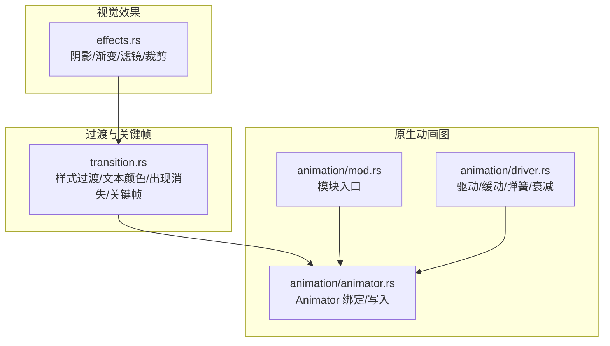
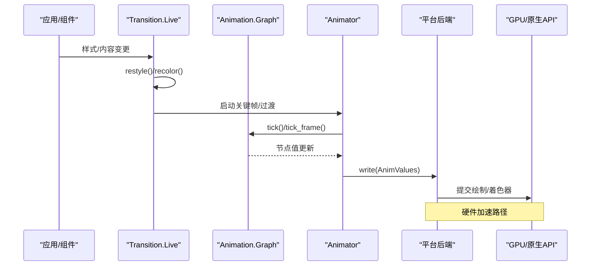
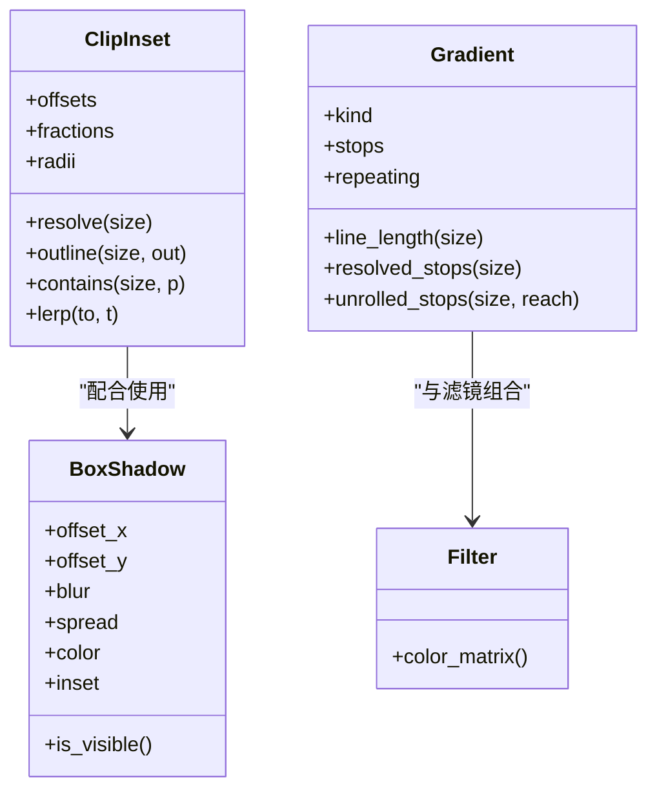
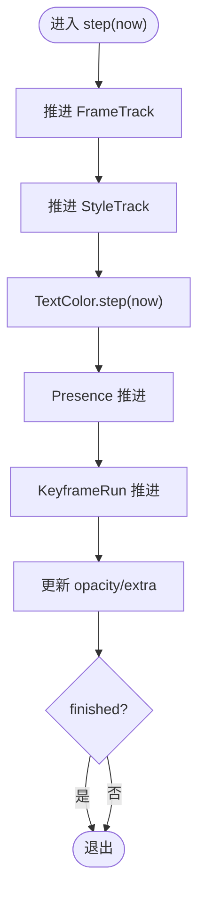
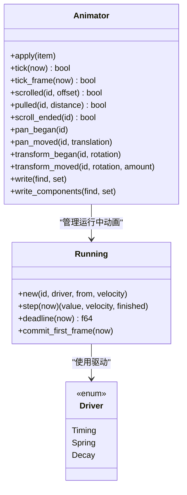

# 效果集成

<cite>
**本文引用的文件**   
- [effects.rs](file://crates/nsh-core/src/effects.rs)
- [transition.rs](file://crates/nsh-core/src/transition.rs)
- [animation/mod.rs](file://crates/nsh-core/src/animation/mod.rs)
- [animation/animator.rs](file://crates/nsh-core/src/animation/animator.rs)
- [animation/driver.rs](file://crates/nsh-core/src/animation/driver.rs)
</cite>

## 目录
1. [简介](#简介)
2. [项目结构](#项目结构)
3. [核心组件](#核心组件)
4. [架构总览](#架构总览)
5. [详细组件分析](#详细组件分析)
6. [依赖关系分析](#依赖关系分析)
7. [性能考量](#性能考量)
8. [故障排查指南](#故障排查指南)
9. [结论](#结论)
10. [附录](#附录)

## 简介
本文件面向 NSH 动画与效果系统，系统性阐述 Effects 框架、Transition 系统与原生动画图（Animation Graph）三者如何协作，覆盖以下目标：
- 效果注册、生命周期管理与渲染集成
- Transition 系统的页面切换、视图过渡与状态转换
- 效果与布局系统的协作机制（重排优化与增量更新）
- 硬件加速实现（GPU 着色器与原生 API 调用）
- 效果的组合模式与链式调用
- 实际效果应用示例与最佳实践

## 项目结构
NSH 的动画与效果能力由三层组成：
- 视觉效果与样式层：effects.rs 提供阴影、渐变、滤镜、裁剪等视觉原语。
- 过渡与关键帧层：transition.rs 负责样式过渡、文本颜色过渡、出现/消失与关键帧动画。
- 原生动画图层：animation/* 提供平台无关的动画图、驱动与调度，Animator 将图值写入视图属性。

图表来源
- [effects.rs:1-800](file://crates/nsh-core/src/effects.rs#L1-L800)
- [transition.rs:1-800](file://crates/nsh-core/src/transition.rs#L1-L800)
- [animation/mod.rs:1-37](file://crates/nsh-core/src/animation/mod.rs#L1-L37)
- [animation/animator.rs:1-545](file://crates/nsh-core/src/animation/animator.rs#L1-L545)
- [animation/driver.rs:1-800](file://crates/nsh-core/src/animation/driver.rs#L1-L800)

章节来源
- [effects.rs:1-800](file://crates/nsh-core/src/effects.rs#L1-L800)
- [transition.rs:1-800](file://crates/nsh-core/src/transition.rs#L1-L800)
- [animation/mod.rs:1-37](file://crates/nsh-core/src/animation/mod.rs#L1-L37)
- [animation/animator.rs:1-545](file://crates/nsh-core/src/animation/animator.rs#L1-L545)
- [animation/driver.rs:1-800](file://crates/nsh-core/src/animation/driver.rs#L1-L800)

## 核心组件
- 视觉效果（Effects）
  - ClipInset：CSS inset() 形状裁剪，支持边偏移、百分比、圆角，提供 outline/contains/lerp 以支持插值与命中测试。
  - BoxShadow：单层阴影参数（偏移、模糊、扩展、颜色、内阴影）。
  - Gradient/ColorStop/GradientKind：线性/径向/锥形渐变，支持重复、位置解析、展开为原生绘制所需停止点序列。
  - Filter：亮度、对比度、灰度、色相旋转、反相、不透明度、饱和度、棕褐色、高斯模糊、投影阴影；可组合为颜色矩阵或交由 GPU 处理。
- 过渡与关键帧（Transition）
  - Live：每视图动画状态机，管理帧移动、样式过渡、文本颜色过渡、出现/消失、关键帧、额外变换与不透明度。
  - Restyle/Recolor：样式与文本颜色的差异检测与过渡启动。
  - Timing/Curve/Ease：缓动曲线（线性、贝塞尔、弹簧、物理弹簧）、时间推进与截止时间计算。
- 原生动画图（Animation Graph）
  - Animator：桌面后端主线程上的动画图执行器，绑定视图属性、手势、滚动、粘性单元格，输出 AnimValues。
  - Driver：时序/弹簧/衰减三类驱动，含边界回弹、首帧卡顿补偿、采样与调试。

章节来源
- [effects.rs:1-800](file://crates/nsh-core/src/effects.rs#L1-L800)
- [transition.rs:1-800](file://crates/nsh-core/src/transition.rs#L1-L800)
- [animation/animator.rs:1-545](file://crates/nsh-core/src/animation/animator.rs#L1-L545)
- [animation/driver.rs:1-800](file://crates/nsh-core/src/animation/driver.rs#L1-L800)

## 架构总览
效果系统通过“数据描述 + 运行时步进”的方式工作：
- 上层声明视觉效果与过渡（effects.rs、transition.rs），生成数据结构。
- 过渡层根据样式变化与内容变化，决定是否需要过渡、何时开始、如何插值。
- 原生动画图在 UI 线程按帧推进，将数值写回视图属性（opacity、transform、color、background 等）。
- 平台后端（Windows/GPUI/Linux/macOS/iOS/Android/Web）负责将值交给 GPU 或原生 API 完成绘制。

图表来源
- [transition.rs:377-406](file://crates/nsh-core/src/transition.rs#L377-L406)
- [transition.rs:514-536](file://crates/nsh-core/src/transition.rs#L514-L536)
- [animation/animator.rs:145-186](file://crates/nsh-core/src/animation/animator.rs#L145-L186)
- [animation/animator.rs:294-327](file://crates/nsh-core/src/animation/animator.rs#L294-L327)

## 详细组件分析

### Effects 框架：效果注册、生命周期与渲染集成
- 效果定义与插值
  - ClipInset 提供 resolve/outline/contains/lerp，使裁剪形状可被插值并用于命中测试。
  - Gradient 提供 line_length/resolved_stops/unrolled_stops，将 CSS 语义转换为原生绘制所需的停止点序列。
  - Filter 提供 color_matrix 组合，非矩阵型（Blur/DropShadow）走 GPU 管线。
- 渲染集成
  - 颜色矩阵与混合：compose_color_matrices 将多个 Filter 合并为一个 4x5 矩阵，减少 CPU 侧多次矩阵乘法。
  - 阴影与渐变：BoxShadow 与 Gradient 作为独立图层/图像参与合成，避免对布局树造成重排。
- 生命周期
  - 效果本身无状态，随样式/元素生命周期存在；当样式变化时，由 Transition 决定是否进行插值过渡。

图表来源
- [effects.rs:22-245](file://crates/nsh-core/src/effects.rs#L22-L245)
- [effects.rs:259-281](file://crates/nsh-core/src/effects.rs#L259-L281)
- [effects.rs:283-556](file://crates/nsh-core/src/effects.rs#L283-L556)
- [effects.rs:661-800](file://crates/nsh-core/src/effects.rs#L661-L800)

章节来源
- [effects.rs:1-800](file://crates/nsh-core/src/effects.rs#L1-L800)

### Transition 系统：页面切换、视图过渡与状态转换
- 样式过渡（restyle）
  - 比较新旧样式，若满足 transition 条件则创建 StyleTrack，逐步插值到目标样式。
  - 同时可能触发关键帧动画（KeyframeAnimation），二者可共存。
- 文本颜色过渡（recolor）
  - 仅当文本为单色且样式包含颜色过渡时启用，避免重新排版，直接在上层覆盖绘制颜色。
- 出现/消失与关键帧
  - Presence 控制不透明度与缩放；Extra 叠加旋转/缩放/位移；KeyframeRun 驱动关键帧动画。
- 步进与截止时间
  - step(now, frame, style) 统一推进所有子动画，返回 Step（是否移除、是否结束、是否重绘）。
  - deadline(now) 给出下一次需要推进的时间，保证无帧场景也能按时收尾。

图表来源
- [transition.rs:280-361](file://crates/nsh-core/src/transition.rs#L280-L361)
- [transition.rs:377-406](file://crates/nsh-core/src/transition.rs#L377-L406)
- [transition.rs:514-536](file://crates/nsh-core/src/transition.rs#L514-L536)
- [transition.rs:756-800](file://crates/nsh-core/src/transition.rs#L756-L800)

章节来源
- [transition.rs:1-800](file://crates/nsh-core/src/transition.rs#L1-L800)

### 原生动画图：Animator 与 Driver
- Animator
  - 维护 Graph、视图绑定、手势、滚动、粘性单元格与组件槽位。
  - apply() 接收 MountItem 批更新；tick()/tick_frame() 推进图；write() 将节点值写入视图属性（opacity、background、border_color、color、transform、canvas 参数）。
  - 支持组件槽位（ComponentSlot）的值只在新值变化时推送。
- Driver
  - 三种驱动：Timing（延时/时长/缓动）、Spring（弹簧）、Decay（衰减，支持边界回弹）。
  - 首帧卡顿补偿（first_frame_stall）确保 UI 线程阻塞后动画仍自然衔接。
  - 参数清洗（sanitized）与越界告警（warn_out_of_range）提升鲁棒性。

图表来源
- [animation/animator.rs:40-65](file://crates/nsh-core/src/animation/animator.rs#L40-L65)
- [animation/animator.rs:67-143](file://crates/nsh-core/src/animation/animator.rs#L67-L143)
- [animation/animator.rs:145-186](file://crates/nsh-core/src/animation/animator.rs#L145-L186)
- [animation/animator.rs:194-327](file://crates/nsh-core/src/animation/animator.rs#L194-L327)
- [animation/driver.rs:40-115](file://crates/nsh-core/src/animation/driver.rs#L40-L115)
- [animation/driver.rs:167-243](file://crates/nsh-core/src/animation/driver.rs#L167-L243)
- [animation/driver.rs:300-382](file://crates/nsh-core/src/animation/driver.rs#L300-L382)

章节来源
- [animation/animator.rs:1-545](file://crates/nsh-core/src/animation/animator.rs#L1-L545)
- [animation/driver.rs:1-800](file://crates/nsh-core/src/animation/driver.rs#L1-L800)

### 效果与布局系统的协作：重排优化与增量更新
- 避免重排
  - 文本颜色过渡通过 TextColor 在上层覆盖绘制，不触发文本测量与排版。
  - 出现/消失与关键帧通过 opacity 与 extra transform 叠加，不修改布局树。
- 增量更新
  - Animator.write_components 仅在组件槽位值变化时推送，减少跨语言/跨层调用。
  - Gradient.unrolled_stops 限制最大展开点数，避免过大开销。
- 尺寸变化感知
  - Transition.Step.resized 标记尺寸变化，便于布局系统做最小化重排。

章节来源
- [transition.rs:111-125](file://crates/nsh-core/src/transition.rs#L111-L125)
- [transition.rs:276-361](file://crates/nsh-core/src/transition.rs#L276-L361)
- [animation/animator.rs:330-361](file://crates/nsh-core/src/animation/animator.rs#L330-L361)
- [effects.rs:534-556](file://crates/nsh-core/src/effects.rs#L534-L556)

### 硬件加速：GPU 着色器与原生 API 调用
- 颜色矩阵与滤镜
  - Filter::color_matrix 将多数滤镜转为 4x5 颜色矩阵，可由 GPU 一次性处理。
  - Blur 与 DropShadow 通常走 GPU 管线（如 Core Animation、Canvas/WebGL）。
- 渐变与阴影
  - Gradient 与 BoxShadow 作为独立图层，交由平台合成引擎处理，减少 CPU 负担。
- 原生 API 集成
  - Animator.write 将 AnimValues 写回视图属性，平台后端将其映射到 GPU 纹理/顶点缓冲或原生绘制命令。

章节来源
- [effects.rs:661-800](file://crates/nsh-core/src/effects.rs#L661-L800)
- [animation/animator.rs:294-327](file://crates/nsh-core/src/animation/animator.rs#L294-L327)

### 效果的组合模式与链式调用
- 滤镜组合
  - compose_color_matrices 将多个 Filter 的颜色矩阵按顺序复合，形成单一矩阵，降低 CPU 计算量。
- 渐变停止点展开
  - unrolled_stops 将重复渐变展开为有限停止点序列，供原生绘制使用。
- 过渡与关键帧组合
  - restyle 可同时启动样式过渡与关键帧动画；Presence 与 KeyframeRun 共同影响 opacity 与 extra。

章节来源
- [effects.rs:783-800](file://crates/nsh-core/src/effects.rs#L783-L800)
- [effects.rs:534-556](file://crates/nsh-core/src/effects.rs#L534-L556)
- [transition.rs:377-406](file://crates/nsh-core/src/transition.rs#L377-L406)
- [transition.rs:339-354](file://crates/nsh-core/src/transition.rs#L339-L354)

### 实际效果应用示例与最佳实践
- 页面切换动画
  - 使用 LayoutTransition 配置 delay/run_ms/curve，结合 Presence 实现淡入/淡出或缩放。
  - 建议：在导航栈切换时，优先使用 opacity/scale 过渡，避免触发布局重排。
- 视图过渡
  - 使用 restyle 对背景色、边框色、颜色进行平滑过渡；文本颜色过渡使用 recolor 以避免重排。
  - 建议：对频繁变化的颜色使用渐变色带或主题变量，减少样式差异。
- 关键帧动画
  - 使用 KeyframeAnimation 定义 spin/ping/pulse/bounce 等常用动画；合理设置 iterations/delay/frame_rate。
  - 建议：长循环动画使用固定帧率（frame_rate）以降低刷新压力。
- 手势联动
  - 使用 Animator.pan_* / transform_* 将拖拽/捏合/旋转映射到动画图节点，再绑定到视图属性。
  - 建议：在 pan_began 时记录起始值，确保拖拽从当前值继续。
- 性能优化
  - 尽量使用 GPU 友好的属性（opacity、transform、color/background）；避免在动画中改变布局相关属性。
  - 使用 reduce_motion 开关，在用户偏好低动画模式下禁用过渡。

章节来源
- [transition.rs:186-212](file://crates/nsh-core/src/transition.rs#L186-L212)
- [transition.rs:377-406](file://crates/nsh-core/src/transition.rs#L377-L406)
- [transition.rs:514-536](file://crates/nsh-core/src/transition.rs#L514-L536)
- [animation/animator.rs:227-290](file://crates/nsh-core/src/animation/animator.rs#L227-L290)

## 依赖关系分析
- 模块耦合
  - effects.rs 提供视觉原语，被 transition.rs 与平台后端引用。
  - transition.rs 依赖 geometry/style 类型，驱动样式与文本颜色过渡。
  - animation/* 提供平台无关的动画图与驱动，Animator 与平台后端解耦。
- 外部依赖
  - 平台后端（Windows/GPUI/Linux/macOS/iOS/Android/Web）负责将值提交给 GPU 或原生 API。
- 潜在循环依赖
  - 各模块职责清晰，未见循环导入；Animator 仅读取 Graph 值，不反向依赖 transition。

图表来源
- [effects.rs:1-800](file://crates/nsh-core/src/effects.rs#L1-L800)
- [transition.rs:1-800](file://crates/nsh-core/src/transition.rs#L1-L800)
- [animation/animator.rs:1-545](file://crates/nsh-core/src/animation/animator.rs#L1-L545)
- [animation/driver.rs:1-800](file://crates/nsh-core/src/animation/driver.rs#L1-L800)

章节来源
- [effects.rs:1-800](file://crates/nsh-core/src/effects.rs#L1-L800)
- [transition.rs:1-800](file://crates/nsh-core/src/transition.rs#L1-L800)
- [animation/animator.rs:1-545](file://crates/nsh-core/src/animation/animator.rs#L1-L545)
- [animation/driver.rs:1-800](file://crates/nsh-core/src/animation/driver.rs#L1-L800)

## 性能考量
- 避免布局抖动
  - 动画期间尽量只改变 opacity、transform、color/background，不改变尺寸/位置。
- 减少重排
  - 文本颜色过渡使用 TextColor 覆盖绘制，避免重新排版。
- 控制复杂度
  - 渐变停止点展开有上限（MAX_UNROLLED_STOPS），防止超大展开数组。
- 帧率控制
  - 仅关键帧动画时可指定 frame_rate，其他情况使用屏幕最高帧率。
- 首帧卡顿补偿
  - first_frame_stall 自动调整动画起点，避免 UI 线程阻塞导致的突兀跳变。

章节来源
- [transition.rs:111-125](file://crates/nsh-core/src/transition.rs#L111-L125)
- [effects.rs:560-593](file://crates/nsh-core/src/effects.rs#L560-L593)
- [animation/driver.rs:17-38](file://crates/nsh-core/src/animation/driver.rs#L17-L38)

## 故障排查指南
- 动画参数越界
  - sanitized 会将无效参数替换为可运行值，并通过 warn_out_of_range 告警；检查 stiffness/damping/mass/velocity 等参数。
- 动画未结束
  - 检查 deadline 与 finishing 状态；确认 Timing.duration 与 easing 是否有效。
- 文本颜色未过渡
  - 确认文本为单色且样式包含颜色过渡；否则 recolor 会立即应用新颜色。
- 组件槽位值未更新
  - 检查 ComponentPropSlots 是否正确挂载；Animator.write_components 仅在值变化时推送。

章节来源
- [animation/driver.rs:300-382](file://crates/nsh-core/src/animation/driver.rs#L300-L382)
- [animation/driver.rs:465-475](file://crates/nsh-core/src/animation/driver.rs#L465-L475)
- [transition.rs:514-536](file://crates/nsh-core/src/transition.rs#L514-L536)
- [animation/animator.rs:330-361](file://crates/nsh-core/src/animation/animator.rs#L330-L361)

## 结论
NSH 的效果与动画体系通过“视觉效果描述 + 过渡状态机 + 原生动画图”的分层设计，实现了高性能、可扩展且易于集成的动画方案。Effects 提供丰富的视觉原语，Transition 负责状态与时间的协调，Animator/Driver 则在 UI 线程高效推进并将结果提交至 GPU/原生 API。遵循本文的最佳实践，可在保证流畅体验的同时，最大化利用硬件加速与增量更新机制。

## 附录
- 术语
  - 重排（Reflow）：布局树重新计算的过程。
  - 增量更新：仅更新发生变化的部分，避免全量重建。
  - 硬件加速：通过 GPU 或原生 API 执行绘制与合成。