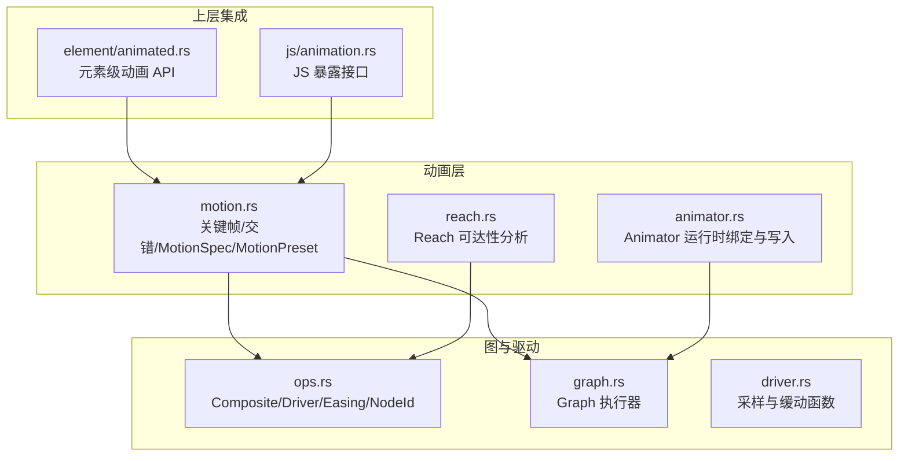
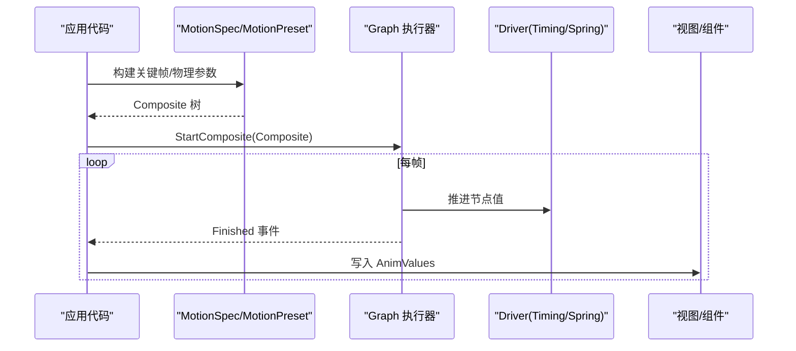
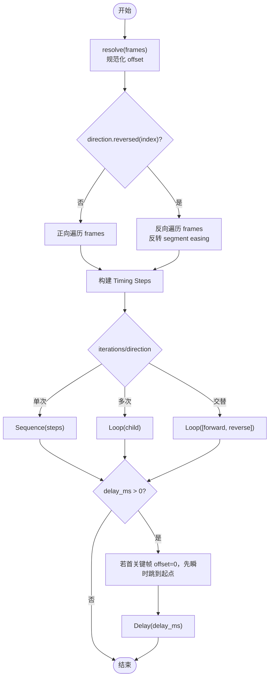
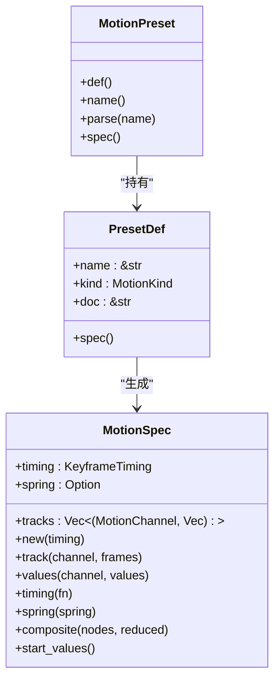
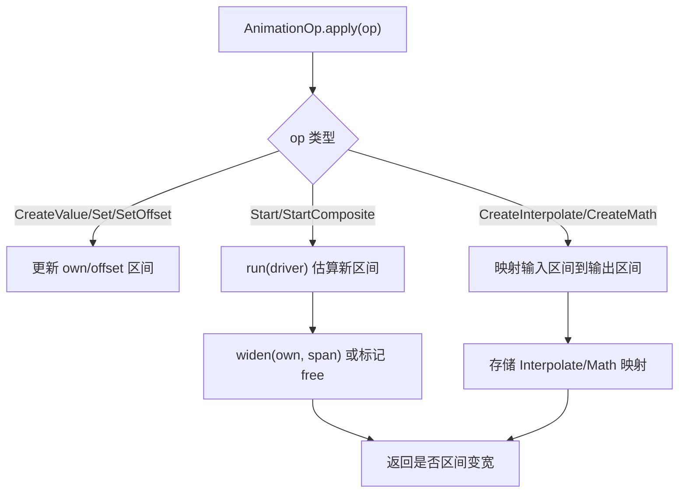
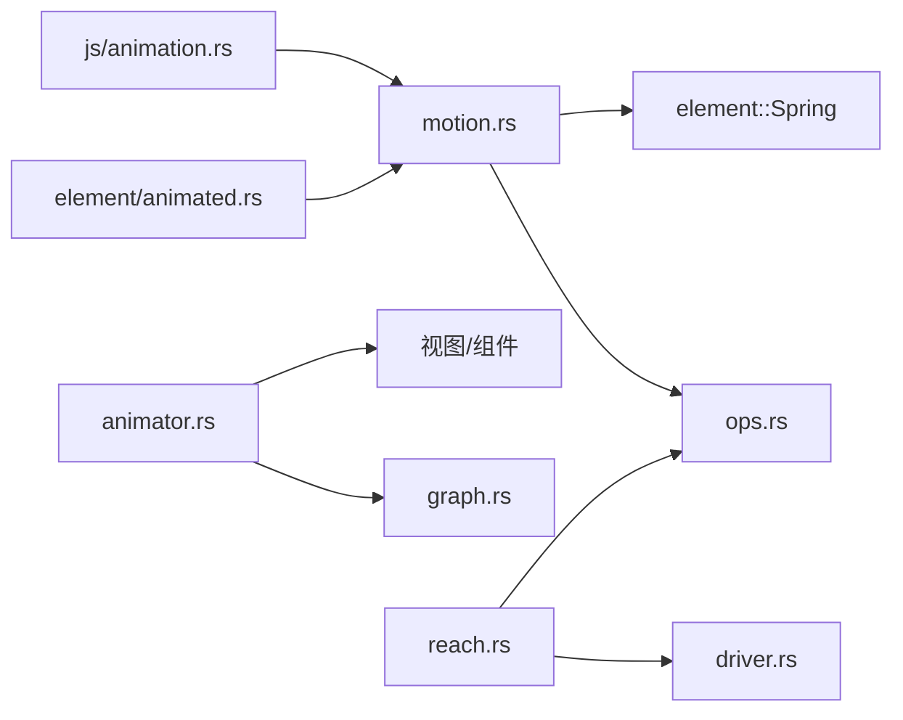

# 运动引擎

<cite>
**本文引用的文件**   
- [crates/nsh-core/src/animation/mod.rs](file://crates/nsh-core/src/animation/mod.rs)
- [crates/nsh-core/src/animation/motion.rs](file://crates/nsh-core/src/animation/motion.rs)
- [crates/nsh-core/src/animation/animator.rs](file://crates/nsh-core/src/animation/animator.rs)
- [crates/nsh-core/src/animation/reach.rs](file://crates/nsh-core/src/animation/reach.rs)
- [crates/nsh-core/src/element/animated.rs](file://crates/nsh-core/src/element/animated.rs)
- [crates/nsh-core/src/js/animation.rs](file://crates/nsh-core/src/js/animation.rs)
</cite>

## 目录
1. [简介](#简介)
2. [项目结构](#项目结构)
3. [核心组件](#核心组件)
4. [架构总览](#架构总览)
5. [关键组件详解](#关键组件详解)
6. [依赖关系分析](#依赖关系分析)
7. [性能与优化建议](#性能与优化建议)
8. [故障排查指南](#故障排查指南)
9. [结论](#结论)

## 简介
本技术文档聚焦 NSH 运动引擎，围绕以下目标展开：
- 解释 MotionSpec 与 MotionPreset 的设计，包括物理参数配置和预设动画库。
- 详细说明关键帧系统实现：Keyframe 数据结构、时间轴管理与插值算法。
- 描述 StaggerFrom 交错策略的计算逻辑和时间偏移处理。
- 解释 Reach 检测机制，用于判断动画是否达到目标状态或可裁剪范围。
- 说明运动曲线的数学原理与自定义缓动函数的实现方法。
- 提供丰富的动画效果示例与性能优化建议。

该引擎以“数据驱动”的方式定义动画，将关键帧、交错、运动规格等数据转换为统一的 Composite 树，由平台无关的图执行器在 UI 线程每帧评估，从而保证动画、手势与滚动联动的高性能表现。

## 项目结构
NSH 运动引擎位于 crates/nsh-core/src/animation 下，核心模块如下：
- mod.rs：导出公共 API，声明模块边界。
- motion.rs：关键帧、时间、交错、MotionSpec/MotionPreset 等数据模型与构建逻辑。
- animator.rs：绑定视图、手势、滚动到动画图的运行时调度与写入。
- reach.rs：Reach 可达性分析，计算节点可能达到的数值区间，用于内容裁剪与节奏控制。
- ops/driver/graph 等：底层操作符、驱动（Timing/Spring/Decay）、图执行器（由上层导出）。



图表来源
- [crates/nsh-core/src/animation/mod.rs:1-37](file://crates/nsh-core/src/animation/mod.rs#L1-L37)
- [crates/nsh-core/src/animation/motion.rs:1-20](file://crates/nsh-core/src/animation/motion.rs#L1-L20)
- [crates/nsh-core/src/animation/animator.rs:1-15](file://crates/nsh-core/src/animation/animator.rs#L1-L15)
- [crates/nsh-core/src/animation/reach.rs:1-24](file://crates/nsh-core/src/animation/reach.rs#L1-L24)

章节来源
- [crates/nsh-core/src/animation/mod.rs:1-37](file://crates/nsh-core/src/animation/mod.rs#L1-L37)

## 核心组件
- Keyframe：单关键帧，包含 offset、value、easing。
- KeyframeTiming：关键帧播放的时间参数（时长、延迟、缓动、迭代次数、方向、帧率）。
- PlaybackDirection：CSS 风格的播放方向（normal/reverse/alternate/alternate-reverse）。
- MotionChannel：运动通道（透明度、平移、旋转、缩放等）。
- MotionSpec：多通道运动规格，支持关键帧序列或弹簧物理。
- MotionPreset/PresetDef：内置预设动画（进入、退出、注意力、循环），通过 PresetDef.spec() 生成 MotionSpec。
- StaggerFrom/stagger_delay：交错起始点枚举与延迟计算。
- Animator：将图与视图绑定，每帧 tick 并写出 AnimValues。
- Reach：对每个节点维护可能达到的数值区间，用于裁剪与节奏。

章节来源
- [crates/nsh-core/src/animation/motion.rs:20-68](file://crates/nsh-core/src/animation/motion.rs#L20-L68)
- [crates/nsh-core/src/animation/motion.rs:124-201](file://crates/nsh-core/src/animation/motion.rs#L124-L201)
- [crates/nsh-core/src/animation/motion.rs:430-519](file://crates/nsh-core/src/animation/motion.rs#L430-L519)
- [crates/nsh-core/src/animation/motion.rs:521-654](file://crates/nsh-core/src/animation/motion.rs#L521-L654)
- [crates/nsh-core/src/animation/motion.rs:656-716](file://crates/nsh-core/src/animation/motion.rs#L656-L716)
- [crates/nsh-core/src/animation/motion.rs:731-909](file://crates/nsh-core/src/animation/motion.rs#L731-L909)
- [crates/nsh-core/src/animation/motion.rs:400-428](file://crates/nsh-core/src/animation/motion.rs#L400-L428)
- [crates/nsh-core/src/animation/animator.rs:17-65](file://crates/nsh-core/src/animation/animator.rs#L17-L65)
- [crates/nsh-core/src/animation/reach.rs:42-87](file://crates/nsh-core/src/animation/reach.rs#L42-L87)

## 架构总览
运动引擎采用“数据→Composite 树→图执行器→平台输出”的分层架构：
- 数据层：Keyframe、KeyframeTiming、MotionSpec、MotionPreset 等纯数据。
- 组合层：keyframes()/composite() 将数据转为 Composite 树（Sequence/Parallel/Loop/Delay/Run）。
- 执行层：Graph 每帧 tick，驱动 Driver（Timing/Spring/Decay）推进节点值。
- 绑定层：Animator 将节点值映射到视图属性（opacity、transform、颜色等）。
- 可达性：Reach 在应用 AnimationOp 时维护节点区间，供裁剪与节奏使用。



图表来源
- [crates/nsh-core/src/animation/motion.rs:310-371](file://crates/nsh-core/src/animation/motion.rs#L310-L371)
- [crates/nsh-core/src/animation/motion.rs:596-645](file://crates/nsh-core/src/animation/motion.rs#L596-L645)
- [crates/nsh-core/src/animation/animator.rs:294-327](file://crates/nsh-core/src/animation/animator.rs#L294-L327)

## 关键组件详解

### 关键帧系统与时间轴管理
- Keyframe：定义某时刻的 value 与段内 easing；offset 为空时按 Web Animations API 规则均匀分布。
- resolve(frames)：规范化 offset，确保单调递增且首尾为 0/1；返回 (offset, value, easing)。
- iteration(node, frames, timing, backwards)：根据 direction 决定正向或反向遍历，构造 Timing 驱动的 Sequence。
- keyframes(node, frames, timing)：组装完整的关键帧动画，支持 delay、iterations、direction、infinite 等语义；当没有 0 处关键帧时，从当前值跳到第一个关键帧（符合 CSS 行为）。
- keyframe_ends(frames, timing)：计算一次迭代的起止值，用于 spring 模式的目标值推导。



图表来源
- [crates/nsh-core/src/animation/motion.rs:203-251](file://crates/nsh-core/src/animation/motion.rs#L203-L251)
- [crates/nsh-core/src/animation/motion.rs:253-308](file://crates/nsh-core/src/animation/motion.rs#L253-L308)
- [crates/nsh-core/src/animation/motion.rs:310-371](file://crates/nsh-core/src/animation/motion.rs#L310-L371)

章节来源
- [crates/nsh-core/src/animation/motion.rs:20-68](file://crates/nsh-core/src/animation/motion.rs#L20-L68)
- [crates/nsh-core/src/animation/motion.rs:203-251](file://crates/nsh-core/src/animation/motion.rs#L203-L251)
- [crates/nsh-core/src/animation/motion.rs:253-308](file://crates/nsh-core/src/animation/motion.rs#L253-L308)
- [crates/nsh-core/src/animation/motion.rs:310-371](file://crates/nsh-core/src/animation/motion.rs#L310-L371)
- [crates/nsh-core/src/animation/motion.rs:373-398](file://crates/nsh-core/src/animation/motion.rs#L373-L398)

### MotionSpec 与 MotionPreset
- MotionSpec：
  - tracks：多个 MotionChannel 的关键帧轨道。
  - timing：统一的时间参数。
  - spring：可选的物理弹簧，将每个通道从当前位置（考虑 start_values）以速度延续的方式弹向关键帧终点。
  - composite(nodes, reduced)：生成并行子节点；reduced=true 时直接线性瞬移到终点（无障碍模式）。
  - start_values()：返回各通道在动画开始处的初始值（用于进入动画前设置）。
- MotionPreset/PresetDef：
  - 通过 presets! 宏批量定义预设（fadeIn、bounceIn、shake、spin、float、breathe 等）。
  - def().spec() 将静态轨道与时间参数转为 MotionSpec。
  - MotionKind：Enter/Exit/Attention/Loop，约束起止状态与迭代语义。



图表来源
- [crates/nsh-core/src/animation/motion.rs:521-654](file://crates/nsh-core/src/animation/motion.rs#L521-L654)
- [crates/nsh-core/src/animation/motion.rs:656-716](file://crates/nsh-core/src/animation/motion.rs#L656-L716)
- [crates/nsh-core/src/animation/motion.rs:731-909](file://crates/nsh-core/src/animation/motion.rs#L731-L909)

章节来源
- [crates/nsh-core/src/animation/motion.rs:521-654](file://crates/nsh-core/src/animation/motion.rs#L521-L654)
- [crates/nsh-core/src/animation/motion.rs:656-716](file://crates/nsh-core/src/animation/motion.rs#L656-L716)
- [crates/nsh-core/src/animation/motion.rs:731-909](file://crates/nsh-core/src/animation/motion.rs#L731-L909)

### StaggerFrom 交错策略
- StaggerFrom：First/Last/Center/Index(origin)，定义交错计数起点。
- stagger_delay(index, count, from)：返回第 index 项相对于起点的间隔数（整数），乘以单位间隔即得延迟。
- 典型用法：列表项依次入场，中心扩散，或从指定索引开始。

```mermaid
flowchart TD
S(["输入 index,count,from"]) --> CheckCount{"count==0?"}
CheckCount --> |是| Zero["返回 0.0"]
CheckCount --> |否| ClampIndex["index = min(index, count-1)"]
ClampIndex --> Branch{"from"}
Branch --> |First| First["delay = index"]
Branch --> |Last| Last["delay = count-1-index"]
Branch --> |Center| Center["delay = floor(|index - (count-1)/2|)"]
Branch --> |Index(origin)| Origin["delay = |index - origin|"]
First --> Out["返回 delay"]
Last --> Out
Center --> Out
Origin --> Out
```

图表来源
- [crates/nsh-core/src/animation/motion.rs:400-428](file://crates/nsh-core/src/animation/motion.rs#L400-L428)

章节来源
- [crates/nsh-core/src/animation/motion.rs:400-428](file://crates/nsh-core/src/animation/motion.rs#L400-L428)
- [crates/nsh-core/src/element/animated.rs:1332-1339](file://crates/nsh-core/src/element/animated.rs#L1332-L1339)
- [crates/nsh-core/src/js/animation.rs:298-303](file://crates/nsh-core/src/js/animation.rs#L298-L303)

### Reach 检测机制
Reach 在应用 AnimationOp 时维护每个节点的数值区间 Span，用于：
- 内容裁剪：知道变换的最大位移，扩大裁剪矩形，避免绘制不可见内容。
- 节奏控制：结合 scroll 与 snap 等场景，确定何时需要继续运行帧。
- 自由值标记：被手势或滚动驱动的值标记为 free，不再受图内约束。

核心逻辑：
- Def::Value：own/offset/free/moved，记录自身值、偏移、是否自由、是否已移动。
- interpolate：将输入区间映射到输出区间，考虑左右外推与缓动超调。
- run(driver)：对 Timing/Spring/Decay 分别估算最大摆动范围；Spring 使用能量衰减上界估计 swing。
- easing_span：对贝塞尔曲线与自定义 Curve 采样估计极值。



图表来源
- [crates/nsh-core/src/animation/reach.rs:89-206](file://crates/nsh-core/src/animation/reach.rs#L89-L206)
- [crates/nsh-core/src/animation/reach.rs:323-391](file://crates/nsh-core/src/animation/reach.rs#L323-L391)
- [crates/nsh-core/src/animation/reach.rs:394-475](file://crates/nsh-core/src/animation/reach.rs#L394-L475)

章节来源
- [crates/nsh-core/src/animation/reach.rs:1-24](file://crates/nsh-core/src/animation/reach.rs#L1-L24)
- [crates/nsh-core/src/animation/reach.rs:89-206](file://crates/nsh-core/src/animation/reach.rs#L89-L206)
- [crates/nsh-core/src/animation/reach.rs:323-391](file://crates/nsh-core/src/animation/reach.rs#L323-L391)
- [crates/nsh-core/src/animation/reach.rs:394-475](file://crates/nsh-core/src/animation/reach.rs#L394-L475)

### 运动曲线与自定义缓动函数
- Easing 支持 Linear、EaseIn/Out/InOut、Bezier、Steps、Curve。
- easing_span(easing)：
  - Bezier：用控制点 y 坐标估计超调范围。
  - Curve：采样 CURVE_SAMPLES 个点，取最小/最大值并加小缓冲，得到安全区间。
- sample_easing/ease：提供逐帧采样能力，便于测试与可视化。
- 自定义缓动：通过 Curve 传入采样函数，引擎内部以采样方式保守估计其极值，保证 Reach 正确性。

章节来源
- [crates/nsh-core/src/animation/reach.rs:448-475](file://crates/nsh-core/src/animation/reach.rs#L448-L475)
- [crates/nsh-core/src/animation/motion.rs:1042-1057](file://crates/nsh-core/src/animation/motion.rs#L1042-L1057)

### 预设动画库示例
内置预设覆盖常见交互：
- 进入：fadeIn、fadeInUp/Down/Left/Right、zoomIn、popIn、bounceIn、slideInUp/Down、flipInX/Y。
- 退出：fadeOut、fadeOutUp/Down/Left/Right、zoomOut、popOut、slideOutUp/Down。
- 注意力：shake、headShake、wiggle、swing、pulse、heartbeat、rubberBand、jello、tada、jump、flash。
- 循环：spin、float、breathe、sway、bob、glow。

这些预设通过 PresetDef.spec() 生成 MotionSpec，可直接作为动画数据使用，也可在此基础上叠加 spring 或修改 timing。

章节来源
- [crates/nsh-core/src/animation/motion.rs:768-881](file://crates/nsh-core/src/animation/motion.rs#L768-L881)
- [crates/nsh-core/src/animation/motion.rs:883-909](file://crates/nsh-core/src/animation/motion.rs#L883-L909)

## 依赖关系分析
- motion.rs 依赖 ops 中的 Composite/Driver/Easing/NodeId，以及 element::Spring。
- animator.rs 依赖 Graph、AnimatedPropValue、Geometry、Color 等，负责绑定视图与组件槽位。
- reach.rs 依赖 driver::ease 与 ops 中所有相关类型，进行区间传播。
- element/animated.rs 与 js/animation.rs 在上层封装 MotionSpec/MotionPreset/StaggerFrom 等 API。



图表来源
- [crates/nsh-core/src/animation/motion.rs:17-18](file://crates/nsh-core/src/animation/motion.rs#L17-L18)
- [crates/nsh-core/src/animation/animator.rs:1-15](file://crates/nsh-core/src/animation/animator.rs#L1-L15)
- [crates/nsh-core/src/animation/reach.rs:27-30](file://crates/nsh-core/src/animation/reach.rs#L27-L30)

章节来源
- [crates/nsh-core/src/animation/motion.rs:17-18](file://crates/nsh-core/src/animation/motion.rs#L17-L18)
- [crates/nsh-core/src/animation/animator.rs:1-15](file://crates/nsh-core/src/animation/animator.rs#L1-L15)
- [crates/nsh-core/src/animation/reach.rs:27-30](file://crates/nsh-core/src/animation/reach.rs#L27-L30)

## 性能与优化建议
- 减少不必要的重绘：
  - 使用 Reach 提供的区间信息，仅在必要时重新布局/绘制可见区域。
  - 对复杂变换（如大量 rotate/scale）谨慎使用，避免过度影响渲染路径。
- 合理选择驱动：
  - 简单过渡优先 Timing；需要自然回弹时使用 Spring，但注意质量/阻尼参数对 CPU/GPU 的影响。
  - 长列表交错动画尽量使用较小的 count 与合理的 stagger 间隔，避免同时启动过多动画。
- 利用 reduced motion：
  - 在无障碍模式下，MotionSpec.composite(..., reduced=true) 会直接瞬移到终点，避免无意义的中间帧计算。
- 复用预设与组合：
  - 基于 MotionPreset 快速构建常用效果，减少重复定义开销。
  - 使用 Parallel/Sequence/Loop 组合动画，避免创建过多独立图实例。
- 帧率控制：
  - 通过 KeyframeTiming.frame_rate 或 Driver.frame_rate 限制高频动画的刷新频率，降低主线程压力。

[本节为通用指导，不直接分析具体文件]

## 故障排查指南
- 动画未按预期到达终点：
  - 检查 keyframe_ends 返回值与 MotionSpec.spring 的目标推导是否正确。
  - 确认 iterations/direction 是否符合预期（尤其是 Alternate/Reverse）。
- 交错顺序异常：
  - 核对 StaggerFrom 的选择与 index/count 边界条件。
  - 验证 stagger_delay 的输出是否与期望一致。
- 内容裁剪不正确：
  - 检查 Reach 是否被外部驱动（手势/滚动）标记为 free，导致区间不可知。
  - 确认 MathOp 中除数可能为 0 的情况，避免区间退化为 None。
- 缓动曲线不稳定：
  - 自定义 Curve 需保证采样稳定；必要时增加 CURVE_SAMPLES 或调整采样策略。
- 性能问题：
  - 观察 Animator.animating()/finishing() 状态，确认是否存在长时间运行的动画。
  - 使用 frame_rate 限制高频动画，减少每帧计算量。

章节来源
- [crates/nsh-core/src/animation/motion.rs:373-398](file://crates/nsh-core/src/animation/motion.rs#L373-L398)
- [crates/nsh-core/src/animation/motion.rs:400-428](file://crates/nsh-core/src/animation/motion.rs#L400-L428)
- [crates/nsh-core/src/animation/reach.rs:208-225](file://crates/nsh-core/src/animation/reach.rs#L208-L225)
- [crates/nsh-core/src/animation/reach.rs:281-299](file://crates/nsh-core/src/animation/reach.rs#L281-L299)
- [crates/nsh-core/src/animation/animator.rs:171-192](file://crates/nsh-core/src/animation/animator.rs#L171-L192)

## 结论
NSH 运动引擎以数据驱动为核心，通过 Keyframe/MotionSpec/MotionPreset 抽象出强大的动画建模能力，并以 Composite 树统一表达时序与组合关系。Reach 提供安全的区间推断，支撑内容裁剪与节奏控制；Animator 将图结果高效写入视图与组件槽位。借助内置预设与灵活的缓动/物理参数，开发者可以快速构建丰富而高性能的动画体验。在实际工程中，应结合 reduced motion、帧率控制与合理的驱动选择，兼顾视觉品质与性能表现。