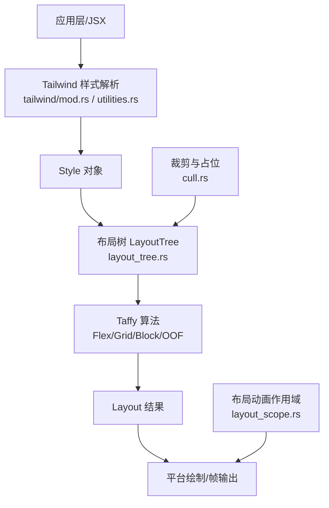
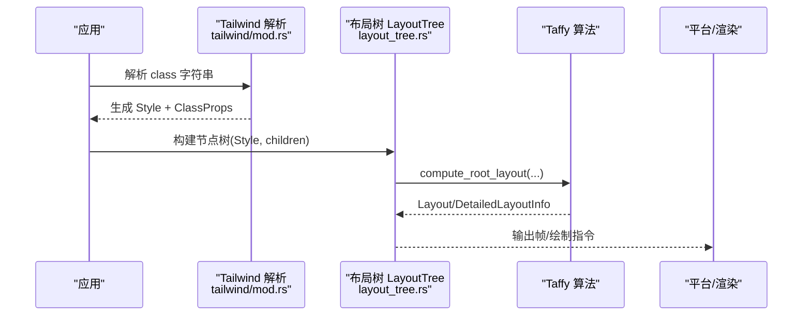
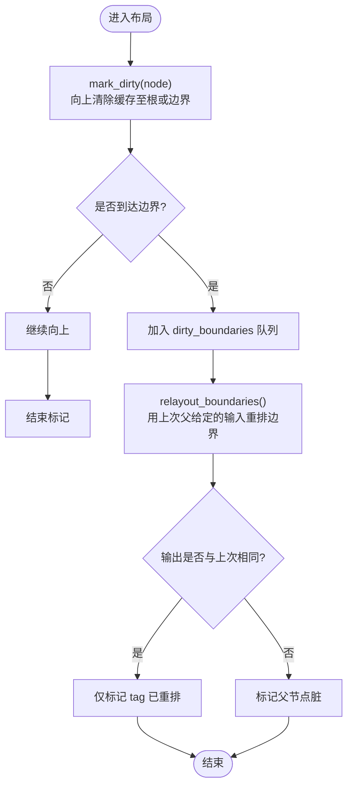
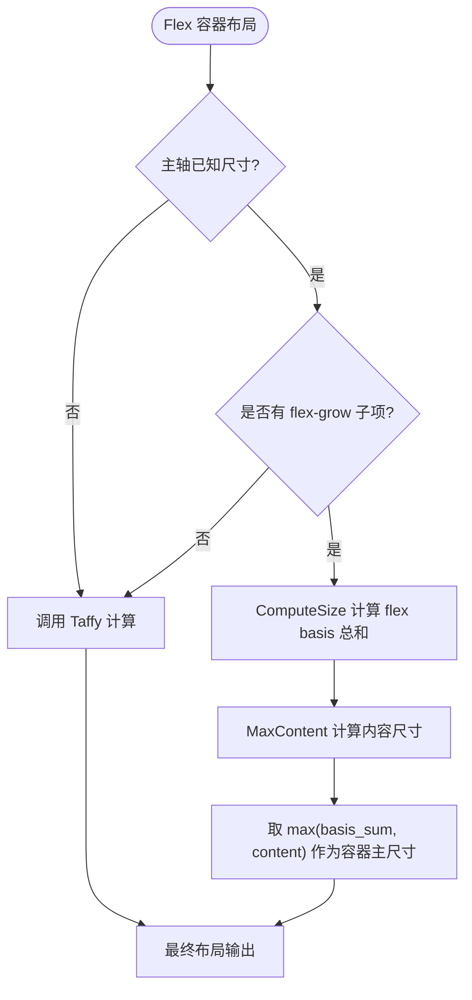
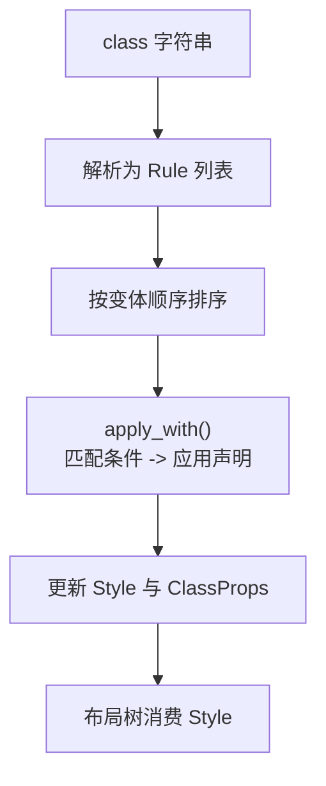
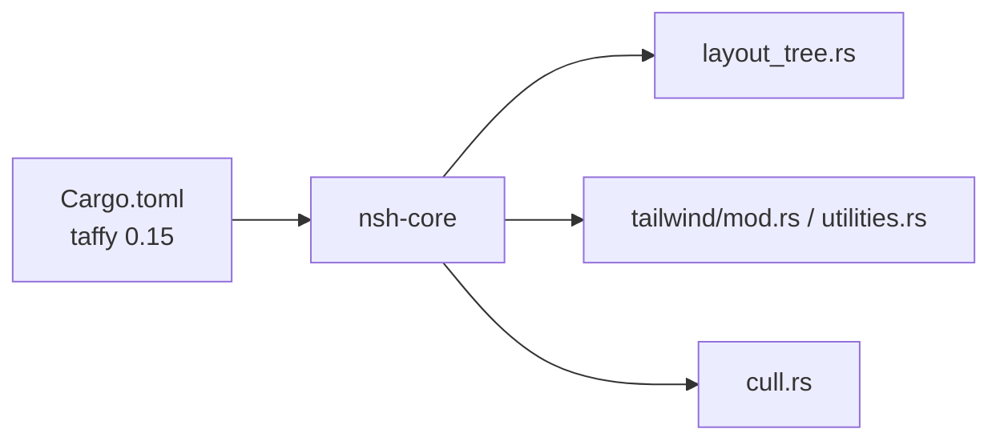

# 布局引擎

<cite>
**本文引用的文件**   
- [layout_tree.rs](file://crates/nsh-core/src/core/layout_tree.rs)
- [layout_scope.rs](file://crates/nsh-core/src/core/layout_scope.rs)
- [cull.rs](file://crates/nsh-core/src/core/cull.rs)
- [tailwind/mod.rs](file://crates/nsh-core/src/tailwind/mod.rs)
- [tailwind/utilities.rs](file://crates/nsh-core/src/tailwind/utilities.rs)
- [Cargo.toml](file://Cargo.toml)
</cite>

## 目录
1. [引言](#引言)
2. [项目结构](#项目结构)
3. [核心组件](#核心组件)
4. [架构总览](#架构总览)
5. [详细组件分析](#详细组件分析)
6. [依赖关系分析](#依赖关系分析)
7. [性能考量](#性能考量)
8. [故障排查指南](#故障排查指南)
9. [结论](#结论)

## 引言
本技术文档聚焦 NSH 的布局引擎，系统性解释 Flexbox 与 Grid 布局的实现原理、Taffy 布局引擎的集成方式、元素测量与定位算法、约束求解流程，以及响应式布局的计算过程（尺寸计算、位置分配与溢出处理）。同时说明 Tailwind CSS 样式的解析与布局属性映射机制，并总结增量布局与缓存等性能优化策略。

## 项目结构
NSH 的布局相关实现集中在 `nsh-core` 中：
- 布局树与 Taffy 集成：`core/layout_tree.rs`
- 布局动画作用域：`core/layout_scope.rs`
- 裁剪与占位逻辑（使用 Taffy 类型）：`core/cull.rs`
- Tailwind 样式解析与属性映射：`tailwind/mod.rs`、`tailwind/utilities.rs`
- Taffy 依赖声明：根 `Cargo.toml`

图表来源
- [layout_tree.rs:1-50](file://crates/nsh-core/src/core/layout_tree.rs#L1-L50)
- [tailwind/mod.rs:1-24](file://crates/nsh-core/src/tailwind/mod.rs#L1-L24)
- [tailwind/utilities.rs:1-24](file://crates/nsh-core/src/tailwind/utilities.rs#L1-L24)
- [cull.rs:14-14](file://crates/nsh-core/src/core/cull.rs#L14-L14)

章节来源
- [layout_tree.rs:1-50](file://crates/nsh-core/src/core/layout_tree.rs#L1-L50)
- [tailwind/mod.rs:1-24](file://crates/nsh-core/src/tailwind/mod.rs#L1-L24)
- [Cargo.toml:241-241](file://Cargo.toml#L241-L241)

## 核心组件
- 布局树 LayoutTree：封装 Taffy 的低层接口，维护节点样式、子树、缓存、未取整布局、详细布局信息，并提供脏标记、边界重排、测量复用等能力。
- Tailwind 样式系统：将 class 字符串解析为规则与声明，按变体顺序应用到 Style，支持响应式断点、交互状态、RTL、主题 token 等。
- 布局动画作用域：对局部变更产生的帧进行分组与插值，使布局变化可动画化。
- 裁剪与占位：结合 Taffy 的类型与布局结果，完成可视区域裁剪与占位尺寸设置。

章节来源
- [layout_tree.rs:55-153](file://crates/nsh-core/src/core/layout_tree.rs#L55-L153)
- [tailwind/mod.rs:1-24](file://crates/nsh-core/src/tailwind/mod.rs#L1-L24)
- [layout_scope.rs:1-29](file://crates/nsh-core/src/core/layout_scope.rs#L1-L29)
- [cull.rs:14-14](file://crates/nsh-core/src/core/cull.rs#L14-L14)

## 架构总览
NSH 在 Rust 侧通过自定义 `LayoutPartialTree` 与 `TraversePartialTree` 实现，驱动 Taffy 的 flexbox/grid/block/out-of-flow 算法；同时保留自己的脏标记、缓存与“边界”概念，以最小化重排范围。Tailwind 负责将 class 转为 Style，再由布局树消费。

图表来源
- [tailwind/mod.rs:1-24](file://crates/nsh-core/src/tailwind/mod.rs#L1-L24)
- [layout_tree.rs:723-739](file://crates/nsh-core/src/core/layout_tree.rs#L723-L739)

## 详细组件分析

### 布局树 LayoutTree 与 Taffy 集成
- 节点模型：每个节点持有共享 Style、角色、父/子关系、Taffy Cache、未取整 Layout、详细布局信息、测量上下文、上次完整布局输入输出、是否“边界”、是否为 holder、是否 stale 等。
- 脏标记与边界：脏标记总是向上到根，遇到“边界”则停止并排队单独重排；边界是那些内部变化不会改变父布局输出的节点（如绝对定位且宽高固定、或 Flex 容器中宽高固定且不收缩、不对齐基线等）。
- 测量复用：叶子节点的多次测量结果被缓存，若所有输入对应的输出一致，则认为上层布局无需重算。
- 布局算法：
  - Flex：修正了 Taffy 在确定空间下主尺寸累加导致的“flex:1 无贡献”问题，采用容器主尺寸为 max-content 直到可用空间的策略。
  - Grid：直接委托 Taffy 的 grid 布局。
  - Block/OOF：委托 Taffy 的 block 与 out-of-flow 布局。
- 未取整布局：保留算法原始结果，由 core 自行做取整，避免 Taffy 内部 rounding 带来的陈旧数据。
- Holder 透传：无样式且仅持有一个子节点的 holder 会被“透传”，让子节点直接在父布局中参与 flex/grid 对齐与 margin:auto 等行为。

图表来源
- [layout_tree.rs:457-477](file://crates/nsh-core/src/core/layout_tree.rs#L457-L477)
- [layout_tree.rs:621-660](file://crates/nsh-core/src/core/layout_tree.rs#L621-L660)

章节来源
- [layout_tree.rs:1-40](file://crates/nsh-core/src/core/layout_tree.rs#L1-L40)
- [layout_tree.rs:55-153](file://crates/nsh-core/src/core/layout_tree.rs#L55-L153)
- [layout_tree.rs:457-500](file://crates/nsh-core/src/core/layout_tree.rs#L457-L500)
- [layout_tree.rs:526-587](file://crates/nsh-core/src/core/layout_tree.rs#L526-L587)
- [layout_tree.rs:621-739](file://crates/nsh-core/src/core/layout_tree.rs#L621-L739)

### Flexbox 布局修正与约束求解
- 问题背景：Taffy 在确定空间中对 flex 项的主尺寸求和，导致 `flex:1` 项在主方向上可能不贡献空间，造成行高/列宽不一致。
- 解决方案：当容器主方向有 flex grow 项且已知维度缺失时，先以 ComputeSize 模式计算各 flex basis 之和，再以 MaxContent 模式计算内容宽度，取两者作为容器主尺寸，从而保证视觉一致性。
- 约束求解要点：
  - 主轴方向：根据 flex-direction 决定水平或垂直。
  - 换行：仅在允许换行时考虑多行。
  - 对齐：baseline 对齐需要额外基线信息。
  - 溢出：通过 DetailedLayoutInfo 获取溢出信息，供滚动/裁剪使用。

图表来源
- [layout_tree.rs:742-800](file://crates/nsh-core/src/core/layout_tree.rs#L742-L800)

章节来源
- [layout_tree.rs:742-800](file://crates/nsh-core/src/core/layout_tree.rs#L742-L800)

### Grid 布局与 Out-of-Flow
- Grid：直接使用 Taffy 的 grid 布局算法，提供行列轨道、网格项放置、跨行跨列等能力。
- Out-of-Flow：委托 Taffy 的 OOF 布局，配合 containing block 信息完成绝对定位、固定定位等。

章节来源
- [layout_tree.rs:1-50](file://crates/nsh-core/src/core/layout_tree.rs#L1-L50)

### Tailwind 样式解析与布局属性映射
- 解析流程：class 字符串被解析为 Rule 列表（含条件 Condition、声明 Decl、优先级 Rank），并按 Tailwind 变体顺序排序后应用。
- 响应式与状态：支持 dark/light、min/max-width、landscape/portrait、pointer-fine/coarse、terminal、RTL、group-data-*、data-*、交互态（hover/focus/active/disabled 等）、position（first/last/odd/even/only）。
- 属性映射：
  - 布局相关：flex、flex-direction、flex-wrap、align-items、justify-content、gap、margin/padding、width/height、max/min 尺寸、position、overflow 等。
  - 文本与排版：line-clamp、truncate、whitespace、text-pretty、ch 单位、currentColor。
  - 其他：transform、shadow、ring、gradient、filter、transition/animation 等。
- 当前色 currentColor：支持 border/ring/shadow 等继承文本颜色。
- 主题 Token：基于 Tailwind 4 调色板（OKLCH→sRGB），并可扩展。

图表来源
- [tailwind/mod.rs:1-24](file://crates/nsh-core/src/tailwind/mod.rs#L1-L24)
- [tailwind/mod.rs:705-800](file://crates/nsh-core/src/tailwind/mod.rs#L705-L800)
- [tailwind/utilities.rs:1-24](file://crates/nsh-core/src/tailwind/utilities.rs#L1-L24)

章节来源
- [tailwind/mod.rs:1-24](file://crates/nsh-core/src/tailwind/mod.rs#L1-L24)
- [tailwind/mod.rs:114-147](file://crates/nsh-core/src/tailwind/mod.rs#L114-L147)
- [tailwind/mod.rs:233-361](file://crates/nsh-core/src/tailwind/mod.rs#L233-L361)
- [tailwind/mod.rs:705-800](file://crates/nsh-core/src/tailwind/mod.rs#L705-L800)
- [tailwind/utilities.rs:1-24](file://crates/nsh-core/src/tailwind/utilities.rs#L1-L24)

### 响应式布局计算流程
- 断点与环境：ClassEnvironment 包含 dark/platform/reduce_motion/pointer/terminal；Context 包含 window 尺寸、rtl、states、position、group 状态查询函数。
- 条件匹配：Condition.matches 依据环境、窗口尺寸、方向、指针精度、终端模式、交互态、group-data、data-*、position 等判定规则是否生效。
- 尺寸计算：
  - 百分比尺寸：相对于父级定长尺寸。
  - ch 单位：默认 ch=8pt，用于 prose 等宽度限制。
  - w-screen/h-screen：相对窗口尺寸的布局。
- 位置分配：由 Flex/Grid 算法决定，结合 margin/padding/gap/align/justify 等。
- 溢出处理：DetailedLayoutInfo 提供溢出信息，结合 cull 模块进行裁剪与占位。

章节来源
- [tailwind/mod.rs:188-219](file://crates/nsh-core/src/tailwind/mod.rs#L188-L219)
- [tailwind/mod.rs:233-361](file://crates/nsh-core/src/tailwind/mod.rs#L233-L361)
- [tailwind/mod.rs:149-151](file://crates/nsh-core/src/tailwind/mod.rs#L149-L151)

### 布局动画作用域
- 目标：对局部变更引起的帧移动进行分组与插值，提升视觉流畅性。
- 机制：记录受影响的 key 与祖先链，拆分 MountItem 帧序列，插入 LayoutAnimation 包裹，平台侧执行动画。
- 影响范围：节点自身及子树、兄弟节点因尺寸变化而移动的帧、以及因父节点尺寸变化而传递下来的帧。

章节来源
- [layout_scope.rs:1-29](file://crates/nsh-core/src/core/layout_scope.rs#L1-L29)
- [layout_scope.rs:42-53](file://crates/nsh-core/src/core/layout_scope.rs#L42-L53)
- [layout_scope.rs:73-155](file://crates/nsh-core/src/core/layout_scope.rs#L73-L155)
- [layout_scope.rs:157-178](file://crates/nsh-core/src/core/layout_scope.rs#L157-L178)

### 裁剪与占位
- 使用 Taffy 的 Position、Dimension、Size 等类型，结合布局结果进行可视区域裁剪与占位尺寸设置。
- 占位高度：在不可见或占位场景下设置固定高度，确保布局稳定。

章节来源
- [cull.rs:14-14](file://crates/nsh-core/src/core/cull.rs#L14-L14)
- [cull.rs:227-227](file://crates/nsh-core/src/core/cull.rs#L227-L227)
- [cull.rs:595-652](file://crates/nsh-core/src/core/cull.rs#L595-L652)

## 依赖关系分析
- Taffy 依赖：通过 Cargo.toml 引入 taffy 0.15，启用 std、flexbox、grid、block_layout、content_size 特性。
- 代码耦合：
  - layout_tree.rs 直接依赖 taffy 的多种算法与数据结构。
  - tailwind 模块独立于布局树，产出 Style 供其消费。
  - cull.rs 依赖 taffy 类型，与布局树协作完成裁剪。

图表来源
- [Cargo.toml:241-241](file://Cargo.toml#L241-L241)
- [layout_tree.rs:44-51](file://crates/nsh-core/src/core/layout_tree.rs#L44-L51)
- [cull.rs:14-14](file://crates/nsh-core/src/core/cull.rs#L14-L14)

章节来源
- [Cargo.toml:241-241](file://Cargo.toml#L241-L241)
- [layout_tree.rs:44-51](file://crates/nsh-core/src/core/layout_tree.rs#L44-L51)

## 性能考量
- 增量布局与脏标记：
  - mark_dirty 总是向上到根，遇到“边界”停止并单独重排，避免全树重排。
  - relayout_boundaries 用上次父给定的输入重新计算边界节点，若输出不变则不污染父布局。
- 测量复用：
  - measures_as_before 比较叶子节点对所有输入的测量输出，若一致则上层布局无需重算。
- 样式共享：
  - share 将相同 Style 对象引用共享，减少内存占用与比较开销。
- 缓存机制：
  - 每个节点维护 Taffy Cache，clear_cache 时清空并重置 measured 列表。
- 边界判定：
  - is_boundary 精确识别不受内部内容变化的节点，缩小重排范围。
- 占位与固定尺寸：
  - sized_by_style 判断节点尺寸完全由样式决定，避免重复测量。

章节来源
- [layout_tree.rs:457-500](file://crates/nsh-core/src/core/layout_tree.rs#L457-L500)
- [layout_tree.rs:526-587](file://crates/nsh-core/src/core/layout_tree.rs#L526-L587)
- [layout_tree.rs:589-613](file://crates/nsh-core/src/core/layout_tree.rs#L589-L613)
- [layout_tree.rs:173-187](file://crates/nsh-core/src/core/layout_tree.rs#L173-L187)
- [layout_tree.rs:131-136](file://crates/nsh-core/src/core/layout_tree.rs#L131-L136)

## 故障排查指南
- 布局异常（Flex 行高不一致）：检查是否在确定空间且有 flex-grow 子项，确认 compute_flex_layout 的修正路径是否生效。
- 溢出显示异常：查看 DetailedLayoutInfo 的溢出字段，确认 cull 模块是否正确处理占位与裁剪。
- Tailwind 样式未生效：确认 ClassList.apply_with 的条件匹配（断点、dark、state、group-data、data-*、position）与声明优先级（important、!）。
- 动画错位：检查 layout_scope 的作用域与祖先链计算，确认 resized/restructured 列表是否正确过滤。

章节来源
- [layout_tree.rs:742-800](file://crates/nsh-core/src/core/layout_tree.rs#L742-L800)
- [cull.rs:595-652](file://crates/nsh-core/src/core/cull.rs#L595-L652)
- [tailwind/mod.rs:233-361](file://crates/nsh-core/src/tailwind/mod.rs#L233-L361)
- [layout_scope.rs:73-155](file://crates/nsh-core/src/core/layout_scope.rs#L73-L155)

## 结论
NSH 的布局引擎在 Taffy 的基础上进行了关键增强：修正 Flex 主尺寸计算、引入边界重排与测量复用、保留未取整布局并由 core 控制取整、并通过 Tailwind 样式系统实现强大的响应式与状态驱动布局。这些设计在保证兼容性的同时显著提升了性能与可维护性。