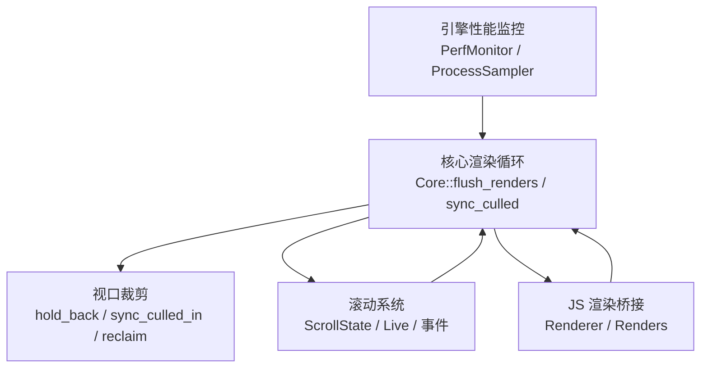
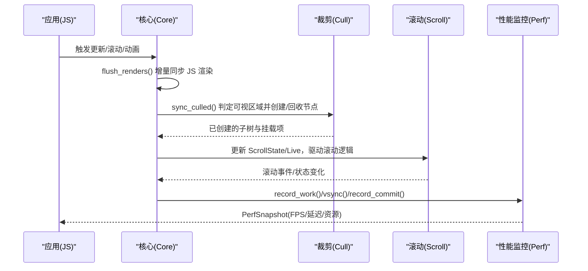
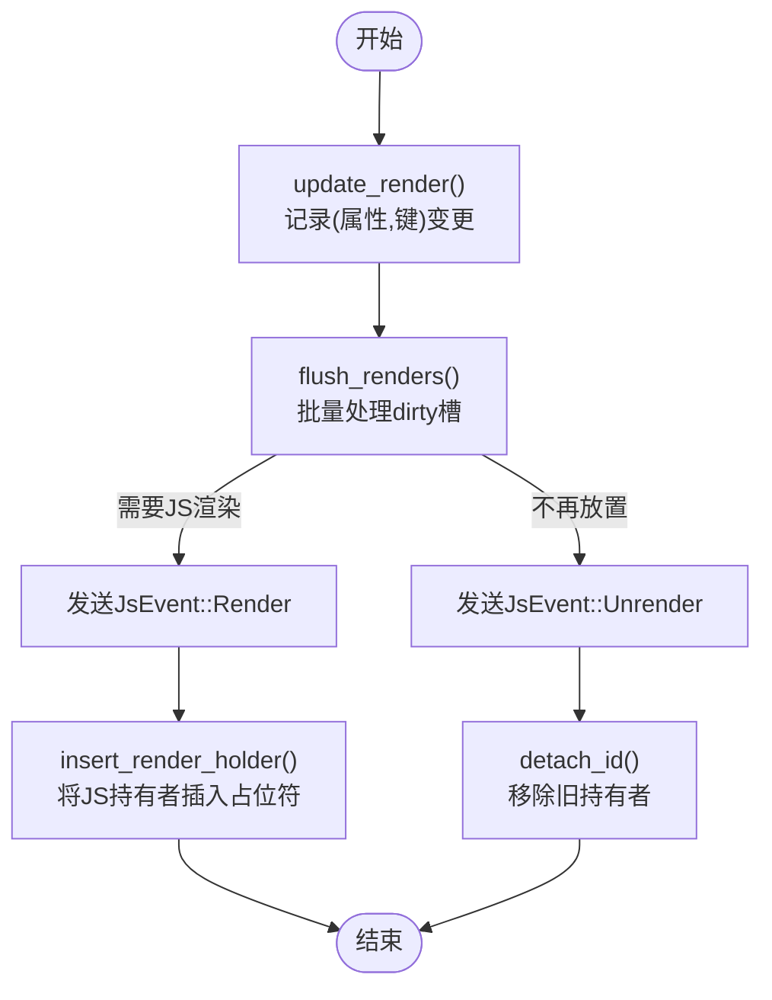
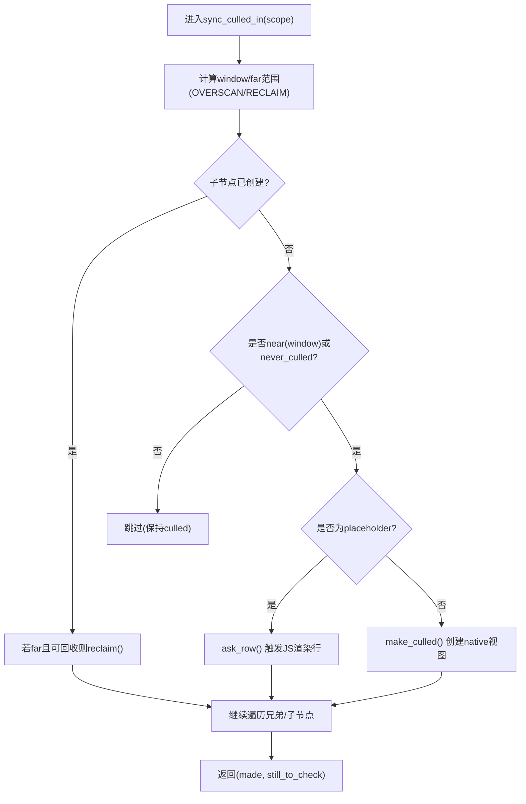
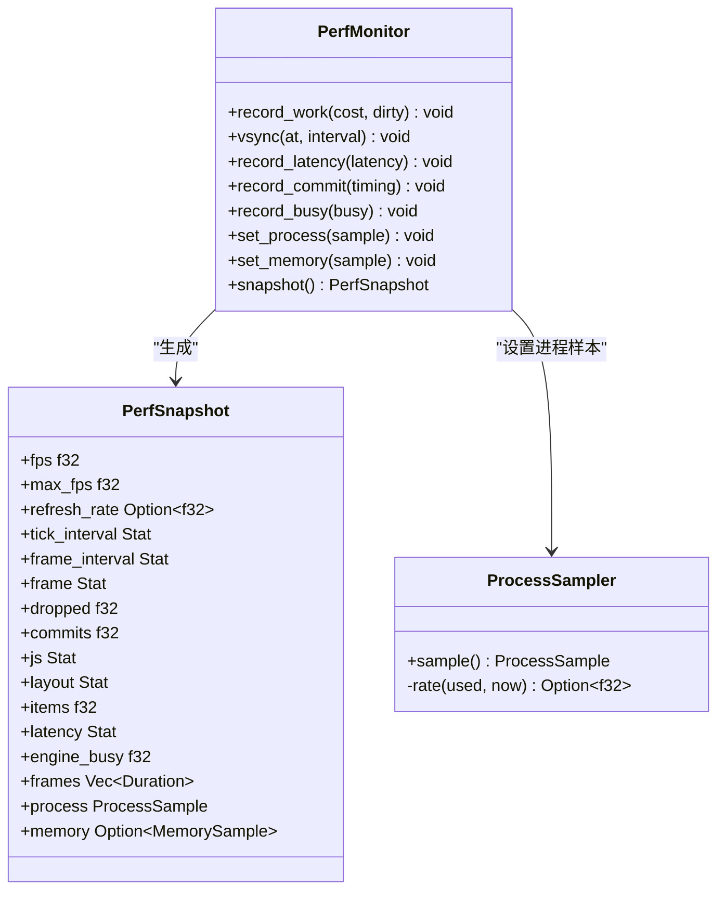
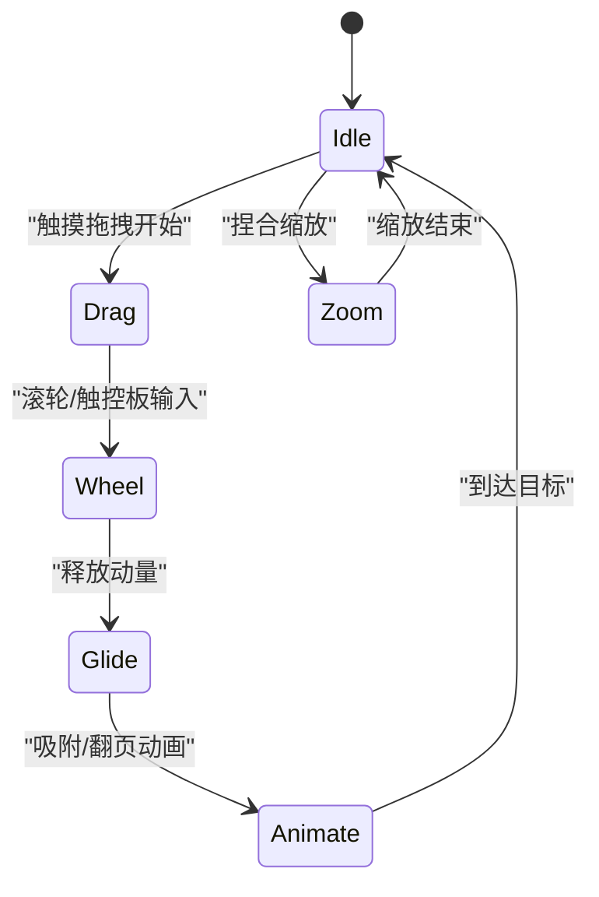
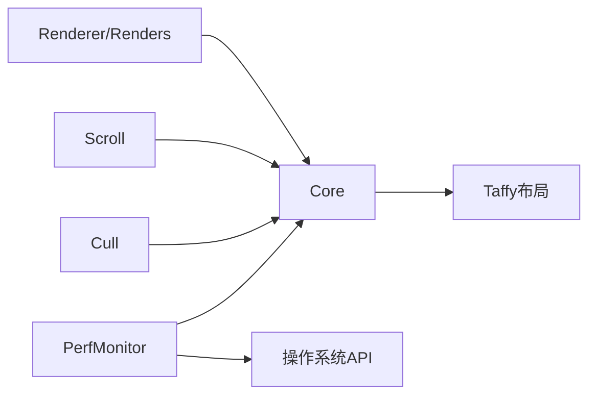

# 渲染优化

<cite>
**本文引用的文件**   
- [perf.rs](file://crates/nsh-engine/src/perf.rs)
- [cull.rs](file://crates/nsh-core/src/core/cull.rs)
- [scroll.rs](file://crates/nsh-core/src/scroll.rs)
- [renders.rs](file://crates/nsh-core/src/core/renders.rs)
- [renderer.rs](file://crates/nsh-core/src/element/renderer.rs)
- [scrollable.rs](file://crates/nsh-core/src/element/scrollable.rs)
</cite>

## 目录
1. [简介](#简介)
2. [项目结构](#项目结构)
3. [核心组件](#核心组件)
4. [架构总览](#架构总览)
5. [详细组件分析](#详细组件分析)
6. [依赖关系分析](#依赖关系分析)
7. [性能考量](#性能考量)
8. [故障排查指南](#故障排查指南)
9. [结论](#结论)

## 简介
本文件面向 NSH 的渲染优化机制，聚焦以下主题：
- 脏矩形检测与增量更新：视图层级变更的最小化重绘范围。
- 视口裁剪（Culling）：离屏元素剔除与可见性判断。
- 帧率控制与自适应渲染：动态刷新率、掉帧统计与资源使用监控。
- 粘性定位与滚动优化：滚动交互、动量滑动、粘滞单元格与滚动事件节流。
- 内存管理与性能监控工具：进程 CPU/内存采样、JS 堆与节点计数、FPS 面板与环境开关。

## 项目结构
围绕渲染优化的关键代码分布在引擎层与核心层：
- 引擎性能监控：nsh-engine 提供 FPS、提交耗时、延迟与进程采样。
- 核心裁剪与滚动：nsh-core 实现视口裁剪、占位符尺寸估计、滚动状态机与事件模型。
- JS 渲染桥接：nsh-core 将 JS 渲染函数与占位符/持有者进行最小化同步。

图表来源
- [perf.rs:1-800](file://crates/nsh-engine/src/perf.rs#L1-L800)
- [cull.rs:1-702](file://crates/nsh-core/src/core/cull.rs#L1-L702)
- [scroll.rs:1-800](file://crates/nsh-core/src/scroll.rs#L1-L800)
- [renders.rs:1-292](file://crates/nsh-core/src/core/renders.rs#L1-L292)
- [renderer.rs:1-276](file://crates/nsh-core/src/element/renderer.rs#L1-L276)

章节来源
- [perf.rs:1-800](file://crates/nsh-engine/src/perf.rs#L1-L800)
- [cull.rs:1-702](file://crates/nsh-core/src/core/cull.rs#L1-L702)
- [scroll.rs:1-800](file://crates/nsh-core/src/scroll.rs#L1-L800)
- [renders.rs:1-292](file://crates/nsh-core/src/core/renders.rs#L1-L292)
- [renderer.rs:1-276](file://crates/nsh-core/src/element/renderer.rs#L1-L276)

## 核心组件
- 性能监控器 PerfMonitor：记录主线程工作、VSync、提交、延迟、引擎忙碌度，并输出 PerfSnapshot（FPS、最大可维持帧率、刷新率、掉帧比例等）。
- 进程采样器 ProcessSampler：按时间窗口计算 CPU 占用百分比，采集进程内存足迹。
- 视口裁剪器（Cull）：基于滚动视口与变换可达范围，决定何时创建、保留或回收子树；对列表行使用占位符与平均尺寸估计。
- 滚动系统（Scroll）：统一处理偏移、动量滑动、弹性回弹、分页/吸附、粘滞单元格、缩放、指示器与刷新 spinner，并通过 ScrollHost 与后端交互。
- JS 渲染桥接（Renderer/Renders）：为 JS 渲染函数生成占位符，在每次提交后仅向 JS 请求尚未渲染的值，并将 JS 返回的持有者插入到对应占位符下。

章节来源
- [perf.rs:1-800](file://crates/nsh-engine/src/perf.rs#L1-L800)
- [cull.rs:1-702](file://crates/nsh-core/src/core/cull.rs#L1-L702)
- [scroll.rs:1-800](file://crates/nsh-core/src/scroll.rs#L1-L800)
- [renders.rs:1-292](file://crates/nsh-core/src/core/renders.rs#L1-L292)
- [renderer.rs:1-276](file://crates/nsh-core/src/element/renderer.rs#L1-L276)

## 架构总览
NSH 的渲染优化由“引擎性能监控 + 核心裁剪/滚动 + JS 渲染桥接”三部分协同完成。引擎侧负责测量与上报，核心侧负责最小化绘制与布局开销，JS 侧按需渲染内容。

图表来源
- [renders.rs:234-290](file://crates/nsh-core/src/core/renders.rs#L234-L290)
- [cull.rs:273-420](file://crates/nsh-core/src/core/cull.rs#L273-L420)
- [scroll.rs:1-800](file://crates/nsh-core/src/scroll.rs#L1-L800)
- [perf.rs:314-483](file://crates/nsh-engine/src/perf.rs#L314-L483)

## 详细组件分析

### 脏矩形检测与增量更新
- 脏标记与最小化重绘
  - 通过 Renders 维护 (prop, key) -> 渲染槽的状态，仅在值发生变化时向 JS 发送 Render/Unrender 事件。
  - 每个 commit 后调用 flush_renders，批量处理 dirty 槽，避免重复渲染。
  - 对于列表单元，cells_awaiting_renders 收集等待 JS 渲染的单元格键，避免未就绪内容影响布局测量。
- 占位符与行渲染
  - 列表行以占位符形式参与布局，待其进入视口附近时再 ask_row 触发 JS 渲染真实行。
  - size_placeholders 根据相邻已渲染行的平均尺寸估算占位符高度，减少二次布局。

图表来源
- [renders.rs:70-133](file://crates/nsh-core/src/core/renders.rs#L70-L133)
- [renders.rs:146-180](file://crates/nsh-core/src/core/renders.rs#L146-L180)
- [renders.rs:234-290](file://crates/nsh-core/src/core/renders.rs#L234-L290)

章节来源
- [renders.rs:1-292](file://crates/nsh-core/src/core/renders.rs#L1-L292)
- [renderer.rs:153-185](file://crates/nsh-core/src/element/renderer.rs#L153-L185)

### 视口裁剪（Culling）与可见性判断
- 裁剪范围与策略
  - OVERSCAN 与 RECLAIM 定义视口外延与回收阈值，RECLAIM_MAX_NODES 限制子树大小以避免昂贵检查。
  - hold_back 将远端且可回收的子树标记 culled；sync_culled_in 遍历子树，依据 frame 与 reach_of 扩展后的矩形判断是否创建或回收。
  - never_culled 排除粘性定位、跟随、装饰、覆盖层等不可裁剪节点。
- 变换可达范围
  - reach_of 解析 transform ops 与动画 bound，计算 x/y 方向的最大位移；无法确定边界时保守不裁剪。
- 占位符与真实测量
  - placeholder 为 Each 行预留空间；measure_for_real 在真实视图创建后替换估计尺寸，必要时触发重新布局。
- 回收与重建
  - reclaim 删除远端子树的 native 视图但保留布局与测量信息；uncull 按需重建祖先链直至已创建节点。

图表来源
- [cull.rs:19-34](file://crates/nsh-core/src/core/cull.rs#L19-L34)
- [cull.rs:129-152](file://crates/nsh-core/src/core/cull.rs#L129-L152)
- [cull.rs:301-420](file://crates/nsh-core/src/core/cull.rs#L301-L420)
- [cull.rs:457-477](file://crates/nsh-core/src/core/cull.rs#L457-L477)
- [cull.rs:506-582](file://crates/nsh-core/src/core/cull.rs#L506-L582)

章节来源
- [cull.rs:1-702](file://crates/nsh-core/src/core/cull.rs#L1-L702)

### 帧率控制与自适应渲染
- FPS 与掉帧统计
  - PerfMonitor.vsync 关闭每帧计时，记录主线程工作成本；frame_warmup 忽略冷启动帧。
  - dropped 统计超过预算（1/refresh_rate）的帧占比；max_fps 取 mean 倒数与显示刷新率的较小值。
- 刷新率平滑与速率窗口
  - refresh_rate 采用指数平滑稳定显示链接周期；RATE_WINDOW=1s 用于统计 fps/commits/engine_busy。
- 进程资源采样
  - ProcessSampler.rate 基于 CPU 时间差与时间窗口计算百分比；memory 在不同平台读取物理足迹/驻留集。
- 环境开关与日志
  - ENV_VAR="NSH_FPS" 控制性能面板开启；mode_by_env 支持 collapsed/hidden 模式；LOG_TARGET 区分 FPS 日志与 trace 日志。

图表来源
- [perf.rs:190-243](file://crates/nsh-engine/src/perf.rs#L190-L243)
- [perf.rs:245-483](file://crates/nsh-engine/src/perf.rs#L245-L483)
- [perf.rs:501-549](file://crates/nsh-engine/src/perf.rs#L501-L549)

章节来源
- [perf.rs:1-800](file://crates/nsh-engine/src/perf.rs#L1-L800)

### 粘性定位与滚动优化
- 滚动状态机与交互
  - Phase 枚举描述 Idle/Drag/Wheel/Glide/Animate/Zoom 等阶段；Live 跟踪 indicator、spinner、zoom 等运行时状态。
  - ScrollState 提供 reported/limits/range/centered/to_viewport/to_content 等几何与约束方法。
- 动量滑动与吸附
  - glide_step 与 projected 计算减速曲线与停止位置；snap_duration 根据速度与距离选择动画时长。
- 粘滞单元格与指示器
  - sticky_shift 计算粘滞单元格偏移；indicator_span_within 计算指示器长度与位置，考虑 inset 与越界拉伸。
- 事件节流与回调
  - event_throttle 限制 on_scroll 频率；on_refresh/on_scroll/on_momentum_* 等事件通过 Scrollable trait 暴露给上层。

图表来源
- [scroll.rs:124-169](file://crates/nsh-core/src/scroll.rs#L124-L169)
- [scroll.rs:340-389](file://crates/nsh-core/src/scroll.rs#L340-L389)
- [scroll.rs:391-442](file://crates/nsh-core/src/scroll.rs#L391-L442)
- [scrollable.rs:150-256](file://crates/nsh-core/src/element/scrollable.rs#L150-L256)

章节来源
- [scroll.rs:1-800](file://crates/nsh-core/src/scroll.rs#L1-L800)
- [scrollable.rs:1-264](file://crates/nsh-core/src/element/scrollable.rs#L1-L264)

## 依赖关系分析
- 组件耦合
  - PerfMonitor 与 Core 解耦：Core 通过 record_work/vsync/record_commit 上报，PerfMonitor 只聚合统计。
  - Cull 与 Core 紧密耦合：依赖 layout/frame/scroll 状态，直接操作 nodes 与 mount。
  - Scroll 与 Core 通过 ScrollHost 接口解耦：后端实现具体视图移动与指示器绘制。
  - Renderer/Renders 与 Core 协作：通过 JsEvent 与 Op 进行最小化同步。
- 外部依赖
  - taffy 布局库：用于布局尺寸与样式操作。
  - 平台 API：CPU/内存采样在不同平台使用不同系统调用。

图表来源
- [perf.rs:314-483](file://crates/nsh-engine/src/perf.rs#L314-L483)
- [cull.rs:273-420](file://crates/nsh-core/src/core/cull.rs#L273-L420)
- [scroll.rs:255-305](file://crates/nsh-core/src/scroll.rs#L255-L305)
- [renders.rs:234-290](file://crates/nsh-core/src/core/renders.rs#L234-L290)

章节来源
- [perf.rs:1-800](file://crates/nsh-engine/src/perf.rs#L1-L800)
- [cull.rs:1-702](file://crates/nsh-core/src/core/cull.rs#L1-L702)
- [scroll.rs:1-800](file://crates/nsh-core/src/scroll.rs#L1-L800)
- [renders.rs:1-292](file://crates/nsh-core/src/core/renders.rs#L1-L292)

## 性能考量
- 最小化重绘
  - 使用 Renders.dirty 批量处理 JS 渲染，避免逐条比较；holder 复用与 detach 降低 DOM/原生视图抖动。
- 视口裁剪
  - 通过 OVERSCAN/RECLAIM 平衡内存与流畅度；reach_of 保守估计变换范围，避免误裁。
- 帧率与掉帧
  - 使用 max_fps 与 dropped 指标评估渲染压力；refresh_rate 平滑避免抖动导致的误判。
- 滚动优化
  - event_throttle 降低 on_scroll 频率；sticky 与 indicator 计算轻量，避免每帧复杂几何。
- 资源采样
  - ProcessSampler 的时间窗口避免短时峰值误导；memory 使用平台最优 API（如 macOS task_info）。

[本节为通用指导，无需特定文件引用]

## 故障排查指南
- FPS 面板未显示
  - 检查环境变量 NSH_FPS 是否设置为非空非 false；确认 mode_by_env 返回值是否符合预期。
- 频繁掉帧
  - 查看 PerfSnapshot.dropped 与 frame.mean；若 frame.mean 接近或超过 1/refresh_rate，需优化 JS 渲染或减少布局复杂度。
- 滚动卡顿
  - 检查 on_scroll 是否过于频繁；启用 event_throttle；确认 cull 是否正常工作（观察 cull_dirty 与 reclaim 行为）。
- 内存增长
  - 关注 MemorySample.js_heap/js_objects/nodes/node_ids；结合 ProcessSampler.memory 趋势判断是否存在泄漏。
- 首帧慢
  - first_frame 日志可用于基准测试；确保 WARMUP 帧不被计入统计，避免误判。

章节来源
- [perf.rs:33-78](file://crates/nsh-engine/src/perf.rs#L33-L78)
- [perf.rs:400-483](file://crates/nsh-engine/src/perf.rs#L400-L483)
- [cull.rs:273-420](file://crates/nsh-core/src/core/cull.rs#L273-L420)
- [scrollable.rs:150-157](file://crates/nsh-core/src/element/scrollable.rs#L150-L157)

## 结论
NSH 的渲染优化通过“脏标记+JS 渲染桥接”、“视口裁剪+占位符估计”、“滚动状态机+事件节流”以及“引擎性能监控+进程采样”形成闭环。开发者应优先关注：
- 最小化 JS 渲染差异与 holder 生命周期。
- 合理使用滚动与粘滞特性，避免过度监听滚动事件。
- 利用 PerfSnapshot 与 ProcessSampler 定位瓶颈，结合 cull 行为调优内存与流畅度。

[本节为总结，无需特定文件引用]