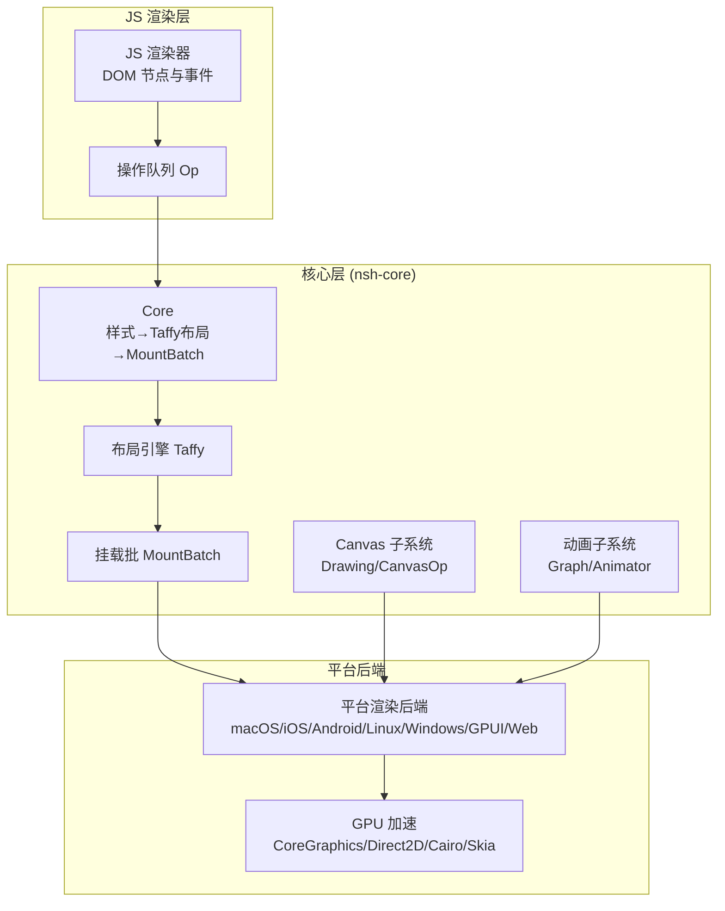
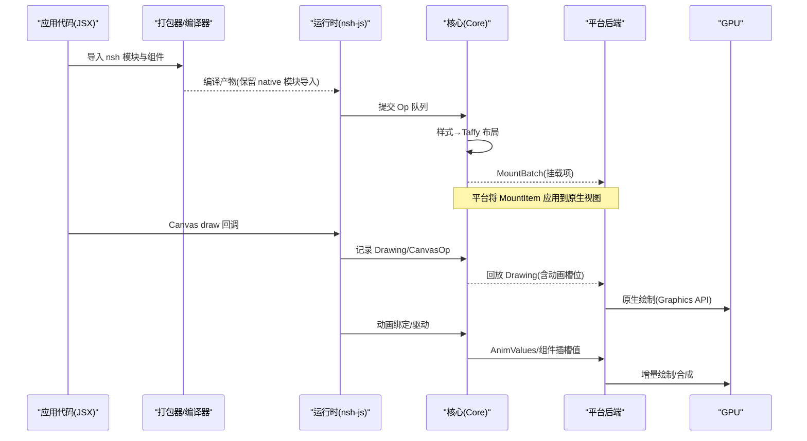
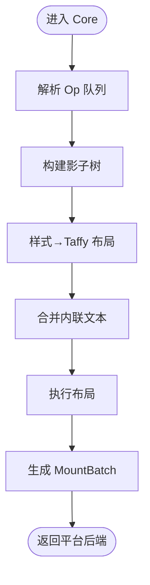
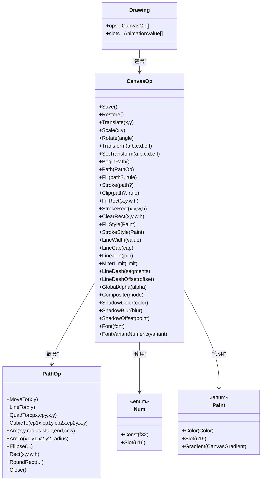
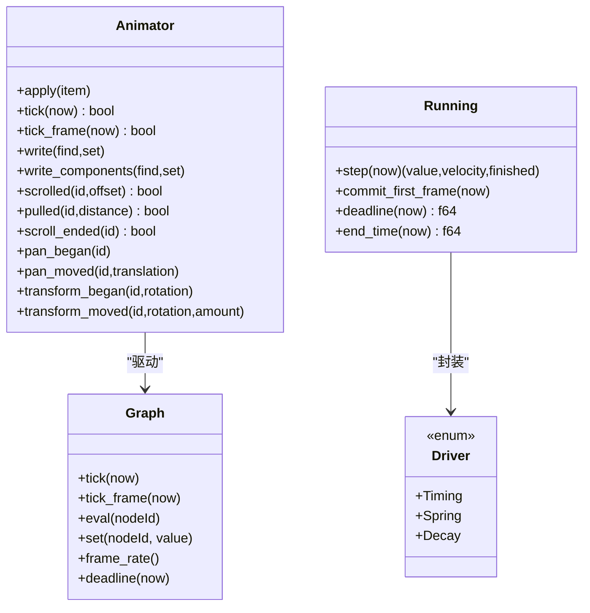
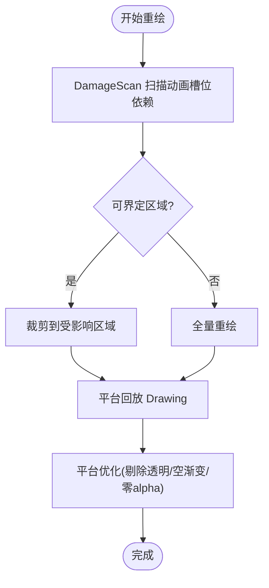
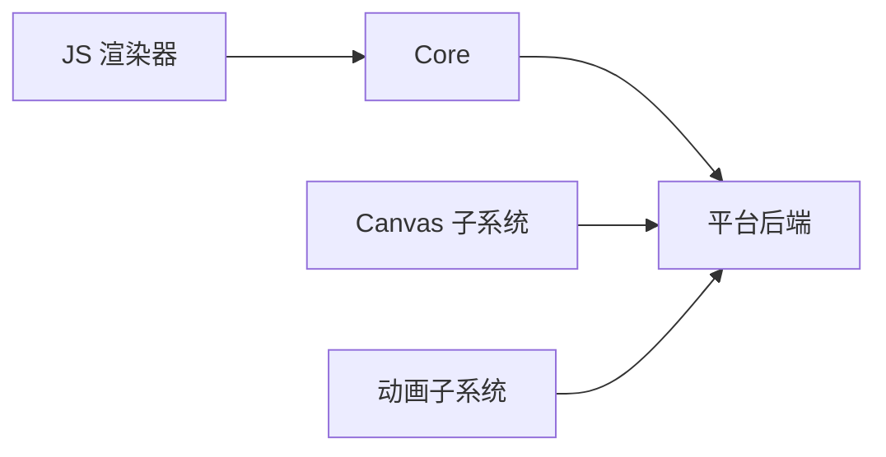

# 渲染管线架构

<cite>
**本文引用的文件**   
- [crates/nsh-core/src/lib.rs](file://crates/nsh-core/src/lib.rs)
- [crates/nsh-core/src/canvas.rs](file://crates/nsh-core/src/canvas.rs)
- [docs/dev/native-pipeline.md](file://docs/dev/native-pipeline.md)
- [docs/dev/canvas.md](file://docs/dev/canvas.md)
- [crates/nsh-core/src/animation/mod.rs](file://crates/nsh-core/src/animation/mod.rs)
- [crates/nsh-core/src/animation/animator.rs](file://crates/nsh-core/src/animation/animator.rs)
- [crates/nsh-core/src/animation/driver.rs](file://crates/nsh-core/src/animation/driver.rs)
</cite>

## 目录
1. [简介](#简介)
2. [项目结构](#项目结构)
3. [核心组件](#核心组件)
4. [架构总览](#架构总览)
5. [详细组件分析](#详细组件分析)
6. [依赖关系分析](#依赖关系分析)
7. [性能考量](#性能考量)
8. [故障排查指南](#故障排查指南)
9. [结论](#结论)
10. [附录](#附录)

## 简介
本技术文档面向 NSH 的渲染管线，系统阐述从 UI 元素树到原生绘制的完整流程：布局计算、绘制指令生成与平台特定渲染调用。重点覆盖 Canvas 渲染系统与 GPU 加速路径、动画系统的插值算法与帧率控制、脏矩形检测与增量渲染策略，以及不同平台的后端差异与最佳实践。读者无需深入源码即可理解整体设计，同时提供精确的文件级引用以便进一步定位实现细节。

## 项目结构
NSH 的核心渲染能力集中在 nsh-core 中，JS 渲染器通过操作（Op）驱动核心进行布局与挂载；Canvas 子系统将 JS 侧的绘图 API 记录为不可变的操作序列，由平台在原生端回放；动画子系统以无平台依赖的图模型运行在 UI 线程，输出视图属性或 Canvas 插槽值。

图表来源
- [crates/nsh-core/src/lib.rs:1-10](file://crates/nsh-core/src/lib.rs#L1-L10)
- [docs/dev/native-pipeline.md:118-138](file://docs/dev/native-pipeline.md#L118-L138)
- [crates/nsh-core/src/canvas.rs:1-10](file://crates/nsh-core/src/canvas.rs#L1-L10)
- [crates/nsh-core/src/animation/mod.rs:1-14](file://crates/nsh-core/src/animation/mod.rs#L1-L14)

章节来源
- [crates/nsh-core/src/lib.rs:1-10](file://crates/nsh-core/src/lib.rs#L1-L10)
- [docs/dev/native-pipeline.md:118-138](file://docs/dev/native-pipeline.md#L118-L138)

## 核心组件
- 核心（Core）：接收 JS 渲染器的操作，维护影子树，将样式转换为 Taffy 布局，合并内联文本，执行布局并产出 MountBatch，由平台后端应用到原生视图。
- Canvas 子系统：将 HTML Canvas 2D 子集记录为 Drawing/CanvasOp，支持动画值槽位，平台回放时直接读取槽位值，避免 JS 参与重绘。
- 动画子系统：以 Graph/Animator 为核心，在 UI 线程按显示帧推进，输出 AnimValues 或组件插槽值，支持手势与滚动联动。

章节来源
- [crates/nsh-core/src/lib.rs:1-10](file://crates/nsh-core/src/lib.rs#L1-L10)
- [crates/nsh-core/src/canvas.rs:1-10](file://crates/nsh-core/src/canvas.rs#L1-L10)
- [crates/nsh-core/src/animation/mod.rs:1-14](file://crates/nsh-core/src/animation/mod.rs#L1-L14)

## 架构总览
下图展示从 JSX 编译到原生绘制的端到端流程，包括模块加载、渲染器、核心布局与挂载、Canvas 回放与动画更新。

图表来源
- [docs/dev/native-pipeline.md:83-117](file://docs/dev/native-pipeline.md#L83-L117)
- [docs/dev/native-pipeline.md:118-138](file://docs/dev/native-pipeline.md#L118-L138)
- [crates/nsh-core/src/canvas.rs:1-10](file://crates/nsh-core/src/canvas.rs#L1-L10)
- [crates/nsh-core/src/animation/mod.rs:1-14](file://crates/nsh-core/src/animation/mod.rs#L1-L14)

## 详细组件分析

### 布局与挂载管线（Core → MountBatch）
- 输入：JS 渲染器产生的 Op（包含元素创建、属性变更、事件绑定等）。
- 处理：Core 解析 Op，构建影子树，将样式转为 Taffy 布局，合并 AttributedText，执行布局。
- 输出：MountBatch（MountItem 列表），平台后端将其应用到原生视图。

图表来源
- [crates/nsh-core/src/lib.rs:1-10](file://crates/nsh-core/src/lib.rs#L1-L10)

章节来源
- [crates/nsh-core/src/lib.rs:1-10](file://crates/nsh-core/src/lib.rs#L1-L10)

### Canvas 渲染系统（Recording + Replay）
- 记录阶段：JS 侧 CanvasRenderingContext2D 的绘图方法被记录为 Rust 列表中的 CanvasOp/PathOp，数字参数可为动画槽位（Num::Slot）。
- 回放阶段：平台在原生端回放 Drawing，读取动画槽位的当前值，避免 JS 参与重绘。
- 命中测试：point_in_path/point_in_stroke 在 Rust 侧回放路径状态进行命中判定。
- OffscreenCanvas：将录制内容解码为 Drawing，发送 RenderCanvas 命令，平台编码为 Blob/PNG 等格式。

图表来源
- [crates/nsh-core/src/canvas.rs:29-37](file://crates/nsh-core/src/canvas.rs#L29-L37)
- [crates/nsh-core/src/canvas.rs:56-130](file://crates/nsh-core/src/canvas.rs#L56-L130)
- [crates/nsh-core/src/canvas.rs:327-336](file://crates/nsh-core/src/canvas.rs#L327-L336)
- [crates/nsh-core/src/canvas.rs:686-800](file://crates/nsh-core/src/canvas.rs#L686-L800)

章节来源
- [docs/dev/canvas.md:1-39](file://docs/dev/canvas.md#L1-L39)
- [crates/nsh-core/src/canvas.rs:1-10](file://crates/nsh-core/src/canvas.rs#L1-L10)
- [crates/nsh-core/src/canvas.rs:29-37](file://crates/nsh-core/src/canvas.rs#L29-L37)
- [crates/nsh-core/src/canvas.rs:686-800](file://crates/nsh-core/src/canvas.rs#L686-L800)

### 动画系统（Graph/Animator/Driver）
- 图模型：AnimationValue/NodeId 构成有向无环图，支持插值、数学运算、关键帧与运动预设。
- Animator：绑定视图属性与 Canvas 插槽，每帧评估并写入 AnimValues 或组件插槽值。
- Driver：时间驱动的闭合函数（Timing/Spring/Decay），保证结果与帧率无关，支持首帧停顿补偿与截止时刻估算。

图表来源
- [crates/nsh-core/src/animation/animator.rs:40-65](file://crates/nsh-core/src/animation/animator.rs#L40-L65)
- [crates/nsh-core/src/animation/animator.rs:67-186](file://crates/nsh-core/src/animation/animator.rs#L67-L186)
- [crates/nsh-core/src/animation/driver.rs:40-54](file://crates/nsh-core/src/animation/driver.rs#L40-L54)
- [crates/nsh-core/src/animation/driver.rs:122-183](file://crates/nsh-core/src/animation/driver.rs#L122-L183)

章节来源
- [crates/nsh-core/src/animation/mod.rs:1-14](file://crates/nsh-core/src/animation/mod.rs#L1-L14)
- [crates/nsh-core/src/animation/animator.rs:1-65](file://crates/nsh-core/src/animation/animator.rs#L1-L65)
- [crates/nsh-core/src/animation/driver.rs:1-54](file://crates/nsh-core/src/animation/driver.rs#L1-L54)

### 脏矩形检测与增量渲染
- 脏区域扫描：DamageScan 基于记录的 CanvasOp 与动画槽位依赖，计算受影响的区域；无法界定时回退到全量重绘。
- 平台差异：
  - iOS/macOS：调用 NshView::redraw_rect，必要时拆分小 source-over 后缀为独立图层，减少 backing store 分配。
  - Windows：累积 damage 并在后台缓冲上增量重绘；对透明/空渐变/零 alpha 图像等进行早期剔除。
  - Linux：分块纹理化 Canvas，仅回放受损区域；对长绘制前缀缓存以提升重复场景性能。
  - Android/Web/GPUI：当前仍整画 Canvas。
- 优化策略：
  - 动画槽位索引：一次绘制生命周期内建立槽位依赖索引，避免重复扫描。
  - 可见性裁剪：离屏 Canvas 不请求帧，直到进入可视区域。
  - 部分重绘：iOS/macOS/Windows 支持局部重绘，Linux 使用分块回放。

图表来源
- [docs/dev/canvas.md:85-120](file://docs/dev/canvas.md#L85-L120)

章节来源
- [docs/dev/canvas.md:85-120](file://docs/dev/canvas.md#L85-L120)

### 平台特定的渲染调用与最佳实践
- macOS/iOS：CoreGraphics 回放，ImageIO 编码；利用 Core Animation 线程与分层合成；优先使用 partial redraws。
- Android：CanvasPainter 在后台线程渲染 Bitmap，压缩输出；注意主线程与后台线程资源隔离。
- Windows：Direct2D 设备上下文，GPU 完成查询后回读像素；WIC 编码 PNG；充分利用 damage 累积与早期剔除。
- Linux：Cairo ImageSurface 回放，GDK 编码；注意 Pango 文本需主线程。
- GPUI：tiny-skia 光栅化，文本轮廓包含在内；注意内存预算与离屏贴图大小。
- Web：OffscreenCanvas 或 <canvas> 转 Blob；浏览器尺寸限制与 CORS 要求；错误码映射 TooLarge。

章节来源
- [docs/dev/canvas.md:59-84](file://docs/dev/canvas.md#L59-L84)
- [docs/dev/canvas.md:85-120](file://docs/dev/canvas.md#L85-L120)

## 依赖关系分析
- JS 渲染器与核心：通过 Op 队列解耦，避免 JS 阻塞 UI 线程；事件与触摸经 Host 分发至响应者系统。
- 核心与平台：MountBatch 作为稳定契约，平台负责将 MountItem 应用到原生视图。
- Canvas 与平台：Drawing/CanvasOp 作为跨平台回放协议，平台按需回放并调用各自 Graphics API。
- 动画与平台：Animator 输出 AnimValues/组件插槽值，平台在 UI 线程应用并重绘。

图表来源
- [docs/dev/native-pipeline.md:118-138](file://docs/dev/native-pipeline.md#L118-L138)
- [crates/nsh-core/src/canvas.rs:1-10](file://crates/nsh-core/src/canvas.rs#L1-L10)
- [crates/nsh-core/src/animation/mod.rs:1-14](file://crates/nsh-core/src/animation/mod.rs#L1-L14)

章节来源
- [docs/dev/native-pipeline.md:118-138](file://docs/dev/native-pipeline.md#L118-L138)

## 性能考量
- 布局与挂载：Core 单线程、低分配意识；Taffy 布局高效；MountBatch 批量应用减少平台交互次数。
- Canvas：
  - 记录开销与回放成本需权衡；避免过多复杂路径与阴影。
  - 使用动画槽位减少 JS 参与重绘；合理设置 scale 与尺寸以避免过大像素。
  - 启用脏矩形检测与增量渲染；避免频繁 clearRect 与复合操作破坏可优化性。
- 动画：
  - 使用闭合驱动（Timing/Spring/Decay）确保与帧率无关；避免无效参数导致早停或异常。
  - 合理设置 frame_rate 与 deadline，避免过度刷新。
  - 手势与滚动联动时，及时更新绑定点以减少抖动。
- 平台差异：
  - macOS/iOS：善用分层合成与 partial redraws。
  - Windows：利用 damage 累积与早期剔除。
  - Linux：分块纹理化与主线程文本布局约束。
  - Android：后台线程渲染与内存管理。
  - Web：注意浏览器尺寸限制与 CORS。

[本节为通用指导，不涉及具体文件分析]

## 故障排查指南
- JS 渲染器异常：
  - 计算抛出异常会被捕获并由 ErrorBoundary 处理；处理器异常会归属其 owner 边界。
  - 检查 mount 入口与虚拟模块 virtual:nsh-app 的 setup 参数是否正确。
- Canvas 回放失败：
  - 颜色或字体无效会丢弃对应操作；检查 draw 回调中的数值与样式。
  - OffscreenCanvas 超时（默认 30s）会拒绝请求；检查图片加载与尺寸限制。
- 动画未触发或卡顿：
  - 检查 Animator 是否收到 tick/tick_frame；确认绑定与槽位名称正确。
  - 验证 Driver 参数范围（stiffness/mass/damping/velocity）是否有效。
- 平台相关：
  - macOS/iOS：partial redraws 未生效时检查 DamageScan 是否能界定区域。
  - Windows：GPU 完成查询未就绪可能导致回读延迟；检查 D2D 设备上下文。
  - Linux：Pango 文本需在主线程；避免后台线程布局。
  - Android：Bitmap 压缩失败或内存不足；检查后台线程与资源释放。
  - Web：TooLarge 或 CORS 错误；检查 canvas 尺寸与图片源。

章节来源
- [docs/dev/native-pipeline.md:131-138](file://docs/dev/native-pipeline.md#L131-L138)
- [docs/dev/canvas.md:59-84](file://docs/dev/canvas.md#L59-L84)
- [crates/nsh-core/src/animation/driver.rs:315-382](file://crates/nsh-core/src/animation/driver.rs#L315-L382)

## 结论
NSH 的渲染管线通过“JS 渲染器 → Core → 平台后端”的分层架构，实现了跨平台的一致性与高性能。Canvas 子系统以记录+回放模式解耦 JS 与原生绘制，结合脏矩形检测与平台优化，显著降低重绘成本。动画子系统以无平台依赖的图模型在 UI 线程运行，提供稳定的插值与帧率控制。各平台后端在统一协议下发挥各自优势，形成稳健且可扩展的渲染体系。

[本节为总结，不涉及具体文件分析]

## 附录
- 术语表：
  - Op：JS 渲染器与核心之间的操作消息。
  - MountBatch/MountItem：核心产出的挂载批次与条目。
  - Drawing/CanvasOp：Canvas 的绘制记录与操作。
  - AnimValues：动画输出的视图属性集合。
  - DamageScan：脏区域扫描器。

[本节为补充信息，不涉及具体文件分析]