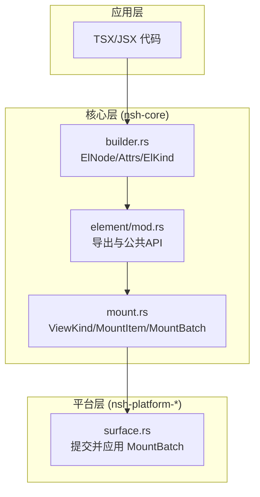
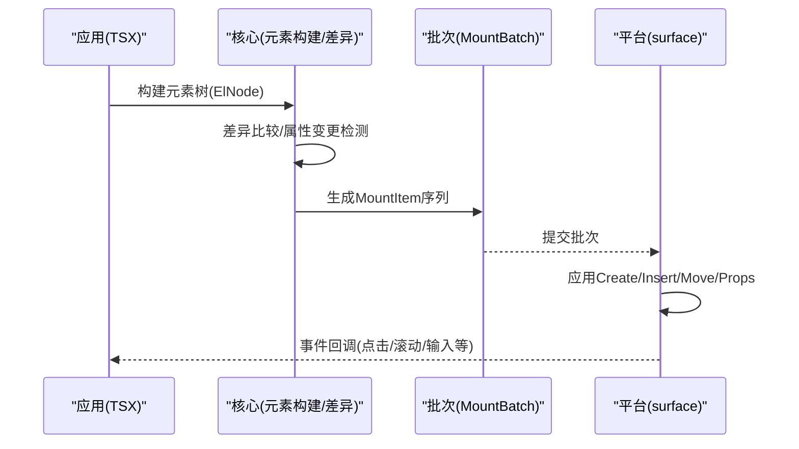
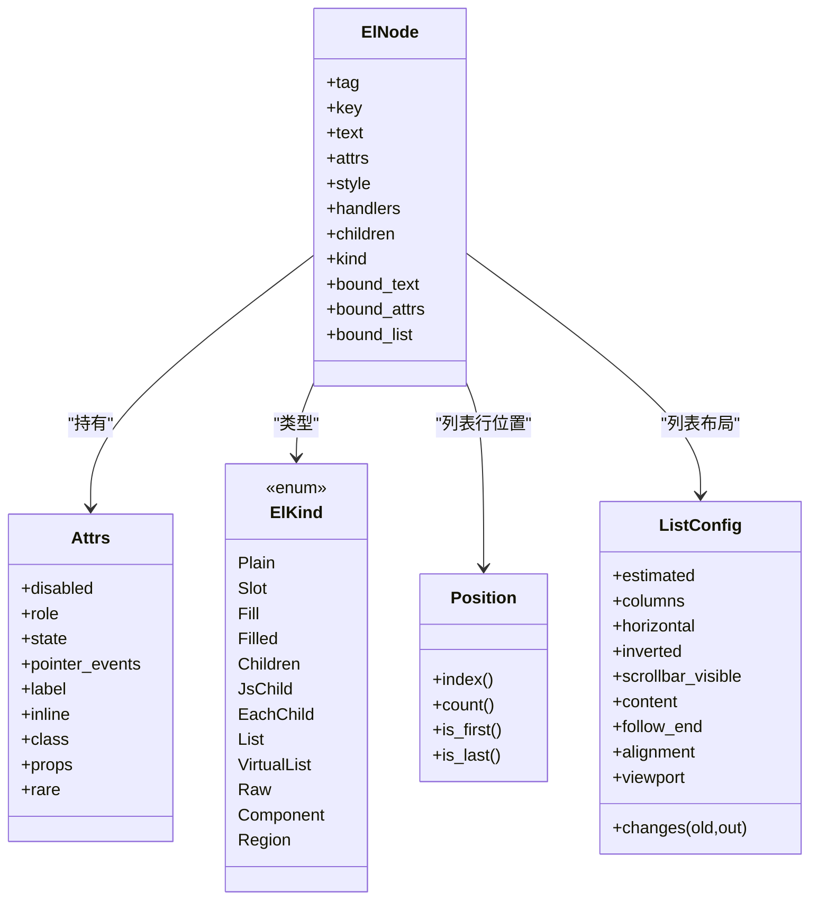
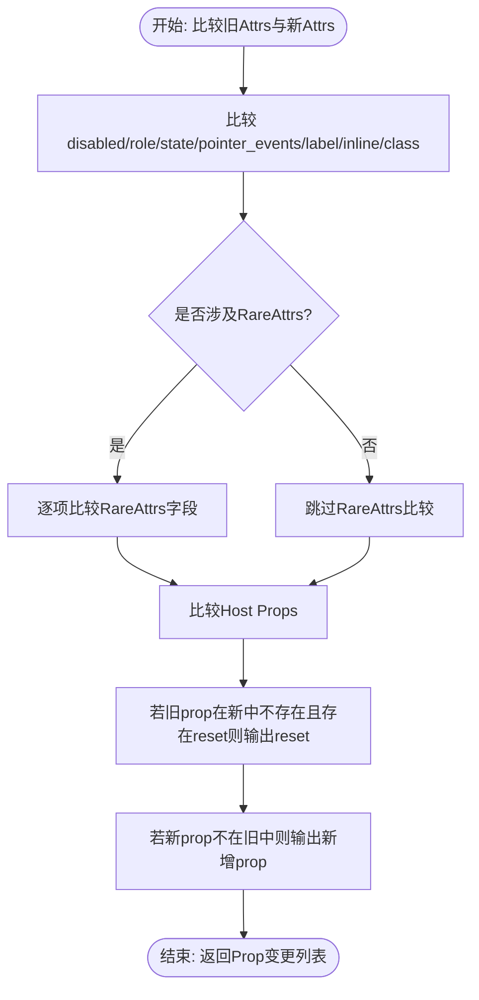
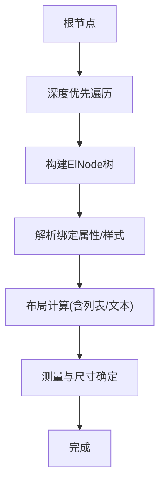
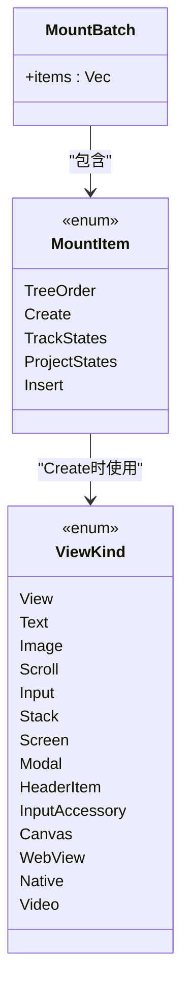
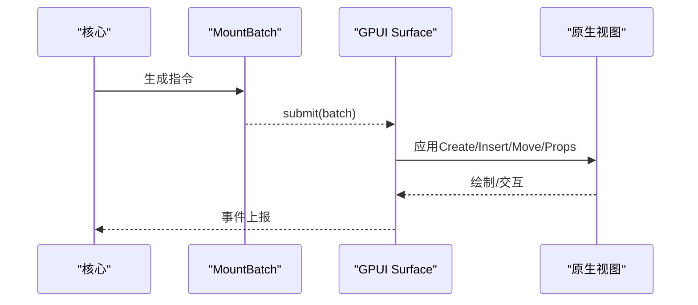
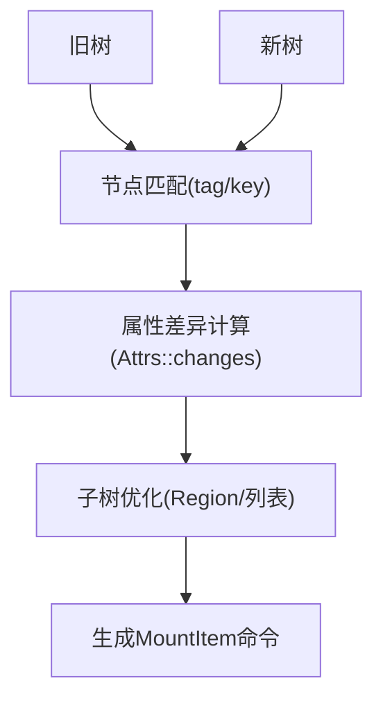
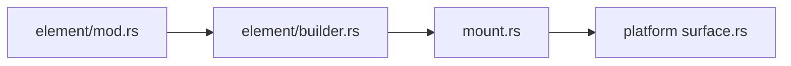

# 元素树系统

<cite>
**本文引用的文件**   
- [crates/nsh-core/src/element/mod.rs](file://crates/nsh-core/src/element/mod.rs)
- [crates/nsh-core/src/element/builder.rs](file://crates/nsh-core/src/element/builder.rs)
- [crates/nsh-core/src/mount.rs](file://crates/nsh-core/src/mount.rs)
- [crates/gpui/nsh-platform-gpui/src/surface.rs](file://crates/gpui/nsh-platform-gpui/src/surface.rs)
- [docs/dev/elements.md](file://docs/dev/elements.md)
</cite>

## 目录
1. [简介](#简介)
2. [项目结构](#项目结构)
3. [核心组件](#核心组件)
4. [架构总览](#架构总览)
5. [详细组件分析](#详细组件分析)
6. [依赖关系分析](#依赖关系分析)
7. [性能考量](#性能考量)
8. [故障排查指南](#故障排查指南)
9. [结论](#结论)
10. [附录](#附录)

## 简介
本文件系统性阐述 NSH 框架的元素树系统，覆盖从 JSX 到元素的转换、虚拟 DOM 的构建与优化、遍历与布局、渲染批处理（MountBatch）、差异比较算法、内存管理与垃圾回收策略，以及性能分析与调试技巧。文档以源码为依据，辅以可视化图示，帮助开发者深入理解并优化元素树的行为。

## 项目结构
NSH 的元素树系统主要位于 nsh-core 的 element 模块与 mount 子系统，平台侧通过 surface 层消费 MountBatch 指令进行原生视图映射。JSX 编译产物在运行时被展开为 ElNode 树，随后由核心进行属性解析、差异计算与批量挂载。

**图表来源**
- [crates/nsh-core/src/element/builder.rs:702-723](file://crates/nsh-core/src/element/builder.rs#L702-L723)
- [crates/nsh-core/src/element/mod.rs:1-31](file://crates/nsh-core/src/element/mod.rs#L1-L31)
- [crates/nsh-core/src/mount.rs:19-58](file://crates/nsh-core/src/mount.rs#L19-L58)
- [crates/gpui/nsh-platform-gpui/src/surface.rs:85-86](file://crates/gpui/nsh-platform-gpui/src/surface.rs#L85-L86)

**章节来源**
- [crates/nsh-core/src/element/mod.rs:1-31](file://crates/nsh-core/src/element/mod.rs#L1-L31)
- [crates/nsh-core/src/element/builder.rs:702-723](file://crates/nsh-core/src/element/builder.rs#L702-L723)
- [crates/nsh-core/src/mount.rs:19-58](file://crates/nsh-core/src/mount.rs#L19-L58)
- [crates/gpui/nsh-platform-gpui/src/surface.rs:85-86](file://crates/gpui/nsh-platform-gpui/src/surface.rs#L85-L86)

## 核心组件
- 元素节点与类型：ElNode、ElKind、Attrs、RareAttrs、Position、ListConfig 等，负责描述元素的结构、属性、样式、事件监听器与列表布局配置。
- 宿主元素与原生视图映射：ViewKind 枚举将逻辑元素映射到原生视图类型（View、Text、Image、Scroll、Input、Stack、Screen、Modal、HeaderItem、InputAccessory、Canvas、WebView、Native、Video）。
- 挂载指令与批次：MountItem 定义创建、插入、移动、属性更新等指令；MountBatch 聚合一次提交的所有变更。
- 平台表面：surface.rs 提供 submit 接口接收并应用 MountBatch，驱动平台原生视图树同步。

**章节来源**
- [crates/nsh-core/src/element/builder.rs:212-303](file://crates/nsh-core/src/element/builder.rs#L212-L303)
- [crates/nsh-core/src/element/builder.rs:670-723](file://crates/nsh-core/src/element/builder.rs#L670-L723)
- [crates/nsh-core/src/mount.rs:19-58](file://crates/nsh-core/src/mount.rs#L19-L58)
- [crates/nsh-core/src/mount.rs:748-800](file://crates/nsh-core/src/mount.rs#L748-L800)
- [crates/gpui/nsh-platform-gpui/src/surface.rs:85-86](file://crates/gpui/nsh-platform-gpui/src/surface.rs#L85-L86)

## 架构总览
下图展示从 JSX 到原生视图的端到端流程：JSX 编译为元素构建调用，运行时生成 ElNode 树，核心执行差异比较与批量挂载，平台层消费 MountBatch 完成原生视图同步。

**图表来源**
- [crates/nsh-core/src/element/builder.rs:702-723](file://crates/nsh-core/src/element/builder.rs#L702-L723)
- [crates/nsh-core/src/mount.rs:748-800](file://crates/nsh-core/src/mount.rs#L748-L800)
- [crates/gpui/nsh-platform-gpui/src/surface.rs:85-86](file://crates/gpui/nsh-platform-gpui/src/surface.rs#L85-L86)

## 详细组件分析

### 元素构建与虚拟DOM
- ElNode 表示一个元素节点，包含标签、键、文本内容、属性、样式、事件监听器、子节点、元素种类（ElKind）以及绑定部分（bound_attrs/bound_list）。
- Attrs 承载可比较的属性集合，包括禁用状态、可访问性角色/状态、指针事件、内联样式、Tailwind class、宿主 props 与稀有属性 RareAttrs。
- ElKind 区分普通元素、槽位、填充、子节点、JS 子节点、列表项、虚拟列表、文本片段、组件与区域（动态/条件/列表）。
- Position 用于列表行位置信息，支持信号化索引与计数，保证列表渲染时数据与位置的响应式一致性。
- ListConfig 描述列表布局参数（估计尺寸、列数、水平/反转、滚动条、对齐、视口等），并提供 changes 方法输出差异 Prop。

**图表来源**
- [crates/nsh-core/src/element/builder.rs:702-723](file://crates/nsh-core/src/element/builder.rs#L702-L723)
- [crates/nsh-core/src/element/builder.rs:212-303](file://crates/nsh-core/src/element/builder.rs#L212-L303)
- [crates/nsh-core/src/element/builder.rs:670-723](file://crates/nsh-core/src/element/builder.rs#L670-L723)
- [crates/nsh-core/src/element/builder.rs:609-668](file://crates/nsh-core/src/element/builder.rs#L609-L668)

**章节来源**
- [crates/nsh-core/src/element/builder.rs:212-303](file://crates/nsh-core/src/element/builder.rs#L212-L303)
- [crates/nsh-core/src/element/builder.rs:609-668](file://crates/nsh-core/src/element/builder.rs#L609-L668)
- [crates/nsh-core/src/element/builder.rs:670-723](file://crates/nsh-core/src/element/builder.rs#L670-L723)

### 差异比较与属性变更检测
- Attrs::changes 按固定顺序比较新旧属性，输出需要更新的 Prop 列表。对 RareAttrs 采用惰性分配与空检查，减少开销。
- Host props 的差异通过 host::same_kind 与 reset 机制处理：移除的 prop 会发送默认重置值，新增或变化的 prop 直接追加。
- ListConfig::changes 针对列表布局字段逐项比较，输出最小化的 Prop 变更集。

**图表来源**
- [crates/nsh-core/src/element/builder.rs:375-468](file://crates/nsh-core/src/element/builder.rs#L375-L468)

**章节来源**
- [crates/nsh-core/src/element/builder.rs:375-468](file://crates/nsh-core/src/element/builder.rs#L375-L468)

### 遍历算法与布局计算
- 元素树的遍历遵循深度优先顺序，确保父节点先于子节点处理，便于父子关系建立与样式继承。
- 列表与虚拟列表使用独立的布局通道，结合 Position 与 ListConfig 进行行定位与可视区管理。
- 文本内容（Raw）与富文本（AttributedText）在布局阶段参与排版，影响整体尺寸与滚动行为。

[本节为概念性说明，不直接分析具体文件]

### 渲染批处理与MountBatch机制
- MountItem 定义了平台无关的渲染指令，包括 Create、Insert、TrackStates、ProjectStates、TreeOrder 等，确保平台后端按序应用。
- ViewKind 将逻辑元素映射到原生视图类型，如 View、Text、Image、Scroll、Input、Stack、Screen、Modal、HeaderItem、InputAccessory、Canvas、WebView、Native、Video。
- MountBatch 聚合一次提交的所有变更，platform surface 通过 submit(batch) 统一应用，减少跨线程与平台调用开销。

**图表来源**
- [crates/nsh-core/src/mount.rs:19-58](file://crates/nsh-core/src/mount.rs#L19-L58)
- [crates/nsh-core/src/mount.rs:748-800](file://crates/nsh-core/src/mount.rs#L748-L800)
- [crates/nsh-core/src/mount.rs:1178-1180](file://crates/nsh-core/src/mount.rs#L1178-L1180)

**章节来源**
- [crates/nsh-core/src/mount.rs:19-58](file://crates/nsh-core/src/mount.rs#L19-L58)
- [crates/nsh-core/src/mount.rs:748-800](file://crates/nsh-core/src/mount.rs#L748-L800)
- [crates/nsh-core/src/mount.rs:1178-1180](file://crates/nsh-core/src/mount.rs#L1178-L1180)

### 平台无关渲染指令与原生视图映射
- 平台 surface 实现 submit(batch)，将 MountBatch 转换为平台原生操作（创建、插入、移动、属性设置）。
- 不同平台（iOS/macOS/Linux/Windows/Web/TUI）共享同一套 MountItem 语义，降低平台适配成本。

**图表来源**
- [crates/gpui/nsh-platform-gpui/src/surface.rs:85-86](file://crates/gpui/nsh-platform-gpui/src/surface.rs#L85-L86)

**章节来源**
- [crates/gpui/nsh-platform-gpui/src/surface.rs:85-86](file://crates/gpui/nsh-platform-gpui/src/surface.rs#L85-L86)

### 元素树的差异比较算法
- 节点匹配：基于 tag/key 进行匹配，ElKind 中的 Children/JsChild/EachChild 用于处理静态与动态子节点。
- 属性变更检测：Attrs::changes 输出最小 Prop 变更集，避免不必要的原生更新。
- 子树优化：Region（dynamic/if/each）独立重算与合并，减少整树重绘；列表使用虚拟列表与复用策略。

[本节为概念性说明，不直接分析具体文件]

### 内存管理与垃圾回收策略
- 元素生命周期与所有者：Listener 与 Owner 关联，当所有者销毁后不再触发事件，避免悬垂引用。
- 引用计数：Rc/Arc 广泛用于闭包、样式、资源与动画节点，确保共享所有权与自动释放。
- 循环引用处理：通过弱引用或显式清理（cleanup）避免环；RareAttrs 惰性分配与清空减少内存占用。
- 绑定属性与样式：bound_attrs/bound_list 在 resolve_once 时一次性求值并清空，避免重复订阅。

**章节来源**
- [crates/nsh-core/src/element/builder.rs:21-88](file://crates/nsh-core/src/element/builder.rs#L21-L88)
- [crates/nsh-core/src/element/builder.rs:738-794](file://crates/nsh-core/src/element/builder.rs#L738-L794)

### JSX到元素的转换与虚拟DOM生成
- JSX 编译产物在运行时调用 builder API（view/text/image 等）构建 ElNode 树。
- 组件作为宿主节点，其根节点展开为子树，保持与 Tailwind 一致的样式规则。
- 环境与设计令牌作为信号，读取即订阅，支持响应式更新。

**章节来源**
- [crates/nsh-core/src/element/mod.rs:1-31](file://crates/nsh-core/src/element/mod.rs#L1-L31)

## 依赖关系分析
- element/mod.rs 导出公共 API 与宏，集中暴露元素构建、样式、事件、响应式系统等能力。
- element/builder.rs 实现元素节点、属性、事件监听器与列表布局的核心数据结构与方法。
- mount.rs 定义 ViewKind、MountItem、MountBatch 等平台无关的渲染指令与批次。
- platform surface 层消费 MountBatch，驱动原生视图同步。

**图表来源**
- [crates/nsh-core/src/element/mod.rs:103-213](file://crates/nsh-core/src/element/mod.rs#L103-L213)
- [crates/nsh-core/src/element/builder.rs:1-20](file://crates/nsh-core/src/element/builder.rs#L1-L20)
- [crates/nsh-core/src/mount.rs:1-17](file://crates/nsh-core/src/mount.rs#L1-L17)
- [crates/gpui/nsh-platform-gpui/src/surface.rs:85-86](file://crates/gpui/nsh-platform-gpui/src/surface.rs#L85-L86)

**章节来源**
- [crates/nsh-core/src/element/mod.rs:103-213](file://crates/nsh-core/src/element/mod.rs#L103-L213)
- [crates/nsh-core/src/element/builder.rs:1-20](file://crates/nsh-core/src/element/builder.rs#L1-L20)
- [crates/nsh-core/src/mount.rs:1-17](file://crates/nsh-core/src/mount.rs#L1-L17)
- [crates/gpui/nsh-platform-gpui/src/surface.rs:85-86](file://crates/gpui/nsh-platform-gpui/src/surface.rs#L85-L86)

## 性能考量
- 批处理：通过 MountBatch 聚合多次变更，减少平台调用次数与跨线程开销。
- 差异最小化：Attrs::changes 与 ListConfig::changes 输出最小 Prop 变更集，避免冗余更新。
- 惰性分配：RareAttrs 仅在非默认值时分配，减少内存压力。
- 列表优化：虚拟列表与复用策略降低大列表渲染成本。
- 事件合并：鼠标移动等高频事件在引擎层合并，避免过度回调。

[本节为通用性能建议，不直接分析具体文件]

## 故障排查指南
- 观察批次：在测试中使用 app.observe 捕获 MountBatch，检查生成的 MountItem 是否符合预期。
- 属性变更：确认 Attrs::changes 输出的 Prop 是否最小化，避免不必要的原生更新。
- 事件回调：检查 Listener 的 owner 生命周期，确保事件在有效范围内触发。
- 平台差异：对比不同平台的 surface 实现，确认 MountBatch 应用一致。

**章节来源**
- [docs/dev/elements.md:1-800](file://docs/dev/elements.md#L1-L800)

## 结论
NSH 的元素树系统通过 ElNode 与 Attrs 精确描述 UI 结构，借助差异比较与批处理机制高效同步至平台原生视图。MountBatch 提供平台无关的渲染指令，简化多端适配。结合响应式系统与内存管理策略，系统在性能与可维护性之间取得平衡。开发者可通过批次观察与属性变更分析优化 UI 行为。

[本节为总结性内容，不直接分析具体文件]

## 附录
- JSX 到原生映射参考：docs/dev/elements.md 提供了各平台元素映射与行为说明，有助于理解元素树在不同平台的落地方式。

**章节来源**
- [docs/dev/elements.md:1-800](file://docs/dev/elements.md#L1-L800)