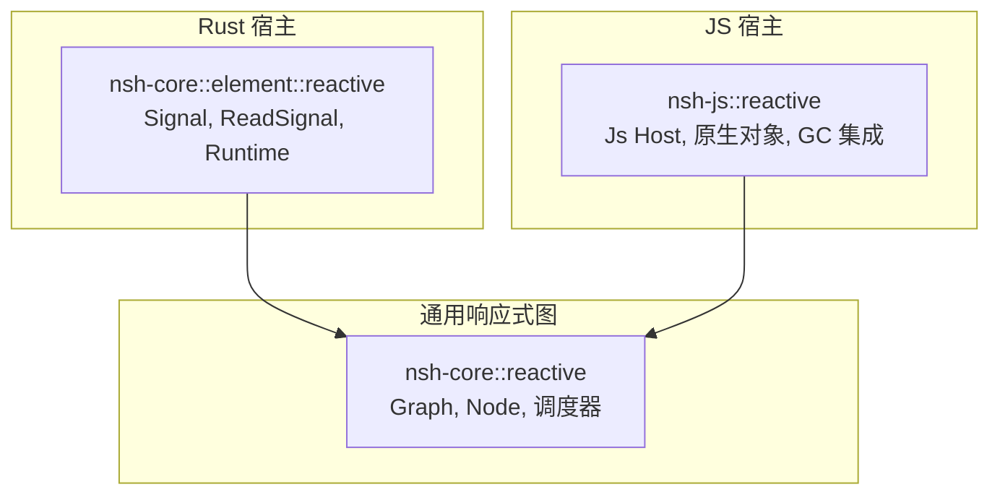
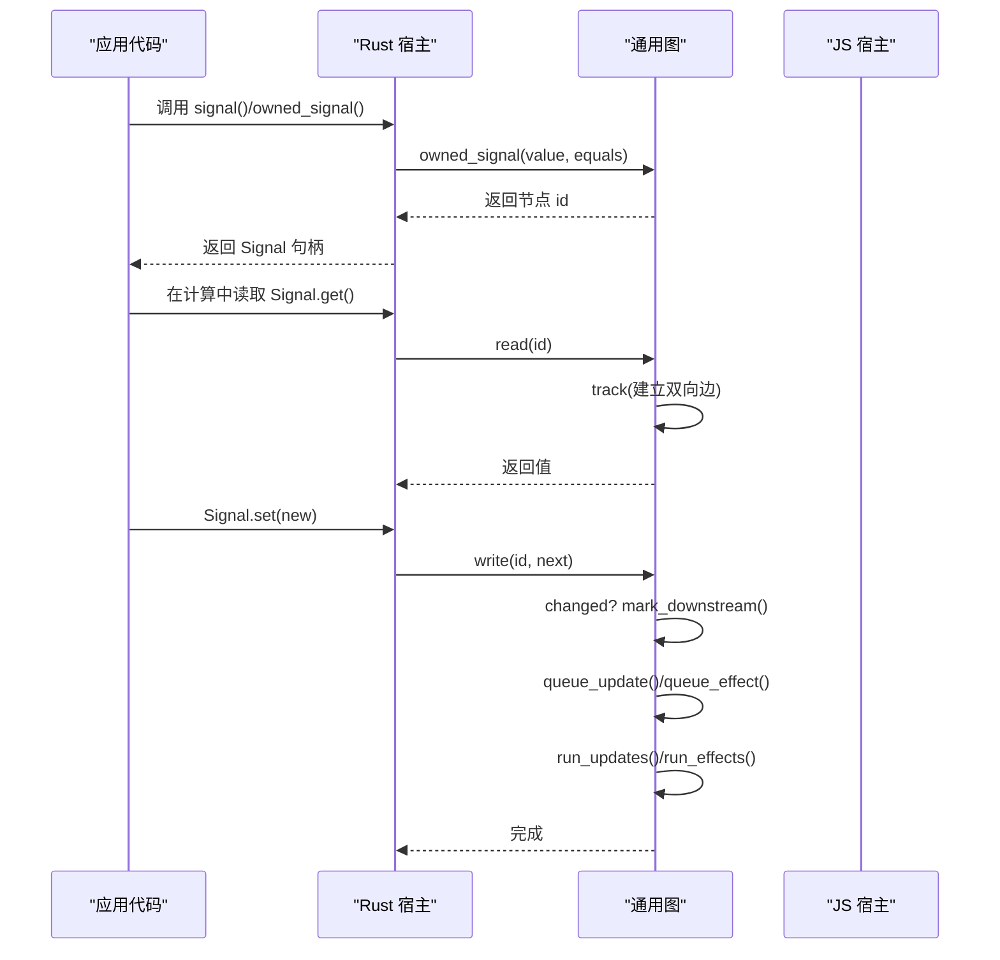
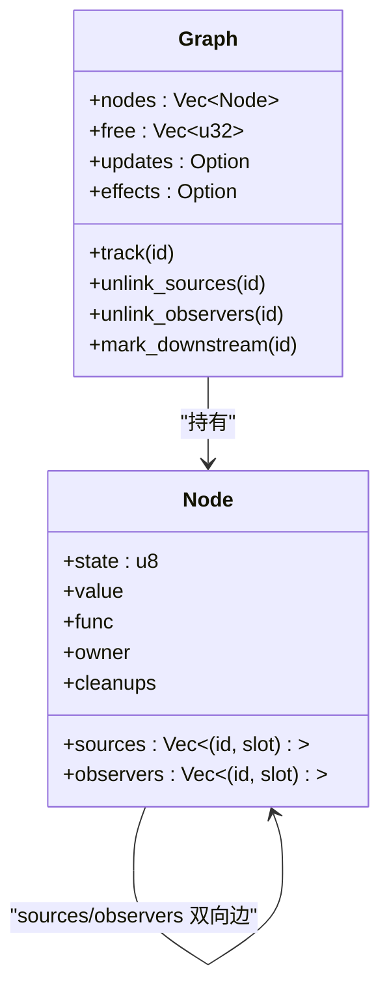
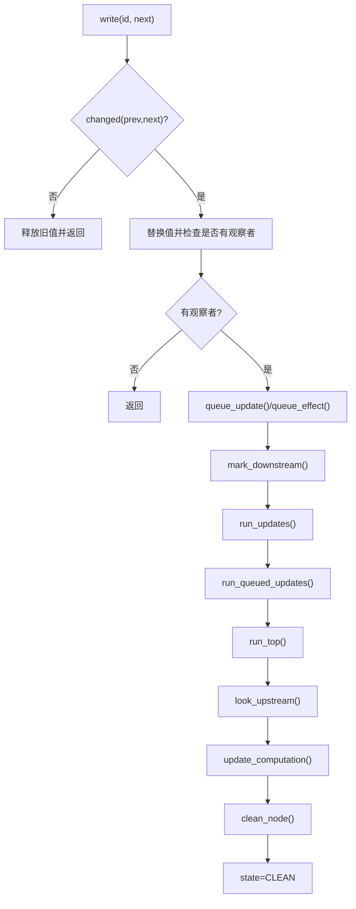
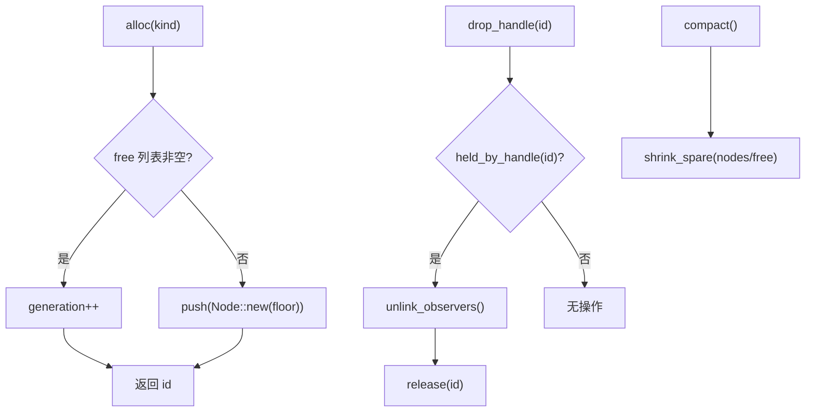
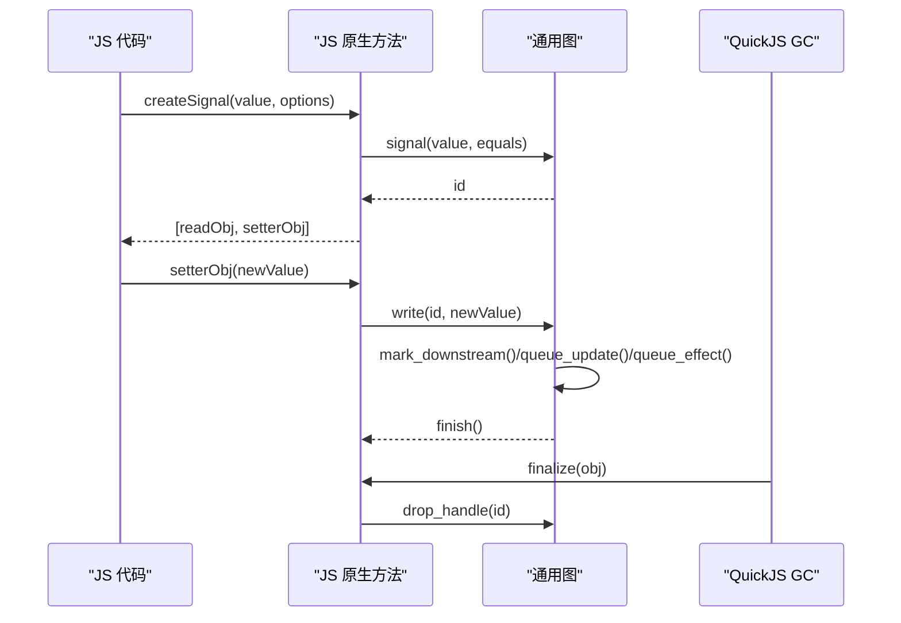
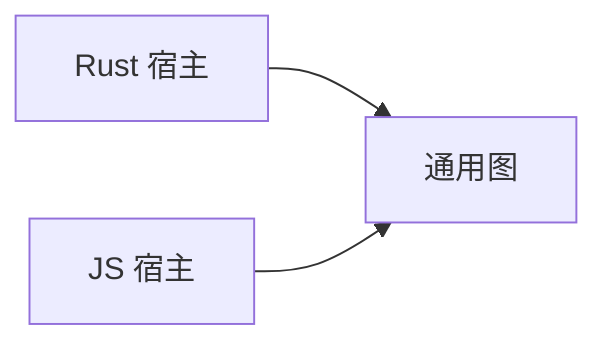

# 信号（Signals）

<cite>
**本文引用的文件**   
- [reactive.rs](file://crates/nsh-core/src/reactive.rs)
- [element/reactive.rs](file://crates/nsh-core/src/element/reactive.rs)
- [js/reactive.rs](file://crates/nsh-js/src/reactive.rs)
</cite>

## 目录
1. [引言](#引言)
2. [项目结构](#项目结构)
3. [核心组件](#核心组件)
4. [架构总览](#架构总览)
5. [详细组件分析](#详细组件分析)
6. [依赖关系分析](#依赖关系分析)
7. [性能与内存管理](#性能与内存管理)
8. [使用示例与实践建议](#使用示例与实践建议)
9. [故障排查](#故障排查)
10. [结论](#结论)

## 引言
本文面向 NSH 框架的信号系统，系统性解释信号的创建、读取与更新机制，对比 `signal()` 与 `owned_signal()` 的差异与适用场景；深入说明依赖追踪的观察者模式实现与双向边关系；阐述 CLEAN / STALE / PENDING 状态机转换；讲解基于 arena 的内存分配、generation 计数与垃圾回收策略；并给出在条件渲染、列表更新等场景下的实践方法与性能优化技巧。最后补充与 JavaScript 运行时集成的关键点以及跨平台一致性保证。

## 项目结构
NSH 的信号系统由三层组成：
- 通用响应式图引擎：`nsh-core::reactive`，定义节点、边、调度器、状态机与内存模型。
- Rust 宿主适配层：`nsh-core::element::reactive`，将 Rust 值、闭包与比较函数接入通用图。
- JS 宿主适配层：`nsh-js::reactive`，将 QuickJS 值、函数与对象生命周期接入通用图。



**图表来源**
- [reactive.rs:1-16](file://crates/nsh-core/src/reactive.rs#L1-L16)
- [element/reactive.rs:1-15](file://crates/nsh-core/src/element/reactive.rs#L1-L15)
- [js/reactive.rs:1-19](file://crates/nsh-js/src/reactive.rs#L1-L19)

**章节来源**
- [reactive.rs:1-16](file://crates/nsh-core/src/reactive.rs#L1-L16)
- [element/reactive.rs:1-15](file://crates/nsh-core/src/element/reactive.rs#L1-L15)
- [js/reactive.rs:1-19](file://crates/nsh-js/src/reactive.rs#L1-L19)

## 核心组件
- Graph：维护节点数组、空闲槽位、监听者/所有者上下文、更新队列与效果队列，提供分配、释放、调度、清理等能力。
- Node：表示信号、计算（memo）、效果（effect/user effect）、根所有者等，包含值、函数、比较器、源/观察边、所有者、清理回调等。
- Host trait：抽象不同宿主（Rust/JS）的值类型、函数、比较、清理与错误处理。
- Signal/ReadSignal：Rust 侧对信号的高层封装，提供 get/set/update 等 API。
- JS 原生对象：将信号/设置器/memo 暴露为 JS 可调用对象，并与 QuickJS GC 集成。

**章节来源**
- [reactive.rs:45-73](file://crates/nsh-core/src/reactive.rs#L45-L73)
- [reactive.rs:146-179](file://crates/nsh-core/src/reactive.rs#L146-L179)
- [reactive.rs:75-136](file://crates/nsh-core/src/reactive.rs#L75-L136)
- [element/reactive.rs:496-532](file://crates/nsh-core/src/element/reactive.rs#L496-L532)
- [js/reactive.rs:38-89](file://crates/nsh-js/src/reactive.rs#L38-L89)

## 架构总览
信号系统的核心流程如下：
- 创建：通过 `signal()` 或 `owned_signal()` 创建信号节点，注册到当前所有者。
- 读取：在计算中读取信号会建立“源→观察”的双向边，并将当前计算加入依赖链。
- 写入：比较新旧值，若变化则标记下游为 STALE/PENDING，并排队调度。
- 调度：按 Solid 风格先更新 memo，再执行 render effect，最后 user effect，防止无限循环。
- 清理：节点重新运行前解绑源边，销毁子节点并执行清理回调。



**图表来源**
- [element/reactive.rs:523-532](file://crates/nsh-core/src/element/reactive.rs#L523-L532)
- [element/reactive.rs:674-682](file://crates/nsh-core/src/element/reactive.rs#L674-L682)
- [reactive.rs:1077-1110](file://crates/nsh-core/src/reactive.rs#L1077-L1110)
- [reactive.rs:1115-1140](file://crates/nsh-core/src/reactive.rs#L1115-L1140)
- [reactive.rs:878-914](file://crates/nsh-core/src/reactive.rs#L878-L914)

## 详细组件分析

### 信号的创建与所有权
- `signal(value)`：创建带默认相等性比较（同类型使用 `PartialEq`）的信号，适合大多数 UI 状态。
- `signal_with(value, SignalEquals::Never)`：每次写入都通知，适用于原地修改或无 `PartialEq` 的类型。
- `owned_signal(value, equals)`：底层 API，将信号归属到当前所有者；若当前所有者已 disposed，立即 dispose 该信号。

区别与场景：
- `signal()` 是高层 API，内部委托给 `owned_signal()`，自动绑定所有者，便于组件级生命周期管理。
- `owned_signal()` 更贴近图引擎，常用于内部实现（如 Kept/Stored），或在需要精细控制所有权时使用。

```mermaid
flowchart TD
Start(["创建信号"]) --> Choice{"API 选择"}
Choice --> |signal()| HighLevel["高层封装<br/>signal(value)"]
Choice --> |signal_with()| CustomEqual["自定义比较<br/>signal_with(value, Never)"]
Choice --> |owned_signal()| LowLevel["底层 API<br/>owned_signal(value, equals)"]
HighLevel --> Owned["委托 owned_signal()"]
CustomEqual --> Owned
LowLevel --> OwnerCheck{"当前所有者是否已 disposed?"}
OwnerCheck --> |是| DisposeNow["立即 dispose"]
OwnerCheck --> |否| Register["注册到所有者"]
Owned --> Register
```

**图表来源**
- [element/reactive.rs:523-532](file://crates/nsh-core/src/element/reactive.rs#L523-L532)
- [element/reactive.rs:665-682](file://crates/nsh-core/src/element/reactive.rs#L665-L682)
- [reactive.rs:333-346](file://crates/nsh-core/src/reactive.rs#L333-L346)

**章节来源**
- [element/reactive.rs:523-532](file://crates/nsh-core/src/element/reactive.rs#L523-L532)
- [element/reactive.rs:665-682](file://crates/nsh-core/src/element/reactive.rs#L665-L682)
- [reactive.rs:333-346](file://crates/nsh-core/src/reactive.rs#L333-L346)

### 依赖追踪与观察者模式
- 读操作：`read()` 在 memo 非 CLEAN 时触发更新；随后调用 `track()` 建立“源→观察”的双向边。
- 写操作：`write()` 比较新值，若变化则遍历观察边，将观察者的状态置为 STALE，并根据类型入队 update/effect；同时递归标记下游（mark_downstream）。
- 双向边：每个节点维护 sources（上游）和 observers（下游），删除采用 swap-remove 以保持 O(1) 平均复杂度。



**图表来源**
- [reactive.rs:146-179](file://crates/nsh-core/src/reactive.rs#L146-L179)
- [reactive.rs:676-724](file://crates/nsh-core/src/reactive.rs#L676-L724)
- [reactive.rs:746-764](file://crates/nsh-core/src/reactive.rs#L746-L764)

**章节来源**
- [reactive.rs:676-724](file://crates/nsh-core/src/reactive.rs#L676-L724)
- [reactive.rs:746-764](file://crates/nsh-core/src/reactive.rs#L746-L764)
- [reactive.rs:1115-1140](file://crates/nsh-core/src/reactive.rs#L1115-L1140)

### 状态管理与调度
状态常量：
- CLEAN：节点值有效且无需重算。
- STALE：节点值失效，需在下一次调度中更新。
- PENDING：节点已在队列中等待更新。

调度流程：
- `write()` 将直接观察者标记为 STALE，并按类型入队 update（memo）或 effect。
- `mark_downstream()` 递归将下游从 CLEAN 转为 PENDING，并继续传播。
- `run_updates()` 启动一轮调度，先执行 queued updates，再执行 effects（render effect 优先于 user effect）。
- `run_top()` 与 `look_upstream()` 负责按所有者拓扑顺序更新祖先，避免重复与死锁。
- 防环保护：单轮最多执行 MAX_RUNS 次，超过则上报 runaway 错误。



**图表来源**
- [reactive.rs:1077-1110](file://crates/nsh-core/src/reactive.rs#L1077-L1110)
- [reactive.rs:746-764](file://crates/nsh-core/src/reactive.rs#L746-L764)
- [reactive.rs:878-914](file://crates/nsh-core/src/reactive.rs#L878-L914)
- [reactive.rs:916-952](file://crates/nsh-core/src/reactive.rs#L916-L952)
- [reactive.rs:954-981](file://crates/nsh-core/src/reactive.rs#L954-L981)
- [reactive.rs:983-1058](file://crates/nsh-core/src/reactive.rs#L983-L1058)
- [reactive.rs:1142-1165](file://crates/nsh-core/src/reactive.rs#L1142-L1165)

**章节来源**
- [reactive.rs:38-43](file://crates/nsh-core/src/reactive.rs#L38-L43)
- [reactive.rs:878-914](file://crates/nsh-core/src/reactive.rs#L878-L914)
- [reactive.rs:916-952](file://crates/nsh-core/src/reactive.rs#L916-L952)
- [reactive.rs:954-981](file://crates/nsh-core/src/reactive.rs#L954-L981)
- [reactive.rs:983-1058](file://crates/nsh-core/src/reactive.rs#L983-L1058)
- [reactive.rs:1077-1110](file://crates/nsh-core/src/reactive.rs#L1077-L1110)
- [reactive.rs:1142-1165](file://crates/nsh-core/src/reactive.rs#L1142-L1165)

### 内存管理：arena、generation 与垃圾回收
- Arena 分配：`alloc()` 复用 free 列表中的槽位，否则 push 新节点；`compact()` 在空闲时压缩尾部 Free 节点并收缩容量。
- Generation 计数：每次复用槽位时 generation 递增，确保旧句柄失效；JS 侧将 (id, generation) 打包进指针以支持 GC finalizer。
- 句柄与释放：`drop_handle()` 当外部句柄消失时释放信号或已 disposed 的计算；`release()` 将节点标记为 Free 并收集到 free 列表。
- JS GC 集成：finalizer 在对象被回收时调用 `drop_handle()`；gc_mark 仅标记对象拥有的值与自定义比较函数，避免误回收。



**图表来源**
- [reactive.rs:279-315](file://crates/nsh-core/src/reactive.rs#L279-L315)
- [reactive.rs:411-417](file://crates/nsh-core/src/reactive.rs#L411-L417)
- [reactive.rs:501-528](file://crates/nsh-core/src/reactive.rs#L501-L528)
- [reactive.rs:726-744](file://crates/nsh-core/src/reactive.rs#L726-L744)
- [js/reactive.rs:518-560](file://crates/nsh-js/src/reactive.rs#L518-L560)

**章节来源**
- [reactive.rs:279-315](file://crates/nsh-core/src/reactive.rs#L279-L315)
- [reactive.rs:501-528](file://crates/nsh-core/src/reactive.rs#L501-L528)
- [reactive.rs:726-744](file://crates/nsh-core/src/reactive.rs#L726-L744)
- [js/reactive.rs:518-560](file://crates/nsh-js/src/reactive.rs#L518-L560)

### 与 JavaScript 运行时集成
- Js Host：将 QuickJS 值作为信号值，函数作为计算，JS 比较函数作为自定义相等性；异常与错误边界通过 `catch`/`deliver_caught` 传递。
- 原生对象：信号/设置器/memo 暴露为 JS 对象，调用即读/写；setter 支持函数式更新。
- 调度与批处理：`batch()` 与 `untrack()` 暴露给 JS，统一走通用调度。
- 生命周期：JS 对象的 finalizer 与 gc_mark 与图引擎协作，确保信号值与比较函数的正确回收。



**图表来源**
- [js/reactive.rs:616-631](file://crates/nsh-js/src/reactive.rs#L616-L631)
- [js/reactive.rs:459-493](file://crates/nsh-js/src/reactive.rs#L459-L493)
- [js/reactive.rs:787-798](file://crates/nsh-js/src/reactive.rs#L787-L798)
- [js/reactive.rs:518-560](file://crates/nsh-js/src/reactive.rs#L518-L560)

**章节来源**
- [js/reactive.rs:38-89](file://crates/nsh-js/src/reactive.rs#L38-L89)
- [js/reactive.rs:616-631](file://crates/nsh-js/src/reactive.rs#L616-L631)
- [js/reactive.rs:459-493](file://crates/nsh-js/src/reactive.rs#L459-L493)
- [js/reactive.rs:787-798](file://crates/nsh-js/src/reactive.rs#L787-L798)
- [js/reactive.rs:518-560](file://crates/nsh-js/src/reactive.rs#L518-L560)

## 依赖关系分析
- Rust 宿主依赖通用图：通过 Host trait 注入 Rust 值、闭包与比较逻辑。
- JS 宿主依赖通用图：通过 Host trait 注入 QuickJS 值、函数与比较逻辑。
- 通用图不反向依赖宿主：所有宿主交互通过短借用与回调完成，避免跨调用持有引用。



**图表来源**
- [reactive.rs:75-136](file://crates/nsh-core/src/reactive.rs#L75-L136)
- [element/reactive.rs:153-261](file://crates/nsh-core/src/element/reactive.rs#L153-L261)
- [js/reactive.rs:83-212](file://crates/nsh-js/src/reactive.rs#L83-L212)

**章节来源**
- [reactive.rs:75-136](file://crates/nsh-core/src/reactive.rs#L75-L136)
- [element/reactive.rs:153-261](file://crates/nsh-core/src/element/reactive.rs#L153-L261)
- [js/reactive.rs:83-212](file://crates/nsh-js/src/reactive.rs#L83-L212)

## 性能与内存管理
- 比较策略：默认使用宿主提供的 same（JS 为严格相等），也可使用 Truthiness 或自定义比较函数；合理选择可减少不必要的通知。
- 批量更新：使用 `batch()` 合并多次写入，减少中间态刷新。
- 惰性求值：memo 仅在读取或显式更新时计算，避免无用工作。
- Arena 与 compact：频繁创建/销毁节点时，利用 arena 复用与空闲时的 compact 降低内存碎片。
- 防环保护：MAX_RUNS 限制单轮执行次数，避免无限循环导致栈溢出。

[本节为通用指导，不直接分析具体文件]

## 使用示例与实践建议
- 条件渲染：使用布尔信号驱动分支；若值不变则不会触发重渲染。
- 列表更新：对列表项使用唯一 key，配合 memo 缓存行内容；必要时使用 `signal_with(..., Never)` 处理原地修改。
- 性能优化：
  - 使用 `batch()` 包裹多个相关状态的更新。
  - 使用 `untracked()` 在不需要订阅的场景读取信号。
  - 合理使用 memo 缓存派生数据，避免重复计算。
  - 选择合适的比较策略，避免过度通知。

[本节为概念性示例，不直接分析具体文件]

## 故障排查
- 无限循环：若 effect 持续改变其读取的信号，将触发 runaway 错误；检查 effect 逻辑与依赖范围。
- 句柄失效：在所有者被 dispose 后访问信号会失败；使用 `try_get()`/`try_set()` 安全访问。
- 类型不匹配：Signal 的泛型类型必须一致；类型不一致会在读取时断言失败。
- JS 异常：计算抛出异常会被捕获并传递给错误边界；检查计算函数与比较函数。

**章节来源**
- [reactive.rs:891-902](file://crates/nsh-core/src/reactive.rs#L891-L902)
- [element/reactive.rs:720-743](file://crates/nsh-core/src/element/reactive.rs#L720-L743)
- [element/reactive.rs:441-445](file://crates/nsh-core/src/element/reactive.rs#L441-L445)
- [js/reactive.rs:132-155](file://crates/nsh-js/src/reactive.rs#L132-L155)

## 结论
NSH 的信号系统以通用响应式图为内核，通过 Host trait 抽象 Rust 与 JS 宿主差异，实现了高效的依赖追踪、状态调度与内存管理。`signal()` 与 `owned_signal()` 分别面向高层易用性与底层可控性；CLEAN/STALE/PENDING 状态机确保最小化重算；arena 与 generation 保障内存安全与高效回收；JS 集成使信号在浏览器与原生环境中保持一致行为。遵循本文的实践建议，可在条件渲染、列表更新等场景中构建高性能、可维护的响应式界面。