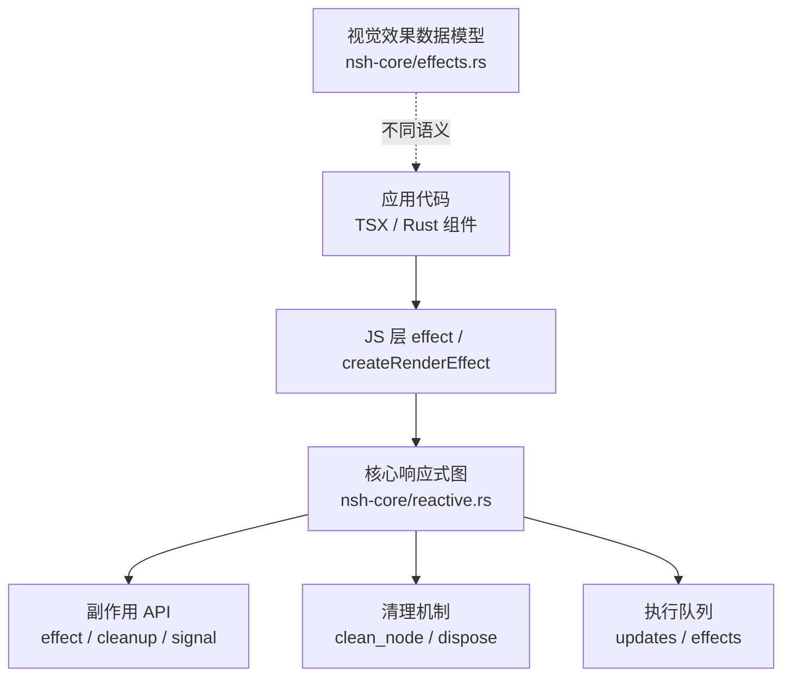
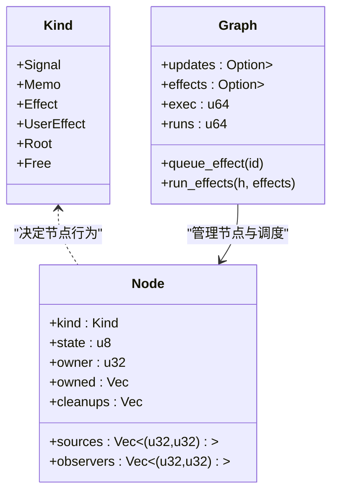
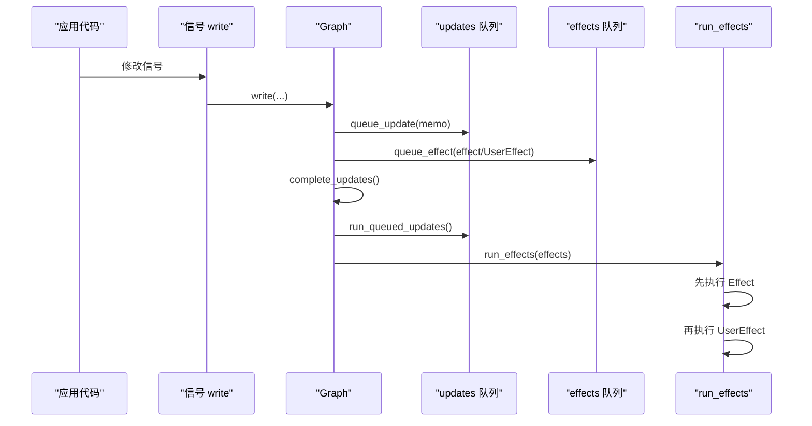
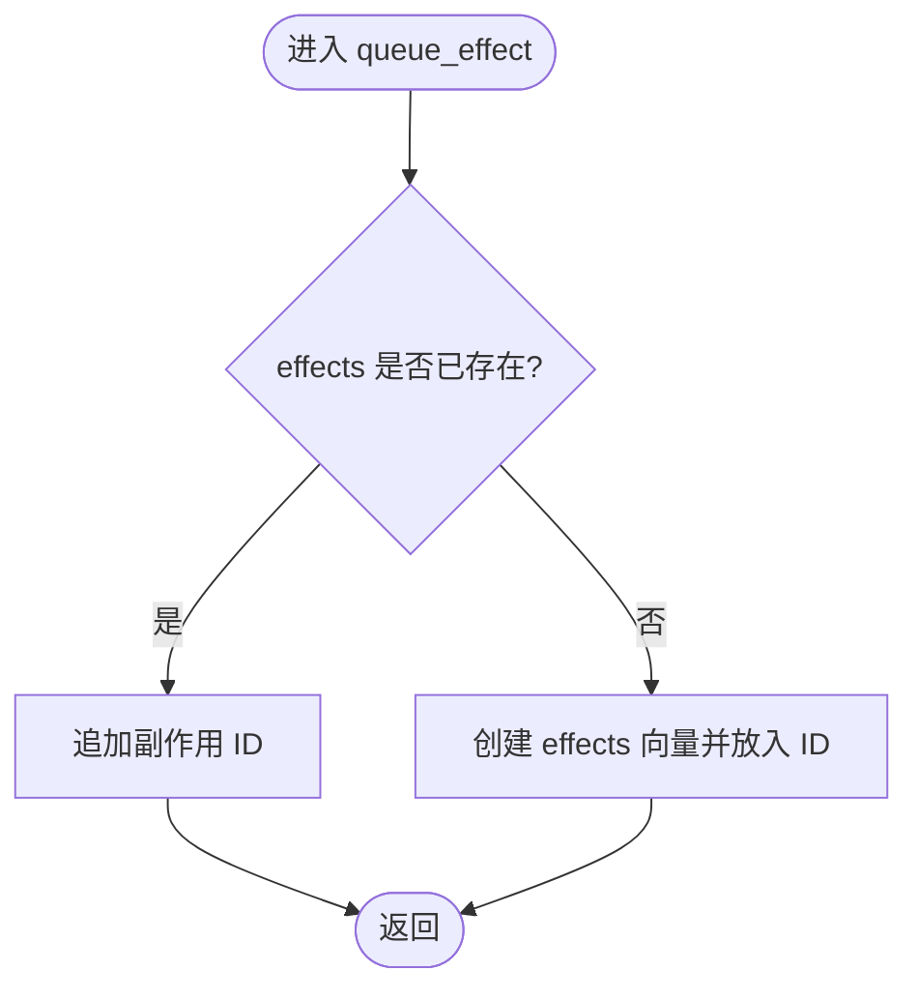
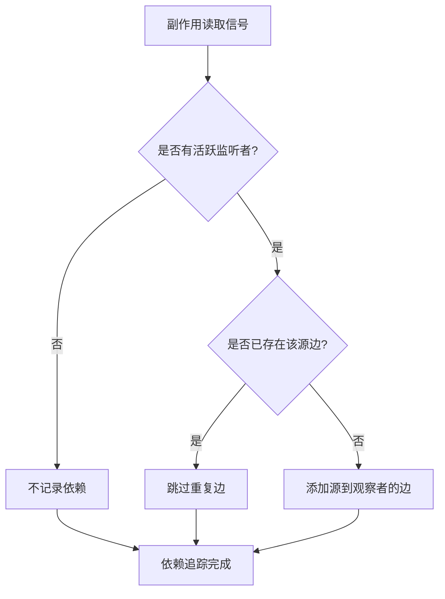
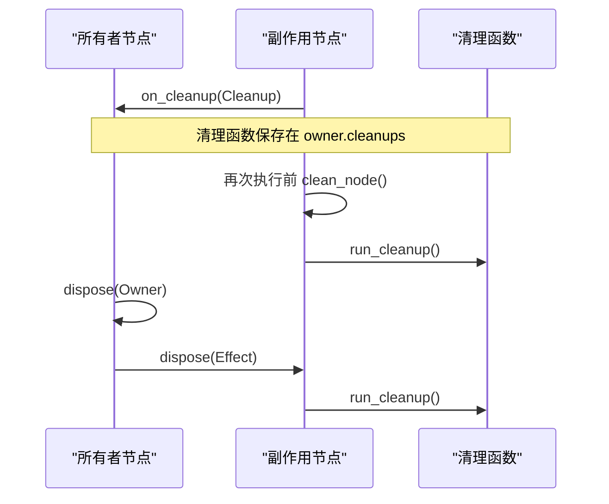
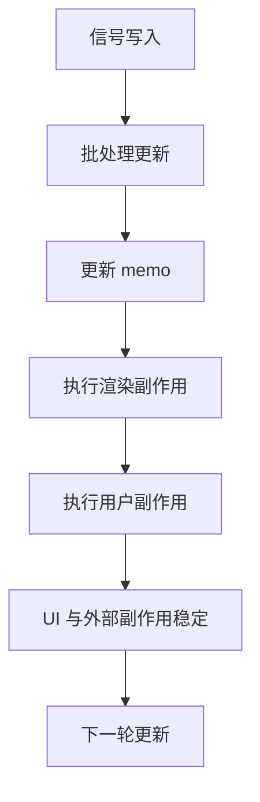

# 副作用（Effects）

<cite>
**本文引用的文件**   
- [reactive.rs](file://crates/nsh-core/src/reactive.rs)
- [effects.rs](file://crates/nsh-core/src/effects.rs)
- [reactive.rs（JS 绑定）](file://crates/nsh-js/src/reactive.rs)
- [tsx.md（副作用与清理参考）](file://skills/nsh/references/tsx.md)
- [coding-guides.md（副作用最佳实践）](file://website/docs/coding-guides.md)
</cite>

## 目录
1. [引言](#引言)
2. [项目结构中的副作用位置](#项目结构中的副作用位置)
3. [核心概念：渲染副作用与用户副作用](#核心概念渲染副作用与用户副作用)
4. [执行队列机制与顺序](#执行队列机制与顺序)
5. [依赖追踪与自动订阅](#依赖追踪与自动订阅)
6. [清理机制与生命周期管理](#清理机制与生命周期管理)
7. [副作用与 UI 更新的协调](#副作用与-ui-更新的协调)
8. [性能特性与优化建议](#性能特性与优化建议)
9. [使用示例与实践指南](#使用示例与实践指南)
10. [常见问题与排错](#常见问题与排错)
11. [结论](#结论)

## 引言
NSH 的副作用系统基于一个通用的响应式图实现，支持信号、记忆值、渲染副作用和用户副作用。其调度策略借鉴 Solid 的更新流程：先批量计算和更新，再按阶段执行副作用；同时严格区分“渲染副作用”和“用户副作用”，以保证 UI 相关副作用尽早执行，而网络请求、定时器、外部 DOM 操作等用户副作用延后到渲染稳定后再运行。

本技术文档聚焦以下目标：
- 解释渲染副作用与用户副作用的区别及执行时机差异。
- 详细说明 `queue_effect` 的工作方式与副作用执行顺序。
- 阐述副作用的清理机制、注册方式和生命周期。
- 说明依赖追踪如何自动订阅信号并在依赖变化时重新执行。
- 给出副作用在 DOM 操作、网络请求和资源清理中的使用模式、最佳实践与常见陷阱。
- 解释副作用与 UI 更新的协调机制，以及如何避免性能问题。

## 项目结构中的副作用位置
NSH 的副作用核心逻辑位于 Rust 核心库中，并通过 JS 层暴露给应用代码：
- 响应式图、副作用创建、调度、清理、依赖追踪等核心实现位于 `nsh-core`。
- JS 运行时将 `effect` 与 `createRenderEffect` 等 API 映射到底层副作用类型。
- 样式与视觉层面的“视觉效果”（如阴影、渐变、滤镜）属于另一个语义域，不应与“副作用”混淆。

**图表来源**
- [reactive.rs:1-10](file://crates/nsh-core/src/reactive.rs#L1-L10)
- [reactive.rs:45-60](file://crates/nsh-core/src/reactive.rs#L45-L60)
- [reactive.rs:806-876](file://crates/nsh-core/src/reactive.rs#L806-L876)
- [effects.rs:1-4](file://crates/nsh-core/src/effects.rs#L1-L4)

**章节来源**
- [reactive.rs:1-10](file://crates/nsh-core/src/reactive.rs#L1-L10)
- [effects.rs:1-4](file://crates/nsh-core/src/effects.rs#L1-L4)

## 核心概念：渲染副作用与用户副作用
NSH 的副作用分为两类：
- **渲染副作用**：用于与 UI 状态同步、读取布局或触发轻量级视图更新。它尽可能早地执行，通常发生在渲染阶段附近。
- **用户副作用**：用于与外部世界交互，例如启动定时器、发起网络请求、操作非 NSH 的 DOM、订阅第三方事件等。它在渲染副作用之后执行，以避免干扰初始渲染。

在底层，这两种副作用通过不同的节点类型表示：
- 渲染副作用对应 `Kind::Effect`。
- 用户副作用对应 `Kind::UserEffect`。

**图表来源**
- [reactive.rs:45-60](file://crates/nsh-core/src/reactive.rs#L45-L60)
- [reactive.rs:241-260](file://crates/nsh-core/src/reactive.rs#L241-L260)
- [reactive.rs:146-179](file://crates/nsh-core/src/reactive.rs#L146-L179)

**章节来源**
- [reactive.rs:45-60](file://crates/nsh-core/src/reactive.rs#L45-L60)
- [reactive.rs:146-179](file://crates/nsh-core/src/reactive.rs#L146-L179)
- [reactive.rs:241-260](file://crates/nsh-core/src/reactive.rs#L241-L260)

## 执行队列机制与顺序
NSH 的副作用执行由两个队列驱动：
- `updates`：待执行的计算节点（主要是 memo）。
- `effects`：待执行的副作用节点（包括渲染副作用与用户副作用）。

关键流程如下：
1. 一次更新周期开始时，`begin_updates` 初始化 `updates` 和 `effects`。
2. 写入信号后，`write` 会标记受影响的观察者，并将 memo 加入 `updates`，将副作用加入 `effects`。
3. `complete_updates` 先执行 `run_queued_updates`，再循环执行 `run_effects`。
4. `run_effects` 分两遍执行：
   - 第一遍执行渲染副作用（`Kind::Effect`）。
   - 第二遍执行用户副作用（`Kind::UserEffect`）。

**图表来源**
- [reactive.rs:1076-1111](file://crates/nsh-core/src/reactive.rs#L1076-L1111)
- [reactive.rs:853-876](file://crates/nsh-core/src/reactive.rs#L853-L876)
- [reactive.rs:904-914](file://crates/nsh-core/src/reactive.rs#L904-L914)

### `queue_effect` 的工作原理
`queue_effect` 负责把副作用节点 ID 加入 `effects` 队列。它有两种典型入口：
- 当信号变化时，`mark_downstream` 或 `write` 会把受影响的用户副作用加入队列。
- 当创建用户副作用且当前正处于 effects 收集阶段时，`effect` 直接调用 `queue_effect`。

**图表来源**
- [reactive.rs:661-667](file://crates/nsh-core/src/reactive.rs#L661-L667)
- [reactive.rs:746-764](file://crates/nsh-core/src/reactive.rs#L746-L764)
- [reactive.rs:1099-1103](file://crates/nsh-core/src/reactive.rs#L1099-L1103)
- [reactive.rs:1238-1242](file://crates/nsh-core/src/reactive.rs#L1238-L1242)

**章节来源**
- [reactive.rs:661-667](file://crates/nsh-core/src/reactive.rs#L661-L667)
- [reactive.rs:746-764](file://crates/nsh-core/src/reactive.rs#L746-L764)
- [reactive.rs:853-876](file://crates/nsh-core/src/reactive.rs#L853-L876)
- [reactive.rs:904-914](file://crates/nsh-core/src/reactive.rs#L904-L914)
- [reactive.rs:1076-1111](file://crates/nsh-core/src/reactive.rs#L1076-L1111)
- [reactive.rs:1231-1244](file://crates/nsh-core/src/reactive.rs#L1231-L1244)

## 依赖追踪与自动订阅
副作用在执行时会成为“监听者”，读取的信号会成为“源”。每次读取信号时，如果当前有活跃的监听者，就会建立从源到观察者的边。依赖变化时，系统沿这些边通知下游，从而让副作用重新执行。

关键点：
- 监听者上下文由 `listener` 维护，副作用执行期间设置自身为监听者。
- 重复读取同一个源不会重复建边。
- 当节点被清理或销毁时，会断开所有源边和观察者边。
- 信号写入后，会根据观察者类型决定走 `queue_update`（memo）还是 `queue_effect`（副作用）。

**图表来源**
- [reactive.rs:676-702](file://crates/nsh-core/src/reactive.rs#L676-L702)
- [reactive.rs:1008-1014](file://crates/nsh-core/src/reactive.rs#L1008-L1014)
- [reactive.rs:1113-1140](file://crates/nsh-core/src/reactive.rs#L1113-L1140)

**章节来源**
- [reactive.rs:676-702](file://crates/nsh-core/src/reactive.rs#L676-L702)
- [reactive.rs:1008-1014](file://crates/nsh-core/src/reactive.rs#L1008-L1014)
- [reactive.rs:1113-1140](file://crates/nsh-core/src/reactive.rs#L1113-L1140)

## 清理机制与生命周期管理
每个节点可以注册多个清理函数。清理函数在以下时机执行：
- 节点再次执行前，先清理上一次执行产生的副作用。
- 节点被销毁时，清理所有注册的清理函数。
- 所有者被销毁时，递归清理其拥有的节点及其清理函数。

清理函数的注册通过 `on_cleanup` 进行，它会尝试把清理函数挂到当前所有者上；如果当前没有有效所有者（例如处于销毁状态），则立即返回清理函数供上层处理。

**图表来源**
- [reactive.rs:614-637](file://crates/nsh-core/src/reactive.rs#L614-L637)
- [reactive.rs:1142-1165](file://crates/nsh-core/src/reactive.rs#L1142-L1165)
- [reactive.rs:1167-1201](file://crates/nsh-core/src/reactive.rs#L1167-L1201)

**章节来源**
- [reactive.rs:614-637](file://crates/nsh-core/src/reactive.rs#L614-L637)
- [reactive.rs:1142-1165](file://crates/nsh-core/src/reactive.rs#L1142-L1165)
- [reactive.rs:1167-1201](file://crates/nsh-core/src/reactive.rs#L1167-L1201)

## 副作用与 UI 更新的协调
NSH 的副作用不是随意执行的，而是与 UI 更新周期协调：
- 渲染副作用优先执行，适合与 UI 状态保持同步。
- 用户副作用延后执行，适合与外部系统交互。
- 多次信号变化会被批处理，避免频繁重算和重复副作用。
- 如果副作用持续改变它读取的值，系统会在达到最大运行次数后报告“失控”错误，而不是无限递归。

**图表来源**
- [reactive.rs:806-876](file://crates/nsh-core/src/reactive.rs#L806-L876)
- [reactive.rs:891-902](file://crates/nsh-core/src/reactive.rs#L891-L902)
- [reactive.rs:1076-1111](file://crates/nsh-core/src/reactive.rs#L1076-L1111)

**章节来源**
- [reactive.rs:806-876](file://crates/nsh-core/src/reactive.rs#L806-L876)
- [reactive.rs:891-902](file://crates/nsh-core/src/reactive.rs#L891-L902)
- [reactive.rs:1076-1111](file://crates/nsh-core/src/reactive.rs#L1076-L1111)

## 性能特性与优化建议
- **批处理更新**：同一轮内的多次信号写入只触发一次副作用执行，减少抖动。
- **依赖去重**：重复读取同一信号不会重复建立依赖边，降低内存和调度开销。
- **两阶段副作用**：渲染副作用与用户副作用分开执行，避免外部副作用干扰 UI 渲染。
- **失控保护**：当副作用不断导致新的更新时，系统会停止并上报错误，防止栈溢出。
- **按需清理**：清理函数只在需要时运行，避免无意义的资源释放。

建议：
- 尽量在副作用中只做必要的副作用逻辑，避免在副作用中进行昂贵的计算；必要时用 memo 缓存结果。
- 使用用户副作用处理外部交互，使用渲染副作用处理 UI 同步。
- 避免在副作用中直接修改它正在读取的信号，除非你明确知道这会触发预期的重新执行。
- 合理使用清理函数释放定时器、订阅、网络连接等资源。

[本节为通用性能指导，不直接分析具体文件]

## 使用示例与实践指南
以下示例以路径形式给出，便于定位仓库中的实际用法与文档说明。

### 基本副作用与清理
- 在组件中使用 `effect` 订阅信号变化，并使用 `cleanup` 清理定时器或订阅。
- 参考文档说明：`effect(fn)` 在当前同步读取的信号变化时重新执行；`cleanup(fn)` 在 effect 再次执行前以及拥有者销毁时运行。

参考路径：
- [tsx.md：副作用与清理:213-234](file://skills/nsh/references/tsx.md#L213-L234)

### 渲染副作用与用户副作用
- 渲染副作用适合与 UI 状态同步。
- 用户副作用适合网络请求、DOM 操作、第三方事件订阅。
- JS 层暴露 `createRenderEffect` 与 `effect`，分别对应渲染副作用与用户副作用。

参考路径：
- [reactive.rs（JS 绑定）：createRenderEffect 与 effect:664-682](file://crates/nsh-js/src/reactive.rs#L664-L682)
- [reactive.rs（JS 绑定）：测试中 createRenderEffect 的使用:1456-1477](file://crates/nsh-js/src/reactive.rs#L1456-L1477)

### 网络请求与资源清理
- 在用户副作用中发起网络请求。
- 使用清理函数取消未完成的请求、关闭连接或移除事件监听。
- 不要在组件主体中无条件发起网络请求，应从事件、副作用或资源中启动。

参考路径：
- [coding-guides.md：副作用最佳实践:804-862](file://website/docs/coding-guides.md#L804-L862)

### DOM 操作与外部系统集成
- 在用户副作用中操作非 NSH 的 DOM 或第三方库。
- 确保在清理函数中恢复状态，避免残留副作用影响后续渲染。
- 若需要在渲染阶段同步某些视图属性，优先考虑渲染副作用。

参考路径：
- [tsx.md：副作用与清理:213-234](file://skills/nsh/references/tsx.md#L213-L234)
- [coding-guides.md：副作用最佳实践:804-862](file://website/docs/coding-guides.md#L804-L862)

**章节来源**
- [tsx.md:213-234](file://skills/nsh/references/tsx.md#L213-L234)
- [reactive.rs（JS 绑定）:664-682](file://crates/nsh-js/src/reactive.rs#L664-L682)
- [reactive.rs（JS 绑定）:1456-1477](file://crates/nsh-js/src/reactive.rs#L1456-L1477)
- [coding-guides.md:804-862](file://website/docs/coding-guides.md#L804-L862)

## 常见问题与排错
- **副作用没有重新执行**：检查是否在副作用中同步读取了信号；异步回调中的读取不会被追踪。
- **副作用反复执行导致卡顿**：检查是否在副作用中修改了它读取的信号，或是否存在过度依赖。
- **清理函数没有执行**：确认副作用是否被正确创建和销毁，以及是否处于有效的所有者上下文中。
- **失控错误**：当副作用不断触发新的更新时，系统会报告失控；应重构副作用逻辑，避免无限循环。

排查建议：
- 使用最小化复现用例，逐步缩小依赖范围。
- 将复杂副作用拆分为多个小副作用，分别处理 UI 同步与外部交互。
- 使用日志或调试工具观察信号变化与副作用执行顺序。

**章节来源**
- [reactive.rs:891-902](file://crates/nsh-core/src/reactive.rs#L891-L902)
- [reactive.rs:1142-1165](file://crates/nsh-core/src/reactive.rs#L1142-L1165)
- [tsx.md:213-234](file://skills/nsh/references/tsx.md#L213-L234)

## 结论
NSH 的副作用系统通过清晰的渲染副作用与用户副作用分离、稳定的执行队列机制、完善的依赖追踪与清理机制，为应用提供了可靠且高性能的副作用处理能力。正确使用副作用可以帮助开发者将 UI 状态与外部世界解耦，同时避免不必要的性能损耗。在实际开发中，应遵循最佳实践：在渲染副作用中同步 UI，在用户副作用中与外部系统交互，并确保清理函数正确释放资源。

[本节为总结性内容，不直接分析具体文件]