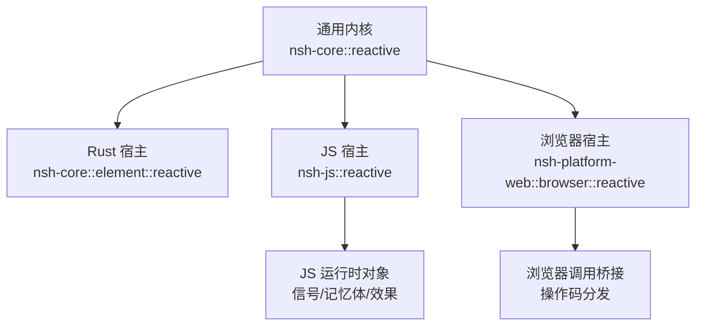
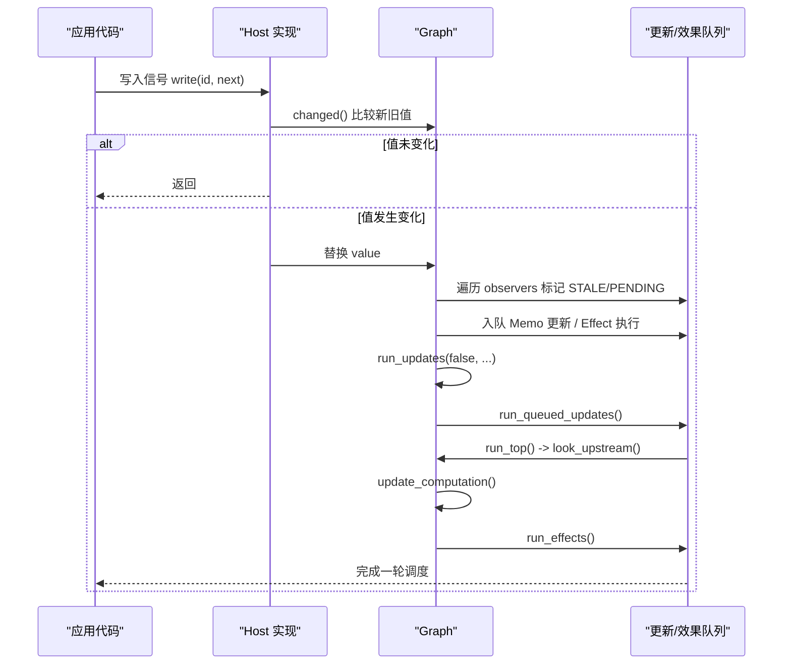
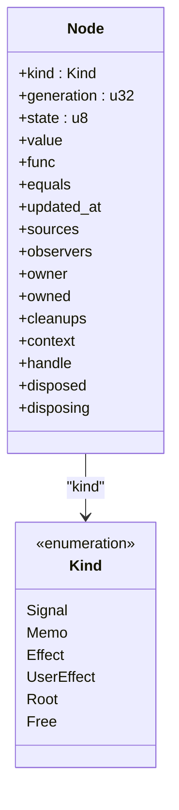
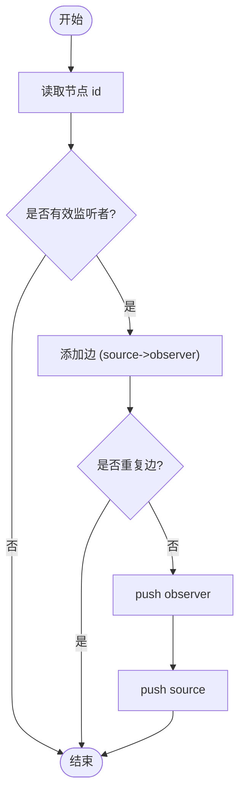
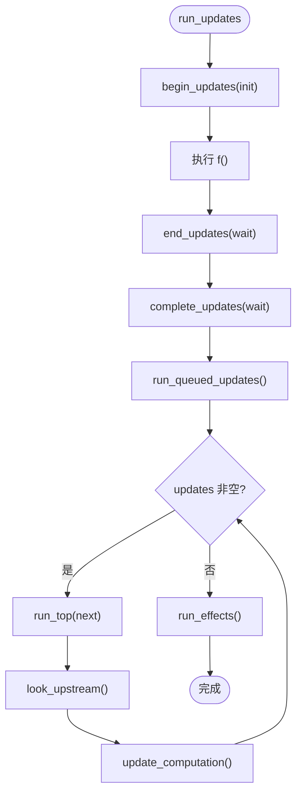
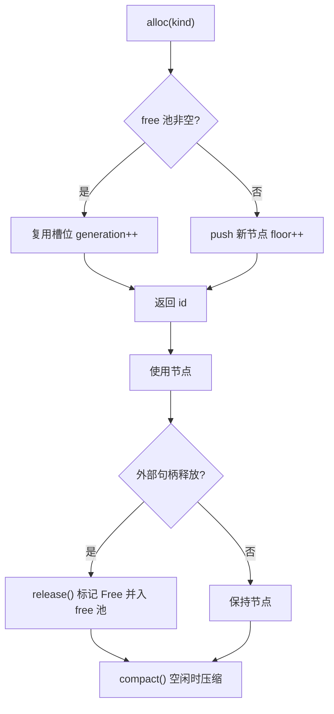
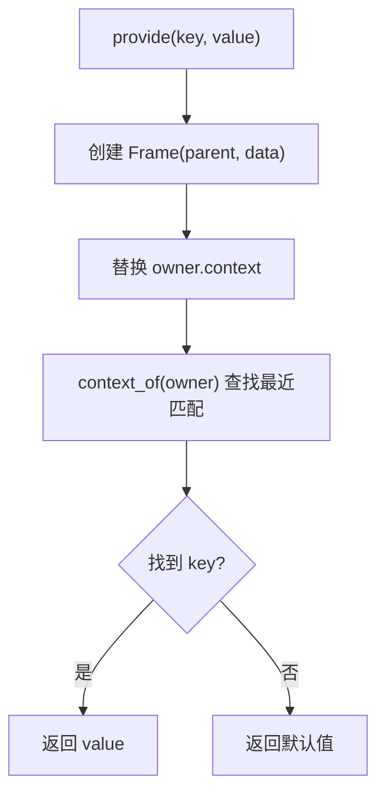
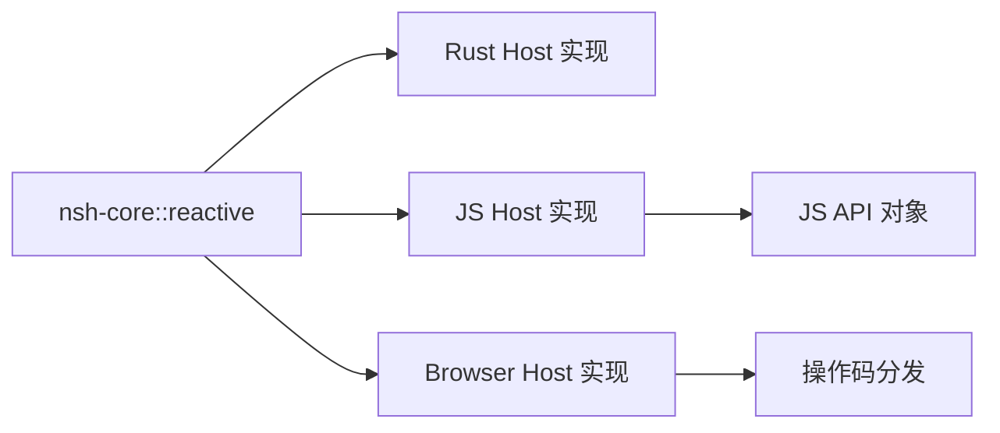

# 响应式图（Reactive Graph）

<cite>
**本文引用的文件**   
- [reactive.rs](file://crates/nsh-core/src/reactive.rs)
- [element/reactive.rs](file://crates/nsh-core/src/element/reactive.rs)
- [nsh-js/reactive.rs](file://crates/nsh-js/src/reactive.rs)
- [browser/reactive.rs](file://crates/nsh-platform-web/src/browser/reactive.rs)
</cite>

## 目录
1. [简介](#简介)
2. [项目结构](#项目结构)
3. [核心组件](#核心组件)
4. [架构总览](#架构总览)
5. [详细组件分析](#详细组件分析)
6. [依赖关系分析](#依赖关系分析)
7. [性能与调度](#性能与调度)
8. [内存管理与垃圾回收](#内存管理与垃圾回收)
9. [上下文系统](#上下文系统)
10. [线程安全与并发访问](#线程安全与并发访问)
11. [扩展 Host trait 示例](#扩展-host-trait-示例)
12. [调试与优化指南](#调试与优化指南)
13. [故障排查](#故障排查)
14. [结论](#结论)

## 简介
本文件为 NSH 框架的响应式图（Reactive Graph）提供深入的技术文档。该图实现了类 Solid 1.9 的调度策略，包括 `runUpdates`、更新队列与效果队列、以及“先更新祖先再执行子节点”的拓扑顺序。图的节点类型包含 Signal、Memo、Effect、UserEffect、Root，并通过双向边维护 sources 与 observers 的依赖关系。Host trait 将值、计算函数、比较器、清理回调和上下文抽象化，使 JS（QuickJS）、Rust 组件与浏览器宿主共享同一算法内核。

## 项目结构
NSH 的响应式图由四层组成：
- 通用内核：`nsh-core::reactive`，实现图、节点、调度、拓扑、所有权与上下文。
- Rust 宿主：`nsh-core::element::reactive`，将 Rust 闭包与 `Rc<dyn Any>` 值接入内核。
- JS 宿主：`nsh-js::reactive`，将 QuickJS 值与函数接入内核，并暴露 JS API。
- 浏览器宿主：`nsh-platform-web::browser::reactive`，在浏览器环境中桥接 JS 回调与内核。

**图表来源**
- [reactive.rs:1-17](file://crates/nsh-core/src/reactive.rs#L1-L17)
- [element/reactive.rs:1-16](file://crates/nsh-core/src/element/reactive.rs#L1-L16)
- [nsh-js/reactive.rs:1-19](file://crates/nsh-js/src/reactive.rs#L1-L19)
- [browser/reactive.rs:1-15](file://crates/nsh-platform-web/src/browser/reactive.rs#L1-L15)

**章节来源**
- [reactive.rs:1-17](file://crates/nsh-core/src/reactive.rs#L1-L17)
- [element/reactive.rs:1-16](file://crates/nsh-core/src/element/reactive.rs#L1-L16)
- [nsh-js/reactive.rs:1-19](file://crates/nsh-js/src/reactive.rs#L1-L19)
- [browser/reactive.rs:1-15](file://crates/nsh-platform-web/src/browser/reactive.rs#L1-L15)

## 核心组件
- 节点类型（Kind）：Signal、Memo、Effect、UserEffect、Root、Free。
- 节点状态（state）：CLEAN、STALE、PENDING。
- 所有者（owner）与监听者（listener）：用于构建依赖链和执行上下文。
- 双向边：sources（源列表）与 observers（观察者列表），使用索引进行 O(1) 删除。
- 调度器：`run_updates`、`complete_updates`、`run_queued_updates`、`run_effects`、`run_top`、`look_upstream`、`update_computation`。
- 内存管理：arena 分配、free 池复用、compact 压缩、generation 防悬垂句柄。
- 上下文系统：Frame 链表，provide/context 查找。
- Host trait：定义值、函数、比较、清理、上下文与数据，供不同宿主实现。

**章节来源**
- [reactive.rs:45-73](file://crates/nsh-core/src/reactive.rs#L45-L73)
- [reactive.rs:146-179](file://crates/nsh-core/src/reactive.rs#L146-L179)
- [reactive.rs:241-260](file://crates/nsh-core/src/reactive.rs#L241-L260)
- [reactive.rs:806-914](file://crates/nsh-core/src/reactive.rs#L806-L914)
- [reactive.rs:916-1058](file://crates/nsh-core/src/reactive.rs#L916-L1058)
- [reactive.rs:1076-1140](file://crates/nsh-core/src/reactive.rs#L1076-L1140)
- [reactive.rs:1142-1201](file://crates/nsh-core/src/reactive.rs#L1142-L1201)
- [reactive.rs:1203-1244](file://crates/nsh-core/src/reactive.rs#L1203-L1244)
- [reactive.rs:1246-1338](file://crates/nsh-core/src/reactive.rs#L1246-L1338)

## 架构总览
响应式图以 arena 存储节点，通过 owner 树组织生命周期，通过 sources/observers 维护依赖关系。调度器保证：
- 写信号时标记下游为 STALE/PENDING，并将 Memo 入队更新、Effect/UserEffect 入队执行。
- 执行阶段先运行所有更新（Memo），再按渲染效果优先、用户效果次优的顺序执行 Effect/UserEffect。
- 对循环依赖或持续变化的 effect，通过 MAX_RUNS 检测 runaway 并上报错误。

**图表来源**
- [reactive.rs:1076-1140](file://crates/nsh-core/src/reactive.rs#L1076-L1140)
- [reactive.rs:878-914](file://crates/nsh-core/src/reactive.rs#L878-L914)
- [reactive.rs:916-1058](file://crates/nsh-core/src/reactive.rs#L916-L1058)

**章节来源**
- [reactive.rs:806-914](file://crates/nsh-core/src/reactive.rs#L806-L914)
- [reactive.rs:916-1058](file://crates/nsh-core/src/reactive.rs#L916-L1058)
- [reactive.rs:1076-1140](file://crates/nsh-core/src/reactive.rs#L1076-L1140)

## 详细组件分析

### 节点类型与用途
- Signal：可写的响应式值，读时在计算中建立订阅边。
- Memo：缓存的计算结果，惰性求值，读时若过期则更新。
- Effect：渲染效果，尽快执行，用于副作用（如 DOM 更新）。
- UserEffect：用户效果，在渲染效果之后执行，常用于外部系统交互。
- Root：所有者根节点，不执行任何计算，仅作为生命周期容器。
- Free：已释放槽位，用于 arena 复用。

**图表来源**
- [reactive.rs:45-60](file://crates/nsh-core/src/reactive.rs#L45-L60)
- [reactive.rs:146-179](file://crates/nsh-core/src/reactive.rs#L146-L179)

**章节来源**
- [reactive.rs:45-60](file://crates/nsh-core/src/reactive.rs#L45-L60)
- [reactive.rs:146-179](file://crates/nsh-core/src/reactive.rs#L146-L179)

### 图的拓扑结构与依赖维护
- 每个节点维护 sources（上游依赖）与 observers（下游依赖），均为 `(id, index)` 元组。
- track 方法在读取时添加边，重复读取同一条边不会重复添加。
- unlink_sources/unlink_observers 使用 swap-remove 实现 O(1) 删除，避免频繁移动元素。
- mark_downstream 递归标记下游为 PENDING，并根据节点类型入队更新或执行。

**图表来源**
- [reactive.rs:676-702](file://crates/nsh-core/src/reactive.rs#L676-L702)
- [reactive.rs:704-724](file://crates/nsh-core/src/reactive.rs#L704-L724)
- [reactive.rs:746-764](file://crates/nsh-core/src/reactive.rs#L746-L764)

**章节来源**
- [reactive.rs:676-702](file://crates/nsh-core/src/reactive.rs#L676-L702)
- [reactive.rs:704-724](file://crates/nsh-core/src/reactive.rs#L704-L724)
- [reactive.rs:746-764](file://crates/nsh-core/src/reactive.rs#L746-L764)

### 调度算法与批处理机制
- `run_updates(h, init, f)`：启动一轮调度；若已有轮次则在当前轮次加入。
- `begin_updates`/`end_updates`：初始化/结束轮次，设置 updates/effects 队列与 exec 时间戳。
- `complete_updates`：循环执行 effects，直到无待执行项；避免递归导致栈溢出。
- `run_queued_updates`：依次执行 queued 的更新（Memo），调用 `run_top`。
- `run_effects`：先执行 Effect，再执行 UserEffect。
- `run_top`：根据 owner 树向上寻找 stale/pending 祖先，先更新祖先再执行当前节点。
- `look_upstream`：将 memo 的上游依赖提升到 CLEAN，必要时递归更新。
- `update_computation`：清理节点并重新执行计算，处理失败情况保持 CLEAN 并保留最后值。

**图表来源**
- [reactive.rs:806-914](file://crates/nsh-core/src/reactive.rs#L806-L914)
- [reactive.rs:916-1058](file://crates/nsh-core/src/reactive.rs#L916-L1058)

**章节来源**
- [reactive.rs:806-914](file://crates/nsh-core/src/reactive.rs#L806-L914)
- [reactive.rs:916-1058](file://crates/nsh-core/src/reactive.rs#L916-L1058)

### 内存管理与垃圾回收
- arena 分配：`alloc` 优先复用 free 池中的槽位，否则 push 新节点；generation 递增防止旧句柄指向新节点。
- compact：空闲时压缩 arena，移除尾部 Free 节点，缩小 Vec 容量，提升缓存局部性。
- handle 机制：节点可被外部持有（signal/memo 对象），drop_handle 仅在节点属于 handle 时释放其值。
- GC 集成（JS）：finalizer 与 mark 钩子确保 JS 对象与图值的引用正确标记与回收。

**图表来源**
- [reactive.rs:279-315](file://crates/nsh-core/src/reactive.rs#L279-L315)
- [reactive.rs:517-528](file://crates/nsh-core/src/reactive.rs#L517-L528)
- [reactive.rs:726-744](file://crates/nsh-core/src/reactive.rs#L726-L744)
- [nsh-js/reactive.rs:518-560](file://crates/nsh-js/src/reactive.rs#L518-L560)

**章节来源**
- [reactive.rs:279-315](file://crates/nsh-core/src/reactive.rs#L279-L315)
- [reactive.rs:517-528](file://crates/nsh-core/src/reactive.rs#L517-L528)
- [reactive.rs:726-744](file://crates/nsh-core/src/reactive.rs#L726-L744)
- [nsh-js/reactive.rs:518-560](file://crates/nsh-js/src/reactive.rs#L518-L560)

### 上下文系统
- Frame：包含 parent 指针与 data（key/value），形成链表。
- provide：在当前 owner 上设置新的 Frame，遮蔽外层 context。
- context_of/context：从 owner 向上查找最近的匹配 key 的 value。
- 各宿主实现 Context 类型：Rust 使用 `(TypeId, Rc<dyn Any>)`，JS 使用 `(JsValue, JsValue)`，浏览器使用 `(Value, Value)`。

**图表来源**
- [reactive.rs:138-144](file://crates/nsh-core/src/reactive.rs#L138-L144)
- [reactive.rs:383-409](file://crates/nsh-core/src/reactive.rs#L383-L409)
- [element/reactive.rs:153-159](file://crates/nsh-core/src/element/reactive.rs#L153-L159)
- [nsh-js/reactive.rs:83-89](file://crates/nsh-js/src/reactive.rs#L83-L89)
- [browser/reactive.rs:29-35](file://crates/nsh-platform-web/src/browser/reactive.rs#L29-L35)

**章节来源**
- [reactive.rs:138-144](file://crates/nsh-core/src/reactive.rs#L138-L144)
- [reactive.rs:383-409](file://crates/nsh-core/src/reactive.rs#L383-L409)
- [element/reactive.rs:153-159](file://crates/nsh-core/src/element/reactive.rs#L153-L159)
- [nsh-js/reactive.rs:83-89](file://crates/nsh-js/src/reactive.rs#L83-L89)
- [browser/reactive.rs:29-35](file://crates/nsh-platform-web/src/browser/reactive.rs#L29-L35)

## 依赖关系分析
- 通用内核依赖 Host trait，不直接依赖具体宿主。
- Rust 宿主实现 Host，将 Rust 闭包与 `Rc<dyn Any>` 值接入内核。
- JS 宿主实现 Host，将 QuickJS 值与函数接入内核，并提供 JS API（createSignal、createMemo、createEffect 等）。
- 浏览器宿主实现 Host，桥接浏览器回调与内核，并通过操作码分发统一入口。

**图表来源**
- [reactive.rs:75-136](file://crates/nsh-core/src/reactive.rs#L75-L136)
- [element/reactive.rs:153-261](file://crates/nsh-core/src/element/reactive.rs#L153-L261)
- [nsh-js/reactive.rs:83-212](file://crates/nsh-js/src/reactive.rs#L83-L212)
- [browser/reactive.rs:29-106](file://crates/nsh-platform-web/src/browser/reactive.rs#L29-L106)

**章节来源**
- [reactive.rs:75-136](file://crates/nsh-core/src/reactive.rs#L75-L136)
- [element/reactive.rs:153-261](file://crates/nsh-core/src/element/reactive.rs#L153-L261)
- [nsh-js/reactive.rs:83-212](file://crates/nsh-js/src/reactive.rs#L83-L212)
- [browser/reactive.rs:29-106](file://crates/nsh-platform-web/src/browser/reactive.rs#L29-L106)

## 性能与调度
- 批量更新：`batch` 将多次写入合并为一轮调度，减少重复计算。
- 延迟执行：UserEffect 在渲染效果之后执行，避免阻塞 UI 更新。
- 上限保护：MAX_RUNS 防止无限循环刷新，触发 runaway 错误。
- 优化点：
  - 使用 Equals::Never 或自定义比较器减少不必要的通知。
  - 合理拆分 Memo 粒度，避免大计算块。
  - 使用 untracked 读取避免不必要订阅。
  - 及时 dispose 不再使用的 root 或 owner，释放资源。

**章节来源**
- [reactive.rs:42-43](file://crates/nsh-core/src/reactive.rs#L42-L43)
- [reactive.rs:891-902](file://crates/nsh-core/src/reactive.rs#L891-L902)
- [reactive.rs:1246-1270](file://crates/nsh-core/src/reactive.rs#L1246-L1270)

## 内存管理与垃圾回收
- arena 分配与 free 池复用降低分配开销。
- compact 在空闲时压缩 arena，减少内存碎片。
- generation 机制防止悬垂句柄（stale handles）误用。
- JS GC 集成：finalizer 与 mark 钩子确保 JS 对象与图值引用正确。

**章节来源**
- [reactive.rs:279-315](file://crates/nsh-core/src/reactive.rs#L279-L315)
- [reactive.rs:517-528](file://crates/nsh-core/src/reactive.rs#L517-L528)
- [nsh-js/reactive.rs:518-560](file://crates/nsh-js/src/reactive.rs#L518-L560)

## 上下文系统
- provide 在当前 owner 上设置新的 Frame，遮蔽外层 context。
- context_of 从 owner 向上查找最近的匹配 key 的 value。
- 各宿主实现 Context 类型：Rust 使用 `(TypeId, Rc<dyn Any>)`，JS 使用 `(JsValue, JsValue)`，浏览器使用 `(Value, Value)`。

**章节来源**
- [reactive.rs:138-144](file://crates/nsh-core/src/reactive.rs#L138-L144)
- [reactive.rs:383-409](file://crates/nsh-core/src/reactive.rs#L383-L409)
- [element/reactive.rs:153-159](file://crates/nsh-core/src/element/reactive.rs#L153-L159)
- [nsh-js/reactive.rs:83-89](file://crates/nsh-js/src/reactive.rs#L83-L89)
- [browser/reactive.rs:29-35](file://crates/nsh-platform-web/src/browser/reactive.rs#L29-L35)

## 线程安全与并发访问
- 单线程模型：每个宿主（Rust/JS/Browser）在各自线程内进入运行时（Runtime::enter），确保图访问串行化。
- 短借用契约：Host 的实现保证每次对图的借用都是短暂的，且在调用宿主函数前释放，避免重入冲突。
- 跨线程限制：图本身不是 Send/Sync，禁止跨线程共享；通过宿主提供的运行时入口控制访问。

**章节来源**
- [element/reactive.rs:142-149](file://crates/nsh-core/src/element/reactive.rs#L142-L149)
- [element/reactive.rs:153-170](file://crates/nsh-core/src/element/reactive.rs#L153-L170)
- [reactive.rs:75-136](file://crates/nsh-core/src/reactive.rs#L75-L136)

## 扩展 Host trait 示例
要扩展 Host trait 以支持自定义值类型，需实现以下方法：
- graph：返回图的可变引用。
- empty/dup/free：管理值的生命周期。
- dup_func/free_func：管理计算函数的生命周期。
- dup_equals/free_equals：管理自定义比较器的生命周期。
- call：执行计算函数，返回新值或 None（失败）。
- same/truthy/custom_changed：实现值相等性与真值判断。
- run_cleanup/free_cleanup：执行/释放清理回调。
- runaway：上报无限循环错误。

参考实现：
- Rust 宿主：[element/reactive.rs:153-261](file://crates/nsh-core/src/element/reactive.rs#L153-L261)
- JS 宿主：[nsh-js/reactive.rs:83-212](file://crates/nsh-js/src/reactive.rs#L83-L212)
- 浏览器宿主：[browser/reactive.rs:29-106](file://crates/nsh-platform-web/src/browser/reactive.rs#L29-L106)

**章节来源**
- [element/reactive.rs:153-261](file://crates/nsh-core/src/element/reactive.rs#L153-L261)
- [nsh-js/reactive.rs:83-212](file://crates/nsh-js/src/reactive.rs#L83-L212)
- [browser/reactive.rs:29-106](file://crates/nsh-platform-web/src/browser/reactive.rs#L29-L106)

## 调试与优化指南
- 调试：
  - 使用 slots_in_use 监控节点数量。
  - 检查 runaway 标志与错误边界捕获。
  - 在浏览器端 trace_edges 追踪句柄与边。
- 优化：
  - 使用 batch 合并多次写入。
  - 使用 untracked 避免不必要订阅。
  - 合理设置 Equals（Never/Truthiness/Custom）。
  - 及时 dispose 不再使用的 root 或 owner。

**章节来源**
- [element/reactive.rs:325-336](file://crates/nsh-core/src/element/reactive.rs#L325-L336)
- [nsh-js/reactive.rs:196-212](file://crates/nsh-js/src/reactive.rs#L196-L212)
- [browser/reactive.rs:196-210](file://crates/nsh-platform-web/src/browser/reactive.rs#L196-L210)

## 故障排查
- 无限循环刷新：检查 effect 是否在读取的信号上持续写入，触发 runaway。
- 悬垂句柄：确认句柄的 generation 与节点 generation 一致，避免使用已释放节点。
- 上下文丢失：检查 provide 是否在正确的 owner 上调用，context_of 查找路径是否正确。
- 性能瓶颈：分析 Memo 粒度与订阅范围，避免过大计算块与过度订阅。

**章节来源**
- [reactive.rs:891-902](file://crates/nsh-core/src/reactive.rs#L891-L902)
- [reactive.rs:411-417](file://crates/nsh-core/src/reactive.rs#L411-L417)
- [reactive.rs:383-409](file://crates/nsh-core/src/reactive.rs#L383-L409)

## 结论
NSH 的响应式图通过通用内核与多宿主实现，提供了高效、可扩展的响应式编程基础。其调度算法、拓扑维护、内存管理与上下文系统共同保证了性能与正确性。开发者可通过扩展 Host trait 适配不同平台，并利用批处理、延迟执行与上限保护优化用户体验。