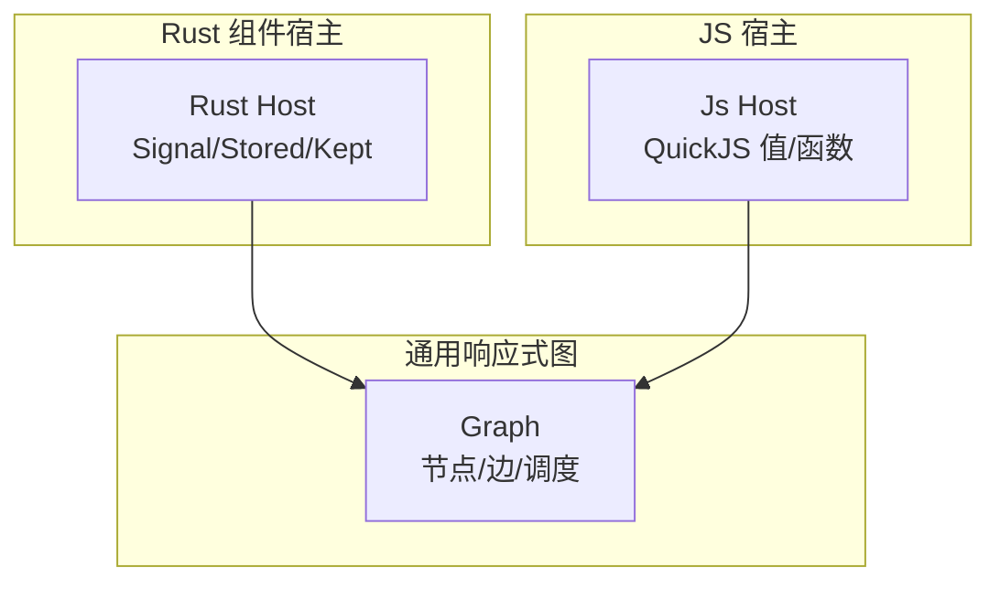
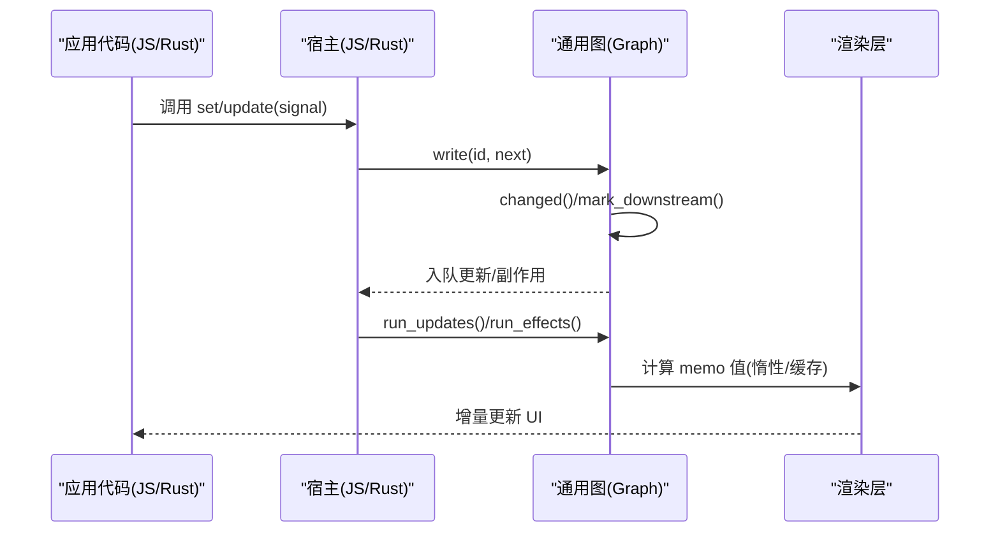
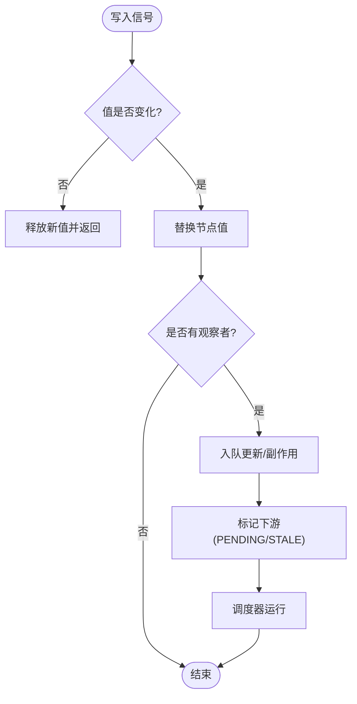
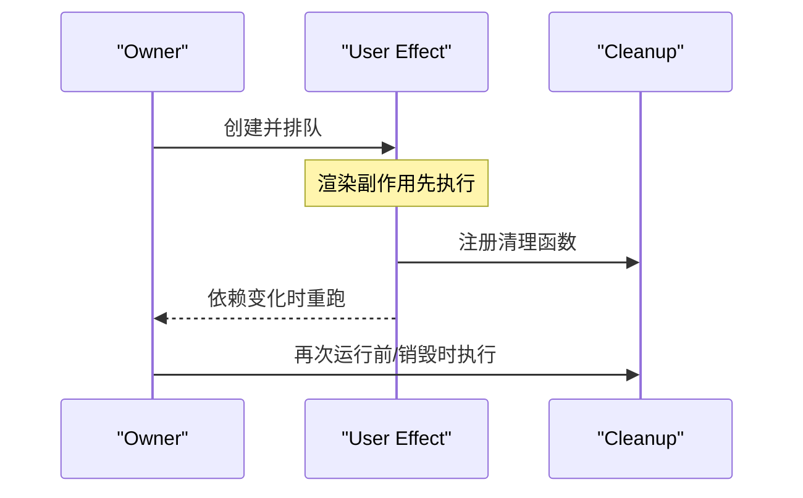
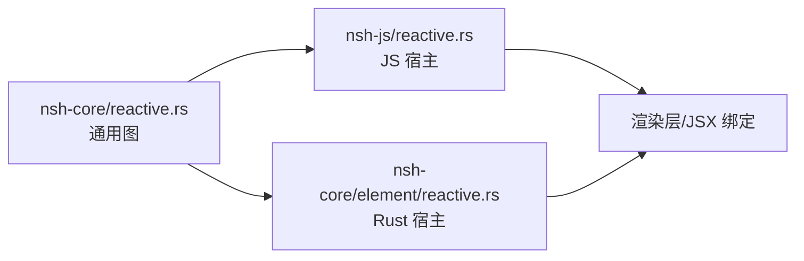

# 响应式系统

<cite>
**本文引用的文件**   
- [reactive.rs](file://crates/nsh-core/src/reactive.rs)
- [element/reactive.rs](file://crates/nsh-core/src/element/reactive.rs)
- [nsh-js/reactive.rs](file://crates/nsh-js/src/reactive.rs)
- [reactivity.md](file://website/zh-CN/docs/reactivity.md)
</cite>

## 目录
1. [简介](#简介)
2. [项目结构](#项目结构)
3. [核心组件](#核心组件)
4. [架构总览](#架构总览)
5. [详细组件分析](#详细组件分析)
6. [依赖关系分析](#依赖关系分析)
7. [性能与增量更新](#性能与增量更新)
8. [故障排查指南](#故障排查指南)
9. [结论](#结论)
10. [附录：API 使用示例路径](#附录api-使用示例路径)

## 简介
本文件系统性阐述 NSH 框架的响应式系统，覆盖信号（signal）、计算值（memo/computed）、副作用（effect）、批处理（batch）、无跟踪读取（untracked）以及上下文（context）等机制。文档从 Rust 核心图算法、Rust 组件宿主到 JS 宿主三层展开，解释依赖追踪、惰性求值、缓存失效、调度与清理机制，并给出 UI 增量更新的驱动流程与最佳实践。

## 项目结构
NSH 响应式系统由三部分构成：
- 通用响应式图（Rust）：实现信号、计算、副作用、所有者、上下文、调度与内存管理。
- Rust 组件宿主：将 Rust 值与闭包接入通用图，提供 Signal/Stored/Kept 等 API。
- JS 宿主：将 QuickJS 值与函数接入通用图，暴露 signal/memo/effect/batch/untracked/context 等原生能力。



图表来源
- [reactive.rs:242-260](file://crates/nsh-core/src/reactive.rs#L242-L260)
- [element/reactive.rs:46-67](file://crates/nsh-core/src/element/reactive.rs#L46-L67)
- [nsh-js/reactive.rs:38-61](file://crates/nsh-js/src/reactive.rs#L38-L61)

章节来源
- [reactive.rs:1-17](file://crates/nsh-core/src/reactive.rs#L1-L17)
- [element/reactive.rs:1-15](file://crates/nsh-core/src/element/reactive.rs#L1-L15)
- [nsh-js/reactive.rs:1-19](file://crates/nsh-js/src/reactive.rs#L1-L19)

## 核心组件
- 信号（Signal）：可被订阅的值；写入时按比较策略通知订阅者。
- 计算值（Memo/Computed）：惰性派生值，缓存结果并在依赖变化时重新计算。
- 副作用（Effect）：在渲染后执行用户逻辑，依赖变化时重跑。
- 批处理（Batch）：合并多次写入，仅触发一次下游更新。
- 无跟踪读取（Untracked）：在跟踪作用域内读取但不建立依赖。
- 上下文（Context）：跨层级传递不可变或响应式环境值。

章节来源
- [element/reactive.rs:496-532](file://crates/nsh-core/src/element/reactive.rs#L496-L532)
- [reactive.rs:1208-1244](file://crates/nsh-core/src/reactive.rs#L1208-L1244)
- [nsh-js/reactive.rs:1054-1064](file://crates/nsh-js/src/reactive.rs#L1054-L1064)

## 架构总览
下图展示信号写入到 UI 更新的完整链路：JS/Rust 调用写接口 → 通用图标记下游 → 调度器运行计算与副作用 → 渲染层消费 memo 值进行增量更新。



图表来源
- [reactive.rs:1076-1140](file://crates/nsh-core/src/reactive.rs#L1076-L1140)
- [reactive.rs:806-914](file://crates/nsh-core/src/reactive.rs#L806-L914)
- [nsh-js/reactive.rs:1200-1219](file://crates/nsh-js/src/reactive.rs#L1200-L1219)

## 详细组件分析

### 信号（Signal）
- 创建与类型：Rust 中通过 `signal`/`signal_with` 创建，支持自定义相等性；JS 中通过 `signal(value, options)` 创建，options 支持 `equals` 为布尔或函数。
- 读取：Rust 用 `get`/`with`，JS 直接调用对象；读取会建立依赖。
- 写入：Rust 提供 `set`/`update`，JS 提供 `set`/`update`；写入先比较是否变化，再标记下游。
- 生命周期：作为“句柄”持有节点 id 与代际号，避免悬垂引用；销毁后读操作安全返回或报错。



图表来源
- [reactive.rs:1060-1111](file://crates/nsh-core/src/reactive.rs#L1060-L1111)
- [element/reactive.rs:728-761](file://crates/nsh-core/src/element/reactive.rs#L728-L761)
- [nsh-js/reactive.rs:1200-1219](file://crates/nsh-js/src/reactive.rs#L1200-L1219)

章节来源
- [element/reactive.rs:496-532](file://crates/nsh-core/src/element/reactive.rs#L496-L532)
- [element/reactive.rs:728-775](file://crates/nsh-core/src/element/reactive.rs#L728-L775)
- [nsh-js/reactive.rs:1054-1064](file://crates/nsh-js/src/reactive.rs#L1054-L1064)
- [nsh-js/reactive.rs:1119-1162](file://crates/nsh-js/src/reactive.rs#L1119-L1162)

### 计算值（Memo/Computed）
- 惰性求值：首次读取时计算并缓存；若上游依赖未变化则直接返回缓存值。
- 依赖追踪：计算函数运行时自动记录其读取的信号，形成有向边。
- 失效与重算：当依赖信号变化，计算节点被标记 STALE/PENDING；读取或调度时按需更新。
- 错误恢复：计算抛出异常时保留上次值并保持 CLEAN，后续依赖变化仍可继续参与调度。

```mermaid
classDiagram
class Node {
+kind
+state
+value
+sources
+observers
+owner
+updated_at
}
class Memo {
+func
+equals
+handle
}
Node <|-- Memo : "Kind : : Memo"
```

图表来源
- [reactive.rs:146-179](file://crates/nsh-core/src/reactive.rs#L146-L179)
- [reactive.rs:1208-1226](file://crates/nsh-core/src/reactive.rs#L1208-L1226)

章节来源
- [reactive.rs:954-1058](file://crates/nsh-core/src/reactive.rs#L954-L1058)
- [reactive.rs:1208-1226](file://crates/nsh-core/src/reactive.rs#L1208-L1226)
- [nsh-js/reactive.rs:1221-1231](file://crates/nsh-js/src/reactive.rs#L1221-L1231)

### 副作用（Effect）
- 执行时机：渲染副作用（render effect）立即执行；用户副作用（user effect）在渲染副作用之后执行。
- 依赖追踪：仅在同步执行期间读取的信号会被追踪。
- 清理机制：可通过 cleanup 注册清理函数，在 effect 再次运行或所属 owner 销毁时执行；JS 支持返回清理函数。



图表来源
- [reactive.rs:1228-1244](file://crates/nsh-core/src/reactive.rs#L1228-L1244)
- [nsh-js/reactive.rs:1233-1278](file://crates/nsh-js/src/reactive.rs#L1233-L1278)

章节来源
- [reactive.rs:904-914](file://crates/nsh-core/src/reactive.rs#L904-L914)
- [nsh-js/reactive.rs:1233-1278](file://crates/nsh-js/src/reactive.rs#L1233-L1278)

### 批处理（Batch）与无跟踪读取（Untracked）
- Batch：将多次写入合并为一次更新，减少不必要的中间状态和重复计算。
- Untracked：在 effect/computed 内部读取某个信号但不建立依赖，用于只读当前快照的场景。

章节来源
- [reactive.rs:1246-1270](file://crates/nsh-core/src/reactive.rs#L1246-L1270)
- [nsh-js/reactive.rs:775-798](file://crates/nsh-js/src/reactive.rs#L775-L798)

### 上下文（Context）
- 提供与查找：上层提供 key/value，下层就近查找；值可为普通值或响应式值。
- 作用域：随 owner 传播，销毁时自动清理。

章节来源
- [reactive.rs:383-409](file://crates/nsh-core/src/reactive.rs#L383-L409)
- [nsh-js/reactive.rs:846-897](file://crates/nsh-js/src/reactive.rs#L846-L897)

## 依赖关系分析
- 通用图（Graph）是所有宿主的共享内核，定义节点类型、边维护、调度与内存回收。
- Rust 宿主将 Rust 值与闭包适配为 Host，提供 Signal/Stored/Kept 等高层 API。
- JS 宿主将 QuickJS 值与函数适配为 Host，暴露 signal/memo/effect/batch/untracked/context 等原生 API。
- 渲染层通过 memo 值驱动 UI 更新，避免全量重绘。



图表来源
- [reactive.rs:242-260](file://crates/nsh-core/src/reactive.rs#L242-L260)
- [element/reactive.rs:46-67](file://crates/nsh-core/src/element/reactive.rs#L46-L67)
- [nsh-js/reactive.rs:38-61](file://crates/nsh-js/src/reactive.rs#L38-L61)

章节来源
- [reactive.rs:1-17](file://crates/nsh-core/src/reactive.rs#L1-L17)
- [element/reactive.rs:1-15](file://crates/nsh-core/src/element/reactive.rs#L1-L15)
- [nsh-js/reactive.rs:1-19](file://crates/nsh-js/src/reactive.rs#L1-L19)

## 性能与增量更新
- 惰性求值与缓存：memo 只在需要时计算，命中缓存则跳过；读取时若 stale 则按需更新。
- 增量标记：write 仅对 clean 的观察者标记 STALE/PENDING，避免重复入队。
- 调度优化：Solid 风格的 runUpdates/runEffects，先更新计算再执行副作用，防止抖动。
- 内存回收：arena 分配 + 代际号 + compact，空闲槽复用，降低碎片。
- 比较策略：默认严格相等（JS）或 PartialEq（Rust），可自定义 equals 以控制通知粒度。

章节来源
- [reactive.rs:806-914](file://crates/nsh-core/src/reactive.rs#L806-L914)
- [reactive.rs:1060-1140](file://crates/nsh-core/src/reactive.rs#L1060-L1140)
- [reactive.rs:293-315](file://crates/nsh-core/src/reactive.rs#L293-L315)

## 故障排查指南
- 无限循环保护：flush 超过阈值时触发 runaway，记录错误并停止调度。
- 错误边界：JS 侧捕获计算抛出的异常，交由最近的 ErrorBoundary 显示 fallback。
- 异步不跟踪：仅在 effect/computed 同步执行期间的读取被追踪；异步回调中的读取不会触发重跑。
- 常见误用：
  - 在组件函数体中读取 signal 期望它更新（应使用绑定）。
  - 在 TSX 中原地修改对象/数组而不替换（应创建新对象/数组）。
  - 用 effect 派生状态（应改用 computed）。
  - 在组件外创建 effect（应放在组件函数体内）。

章节来源
- [reactive.rs:891-901](file://crates/nsh-core/src/reactive.rs#L891-L901)
- [nsh-js/reactive.rs:132-211](file://crates/nsh-js/src/reactive.rs#L132-L211)
- [reactivity.md:508-543](file://website/zh-CN/docs/reactivity.md#L508-L543)

## 结论
NSH 的响应式系统以 Solid 风格调度为核心，通过通用图统一 Rust 与 JS 宿主，提供高性能、细粒度的依赖追踪与增量更新。信号、计算值与副作用各司其职，配合批处理、无跟踪读取与上下文，满足复杂 UI 场景的性能与可维护性需求。

## 附录：API 使用示例路径
- 信号创建与读写、对象与数组更新、computed、effect、resource、cleanup、batch、untracked、context、错误边界等用法示例参见：
  - [reactivity.md:23-106](file://website/zh-CN/docs/reactivity.md#L23-L106)
  - [reactivity.md:107-144](file://website/zh-CN/docs/reactivity.md#L107-L144)
  - [reactivity.md:145-210](file://website/zh-CN/docs/reactivity.md#L145-L210)
  - [reactivity.md:211-272](file://website/zh-CN/docs/reactivity.md#L211-L272)
  - [reactivity.md:273-330](file://website/zh-CN/docs/reactivity.md#L273-L330)
  - [reactivity.md:332-377](file://website/zh-CN/docs/reactivity.md#L332-L377)
  - [reactivity.md:379-455](file://website/zh-CN/docs/reactivity.md#L379-L455)
  - [reactivity.md:457-494](file://website/zh-CN/docs/reactivity.md#L457-L494)