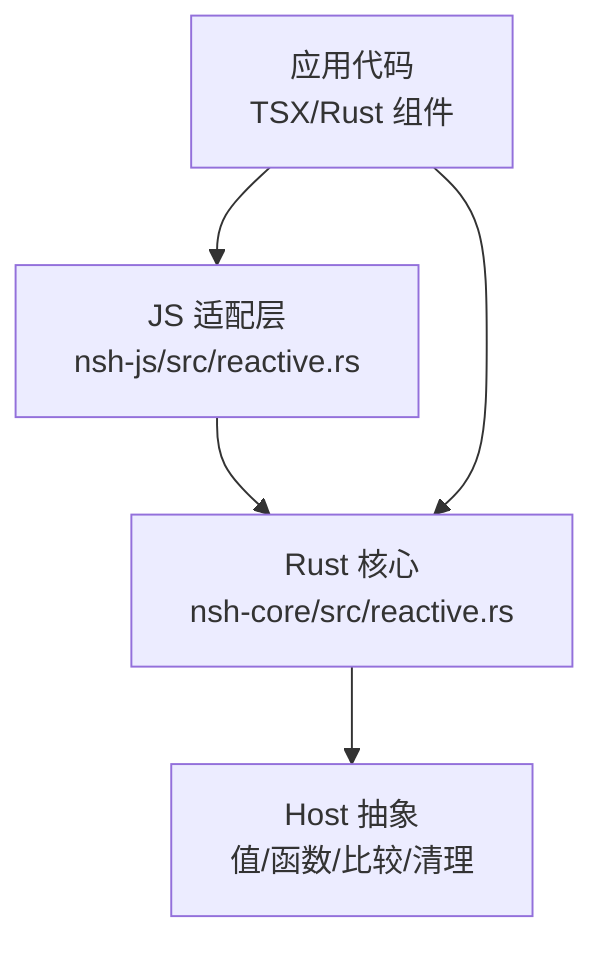
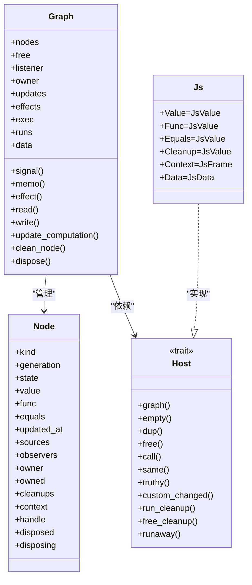
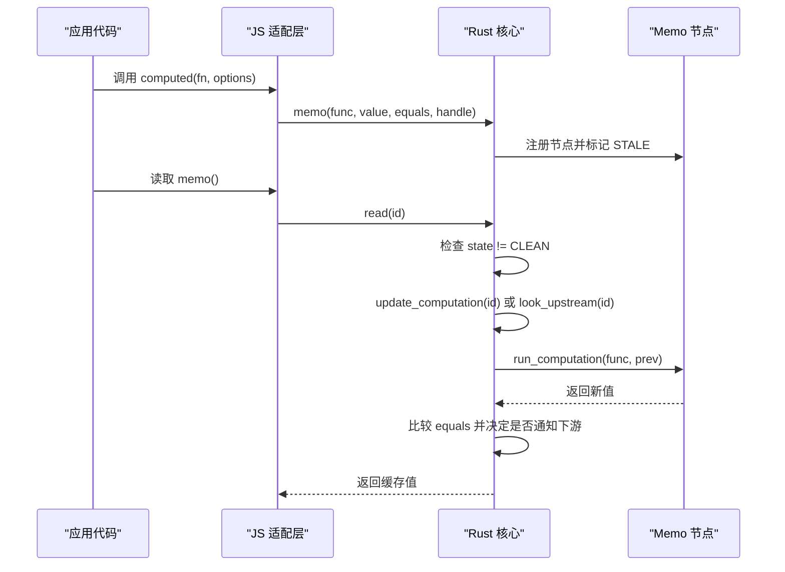
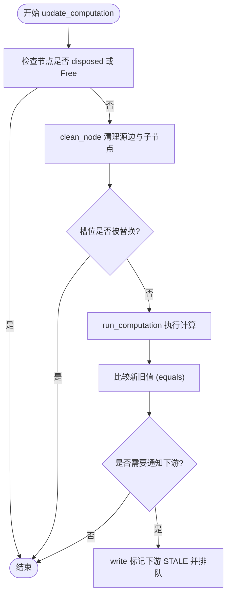
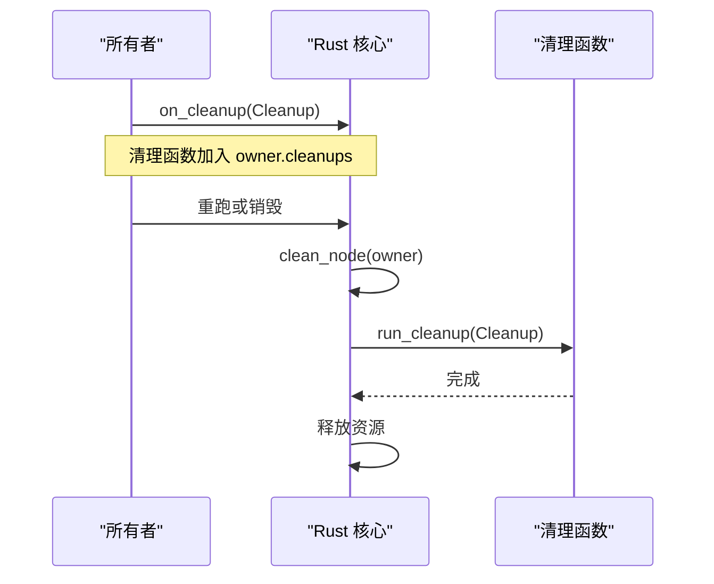
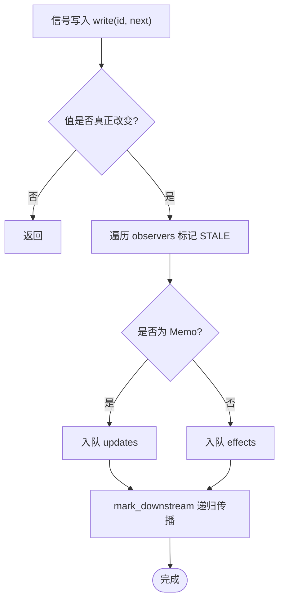
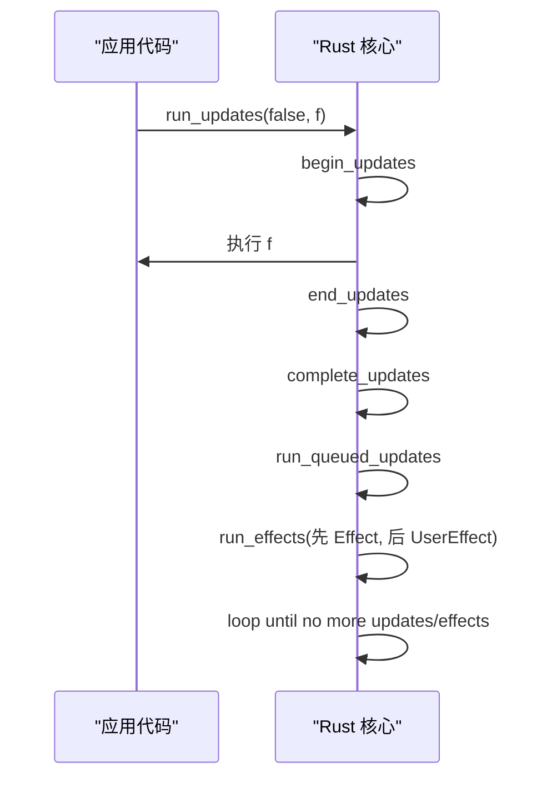

# 计算值（Memos）

<cite>
**本文引用的文件**   
- [reactive.rs](file://crates/nsh-core/src/reactive.rs)
- [reactive.rs](file://crates/nsh-js/src/reactive.rs)
</cite>

## 目录
1. [引言](#引言)
2. [项目结构](#项目结构)
3. [核心组件](#核心组件)
4. [架构总览](#架构总览)
5. [详细组件分析](#详细组件分析)
6. [依赖与失效传播](#依赖与失效传播)
7. [执行调度与顺序](#执行调度与顺序)
8. [清理机制](#清理机制)
9. [性能与缓存策略](#性能与缓存策略)
10. [使用示例与最佳实践](#使用示例与最佳实践)
11. [故障排查](#故障排查)
12. [结论](#结论)

## 引言
本文聚焦 NSH 框架中的“计算值”（Memos）子系统，系统阐述其惰性求值、依赖追踪、失效传播、执行调度与清理机制。NSH 的响应式图由 Rust 核心实现，JS 侧通过 QuickJS 适配层运行用户代码；两者共享同一套算法与语义保证。计算值在首次读取或显式更新时触发计算，并缓存结果直到上游依赖变化；当信号写入后，依赖链上的计算值会被标记为待更新，并在合适的时机按拓扑顺序重新计算，避免重复工作。

## 项目结构
NSH 的计算值系统位于两个关键位置：
- Rust 核心：`nsh-core/src/reactive.rs`，定义响应式图、节点类型、调度器、更新/清理流程等。
- JS 适配层：`nsh-js/src/reactive.rs`，将 QuickJS 的值、函数、清理回调与错误边界接入通用图。

**图表来源**
- [reactive.rs:1-17](file://crates/nsh-core/src/reactive.rs#L1-L17)
- [reactive.rs:1-19](file://crates/nsh-js/src/reactive.rs#L1-L19)

**章节来源**
- [reactive.rs:1-17](file://crates/nsh-core/src/reactive.rs#L1-L17)
- [reactive.rs:1-19](file://crates/nsh-js/src/reactive.rs#L1-L19)

## 核心组件
- 节点类型：信号（Signal）、计算值（Memo）、渲染副作用（Effect）、用户副作用（UserEffect）、根（Root）、空闲（Free）。
- 节点状态：CLEAN、STALE、PENDING。
- 调度队列：updates（计算值队列）、effects（副作用队列）。
- 所有者与上下文：owner 树、context 帧，用于生命周期和依赖隔离。
- 比较策略：默认相等、从不相等、真值比较、自定义比较。
- 清理回调：on_cleanup 注册的清理函数，在所有者重跑或销毁时执行。

**章节来源**
- [reactive.rs:45-73](file://crates/nsh-core/src/reactive.rs#L45-L73)
- [reactive.rs:146-179](file://crates/nsh-core/src/reactive.rs#L146-L179)
- [reactive.rs:241-260](file://crates/nsh-core/src/reactive.rs#L241-L260)
- [reactive.rs:614-643](file://crates/nsh-core/src/reactive.rs#L614-L643)

## 架构总览
NSH 的响应式图采用 Solid 风格的调度模型：写信号会批量标记下游依赖，随后在 flush 阶段按拓扑顺序更新计算值，再执行副作用。JS 侧通过 `Js` 实现 `Host`，把 QuickJS 的值、函数、清理回调与错误边界接入该图。

**图表来源**
- [reactive.rs:146-179](file://crates/nsh-core/src/reactive.rs#L146-L179)
- [reactive.rs:241-260](file://crates/nsh-core/src/reactive.rs#L241-L260)
- [reactive.rs:83-136](file://crates/nsh-core/src/reactive.rs#L83-L136)
- [reactive.rs:38-212](file://crates/nsh-js/src/reactive.rs#L38-L212)

**章节来源**
- [reactive.rs:83-136](file://crates/nsh-core/src/reactive.rs#L83-L136)
- [reactive.rs:38-212](file://crates/nsh-js/src/reactive.rs#L38-L212)

## 详细组件分析

### 计算值的创建与惰性求值
- 创建：`memo(h, func, value, equals, handle)` 在 Rust 核心中注册一个 Memo 节点，并立即尝试执行一次计算（除非处于已销毁所有者下）。
- 惰性求值：对 Memo 的读操作 `read(id)` 会在需要时触发更新：若节点 STALE，则直接调用 `update_computation`；若 PENDING，则进入 `look_upstream` 同步上游依赖，确保读取到的值是最新的。
- 缓存：Memo 的结果保存在节点 `value` 字段，并通过 `updated_at` 记录最近成功更新时间；只有当上游依赖变化且比较策略认为值确实改变时，才会通知下游。

**图表来源**
- [reactive.rs:1203-1226](file://crates/nsh-core/src/reactive.rs#L1203-L1226)
- [reactive.rs:1113-1140](file://crates/nsh-core/src/reactive.rs#L1113-L1140)
- [reactive.rs:1000-1058](file://crates/nsh-core/src/reactive.rs#L1000-L1058)
- [reactive.rs:633-651](file://crates/nsh-js/src/reactive.rs#L633-L651)
- [reactive.rs:1221-1231](file://crates/nsh-js/src/reactive.rs#L1221-L1231)

**章节来源**
- [reactive.rs:1203-1226](file://crates/nsh-core/src/reactive.rs#L1203-L1226)
- [reactive.rs:1113-1140](file://crates/nsh-core/src/reactive.rs#L1113-L1140)
- [reactive.rs:1000-1058](file://crates/nsh-core/src/reactive.rs#L1000-L1058)
- [reactive.rs:633-651](file://crates/nsh-js/src/reactive.rs#L633-L651)
- [reactive.rs:1221-1231](file://crates/nsh-js/src/reactive.rs#L1221-L1231)

### 计算值的执行调度：update_computation 的工作原理
- `update_computation(id)` 负责清理节点、检查槽位是否仍有效，然后调用 `run_computation` 执行计算。
- `run_computation` 设置监听者与所有者上下文，调用宿主函数执行计算，处理失败路径（保持旧值并标记 CLEAN），并根据 `updated_at` 决定是否通知下游。
- 调度入口：`run_updates` 启动一轮更新，`complete_updates` 循环执行 effects 与 updates，防止递归导致栈溢出。

**图表来源**
- [reactive.rs:983-997](file://crates/nsh-core/src/reactive.rs#L983-L997)
- [reactive.rs:1000-1058](file://crates/nsh-core/src/reactive.rs#L1000-L1058)
- [reactive.rs:1076-1111](file://crates/nsh-core/src/reactive.rs#L1076-L1111)
- [reactive.rs:806-876](file://crates/nsh-core/src/reactive.rs#L806-L876)

**章节来源**
- [reactive.rs:983-997](file://crates/nsh-core/src/reactive.rs#L983-L997)
- [reactive.rs:1000-1058](file://crates/nsh-core/src/reactive.rs#L1000-L1058)
- [reactive.rs:1076-1111](file://crates/nsh-core/src/reactive.rs#L1076-L1111)
- [reactive.rs:806-876](file://crates/nsh-core/src/reactive.rs#L806-L876)

### 计算值的清理机制：cleanup 的注册与执行时机
- 注册：`on_cleanup(f)` 将清理函数追加到当前 owner 的 cleanups 列表；若在 DISPOSED 状态下注册，则立即释放。
- 执行时机：
  - 节点重跑前：`clean_node` 先 unlink sources，再 dispose owned，最后依次执行 cleanups。
  - 所有者销毁：`dispose` 标记 disposing，清理并释放节点资源。
- JS 侧：`onCleanup(fn)` 与 `effect` 返回值作为清理函数的习惯兼容，均通过 `add_cleanup` 注册。

**图表来源**
- [reactive.rs:614-643](file://crates/nsh-core/src/reactive.rs#L614-L643)
- [reactive.rs:1142-1165](file://crates/nsh-core/src/reactive.rs#L1142-L1165)
- [reactive.rs:1167-1201](file://crates/nsh-core/src/reactive.rs#L1167-L1201)
- [reactive.rs:800-813](file://crates/nsh-js/src/reactive.rs#L800-L813)
- [reactive.rs:1252-1278](file://crates/nsh-js/src/reactive.rs#L1252-L1278)

**章节来源**
- [reactive.rs:614-643](file://crates/nsh-core/src/reactive.rs#L614-L643)
- [reactive.rs:1142-1165](file://crates/nsh-core/src/reactive.rs#L1142-L1165)
- [reactive.rs:1167-1201](file://crates/nsh-core/src/reactive.rs#L1167-L1201)
- [reactive.rs:800-813](file://crates/nsh-js/src/reactive.rs#L800-L813)
- [reactive.rs:1252-1278](file://crates/nsh-js/src/reactive.rs#L1252-L1278)

## 依赖与失效传播
- 依赖追踪：在计算值执行期间，读取的信号或 Memo 会通过 `track(id)` 建立双向边（source <-> observer），避免重复边。
- 失效标记：信号写入 `write(id, next)` 会遍历观察者，将其标记为 STALE，并将 Memo 入队 updates，Effect 入队 effects；同时递归 `mark_downstream` 传播至更下游。
- 上游同步：`look_upstream(id)` 在读取 PENDING 节点时，递归同步上游依赖，确保一致性。

**图表来源**
- [reactive.rs:676-724](file://crates/nsh-core/src/reactive.rs#L676-L724)
- [reactive.rs:746-764](file://crates/nsh-core/src/reactive.rs#L746-L764)
- [reactive.rs:1076-1111](file://crates/nsh-core/src/reactive.rs#L1076-L1111)
- [reactive.rs:954-981](file://crates/nsh-core/src/reactive.rs#L954-L981)

**章节来源**
- [reactive.rs:676-724](file://crates/nsh-core/src/reactive.rs#L676-L724)
- [reactive.rs:746-764](file://crates/nsh-core/src/reactive.rs#L746-L764)
- [reactive.rs:1076-1111](file://crates/nsh-core/src/reactive.rs#L1076-L1111)
- [reactive.rs:954-981](file://crates/nsh-core/src/reactive.rs#L954-L981)

## 执行调度与顺序
- 更新轮次：`run_updates(init, f)` 启动一轮更新；若已有轮次在进行，则加入现有轮次。
- 完成逻辑：`complete_updates` 先执行 queued updates，再循环执行 effects，每次循环后再次执行 queued updates，直至无更多任务。
- 防无限循环：`MAX_RUNS` 限制单次 flush 的最大运行次数，超过则上报 runaway 错误。
- 执行顺序：先渲染副作用（Effect），后用户副作用（UserEffect），保证 UI 更新优先于用户逻辑。

**图表来源**
- [reactive.rs:806-876](file://crates/nsh-core/src/reactive.rs#L806-L876)
- [reactive.rs:878-914](file://crates/nsh-core/src/reactive.rs#L878-L914)
- [reactive.rs:891-902](file://crates/nsh-core/src/reactive.rs#L891-L902)

**章节来源**
- [reactive.rs:806-876](file://crates/nsh-core/src/reactive.rs#L806-L876)
- [reactive.rs:878-914](file://crates/nsh-core/src/reactive.rs#L878-L914)
- [reactive.rs:891-902](file://crates/nsh-core/src/reactive.rs#L891-L902)

## 清理机制
- 清理注册：`on_cleanup` 将清理函数附加到当前 owner；若当前无 owner（DISPOSED），则立即释放。
- 清理执行：`clean_node` 在节点重跑前清理源边、释放子节点、执行所有清理函数；`dispose` 在销毁时同样清理并释放资源。
- JS 兼容：`effect` 返回值作为清理函数，或通过 `onCleanup` 显式注册；`add_cleanup` 统一封装。

**章节来源**
- [reactive.rs:614-643](file://crates/nsh-core/src/reactive.rs#L614-L643)
- [reactive.rs:1142-1165](file://crates/nsh-core/src/reactive.rs#L1142-L1165)
- [reactive.rs:1167-1201](file://crates/nsh-core/src/reactive.rs#L1167-L1201)
- [reactive.rs:800-813](file://crates/nsh-js/src/reactive.rs#L800-L813)
- [reactive.rs:1252-1278](file://crates/nsh-js/src/reactive.rs#L1252-L1278)

## 性能与缓存策略
- 惰性求值：Memo 仅在读取或显式更新时计算，避免不必要的开销。
- 比较策略：
  - 默认：使用宿主提供的 `same` 进行严格相等判断。
  - 从不相等：`Equals::Never` 强制通知下游。
  - 真值比较：`Equals::Truthiness` 基于 truthy 值变化。
  - 自定义比较：`Equals::Custom` 允许用户提供比较函数。
- 批量更新：`batch` 将多次写入合并为一轮更新，减少重复计算。
- 内存回收：`compact` 在空闲时压缩节点数组，释放空闲槽位，降低内存占用。

**章节来源**
- [reactive.rs:1060-1074](file://crates/nsh-core/src/reactive.rs#L1060-L1074)
- [reactive.rs:1267-1270](file://crates/nsh-core/src/reactive.rs#L1267-L1270)
- [reactive.rs:293-315](file://crates/nsh-core/src/reactive.rs#L293-L315)
- [reactive.rs:58-60](file://crates/nsh-js/src/reactive.rs#L58-L60)

## 使用示例与最佳实践

### 派生状态计算
- 场景：根据多个信号派生出新的值，如价格、折扣、总价等。
- 模式：使用 `computed` 或 `createMemo` 包裹派生逻辑，内部读取相关信号；框架会自动建立依赖关系并在依赖变化时重新计算。
- 优化：使用 `untracked` 跳过某些不需要的依赖追踪；使用 `batch` 合并多次写入以减少中间态计算。

**章节来源**
- [reactive.rs:1221-1231](file://crates/nsh-js/src/reactive.rs#L1221-L1231)
- [reactive.rs:1246-1252](file://crates/nsh-core/src/reactive.rs#L1246-L1252)
- [reactive.rs:1267-1270](file://crates/nsh-core/src/reactive.rs#L1267-L1270)

### 复杂数据转换与性能优化
- 场景：对大型数据集进行过滤、排序、聚合等操作。
- 模式：将昂贵计算放入 Memo，并使用 `equals` 策略避免不必要的下游通知；必要时结合 `untracked` 读取外部状态而不建立依赖。
- 优化：利用 `batch` 批量更新多个信号，确保最终只触发一次派生计算。

**章节来源**
- [reactive.rs:1060-1074](file://crates/nsh-core/src/reactive.rs#L1060-L1074)
- [reactive.rs:1246-1252](file://crates/nsh-core/src/reactive.rs#L1246-L1252)
- [reactive.rs:1267-1270](file://crates/nsh-core/src/reactive.rs#L1267-L1270)

### 与信号的交互关系
- 读取信号：Memo 在执行期间自动追踪读取的信号，建立依赖边。
- 写入信号：`write` 会标记所有观察者为 STALE，并触发下游更新。
- 避免不必要重新计算：使用 `untracked` 跳过依赖追踪；使用 `equals` 策略控制通知粒度。

**章节来源**
- [reactive.rs:676-724](file://crates/nsh-core/src/reactive.rs#L676-L724)
- [reactive.rs:1076-1111](file://crates/nsh-core/src/reactive.rs#L1076-L1111)
- [reactive.rs:1246-1252](file://crates/nsh-core/src/reactive.rs#L1246-L1252)

## 故障排查
- 无限循环检测：若副作用持续修改其读取的信号，框架会在达到 `MAX_RUNS` 后上报 runaway 错误，避免栈溢出。
- 错误边界：JS 侧支持 ErrorBoundary，捕获计算值或副作用中的异常，并在下一轮渲染中展示降级 UI。
- 常见问题：
  - 依赖未正确追踪：确认是否在 Memo 执行期间读取信号，或使用 `untracked` 时明确意图。
  - 清理函数未执行：检查是否在正确的 owner 上下文中注册清理函数。
  - 性能问题：评估 `equals` 策略是否过于宽松或严格，考虑使用 `batch` 合并更新。

**章节来源**
- [reactive.rs:891-902](file://crates/nsh-core/src/reactive.rs#L891-L902)
- [reactive.rs:196-212](file://crates/nsh-js/src/reactive.rs#L196-L212)
- [reactive.rs:297-317](file://crates/nsh-js/src/reactive.rs#L297-L317)

## 结论
NSH 的计算值系统以 Solid 风格的响应式图为基础，实现了高效的惰性求值、精确的依赖追踪、可靠的失效传播与清晰的执行调度。通过灵活的比较策略、批量更新与清理机制，开发者可以构建高性能、可维护的派生状态逻辑。理解这些核心机制有助于在实际项目中合理设计数据流，避免不必要的重新计算，并确保资源及时清理。