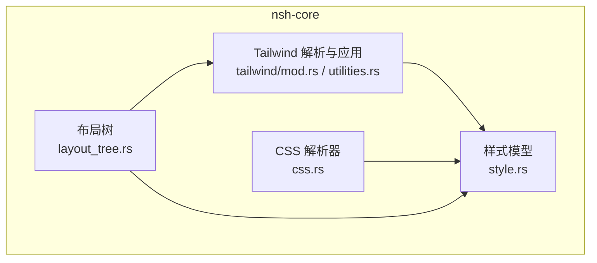
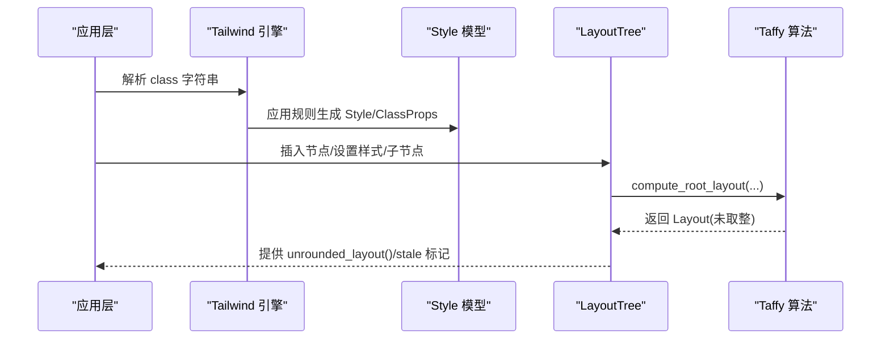
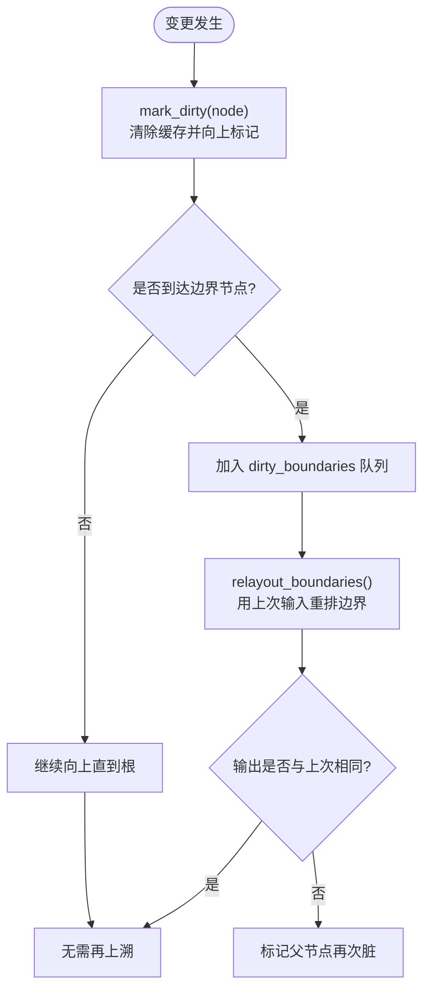
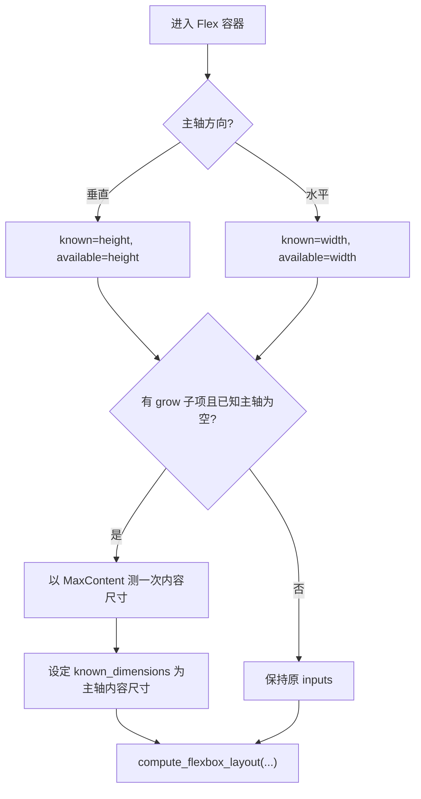
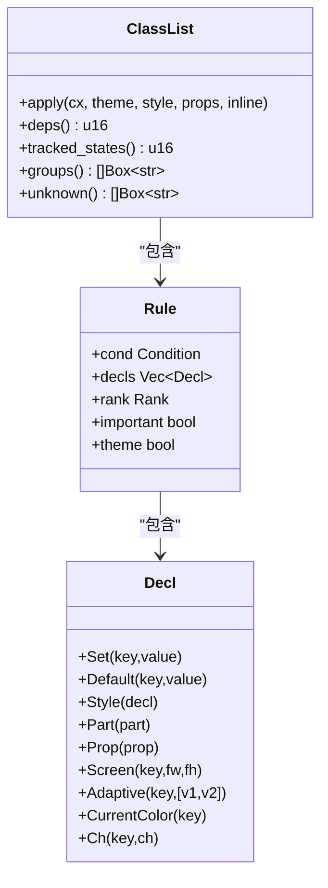
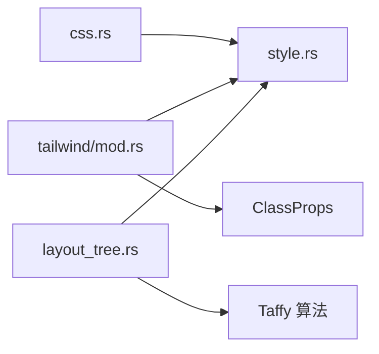

# 布局引擎

<cite>
**本文引用的文件**   
- [layout_tree.rs](file://crates/nsh-core/src/core/layout_tree.rs)
- [style.rs](file://crates/nsh-core/src/style.rs)
- [css.rs](file://crates/nsh-core/src/css.rs)
- [tailwind/mod.rs](file://crates/nsh-core/src/tailwind/mod.rs)
- [tailwind/utilities.rs](file://crates/nsh-core/src/tailwind/utilities.rs)
</cite>

## 目录
1. [简介](#简介)
2. [项目结构](#项目结构)
3. [核心组件](#核心组件)
4. [架构总览](#架构总览)
5. [详细组件分析](#详细组件分析)
6. [依赖关系分析](#依赖关系分析)
7. [性能考量](#性能考量)
8. [故障排查指南](#故障排查指南)
9. [结论](#结论)
10. [附录](#附录)

## 简介
本技术文档聚焦 NSH 框架的布局引擎，围绕基于 Taffy 的 Flexbox 与 Grid 布局系统展开，详细说明主轴/交叉轴计算、CSS 样式解析与 Tailwind 支持、布局约束（固定尺寸、弹性伸缩、百分比）处理、多行文本换行/对齐/溢出策略、响应式布局（媒体查询、断点、动态适配），以及性能优化实践与调试方法。目标是帮助读者从架构到实现细节全面理解 NSH 的布局子系统。

## 项目结构
NSH 的布局相关代码主要位于 nsh-core 中：
- 布局树与算法调度：core/layout_tree.rs
- 样式模型与视觉属性：style.rs
- CSS 值语法与颜色/渐变等解析：css.rs
- Tailwind 类名解析与应用：tailwind/mod.rs、tailwind/utilities.rs

图表来源
- [layout_tree.rs:1-51](file://crates/nsh-core/src/core/layout_tree.rs#L1-L51)
- [style.rs:1-23](file://crates/nsh-core/src/style.rs#L1-L23)
- [css.rs:1-8](file://crates/nsh-core/src/css.rs#L1-L8)
- [tailwind/mod.rs:1-23](file://crates/nsh-core/src/tailwind/mod.rs#L1-L23)

章节来源
- [layout_tree.rs:1-51](file://crates/nsh-core/src/core/layout_tree.rs#L1-L51)
- [style.rs:1-23](file://crates/nsh-core/src/style.rs#L1-L23)
- [css.rs:1-8](file://crates/nsh-core/src/css.rs#L1-L8)
- [tailwind/mod.rs:1-23](file://crates/nsh-core/src/tailwind/mod.rs#L1-L23)

## 核心组件
- 布局树 LayoutTree：封装 Taffy 的布局算法（Flex/Grid/Block/OOF），提供脏标记、边界重排、缓存、未取整布局输出等能力。
- 样式模型 Style：定义颜色、边框、圆角、变换、阴影、渐变、文本属性等，供渲染与布局使用。
- CSS 解析器 css：解析长度、角度、颜色、flex 简写、阴影、渐变等通用值。
- Tailwind 引擎 tailwind：将 class 字符串解析为规则并应用到 Style 与 ClassProps，支持变体、断点、状态、主题色等。

章节来源
- [layout_tree.rs:55-153](file://crates/nsh-core/src/core/layout_tree.rs#L55-L153)
- [style.rs:25-111](file://crates/nsh-core/src/style.rs#L25-L111)
- [css.rs:1-115](file://crates/nsh-core/src/css.rs#L1-L115)
- [tailwind/mod.rs:1-23](file://crates/nsh-core/src/tailwind/mod.rs#L1-L23)

## 架构总览
NSH 的布局管线由“样式解析 → Tailwind 应用 → 布局树构建 → Taffy 算法执行 → 结果回写”组成。Tailwind 与 CSS 解析产物最终落到 Style；LayoutTree 通过 View 适配器桥接 Taffy 的容器与叶子测量回调，完成 Flex/Grid/Block 布局并记录未取整布局。

图表来源
- [tailwind/mod.rs:705-800](file://crates/nsh-core/src/tailwind/mod.rs#L705-L800)
- [layout_tree.rs:723-739](file://crates/nsh-core/src/core/layout_tree.rs#L723-L739)
- [layout_tree.rs:845-924](file://crates/nsh-core/src/core/layout_tree.rs#L845-L924)

## 详细组件分析

### 布局树与 Taffy 集成（Flex/Grid/Block/OOF）
- 脏标记与边界重排：变更向上标记至根，遇到“边界节点”则入队单独重排，避免全树重算。
- 无提升子节点：不保留 Taffy 的提升绝对定位节点集合，核心自行取整，避免陈旧数据。
- 未取整布局：unrounded_layout 直接返回算法计算结果，便于上层精确控制。
- 叶子测量缓存：记录叶子对多次测量输入的响应，若一致则跳过父级重排。
- 持有者透传：无样式的“持有者”节点可被透传，使内部 JSX 节点在父容器中参与 flex/grid 布局。

图表来源
- [layout_tree.rs:457-477](file://crates/nsh-core/src/core/layout_tree.rs#L457-L477)
- [layout_tree.rs:621-660](file://crates/nsh-core/src/core/layout_tree.rs#L621-L660)

章节来源
- [layout_tree.rs:1-40](file://crates/nsh-core/src/core/layout_tree.rs#L1-L40)
- [layout_tree.rs:457-500](file://crates/nsh-core/src/core/layout_tree.rs#L457-L500)
- [layout_tree.rs:621-739](file://crates/nsh-core/src/core/layout_tree.rs#L621-L739)

### Flexbox 主轴/交叉轴计算与 shrink-to-fit
- 主轴方向：根据 flex-direction 决定垂直或水平主轴。
- 确定空间下的主轴尺寸修正：当存在 grow 子项且主轴可用空间确定时，先以 MaxContent 计算内容宽度/高度，再与可用空间比较，确保 flex:1 的子项不被忽略。
- 委托 Taffy：最终调用 compute_flexbox_layout 完成排列。

图表来源
- [layout_tree.rs:742-814](file://crates/nsh-core/src/core/layout_tree.rs#L742-L814)

章节来源
- [layout_tree.rs:742-814](file://crates/nsh-core/src/core/layout_tree.rs#L742-L814)

### Grid 布局与详细信息
- Grid 容器：通过 LayoutGridContainer 接口暴露容器/子项样式，并将 DetailedGridInfo 写入节点以便调试。
- 终端网格：在终端模式下，布局走 terminal_layout 分支，按 Cell 网格进行布局与裁剪。

章节来源
- [layout_tree.rs:1200-1224](file://crates/nsh-core/src/core/layout_tree.rs#L1200-L1224)
- [layout_tree.rs:895-901](file://crates/nsh-core/src/core/layout_tree.rs#L895-L901)

### 样式模型与视觉属性
- 颜色与字体：Color 支持多种格式解析；FontFamily 列表与通用族映射。
- 边框与圆角：Borders、CornerRadii 及其 fit/inset 等几何运算。
- 视图样式 ViewStyle：背景、透明度、裁剪、变换、阴影、渐变、混合模式、过渡/动画等。

章节来源
- [style.rs:25-111](file://crates/nsh-core/src/style.rs#L25-L111)
- [style.rs:486-619](file://crates/nsh-core/src/style.rs#L486-L619)
- [style.rs:704-763](file://crates/nsh-core/src/style.rs#L704-L763)

### CSS 值解析与 Tailwind 支持
- CSS 值：长度（px/pt/rem）、角度、数字/百分比、flex 简写、颜色（hex/rgb/hsl/oklch/oklab/color-mix）、阴影、渐变等。
- Tailwind 引擎：
  - 类串解析为 Rule 列表，带条件（dark/breakpoint/platform/state/group/data/position 等）。
  - 应用顺序：默认样式 → 普通工具 → 变体工具 → 内联 style（! 工具覆盖内联）。
  - 主题色：Tailwind v4 主题（OKLCH→sRGB）+ nsh.json 扩展，编译进包并在启动时注入。
  - 当前色 currentColor：支持继承与占位符/选区等特殊伪元素颜色。

图表来源
- [tailwind/mod.rs:659-700](file://crates/nsh-core/src/tailwind/mod.rs#L659-L700)
- [tailwind/mod.rs:363-559](file://crates/nsh-core/src/tailwind/mod.rs#L363-L559)
- [tailwind/utilities.rs:153-186](file://crates/nsh-core/src/tailwind/utilities.rs#L153-L186)

章节来源
- [css.rs:1-115](file://crates/nsh-core/src/css.rs#L1-L115)
- [css.rs:117-155](file://crates/nsh-core/src/css.rs#L117-L155)
- [css.rs:199-551](file://crates/nsh-core/src/css.rs#L199-L551)
- [tailwind/mod.rs:1-23](file://crates/nsh-core/src/tailwind/mod.rs#L1-L23)
- [tailwind/mod.rs:233-361](file://crates/nsh-core/src/tailwind/mod.rs#L233-L361)
- [tailwind/mod.rs:705-800](file://crates/nsh-core/src/tailwind/mod.rs#L705-L800)
- [tailwind/utilities.rs:1-23](file://crates/nsh-core/src/tailwind/utilities.rs#L1-L23)

### 布局约束处理（固定尺寸、弹性伸缩、百分比）
- 固定尺寸：size.width/height 为固定点值时，结合 flex-shrink=0、flex-basis=auto、非基线对齐等条件，可将节点视为“边界”，避免子内容变化影响父布局。
- 百分比尺寸：percentage 相对父定长尺寸，满足 sized_by_style 条件时可认为尺寸由样式决定，从而跳过内容测量导致的父级重排。
- 弹性伸缩：grow/shrink 因子与 basis 共同决定分配自由空间与收缩行为，Flex 容器在确定空间下会修正主轴尺寸以避免 flex:1 失效。

章节来源
- [layout_tree.rs:512-587](file://crates/nsh-core/src/core/layout_tree.rs#L512-L587)
- [layout_tree.rs:742-814](file://crates/nsh-core/src/core/layout_tree.rs#L742-L814)

### 多行文本布局（换行、对齐、溢出）
- 换行控制：ClassProps.no_wrap 与 pretty 控制是否换行与“最后一行单词合并”。
- 对齐：Aligned 枚举区分 baseline 与 edges 对齐，仅在需要时计算基线。
- 溢出：EllipsizeMode 支持尾/头/中省略与裁剪；textOverflow 与 numberOfLines 由 ClassProps 驱动。

章节来源
- [tailwind/mod.rs:561-594](file://crates/nsh-core/src/tailwind/mod.rs#L561-L594)
- [layout_tree.rs:824-833](file://crates/nsh-core/src/core/layout_tree.rs#L824-L833)

### 响应式布局（媒体查询、断点、动态适配）
- 断点与环境：Condition 支持 min-width/max-width、landscape/portrait、platform、pointer、terminal、RTL、reduce-motion 等。
- 窗口尺寸：Context.window 传入窗口宽高，用于 w-screen/h-screen 及断点判断。
- 依赖追踪：deps 位图指示哪些环境变化需重新解析类串，避免不必要重算。

章节来源
- [tailwind/mod.rs:114-147](file://crates/nsh-core/src/tailwind/mod.rs#L114-L147)
- [tailwind/mod.rs:233-361](file://crates/nsh-core/src/tailwind/mod.rs#L233-L361)
- [tailwind/mod.rs:203-219](file://crates/nsh-core/src/tailwind/mod.rs#L203-L219)

## 依赖关系分析
- LayoutTree 依赖 Taffy 的算法与类型，并通过 View 适配器实现各布局容器接口。
- Tailwind 引擎产出 Style/ClassProps，供 LayoutTree 使用。
- CSS 解析器为 Tailwind 与 Style 提供基础值解析能力。

图表来源
- [css.rs:1-8](file://crates/nsh-core/src/css.rs#L1-L8)
- [tailwind/mod.rs:1-23](file://crates/nsh-core/src/tailwind/mod.rs#L1-L23)
- [layout_tree.rs:44-51](file://crates/nsh-core/src/core/layout_tree.rs#L44-L51)

章节来源
- [layout_tree.rs:44-51](file://crates/nsh-core/src/core/layout_tree.rs#L44-L51)
- [tailwind/mod.rs:1-23](file://crates/nsh-core/src/tailwind/mod.rs#L1-L23)
- [css.rs:1-8](file://crates/nsh-core/src/css.rs#L1-L8)

## 性能考量
- 脏标记与边界重排：仅对受影响的边界节点重排，减少不必要的父级计算。
- 叶子测量缓存：记录叶子对多次测量输入的响应，若一致则跳过父级重排。
- 样式共享：最近使用的 Style 对象通过 Rc 共享，降低内存与比较开销。
- 避免抖动：通过 is_boundary/sized_by_style/measures_as_before 等机制，稳定布局结果，减少重排重绘。
- 虚拟滚动建议：对超长列表采用分页/虚拟化加载，配合终端网格与 list_bar_room 计算滚动条占用空间。

章节来源
- [layout_tree.rs:457-500](file://crates/nsh-core/src/core/layout_tree.rs#L457-L500)
- [layout_tree.rs:589-607](file://crates/nsh-core/src/core/layout_tree.rs#L589-L607)
- [layout_tree.rs:173-187](file://crates/nsh-core/src/core/layout_tree.rs#L173-L187)
- [layout_tree.rs:235-250](file://crates/nsh-core/src/core/layout_tree.rs#L235-L250)

## 故障排查指南
- 检查 display:none 与终端 left_out：displays_none 会跳过布局，确认节点是否被隐藏或终端裁剪。
- 验证边界判定：is_boundary 条件（绝对定位+固定尺寸、或 Flex 容器中的固定尺寸+不收缩+非基线对齐）是否符合预期。
- 查看未取整布局：unrounded_layout 可直接获取算法输出，辅助定位位置/尺寸偏差。
- Tailwind 规则命中：通过 deps/tracked_states/unknown 检查类串依赖与未知类，确认断点/状态/平台条件是否匹配。
- 颜色与渐变：color-mix/gradient 解析失败会导致样式缺失，检查 color/gradient 函数返回值。

章节来源
- [layout_tree.rs:292-298](file://crates/nsh-core/src/core/layout_tree.rs#L292-L298)
- [layout_tree.rs:512-587](file://crates/nsh-core/src/core/layout_tree.rs#L512-L587)
- [layout_tree.rs:615-619](file://crates/nsh-core/src/core/layout_tree.rs#L615-L619)
- [tailwind/mod.rs:691-699](file://crates/nsh-core/src/tailwind/mod.rs#L691-L699)
- [css.rs:386-551](file://crates/nsh-core/src/css.rs#L386-L551)

## 结论
NSH 的布局引擎以 Taffy 为核心，通过 LayoutTree 提供高性能的脏标记、边界重排与测量缓存，并结合 Tailwind 引擎实现声明式样式与响应式布局。CSS 解析器提供丰富的值类型支持，Style 模型统一承载视觉与布局信息。整体设计在保证兼容性的同时，兼顾了性能与可扩展性。

## 附录
- 常用 API 路径参考：
  - 布局树操作：[layout_tree.rs:189-212](file://crates/nsh-core/src/core/layout_tree.rs#L189-L212)、[layout_tree.rs:436-455](file://crates/nsh-core/src/core/layout_tree.rs#L436-L455)
  - 样式应用：[tailwind/mod.rs:705-800](file://crates/nsh-core/src/tailwind/mod.rs#L705-L800)
  - CSS 值解析：[css.rs:62-115](file://crates/nsh-core/src/css.rs#L62-L115)、[css.rs:199-551](file://crates/nsh-core/src/css.rs#L199-L551)