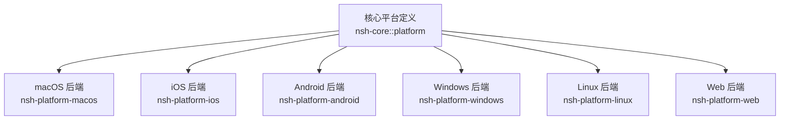
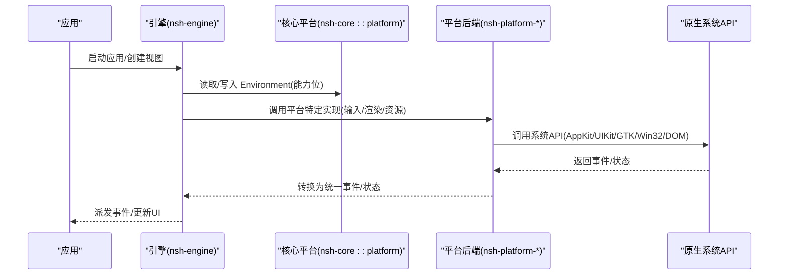
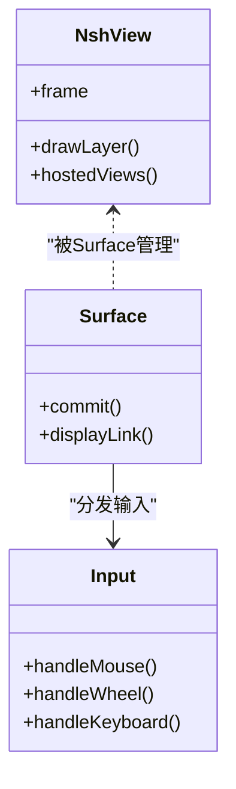
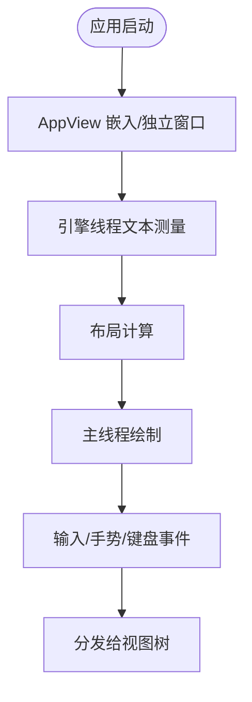
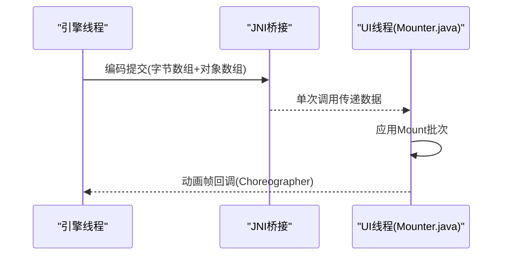
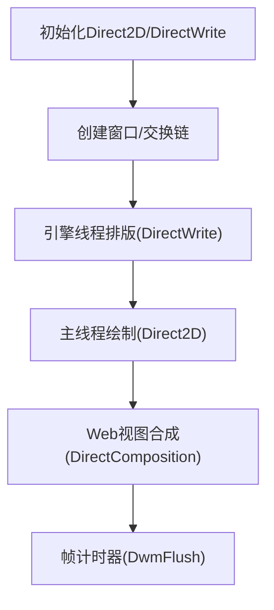
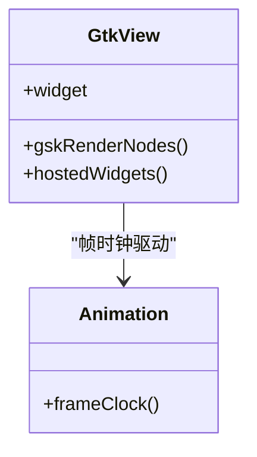
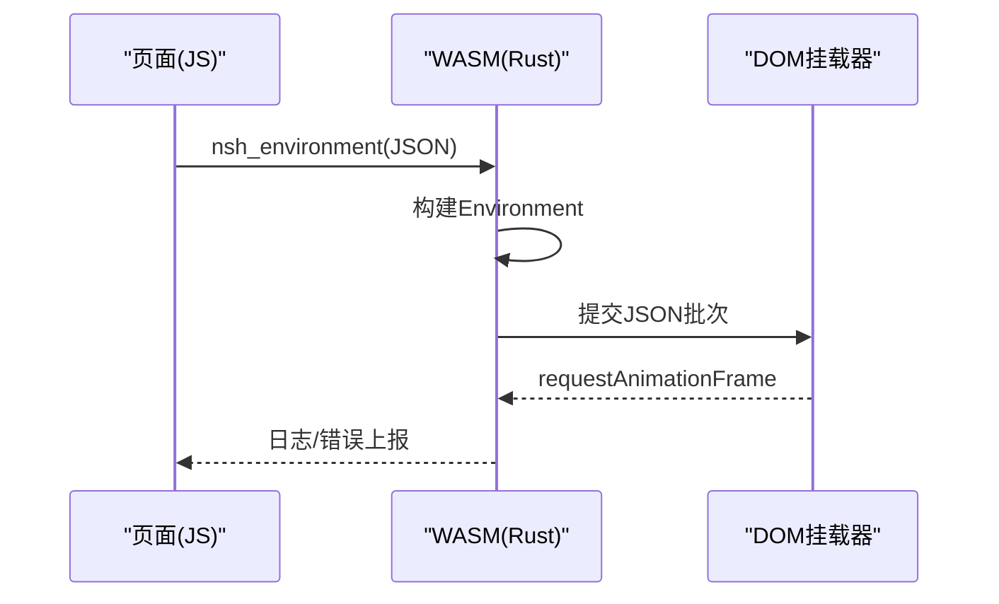
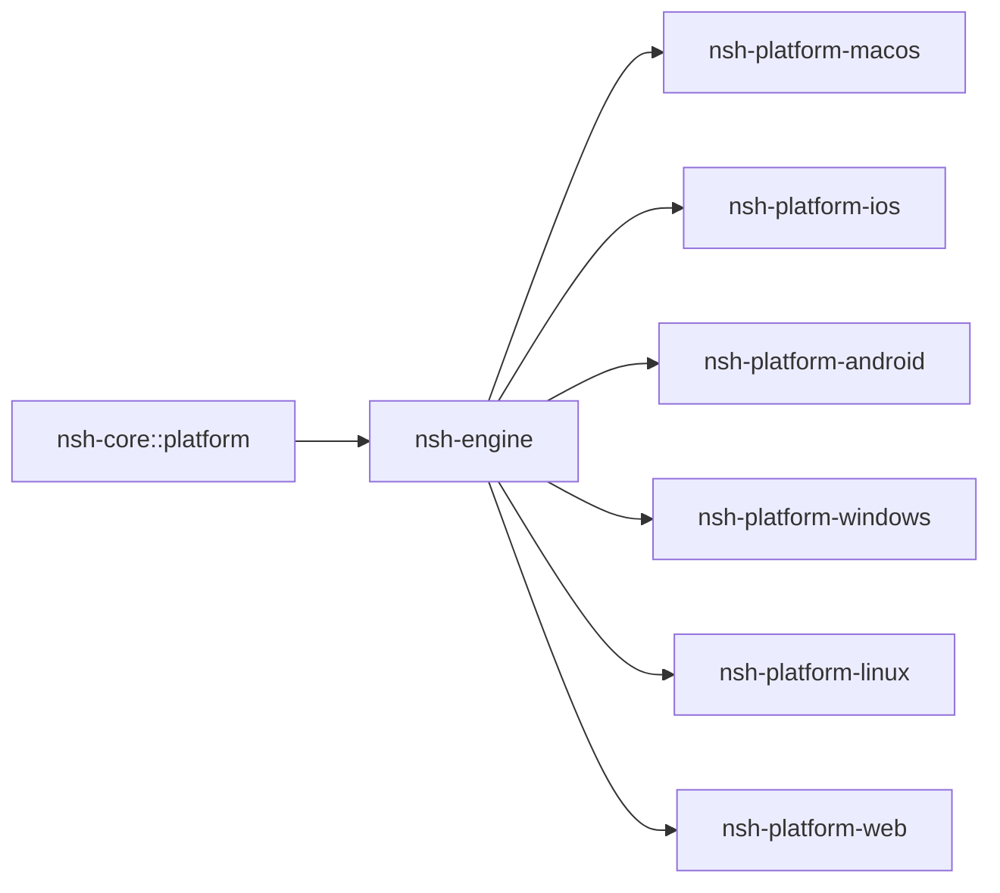

# 平台抽象层

<cite>
**本文引用的文件**   
- [crates/nsh-core/src/platform.rs](file://crates/nsh-core/src/platform.rs)
- [crates/nsh-platform-macos/src/lib.rs](file://crates/nsh-platform-macos/src/lib.rs)
- [crates/nsh-platform-ios/src/lib.rs](file://crates/nsh-platform-ios/src/lib.rs)
- [crates/nsh-platform-android/src/lib.rs](file://crates/nsh-platform-android/src/lib.rs)
- [crates/nsh-platform-windows/src/lib.rs](file://crates/nsh-platform-windows/src/lib.rs)
- [crates/nsh-platform-linux/src/lib.rs](file://crates/nsh-platform-linux/src/lib.rs)
- [crates/nsh-platform-web/src/lib.rs](file://crates/nsh-platform-web/src/lib.rs)
</cite>

## 目录
1. [简介](#简介)
2. [项目结构](#项目结构)
3. [核心组件](#核心组件)
4. [架构总览](#架构总览)
5. [详细组件分析](#详细组件分析)
6. [依赖关系分析](#依赖关系分析)
7. [性能考量](#性能考量)
8. [故障排查指南](#故障排查指南)
9. [结论](#结论)
10. [附录](#附录)

## 简介
本文件为 NSH 框架的“平台抽象层”提供系统化、可操作的架构文档。目标包括：
- 解释跨平台抽象的设计理念：统一 API 与平台特定实现的分离机制。
- 说明各平台（macOS、iOS、Android、Windows、Linux、Web）适配层的职责与实现要点，包括原生 UI 系统封装与能力映射。
- 阐述平台能力发现机制：功能检测、降级策略与兼容性处理。
- 说明平台特定的资源管理：字体、图标、音频与视频的处理方式。
- 解释平台事件系统的统一抽象：输入事件、窗口事件与系统通知。
- 提供添加新平台支持的开发指南：必要接口与测试要求。
- 给出平台差异对比表与迁移建议。

## 项目结构
NSH 的平台抽象层由“核心定义 + 多平台后端”组成：
- 核心层（nsh-core）：定义统一的平台环境、能力标志、类型与常量，供上层应用与引擎使用。
- 平台后端（nsh-platform-*）：针对 macOS/iOS/Android/Windows/Linux/Web 的具体实现，将核心能力映射到各自的原生系统。

图表来源
- [crates/nsh-core/src/platform.rs:1-120](file://crates/nsh-core/src/platform.rs#L1-L120)
- [crates/nsh-platform-macos/src/lib.rs:1-22](file://crates/nsh-platform-macos/src/lib.rs#L1-L22)
- [crates/nsh-platform-ios/src/lib.rs:1-37](file://crates/nsh-platform-ios/src/lib.rs#L1-L37)
- [crates/nsh-platform-android/src/lib.rs:1-16](file://crates/nsh-platform-android/src/lib.rs#L1-L16)
- [crates/nsh-platform-windows/src/lib.rs:1-21](file://crates/nsh-platform-windows/src/lib.rs#L1-L21)
- [crates/nsh-platform-linux/src/lib.rs:1-14](file://crates/nsh-platform-linux/src/lib.rs#L1-L14)
- [crates/nsh-platform-web/src/lib.rs:1-27](file://crates/nsh-platform-web/src/lib.rs#L1-L27)

章节来源
- [crates/nsh-core/src/platform.rs:1-120](file://crates/nsh-core/src/platform.rs#L1-L120)
- [crates/nsh-platform-macos/src/lib.rs:1-22](file://crates/nsh-platform-macos/src/lib.rs#L1-L22)
- [crates/nsh-platform-ios/src/lib.rs:1-37](file://crates/nsh-platform-ios/src/lib.rs#L1-L37)
- [crates/nsh-platform-android/src/lib.rs:1-16](file://crates/nsh-platform-android/src/lib.rs#L1-L16)
- [crates/nsh-platform-windows/src/lib.rs:1-21](file://crates/nsh-platform-windows/src/lib.rs#L1-L21)
- [crates/nsh-platform-linux/src/lib.rs:1-14](file://crates/nsh-platform-linux/src/lib.rs#L1-L14)
- [crates/nsh-platform-web/src/lib.rs:1-27](file://crates/nsh-platform-web/src/lib.rs#L1-L27)

## 核心组件
本节聚焦核心平台抽象的关键概念与数据结构，它们是各平台后端的契约基础。

- 操作系统与设备形态
  - Os：ios/android/macos/windows/linux/web；提供 is_desktop、is_catalyst、name 等判断。
  - Idiom：phone/pad/mac/tv/desktop/terminal；提供 desktop_on、reported_on 以统一桌面行为判定。
- 外观与交互
  - ColorScheme/Appearance：浅色/深色/跟随系统。
  - InputModality：Keyboard/Pointer，用于焦点可见性提示。
- 环境与能力
  - Environment：聚合窗口尺寸、安全区域、键盘高度、像素比、语言、网络状态、特性开关（如 canvas_render、share、notifications、audio、web_views、shaders 等）。
  - Network/NetworkKind/CellularData：网络连通性、昂贵/受限连接、蜂窝数据权限。
  - SizeClass：compact/regular，基于宽度或原生 size class。
- 宿主与环境覆盖
  - HostEnvironment：宿主可覆盖 locale/font_scale，影响 Intl、locale()、fontScale() 等行为。
- 平台名称与报告
  - Environment.platform_name()：对外暴露平台名；自定义平台可设置 platform 字段并上报 os。

这些类型共同构成“统一 API 接口”，平台后端通过填充 Environment 的能力位来声明自身支持的特性，从而让上层代码进行条件分支与降级。

章节来源
- [crates/nsh-core/src/platform.rs:54-147](file://crates/nsh-core/src/platform.rs#L54-L147)
- [crates/nsh-core/src/platform.rs:161-210](file://crates/nsh-core/src/platform.rs#L161-L210)
- [crates/nsh-core/src/platform.rs:239-386](file://crates/nsh-core/src/platform.rs#L239-L386)
- [crates/nsh-core/src/platform.rs:388-415](file://crates/nsh-core/src/platform.rs#L388-L415)
- [crates/nsh-core/src/platform.rs:417-661](file://crates/nsh-core/src/platform.rs#L417-L661)
- [crates/nsh-core/src/platform.rs:716-742](file://crates/nsh-core/src/platform.rs#L716-L742)
- [crates/nsh-core/src/platform.rs:635-661](file://crates/nsh-core/src/platform.rs#L635-L661)

## 架构总览
NSH 采用“核心定义 + 多后端实现”的分层架构：
- 核心层（nsh-core）：定义平台能力模型、枚举与常量，不依赖具体 OS。
- 引擎层（nsh-engine）：驱动渲染、布局、JS 运行时、生命周期等，通过 Environment 与后端交互。
- 平台后端（nsh-platform-*）：将核心能力映射到 AppKit/UIKit/GTK/Win32/DOM/WASM 等平台 API。

图表来源
- [crates/nsh-core/src/platform.rs:417-661](file://crates/nsh-core/src/platform.rs#L417-L661)
- [crates/nsh-platform-macos/src/lib.rs:1-22](file://crates/nsh-platform-macos/src/lib.rs#L1-L22)
- [crates/nsh-platform-ios/src/lib.rs:1-37](file://crates/nsh-platform-ios/src/lib.rs#L1-L37)
- [crates/nsh-platform-android/src/lib.rs:1-16](file://crates/nsh-platform-android/src/lib.rs#L1-L16)
- [crates/nsh-platform-windows/src/lib.rs:1-21](file://crates/nsh-platform-windows/src/lib.rs#L1-L21)
- [crates/nsh-platform-linux/src/lib.rs:1-14](file://crates/nsh-platform-linux/src/lib.rs#L1-L14)
- [crates/nsh-platform-web/src/lib.rs:1-27](file://crates/nsh-platform-web/src/lib.rs#L1-L27)

## 详细组件分析

### macOS 后端（AppKit/CoreText）
- 视图与渲染：每个节点是 NSView 子类，背景/边框/阴影/图像由 Core Animation 绘制；文本与画布绘制进入独立内容层。
- 线程模型：引擎在独立线程运行，每次提交在主队列执行一次；文本在引擎线程排版，主线程仅绘制。
- 动画与输入：原生动画在显示链接上运行；桌面输入由根视图接管鼠标/滚轮/触控板/键盘，滚动视图维护偏移。
- 能力映射：通过 Environment 的布尔位（如 web_views、shaders、notifications 等）声明能力。

图表来源
- [crates/nsh-platform-macos/src/lib.rs:1-22](file://crates/nsh-platform-macos/src/lib.rs#L1-L22)

章节来源
- [crates/nsh-platform-macos/src/lib.rs:1-22](file://crates/nsh-platform-macos/src/lib.rs#L1-L22)

### iOS 后端（UIKit）
- 视图与嵌入：AppView 可在任意 UIKit 层级中嵌入；run_app 可创建独立窗口；Surface 为底层主机。
- 文本与测量：在引擎线程使用与标签相同的 attributed strings 测量，保证布局与渲染一致。
- 硬件键盘：focusable 视图成为 first responder/UIFocusItem；按键事件按 UIKit 语义转换；Tab/Shift+Tab 遍历；快捷键优先级高于默认行为。
- 能力映射：通过 Environment 的布尔位声明能力（如 share、auth_session、tab_bar 等）。

图表来源
- [crates/nsh-platform-ios/src/lib.rs:1-37](file://crates/nsh-platform-ios/src/lib.rs#L1-L37)

章节来源
- [crates/nsh-platform-ios/src/lib.rs:1-37](file://crates/nsh-platform-ios/src/lib.rs#L1-L37)

### Android 后端（JNI + Java/Kotlin）
- 线程与提交：引擎线程运行 JS 与布局；文本通过 StaticLayout（JNI）排版；每次提交编码为字节数组，单 JNI 调用交给 UI 线程 Mounter 应用。
- 原生动画：在 UI 线程通过 Choreographer 驱动 Rust 侧动画图，变更值以紧凑数组回传。
- 选择模型：可编辑文本的选择状态在 UI 线程使用 nsh-core 模型同步。
- 能力映射：通过 Environment 的布尔位声明能力（如 notifications、permissions、picker 等）。

图表来源
- [crates/nsh-platform-android/src/lib.rs:1-16](file://crates/nsh-platform-android/src/lib.rs#L1-L16)

章节来源
- [crates/nsh-platform-android/src/lib.rs:1-16](file://crates/nsh-platform-android/src/lib.rs#L1-L16)

### Windows 后端（Win32/Direct2D/DirectWrite）
- 视图与渲染：每个节点是保留式视图；窗口整体用 Direct2D 绘制到交换链；Web 视图通过 DirectComposition 合成。
- 线程与消息：引擎独立线程；每次提交投递窗口消息；文本由 DirectWrite 在引擎线程排版，主线程绘制。
- 动画与帧：原生动画与 JS 帧请求由 DwmFlush 驱动的帧计时器调度。
- 能力映射：通过 Environment 的布尔位声明能力（如 audio、notifications、web_views、shaders 等）。

图表来源
- [crates/nsh-platform-windows/src/lib.rs:1-21](file://crates/nsh-platform-windows/src/lib.rs#L1-L21)

章节来源
- [crates/nsh-platform-windows/src/lib.rs:1-21](file://crates/nsh-platform-windows/src/lib.rs#L1-L21)

### Linux 后端（GTK4/Pango）
- 视图与渲染：每个节点是 GTK Widget 子类；背景/边框/阴影/文本字形/图像由 GSK 渲染节点绘制；文本字段/Web 视图/视频作为 GTK 控件托管。
- 线程与动画：引擎独立线程；提交进入 GTK 主循环；原生动画在根视图帧时钟上运行。
- 能力映射：通过 Environment 的布尔位声明能力（如 sound、notifications、web_views、shaders 等）。

图表来源
- [crates/nsh-platform-linux/src/lib.rs:1-14](file://crates/nsh-platform-linux/src/lib.rs#L1-L14)

章节来源
- [crates/nsh-platform-linux/src/lib.rs:1-14](file://crates/nsh-platform-linux/src/lib.rs#L1-L14)

### Web 后端（WASM/DOM）
- 运行环境：TSX 在浏览器 JS 引擎运行；Rust 引擎在页面主线程；每次提交转为 JSON 批次，由 DOM mounter 应用绝对定位元素与 CSS。
- 文本与动画：文本使用浏览器字体度量绘制；原生动画在 requestAnimationFrame 上运行。
- 网络与存储：fetch 走浏览器 fetch；storage 走 LocalStorage；文件系统走浏览器 FS。
- 能力映射：通过 Environment 的布尔位声明能力（如 canvas_render、share、notifications、audio、shaders 等），并由页面 JSON 注入 idiom/locale/network 等。

图表来源
- [crates/nsh-platform-web/src/lib.rs:1-27](file://crates/nsh-platform-web/src/lib.rs#L1-L27)
- [crates/nsh-platform-web/src/lib.rs:478-655](file://crates/nsh-platform-web/src/lib.rs#L478-L655)

章节来源
- [crates/nsh-platform-web/src/lib.rs:1-27](file://crates/nsh-platform-web/src/lib.rs#L1-L27)
- [crates/nsh-platform-web/src/lib.rs:478-655](file://crates/nsh-platform-web/src/lib.rs#L478-L655)

## 依赖关系分析
- 耦合与内聚
  - 核心层（nsh-core::platform）保持低耦合，仅提供类型与能力位；平台后端高内聚地实现具体能力。
  - 平台后端依赖各自原生 SDK（AppKit/UIKit/GTK/Win32/DOM），并通过 Environment 向引擎暴露能力。
- 直接/间接依赖
  - 引擎依赖核心平台定义；平台后端依赖引擎提供的 App/Root/Limits 等。
- 外部依赖与集成点
  - macOS：AppKit/CoreAnimation/CoreText。
  - iOS：UIKit/Focus/Presses。
  - Android：JNI/StaticLayout/Choreographer/Mounter.java。
  - Windows：Win32/Direct2D/DirectWrite/DirectComposition/DwmFlush。
  - Linux：GTK4/Pango/GSK。
  - Web：浏览器 Fetch/WebSocket/LocalStorage/DOM。

图表来源
- [crates/nsh-core/src/platform.rs:417-661](file://crates/nsh-core/src/platform.rs#L417-L661)
- [crates/nsh-platform-macos/src/lib.rs:1-22](file://crates/nsh-platform-macos/src/lib.rs#L1-L22)
- [crates/nsh-platform-ios/src/lib.rs:1-37](file://crates/nsh-platform-ios/src/lib.rs#L1-L37)
- [crates/nsh-platform-android/src/lib.rs:1-16](file://crates/nsh-platform-android/src/lib.rs#L1-L16)
- [crates/nsh-platform-windows/src/lib.rs:1-21](file://crates/nsh-platform-windows/src/lib.rs#L1-L21)
- [crates/nsh-platform-linux/src/lib.rs:1-14](file://crates/nsh-platform-linux/src/lib.rs#L1-L14)
- [crates/nsh-platform-web/src/lib.rs:1-27](file://crates/nsh-platform-web/src/lib.rs#L1-L27)

章节来源
- [crates/nsh-core/src/platform.rs:417-661](file://crates/nsh-core/src/platform.rs#L417-L661)
- [crates/nsh-platform-macos/src/lib.rs:1-22](file://crates/nsh-platform-macos/src/lib.rs#L1-L22)
- [crates/nsh-platform-ios/src/lib.rs:1-37](file://crates/nsh-platform-ios/src/lib.rs#L1-L37)
- [crates/nsh-platform-android/src/lib.rs:1-16](file://crates/nsh-platform-android/src/lib.rs#L1-L16)
- [crates/nsh-platform-windows/src/lib.rs:1-21](file://crates/nsh-platform-windows/src/lib.rs#L1-L21)
- [crates/nsh-platform-linux/src/lib.rs:1-14](file://crates/nsh-platform-linux/src/lib.rs#L1-L14)
- [crates/nsh-platform-web/src/lib.rs:1-27](file://crates/nsh-platform-web/src/lib.rs#L1-L27)

## 性能考量
- 线程模型
  - 桌面与移动端后端普遍采用“引擎线程 + 主线程”的双线程模型：引擎线程负责布局与排版，主线程负责绘制与事件分发，降低阻塞风险。
- 文本排版
  - macOS/iOS：CoreText/attributed strings 在引擎线程排版，主线程仅绘制。
  - Windows：DirectWrite 在引擎线程排版。
  - Linux：Pango 在引擎线程排版。
  - Web：浏览器字体度量在 WASM 侧完成，避免频繁跨边界。
- 动画与帧率
  - macOS：显示链接驱动。
  - Windows：DwmFlush 驱动帧计时。
  - Android：Choreographer 驱动。
  - Web：requestAnimationFrame。
- 资源加载
  - Web：assets 通过页面预加载或按需下载；缓存由浏览器 HTTP 缓存承担。
  - 桌面/移动：平台后端通过 Assets 接口提供资源访问，减少重复 IO。

[本节为通用指导，不涉及具体文件分析]

## 故障排查指南
- 能力不可用
  - 现象：调用某平台能力立即失败（如 ERR_FEATURE_UNAVAILABLE_ON_PLATFORM）。
  - 原因：Environment 对应能力位未开启（如 canvas_render、share、notifications、audio、web_views、shaders）。
  - 处理：检查平台后端是否正确设置 Environment 能力位；对不支持的平台提供降级逻辑。
- 网络状态异常
  - 现象：network().online 为 false 或 kind 为 unknown。
  - 原因：平台未提供网络监控或尚未响应。
  - 处理：在 unknown 时允许尝试请求并根据结果学习；在 none 时提示离线。
- 剪贴板写结果缺失
  - 现象：无法获知剪贴板写入是否成功。
  - 原因：clipboard_write_result 为 false。
  - 处理：在不可用时返回 Requested 状态，并在 UI 上提示用户重试。
- WebView 不可用
  - 现象：WebView 报错 unavailable。
  - 原因：web_views=false 或 webview_requests=false。
  - 处理：在不可用时切换到替代方案（如打开系统浏览器）。
- 着色器不可用
  - 现象：Shader 相关视图不可用。
  - 原因：shaders=false（无 GPU 或平台未启用）。
  - 处理：降级为静态效果或关闭动画。

章节来源
- [crates/nsh-core/src/platform.rs:520-619](file://crates/nsh-core/src/platform.rs#L520-L619)
- [crates/nsh-platform-web/src/lib.rs:478-655](file://crates/nsh-platform-web/src/lib.rs#L478-L655)

## 结论
NSH 的平台抽象层通过核心层定义统一的能力模型与类型，由各平台后端将能力映射到原生系统，从而实现一致的 API 体验与灵活的降级策略。开发者应优先使用 Environment 的能力位进行条件分支，确保在不同平台上的稳定表现。新增平台时，需严格遵循核心契约，完善能力位与事件映射，并提供充分的测试覆盖。

[本节为总结性内容，不涉及具体文件分析]

## 附录

### 平台能力发现与降级策略
- 能力发现
  - 通过 Environment 的布尔位（如 canvas_render、share、notifications、audio、web_views、shaders、clipboard_images、scheme_links 等）声明平台支持。
  - Web 后端通过页面 JSON 注入 idiom/locale/network 等环境信息，并据此构造 Environment。
- 降级策略
  - 对于不可用的能力，上层应提供降级路径（如禁用特效、切换至系统分享、使用浏览器登录等）。
  - 对未知网络状态，允许尝试请求并根据结果学习。
- 兼容性处理
  - 使用 Idiom.desktop_on/os.is_desktop 统一桌面行为判定。
  - 使用 Appearance.resolve(ColorScheme) 统一明暗主题。

章节来源
- [crates/nsh-core/src/platform.rs:417-661](file://crates/nsh-core/src/platform.rs#L417-L661)
- [crates/nsh-platform-web/src/lib.rs:478-655](file://crates/nsh-platform-web/src/lib.rs#L478-L655)

### 平台特定资源管理（字体、图标、音频、视频）
- 字体
  - macOS/iOS：CoreText/attributed strings 在引擎线程排版。
  - Windows：DirectWrite 在引擎线程排版。
  - Linux：Pango 在引擎线程排版。
  - Web：浏览器字体度量在 WASM 侧完成。
- 图标
  - 通过 Assets 接口提供；Web 端由页面预加载或按需下载。
- 音频/视频
  - 桌面/移动后端通过 Environment.audio 等能力位控制可用性；Web 端依赖浏览器媒体能力。

章节来源
- [crates/nsh-platform-macos/src/lib.rs:1-22](file://crates/nsh-platform-macos/src/lib.rs#L1-L22)
- [crates/nsh-platform-ios/src/lib.rs:1-37](file://crates/nsh-platform-ios/src/lib.rs#L1-L37)
- [crates/nsh-platform-windows/src/lib.rs:1-21](file://crates/nsh-platform-windows/src/lib.rs#L1-L21)
- [crates/nsh-platform-linux/src/lib.rs:1-14](file://crates/nsh-platform-linux/src/lib.rs#L1-L14)
- [crates/nsh-platform-web/src/lib.rs:1-27](file://crates/nsh-platform-web/src/lib.rs#L1-L27)

### 平台事件系统的统一抽象
- 输入事件
  - macOS：根视图接管鼠标/滚轮/触控板/键盘。
  - iOS：硬件键盘通过 UIPress/UIKeyCommand 转换；焦点与 Tab 遍历规则明确。
  - Android：JNI 桥接将系统事件转换为统一事件。
  - Windows：Win32 消息转统一事件。
  - Linux：GTK 事件转统一事件。
  - Web：浏览器事件转统一事件。
- 窗口事件
  - 通过 Environment.window_state/safe_area/title_bar 等字段统一表达。
- 系统通知
  - 通过 Environment.notifications 能力位控制；平台后端实现具体展示。

章节来源
- [crates/nsh-platform-macos/src/lib.rs:1-22](file://crates/nsh-platform-macos/src/lib.rs#L1-L22)
- [crates/nsh-platform-ios/src/lib.rs:1-37](file://crates/nsh-platform-ios/src/lib.rs#L1-L37)
- [crates/nsh-platform-android/src/lib.rs:1-16](file://crates/nsh-platform-android/src/lib.rs#L1-L16)
- [crates/nsh-platform-windows/src/lib.rs:1-21](file://crates/nsh-platform-windows/src/lib.rs#L1-L21)
- [crates/nsh-platform-linux/src/lib.rs:1-14](file://crates/nsh-platform-linux/src/lib.rs#L1-L14)
- [crates/nsh-platform-web/src/lib.rs:1-27](file://crates/nsh-platform-web/src/lib.rs#L1-L27)

### 添加新平台支持的开发指南
- 必要接口实现
  - 实现 Environment 的能力位：根据平台能力设置 canvas_render、share、notifications、audio、web_views、shaders 等。
  - 实现输入事件映射：将平台输入事件转换为统一事件。
  - 实现资源访问：Assets 接口（read/url）。
  - 实现线程模型：引擎线程与主线程协作（排版/绘制/动画）。
- 测试要求
  - 单元测试：验证能力位与事件映射的正确性。
  - 集成测试：覆盖关键流程（输入、渲染、网络、存储）。
  - 回归测试：确保与其他平台行为一致。

[本节为通用指导，不涉及具体文件分析]

### 平台差异对比表
- 渲染与排版
  - macOS：AppKit/CoreAnimation/CoreText。
  - iOS：UIKit/attributed strings。
  - Android：JNI/StaticLayout/Mounter.java。
  - Windows：Direct2D/DirectWrite。
  - Linux：GTK4/Pango/GSK。
  - Web：DOM/CSS/浏览器字体度量。
- 动画与帧
  - macOS：显示链接。
  - iOS：UIKit 动画。
  - Android：Choreographer。
  - Windows：DwmFlush。
  - Linux：GTK 帧时钟。
  - Web：requestAnimationFrame。
- 能力位示例
  - canvas_render：Web=true；其他平台由后端设置。
  - share：Web 由 navigator.share 决定；移动/桌面由后端设置。
  - notifications：各平台后端设置。
  - audio：各平台后端设置。
  - web_views：桌面/移动后端设置；Web 为 iframe。
  - shaders：Web 由 WebGL 可用性决定；其他平台由后端设置。

章节来源
- [crates/nsh-core/src/platform.rs:520-619](file://crates/nsh-core/src/platform.rs#L520-L619)
- [crates/nsh-platform-web/src/lib.rs:478-655](file://crates/nsh-platform-web/src/lib.rs#L478-L655)

### 迁移建议
- 从旧版本迁移
  - 检查 Environment 能力位的使用，确保对新平台的兼容。
  - 对不可用能力提供降级路径，避免崩溃。
- 面向未来扩展
  - 优先使用核心层定义的类型与能力位，避免直接依赖平台细节。
  - 在平台后端中集中实现能力映射，保持核心层稳定。

[本节为通用指导，不涉及具体文件分析]