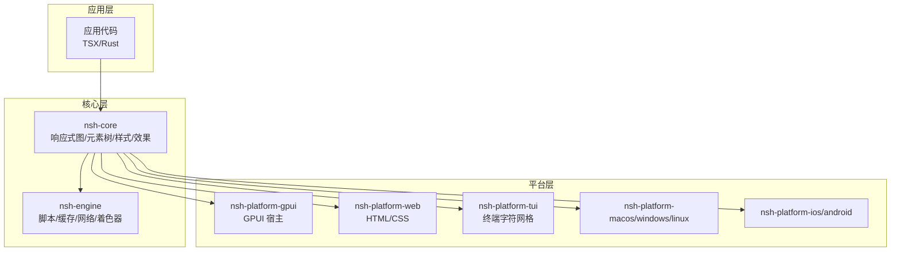
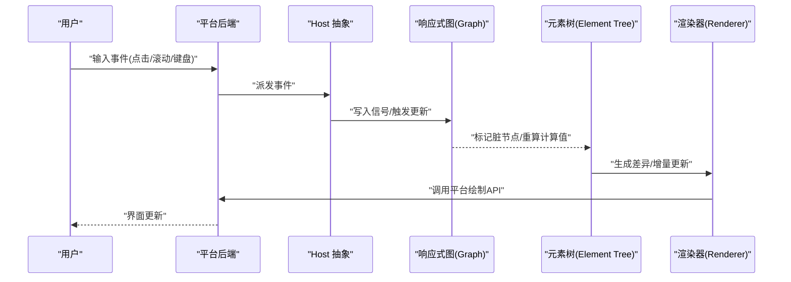
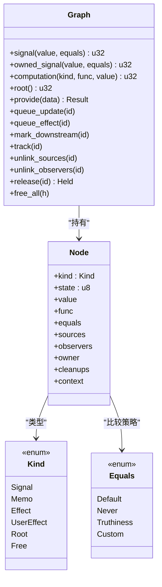
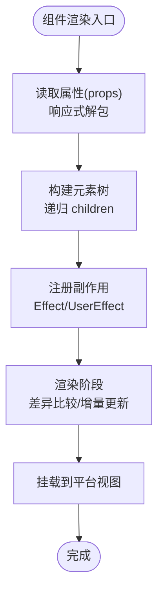
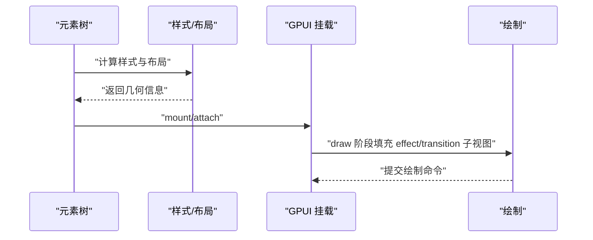
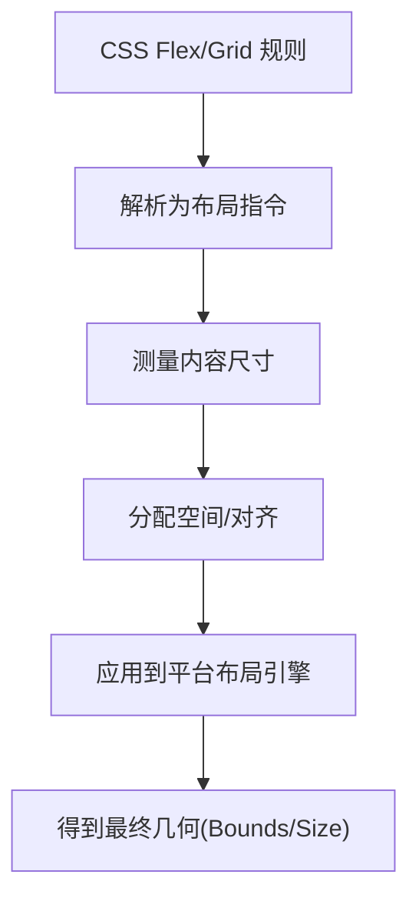
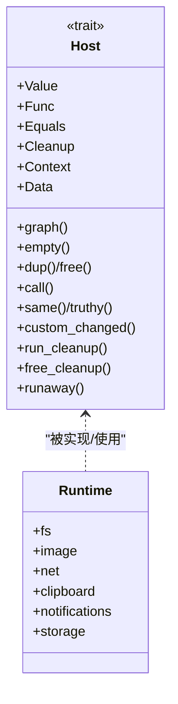
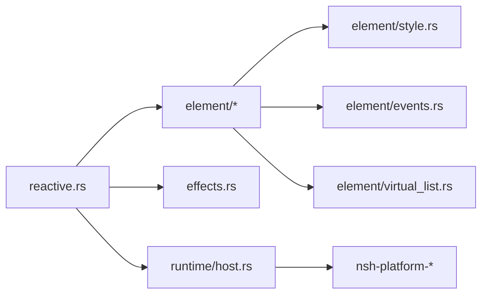

# 核心概念

<cite>
**本文引用的文件**   
- [README.md](file://README.md)
- [reactive.rs](file://crates/nsh-core/src/reactive.rs)
- [effects.rs](file://crates/nsh-core/src/effects.rs)
- [element/mod.rs](file://crates/nsh-core/src/element/mod.rs)
- [element/component.rs](file://crates/nsh-core/src/element/component.rs)
- [element/style.rs](file://crates/nsh-core/src/element/style.rs)
- [element/events.rs](file://crates/nsh-core/src/element/events.rs)
- [element/virtual_list.rs](file://crates/nsh-core/src/element/virtual_list.rs)
- [runtime/host.rs](file://crates/nsh-core/src/runtime/host.rs)
- [nsh-platform-gpui/mount.rs](file://crates/gpui/nsh-platform-gpui/src/mount.rs)
</cite>

## 目录
1. [引言](#引言)
2. [项目结构](#项目结构)
3. [核心组件](#核心组件)
4. [架构总览](#架构总览)
5. [详细组件分析](#详细组件分析)
6. [依赖关系分析](#依赖关系分析)
7. [性能考量](#性能考量)
8. [故障排查指南](#故障排查指南)
9. [结论](#结论)

## 引言
本文件聚焦 NSH 框架的核心概念与实现机制，围绕响应式编程模型（信号、计算值、副作用）、组件系统（生命周期、属性传递、事件处理、状态管理）、元素树构建与渲染、布局引擎（Flexbox/Grid）以及跨平台抽象层展开。文档以代码级分析为基础，辅以架构图、数据流图与流程图，帮助读者从用户交互到 UI 更新建立完整心智模型。

## 项目结构
NSH 采用多 crate 的模块化组织：
- nsh-core：核心运行时、响应式图、元素系统与样式/效果定义、平台抽象接口
- nsh-engine：引擎侧能力（脚本、缓存、网络、着色器等）
- nsh-base：基础 UI 组件库（按钮、列表、对话框等）
- nsh-js / nsh-macros：JS 绑定与宏工具
- nsh-platform-*：各平台后端（macOS、Windows、Linux、iOS、Android、Web、GPUI、TUI）
- gpui/nsh-platform-gpui：GPUI 宿主集成（窗口、挂载、绘制管线）



图表来源
- [README.md:1-60](file://README.md#L1-L60)

章节来源
- [README.md:1-60](file://README.md#L1-L60)

## 核心组件
- 响应式图：信号（Signal）、计算值（Memo）、副作用（Effect/UserEffect）、所有者（Owner）、上下文（Context），基于 Solid 调度策略（runUpdates、更新队列与副作用队列）。
- 元素系统：元素节点、属性与样式、事件分发、虚拟列表、组件封装。
- 样式与效果：渐变、阴影、滤镜、裁剪路径、过渡与关键帧动画。
- 运行时与平台：Host 抽象、平台能力（文件系统、图像、网络、剪贴板、通知等）。

章节来源
- [reactive.rs:1-10](file://crates/nsh-core/src/reactive.rs#L1-L10)
- [element/mod.rs](file://crates/nsh-core/src/element/mod.rs)
- [effects.rs:1-15](file://crates/nsh-core/src/effects.rs#L1-L15)
- [runtime/host.rs](file://crates/nsh-core/src/runtime/host.rs)

## 架构总览
下图展示从用户交互到 UI 更新的端到端流程：事件进入 Host，触发响应式图更新，驱动元素树差异比较与增量渲染，最终由平台后端绘制。



图表来源
- [reactive.rs:645-764](file://crates/nsh-core/src/reactive.rs#L645-L764)
- [nsh-platform-gpui/mount.rs:320-330](file://crates/gpui/nsh-platform-gpui/src/mount.rs#L320-L330)

## 详细组件分析

### 响应式编程模型（信号、计算值、副作用）
- 节点类型：Signal、Memo、Effect、UserEffect、Root、Free。
- 调度：更新队列（updates）与副作用队列（effects），先执行渲染相关副作用，再执行用户副作用。
- 追踪与依赖：读操作通过 track 建立边；写操作 mark_downstream 标记下游并排队。
- 所有权与清理：Owner 管理子节点生命周期；Cleanup 在 Owner 重建或销毁时运行。
- 相等性：Equals 支持默认、从不、真值判断与自定义比较，减少不必要的重算。



图表来源
- [reactive.rs:45-74](file://crates/nsh-core/src/reactive.rs#L45-L74)
- [reactive.rs:146-179](file://crates/nsh-core/src/reactive.rs#L146-L179)
- [reactive.rs:241-260](file://crates/nsh-core/src/reactive.rs#L241-L260)
- [reactive.rs:676-724](file://crates/nsh-core/src/reactive.rs#L676-L724)
- [reactive.rs:746-764](file://crates/nsh-core/src/reactive.rs#L746-L764)

章节来源
- [reactive.rs:1-10](file://crates/nsh-core/src/reactive.rs#L1-L10)
- [reactive.rs:45-74](file://crates/nsh-core/src/reactive.rs#L45-L74)
- [reactive.rs:146-179](file://crates/nsh-core/src/reactive.rs#L146-L179)
- [reactive.rs:241-260](file://crates/nsh-core/src/reactive.rs#L241-L260)
- [reactive.rs:645-764](file://crates/nsh-core/src/reactive.rs#L645-L764)

### 组件系统（生命周期、属性、事件、状态）
- 组件封装：component 模块提供组件函数式封装，将 props、children、上下文与副作用组合为可复用单元。
- 属性传递：props 通过 reactive 包装，支持静态与动态属性；样式与类名合并。
- 事件处理：events 模块统一事件捕获/冒泡、按键与手势，映射到平台输入。
- 生命周期：Owner 创建/销毁控制子组件生命周期；on_cleanup 注册清理逻辑。



图表来源
- [element/component.rs](file://crates/nsh-core/src/element/component.rs)
- [element/events.rs](file://crates/nsh-core/src/element/events.rs)
- [reactive.rs:614-637](file://crates/nsh-core/src/reactive.rs#L614-L637)

章节来源
- [element/component.rs](file://crates/nsh-core/src/element/component.rs)
- [element/events.rs](file://crates/nsh-core/src/element/events.rs)
- [reactive.rs:614-637](file://crates/nsh-core/src/reactive.rs#L614-L637)

### 元素树与渲染机制
- 元素树：由 element 模块定义，包含基础元素、容器、表单控件、媒体等。
- 渲染管线：元素树经样式解析、布局计算后，交由平台渲染器绘制。
- 挂载与过渡：GPUI 挂载层在 draw 阶段填充 effect/transition 的子视图，保证一次性变更。



图表来源
- [nsh-platform-gpui/mount.rs:320-330](file://crates/gpui/nsh-platform-gpui/src/mount.rs#L320-L330)

章节来源
- [element/mod.rs](file://crates/nsh-core/src/element/mod.rs)
- [nsh-platform-gpui/mount.rs:320-330](file://crates/gpui/nsh-platform-gpui/src/mount.rs#L320-L330)

### 布局引擎（Flexbox/Grid）
- Flexbox：通过 CSS 语义的 flex 属性驱动布局，元素按主轴/交叉轴排列，支持对齐、换行、弹性伸缩。
- Grid：二维网格布局，行列轨道与单元格定位，适合复杂仪表盘与卡片布局。
- 与平台对接：布局结果转换为平台原生布局参数（如 Auto Layout、Win32 布局、GTK 约束）。



[本节为概念性说明，不直接分析具体文件]

### 跨平台抽象层（Host 抽象）
- Host trait：定义值、函数、比较、清理、上下文的托管方式，使 JS（QuickJS）与 Rust 共享同一响应式算法。
- 平台能力：文件系统、图像、网络、剪贴板、通知、存储等通过 runtime 模块暴露给上层。
- 平台后端：GPUI、Web、TUI、桌面与移动平台各自实现 Host 与绘制桥接。



图表来源
- [reactive.rs:75-136](file://crates/nsh-core/src/reactive.rs#L75-L136)
- [runtime/host.rs](file://crates/nsh-core/src/runtime/host.rs)

章节来源
- [reactive.rs:75-136](file://crates/nsh-core/src/reactive.rs#L75-L136)
- [runtime/host.rs](file://crates/nsh-core/src/runtime/host.rs)

### 样式与视觉效果
- ClipInset：CSS inset() 形状裁剪，支持圆角与插值动画。
- BoxShadow：多层阴影，支持 inset 与 spread。
- Gradient：线性/径向/锥形渐变，支持重复与位置插值。
- Filter：亮度、对比度、灰度、饱和度、色相旋转、反色、不透明度、模糊与投影。

```mermaid
classDiagram
class ClipInset {
+offsets
+fractions
+radii
+resolve(size)
+outline(size, out)
+contains(size, p)
+lerp(to, t)
}
class BoxShadow {
+offset_x
+offset_y
+blur
+spread
+color
+inset
+is_visible()
}
class Gradient {
+kind
+stops
+repeating
+line_length(size)
+resolved_stops(size)
+unrolled_stops(size, reach)
}
class Filter {
<<enum>>
Blur
Brightness
Contrast
Grayscale
HueRotate
Invert
Opacity
Saturate
Sepia
DropShadow
+color_matrix()
}
ClipInset --> "用于" ClipPath
BoxShadow --> "用于" ShadowLayer
Gradient --> "用于" Background/Mask
Filter --> "用于" Paint Pipeline
```

图表来源
- [effects.rs:16-245](file://crates/nsh-core/src/effects.rs#L16-L245)
- [effects.rs:259-281](file://crates/nsh-core/src/effects.rs#L259-L281)
- [effects.rs:283-556](file://crates/nsh-core/src/effects.rs#L283-L556)
- [effects.rs:661-781](file://crates/nsh-core/src/effects.rs#L661-L781)

章节来源
- [effects.rs:1-15](file://crates/nsh-core/src/effects.rs#L1-L15)
- [effects.rs:16-245](file://crates/nsh-core/src/effects.rs#L16-L245)
- [effects.rs:259-281](file://crates/nsh-core/src/effects.rs#L259-L281)
- [effects.rs:283-556](file://crates/nsh-core/src/effects.rs#L283-L556)
- [effects.rs:661-781](file://crates/nsh-core/src/effects.rs#L661-L781)

## 依赖关系分析
- 响应式图是核心依赖，被元素系统、组件、样式与平台挂载层共同使用。
- 元素系统依赖样式与事件模块，向上提供可复用的 UI 构件。
- 平台后端依赖 Host 抽象与运行时能力，向下对接原生 API。



图表来源
- [reactive.rs:1-10](file://crates/nsh-core/src/reactive.rs#L1-L10)
- [element/mod.rs](file://crates/nsh-core/src/element/mod.rs)
- [effects.rs:1-15](file://crates/nsh-core/src/effects.rs#L1-L15)
- [runtime/host.rs](file://crates/nsh-core/src/runtime/host.rs)

章节来源
- [reactive.rs:1-10](file://crates/nsh-core/src/reactive.rs#L1-L10)
- [element/mod.rs](file://crates/nsh-core/src/element/mod.rs)
- [effects.rs:1-15](file://crates/nsh-core/src/effects.rs#L1-L15)
- [runtime/host.rs](file://crates/nsh-core/src/runtime/host.rs)

## 性能考量
- 增量更新：响应式图仅对受影响的节点进行重算与重绘，避免全量刷新。
- 虚拟滚动：virtual_list 模块按需渲染可见项，降低大列表内存与绘制开销。
- 资源管理：Host::free/free_func/free_equals/free_cleanup 确保值、函数、比较器与清理逻辑及时释放；Graph.compact 回收空闲槽位，压缩内存。
- 动画与过渡：ClipInset、Gradient、Filter 支持插值与矩阵合成，GPU 友好。
- 平台优化：GPUI 挂载层在 draw 阶段批量填充 effect/transition 子视图，减少中间状态抖动。

章节来源
- [reactive.rs:298-315](file://crates/nsh-core/src/reactive.rs#L298-L315)
- [reactive.rs:766-786](file://crates/nsh-core/src/reactive.rs#L766-L786)
- [element/virtual_list.rs](file://crates/nsh-core/src/element/virtual_list.rs)
- [effects.rs:16-245](file://crates/nsh-core/src/effects.rs#L16-L245)
- [nsh-platform-gpui/mount.rs:320-330](file://crates/gpui/nsh-platform-gpui/src/mount.rs#L320-L330)

## 故障排查指南
- 无限循环保护：runaway 计数器防止副作用无限更新；超过阈值记录错误并停止。
- 清理失败：on_cleanup 返回 Err 时，需检查清理逻辑是否抛出异常或访问已释放资源。
- 内存泄漏：确认所有 signal/computation 的生命周期与 owner 关联；必要时显式 drop_handle 释放外部引用。
- 平台绘制异常：检查 mount 阶段 effect/transition 子视图是否正确填充；确认 Host 的 free 系列方法正确释放资源。

章节来源
- [reactive.rs:133-136](file://crates/nsh-core/src/reactive.rs#L133-L136)
- [reactive.rs:614-637](file://crates/nsh-core/src/reactive.rs#L614-L637)
- [reactive.rs:501-528](file://crates/nsh-core/src/reactive.rs#L501-L528)
- [nsh-platform-gpui/mount.rs:320-330](file://crates/gpui/nsh-platform-gpui/src/mount.rs#L320-L330)

## 结论
NSH 以 Solid 风格的响应式图为内核，结合元素树与平台抽象，实现了跨平台的统一 UI 体验。通过精确的依赖追踪、增量更新与资源管理，配合丰富的样式与效果能力，NSH 在保证性能的同时提供了强大的可扩展性与可维护性。开发者可在 TSX 或 Rust 中编写应用，共享同一套组件、状态与 API，并在不同平台上获得原生体验。