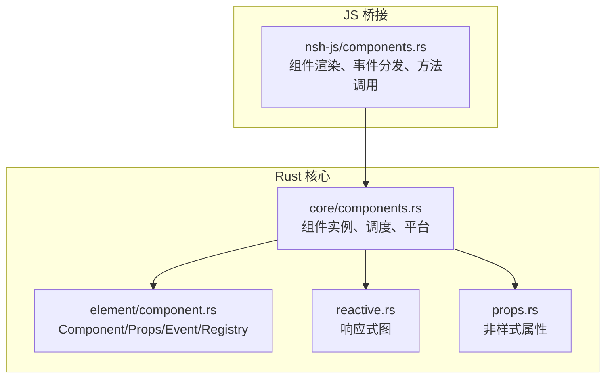
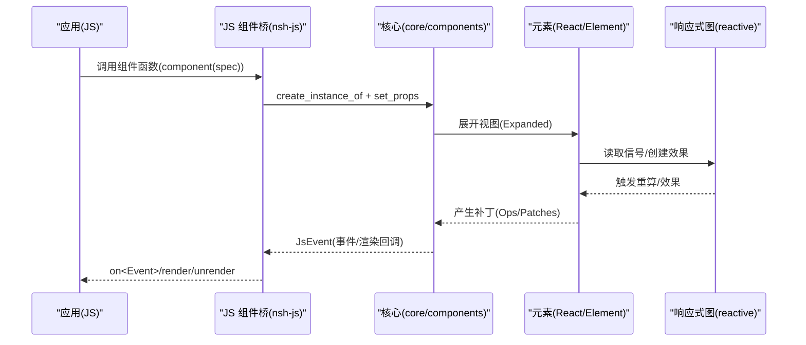
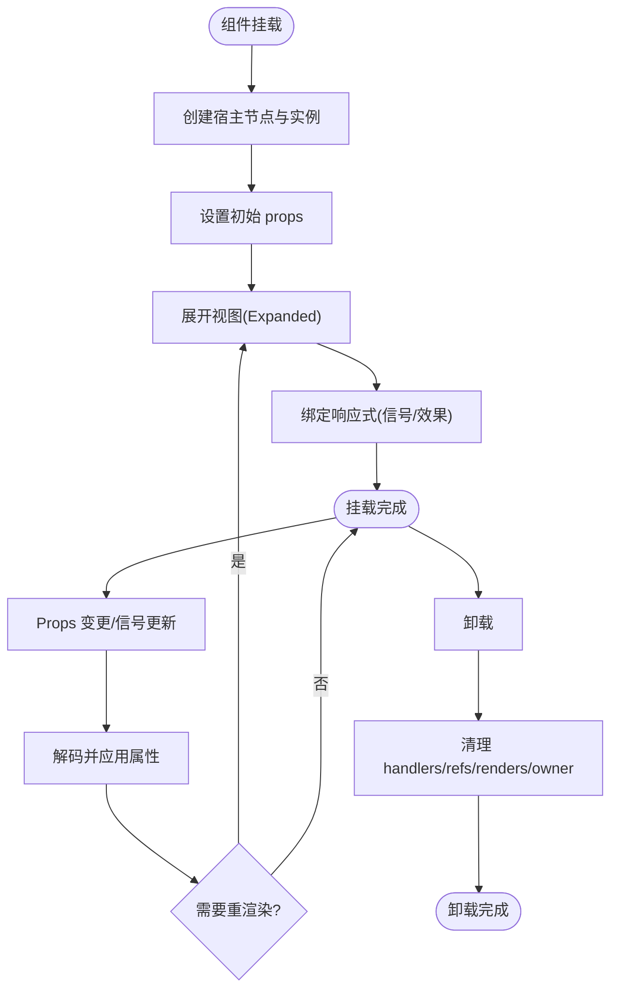
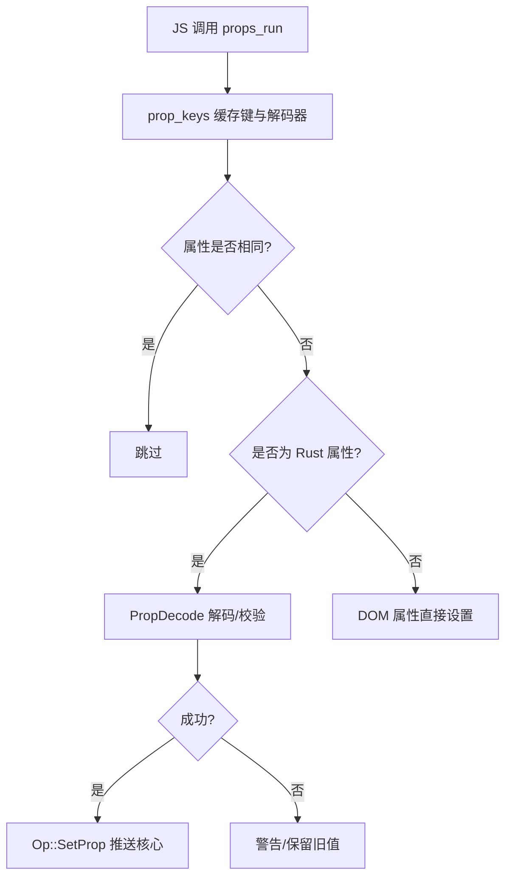
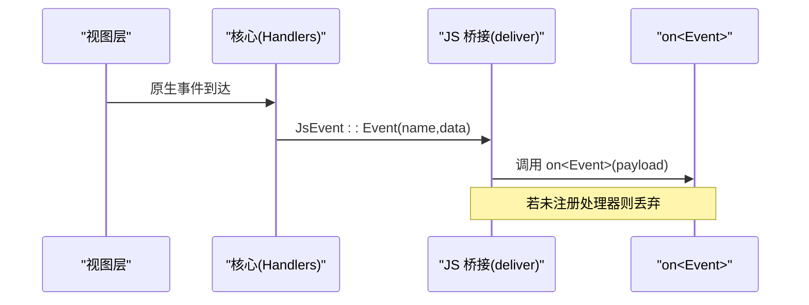
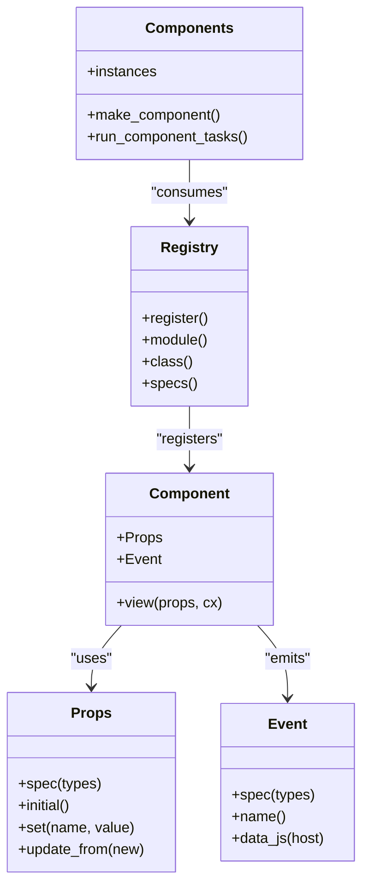
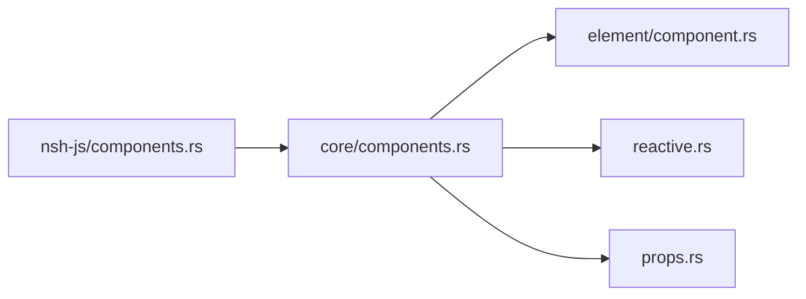

# 组件模型

<cite>
**本文引用的文件**   
- [crates/nsh-core/src/core/components.rs](file://crates/nsh-core/src/core/components.rs)
- [crates/nsh-core/src/element/component.rs](file://crates/nsh-core/src/element/component.rs)
- [crates/nsh-js/src/components.rs](file://crates/nsh-js/src/components.rs)
- [crates/nsh-core/src/reactive.rs](file://crates/nsh-core/src/reactive.rs)
- [crates/nsh-core/src/props.rs](file://crates/nsh-core/src/props.rs)
</cite>

## 目录
1. [简介](#简介)
2. [项目结构](#项目结构)
3. [核心组件](#核心组件)
4. [架构总览](#架构总览)
5. [详细组件分析](#详细组件分析)
6. [依赖关系分析](#依赖关系分析)
7. [性能考虑](#性能考虑)
8. [故障排查指南](#故障排查指南)
9. [结论](#结论)
10. [附录](#附录)

## 简介
本文件面向 NSH 框架的组件模型，系统性阐述以下主题：
- 组件生命周期（挂载、更新、卸载）的执行顺序与钩子
- 属性（props）传递机制（类型检查、默认值、验证规则）
- 事件处理系统（冒泡、捕获、自定义事件）
- 状态管理最佳实践（局部状态、共享状态、状态提升）
- 组合与复用模式（高阶组件、渲染属性、自定义 Hook）
- 开发最佳实践与常见陷阱

NSH 的组件由 Rust 侧定义（Component trait、Props、Event），JS 侧通过 nsh-js 桥接为可渲染函数；运行时基于响应式图（signals/memos/effects/owners）驱动视图更新。

## 项目结构
围绕组件模型的关键代码分布在以下模块：
- nsh-core: 组件抽象、注册表、实例与宿主节点、调度与平台交互
- element: Component trait、Props/Event 派生、构建器与元素树
- nsh-js: JS 到 Rust 的桥接、组件渲染函数、事件分发、方法调用
- reactive: 响应式图（信号、计算、效果、所有者、上下文）
- props: 非样式视图属性（可访问性、手势、布局等）

图表来源
- [crates/nsh-core/src/core/components.rs:1-120](file://crates/nsh-core/src/core/components.rs#L1-L120)
- [crates/nsh-core/src/element/component.rs:1-120](file://crates/nsh-core/src/element/component.rs#L1-L120)
- [crates/nsh-js/src/components.rs:1-120](file://crates/nsh-js/src/components.rs#L1-L120)
- [crates/nsh-core/src/reactive.rs:1-120](file://crates/nsh-core/src/reactive.rs#L1-L120)
- [crates/nsh-core/src/props.rs:1-60](file://crates/nsh-core/src/props.rs#L1-L60)

章节来源
- [crates/nsh-core/src/core/components.rs:1-120](file://crates/nsh-core/src/core/components.rs#L1-L120)
- [crates/nsh-core/src/element/component.rs:1-120](file://crates/nsh-core/src/element/component.rs#L1-L120)
- [crates/nsh-js/src/components.rs:1-120](file://crates/nsh-js/src/components.rs#L1-L120)
- [crates/nsh-core/src/reactive.rs:1-120](file://crates/nsh-core/src/reactive.rs#L1-L120)
- [crates/nsh-core/src/props.rs:1-60](file://crates/nsh-core/src/props.rs#L1-L60)

## 核心组件
- Component trait 与 Props/Event 派生：定义组件接口、属性与事件契约，并生成 TS 声明与 JS 绑定
- Registry：组件、模块、类的注册中心，负责导出名称冲突检测与合并
- Instance/Components：组件实例与运行时状态（节点、事件监听、虚拟列表、任务调度）
- JS 组件渲染器：将 Rust 组件暴露为 JS 函数，处理 props 同步、事件转发、ref 与方法调用
- 响应式图：提供 signals/memos/effects/owners 与上下文传播，驱动最小化更新

章节来源
- [crates/nsh-core/src/element/component.rs:22-73](file://crates/nsh-core/src/element/component.rs#L22-L73)
- [crates/nsh-core/src/element/component.rs:269-320](file://crates/nsh-core/src/element/component.rs#L269-L320)
- [crates/nsh-core/src/element/component.rs:343-358](file://crates/nsh-core/src/element/component.rs#L343-L358)
- [crates/nsh-core/src/element/component.rs:998-1025](file://crates/nsh-core/src/element/component.rs#L998-L1025)
- [crates/nsh-core/src/core/components.rs:183-262](file://crates/nsh-core/src/core/components.rs#L183-L262)
- [crates/nsh-js/src/components.rs:866-888](file://crates/nsh-js/src/components.rs#L866-L888)
- [crates/nsh-core/src/reactive.rs:45-136](file://crates/nsh-core/src/reactive.rs#L45-L136)

## 架构总览
下图展示从 JS 调用到 Rust 组件渲染、再到响应式更新的完整链路。

图表来源
- [crates/nsh-js/src/components.rs:978-1003](file://crates/nsh-js/src/components.rs#L978-L1003)
- [crates/nsh-core/src/core/components.rs:1346-1365](file://crates/nsh-core/src/core/components.rs#L1346-L1365)
- [crates/nsh-core/src/core/components.rs:434-468](file://crates/nsh-core/src/core/components.rs#L434-L468)
- [crates/nsh-core/src/reactive.rs:241-277](file://crates/nsh-core/src/reactive.rs#L241-L277)

## 详细组件分析

### 组件生命周期（挂载、更新、卸载）
- 挂载
  - JS 侧通过 component(spec) 创建渲染函数，设置 slot、items、ref、事件监听与 props effect
  - 核心侧 make_component/create_instance_of 创建宿主节点与实例，设置 props
  - 视图展开 Expanded，建立节点树与绑定
- 更新
  - props_run 在 JS 侧收集变更，通过 Op::SetProp 推送到核心
  - 核心根据 spec 解码并应用 Rust 属性，必要时触发重新渲染
  - 响应式图在信号变化时标记下游，执行 render effects 与 user effects
- 卸载
  - 组件销毁时清理 ref、slots、renders、handlers 与 owner 下的 cleanups
  - JS 侧 dispose_renders/owner，移除 DOM 节点

图表来源
- [crates/nsh-js/src/components.rs:978-1215](file://crates/nsh-js/src/components.rs#L978-L1215)
- [crates/nsh-core/src/core/components.rs:1346-1365](file://crates/nsh-core/src/core/components.rs#L1346-L1365)
- [crates/nsh-core/src/core/components.rs:434-468](file://crates/nsh-core/src/core/components.rs#L434-L468)
- [crates/nsh-js/src/components.rs:1505-1599](file://crates/nsh-js/src/components.rs#L1505-L1599)

章节来源
- [crates/nsh-js/src/components.rs:978-1215](file://crates/nsh-js/src/components.rs#L978-L1215)
- [crates/nsh-core/src/core/components.rs:1346-1365](file://crates/nsh-core/src/core/components.rs#L1346-L1365)
- [crates/nsh-js/src/components.rs:1505-1599](file://crates/nsh-js/src/components.rs#L1505-L1599)

### 属性（props）传递机制
- 类型与校验
  - Props trait 提供 spec/initial/set/update_from/held 等方法
  - JS 侧 prop_keys 缓存属性名与 decode 函数，props_run 遍历比较旧值与新值
  - set_rust_prop 调用 PropDecode 进行类型转换，错误以警告或抛出异常处理
- 默认值与可选
  - Props::initial 提供默认值；undefined 重置为默认
  - PropKind::Value/Renderer/Slot/Children/Items 支持多种属性形态
- 验证规则
  - 解码失败时记录警告并保留原值；getter 抛错则透传异常
  - 对 host props（class/style/testID 等）直接设置到 DOM 节点

图表来源
- [crates/nsh-js/src/components.rs:906-940](file://crates/nsh-js/src/components.rs#L906-L940)
- [crates/nsh-js/src/components.rs:1235-1306](file://crates/nsh-js/src/components.rs#L1235-L1306)
- [crates/nsh-js/src/components.rs:1314-1367](file://crates/nsh-js/src/components.rs#L1314-L1367)
- [crates/nsh-core/src/element/component.rs:269-320](file://crates/nsh-core/src/element/component.rs#L269-L320)

章节来源
- [crates/nsh-js/src/components.rs:906-940](file://crates/nsh-js/src/components.rs#L906-L940)
- [crates/nsh-js/src/components.rs:1235-1306](file://crates/nsh-js/src/components.rs#L1235-L1306)
- [crates/nsh-js/src/components.rs:1314-1367](file://crates/nsh-js/src/components.rs#L1314-L1367)
- [crates/nsh-core/src/element/component.rs:269-320](file://crates/nsh-core/src/element/component.rs#L269-L320)

### 事件处理系统（冒泡、捕获、自定义事件）
- 自定义事件
  - Event trait 定义事件规范，JS 侧 handler_name 将 press -> onPress
  - deliver 将 Rust 组件事件转换为 JS 对象{name, data}，调用对应 on<Event> 处理器
- 冒泡与捕获
  - Handlers 按节点维护事件监听列表；事件到达时仅扫描该节点的监听
  - given_handlers 允许父级视图为嵌套组件根添加额外监听，作为“捕获”阶段后执行
- 特殊事件
  - $children/$render/$unrender 用于懒子节点与渲染函数内容生命周期控制

图表来源
- [crates/nsh-core/src/core/components.rs:129-181](file://crates/nsh-core/src/core/components.rs#L129-L181)
- [crates/nsh-js/src/components.rs:372-469](file://crates/nsh-js/src/components.rs#L372-L469)
- [crates/nsh-js/src/components.rs:1403-1503](file://crates/nsh-js/src/components.rs#L1403-L1503)

章节来源
- [crates/nsh-core/src/core/components.rs:129-181](file://crates/nsh-core/src/core/components.rs#L129-L181)
- [crates/nsh-js/src/components.rs:372-469](file://crates/nsh-js/src/components.rs#L372-L469)
- [crates/nsh-js/src/components.rs:1403-1503](file://crates/nsh-js/src/components.rs#L1403-L1503)

### 状态管理最佳实践
- 局部状态
  - 使用 signals/memos 在组件作用域内管理状态，避免跨组件耦合
- 共享状态
  - 通过 context 或全局 store（如 nsh-base 的状态模块）共享数据
- 状态提升
  - 将多个子组件共享的状态提升到最近公共父组件，统一管理与派发
- 副作用与清理
  - 使用 effects 执行副作用，on_cleanup 确保资源释放（定时器、订阅等）

章节来源
- [crates/nsh-core/src/reactive.rs:138-179](file://crates/nsh-core/src/reactive.rs#L138-L179)
- [crates/nsh-core/src/reactive.rs:614-643](file://crates/nsh-core/src/reactive.rs#L614-L643)

### 组合与复用模式
- 高阶组件（HOC）
  - 通过包装组件增强行为（如注入 props、拦截事件），保持被包裹组件的 props/events 契约
- 渲染属性（Render Props）
  - 使用 PropKind::Renderer 或 children 函数实现动态渲染逻辑
- 自定义 Hook
  - 封装常用逻辑（如网络请求、动画、键盘监听）为可复用的函数，配合 signals/effects 使用

章节来源
- [crates/nsh-core/src/element/component.rs:213-230](file://crates/nsh-core/src/element/component.rs#L213-L230)
- [crates/nsh-js/src/components.rs:471-477](file://crates/nsh-js/src/components.rs#L471-L477)

### 类与接口关系图

图表来源
- [crates/nsh-core/src/element/component.rs:43-73](file://crates/nsh-core/src/element/component.rs#L43-L73)
- [crates/nsh-core/src/element/component.rs:269-320](file://crates/nsh-core/src/element/component.rs#L269-L320)
- [crates/nsh-core/src/element/component.rs:343-358](file://crates/nsh-core/src/element/component.rs#L343-L358)
- [crates/nsh-core/src/element/component.rs:998-1025](file://crates/nsh-core/src/element/component.rs#L998-L1025)
- [crates/nsh-core/src/core/components.rs:663-740](file://crates/nsh-core/src/core/components.rs#L663-L740)

## 依赖关系分析
- JS 桥接依赖 core 的 ComponentSpec、Op、EventKind 等
- 核心依赖 element 的 IntoElement、Builder、Scope 等
- 响应式图独立于 UI 层，被 core 与 JS 共同使用
- props.rs 提供非样式属性，供 view 与组件使用

图表来源
- [crates/nsh-js/src/components.rs:1-43](file://crates/nsh-js/src/components.rs#L1-L43)
- [crates/nsh-core/src/core/components.rs:1-36](file://crates/nsh-core/src/core/components.rs#L1-L36)
- [crates/nsh-core/src/element/component.rs:1-20](file://crates/nsh-core/src/element/component.rs#L1-L20)
- [crates/nsh-core/src/reactive.rs:1-17](file://crates/nsh-core/src/reactive.rs#L1-L17)
- [crates/nsh-core/src/props.rs:1-10](file://crates/nsh-core/src/props.rs#L1-L10)

章节来源
- [crates/nsh-js/src/components.rs:1-43](file://crates/nsh-js/src/components.rs#L1-L43)
- [crates/nsh-core/src/core/components.rs:1-36](file://crates/nsh-core/src/core/components.rs#L1-L36)
- [crates/nsh-core/src/element/component.rs:1-20](file://crates/nsh-core/src/element/component.rs#L1-L20)
- [crates/nsh-core/src/reactive.rs:1-17](file://crates/nsh-core/src/reactive.rs#L1-L17)
- [crates/nsh-core/src/props.rs:1-10](file://crates/nsh-core/src/props.rs#L1-L10)

## 性能考虑
- 事件监听优化：Handlers 按节点存储监听，避免全量扫描
- 样式缓存：styles 缓存 ClassList，减少重复计算
- 任务轮次限制：MAX_TASK_ROUNDS 防止无限循环
- 响应式图压缩：compact 回收空闲槽位，降低内存占用

章节来源
- [crates/nsh-core/src/core/components.rs:129-181](file://crates/nsh-core/src/core/components.rs#L129-L181)
- [crates/nsh-core/src/core/components.rs:1049-1064](file://crates/nsh-core/src/core/components.rs#L1049-L1064)
- [crates/nsh-core/src/core/components.rs:42-44](file://crates/nsh-core/src/core/components.rs#L42-L44)
- [crates/nsh-core/src/reactive.rs:298-315](file://crates/nsh-core/src/reactive.rs#L298-L315)

## 故障排查指南
- 组件崩溃
  - caught 捕获 panic 并转为 ComponentError，便于错误边界展示
- 属性解码失败
  - 输出警告日志，保留旧值；getter 抛错会透传异常
- 事件未处理
  - 若无 on<Event> 处理器，事件数据会被丢弃以避免无谓转换

章节来源
- [crates/nsh-core/src/element/component.rs:75-105](file://crates/nsh-core/src/element/component.rs#L75-L105)
- [crates/nsh-js/src/components.rs:1314-1367](file://crates/nsh-js/src/components.rs#L1314-L1367)
- [crates/nsh-js/src/components.rs:372-469](file://crates/nsh-js/src/components.rs#L372-L469)

## 结论
NSH 的组件模型以 Rust 为核心，JS 为桥接，结合响应式图实现高效、可控的 UI 更新。通过严格的 props 契约、灵活的事件系统与清晰的组件生命周期，开发者可以构建高性能、可维护的应用界面。遵循本文的最佳实践与模式，有助于提升组件的可读性与复用性。

## 附录
- 参考文档与示例可在 examples 与 docs 中找到，涵盖组件、样式、响应式与平台扩展等内容