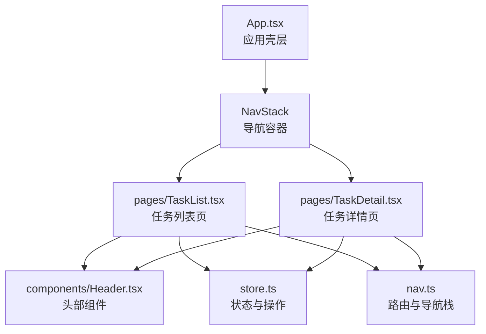
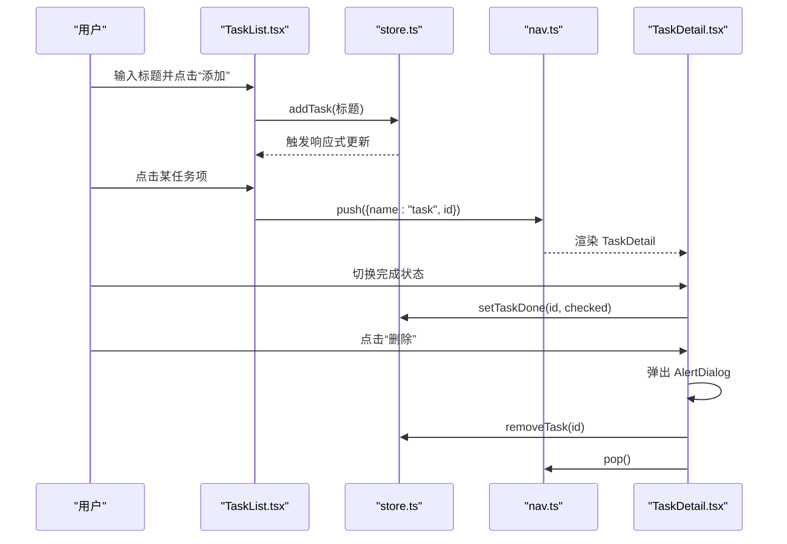
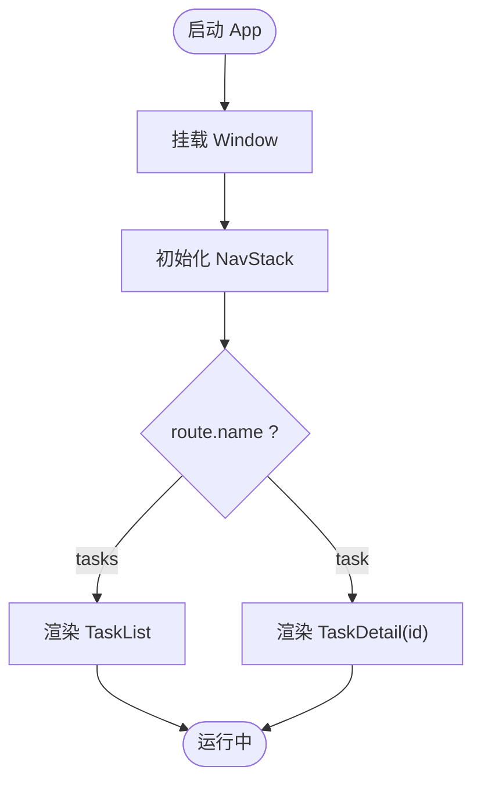
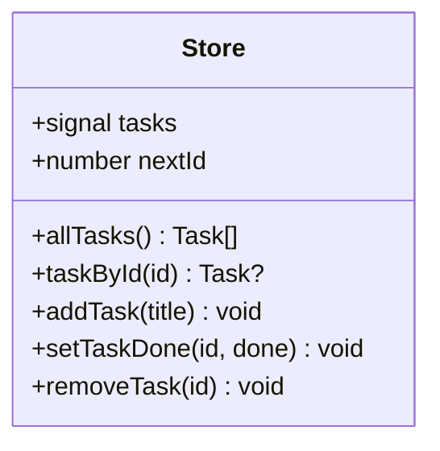
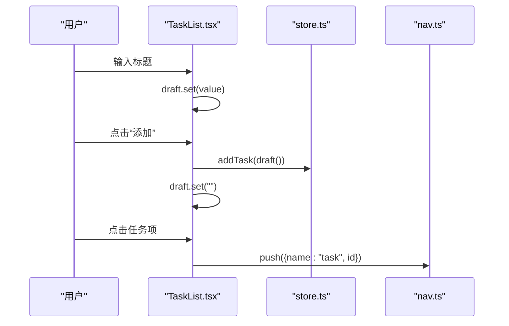
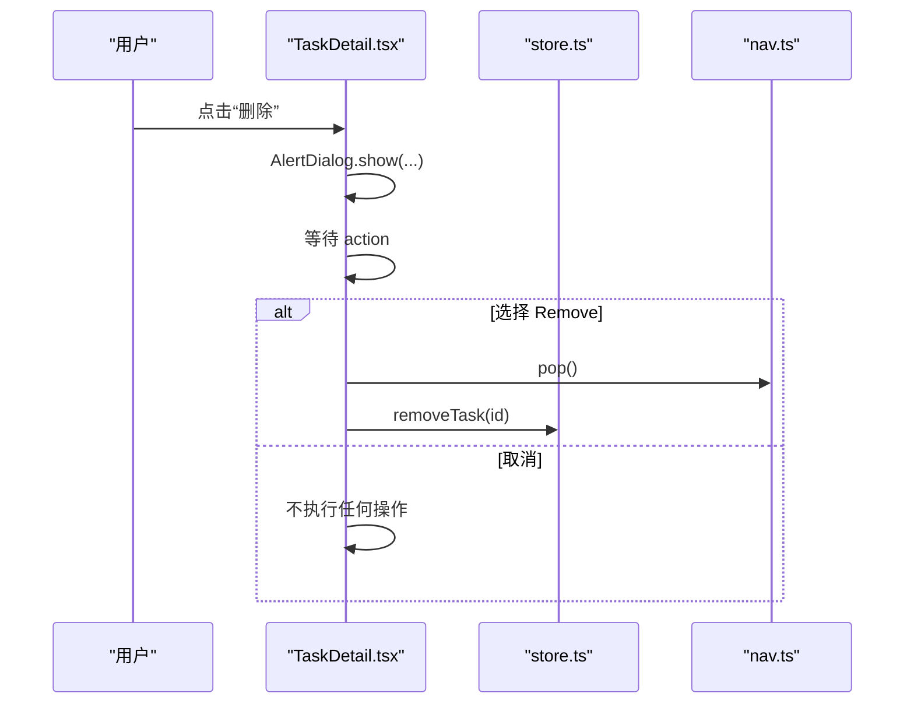
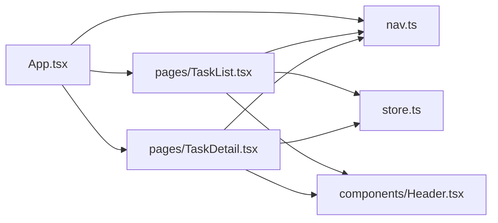
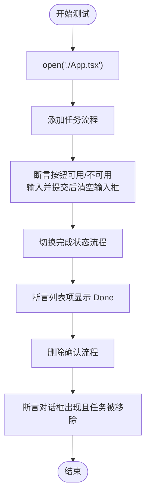

# 任务管理应用

<cite>
**本文引用的文件**   
- [App.tsx](file://examples/tasks/App.tsx)
- [store.ts](file://examples/tasks/store.ts)
- [nav.ts](file://examples/tasks/nav.ts)
- [TaskList.tsx](file://examples/tasks/pages/TaskList.tsx)
- [TaskDetail.tsx](file://examples/tasks/pages/TaskDetail.tsx)
- [Header.tsx](file://examples/tasks/components/Header.tsx)
- [App.test.tsx](file://examples/tasks/App.test.tsx)
</cite>

## 目录
1. [简介](#简介)
2. [项目结构](#项目结构)
3. [核心组件](#核心组件)
4. [架构总览](#架构总览)
5. [详细组件分析](#详细组件分析)
6. [依赖关系分析](#依赖关系分析)
7. [性能与可扩展性](#性能与可扩展性)
8. [测试与调试指南](#测试与调试指南)
9. [结论](#结论)

## 简介
本教程围绕仓库中的“任务管理”示例应用，系统讲解中等复杂度应用的页面路由、状态管理、数据持久化（本地存储）与用户交互设计。你将了解：
- 页面结构与路由组织方式
- 基于信号的状态管理与响应式更新
- 列表渲染与虚拟化的使用
- 对话框等原生交互的调用
- 端到端测试用例的编写与调试技巧

该示例采用简洁的分层组织：入口壳层负责挂载窗口与导航栈；页面组件负责具体业务视图；共享状态集中在 store；导航配置集中维护。

## 项目结构
示例位于 examples/tasks 目录，主要文件职责如下：
- App.tsx：应用壳层，挂载窗口并注册 NavStack 路由到 TaskList 与 TaskDetail 页面
- nav.ts：定义路由类型与导航栈实例
- store.ts：定义任务数据结构与增删改查方法，暴露响应式读取接口
- pages/TaskList.tsx：任务列表页，包含输入框、添加按钮与可滚动的任务列表
- pages/TaskDetail.tsx：任务详情页，包含完成状态切换与删除确认
- components/Header.tsx：通用头部组件，提供返回按钮与标题展示
- App.test.tsx：端到端测试用例，覆盖添加、切换完成状态、删除确认流程

图表来源
- [App.tsx:10-21](file://examples/tasks/App.tsx#L10-L21)
- [TaskList.tsx:15-47](file://examples/tasks/pages/TaskList.tsx#L15-L47)
- [TaskDetail.tsx:23-40](file://examples/tasks/pages/TaskDetail.tsx#L23-L40)
- [Header.tsx:6-16](file://examples/tasks/components/Header.tsx#L6-L16)
- [store.ts:10-37](file://examples/tasks/store.ts#L10-L37)
- [nav.ts:4-6](file://examples/tasks/nav.ts#L4-L6)

章节来源
- [App.tsx:1-27](file://examples/tasks/App.tsx#L1-L27)
- [nav.ts:1-7](file://examples/tasks/nav.ts#L1-L7)
- [store.ts:1-38](file://examples/tasks/store.ts#L1-L38)
- [TaskList.tsx:1-50](file://examples/tasks/pages/TaskList.tsx#L1-L50)
- [TaskDetail.tsx:1-43](file://examples/tasks/pages/TaskDetail.tsx#L1-L43)
- [Header.tsx:1-18](file://examples/tasks/components/Header.tsx#L1-L18)

## 核心组件
- 应用壳层（App.tsx）
  - 挂载 Window 作为根节点
  - 使用 NavStack 承载页面路由
  - 根据 route.name 渲染 TaskList 或 TaskDetail
- 导航（nav.ts）
  - 定义 Route 联合类型，支持 tasks 与 task(id)
  - 创建全局导航栈实例，供页面 push/pop
- 状态（store.ts）
  - 使用 signal 维护任务数组
  - 暴露 allTasks、taskById 读取接口
  - 提供 addTask、setTaskDone、removeTask 写操作
- 列表页（TaskList.tsx）
  - 使用 Input 与 Button 实现新增任务
  - 使用 List 虚拟化渲染任务项
  - 点击任务项通过 nav.push 进入详情页
- 详情页（TaskDetail.tsx）
  - 显示任务标题与完成状态
  - 使用 Switch 切换完成状态
  - 使用 AlertDialog 进行删除确认
- 头部（Header.tsx）
  - 根据导航栈深度决定是否显示返回按钮
  - 显示页面标题

章节来源
- [App.tsx:1-27](file://examples/tasks/App.tsx#L1-L27)
- [nav.ts:1-7](file://examples/tasks/nav.ts#L1-L7)
- [store.ts:1-38](file://examples/tasks/store.ts#L1-L38)
- [TaskList.tsx:1-50](file://examples/tasks/pages/TaskList.tsx#L1-L50)
- [TaskDetail.tsx:1-43](file://examples/tasks/pages/TaskDetail.tsx#L1-L43)
- [Header.tsx:1-18](file://examples/tasks/components/Header.tsx#L1-L18)

## 架构总览
整体架构遵循“壳层 + 页面 + 状态 + 导航”的清晰分层：
- 壳层负责窗口与导航容器
- 页面组件专注 UI 与交互
- 状态模块统一数据源与变更逻辑
- 导航模块统一管理路由与跳转

图表来源
- [TaskList.tsx:11-14](file://examples/tasks/pages/TaskList.tsx#L11-L14)
- [TaskList.tsx:34-44](file://examples/tasks/pages/TaskList.tsx#L34-L44)
- [TaskDetail.tsx:11-22](file://examples/tasks/pages/TaskDetail.tsx#L11-L22)
- [TaskDetail.tsx:27-35](file://examples/tasks/pages/TaskDetail.tsx#L27-L35)
- [store.ts:22-37](file://examples/tasks/store.ts#L22-L37)
- [nav.ts:4-6](file://examples/tasks/nav.ts#L4-L6)

## 详细组件分析

### 应用壳层与路由（App.tsx）
- 作用
  - 挂载主窗口
  - 初始化 NavStack 并绑定路由到页面组件
- 关键点
  - 根据 route.name 分支渲染不同页面
  - 将路由参数（如 id）传递给详情页

图表来源
- [App.tsx:9-24](file://examples/tasks/App.tsx#L9-L24)

章节来源
- [App.tsx:1-27](file://examples/tasks/App.tsx#L1-L27)

### 导航（nav.ts）
- 作用
  - 定义路由类型与初始路由
  - 提供全局导航栈实例
- 关键点
  - 使用 createNavStack 创建单例
  - 路由类型区分 tasks 与 task(id)

章节来源
- [nav.ts:1-7](file://examples/tasks/nav.ts#L1-L7)

### 状态与数据（store.ts）
- 作用
  - 维护任务列表与自增 ID
  - 提供统一的读写接口
- 关键点
  - 使用 signal 包裹任务数组，保证响应式更新
  - 所有写操作通过 update 生成新数组/对象，确保不可变更新
  - 对外暴露 allTasks、taskById 用于只读访问

图表来源
- [store.ts:4-37](file://examples/tasks/store.ts#L4-L37)

章节来源
- [store.ts:1-38](file://examples/tasks/store.ts#L1-L38)

### 列表页（TaskList.tsx）
- 作用
  - 提供新增任务的输入与提交
  - 渲染任务列表并处理点击跳转
- 关键点
  - 使用 signal 管理临时输入草稿
  - 使用 List 虚拟化渲染，keyExtractor 使用唯一 id
  - 点击任务项通过 nav.push 跳转到详情页

图表来源
- [TaskList.tsx:8-14](file://examples/tasks/pages/TaskList.tsx#L8-L14)
- [TaskList.tsx:34-44](file://examples/tasks/pages/TaskList.tsx#L34-L44)
- [store.ts:22-27](file://examples/tasks/store.ts#L22-L27)
- [nav.ts:4-6](file://examples/tasks/nav.ts#L4-L6)

章节来源
- [TaskList.tsx:1-50](file://examples/tasks/pages/TaskList.tsx#L1-L50)

### 详情页（TaskDetail.tsx）
- 作用
  - 展示任务详情
  - 切换完成状态
  - 删除任务前弹出确认对话框
- 关键点
  - 使用 taskById 获取当前任务
  - 使用 Switch 控制完成状态
  - 使用 AlertDialog.show 异步等待用户选择
  - 确认后调用 removeTask 并 nav.pop()

图表来源
- [TaskDetail.tsx:11-22](file://examples/tasks/pages/TaskDetail.tsx#L11-L22)
- [TaskDetail.tsx:27-35](file://examples/tasks/pages/TaskDetail.tsx#L27-L35)
- [store.ts:34-37](file://examples/tasks/store.ts#L34-L37)
- [nav.ts:4-6](file://examples/tasks/nav.ts#L4-L6)

章节来源
- [TaskDetail.tsx:1-43](file://examples/tasks/pages/TaskDetail.tsx#L1-L43)

### 头部组件（Header.tsx）
- 作用
  - 在桌面与 Web 平台显示自定义头部
  - 根据导航栈深度显示返回按钮
- 关键点
  - 使用 nav.routes().length 判断是否显示返回按钮
  - 点击返回按钮调用 nav.pop()

章节来源
- [Header.tsx:1-18](file://examples/tasks/components/Header.tsx#L1-L18)

## 依赖关系分析
- 组件耦合
  - 页面组件依赖 store 与 nav，保持 UI 与数据/路由解耦
  - Header 仅依赖 nav，复用性强
- 外部依赖
  - nsh：基础 UI 与运行时能力
  - nsh/base：NavStack、Button、Input、Switch、AlertDialog 等基础组件
  - nsh/desktop：Window 宿主组件

图表来源
- [App.tsx:1-27](file://examples/tasks/App.tsx#L1-L27)
- [nav.ts:1-7](file://examples/tasks/nav.ts#L1-L7)
- [store.ts:1-38](file://examples/tasks/store.ts#L1-L38)
- [TaskList.tsx:1-50](file://examples/tasks/pages/TaskList.tsx#L1-L50)
- [TaskDetail.tsx:1-43](file://examples/tasks/pages/TaskDetail.tsx#L1-L43)
- [Header.tsx:1-18](file://examples/tasks/components/Header.tsx#L1-L18)

章节来源
- [App.tsx:1-27](file://examples/tasks/App.tsx#L1-L27)
- [nav.ts:1-7](file://examples/tasks/nav.ts#L1-L7)
- [store.ts:1-38](file://examples/tasks/store.ts#L1-L38)
- [TaskList.tsx:1-50](file://examples/tasks/pages/TaskList.tsx#L1-L50)
- [TaskDetail.tsx:1-43](file://examples/tasks/pages/TaskDetail.tsx#L1-L43)
- [Header.tsx:1-18](file://examples/tasks/components/Header.tsx#L1-L18)

## 性能与可扩展性
- 列表虚拟化
  - 使用 List 的 estimatedItemSize 与 keyExtractor 提升长列表渲染性能
- 不可变更新
  - store 中所有写操作均生成新数组/对象，避免深层比较开销
- 响应式粒度
  - 通过 allTasks 与 taskById 精确订阅，减少不必要的重渲染
- 可扩展建议
  - 引入分页或搜索过滤时，可在 store 中增加筛选逻辑与缓存
  - 将 Header 扩展为可配置的工具栏区域，支持更多操作按钮

[本节为通用指导，不涉及具体文件分析]

## 测试与调试指南
- 端到端测试
  - 使用 nsh/test 提供的 open、press、waitFor、value 等方法模拟用户操作
  - 覆盖关键流程：添加任务、切换完成状态、删除确认
- 断言要点
  - 验证按钮禁用状态（空标题不可添加）
  - 验证输入框清空行为
  - 验证列表项状态变化
  - 验证对话框出现与关闭次数
- 调试技巧
  - 使用 app.onDialog 拦截对话框，便于自动化确认
  - 使用 waitFor 配合元素存在/消失断言，确保时序稳定

图表来源
- [App.test.tsx:4-11](file://examples/tasks/App.test.tsx#L4-L11)
- [App.test.tsx:13-20](file://examples/tasks/App.test.tsx#L13-L20)
- [App.test.tsx:22-33](file://examples/tasks/App.test.tsx#L22-L33)

章节来源
- [App.test.tsx:1-34](file://examples/tasks/App.test.tsx#L1-L34)

## 结论
该任务管理示例展示了中等复杂度应用的最佳实践：
- 清晰的页面与路由组织
- 基于信号的响应式状态管理
- 虚拟化列表提升性能
- 使用原生对话框增强用户体验
- 完善的端到端测试保障功能稳定性

按照本教程的步骤，你可以快速理解并在此基础上扩展更多功能，例如任务分类、优先级、搜索与筛选、以及跨平台适配优化。