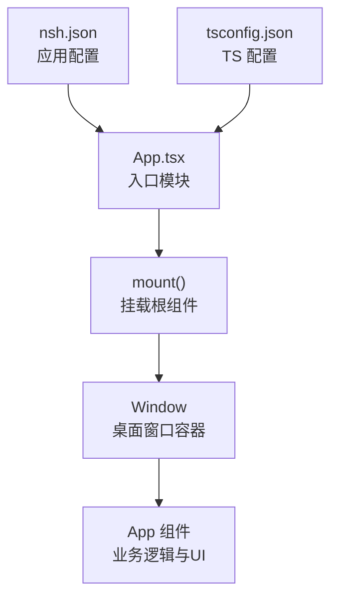
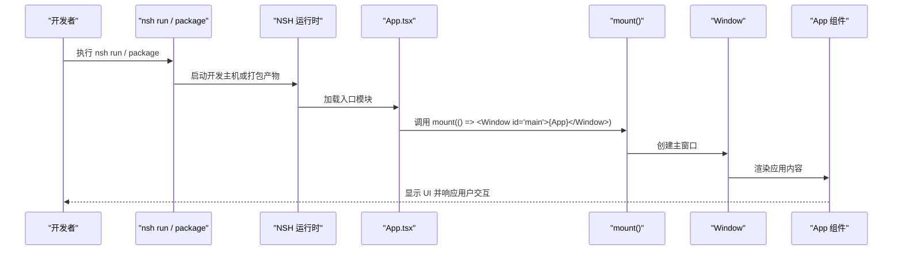
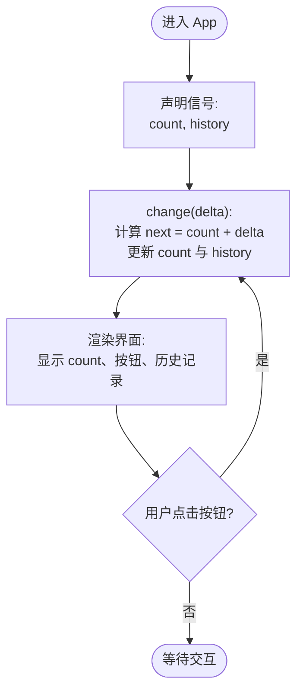
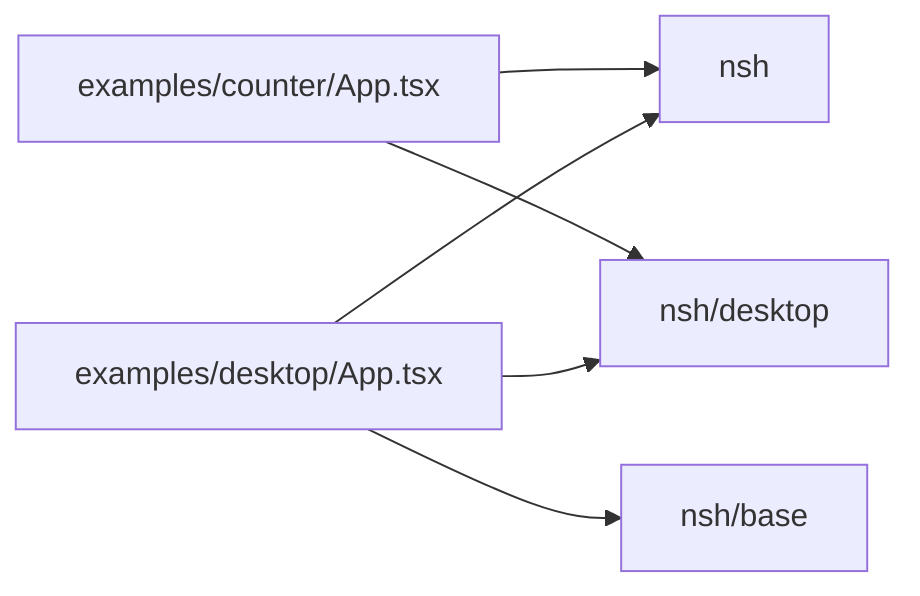

# 基础示例

<cite>
**本文引用的文件**   
- [examples/counter/App.tsx](file://examples/counter/App.tsx)
- [examples/desktop/App.tsx](file://examples/desktop/App.tsx)
- [examples/counter/nsh.json](file://examples/counter/nsh.json)
- [examples/desktop/tsconfig.json](file://examples/desktop/tsconfig.json)
- [website/docs/getting-started.md](file://website/docs/getting-started.md)
- [website/docs/jsx-and-components.md](file://website/docs/jsx-and-components.md)
- [website/docs/reactivity.md](file://website/docs/reactivity.md)
- [website/docs/project-structure.md](file://website/docs/project-structure.md)
</cite>

## 目录
1. [简介](#简介)
2. [项目结构](#项目结构)
3. [核心组件](#核心组件)
4. [架构总览](#架构总览)
5. [详细组件分析](#详细组件分析)
6. [依赖关系分析](#依赖关系分析)
7. [性能与可维护性](#性能与可维护性)
8. [运行指导](#运行指导)
9. [常见问题与排错](#常见问题与排错)
10. [结论](#结论)

## 简介
本指南面向初学者，带你从零开始理解并构建一个 NSH 应用。我们将通过两个官方示例来学习：
- 计数器应用：展示信号、状态更新、事件处理与列表渲染等基础概念。
- 桌面应用：演示窗口、菜单、标题栏拖拽、平台能力与主题切换等桌面特性。

读完本篇后，你将能够：
- 使用 nsh init 初始化项目
- 编写第一个 TSX 组件
- 使用 signal 管理状态
- 处理用户交互（点击、输入、菜单）
- 在桌面端挂载 Window 并配置窗口行为
- 运行、调试和打包你的第一个 NSH 应用

## 项目结构
NSH 支持 Rust 与 TSX 两种语言。对于 TSX 应用，典型结构如下：
- App.tsx：入口模块，调用 mount 渲染根组件
- nsh.json：应用元信息（名称、ID、版本、主题、能力等）
- tsconfig.json：扩展 .nsh/tsconfig.json，提供编辑器类型提示
- src/：业务模块（可按需组织）
- assets/：图片、字体等资源
- ext/：可选的 Rust 扩展（nshm crate）



图表来源
- [website/docs/project-structure.md:29-48](file://website/docs/project-structure.md#L29-L48)
- [website/docs/project-structure.md:88-89](file://website/docs/project-structure.md#L88-L89)

章节来源
- [website/docs/project-structure.md:29-48](file://website/docs/project-structure.md#L29-L48)
- [website/docs/project-structure.md:88-89](file://website/docs/project-structure.md#L88-L89)

## 核心组件
- 信号（signal）：响应式数据源，读时订阅，写时通知依赖更新
- 视图元素（View、Text）：布局与文本的基础原语
- 控制流（Each、If）：列表渲染与条件渲染
- 桌面能力（Window、Menu、titleBar、currentWindow）：窗口、菜单、标题栏与平台 API
- 主题与环境（colorScheme、platform）：深色模式与平台判断

这些概念贯穿两个示例：
- 计数器应用聚焦于 signal、事件处理、列表渲染
- 桌面应用在此基础上加入 Window、Menu、titleBar 与主题切换

章节来源
- [website/docs/reactivity.md:23-43](file://website/docs/reactivity.md#L23-L43)
- [website/docs/jsx-and-components.md:13-28](file://website/docs/jsx-and-components.md#L13-L28)
- [website/docs/jsx-and-components.md:430-438](file://website/docs/jsx-and-components.md#L430-L438)

## 架构总览
下图展示了从入口到 UI 渲染的关键路径，以及桌面能力的接入点。



图表来源
- [website/docs/getting-started.md:195-205](file://website/docs/getting-started.md#L195-L205)
- [website/docs/jsx-and-components.md:430-438](file://website/docs/jsx-and-components.md#L430-L438)

## 详细组件分析

### 计数器应用（Counter）
计数器应用演示了：
- 使用 signal 维护当前计数与历史值
- 自定义 Button 组件封装样式与 onPress
- 使用 Each 渲染最近的历史记录
- 在桌面端通过 Window 挂载应用



图表来源
- [examples/counter/App.tsx:21-29](file://examples/counter/App.tsx#L21-L29)
- [examples/counter/App.tsx:31-58](file://examples/counter/App.tsx#L31-L58)

关键实现要点（以路径引用代替代码片段）：
- 信号与状态更新：[examples/counter/App.tsx:21-29](file://examples/counter/App.tsx#L21-L29)
- 列表渲染（Each）：[examples/counter/App.tsx:52-57](file://examples/counter/App.tsx#L52-L57)
- 桌面窗口挂载：[examples/counter/App.tsx:62-62](file://examples/counter/App.tsx#L62-L62)

章节来源
- [examples/counter/App.tsx:1-63](file://examples/counter/App.tsx#L1-L63)
- [website/docs/reactivity.md:23-43](file://website/docs/reactivity.md#L23-L43)
- [website/docs/jsx-and-components.md:284-318](file://website/docs/jsx-and-components.md#L284-L318)

### 桌面应用（Desktop）
桌面应用演示了：
- 获取当前窗口 currentWindow 并设置标题
- 使用 Menu 定义应用菜单与上下文菜单
- 使用 titleBar 与 desktop={{ windowDrag: true }} 实现自定义标题栏拖拽
- 根据 colorScheme 切换深色主题
- 使用 effect 同步窗口标题栏样式与高度

```mermaid
sequenceDiagram
participant App as "App 组件"
participant Win as "currentWindow()"
participant Menu as "Menu"
participant Title as "titleBar()"
participant UI as "界面"
App->>Win : set({ title : "nsh desktop" })
App->>Menu : setApplicationMenu([...])
App->>Title : 读取 height/left/right
App->>UI : 渲染自定义标题栏与内容
UI->>App : 用户操作点击菜单、搜索、切换标题栏
App->>Win : 更新 titleBar 样式与高度
App->>Menu : 弹出上下文菜单或应用菜单
```

图表来源
- [examples/desktop/App.tsx:15-23](file://examples/desktop/App.tsx#L15-L23)
- [examples/desktop/App.tsx:25-67](file://examples/desktop/App.tsx#L25-L67)
- [examples/desktop/App.tsx:69-90](file://examples/desktop/App.tsx#L69-L90)
- [examples/desktop/App.tsx:98-147](file://examples/desktop/App.tsx#L98-L147)
- [examples/desktop/App.tsx:158-184](file://examples/desktop/App.tsx#L158-L184)

关键实现要点（以路径引用代替代码片段）：
- 窗口与菜单初始化：[examples/desktop/App.tsx:15-23](file://examples/desktop/App.tsx#L15-L23)
- 应用菜单定义：[examples/desktop/App.tsx:25-67](file://examples/desktop/App.tsx#L25-L67)
- 标题栏效果与高度同步：[examples/desktop/App.tsx:69-90](file://examples/desktop/App.tsx#L69-L90)
- 自定义标题栏拖拽与按钮：[examples/desktop/App.tsx:98-147](file://examples/desktop/App.tsx#L98-L147)
- 上下文菜单与日志输出：[examples/desktop/App.tsx:158-184](file://examples/desktop/App.tsx#L158-L184)

章节来源
- [examples/desktop/App.tsx:1-191](file://examples/desktop/App.tsx#L1-L191)
- [website/docs/jsx-and-components.md:430-438](file://website/docs/jsx-and-components.md#L430-L438)

## 依赖关系分析
- 计数器应用依赖：
  - nsh：mount、signal、Text、View、Each
  - nsh/desktop：Window
- 桌面应用依赖：
  - nsh：effect、mount、signal、Text、View、colorScheme、platform
  - nsh/base：Input
  - nsh/desktop：Window、currentWindow、Menu、MenuItem、titleBar



图表来源
- [examples/counter/App.tsx:1-2](file://examples/counter/App.tsx#L1-L2)
- [examples/desktop/App.tsx:8-11](file://examples/desktop/App.tsx#L8-L11)

章节来源
- [examples/counter/App.tsx:1-63](file://examples/counter/App.tsx#L1-L63)
- [examples/desktop/App.tsx:1-191](file://examples/desktop/App.tsx#L1-L191)

## 性能与可维护性
- 使用 computed 缓存派生值，避免重复计算
- 使用 batch 批量更新多个信号，减少多次重绘
- 合理使用 Each 的 key，保持行稳定，提升列表性能
- 将频繁更新的 UI 拆分为独立组件，缩小更新范围
- 使用 effect 进行副作用（如网络请求），并在 cleanup 中清理定时器或任务

章节来源
- [website/docs/reactivity.md:108-145](file://website/docs/reactivity.md#L108-L145)
- [website/docs/reactivity.md:333-356](file://website/docs/reactivity.md#L333-L356)
- [website/docs/jsx-and-components.md:284-318](file://website/docs/jsx-and-components.md#L284-L318)

## 运行指导
- 初始化项目
  - 使用 nsh init 创建 Rust、TS 或 mixed 模板
  - TSX 应用会生成 App.tsx、nsh.json、tsconfig.json 等文件
- 运行应用
  - nsh run：在当前机器默认目标上运行；也可指定 --target（ios/android/macos/windows/linux/web/catalyst）
  - 开发模式下，TSX 应用支持热更新
- 打包应用
  - nsh package：为各平台生成安装包或站点
- 测试应用
  - nsh test：无头运行，打印挂载结果或运行测试用例

章节来源
- [website/docs/getting-started.md:22-73](file://website/docs/getting-started.md#L22-L73)
- [website/docs/getting-started.md:195-284](file://website/docs/getting-started.md#L195-L284)
- [website/docs/getting-started.md:438-468](file://website/docs/getting-started.md#L438-L468)

## 常见问题与排错
- 文本未显示
  - 在 TSX 中，文本必须放在 <Text> 内；直接在 <View> 中写字符串不会显示
- 信号不更新
  - 确保在 JSX 表达式中直接读取信号（如 {count()}），而不是在组件体中解构一次
- 数组/对象更新无效
  - TSX 中信号比较使用 ===，请返回新对象/数组，或使用 update 生成新值
- 错误边界
  - 使用 ErrorBoundary 捕获局部错误，并提供重试机制
- 热更新失效
  - 若修改了 nsh.json 的能力或引入了未导入的模块，可能需要全量重载

章节来源
- [website/docs/jsx-and-components.md:64-66](file://website/docs/jsx-and-components.md#L64-L66)
- [website/docs/reactivity.md:81-106](file://website/docs/reactivity.md#L81-L106)
- [website/docs/reactivity.md:458-494](file://website/docs/reactivity.md#L458-L494)
- [website/docs/getting-started.md:340-346](file://website/docs/getting-started.md#L340-L346)

## 结论
通过计数器与桌面两个示例，你已经掌握了 NSH 的核心概念：
- 使用 signal 管理状态，结合 Each/If 完成列表与条件渲染
- 在桌面端使用 Window、Menu、titleBar 构建完整的应用外壳
- 借助 nsh run/package/test 快速迭代与交付

建议下一步：
- 阅读 Reactivity 与 JSX/Components 文档，深入理解响应式与组件模型
- 尝试扩展计数器应用，增加加减乘除、撤销重做、本地存储等功能
- 基于桌面示例，添加系统托盘、快捷键、多窗口等高级特性