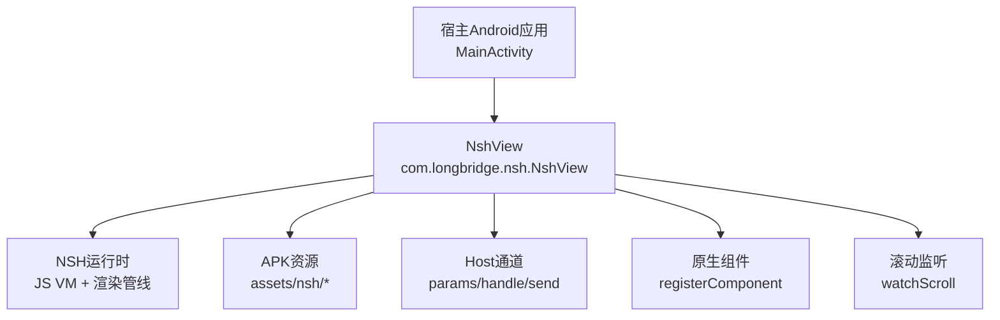
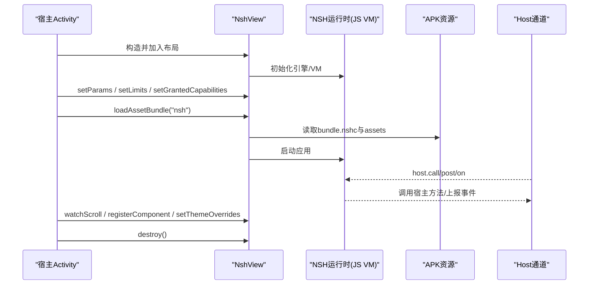
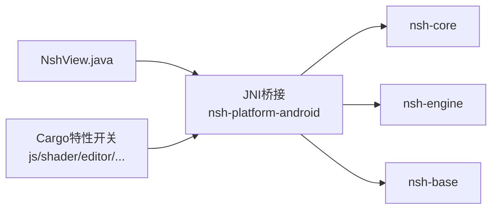

# Android平台集成

<cite>
**本文引用的文件**   
- [examples/embed-android/README.md](file://examples/embed-android/README.md)
- [website/docs/android.md](file://website/docs/android.md)
- [crates/nsh-platform-android/Cargo.toml](file://crates/nsh-platform-android/Cargo.toml)
- [crates/nsh-platform-android/java/com/longbridge/nsh/NshView.java](file://crates/nsh-platform-android/java/com/longbridge/nsh/NshView.java)
</cite>

## 目录
1. [简介](#简介)
2. [项目结构](#项目结构)
3. [核心组件](#核心组件)
4. [架构总览](#架构总览)
5. [详细组件分析](#详细组件分析)
6. [依赖分析](#依赖分析)
7. [性能考虑](#性能考虑)
8. [故障排查指南](#故障排查指南)
9. [结论](#结论)
10. [附录](#附录)

## 简介
本文件面向希望在现有Android应用中嵌入NSH应用的开发者，提供从项目配置到代码实现的完整步骤。内容涵盖：
- Activity集成与生命周期管理
- NSH运行时初始化、资源加载与主题覆盖
- 事件通道（host.params/handle/send）与原生组件注册
- 滚动视图联动、安全区域与键盘适配
- 权限、签名包与开发模式
- 常见问题与性能优化建议

## 项目结构
仓库中与Android集成直接相关的部分包括：
- 示例应用：examples/embed-android，展示如何在已有Activity中嵌入NshView并演示原生组件、滚动监听、host通道等能力
- 官方文档：website/docs/android.md，提供完整的Android平台说明、API参考与最佳实践
- Android平台后端：crates/nsh-platform-android，包含JNI桥接、Java层NshView与Rust侧能力开关
- Java入口类：crates/nsh-platform-android/java/com/longbridge/nsh/NshView.java，是宿主App集成的核心UI组件

图表来源
- [website/docs/android.md:75-224](file://website/docs/android.md#L75-L224)
- [examples/embed-android/README.md:1-94](file://examples/embed-android/README.md#L1-L94)

章节来源
- [website/docs/android.md:75-224](file://website/docs/android.md#L75-L224)
- [examples/embed-android/README.md:1-94](file://examples/embed-android/README.md#L1-L94)

## 核心组件
- NshView：NSH在Android上的UI容器，负责创建引擎、加载资源、处理事件、管理生命周期与系统交互（键盘、安全区域、滚动）。
- Host通道：通过setParams/handle/send实现宿主与应用的双向通信，无需额外视图。
- 原生组件：通过registerComponent将宿主自定义View暴露给JS使用。
- 滚动监听：通过watchScroll以nativeID绑定页面中的<Scroll>，实现宿主UI与页面滚动的同步。
- 主题覆盖：通过setThemeOverrides注入宿主品牌样式，即时生效。
- 签名包运行：runPackage执行经信任校验的下载包，支持离线更新。

章节来源
- [website/docs/android.md:197-224](file://website/docs/android.md#L197-L224)
- [website/docs/android.md:239-324](file://website/docs/android.md#L239-L324)
- [website/docs/android.md:326-342](file://website/docs/android.md#L326-L342)
- [website/docs/android.md:473-499](file://website/docs/android.md#L473-L499)

## 架构总览
下图展示了宿主Activity与NshView、NSH运行时、资源与通道的关系。每个NshView拥有独立的引擎与VM，互不干扰；宿主可设置限制、能力、语言、字体缩放、缓存策略等。

图表来源
- [website/docs/android.md:134-195](file://website/docs/android.md#L134-L195)
- [website/docs/android.md:197-224](file://website/docs/android.md#L197-L224)
- [website/docs/android.md:239-324](file://website/docs/android.md#L239-L324)

## 详细组件分析

### MainActivity集成示例
目标：在现有Activity中嵌入NSH应用，完成初始化、资源加载、事件传递与生命周期管理。

推荐步骤：
1. 添加AAR依赖
   - 发布版：dist/nsh/embed/android/nsh.aar
   - 开发版：dist/nsh/embed/android/nsh-dev.aar
   - Gradle示例见文档“Get the library”小节

2. 构建并打包资源
   - 将TSX应用构建为APK资源：nsh build App.tsx --release --out app/src/main/assets/nsh
   - 产物包含bundle.nshc、bundle.js、capabilities.json与assets/

3. 在Activity中创建并显示NshView
   - 在onCreate中new NshView(this)，设置错误回调，setContentView(nsh)
   - 调用loadAssetBundle("nsh")加载资源
   - 在onDestroy中调用destroy()释放资源

4. 可选：将NshView放入任意布局（如Toolbar下方）

5. 开发模式
   - 使用nsh-dev.aar时，connectDevServer连接本地dev server
   - 模拟器需adb reverse转发端口

章节来源
- [website/docs/android.md:90-133](file://website/docs/android.md#L90-L133)
- [website/docs/android.md:134-195](file://website/docs/android.md#L134-L195)
- [examples/embed-android/README.md:1-12](file://examples/embed-android/README.md#L1-L12)

### 生命周期管理与系统交互
- Back键：优先交给NSH处理（对话框关闭、页面回退、BackHandler），未消费时再交由Activity
- 键盘：NshView自动滚动使输入框可见；建议使用adjustResize或默认行为
- 安全区域：仅报告与视图重叠的系统栏与键盘区域；可叠加additionalSafeAreaInsets
- 配置变更：可在Activity声明configChanges避免重建；NshView会跟随尺寸、密度、方向变化重排
- 销毁：在宿主Activity/Fragment销毁时调用destroy()

章节来源
- [website/docs/android.md:524-553](file://website/docs/android.md#L524-L553)

### 资源加载与主题覆盖
- 资源加载
  - loadAssetBundle(dir)：从APK assets/dir/bundle.nshc加载
  - loadBundleFile(file)：仅接受JS源码，拒绝.nshc
  - runPackage(pkg)：运行已验证的签名包
- 主题覆盖
  - setThemeOverrides(json)：以nsh.json theme格式覆盖token，立即生效，影响后续加载的应用

章节来源
- [website/docs/android.md:197-224](file://website/docs/android.md#L197-L224)
- [website/docs/android.md:326-342](file://website/docs/android.md#L326-L342)

### 事件通道与原生组件
- 参数与事件
  - setParams(params)：应用启动时读取host.params
  - handle(name, handler)：接收host.call/host.post，UI线程执行，reply.resolve/reject
  - send(name, data)：向应用发送事件，任何线程可调用
- 原生组件
  - registerComponent(name, factory)：将宿主View暴露给JS使用
  - 组件通过context.emit触发事件，context.setSize反馈尺寸
- 滚动监听
  - watchScroll(nativeId, watcher)：基于nativeID绑定<Scroll>，提供NshScrollHandle进行滚动控制与监听

章节来源
- [website/docs/android.md:239-324](file://website/docs/android.md#L239-L324)
- [examples/embed-android/README.md:13-42](file://examples/embed-android/README.md#L13-L42)

### 权限、签名包与开发模式
- 权限
  - AAR声明INTERNET与ACCESS_NETWORK_STATE
  - 危险权限请求通过permissions API，由活动发起，跨配置变更
- 签名包
  - NshTrust校验公钥与撤销列表，openPackage在非UI线程执行，runPackage在UI线程执行
- 开发模式
  - nsh-dev.aar支持connectDevServer，允许HTTP明文访问（usesCleartextTraffic=true）

章节来源
- [website/docs/android.md:452-522](file://website/docs/android.md#L452-L522)

### NshView关键API速查
- 构造与错误回调：NshView(Context), setErrorListener
- 运行时配置：setLimits, setGrantedCapabilities, setLocale, setFontScale
- 外观与安全区：setAdditionalSafeAreaInsets, setThemeOverrides, registerFont
- 存储与缓存：setStorageDirectory, setCacheOptions
- 资源加载：loadAssetBundle, loadBundleFile, runPackage
- 扩展能力：registerComponent, watchScroll, setContentCulling
- 通信：setParams, send, handle
- 开发：connectDevServer
- 系统交互：handleBack, destroy

章节来源
- [website/docs/android.md:197-224](file://website/docs/android.md#L197-L224)

## 依赖分析
- Java层：NshView作为FrameLayout子类，承载NSH渲染树与JS VM
- Rust层：nsh-platform-android提供JNI桥接、文本布局、动画驱动等能力
- Cargo特性：js、shader、editor、rich-editor、plot、term、highlight、math、emoji-picker、zlib、crypto、websocket、updater、svg等按需启用

图表来源
- [crates/nsh-platform-android/Cargo.toml:1-83](file://crates/nsh-platform-android/Cargo.toml#L1-L83)

章节来源
- [crates/nsh-platform-android/Cargo.toml:1-83](file://crates/nsh-platform-android/Cargo.toml#L1-L83)

## 性能考虑
- 内存与节点数限制：通过setLimits调整堆大小、栈大小、加载超时、单次调用耗时与最大节点数，避免卡顿与OOM
- 滚动裁剪：setContentCulling(true)仅在视口附近生成子视图，减少绘制压力；需要全屏截图时可临时关闭
- 缓存策略：setCacheOptions控制图片与磁盘缓存大小，平衡IO与内存
- 字体与文本：合理设置setFontScale，避免频繁重排；必要时预注册字体
- 网络与资源：优先使用APK内资源与签名包，减少动态加载开销；开发模式注意明文HTTP与证书校验

章节来源
- [website/docs/android.md:197-224](file://website/docs/android.md#L197-L224)
- [website/docs/android.md:452-471](file://website/docs/android.md#L452-L471)

## 故障排查指南
- 无法加载资源
  - 确认assets路径与名称正确，bundle.nshc存在且可读
  - 若从外部文件加载，仅支持JS源码，不接受.nshc
- 崩溃或无响应
  - 检查setLimits是否过小导致VM被限制终止
  - 查看setErrorListener日志，定位JS异常或加载失败
- 键盘遮挡输入框
  - 确保windowSoftInputMode为adjustResize或未设置
- 主题未生效
  - 检查setThemeOverrides的JSON格式与token命名
- 滚动不同步
  - 确认<Scroll>设置了nativeID，并使用watchScroll绑定
- 权限问题
  - 检查Manifest声明与运行时请求流程，确保有前台Activity
- 签名包拒绝
  - 核对root公钥与撤销列表，确认openPackage在非UI线程执行

章节来源
- [website/docs/android.md:225-229](file://website/docs/android.md#L225-L229)
- [website/docs/android.md:363-418](file://website/docs/android.md#L363-L418)
- [website/docs/android.md:473-499](file://website/docs/android.md#L473-L499)

## 结论
通过在宿主Activity中引入NshView，开发者可以无缝地将NSH应用嵌入现有Android界面，获得独立引擎、灵活的主题覆盖、强大的host通道与原生组件能力。配合合理的生命周期管理、权限与签名机制，以及针对滚动、键盘与安全区域的适配，可以在保证体验的同时实现高性能与可维护性。

## 附录
- 快速清单
  - 添加nsh.aar或nsh-dev.aar依赖
  - 构建并放置assets/nsh
  - 在Activity中创建NshView并loadAssetBundle
  - 在onDestroy中调用destroy
  - 根据需要配置setLimits/setGrantedCapabilities/setThemeOverrides
  - 使用handle/send进行双向通信
  - 使用registerComponent暴露原生组件
  - 使用watchScroll同步滚动
  - 使用runPackage运行签名包
  - 开发模式使用connectDevServer

章节来源
- [examples/embed-android/README.md:1-94](file://examples/embed-android/README.md#L1-L94)
- [website/docs/android.md:75-224](file://website/docs/android.md#L75-L224)