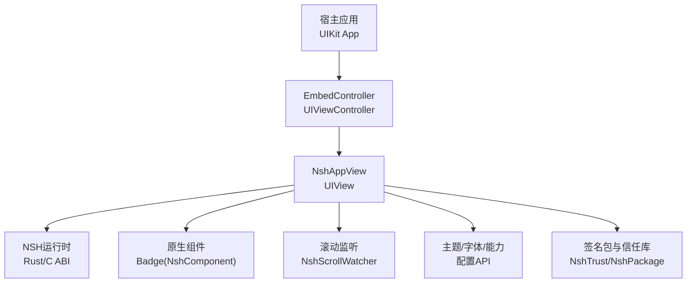
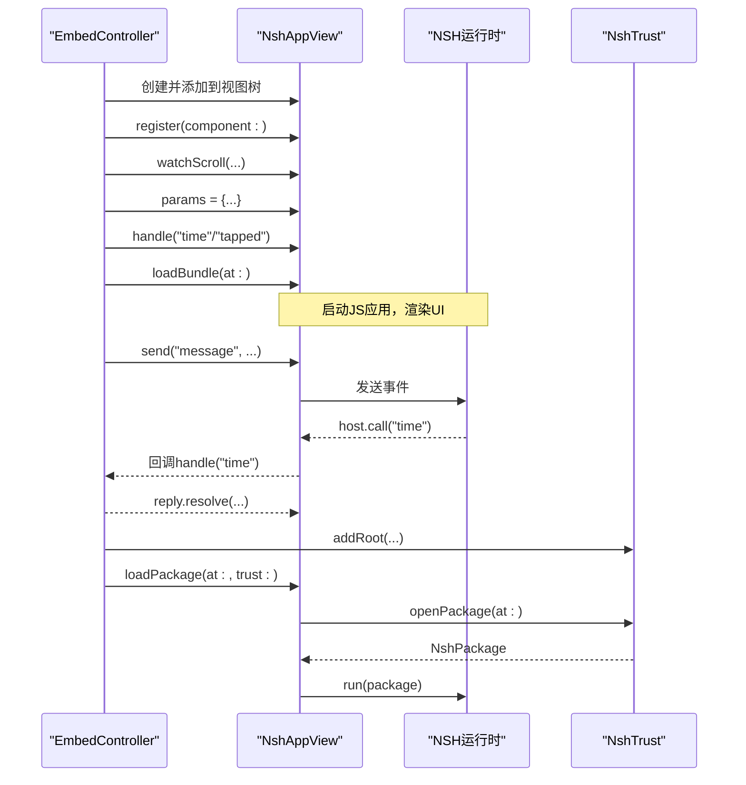
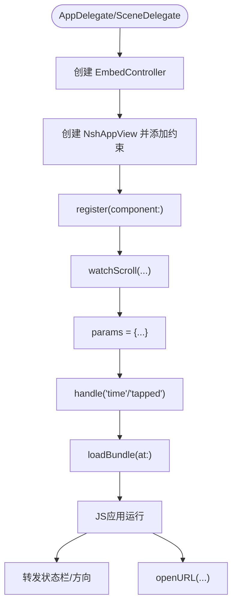
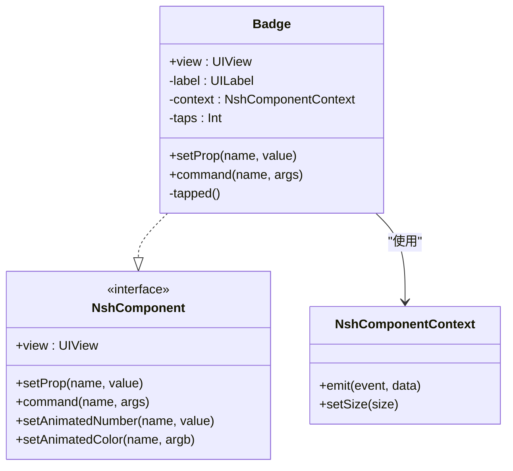
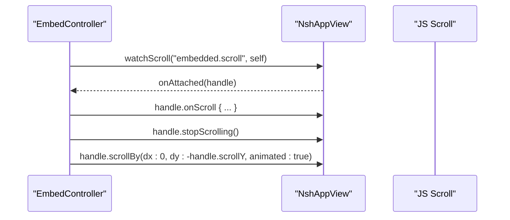
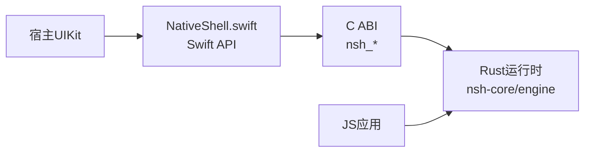

# iOS平台集成

<cite>
**本文引用的文件**   
- [examples/embed-ios/main.swift](file://examples/embed-ios/main.swift)
- [examples/embed-ios/README.md](file://examples/embed-ios/README.md)
- [crates/nsh-platform-ios/swift/NativeShell.swift](file://crates/nsh-platform-ios/swift/NativeShell.swift)
</cite>

## 目录
1. [简介](#简介)
2. [项目结构](#项目结构)
3. [核心组件](#核心组件)
4. [架构总览](#架构总览)
5. [详细组件分析](#详细组件分析)
6. [依赖关系分析](#依赖关系分析)
7. [性能与资源限制](#性能与资源限制)
8. [iOS权限、沙盒与调试](#ios权限沙盒与调试)
9. [常见问题排查](#常见问题排查)
10. [结论](#结论)

## 简介
本文面向已有iOS应用，说明如何将NSH应用以视图形式嵌入宿主UIKit应用中。内容覆盖从Xcode工程配置到Swift代码实现的全流程，包括：
- 使用 `NshAppView` 承载NSH运行时
- 在ViewController中管理生命周期与状态
- 通过 `nsh/host` 通道进行参数传递、调用与事件通信
- 注册原生组件（Native Component）
- 监听并驱动滚动视图
- 主题覆盖、字体注册、能力授权
- 签名包加载与信任库管理
- 链接打开、Handoff、状态栏与方向控制
- 开发模式连接远程服务
- iOS权限、沙盒路径与调试技巧

## 项目结构
示例工程位于 `examples/embed-ios`，包含一个可直接运行的Swift入口，演示了完整的嵌入方式；NSH在iOS平台的Swift API定义位于 `crates/nsh-platform-ios/swift/NativeShell.swift`。

图表来源
- [examples/embed-ios/main.swift:18-201](file://examples/embed-ios/main.swift#L18-L201)
- [crates/nsh-platform-ios/swift/NativeShell.swift:116-373](file://crates/nsh-platform-ios/swift/NativeShell.swift#L116-L373)

章节来源
- [examples/embed-ios/main.swift:1-308](file://examples/embed-ios/main.swift#L1-L308)
- [examples/embed-ios/README.md:1-88](file://examples/embed-ios/README.md#L1-L88)

## 核心组件
- NshAppView：承载NSH应用的UIView，负责加载bundle或签名包、与JS侧通信、主题与字体、能力授权、URL处理等。
- NshTrust/NshPackage：签名包的信任管理与验证执行。
- NshComponent/NshComponentContext：原生组件接口，用于将宿主UI暴露给JS。
- NshScrollWatcher/NshScrollHandle：滚动视图的监听与控制。
- NshHostReply：对JS调用的响应对象。

章节来源
- [crates/nsh-platform-ios/swift/NativeShell.swift:116-373](file://crates/nsh-platform-ios/swift/NativeShell.swift#L116-L373)
- [crates/nsh-platform-ios/swift/NativeShell.swift:379-466](file://crates/nsh-platform-ios/swift/NativeShell.swift#L379-L466)
- [crates/nsh-platform-ios/swift/NativeShell.swift:471-528](file://crates/nsh-platform-ios/swift/NativeShell.swift#L471-L528)
- [crates/nsh-platform-ios/swift/NativeShell.swift:559-601](file://crates/nsh-platform-ios/swift/NativeShell.swift#L559-L601)
- [crates/nsh-platform-ios/swift/NativeShell.swift:770-800](file://crates/nsh-platform-ios/swift/NativeShell.swift#L770-L800)

## 架构总览
下图展示了宿主UIKit与NSH运行时的交互关系，以及关键数据流。

图表来源
- [examples/embed-ios/main.swift:82-119](file://examples/embed-ios/main.swift#L82-L119)
- [examples/embed-ios/main.swift:171-187](file://examples/embed-ios/main.swift#L171-L187)
- [crates/nsh-platform-ios/swift/NativeShell.swift:327-347](file://crates/nsh-platform-ios/swift/NativeShell.swift#L327-L347)
- [crates/nsh-platform-ios/swift/NativeShell.swift:379-424](file://crates/nsh-platform-ios/swift/NativeShell.swift#L379-L424)

## 详细组件分析

### 视图控制器集成与生命周期
- 在 `viewDidLoad` 中创建 `NshAppView`，设置错误回调、注册原生组件、监听滚动、设置参数与处理器，最后调用 `loadBundle`。
- 通过约束将NSH视图与宿主UI布局组合。
- 转发状态栏样式、隐藏策略、动画与方向控制给 `NshAppView` 的静态属性。
- 使用Scene生命周期初始化窗口与根控制器，并将系统打开的链接传递给 `NshAppView.openURL`。

图表来源
- [examples/embed-ios/main.swift:37-107](file://examples/embed-ios/main.swift#L37-L107)
- [examples/embed-ios/main.swift:190-201](file://examples/embed-ios/main.swift#L190-L201)
- [examples/embed-ios/main.swift:275-305](file://examples/embed-ios/main.swift#L275-L305)

章节来源
- [examples/embed-ios/main.swift:18-201](file://examples/embed-ios/main.swift#L18-L201)
- [examples/embed-ios/main.swift:260-308](file://examples/embed-ios/main.swift#L260-L308)

### main.swift 集成要点
- 构建并复制NSH产物：将 `nsh build` 的输出作为资源目录 `nsh` 加入应用，其中包含 `bundle.nshc` 与 `assets`。
- 加载Bundle：通过 `app.loadBundle(at:)` 指定 `nsh/bundle.nshc` 的路径。
- 签名包更新：使用 `NshTrust` 管理根密钥与撤销列表，调用 `app.loadPackage(at:trust:)` 下载并验证签名包后运行。
- 原生组件：通过 `app.register(component:)` 将宿主UI暴露给JS，组件实现 `NshComponent`，支持属性、命令、事件与尺寸上报。
- 滚动联动：通过 `app.watchScroll(...)` 监听JS `<Scroll>`，获取 `NshScrollHandle` 以驱动或跟随滚动。
- 无视图通信：通过 `app.params`、`app.handle(...)`、`app.send(...)` 与JS侧 `nsh/host` 通道交互。
- 主题覆盖：使用 `app.setThemeOverrides(...)` 注入宿主品牌主题。
- 字体注册：使用 `app.registerFont(...)` 提供自定义字体。
- 能力授权：使用 `app.grantCapabilities(...)` 授予JS能力。
- 开发模式：使用 `NativeShellDev.xcframework` 时，可调用 `connectDevServer(...)` 连接本地开发服务器。

章节来源
- [examples/embed-ios/README.md:6-82](file://examples/embed-ios/README.md#L6-L82)
- [examples/embed-ios/main.swift:109-187](file://examples/embed-ios/main.swift#L109-L187)

### NSH运行时Swift API
- NshAppView
  - 生命周期：构造、销毁时自动释放底层资源。
  - 错误处理：`onError` 回调主线程错误消息。
  - 运行时限制：`limits` 控制内存、栈、加载预算、调用预算、节点数上限。
  - 内容裁剪：`contentCulling` 控制滚动内容按需生成。
  - Handoff：`handoff` 开启跨设备接力。
  - 存储目录：`storageDirectory` 统一JS storage路径。
  - 缓存选项：`cacheOptions` 控制图片缓存位置与大小策略。
  - 国际化与字号：`locale`、`fontScale`。
  - 启动参数：`params` 同步提供给JS。
  - 主题覆盖：`setThemeOverrides(json?)`。
  - 字体注册：`registerFont(data)`。
  - 能力授权：`grantCapabilities(json?)`。
  - 加载Bundle：`loadBundle(at:)`。
  - 运行签名包：`run(_ package:)` 与 `loadPackage(at:trust:)`。
  - 开发模式：`connectDevServer(url)`。
  - 状态栏与方向：静态属性转发。
  - URL处理：`openURL(_:)` 与 `onOpenURL`。
  - 主机通道：`send(name,data?)`、`handle(name,handler)`、`removeHandler(name)`。
  - 原生组件注册：`register(component:name,make:)`。
- NshTrust/NshPackage
  - 信任库：`init(stateDirectory:)`、`addRoot(publicKey:)`、`updateRevocations(json:)`、`openPackage(at:)`。
  - 签名包信息：`Info(id,name,version,build)`。
- NshComponent/NshComponentContext
  - 组件接口：`view`、`setProp`、`command`、`setAnimatedNumber`、`setAnimatedColor`。
  - 上下文：`emit(event,data?)`、`setSize(size)`。
- NshHostReply
  - 异步响应：`resolve(value?)`、`reject(message)`。
- NshScrollWatcher/NshScrollHandle
  - 监听器：`onAttached(handle)`、`onDetached()`。
  - 句柄：`isAlive`、`scrollX/Y`、`contentWidth/Height`、`viewportWidth/Height`、`onScroll`、`onContentSizeChange`、`stopScrolling()`、`scrollBy(dx:dy:animated:)`。

章节来源
- [crates/nsh-platform-ios/swift/NativeShell.swift:116-373](file://crates/nsh-platform-ios/swift/NativeShell.swift#L116-L373)
- [crates/nsh-platform-ios/swift/NativeShell.swift:379-466](file://crates/nsh-platform-ios/swift/NativeShell.swift#L379-L466)
- [crates/nsh-platform-ios/swift/NativeShell.swift:471-528](file://crates/nsh-platform-ios/swift/NativeShell.swift#L471-L528)
- [crates/nsh-platform-ios/swift/NativeShell.swift:559-601](file://crates/nsh-platform-ios/swift/NativeShell.swift#L559-L601)
- [crates/nsh-platform-ios/swift/NativeShell.swift:609-767](file://crates/nsh-platform-ios/swift/NativeShell.swift#L609-L767)
- [crates/nsh-platform-ios/swift/NativeShell.swift:770-800](file://crates/nsh-platform-ios/swift/NativeShell.swift#L770-L800)

### 原生组件实现（Badge）
- 继承 `NshComponent`，持有宿主 `UIView` 与 `UILabel`。
- 通过 `setProp` 接收JS传入的属性（文本、颜色），并根据内容计算尺寸。
- 通过 `command` 响应JS的命令（如脉冲动画）。
- 通过 `context.emit("tap", ...)` 向JS抛出点击事件。

图表来源
- [examples/embed-ios/main.swift:203-246](file://examples/embed-ios/main.swift#L203-L246)
- [crates/nsh-platform-ios/swift/NativeShell.swift:471-528](file://crates/nsh-platform-ios/swift/NativeShell.swift#L471-L528)

章节来源
- [examples/embed-ios/main.swift:203-246](file://examples/embed-ios/main.swift#L203-L246)
- [crates/nsh-platform-ios/swift/NativeShell.swift:471-528](file://crates/nsh-platform-ios/swift/NativeShell.swift#L471-L528)

### 滚动联动流程
- 宿主通过 `app.watchScroll("embedded.scroll", self)` 订阅JS页面中的滚动元素。
- 当元素出现时，`onAttached` 返回 `NshScrollHandle`，可监听滚动与尺寸变化。
- 宿主可主动停止滚动或驱动滚动位置。

图表来源
- [examples/embed-ios/main.swift:84-84](file://examples/embed-ios/main.swift#L84-L84)
- [examples/embed-ios/main.swift:159-169](file://examples/embed-ios/main.swift#L159-L169)
- [examples/embed-ios/main.swift:122-133](file://examples/embed-ios/main.swift#L122-L133)
- [crates/nsh-platform-ios/swift/NativeShell.swift:770-800](file://crates/nsh-platform-ios/swift/NativeShell.swift#L770-L800)

章节来源
- [examples/embed-ios/main.swift:84-84](file://examples/embed-ios/main.swift#L84-L84)
- [examples/embed-ios/main.swift:159-169](file://examples/embed-ios/main.swift#L159-L169)
- [examples/embed-ios/main.swift:122-133](file://examples/embed-ios/main.swift#L122-L133)
- [crates/nsh-platform-ios/swift/NativeShell.swift:770-800](file://crates/nsh-platform-ios/swift/NativeShell.swift#L770-L800)

## 依赖关系分析
- Swift层（NativeShell.swift）通过C ABI调用底层Rust实现的NSH运行时。
- 宿主应用通过 `NshAppView` 暴露的能力与JS侧模块（如 `nsh/host`、`nsh/device`、`nsh/native`）进行双向通信。
- 签名包机制由 `NshTrust` 管理根密钥与撤销列表，确保仅运行可信包。

图表来源
- [crates/nsh-platform-ios/swift/NativeShell.swift:1-18](file://crates/nsh-platform-ios/swift/NativeShell.swift#L1-L18)
- [crates/nsh-platform-ios/swift/NativeShell.swift:116-373](file://crates/nsh-platform-ios/swift/NativeShell.swift#L116-L373)

章节来源
- [crates/nsh-platform-ios/swift/NativeShell.swift:1-18](file://crates/nsh-platform-ios/swift/NativeShell.swift#L1-L18)
- [crates/nsh-platform-ios/swift/NativeShell.swift:116-373](file://crates/nsh-platform-ios/swift/NativeShell.swift#L116-L373)

## 性能与资源限制
- VM限制：可通过 `NshAppView.limits` 设置JS堆内存、解释器栈、加载预算、调用预算与最大节点数，防止单应用影响宿主稳定性。
- 内容裁剪：`contentCulling` 默认开启，仅在视口附近生成内容以提升滚动性能；关闭后可用于全量截图等场景。
- 缓存策略：`NshCacheOptions` 支持系统缓存目录、自定义目录或关闭磁盘缓存；图片缓存支持默认策略或按大小限制。
- 开发模式：使用 `NativeShellDev.xcframework` 连接 `nsh dev` 服务器，便于热重载与调试。

章节来源
- [crates/nsh-platform-ios/swift/NativeShell.swift:75-103](file://crates/nsh-platform-ios/swift/NativeShell.swift#L75-L103)
- [crates/nsh-platform-ios/swift/NativeShell.swift:181-189](file://crates/nsh-platform-ios/swift/NativeShell.swift#L181-L189)
- [crates/nsh-platform-ios/swift/NativeShell.swift:40-73](file://crates/nsh-platform-ios/swift/NativeShell.swift#L40-L73)
- [crates/nsh-platform-ios/swift/NativeShell.swift:349-354](file://crates/nsh-platform-ios/swift/NativeShell.swift#L349-L354)

## iOS权限、沙盒与调试
- Info.plist最小配置：仅需启用多场景支持（`UIApplicationSupportsMultipleScenes` 为false），其余由代码配置SceneDelegate。
- 链接与Handoff：
  - 自定义scheme与Universal Link通过 `scene(_:openURLContexts:)` 与 `scene(_:continue:)` 交给 `NshAppView.openURL`。
  - 开启 `handoff` 可将当前URL写入 `NSUserActivity`，在其他设备上继续。
- 状态栏与方向：
  - 将 `preferredStatusBarStyle`、`prefersStatusBarHidden`、`preferredStatusBarUpdateAnimation` 与 `supportedInterfaceOrientations` 转发给 `NshAppView` 的静态属性。
- 沙盒路径：
  - 信任库与签名包资产通常放在Application Support目录下，例如 `applicationSupportDirectory/nsh`。
  - JS storage目录可通过 `storageDirectory` 统一设置。
- 调试技巧：
  - 使用 `NativeShellDev.xcframework` 并调用 `connectDevServer(URL)` 连接本地开发服务器。
  - 设置 `onError` 捕获JS异常与加载失败。
  - 通过 `limits` 调整加载与调用预算，避免卡顿或崩溃。

章节来源
- [examples/embed-ios/main.swift:258-305](file://examples/embed-ios/main.swift#L258-L305)
- [examples/embed-ios/main.swift:190-201](file://examples/embed-ios/main.swift#L190-L201)
- [examples/embed-ios/main.swift:32-35](file://examples/embed-ios/main.swift#L32-L35)
- [crates/nsh-platform-ios/swift/NativeShell.swift:191-214](file://crates/nsh-platform-ios/swift/NativeShell.swift#L191-L214)
- [crates/nsh-platform-ios/swift/NativeShell.swift:349-354](file://crates/nsh-platform-ios/swift/NativeShell.swift#L349-L354)

## 常见问题排查
- Bundle未找到：确认已将 `nsh/build` 输出作为资源目录 `nsh` 加入应用，且路径指向 `bundle.nshc`。
- 签名包被拒绝：检查 `NshTrust.addRoot` 是否添加了正确的根公钥，以及撤销列表是否最新。
- JS调用无响应：确认已通过 `handle(name, handler)` 注册对应处理器，并确保 `reply.resolve/reject` 只调用一次。
- 滚动联动无效：确认JS侧元素设置了正确的 `nativeID`，并在 `onAttached` 中保存 `NshScrollHandle`。
- 主题未生效：确认 `setThemeOverrides` 传入的JSON格式正确，且键名与JS侧主题一致。
- 字体不显示：确认 `registerFont` 传入的是有效的字体数据（TTF/OTF/WOFF/WOFF2）。
- 开发模式无法连接：确认使用 `NativeShellDev.xcframework` 且本地 `nsh dev` 服务已启动。

章节来源
- [examples/embed-ios/README.md:6-82](file://examples/embed-ios/README.md#L6-L82)
- [crates/nsh-platform-ios/swift/NativeShell.swift:327-354](file://crates/nsh-platform-ios/swift/NativeShell.swift#L327-L354)
- [crates/nsh-platform-ios/swift/NativeShell.swift:379-424](file://crates/nsh-platform-ios/swift/NativeShell.swift#L379-L424)
- [crates/nsh-platform-ios/swift/NativeShell.swift:609-681](file://crates/nsh-platform-ios/swift/NativeShell.swift#L609-L681)
- [crates/nsh-platform-ios/swift/NativeShell.swift:770-800](file://crates/nsh-platform-ios/swift/NativeShell.swift#L770-L800)

## 结论
通过将 `NshAppView` 嵌入现有UIKit应用，开发者可以在宿主UI之下运行NSH应用，并通过丰富的Swift API完成参数传递、调用与事件通信、原生组件扩展、滚动联动、主题与字体管理、能力授权、签名包更新与调试。结合iOS的Scene生命周期、链接处理与Handoff，可实现与宿主应用无缝集成的体验。合理配置VM限制与缓存策略，可在保证性能的同时提升用户体验。