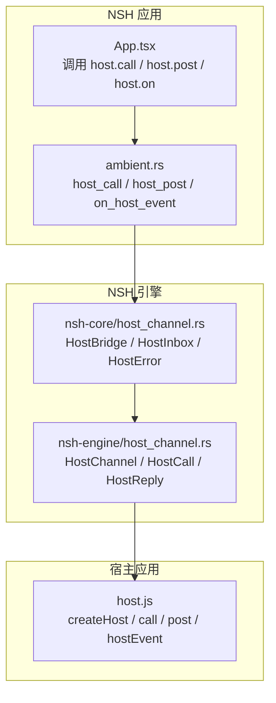
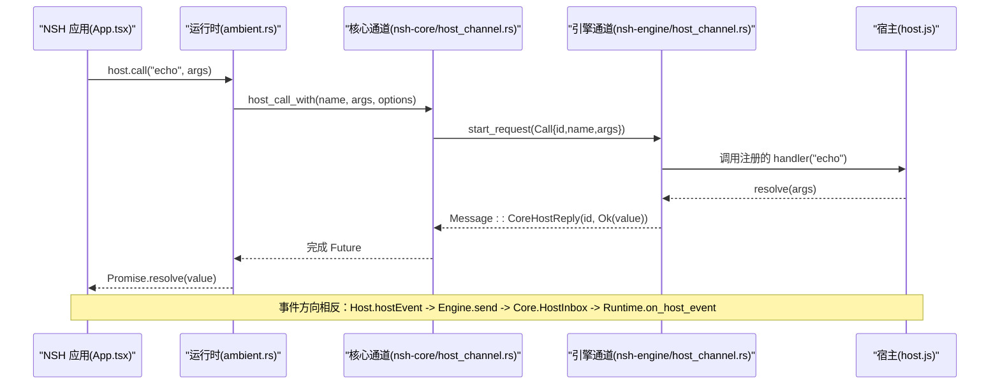
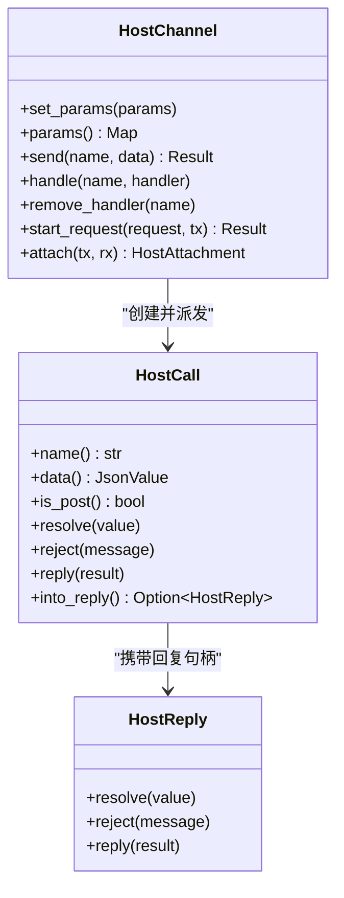
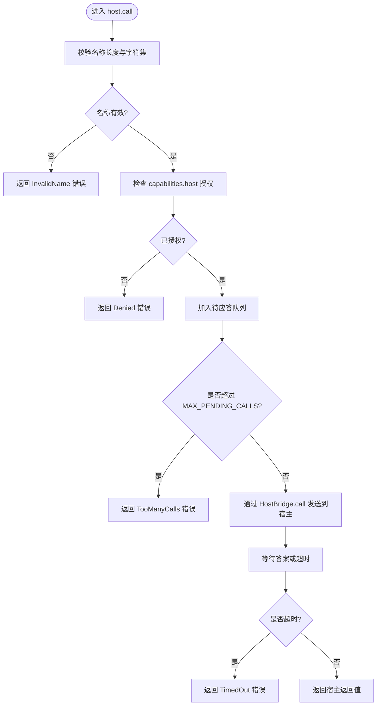
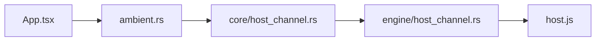
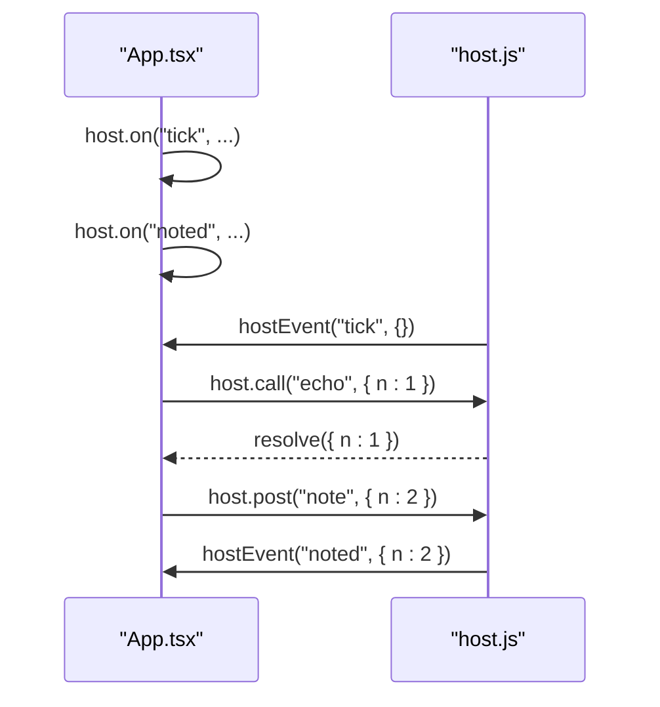

# 宿主通信机制

<cite>
**本文引用的文件**   
- [examples/host-echo/App.tsx](file://examples/host-echo/App.tsx)
- [examples/host-echo/host.js](file://examples/host-echo/host.js)
- [crates/nsh-core/src/host_channel.rs](file://crates/nsh-core/src/host_channel.rs)
- [crates/nsh-engine/src/host_channel.rs](file://crates/nsh-engine/src/host_channel.rs)
- [crates/nsh-core/src/element/ambient.rs](file://crates/nsh-core/src/element/ambient.rs)
</cite>

## 目录
1. [引言](#引言)
2. [项目结构](#项目结构)
3. [核心组件](#核心组件)
4. [架构总览](#架构总览)
5. [详细组件分析](#详细组件分析)
6. [依赖关系分析](#依赖关系分析)
7. [性能与容量限制](#性能与容量限制)
8. [安全与权限模型](#安全与权限模型)
9. [错误处理策略](#错误处理策略)
10. [API 参考](#api-参考)
11. [使用示例：host-echo](#使用示例host-echo)
12. [故障排查指南](#故障排查指南)
13. [结论](#结论)

## 引言
本文面向需要在宿主应用（嵌入 NSH 的宿主）与 NSH 应用之间实现双向通信的开发者。内容涵盖：
- 双向通信协议与消息格式
- 事件订阅模式
- 命令调用与状态同步
- 安全与权限控制
- 错误处理与超时、配额保护
- 性能优化建议
- 基于 host-echo 示例的端到端说明
- 完整的 API 参考

## 项目结构
围绕宿主通信，仓库中与本主题直接相关的代码分布在以下位置：
- 示例层：examples/host-echo 展示 JS 宿主与 TS 应用的交互
- 核心层：nsh-core 定义跨语言共享的消息通道、错误类型、名称校验与入队逻辑
- 引擎层：nsh-engine 提供宿主侧 HostChannel，负责分发事件、注册处理器、管理调用生命周期
- 运行时桥接：ambient 暴露 host_call / host_post / on_host_event 等运行时能力

图表来源
- [examples/host-echo/App.tsx:1-47](file://examples/host-echo/App.tsx#L1-L47)
- [crates/nsh-core/src/host_channel.rs:1-120](file://crates/nsh-core/src/host_channel.rs#L1-L120)
- [crates/nsh-engine/src/host_channel.rs:1-120](file://crates/nsh-engine/src/host_channel.rs#L1-L120)
- [examples/host-echo/host.js:1-18](file://examples/host-echo/host.js#L1-L18)

章节来源
- [examples/host-echo/App.tsx:1-47](file://examples/host-echo/App.tsx#L1-L47)
- [examples/host-echo/host.js:1-18](file://examples/host-echo/host.js#L1-L18)
- [crates/nsh-core/src/host_channel.rs:1-120](file://crates/nsh-core/src/host_channel.rs#L1-L120)
- [crates/nsh-engine/src/host_channel.rs:1-120](file://crates/nsh-engine/src/host_channel.rs#L1-L120)

## 核心组件
- 消息通道抽象（nsh-core）
  - HostBridge：应用侧看到的宿主接口（available、params、call、post）
  - HostInbox：未消费事件的缓冲队列，按名称保留，满则丢弃最旧
  - HostError：统一的错误类型与稳定错误码映射
  - HostRequest：从应用到宿主的请求（Call/Post）
- 宿主通道实现（nsh-engine）
  - HostChannel：宿主侧通道，负责参数、事件发送、处理器注册、URL 路由钩子
  - HostCall / HostReply：一次调用的上下文与回复对象
  - OpenUrlRequest：URL 打开请求的统一入口
- 运行时桥接（ambient）
  - host_call / host_call_with：发起异步调用并支持超时
  - host_post：无返回的事件式调用
  - on_host_event：订阅宿主推送的事件

章节来源
- [crates/nsh-core/src/host_channel.rs:1-120](file://crates/nsh-core/src/host_channel.rs#L1-L120)
- [crates/nsh-engine/src/host_channel.rs:1-120](file://crates/nsh-engine/src/host_channel.rs#L1-L120)
- [crates/nsh-core/src/element/ambient.rs:1370-1462](file://crates/nsh-core/src/element/ambient.rs#L1370-L1462)

## 架构总览
下图展示了从 NSH 应用到宿主 JS 的双向通信流程：

图表来源
- [crates/nsh-core/src/element/ambient.rs:1370-1462](file://crates/nsh-core/src/element/ambient.rs#L1370-L1462)
- [crates/nsh-core/src/host_channel.rs:224-296](file://crates/nsh-core/src/host_channel.rs#L224-L296)
- [crates/nsh-engine/src/host_channel.rs:289-348](file://crates/nsh-engine/src/host_channel.rs#L289-L348)
- [examples/host-echo/host.js:5-17](file://examples/host-echo/host.js#L5-L17)

## 详细组件分析

### 宿主通道（nsh-engine HostChannel）
职责：
- 维护宿主侧的参数、处理器集合、URL 处理器
- 接收来自 NSH 应用的 Call/Post 请求并分发给对应处理器
- 将宿主侧事件发送到运行中的 NSH 应用；若无应用运行则缓存
- 管理调用的“进行中”计数与答案回传

关键行为：
- set_params / params：设置和读取启动参数
- handle / remove_handler：注册或移除处理器
- send：发送事件，若当前有引擎运行则投递，否则入 pending 队列
- start_request：根据请求类型分发 Call/Post，未配置或未找到处理器时拒绝
- attach/detach：绑定/解绑引擎，确保事件在应用切换时的正确归属

图表来源
- [crates/nsh-engine/src/host_channel.rs:87-122](file://crates/nsh-engine/src/host_channel.rs#L87-L122)
- [crates/nsh-engine/src/host_channel.rs:140-236](file://crates/nsh-engine/src/host_channel.rs#L140-L236)
- [crates/nsh-engine/src/host_channel.rs:289-348](file://crates/nsh-engine/src/host_channel.rs#L289-L348)
- [crates/nsh-engine/src/host_channel.rs:563-628](file://crates/nsh-engine/src/host_channel.rs#L563-L628)
- [crates/nsh-engine/src/host_channel.rs:700-772](file://crates/nsh-engine/src/host_channel.rs#L700-L772)

章节来源
- [crates/nsh-engine/src/host_channel.rs:87-122](file://crates/nsh-engine/src/host_channel.rs#L87-L122)
- [crates/nsh-engine/src/host_channel.rs:140-236](file://crates/nsh-engine/src/host_channel.rs#L140-L236)
- [crates/nsh-engine/src/host_channel.rs:289-348](file://crates/nsh-engine/src/host_channel.rs#L289-L348)
- [crates/nsh-engine/src/host_channel.rs:563-628](file://crates/nsh-engine/src/host_channel.rs#L563-L628)
- [crates/nsh-engine/src/host_channel.rs:700-772](file://crates/nsh-engine/src/host_channel.rs#L700-L772)

### 核心通道与错误模型（nsh-core）
职责：
- 定义 HostBridge 接口，供引擎实现并在应用侧暴露
- 定义 HostInbox 事件缓冲，保证未监听事件可被后续监听者消费
- 定义 HostError 及其稳定错误码，统一错误语义
- 定义 HostRequest 作为从应用到宿主的请求载体

关键点：
- MAX_QUEUED_EVENTS：事件缓冲上限
- MAX_PENDING_CALLS：并发等待答案的上限
- DEFAULT_CALL_TIMEOUT：默认调用超时
- check_name / valid_host_name：名称合法性校验
- refusal：权限与名称规则检查

图表来源
- [crates/nsh-core/src/host_channel.rs:18-104](file://crates/nsh-core/src/host_channel.rs#L18-L104)
- [crates/nsh-core/src/host_channel.rs:106-173](file://crates/nsh-core/src/host_channel.rs#L106-L173)
- [crates/nsh-core/src/host_channel.rs:183-222](file://crates/nsh-core/src/host_channel.rs#L183-L222)
- [crates/nsh-core/src/host_channel.rs:224-296](file://crates/nsh-core/src/host_channel.rs#L224-L296)

章节来源
- [crates/nsh-core/src/host_channel.rs:18-104](file://crates/nsh-core/src/host_channel.rs#L18-L104)
- [crates/nsh-core/src/host_channel.rs:106-173](file://crates/nsh-core/src/host_channel.rs#L106-L173)
- [crates/nsh-core/src/host_channel.rs:183-222](file://crates/nsh-core/src/host_channel.rs#L183-L222)
- [crates/nsh-core/src/host_channel.rs:224-296](file://crates/nsh-core/src/host_channel.rs#L224-L296)

### 运行时桥接（ambient）
职责：
- 暴露 host_call / host_call_with / host_post / on_host_event
- 为 host_call 提供基于应用时钟的超时控制
- 将 on_host_event 与宿主事件源连接起来，支持事件缓冲与订阅生命周期

要点：
- host_call_with 支持自定义超时，0 表示无限等待
- on_host_event 会在没有监听器时缓存事件，直到监听器添加后消费
- host_post 是无响应的单向通知

章节来源
- [crates/nsh-core/src/element/ambient.rs:1370-1462](file://crates/nsh-core/src/element/ambient.rs#L1370-L1462)

## 依赖关系分析
- nsh-core 定义跨语言契约（HostBridge、HostError、HostInbox），不依赖具体宿主实现
- nsh-engine 实现 HostBridge，并通过 HostChannel 管理宿主侧状态
- ambient 在运行时调用 core 的服务，最终落到 engine 的 HostChannel
- 示例 host-echo 通过 JS 宿主实现 createHost，提供 call/post/hostEvent

图表来源
- [crates/nsh-core/src/element/ambient.rs:1370-1462](file://crates/nsh-core/src/element/ambient.rs#L1370-L1462)
- [crates/nsh-core/src/host_channel.rs:1-120](file://crates/nsh-core/src/host_channel.rs#L1-L120)
- [crates/nsh-engine/src/host_channel.rs:1-120](file://crates/nsh-engine/src/host_channel.rs#L1-L120)
- [examples/host-echo/host.js:1-18](file://examples/host-echo/host.js#L1-L18)
- [examples/host-echo/App.tsx:1-47](file://examples/host-echo/App.tsx#L1-L47)

章节来源
- [crates/nsh-core/src/host_channel.rs:1-120](file://crates/nsh-core/src/host_channel.rs#L1-L120)
- [crates/nsh-engine/src/host_channel.rs:1-120](file://crates/nsh-engine/src/host_channel.rs#L1-L120)
- [crates/nsh-core/src/element/ambient.rs:1370-1462](file://crates/nsh-core/src/element/ambient.rs#L1370-L1462)
- [examples/host-echo/host.js:1-18](file://examples/host-echo/host.js#L1-L18)
- [examples/host-echo/App.tsx:1-47](file://examples/host-echo/App.tsx#L1-L47)

## 性能与容量限制
- 事件缓冲上限：MAX_QUEUED_EVENTS = 256，超出时丢弃最旧事件
- 并发调用上限：MAX_PENDING_CALLS = 1024，超出时报 TooManyCalls
- 默认调用超时：DEFAULT_CALL_TIMEOUT = 30s，可通过 HostCallOptions.timeout 调整
- 名称长度上限：MAX_NAME_LEN = 256 字节
- 处理器执行要求：必须快速返回；耗时操作应移至其他线程，再通过 HostCall.resolve/reject 回传结果

优化建议：
- 对高频事件进行节流或合并
- 合理设置调用超时，避免长时间阻塞
- 避免在处理器中执行阻塞 I/O
- 使用 host.post 替代 host.call 当不需要返回值

章节来源
- [crates/nsh-core/src/host_channel.rs:18-104](file://crates/nsh-core/src/host_channel.rs#L18-L104)
- [crates/nsh-engine/src/host_channel.rs:40-51](file://crates/nsh-engine/src/host_channel.rs#L40-L51)

## 安全与权限模型
- 名称合法性：仅允许特定字符集，非法名称会触发 InvalidName
- 权限控制：capabilities.host 白名单决定哪些名称可被调用；未授权触发 Denied
- URL 路由：openUrl 走专用钩子，不受 host.call 名称空间影响，需单独授权 openUrl capability

章节来源
- [crates/nsh-core/src/host_channel.rs:27-81](file://crates/nsh-core/src/host_channel.rs#L27-L81)
- [crates/nsh-engine/src/host_channel.rs:368-404](file://crates/nsh-engine/src/host_channel.rs#L368-L404)

## 错误处理策略
- HostError 枚举覆盖失败、未授权、无效名称、平台不可用、超时、配额超限等场景
- 每种错误映射到稳定的错误码，便于上层统一处理
- 调用未得到答案时会由 HostReply Drop 自动拒绝，防止泄漏

章节来源
- [crates/nsh-core/src/host_channel.rs:106-173](file://crates/nsh-core/src/host_channel.rs#L106-L173)
- [crates/nsh-engine/src/host_channel.rs:761-772](file://crates/nsh-engine/src/host_channel.rs#L761-L772)

## API 参考

### NSH 应用侧 API（TypeScript/JSX）
- host.available(): boolean
  - 描述：当前平台是否存在可用的宿主通道
- host.params: object
  - 描述：宿主启动时传入的参数（JSON 对象）
- host.call(name: string, args?: any, options?: { timeout?: number }): Promise<any>
  - 描述：调用宿主函数，等待返回值；支持超时选项
- host.post(name: string, args?: any): void
  - 描述：向宿主发送事件，无需返回值
- host.on(name: string, listener: (data: any) => void): () => void
  - 描述：订阅宿主事件；返回取消订阅函数

章节来源
- [examples/host-echo/App.tsx:1-47](file://examples/host-echo/App.tsx#L1-L47)
- [crates/nsh-core/src/element/ambient.rs:1370-1462](file://crates/nsh-core/src/element/ambient.rs#L1370-L1462)

### 宿主侧 API（JavaScript）
- createHost(player): { call(name, args), post(name, args) }
  - 描述：宿主入口，返回 call/post 处理器
- player.hostEvent(name: string, data: any): void
  - 描述：向 NSH 应用推送事件

章节来源
- [examples/host-echo/host.js:1-18](file://examples/host-echo/host.js#L1-L18)

### Rust 宿主侧 API（nsh-engine）
- HostChannel::new()
- HostChannel::set_params(params)
- HostChannel::params()
- HostChannel::send(name, data)
- HostChannel::handle(name, handler)
- HostChannel::remove_handler(name)
- HostChannel::handle_open_url(handler)
- HostChannel::remove_open_url_handler()

章节来源
- [crates/nsh-engine/src/host_channel.rs:140-236](file://crates/nsh-engine/src/host_channel.rs#L140-L236)
- [crates/nsh-engine/src/host_channel.rs:368-404](file://crates/nsh-engine/src/host_channel.rs#L368-L404)

## 使用示例：host-echo
该示例演示了 NSH 应用与 JS 宿主之间的数据交换、命令调用与事件同步：
- 应用侧
  - 订阅 tick 与 noted 事件
  - 点击按钮调用 echo 并显示结果
  - 点击另一个按钮发送 note 事件
- 宿主侧
  - 初始化时立即发送 tick，随后每秒发送一次
  - 处理 echo 调用，原样返回参数
  - 处理 note 事件，转发为 noted 事件

图表来源
- [examples/host-echo/App.tsx:8-16](file://examples/host-echo/App.tsx#L8-L16)
- [examples/host-echo/App.tsx:32-38](file://examples/host-echo/App.tsx#L32-L38)
- [examples/host-echo/host.js:5-17](file://examples/host-echo/host.js#L5-L17)

章节来源
- [examples/host-echo/App.tsx:1-47](file://examples/host-echo/App.tsx#L1-L47)
- [examples/host-echo/host.js:1-18](file://examples/host-echo/host.js#L1-L18)

## 故障排查指南
常见问题与定位方法：
- 调用未返回
  - 检查宿主处理器是否正确 resolve/reject
  - 确认未超过 MAX_PENDING_CALLS
  - 检查超时设置是否过短
- 事件未到达
  - 确认宿主是否调用 hostEvent
  - 检查应用是否已注册对应监听器
  - 注意事件缓冲上限，过多会被丢弃
- 权限错误
  - 检查 nsh.json 中 capabilities.host 是否包含目标名称
  - 确认名称符合合法字符集
- URL 路由问题
  - 确认已注册 handle_open_url 且具备 openUrl 权限
  - 区分 openUrl 与 host.call 的名称空间

章节来源
- [crates/nsh-core/src/host_channel.rs:106-173](file://crates/nsh-core/src/host_channel.rs#L106-L173)
- [crates/nsh-engine/src/host_channel.rs:289-348](file://crates/nsh-engine/src/host_channel.rs#L289-L348)
- [crates/nsh-engine/src/host_channel.rs:368-404](file://crates/nsh-engine/src/host_channel.rs#L368-L404)

## 结论
NSH 的宿主通信机制通过清晰的三层设计（应用侧 API、核心通道契约、引擎通道实现）实现了安全、可控、可扩展的双向通信。借助 host-echo 示例，开发者可以快速掌握事件订阅、命令调用与状态同步的模式。在生产环境中，建议结合权限白名单、合理的超时与配额策略，以及高效的处理器实现，构建稳定可靠的跨语言交互方案。