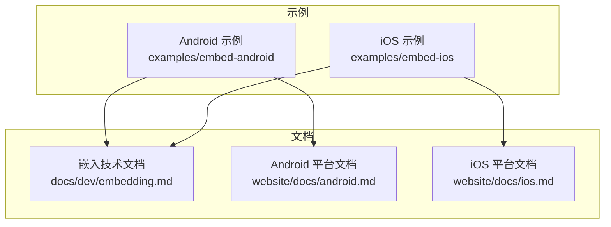
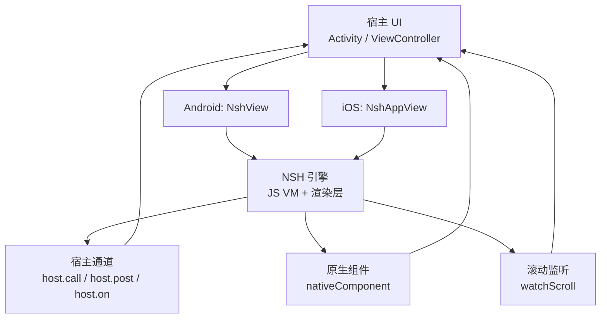
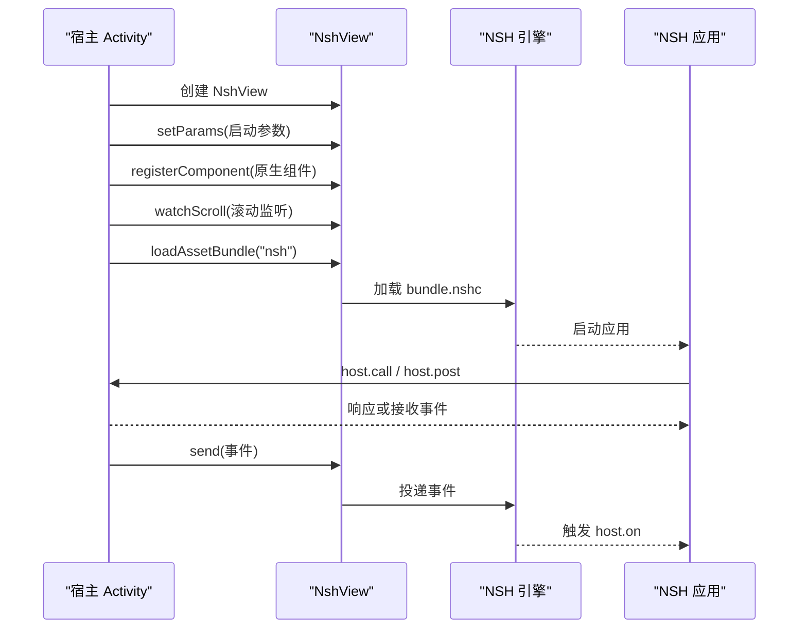
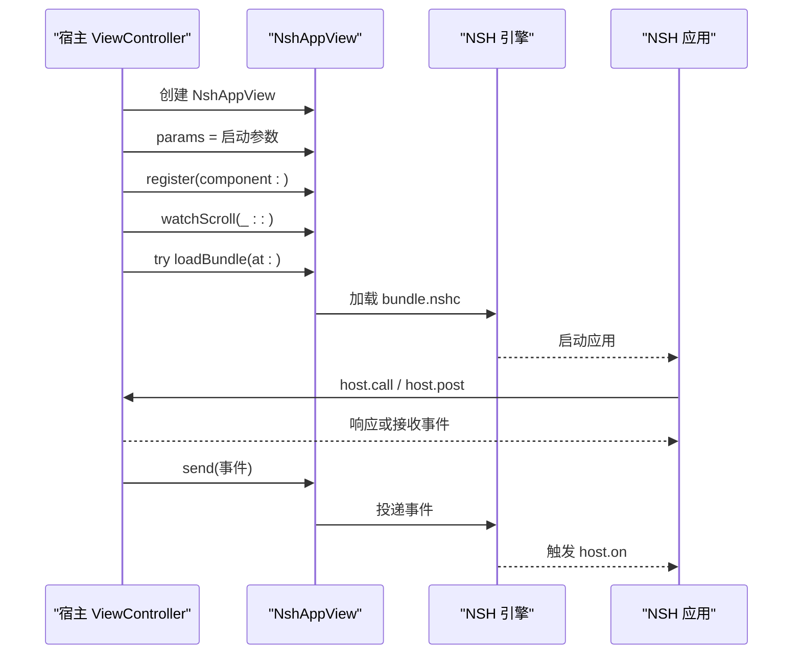
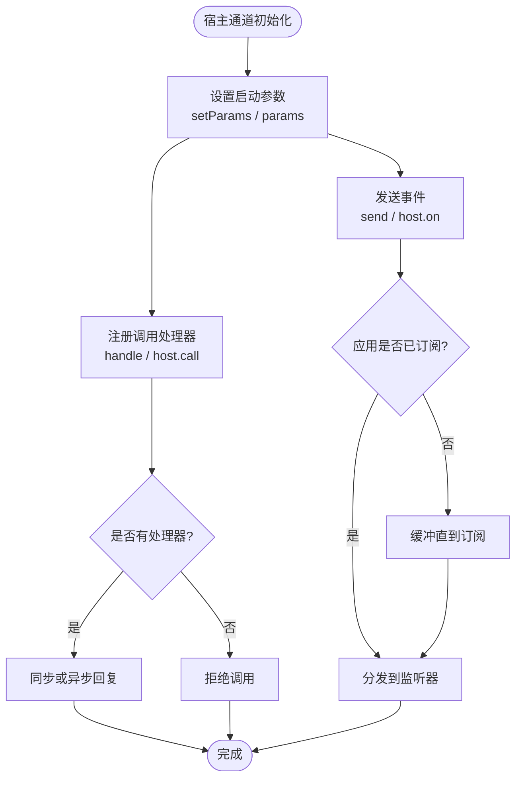
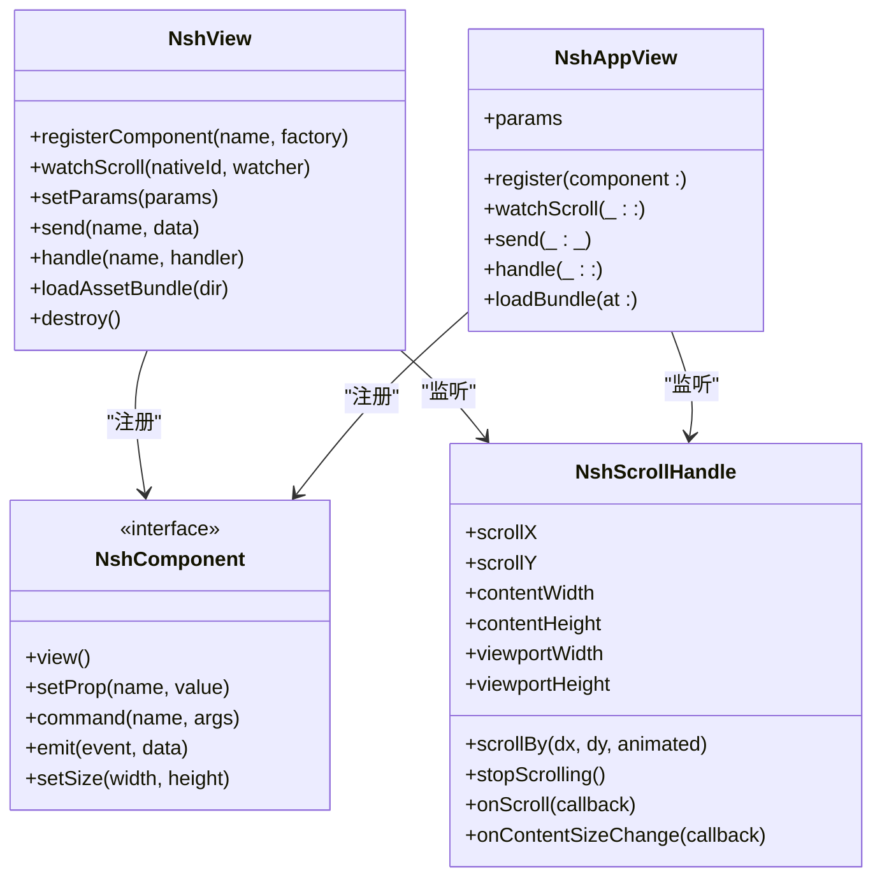
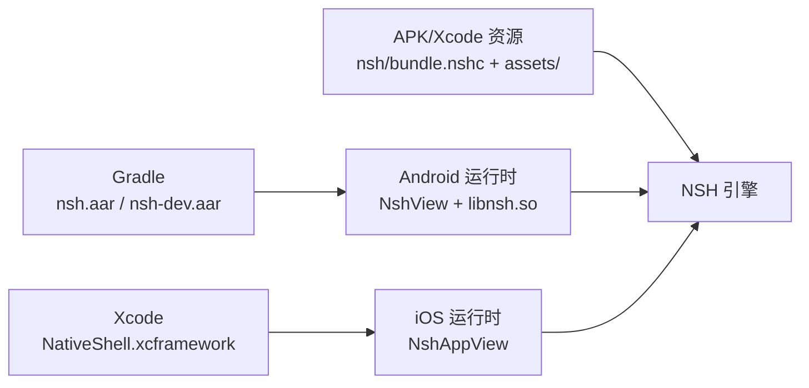

# 平台集成示例

<cite>
**本文引用的文件**   
- [examples/embed-android/README.md](file://examples/embed-android/README.md)
- [examples/embed-ios/README.md](file://examples/embed-ios/README.md)
- [examples/embed-android/src/com/longbridge/nsh/embeddemo/MainActivity.java](file://examples/embed-android/src/com/longbridge/nsh/embeddemo/MainActivity.java)
- [examples/embed-ios/main.swift](file://examples/embed-ios/main.swift)
- [docs/dev/embedding.md](file://docs/dev/embedding.md)
- [website/docs/android.md](file://website/docs/android.md)
- [website/docs/ios.md](file://website/docs/ios.md)
</cite>

## 目录
1. [简介](#简介)
2. [项目结构](#项目结构)
3. [核心组件](#核心组件)
4. [架构总览](#架构总览)
5. [详细组件分析](#详细组件分析)
6. [依赖关系分析](#依赖关系分析)
7. [性能与资源管理](#性能与资源管理)
8. [常见问题与调试](#常见问题与调试)
9. [最佳实践与经验总结](#最佳实践与经验总结)
10. [结论](#结论)

## 简介
本文件面向希望将 NSH 应用嵌入到现有宿主应用的工程师，重点覆盖 Android 与 iOS 平台的集成方式。文档围绕以下主题展开：
- 如何将 NSH 应用以视图形式嵌入宿主 UI
- 宿主与 NSH 应用之间的通信机制（参数、事件、调用）
- 生命周期管理与资源管理（存储、缓存、字体、主题、安全区等）
- 完整的集成步骤与配置说明
- 常见问题排查与调试技巧
- 跨平台集成的最佳实践与注意事项

NSH 的嵌入式运行时在 Android 上通过 `NshView` 暴露，iOS 上通过 `NshAppView` 暴露；两者都提供一致的“宿主通道”能力，用于无视图的参数传递、事件收发和函数调用。

## 项目结构
仓库中与“平台集成示例”直接相关的代码与文档主要位于以下位置：
- Android 示例：`examples/embed-android`
- iOS 示例：`examples/embed-ios`
- 平台嵌入技术文档：`docs/dev/embedding.md`
- 官方平台指南：`website/docs/android.md`、`website/docs/ios.md`

**图表来源**
- [examples/embed-android/README.md:1-94](file://examples/embed-android/README.md#L1-L94)
- [examples/embed-ios/README.md:1-88](file://examples/embed-ios/README.md#L1-L88)
- [docs/dev/embedding.md:82-104](file://docs/dev/embedding.md#L82-L104)
- [website/docs/android.md:75-111](file://website/docs/android.md#L75-L111)
- [website/docs/ios.md:141-220](file://website/docs/ios.md#L141-L220)

**章节来源**
- [examples/embed-android/README.md:1-94](file://examples/embed-android/README.md#L1-L94)
- [examples/embed-ios/README.md:1-88](file://examples/embed-ios/README.md#L1-L88)
- [docs/dev/embedding.md:82-104](file://docs/dev/embedding.md#L82-L104)
- [website/docs/android.md:75-111](file://website/docs/android.md#L75-L111)
- [website/docs/ios.md:141-220](file://website/docs/ios.md#L141-L220)

## 核心组件
- Android 嵌入入口：`com.longbridge.nsh.NshView`
  - 负责加载 NSH 应用、注册原生组件、监听滚动、设置主题、处理宿主通道等。
- iOS 嵌入入口：`NshAppView`
  - 负责加载 NSH 应用、注册原生组件、监听滚动、设置主题、处理宿主通道等。
- 宿主通道：`nsh/host`
  - 提供启动参数、事件发送、函数调用与 URL 路由钩子。
- 原生组件：`nativeComponent`
  - 宿主可注册自己的原生视图，供 JS 侧使用。
- 滚动监听：`watchScroll`
  - 宿主可在 UI 线程跟随 NSH 页面的滚动状态并驱动原生 UI。

**章节来源**
- [website/docs/android.md:197-224](file://website/docs/android.md#L197-L224)
- [website/docs/ios.md:301-331](file://website/docs/ios.md#L301-L331)
- [docs/dev/embedding.md:177-251](file://docs/dev/embedding.md#L177-L251)
- [docs/dev/embedding.md:156-176](file://docs/dev/embedding.md#L156-L176)

## 架构总览
下图展示宿主应用与 NSH 应用在 Android/iOS 上的整体交互关系：

**图表来源**
- [website/docs/android.md:75-111](file://website/docs/android.md#L75-L111)
- [website/docs/ios.md:141-220](file://website/docs/ios.md#L141-L220)
- [docs/dev/embedding.md:177-251](file://docs/dev/embedding.md#L177-L251)
- [docs/dev/embedding.md:156-176](file://docs/dev/embedding.md#L156-L176)

## 详细组件分析

### Android 集成要点
- 引入 AAR：`dist/nsh/embed/android/nsh.aar`（开发构建可用 `nsh-dev.aar`）。
- 将 NSH 构建产物放入 APK assets，例如 `app/src/main/assets/nsh`。
- 创建 `NshView`，添加到布局，调用 `loadAssetBundle("nsh")`，并在 Activity 销毁时调用 `destroy()`。
- 通过 `setParams`、`send`、`handle` 建立宿主通道；通过 `registerComponent` 注册原生组件；通过 `watchScroll` 监听页面滚动。

**图表来源**
- [examples/embed-android/src/com/longbridge/nsh/embeddemo/MainActivity.java:48-150](file://examples/embed-android/src/com/longbridge/nsh/embeddemo/MainActivity.java#L48-L150)
- [website/docs/android.md:197-224](file://website/docs/android.md#L197-L224)
- [website/docs/android.md:239-280](file://website/docs/android.md#L239-L280)

**章节来源**
- [examples/embed-android/README.md:1-94](file://examples/embed-android/README.md#L1-L94)
- [examples/embed-android/src/com/longbridge/nsh/embeddemo/MainActivity.java:48-150](file://examples/embed-android/src/com/longbridge/nsh/embeddemo/MainActivity.java#L48-L150)
- [website/docs/android.md:75-111](file://website/docs/android.md#L75-L111)
- [website/docs/android.md:197-224](file://website/docs/android.md#L197-L224)
- [website/docs/android.md:239-280](file://website/docs/android.md#L239-L280)

### iOS 集成要点
- 引入 `NativeShell.xcframework`（开发构建可用 `NativeShellDev.xcframework`），Swift 中 `import NativeShell`。
- 将 NSH 构建产物作为资源文件夹 `nsh` 加入工程，包含 `bundle.nshc` 与 `assets/`。
- 创建 `NshAppView`，添加到视图层级，调用 `try app.loadBundle(at:)`，视图释放时应用停止。
- 通过 `params`、`send`、`handle` 建立宿主通道；通过 `register(component:)` 注册原生组件；通过 `watchScroll(_: :_)` 监听页面滚动。
- 支持 Scene 生命周期、URL Scheme、Handoff、状态栏与方向控制。

**图表来源**
- [examples/embed-ios/main.swift:37-107](file://examples/embed-ios/main.swift#L37-L107)
- [website/docs/ios.md:301-331](file://website/docs/ios.md#L301-L331)
- [website/docs/ios.md:348-383](file://website/docs/ios.md#L348-L383)

**章节来源**
- [examples/embed-ios/README.md:1-88](file://examples/embed-ios/README.md#L1-L88)
- [examples/embed-ios/main.swift:37-107](file://examples/embed-ios/main.swift#L37-L107)
- [website/docs/ios.md:141-220](file://website/docs/ios.md#L141-L220)
- [website/docs/ios.md:301-331](file://website/docs/ios.md#L301-L331)
- [website/docs/ios.md:348-383](file://website/docs/ios.md#L348-L383)

### 宿主通道通信模型
宿主通道是宿主与 NSH 应用之间无视图的通信桥梁，提供三类能力：
- 启动参数：宿主在加载前设置，应用启动时读取。
- 事件：宿主向应用发送事件，应用通过 `host.on` 订阅。
- 调用：应用调用宿主方法，宿主通过 `handle` 注册处理器，支持同步返回或异步回复。

**图表来源**
- [docs/dev/embedding.md:186-230](file://docs/dev/embedding.md#L186-L230)
- [website/docs/android.md:239-280](file://website/docs/android.md#L239-L280)
- [website/docs/ios.md:348-383](file://website/docs/ios.md#L348-L383)

**章节来源**
- [docs/dev/embedding.md:186-230](file://docs/dev/embedding.md#L186-L230)
- [website/docs/android.md:239-280](file://website/docs/android.md#L239-L280)
- [website/docs/ios.md:348-383](file://website/docs/ios.md#L348-L383)

### 原生组件与滚动监听
- 原生组件：宿主通过 `registerComponent`（Android）或 `register(component:)`（iOS）注册自定义视图，JS 侧通过 `nativeComponent` 使用。组件可接收 props、执行命令、发出事件，并可报告自身尺寸。
- 滚动监听：宿主通过 `watchScroll` 监听 NSH 页面的 `<Scroll>`，在 UI 线程获取滚动偏移、内容尺寸变化，并可驱动原生 UI 同步移动。

**图表来源**
- [website/docs/android.md:197-224](file://website/docs/android.md#L197-L224)
- [website/docs/ios.md:301-331](file://website/docs/ios.md#L301-L331)
- [docs/dev/embedding.md:105-139](file://docs/dev/embedding.md#L105-L139)
- [docs/dev/embedding.md:156-176](file://docs/dev/embedding.md#L156-L176)

**章节来源**
- [docs/dev/embedding.md:105-139](file://docs/dev/embedding.md#L105-L139)
- [docs/dev/embedding.md:156-176](file://docs/dev/embedding.md#L156-L176)
- [website/docs/android.md:197-224](file://website/docs/android.md#L197-L224)
- [website/docs/ios.md:301-331](file://website/docs/ios.md#L301-L331)

## 依赖关系分析
- Android 嵌入依赖：
  - Gradle 引入 `nsh.aar` 或 `nsh-dev.aar`
  - APK assets 中包含 `nsh/bundle.nshc` 与 `nsh/assets/`
  - `NshView` 提供 JNI 桥接，运行 `libnsh.so`
- iOS 嵌入依赖：
  - Xcode 引入 `NativeShell.xcframework` 或 `NativeShellDev.xcframework`
  - 应用资源包含 `nsh/bundle.nshc` 与 `nsh/assets/`
  - `NshAppView` 通过 Swift/C ABI 调用 Rust 引擎

**图表来源**
- [website/docs/android.md:90-111](file://website/docs/android.md#L90-L111)
- [website/docs/ios.md:190-220](file://website/docs/ios.md#L190-L220)
- [docs/dev/embedding.md:63-81](file://docs/dev/embedding.md#L63-L81)

**章节来源**
- [website/docs/android.md:90-111](file://website/docs/android.md#L90-L111)
- [website/docs/ios.md:190-220](file://website/docs/ios.md#L190-L220)
- [docs/dev/embedding.md:63-81](file://docs/dev/embedding.md#L63-L81)

## 性能与资源管理
- 内存与节点限制：可通过 `setLimits`（Android）或 `limits`（iOS）设置 JS 堆大小、栈大小、加载预算、调用预算与最大节点数。
- 存储与缓存：
  - 存储目录：`setStorageDirectory`（Android）或 `storageDirectory`（iOS）指定应用数据存放位置。
  - 缓存策略：`setCacheOptions`（Android）或 `cacheOptions`（iOS）控制图片缓存位置与大小。
- 字体与主题：
  - 字体：`registerFont` 注册宿主提供的字体文件，避免每个 bundle 重复打包。
  - 主题：`setThemeOverrides` 注入宿主品牌样式，即时重绘并影响后续加载的应用。
- 安全区与键盘：
  - Android：`setAdditionalSafeAreaInsets` 叠加宿主浮动 UI 的安全区。
  - iOS：通过 `additionalSafeAreaInsets` 与系统 safe area 结合。
- 字节码安全：
  - `.nshc` 仅可从 APK assets 或应用包内加载；下载代码应使用签名包。

**章节来源**
- [website/docs/android.md:203-211](file://website/docs/android.md#L203-L211)
- [website/docs/ios.md:309-317](file://website/docs/ios.md#L309-L317)
- [website/docs/android.md:326-342](file://website/docs/android.md#L326-L342)
- [website/docs/ios.md:424-443](file://website/docs/ios.md#L424-L443)
- [website/docs/android.md:225-228](file://website/docs/android.md#L225-L228)
- [website/docs/ios.md:332-335](file://website/docs/ios.md#L332-L335)

## 常见问题与调试
- 开发模式连接：
  - Android：使用 `nsh-dev.aar` 并调用 `connectDevServer(url)`，模拟器需 `adb reverse tcp:8790 tcp:8790`。
  - iOS：使用 `NativeShellDev.xcframework` 并调用 `connectDevServer(url)`。
- 错误回调：
  - Android：`setErrorListener` 接收致命错误。
  - iOS：`onError` 接收致命错误。
- 日志与崩溃：
  - Android：发布构建剥离符号表，完整库位于 `symbols/<abi>/`，可用于 `ndk-stack`。
  - iOS：日志写入统一日志，子系统为应用 bundle ID。
- 权限与活动：
  - Android：Rust 侧通过 `permissions` 请求危险权限；通过 `activity` 启动其他应用ForResult。
  - iOS：通知中心委托由 NSH 接管，外部通知通过 `set_foreign_handler` 转发。

**章节来源**
- [website/docs/android.md:501-522](file://website/docs/android.md#L501-L522)
- [website/docs/ios.md:543-558](file://website/docs/ios.md#L543-L558)
- [website/docs/android.md:363-418](file://website/docs/android.md#L363-L418)
- [website/docs/ios.md:38-77](file://website/docs/ios.md#L38-L77)
- [website/docs/android.md:420-450](file://website/docs/android.md#L420-L450)

## 最佳实践与经验总结
- 视图生命周期：
  - Android：在 Activity `onDestroy` 中调用 `nsh.destroy()`。
  - iOS：视图释放时自动停止应用；确保正确持有 `NshAppView` 引用。
- 宿主通道设计：
  - 启动参数应在加载前设置；事件在未订阅时会被缓冲，适合启动期通知。
  - 调用处理器应避免阻塞引擎线程；异步任务完成后通过 `reply.resolve/reject` 回复。
- 原生组件：
  - 组件尺寸应准确报告，避免布局抖动。
  - 动画属性绑定需在主线程更新，避免 JS 与原生线程竞争。
- 滚动监听：
  - 使用 `watchScroll` 而非 JS 回调，以获得更精确的帧级同步。
  - 注意 `nativeID` 的唯一性与稳定性。
- 主题与安全区：
  - 主题覆盖适用于多品牌宿主；安全区叠加宿主浮动 UI，保证内容不被遮挡。
- 字节码与签名包：
  - 生产环境仅从 assets 或签名包加载 `.nshc`；下载代码必须使用签名包验证。

**章节来源**
- [examples/embed-android/src/com/longbridge/nsh/embeddemo/MainActivity.java:152-162](file://examples/embed-android/src/com/longbridge/nsh/embeddemo/MainActivity.java#L152-L162)
- [examples/embed-ios/main.swift:190-200](file://examples/embed-ios/main.swift#L190-L200)
- [docs/dev/embedding.md:186-230](file://docs/dev/embedding.md#L186-L230)
- [docs/dev/embedding.md:105-139](file://docs/dev/embedding.md#L105-L139)
- [docs/dev/embedding.md:156-176](file://docs/dev/embedding.md#L156-L176)
- [website/docs/android.md:225-228](file://website/docs/android.md#L225-L228)
- [website/docs/ios.md:332-335](file://website/docs/ios.md#L332-L335)

## 结论
通过将 NSH 应用嵌入宿主 UI，开发者可以在现有应用中无缝集成高性能的 TSX/Rust 界面模块。Android 与 iOS 分别通过 `NshView` 与 `NshAppView` 提供一致的嵌入体验，并通过宿主通道实现参数、事件与调用的双向通信。借助原生组件、滚动监听、主题覆盖与安全区叠加，宿主可以灵活控制 NSH 应用的呈现与行为。在生产环境中，务必遵循字节码安全、签名包验证与资源管理的最佳实践，以确保应用稳定、安全且易于维护。