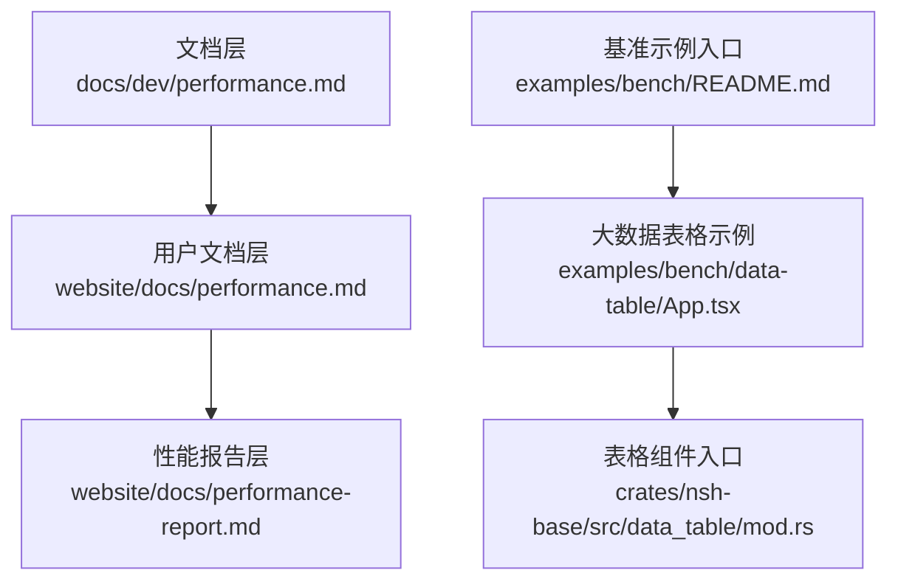
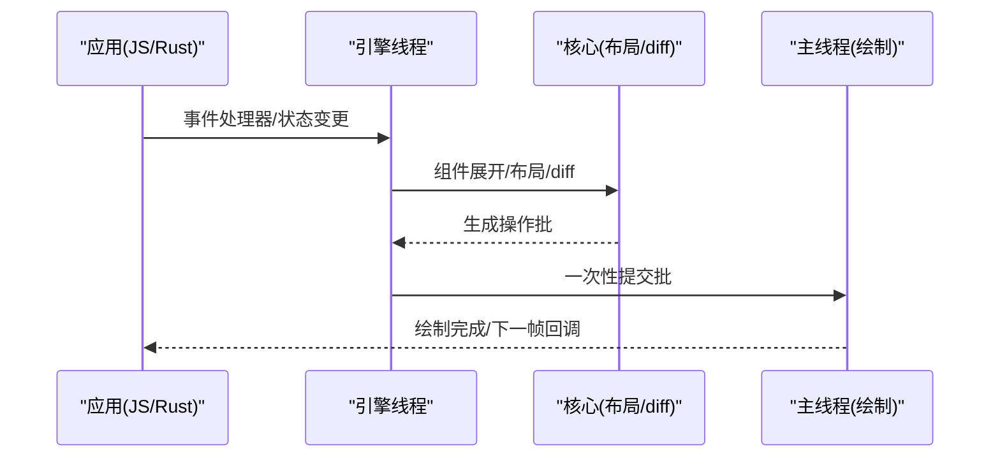
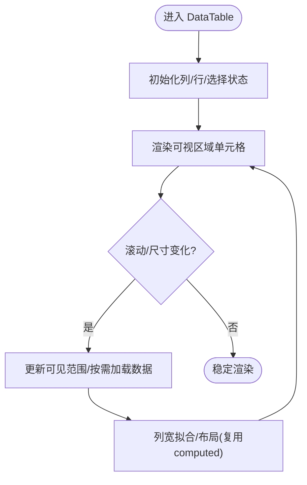
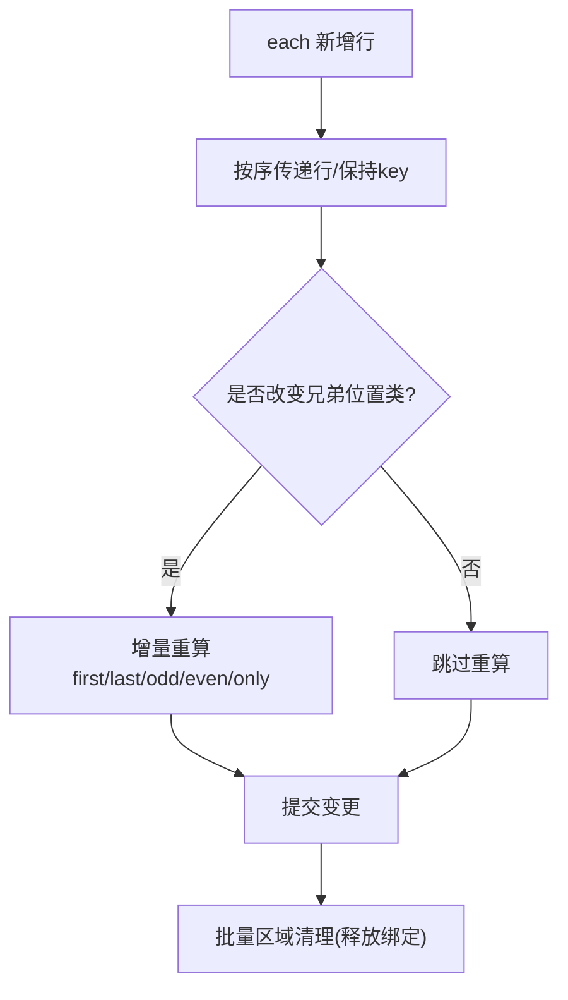
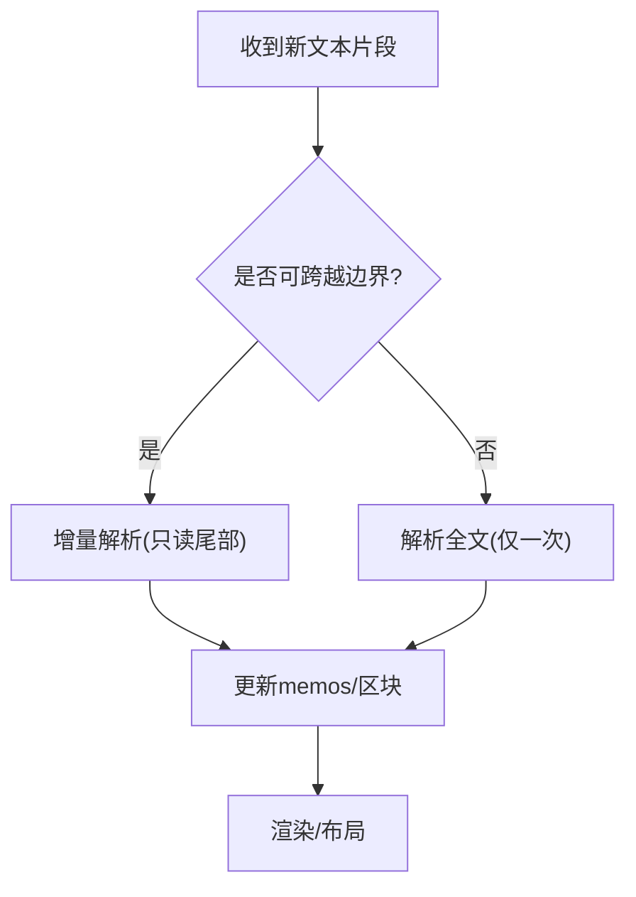
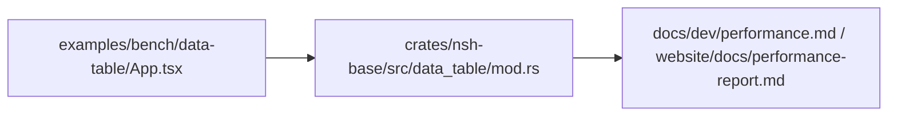

# 性能基准测试

<cite>
**本文引用的文件**   
- [performance.md](file://docs/dev/performance.md)
- [performance.md](file://website/docs/performance.md)
- [performance-report.md](file://website/docs/performance-report.md)
- [README.md](file://examples/bench/README.md)
- [App.tsx](file://examples/bench/data-table/App.tsx)
- [mod.rs](file://crates/nsh-base/src/data_table/mod.rs)
</cite>

## 目录
1. [引言](#引言)
2. [项目结构](#项目结构)
3. [核心组件](#核心组件)
4. [架构总览](#架构总览)
5. [详细组件分析](#详细组件分析)
6. [依赖关系分析](#依赖关系分析)
7. [性能考量](#性能考量)
8. [故障排查指南](#故障排查指南)
9. [结论](#结论)
10. [附录](#附录)

## 引言
本文件聚焦 NSH 的性能基准测试，覆盖大数据表格渲染、长文档编辑器、复杂布局计算等典型场景；解释性能分析方法、瓶颈识别与优化策略；提供可复现的测试用例与结果解读；并总结内存管理、渲染优化、事件处理等方面的最佳实践，帮助在实际项目中落地优化。

## 项目结构
NSH 的性能基线与案例分布在以下位置：
- 开发性能记录与历史优化数据：docs/dev/performance.md
- 面向用户的性能说明与测量方法：website/docs/performance.md
- 跨平台性能报告（Linux/macOS/Windows/iOS）：website/docs/performance-report.md
- 基准示例入口与运行方式：examples/bench/README.md
- 大数据表格示例应用：examples/bench/data-table/App.tsx
- 表格组件 API 与实现入口：crates/nsh-base/src/data_table/mod.rs

图表来源
- [performance.md:1-800](file://docs/dev/performance.md#L1-L800)
- [performance.md:1-281](file://website/docs/performance.md#L1-L281)
- [performance-report.md:1-550](file://website/docs/performance-report.md#L1-L550)
- [README.md:1-89](file://examples/bench/README.md#L1-L89)
- [App.tsx:1-43](file://examples/bench/data-table/App.tsx#L1-L43)
- [mod.rs:1-675](file://crates/nsh-base/src/data_table/mod.rs#L1-L675)

章节来源
- [performance.md:1-800](file://docs/dev/performance.md#L1-L800)
- [performance.md:1-281](file://website/docs/performance.md#L1-L281)
- [performance-report.md:1-550](file://website/docs/performance-report.md#L1-L550)
- [README.md:1-89](file://examples/bench/README.md#L1-L89)

## 核心组件
- 大数据表格 DataTable：支持双向滚动、行列选择、列宽调整/移动/固定/排序、可见行回调、自定义单元格渲染等，适合百万级行的虚拟化展示。
- 长文档编辑器 RichEditor：段落、表格、代码块、引用等混合内容，强调增量更新、选择框几何、文本块索引二分查找等优化。
- 文本视图 TextView：Markdown 流式解析、定义延迟解析、长文本分段读取、流式修复等，显著降低大文档解析与重绘成本。
- 列表与 Each：行保持、有序匹配、批量清理、兄弟位置类增量重算等，避免 O(n^2) 增长。

章节来源
- [mod.rs:1-675](file://crates/nsh-base/src/data_table/mod.rs#L1-L675)
- [performance.md:1-800](file://docs/dev/performance.md#L1-L800)

## 架构总览
NSH 的性能关键路径由“引擎线程 + 主线程”协作构成：
- 引擎线程：JS/Rust 业务逻辑、响应式图、组件展开、布局、diff、生成原生操作批。
- 主线程：平台绘制、动画、输入合成。
- 批处理：一次交互产生一个 commit，跨线程仅一次投递，避免逐视图桥接与序列化。

图表来源
- [performance.md:1-281](file://website/docs/performance.md#L1-L281)

## 详细组件分析

### 大数据表格渲染（DataTable）
- 场景要点：100,000 行 × 20 列，首列固定，按可见范围按需加载数据，滚动时触发 onVisibleRowsChange。
- 关键优化点：
  - 仅渲染可视区域单元格，减少节点数量与布局压力。
  - 列宽计算复用 computed，避免重复拟合。
  - 选择状态与标记信号分离，避免整行选中唤醒所有单元格 memo。
  - 非可排序列的 headerContent 包装仅在样式需要时挂载。
- 基准参考：首次提交 mount items 与 nodes 下降，点击行提交时间从 354 µs 降至 301 µs。

图表来源
- [App.tsx:1-43](file://examples/bench/data-table/App.tsx#L1-L43)
- [mod.rs:1-675](file://crates/nsh-base/src/data_table/mod.rs#L1-L675)

章节来源
- [App.tsx:1-43](file://examples/bench/data-table/App.tsx#L1-L43)
- [mod.rs:1-675](file://crates/nsh-base/src/data_table/mod.rs#L1-L675)
- [performance.md:1-800](file://docs/dev/performance.md#L1-L800)

### 长文档编辑器（RichEditor）
- 场景要点：包含大量段落、表格、代码块、引用等混合块；编辑首段字符插入/删除；选择框几何与文本块索引需高效。
- 关键优化点：
  - 将块偏移移出响应式块项，放入 Tree 维护。
  - selectedNode/focusedNode 与文本块选择框为每块信号，仅在被选或编辑触发的块上更新。
  - 有序文本块索引使 text_at/range_rects 转为二分查找。
  - 首个 1,000 段落的初始提交从失败超时降至数百毫秒级别；单字符编辑批次仅含一个 Text 与选择框帧。
- 基准参考：初始填充与初始提交显著下降；编辑阶段 commit 时间与 mount items 保持稳定。

```mermaid
sequenceDiagram
participant User as "用户"
participant Editor as "RichEditor"
participant Tree as "Tree(块索引)"
participant Signals as "每块信号"
participant Core as "核心(diff/commit)"
User->>Editor : 在首段插入/删除字符
Editor->>Signals : 更新受影响块的选中/焦点信号
Editor->>Tree : 查询/更新块偏移与索引
Editor->>Core : 提交(Text + 选择框帧)
Core-->>User : 渲染完成
```

图表来源
- [performance.md:1-800](file://docs/dev/performance.md#L1-L800)

章节来源
- [performance.md:1-800](file://docs/dev/performance.md#L1-L800)

### 复杂布局计算（Each/列表与兄弟位置类）
- 场景要点：大量子元素同时挂载、滚动中逐步创建、兄弟位置类（odd:/last:）频繁变化。
- 关键优化点：
  - each 的行按顺序传递并保持 key，核心仅对保留后的元素进行匹配，避免全量 map 与搜索。
  - 兄弟位置类增量重算：仅当 first:/last:/odd:/even:/only: 位变化时才重排子树。
  - 批量区域清理：受影响的视图在一次扫描中统一释放节点绑定。
- 基准参考：
  - each 追加行从 O(n^2) 降为近似线性；5,000 行追加提交时间大幅下降。
  - 兄弟位置类 500/2,000 行挂载时间从数百毫秒降至几十毫秒。
  - 批量清理后 RichEditor 初始提交显著下降。

图表来源
- [performance.md:1-800](file://docs/dev/performance.md#L1-L800)

章节来源
- [performance.md:1-800](file://docs/dev/performance.md#L1-L800)

### 文本视图流式解析（TextView）
- 场景要点：Markdown 流式回复、链接/脚注定义、长文本一次性设置、代码块/表格/列表等。
- 关键优化点：
  - 流式解析：仅读取可变化的边界，避免每次解析全文。
  - 定义延迟解析：首次遇到定义时转换已有树，必要时再解析全文一次。
  - 长文本分段读取：超过边界大小的文本按流式方式分段解析。
  - 流式修复：带游标遍历有序代码跨度，避免平方复杂度。
- 基准参考：
  - 典型 20 KB/40 KB 回复的解析与 memos 对比从秒级降至毫秒级。
  - 完整 parse 在 streaming=true 下也显著加速。
  - 长文本（1.9 MB）分段读取较一次性解析更快。

图表来源
- [performance.md:1-800](file://docs/dev/performance.md#L1-L800)

章节来源
- [performance.md:1-800](file://docs/dev/performance.md#L1-L800)

## 依赖关系分析
- 示例与应用：examples/bench/data-table/App.tsx 通过 DataTable 暴露的 props/events 驱动可见行加载。
- 组件实现：crates/nsh-base/src/data_table/mod.rs 提供 DataTable 组件、API 与事件类型，内部控制器负责滚动、选择、列宽等。
- 性能基线：docs/dev/performance.md 与 website/docs/performance-report.md 提供跨平台指标与复现实验步骤。

图表来源
- [App.tsx:1-43](file://examples/bench/data-table/App.tsx#L1-L43)
- [mod.rs:1-675](file://crates/nsh-base/src/data_table/mod.rs#L1-L675)
- [performance.md:1-800](file://docs/dev/performance.md#L1-L800)
- [performance-report.md:1-550](file://website/docs/performance-report.md#L1-L550)

章节来源
- [App.tsx:1-43](file://examples/bench/data-table/App.tsx#L1-L43)
- [mod.rs:1-675](file://crates/nsh-base/src/data_table/mod.rs#L1-L675)
- [performance.md:1-800](file://docs/dev/performance.md#L1-L800)
- [performance-report.md:1-550](file://website/docs/performance-report.md#L1-L550)

## 性能考量
- 语言选择：Rust 组件无 JS 开销；TSX 中尽量保持 handler/computed 轻量，重型计算缓存或移至后台。
- 批处理：一次交互一个 commit，避免多次跨线程投递；使用 batch 让 effect/computed 看到一致写入。
- 细粒度更新：仅更新绑定的最小单元；集合用 each/<Each> 或虚拟列表，避免整棵子树重建。
- 不发送多余数据：核心仅发送变更；颜色变化不触发文本重排。
- 原生动画：使用 animated_value 而非每帧写信号；scroll_value 替代 on_scroll 监听。
- 长列表虚拟化：List/virtual_list 仅渲染视口附近行；滚动帧若无新行则不调用 JS。
- 内存与渲染：Canvas 分块栅格化、静态部分缓存；图片解码与缓存大小需预算控制；避免在热路径分配 CString/String。

章节来源
- [performance.md:1-281](file://website/docs/performance.md#L1-L281)
- [performance.md:1-800](file://docs/dev/performance.md#L1-L800)

## 故障排查指南
- 使用 headless --trace 观察 ops/mount items/nodes 与 commit 时间，定位异常增多的 mount items。
- 使用 --fps/-v 查看帧时间分布与 p95，结合 CPU/GPU/内存面板定位卡顿来源。
- 常见症状与对策：
  - 点击一次产生大量 mount items：检查是否在顶层读取信号导致整子树重建；改用 each/<Each> 或 List。
  - 滚动帧抖动：避免 on_scroll 中做重计算；改用 scroll_value 或预计算。
  - 大数据表格卡顿：确认 onVisibleRowsChange 正确分页；列宽拟合是否被重复调用。
  - 长文档编辑慢：检查是否每块都重新计算；确保选择/焦点信号为每块独立且仅影响相关块。
  - Markdown 流式解析慢：确认启用 streaming；检查定义解析路径是否触发全文解析。

章节来源
- [performance.md:1-281](file://website/docs/performance.md#L1-L281)
- [performance.md:1-800](file://docs/dev/performance.md#L1-L800)

## 结论
NSH 通过原生运行时、批处理、细粒度更新与虚拟化等手段，在大表格、长文档与复杂布局场景下取得显著性能收益。实践中应优先采用 Rust 组件、虚拟列表、原生动画与流式解析，并结合 --trace 与 --fps 持续验证优化效果。

## 附录
- 基准示例运行方式与用例清单参见 examples/bench/README.md。
- 跨平台性能报告与复现实验步骤参见 website/docs/performance-report.md。

章节来源
- [README.md:1-89](file://examples/bench/README.md#L1-L89)
- [performance-report.md:1-550](file://website/docs/performance-report.md#L1-L550)