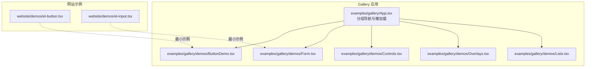
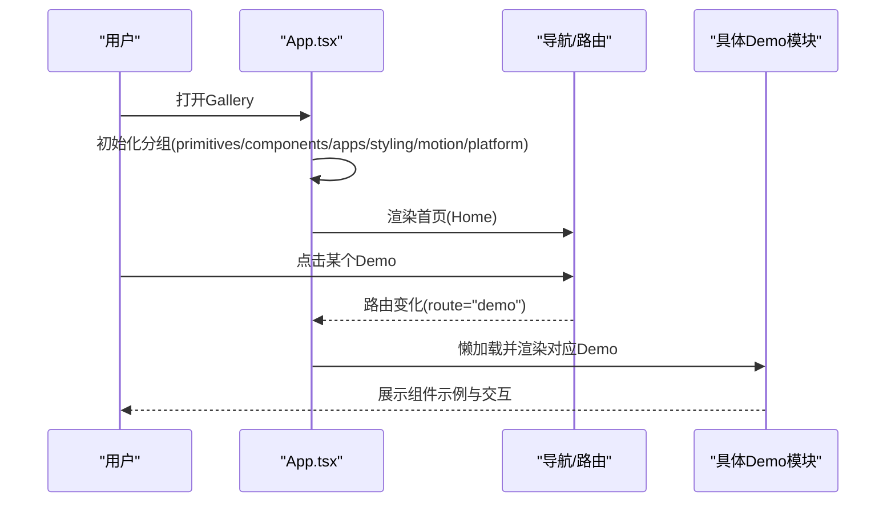
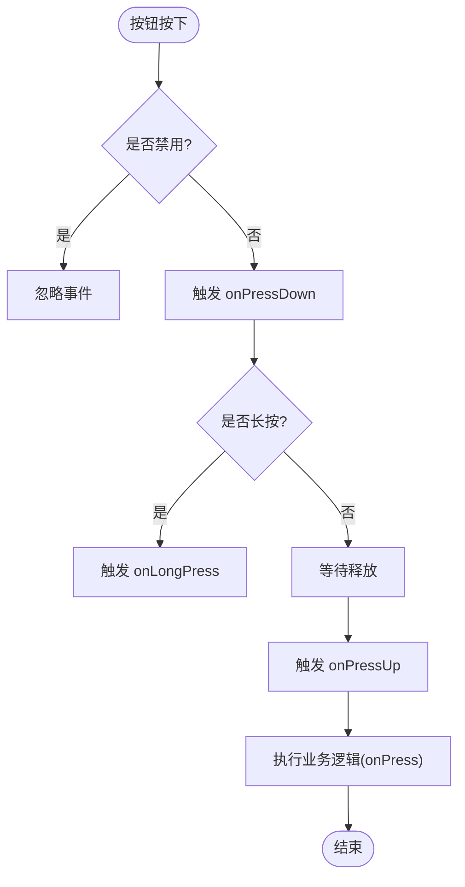
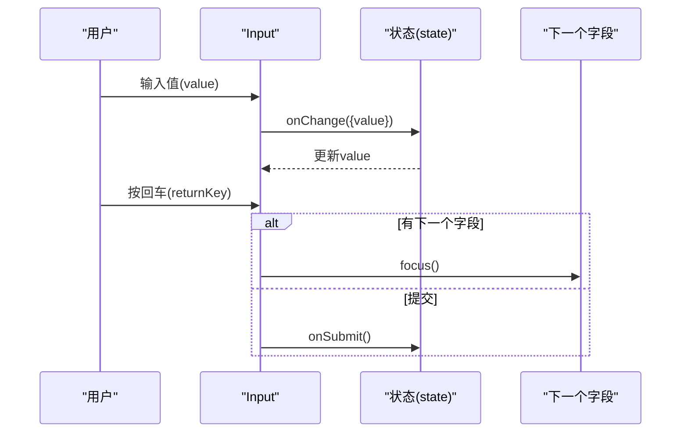
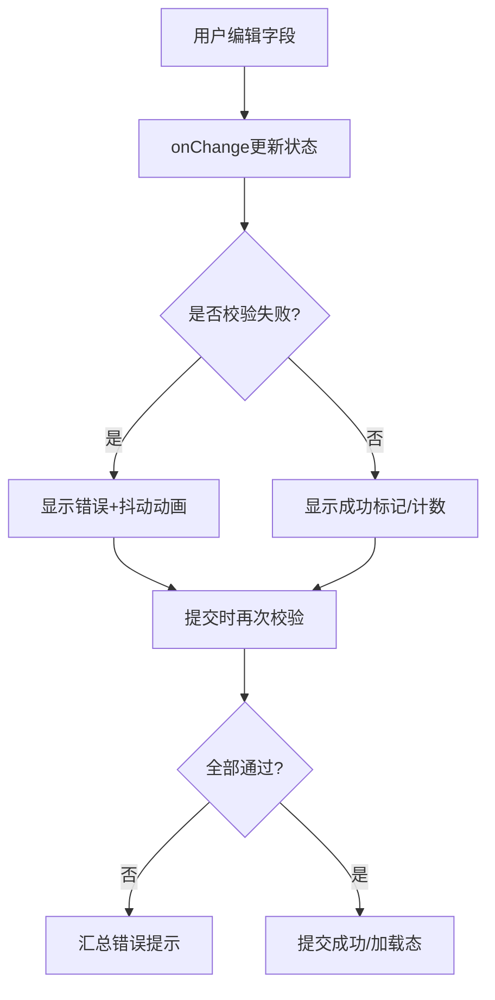
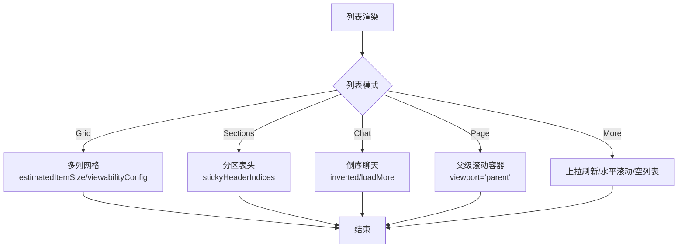
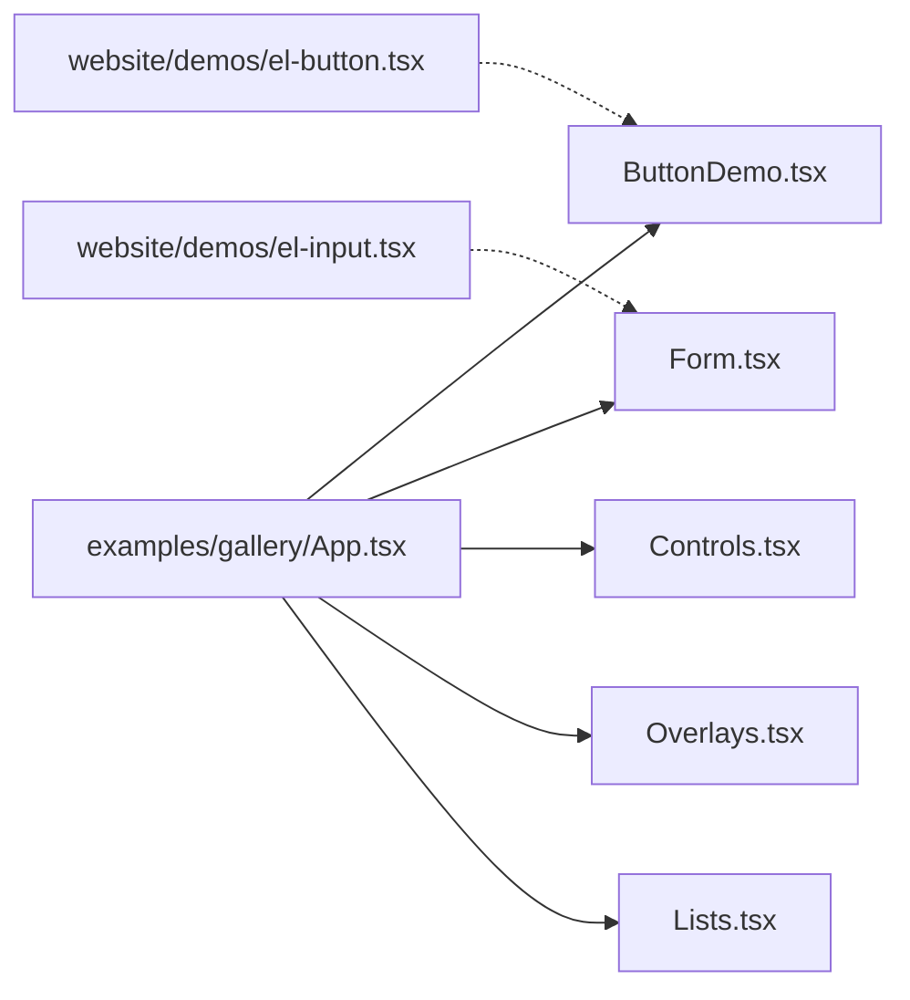

```mermaid
classDiagram
class Switch {
+checked : boolean
+onChange(event)
+disabled : boolean
}
class Checkbox {
+checked : boolean
+indeterminate : boolean
+onChange(event)
}
class RadioGroup {
+value : string
+onChange(event)
}
class Slider {
+value : number
+range : [number, number]
+onChange(event)
}
class Select {
+options : Option[]
+value : string
+onChange(event)
}
class Combobox {
+options : Option[]
+searchable : boolean
+value : string
+onChange(event)
}
class DatePicker {
+value : string
+presets : DateRangePreset[]
+onChange(event)
}
class NumberInput {
+value : number
+step : number
+range : [number, number]
+onChange(event)
}
class OtpInput {
+value : string
+maxLength : number
+onChange(event)
}
class Progress {
+value : number
+indeterminate : boolean
}
class Tabs {
+tabs : Tab[]
+selected : number
+onChange(event)
}
```

# UI组件演示

<cite>
**本文引用的文件**   
- [examples/gallery/App.tsx](file://examples/gallery/App.tsx)
- [website/demos/el-button.tsx](file://website/demos/el-button.tsx)
- [website/demos/el-input.tsx](file://website/demos/el-input.tsx)
- [examples/gallery/demos/ButtonDemo.tsx](file://examples/gallery/demos/ButtonDemo.tsx)
- [examples/gallery/demos/Form.tsx](file://examples/gallery/demos/Form.tsx)
- [examples/gallery/demos/Controls.tsx](file://examples/gallery/demos/Controls.tsx)
- [examples/gallery/demos/Overlays.tsx](file://examples/gallery/demos/Overlays.tsx)
- [examples/gallery/demos/Lists.tsx](file://examples/gallery/demos/Lists.tsx)
</cite>

## 目录
1. [简介](#简介)
2. [项目结构](#项目结构)
3. [核心组件](#核心组件)
4. [架构总览](#架构总览)
5. [详细组件分析](#详细组件分析)
6. [依赖关系分析](#依赖关系分析)
7. [性能与可访问性](#性能与可访问性)
8. [故障排查指南](#故障排查指南)
9. [结论](#结论)
10. [附录：组件清单与示例索引](#附录组件清单与示例索引)

## 简介
本文件面向NSH UI组件演示部分，系统性梳理并说明基础UI组件的演示示例、用法、属性配置、事件处理与样式定制方法。文档覆盖按钮、输入框、表格、选择器、列表、弹窗等50+个组件，提供组合使用模式与最佳实践，并包含响应式布局、无障碍访问与跨平台兼容性的说明，以及高级功能如自定义样式、动画效果与复杂交互场景的实现思路。

## 项目结构
Gallery应用作为NSH组件的集中展示入口，通过分组导航将“原生基元”和“nsh/base组件”两类演示组织起来；网站侧的demos目录则提供每个组件的最小化示例页面，便于独立运行与查阅。

**图表来源**
- [examples/gallery/App.tsx:42-170](file://examples/gallery/App.tsx#L42-L170)
- [examples/gallery/demos/ButtonDemo.tsx:1-16](file://examples/gallery/demos/ButtonDemo.tsx#L1-L16)
- [examples/gallery/demos/Form.tsx:1-10](file://examples/gallery/demos/Form.tsx#L1-L10)
- [examples/gallery/demos/Controls.tsx:1-18](file://examples/gallery/demos/Controls.tsx#L1-L18)
- [examples/gallery/demos/Overlays.tsx:1-5](file://examples/gallery/demos/Overlays.tsx#L1-L5)
- [examples/gallery/demos/Lists.tsx:1-9](file://examples/gallery/demos/Lists.tsx#L1-L9)
- [website/demos/el-button.tsx:1-10](file://website/demos/el-button.tsx#L1-L10)
- [website/demos/el-input.tsx:1-10](file://website/demos/el-input.tsx#L1-L10)

**章节来源**
- [examples/gallery/App.tsx:42-170](file://examples/gallery/App.tsx#L42-L170)

## 核心组件
本节聚焦演示中高频使用的核心组件族：按钮、输入框、表单、控件（开关/复选/单选/滑块/选择器等）、覆盖层（弹出/提示/抽屉/通知）与列表。

- 按钮 Button
  - 用途：主操作、次要操作、危险操作、图标按钮、分割按钮、带进度或忙态。
  - 关键能力：onPress/onPressDown/onPressUp、disabled、busy、icon、size、variant、长压确认、复制反馈、键盘焦点与无障碍标签。
  - 样式定制：raised/ghost/secondary/danger、hover/active/focus状态、尺寸与间距。
  - 参考实现路径：[examples/gallery/demos/ButtonDemo.tsx:1-16](file://examples/gallery/demos/ButtonDemo.tsx#L1-L16)、[website/demos/el-button.tsx:1-10](file://website/demos/el-button.tsx#L1-L10)

- 输入框 Input
  - 用途：单行/多行、密码掩码、搜索、前缀/后缀、自动补全、返回键行为、字数限制。
  - 关键能力：value/onChange、placeholder、maxLength、returnKeyType、autoCapitalize/autoCorrect、ref聚焦控制、onSubmit。
  - 样式定制：占位符颜色、光标颜色、选中色、内边距与圆角。
  - 参考实现路径：[website/demos/el-input.tsx:1-10](file://website/demos/el-input.tsx#L1-L10)、[examples/gallery/demos/Form.tsx:1-10](file://examples/gallery/demos/Form.tsx#L1-L10)

- 表单 Form
  - 用途：账户注册/登录、地址填写、数值输入、验证码、富文本消息区。
  - 关键能力：受控字段、校验与错误提示、提交流程、键盘交互（下一项聚焦/收起）、多键盘类型、滚动到可视区域。
  - 样式定制：字段边框高亮、错误抖动、成功打勾、前/后缀addon、长度计数条。
  - 参考实现路径：[examples/gallery/demos/Form.tsx:51-162](file://examples/gallery/demos/Form.tsx#L51-L162)、[examples/gallery/demos/Form.tsx:520-800](file://examples/gallery/demos/Form.tsx#L520-L800)

- 控件 Controls（Switch/Checkbox/Radio/Slider/Select/Combobox/DatePicker/NumberInput/OtpInput/Progress/Tabs等）
  - 用途：设置开关、筛选多选、单选计划、范围滑块、下拉选择、组合搜索、日期时间、步进数字、一次性验证码、进度指示、标签页。
  - 关键能力：checked/value/onChange、disabled、indeterminate、grouping、searchable、preset、step/range、keyboardType、accessibilityLabel。
  - 样式定制：track/thumb样式、尺寸、选中态填充、动画过渡。
  - 参考实现路径：[examples/gallery/demos/Controls.tsx:1-18](file://examples/gallery/demos/Controls.tsx#L1-L18)、[examples/gallery/demos/Controls.tsx:586-608](file://examples/gallery/demos/Controls.tsx#L586-L608)

- 覆盖层 Overlays（Popover/Tooltip/Sheet/Toast）
  - 用途：锚点弹出、悬停提示、边缘面板、自关闭通知。
  - 关键能力：placement/align/offset/margin、open状态管理、ESC/点击外部关闭、手势关闭（滑动）。
  - 参考实现路径：[examples/gallery/demos/Overlays.tsx:1-5](file://examples/gallery/demos/Overlays.tsx#L1-L5)

- 列表 Lists（List/Scroll/Grid/聊天/分页/上拉刷新）
  - 用途：网格、分区表头、聊天倒序、水平滚动、空列表、上拉刷新、粘性头部、可见项回调。
  - 关键能力：each/estimatedItemSize/inverted/header/footer/separator、stickyHeaderIndices、viewabilityConfig、onLoadMore、pull-to-refresh。
  - 参考实现路径：[examples/gallery/demos/Lists.tsx:1-9](file://examples/gallery/demos/Lists.tsx#L1-L9)、[examples/gallery/demos/Lists.tsx:40-123](file://examples/gallery/demos/Lists.tsx#L40-L123)、[examples/gallery/demos/Lists.tsx:245-346](file://examples/gallery/demos/Lists.tsx#L245-L346)、[examples/gallery/demos/Lists.tsx:358-424](file://examples/gallery/demos/Lists.tsx#L358-L424)、[examples/gallery/demos/Lists.tsx:676-766](file://examples/gallery/demos/Lists.tsx#L676-L766)

**章节来源**
- [examples/gallery/demos/ButtonDemo.tsx:1-16](file://examples/gallery/demos/ButtonDemo.tsx#L1-L16)
- [website/demos/el-button.tsx:1-10](file://website/demos/el-button.tsx#L1-L10)
- [website/demos/el-input.tsx:1-10](file://website/demos/el-input.tsx#L1-L10)
- [examples/gallery/demos/Form.tsx:51-162](file://examples/gallery/demos/Form.tsx#L51-L162)
- [examples/gallery/demos/Form.tsx:520-800](file://examples/gallery/demos/Form.tsx#L520-L800)
- [examples/gallery/demos/Controls.tsx:1-18](file://examples/gallery/demos/Controls.tsx#L1-L18)
- [examples/gallery/demos/Controls.tsx:586-608](file://examples/gallery/demos/Controls.tsx#L586-L608)
- [examples/gallery/demos/Overlays.tsx:1-5](file://examples/gallery/demos/Overlays.tsx#L1-L5)
- [examples/gallery/demos/Lists.tsx:1-9](file://examples/gallery/demos/Lists.tsx#L1-L9)
- [examples/gallery/demos/Lists.tsx:40-123](file://examples/gallery/demos/Lists.tsx#L40-L123)
- [examples/gallery/demos/Lists.tsx:245-346](file://examples/gallery/demos/Lists.tsx#L245-L346)
- [examples/gallery/demos/Lists.tsx:358-424](file://examples/gallery/demos/Lists.tsx#L358-L424)
- [examples/gallery/demos/Lists.tsx:676-766](file://examples/gallery/demos/Lists.tsx#L676-L766)

## 架构总览
Gallery通过分组与懒加载组织所有演示，用户从首页进入后，根据分组与子标题渲染对应Demo模块；桌面端采用侧边栏+内容区的布局，移动端采用NavStack路由栈。

**图表来源**
- [examples/gallery/App.tsx:42-170](file://examples/gallery/App.tsx#L42-L170)
- [examples/gallery/App.tsx:262-301](file://examples/gallery/App.tsx#L262-L301)
- [examples/gallery/App.tsx:778-800](file://examples/gallery/App.tsx#L778-L800)

## 详细组件分析

### 按钮 Button
- 交互要点
  - 基本点击：onPress
  - 按下/抬起：onPressDown/onPressUp（用于长按进度或拖拽反馈）
  - 禁用态：disabled（不可点击、无hover/focus）
  - 忙态与完成态：busy + icon切换（保存/上传）
  - 分割按钮：主动作+菜单选项（合并策略等）
  - 复制反馈：Clipboard写入后显示“已复制”
  - 长按确认：delayLongPress + onLongPress（删除等破坏性操作）
- 样式与主题
  - variant：primary/secondary/ghost/danger
  - size：small/regular/large
  - hoverStyle/activeStyle/focusVisibleStyle
  - 动画：LayoutAnimation、Animated.timing/spring、reduceMotion适配
- 代码片段路径
  - [examples/gallery/demos/ButtonDemo.tsx:153-186](file://examples/gallery/demos/ButtonDemo.tsx#L153-L186)
  - [examples/gallery/demos/ButtonDemo.tsx:245-344](file://examples/gallery/demos/ButtonDemo.tsx#L245-L344)
  - [examples/gallery/demos/ButtonDemo.tsx:346-413](file://examples/gallery/demos/ButtonDemo.tsx#L346-L413)
  - [examples/gallery/demos/ButtonDemo.tsx:415-456](file://examples/gallery/demos/ButtonDemo.tsx#L415-L456)
  - [examples/gallery/demos/ButtonDemo.tsx:458-524](file://examples/gallery/demos/ButtonDemo.tsx#L458-L524)
  - [website/demos/el-button.tsx:15-28](file://website/demos/el-button.tsx#L15-L28)

**图表来源**
- [examples/gallery/demos/ButtonDemo.tsx:346-413](file://examples/gallery/demos/ButtonDemo.tsx#L346-L413)
- [examples/gallery/demos/ButtonDemo.tsx:458-524](file://examples/gallery/demos/ButtonDemo.tsx#L458-L524)

**章节来源**
- [examples/gallery/demos/ButtonDemo.tsx:153-186](file://examples/gallery/demos/ButtonDemo.tsx#L153-L186)
- [examples/gallery/demos/ButtonDemo.tsx:245-344](file://examples/gallery/demos/ButtonDemo.tsx#L245-L344)
- [examples/gallery/demos/ButtonDemo.tsx:346-413](file://examples/gallery/demos/ButtonDemo.tsx#L346-L413)
- [examples/gallery/demos/ButtonDemo.tsx:415-456](file://examples/gallery/demos/ButtonDemo.tsx#L415-L456)
- [examples/gallery/demos/ButtonDemo.tsx:458-524](file://examples/gallery/demos/ButtonDemo.tsx#L458-L524)
- [website/demos/el-button.tsx:15-28](file://website/demos/el-button.tsx#L15-L28)

### 输入框 Input
- 常用属性
  - value/onChange：受控输入
  - placeholder：占位提示
  - maxLength：最大长度
  - returnKeyType：next/done/search/send
  - autoCapitalize/autoCorrect：大小写与纠错
  - masked：密码掩码
  - ref：聚焦控制
  - onSubmit：回车提交
- 组合模式
  - 用户名→密码→备注的Tab顺序与回车跳转
  - 多行文本高度自适应与字符计数
- 代码片段路径
  - [website/demos/el-input.tsx:12-36](file://website/demos/el-input.tsx#L12-L36)
  - [website/demos/el-input.tsx:37-50](file://website/demos/el-input.tsx#L37-L50)
  - [examples/gallery/demos/Form.tsx:125-147](file://examples/gallery/demos/Form.tsx#L125-L147)

**图表来源**
- [website/demos/el-input.tsx:12-36](file://website/demos/el-input.tsx#L12-L36)
- [examples/gallery/demos/Form.tsx:125-147](file://examples/gallery/demos/Form.tsx#L125-L147)

**章节来源**
- [website/demos/el-input.tsx:12-36](file://website/demos/el-input.tsx#L12-L36)
- [website/demos/el-input.tsx:37-50](file://website/demos/el-input.tsx#L37-L50)
- [examples/gallery/demos/Form.tsx:125-147](file://examples/gallery/demos/Form.tsx#L125-L147)

### 表单 Form
- 校验与反馈
  - 失焦/提交时校验，错误抖动与滑入提示
  - 强度条与规则勾选（密码强度）
  - 前/后缀addon、leading/trailing图标与按钮
- 键盘与滚动
  - 键盘弹起时自动滚动到可视区域
  - 不同键盘类型（email/phone/decimal/number）
- 代码片段路径
  - [examples/gallery/demos/Form.tsx:51-162](file://examples/gallery/demos/Form.tsx#L51-L162)
  - [examples/gallery/demos/Form.tsx:312-372](file://examples/gallery/demos/Form.tsx#L312-L372)
  - [examples/gallery/demos/Form.tsx:520-800](file://examples/gallery/demos/Form.tsx#L520-L800)

**图表来源**
- [examples/gallery/demos/Form.tsx:51-162](file://examples/gallery/demos/Form.tsx#L51-L162)
- [examples/gallery/demos/Form.tsx:520-800](file://examples/gallery/demos/Form.tsx#L520-L800)

**章节来源**
- [examples/gallery/demos/Form.tsx:51-162](file://examples/gallery/demos/Form.tsx#L51-L162)
- [examples/gallery/demos/Form.tsx:312-372](file://examples/gallery/demos/Form.tsx#L312-L372)
- [examples/gallery/demos/Form.tsx:520-800](file://examples/gallery/demos/Form.tsx#L520-L800)

### 控件 Controls（Switch/Checkbox/Radio/Slider/Select/Combobox/DatePicker/NumberInput/OtpInput/Progress/Tabs）
- 典型用法
  - Switch：系统设置、快速开关
  - Checkbox：全选/半选、筛选
  - Radio：单选计划/配送方式
  - Slider：音量/价格区间
  - Select/Combobox：排序/字体/语言/话题搜索
  - DatePicker：工作日/日期范围/会议时间
  - NumberInput：数量步进/范围
  - OtpInput：验证码输入
  - Progress：已知/未知进度的进度条
  - Tabs：分区切换
- 代码片段路径
  - [examples/gallery/demos/Controls.tsx:586-608](file://examples/gallery/demos/Controls.tsx#L586-L608)
  - [examples/gallery/demos/Controls.tsx:611-678](file://examples/gallery/demos/Controls.tsx#L611-L678)
  - [examples/gallery/demos/Controls.tsx:686-729](file://examples/gallery/demos/Controls.tsx#L686-L729)
  - [examples/gallery/demos/Controls.tsx:731-782](file://examples/gallery/demos/Controls.tsx#L731-L782)
  - [examples/gallery/demos/Controls.tsx:784-800](file://examples/gallery/demos/Controls.tsx#L784-L800)

**图表来源**
- [examples/gallery/demos/Controls.tsx:1-18](file://examples/gallery/demos/Controls.tsx#L1-L18)
- [examples/gallery/demos/Controls.tsx:586-608](file://examples/gallery/demos/Controls.tsx#L586-L608)

**章节来源**
- [examples/gallery/demos/Controls.tsx:1-18](file://examples/gallery/demos/Controls.tsx#L1-L18)
- [examples/gallery/demos/Controls.tsx:586-608](file://examples/gallery/demos/Controls.tsx#L586-L608)
- [examples/gallery/demos/Controls.tsx:611-678](file://examples/gallery/demos/Controls.tsx#L611-L678)
- [examples/gallery/demos/Controls.tsx:686-729](file://examples/gallery/demos/Controls.tsx#L686-L729)
- [examples/gallery/demos/Controls.tsx:731-782](file://examples/gallery/demos/Controls.tsx#L731-L782)
- [examples/gallery/demos/Controls.tsx:784-800](file://examples/gallery/demos/Controls.tsx#L784-L800)

### 覆盖层 Overlays（Popover/Tooltip/Sheet/Toast）
- 行为
  - Popover：锚点定位、点击外部/ESC关闭
  - Tooltip：悬停提示、固定显示
  - Sheet：边缘面板、手势关闭
  - Toast：自动关闭、动作关闭、滑动关闭
- 代码片段路径
  - [examples/gallery/demos/Overlays.tsx:1-5](file://examples/gallery/demos/Overlays.tsx#L1-L5)

**章节来源**
- [examples/gallery/demos/Overlays.tsx:1-5](file://examples/gallery/demos/Overlays.tsx#L1-L5)

### 列表 Lists（Grid/Sections/Chat/Page/More）
- 能力
  - Grid：多列网格、可见项回调、滚动到指定位置
  - Sections：分区表头粘性置顶
  - Chat：倒序聊天、加载更多、键盘交互
  - Page：父级滚动容器下多个List、粘性头部偏移
  - More：上拉刷新（系统/自定义指示器）、水平滚动、空列表
- 代码片段路径
  - [examples/gallery/demos/Lists.tsx:40-123](file://examples/gallery/demos/Lists.tsx#L40-L123)
  - [examples/gallery/demos/Lists.tsx:143-231](file://examples/gallery/demos/Lists.tsx#L143-L231)
  - [examples/gallery/demos/Lists.tsx:245-346](file://examples/gallery/demos/Lists.tsx#L245-L346)
  - [examples/gallery/demos/Lists.tsx:358-424](file://examples/gallery/demos/Lists.tsx#L358-L424)
  - [examples/gallery/demos/Lists.tsx:676-766](file://examples/gallery/demos/Lists.tsx#L676-L766)

**图表来源**
- [examples/gallery/demos/Lists.tsx:40-123](file://examples/gallery/demos/Lists.tsx#L40-L123)
- [examples/gallery/demos/Lists.tsx:143-231](file://examples/gallery/demos/Lists.tsx#L143-L231)
- [examples/gallery/demos/Lists.tsx:245-346](file://examples/gallery/demos/Lists.tsx#L245-L346)
- [examples/gallery/demos/Lists.tsx:358-424](file://examples/gallery/demos/Lists.tsx#L358-L424)
- [examples/gallery/demos/Lists.tsx:676-766](file://examples/gallery/demos/Lists.tsx#L676-L766)

**章节来源**
- [examples/gallery/demos/Lists.tsx:40-123](file://examples/gallery/demos/Lists.tsx#L40-L123)
- [examples/gallery/demos/Lists.tsx:143-231](file://examples/gallery/demos/Lists.tsx#L143-L231)
- [examples/gallery/demos/Lists.tsx:245-346](file://examples/gallery/demos/Lists.tsx#L245-L346)
- [examples/gallery/demos/Lists.tsx:358-424](file://examples/gallery/demos/Lists.tsx#L358-L424)
- [examples/gallery/demos/Lists.tsx:676-766](file://examples/gallery/demos/Lists.tsx#L676-L766)

## 依赖关系分析
- Gallery入口App负责分组与懒加载，各Demo模块按需引入，降低首屏体积。
- 网站示例（el-button/el-input）为最小化示例，便于单独运行与对比。
- 组件库统一来自nsh/base，样式与动效由Gallery内部ui工具函数与主题变量驱动。

**图表来源**
- [examples/gallery/App.tsx:42-170](file://examples/gallery/App.tsx#L42-L170)
- [website/demos/el-button.tsx:1-10](file://website/demos/el-button.tsx#L1-L10)
- [website/demos/el-input.tsx:1-10](file://website/demos/el-input.tsx#L1-L10)

**章节来源**
- [examples/gallery/App.tsx:42-170](file://examples/gallery/App.tsx#L42-L170)

## 性能与可访问性
- 性能
  - 列表虚拟化：estimatedItemSize、viewport="parent"、inverted、onLoadMore阈值控制
  - 动画优化：reduceMotion检测、LayoutAnimation、Animated.timing/spring
  - 懒加载：Demo模块lazy(() => import(...))
- 可访问性
  - role/accessibilityLabel/accessibilityState
  - 键盘导航：Tab/Enter/Escape、keymap绑定
  - 焦点环：focusVisibleStyle、focusRing
- 跨平台
  - platform.desktop/mobile判断、safeAreaInsets、keyboardFrame
  - iOS/Android原生差异（如SystemSwitch）
  - RTL支持、终端环境适配

**章节来源**
- [examples/gallery/demos/Lists.tsx:40-123](file://examples/gallery/demos/Lists.tsx#L40-L123)
- [examples/gallery/demos/Lists.tsx:676-766](file://examples/gallery/demos/Lists.tsx#L676-L766)
- [examples/gallery/demos/ButtonDemo.tsx:32-51](file://examples/gallery/demos/ButtonDemo.tsx#L32-L51)
- [examples/gallery/demos/Form.tsx:520-800](file://examples/gallery/demos/Form.tsx#L520-L800)
- [examples/gallery/App.tsx:42-170](file://examples/gallery/App.tsx#L42-L170)

## 故障排查指南
- 输入框无法聚焦
  - 检查ref是否正确赋值与调用focus
  - 确认父容器未阻止pointerEvents
  - 参考路径：[website/demos/el-input.tsx:12-36](file://website/demos/el-input.tsx#L12-L36)
- 表单校验不生效
  - 确保在onBlur或onSubmit时触发校验
  - 注意attempt计数以重播抖动动画
  - 参考路径：[examples/gallery/demos/Form.tsx:51-162](file://examples/gallery/demos/Form.tsx#L51-L162)
- 列表卡顿或闪烁
  - 设置estimatedItemSize，避免频繁测量
  - 使用viewport="parent"减少嵌套滚动
  - 参考路径：[examples/gallery/demos/Lists.tsx:40-123](file://examples/gallery/demos/Lists.tsx#L40-L123)
- 动画不符合预期
  - 检查reduceMotion开关
  - 使用LayoutAnimation.configureNext包裹数据变更
  - 参考路径：[examples/gallery/demos/ButtonDemo.tsx:32-51](file://examples/gallery/demos/ButtonDemo.tsx#L32-L51)

**章节来源**
- [website/demos/el-input.tsx:12-36](file://website/demos/el-input.tsx#L12-L36)
- [examples/gallery/demos/Form.tsx:51-162](file://examples/gallery/demos/Form.tsx#L51-L162)
- [examples/gallery/demos/Lists.tsx:40-123](file://examples/gallery/demos/Lists.tsx#L40-L123)
- [examples/gallery/demos/ButtonDemo.tsx:32-51](file://examples/gallery/demos/ButtonDemo.tsx#L32-L51)

## 结论
本指南基于仓库中的Gallery与网站示例，系统化梳理了NSH基础UI组件的演示用法、属性与事件、样式定制与组合模式，并补充了性能、可访问性与跨平台注意事项。建议在实际项目中优先复用Gallery中的Look与Theme工具函数，保持视觉一致性；对大数据量列表务必启用虚拟化与惰性加载；对动画与交互遵循reduceMotion与无障碍规范，提升整体体验。

## 附录：组件清单与示例索引
- 基础元素（Primitives）
  - Text、Image、Scroll、List、Canvas、Shader、WebView、Video
  - 参考：[examples/gallery/App.tsx:42-51](file://examples/gallery/App.tsx#L42-L51)
- nsh/base 组件（Components）
  - Accordion、Avatar、Button、Carousel、Checkbox、Collapsible、ColorPicker、Combobox、Command、DataTable、DatePicker、DiffView、Dock、Editor、EmojiPicker、HoverCard、Input、Link、Menu、NavStack、NumberInput、OtpInput、Pagination、Plot、Popover、Progress、Radio、Resizable、RichEditor、Select、Sheet、Slider、SplitView、Switch、Tabs、Terminal、TextView、Toast、Toggle、Toolbar、Tooltip、Tree
  - 参考：[examples/gallery/App.tsx:55-98](file://examples/gallery/App.tsx#L55-L98)
- 分类与用途
  - Actions、Inputs、Navigation、Overlays、Data、Documents and workspaces
  - 参考：[examples/gallery/App.tsx:100-108](file://examples/gallery/App.tsx#L100-L108)
- 网站最小示例
  - el-button、el-input
  - 参考：[website/demos/el-button.tsx:1-10](file://website/demos/el-button.tsx#L1-L10)、[website/demos/el-input.tsx:1-10](file://website/demos/el-input.tsx#L1-L10)

**章节来源**
- [examples/gallery/App.tsx:42-108](file://examples/gallery/App.tsx#L42-L108)
- [website/demos/el-button.tsx:1-10](file://website/demos/el-button.tsx#L1-L10)
- [website/demos/el-input.tsx:1-10](file://website/demos/el-input.tsx#L1-L10)