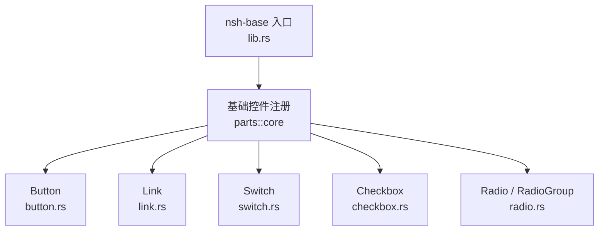
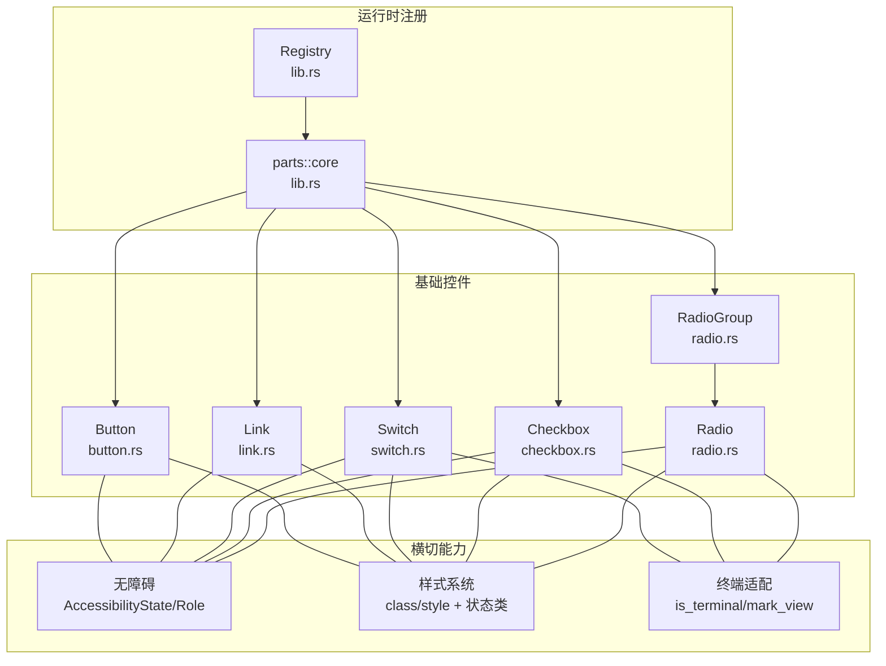
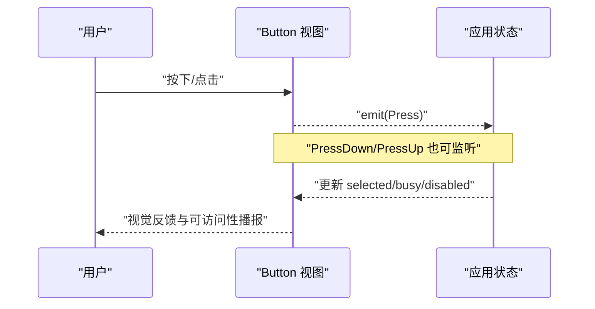
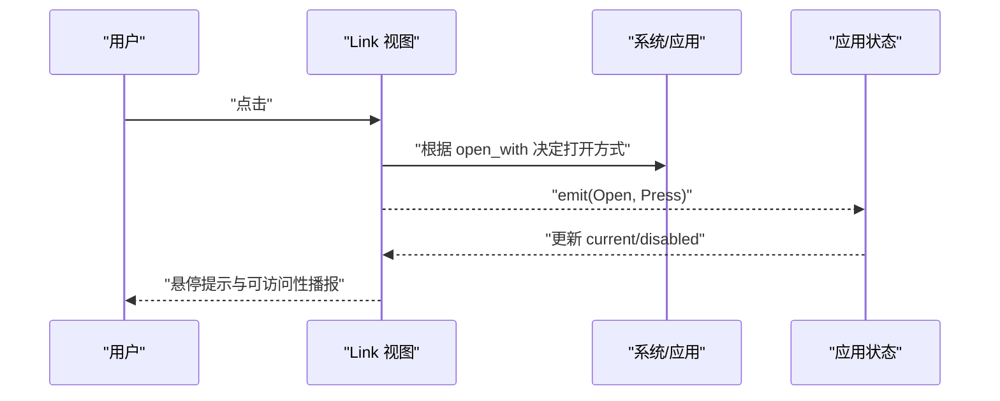
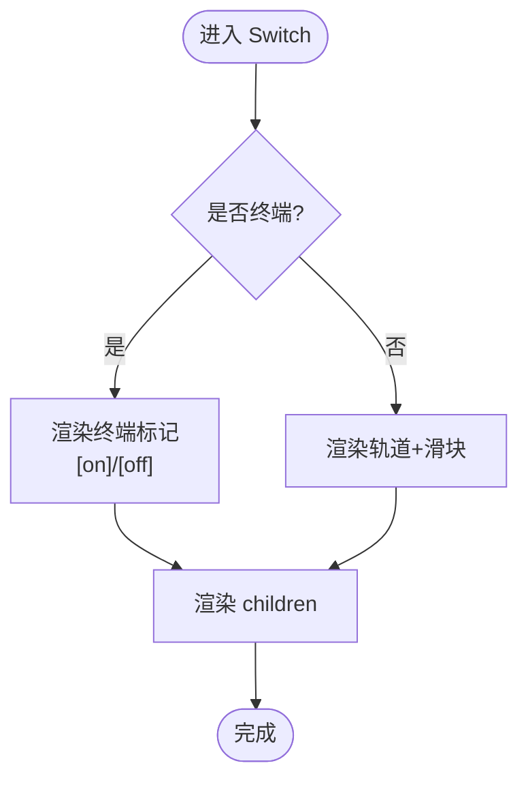
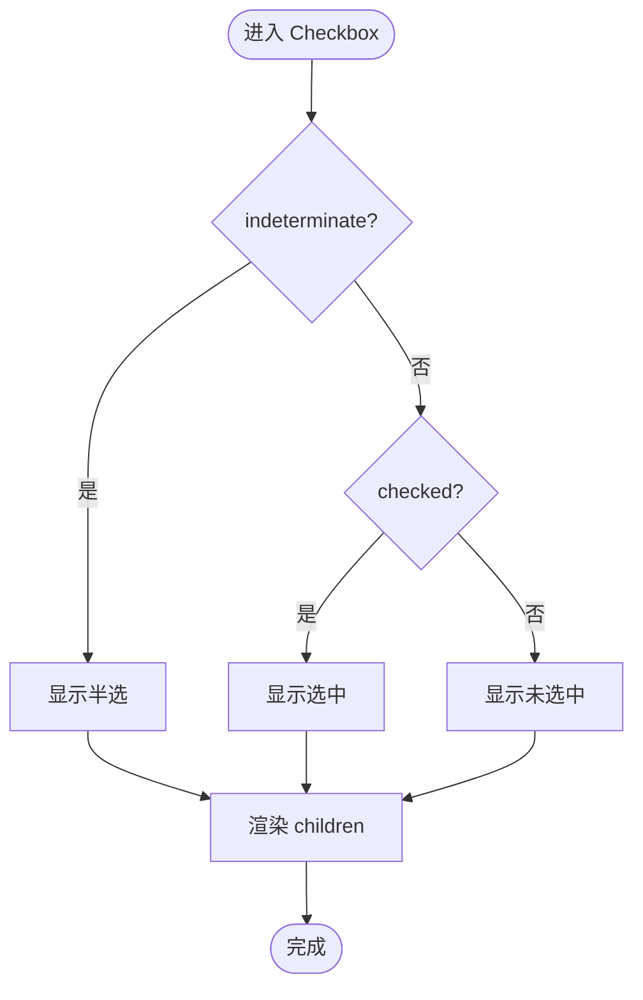
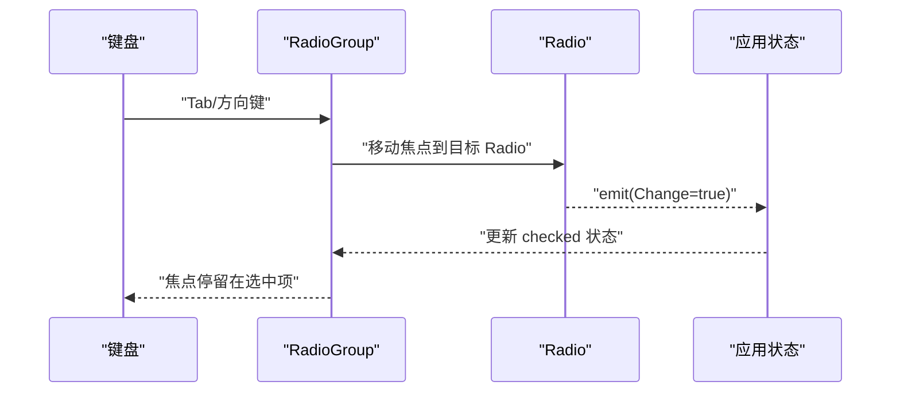
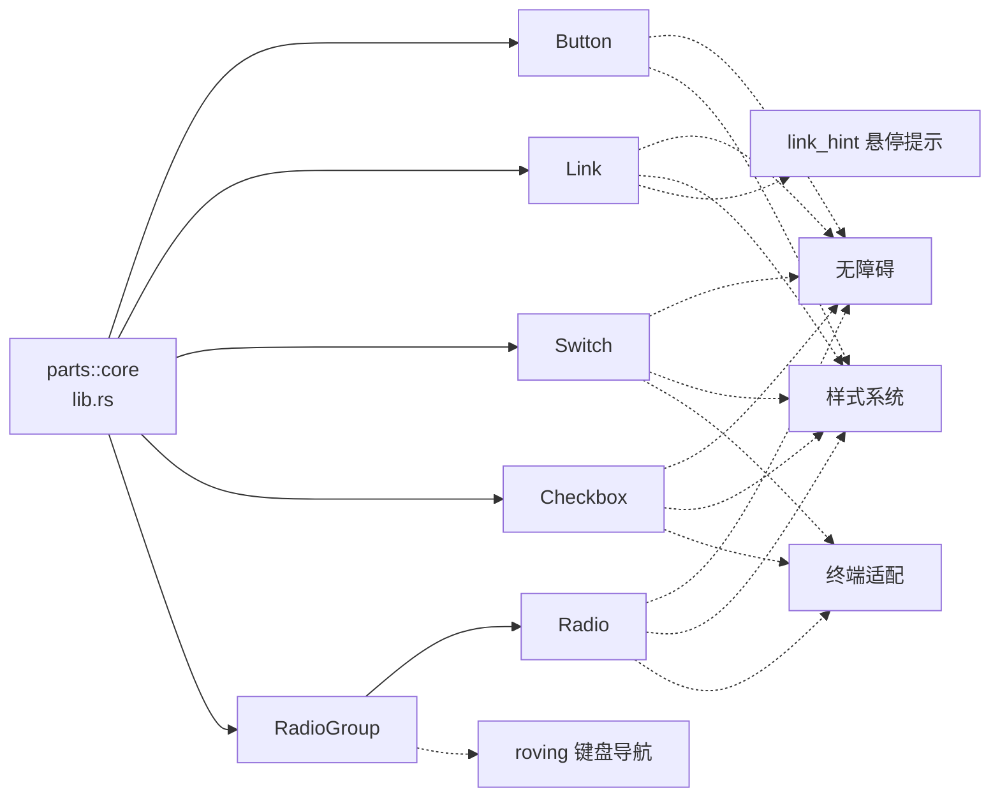

# 基础组件演示

<cite>
**本文引用的文件**   
- [lib.rs](file://crates/nsh-base/src/lib.rs)
- [button.rs](file://crates/nsh-base/src/button.rs)
- [link.rs](file://crates/nsh-base/src/link.rs)
- [switch.rs](file://crates/nsh-base/src/switch.rs)
- [checkbox.rs](file://crates/nsh-base/src/checkbox.rs)
- [radio.rs](file://crates/nsh-base/src/radio.rs)
</cite>

## 目录
1. [简介](#简介)
2. [项目结构](#项目结构)
3. [核心组件](#核心组件)
4. [架构总览](#架构总览)
5. [详细组件分析](#详细组件分析)
6. [依赖关系分析](#依赖关系分析)
7. [性能考虑](#性能考虑)
8. [故障排查指南](#故障排查指南)
9. [结论](#结论)
10. [附录](#附录)

## 简介
本演示文档聚焦 NSH 基础 UI 组件库中的核心交互控件：按钮、链接、开关、复选框、单选框。文档从属性配置、事件处理、状态管理与样式定制四个维度展开，提供基本用法、高级配置与组合模式的实践指引，并说明响应式行为、跨平台兼容（含终端环境）、无障碍访问支持与最佳实践建议。所有示例以“代码片段路径”形式给出，便于在仓库中快速定位实现与测试用例。

## 项目结构
NSH 的基础 UI 能力集中在 Rust 包 nsh-base 中，通过统一的注册机制暴露给 JS/TS 层使用。核心入口 lib.rs 负责导出各组件类型、事件与工厂函数，并通过 parts::core 将基础控件（Button、Link、Checkbox、Radio/RadioGroup、Switch 等）注册到运行时。

**图示来源**
- [lib.rs:392-422](file://crates/nsh-base/src/lib.rs#L392-L422)
- [button.rs:1-83](file://crates/nsh-base/src/button.rs#L1-L83)
- [link.rs:1-152](file://crates/nsh-base/src/link.rs#L1-L152)
- [switch.rs:1-121](file://crates/nsh-base/src/switch.rs#L1-L121)
- [checkbox.rs:1-138](file://crates/nsh-base/src/checkbox.rs#L1-L138)
- [radio.rs:1-150](file://crates/nsh-base/src/radio.rs#L1-L150)

**章节来源**
- [lib.rs:1-11](file://crates/nsh-base/src/lib.rs#L1-L11)
- [lib.rs:392-422](file://crates/nsh-base/src/lib.rs#L392-L422)

## 核心组件
本节概述各组件的职责、关键属性、事件与样式钩子，帮助读者快速建立整体认知。

- 按钮 Button
  - 职责：可点击目标，无自带外观；支持选中态、忙碌态、禁用态。
  - 关键属性：disabled、selected、selected_style、busy、accessibility_label、role、hit_slop、children。
  - 事件：Press、PressDown、PressUp。
  - 样式：通过 class/style 与 active/hover/focus-visible/selected/disabled 类或对应 Style 对象定制。
  - 无障碍：role 默认 button，可选 accessibilityLabel；selected/busy 会由辅助技术播报。

- 链接 Link
  - 职责：可导航的目标，无自带外观；支持系统打开或应用内打开。
  - 关键属性：href、title、open_with、disabled、current、accessibility_label、hit_slop、children。
  - 事件：Open（先于 Press）、Press。
  - 样式：hover/active/focus-visible/disabled 类或 Style 对象；启用时指针为手型。
  - 无障碍：role=link，current 页标识；悬停提示显示 href/title。

- 开关 Switch
  - 职责：开/关二元控制，即时生效。
  - 关键属性：checked、disabled、checked_style、accessibility_label、hit_slop、track_class/track_style、thumb_class/thumb_style、children。
  - 事件：Change(checked)。
  - 样式：轨道与滑块分别可通过 class/style 定制；checked/disabled/active 类跟随状态。
  - 无障碍：role=switch，checked 值由辅助技术播报。

- 复选框 Checkbox
  - 职责：三态选择（选中/未选中/半选）。
  - 关键属性：checked、indeterminate、disabled、checked_style、indeterminate_style、accessibility_label、invalid、accessibility_described_by、role、hit_slop、indicator_class/indicator_style、indicator、children。
  - 事件：Change(checked)。
  - 样式：指示器可自定义；checked/indeterminate/disabled 类跟随状态。
  - 无障碍：role=checkbox，mixed/true/false 状态播报；invalid 与描述元素联动。

- 单选框 Radio / RadioGroup
  - 职责：多选一选项组；键盘方向键在组内切换并自动选中。
  - 关键属性（Radio）：checked、disabled、checked_style、accessibility_label、hit_slop、children。
  - 关键属性（RadioGroup）：accessibility_label、children。
  - 事件（Radio）：Change(true)。
  - 样式：group-checked 类用于内部指示器；checked/disabled 类跟随状态。
  - 无障碍：Radio role=radiobutton，RadioGroup role=radiogroup；键盘遵循 WAI-ARIA 模式。

**章节来源**
- [button.rs:7-82](file://crates/nsh-base/src/button.rs#L7-L82)
- [link.rs:10-151](file://crates/nsh-base/src/link.rs#L10-L151)
- [switch.rs:11-120](file://crates/nsh-base/src/switch.rs#L11-L120)
- [checkbox.rs:8-137](file://crates/nsh-base/src/checkbox.rs#L8-L137)
- [radio.rs:16-149](file://crates/nsh-base/src/radio.rs#L16-L149)

## 架构总览
下图展示基础组件在运行时中的注册与调用关系，以及它们如何与无障碍、样式系统与终端渲染分支协作。

**图示来源**
- [lib.rs:392-422](file://crates/nsh-base/src/lib.rs#L392-L422)
- [button.rs:65-82](file://crates/nsh-base/src/button.rs#L65-L82)
- [link.rs:99-151](file://crates/nsh-base/src/link.rs#L99-L151)
- [switch.rs:80-120](file://crates/nsh-base/src/switch.rs#L80-L120)
- [checkbox.rs:91-137](file://crates/nsh-base/src/checkbox.rs#L91-L137)
- [radio.rs:76-149](file://crates/nsh-base/src/radio.rs#L76-L149)

## 详细组件分析

### 按钮 Button
- 属性配置
  - disabled：禁用后不可点击，样式与辅助技术均反映禁用。
  - selected：选中态（如触发器、当前标签），由应用维护并样式化。
  - busy：忙碌态，仍可计数按压但通常配合 disabled 拒绝重复操作。
  - hit_slop：扩大命中区域，适合小图标按钮。
  - role/accessibility_label：为屏幕阅读器提供语义。
- 事件处理
  - Press/PressDown/PressUp：覆盖按下、按下开始、释放结束三类时机。
- 状态管理
  - 由应用维护 selected/busy/disabled 状态，组件仅呈现。
- 样式定制
  - 通过 class/style 与 active/hover/focus-visible/selected/disabled 类或对应 Style 对象定制。
- 响应式与跨平台
  - 在 Toolbar/ToggleGroup 中作为焦点停靠项；Terminal 下仍保持可访问性。
- 无障碍
  - role=button，可选 accessibilityLabel；selected/busy 会被播报。

**图示来源**
- [button.rs:43-82](file://crates/nsh-base/src/button.rs#L43-L82)

**章节来源**
- [button.rs:7-82](file://crates/nsh-base/src/button.rs#L7-L82)

### 链接 Link
- 属性配置
  - href：目标地址或应用内路径。
  - title：悬停提示标题，位于目的地上方。
  - open_with：system（系统打开 URL）或 app（交由 onOpen 处理）。
  - current：当前页面标识，供辅助技术播报。
  - hit_slop/disabled/accessibility_label/children：同基础交互控件。
- 事件处理
  - Open(href)：在尝试打开前触发；Press：打开之后触发。
- 状态管理
  - 由应用维护 current/disabled 等状态。
- 样式定制
  - hover/active/focus-visible/disabled 类或 Style 对象；启用时指针为手型。
- 响应式与跨平台
  - 非终端环境下显示悬停提示；终端环境下文本直接可点击跳转。
- 无障碍
  - role=link，current 页标识；悬停提示对可访问性友好。

**图示来源**
- [link.rs:67-151](file://crates/nsh-base/src/link.rs#L67-L151)

**章节来源**
- [link.rs:10-151](file://crates/nsh-base/src/link.rs#L10-L151)

### 开关 Switch
- 属性配置
  - checked：开/关值，由应用维护。
  - track_class/track_style、thumb_class/thumb_style：轨道与滑块的样式。
  - checked_style/disabled/hit_slop/accessibility_label/children：通用交互与可访问性。
- 事件处理
  - Change(checked)：每次按压请求取反后的值。
- 状态管理
  - 应用维护 checked，组件呈现 checked/disabled/active 状态。
- 样式定制
  - 轨道与滑块可独立样式化；checked/disabled/active 类跟随状态。
- 响应式与跨平台
  - 终端环境下以文本标记替代轨道/滑块，布局为行内排列。
- 无障碍
  - role=switch，checked 值播报。

**图示来源**
- [switch.rs:80-120](file://crates/nsh-base/src/switch.rs#L80-L120)

**章节来源**
- [switch.rs:11-120](file://crates/nsh-base/src/switch.rs#L11-L120)

### 复选框 Checkbox
- 属性配置
  - checked/indeterminate/disabled：三态与禁用。
  - indicator_class/indicator_style/indicator：指示器外观与内容。
  - invalid/accessibility_described_by：表单校验与描述。
  - role/hit_slop/accessibility_label/children：通用交互与可访问性。
- 事件处理
  - Change(checked)：从未选中/半选变为选中，从选中变为未选中。
- 状态管理
  - indeterminate 优先级高于 checked；应用维护三者状态。
- 样式定制
  - checked/indeterminate/disabled 类跟随状态；指示器可完全自定义。
- 响应式与跨平台
  - 终端环境下以文本标记替代指示器，布局为行内排列。
- 无障碍
  - role=checkbox，mixed/true/false 播报；invalid 与描述元素联动。

**图示来源**
- [checkbox.rs:91-137](file://crates/nsh-base/src/checkbox.rs#L91-L137)

**章节来源**
- [checkbox.rs:8-137](file://crates/nsh-base/src/checkbox.rs#L8-L137)

### 单选框 Radio / RadioGroup
- 属性配置
  - Radio：checked/disabled/checked_style/accessibility_label/hit_slop/children。
  - RadioGroup：accessibility_label/children。
- 事件处理
  - Radio.Change(true)：当未选中的 Radio 被选中时触发。
- 状态管理
  - RadioGroup 不持有值，仅协调键盘与上下文；应用维护哪个 Radio 被选中。
- 样式定制
  - group-checked 类用于内部指示器；checked/disabled 类跟随状态。
- 响应式与跨平台
  - 终端环境下以文本标记替代圆点，布局为行内排列。
- 无障碍
  - Radio role=radiobutton，RadioGroup role=radiogroup；键盘遵循 WAI-ARIA 模式（方向键移动焦点并选中）。

**图示来源**
- [radio.rs:76-149](file://crates/nsh-base/src/radio.rs#L76-L149)

**章节来源**
- [radio.rs:16-149](file://crates/nsh-base/src/radio.rs#L16-L149)

## 依赖关系分析
- 组件注册
  - parts::core 统一注册 Button、Link、Checkbox、Radio/RadioGroup、Switch 等基础控件。
- 横切依赖
  - 无障碍：所有组件均设置 AccessibilityRole 与 AccessibilityState。
  - 样式系统：通过 class/style 与状态类（active/hover/focus-visible/checked/disabled 等）驱动外观。
  - 终端适配：Switch/Checkbox/Radio 在终端环境下采用文本标记渲染。
- 外部模块
  - roving：RadioGroup 的键盘导航与焦点管理。
  - link_hint：Link 的悬停提示。
  - terminal：终端环境的特殊渲染与标记。

**图示来源**
- [lib.rs:392-422](file://crates/nsh-base/src/lib.rs#L392-L422)
- [radio.rs:1-150](file://crates/nsh-base/src/radio.rs#L1-L150)
- [link.rs:1-152](file://crates/nsh-base/src/link.rs#L1-L152)
- [switch.rs:1-121](file://crates/nsh-base/src/switch.rs#L1-L121)
- [checkbox.rs:1-138](file://crates/nsh-base/src/checkbox.rs#L1-L138)

**章节来源**
- [lib.rs:392-422](file://crates/nsh-base/src/lib.rs#L392-L422)

## 性能考虑
- 轻量无外观：组件本身不包含样式与尺寸，避免不必要的重绘与布局开销。
- 状态最小化：组件仅转发状态（checked/disabled/busy/selected），应用侧集中管理，减少状态抖动。
- 终端分支渲染：仅在终端环境下走文本标记路径，降低复杂 DOM 树构建成本。
- 命中区域优化：hit_slop 允许在不改变布局的前提下扩大点击区域，提升移动端体验。

## 故障排查指南
- 点击无效
  - 检查 disabled 是否为 true；确认 hit_slop 是否过小导致点击落空。
  - 参考：[button.rs:13-14](file://crates/nsh-base/src/button.rs#L13-L14)、[link.rs:43-48](file://crates/nsh-base/src/link.rs#L43-L48)、[switch.rs:18-21](file://crates/nsh-base/src/switch.rs#L18-L21)、[checkbox.rs:21-24](file://crates/nsh-base/src/checkbox.rs#L21-L24)、[radio.rs:24-27](file://crates/nsh-base/src/radio.rs#L24-L27)
- 样式不生效
  - 确认使用了正确的状态类（active/hover/focus-visible/checked/disabled）或对应的 Style 对象。
  - 参考：[button.rs:54-60](file://crates/nsh-base/src/button.rs#L54-L60)、[link.rs:84-91](file://crates/nsh-base/src/link.rs#L84-L91)、[switch.rs:64-75](file://crates/nsh-base/src/switch.rs#L64-L75)、[checkbox.rs:76-86](file://crates/nsh-base/src/checkbox.rs#L76-L86)、[radio.rs:60-70](file://crates/nsh-base/src/radio.rs#L60-L70)
- 无障碍播报异常
  - 检查 role 与 accessibilityLabel；确保 checked/indeterminate/current/busy 等状态正确传递。
  - 参考：[button.rs:28-33](file://crates/nsh-base/src/button.rs#L28-L33)、[link.rs:49-56](file://crates/nsh-base/src/link.rs#L49-L56)、[switch.rs:26-28](file://crates/nsh-base/src/switch.rs#L26-L28)、[checkbox.rs:32-46](file://crates/nsh-base/src/checkbox.rs#L32-L46)、[radio.rs:31-33](file://crates/nsh-base/src/radio.rs#L31-L33)
- 终端显示异常
  - 终端环境下组件以文本标记渲染，需确保 children 布局为行内。
  - 参考：[switch.rs:105-119](file://crates/nsh-base/src/switch.rs#L105-L119)、[checkbox.rs:121-136](file://crates/nsh-base/src/checkbox.rs#L121-L136)、[radio.rs:110-115](file://crates/nsh-base/src/radio.rs#L110-L115)

**章节来源**
- [button.rs:13-14](file://crates/nsh-base/src/button.rs#L13-L14)
- [link.rs:43-48](file://crates/nsh-base/src/link.rs#L43-L48)
- [switch.rs:18-21](file://crates/nsh-base/src/switch.rs#L18-L21)
- [checkbox.rs:21-24](file://crates/nsh-base/src/checkbox.rs#L21-L24)
- [radio.rs:24-27](file://crates/nsh-base/src/radio.rs#L24-L27)
- [button.rs:54-60](file://crates/nsh-base/src/button.rs#L54-L60)
- [link.rs:84-91](file://crates/nsh-base/src/link.rs#L84-L91)
- [switch.rs:64-75](file://crates/nsh-base/src/switch.rs#L64-L75)
- [checkbox.rs:76-86](file://crates/nsh-base/src/checkbox.rs#L76-L86)
- [radio.rs:60-70](file://crates/nsh-base/src/radio.rs#L60-L70)
- [button.rs:28-33](file://crates/nsh-base/src/button.rs#L28-L33)
- [link.rs:49-56](file://crates/nsh-base/src/link.rs#L49-L56)
- [switch.rs:26-28](file://crates/nsh-base/src/switch.rs#L26-L28)
- [checkbox.rs:32-46](file://crates/nsh-base/src/checkbox.rs#L32-L46)
- [radio.rs:31-33](file://crates/nsh-base/src/radio.rs#L31-L33)
- [switch.rs:105-119](file://crates/nsh-base/src/switch.rs#L105-L119)
- [checkbox.rs:121-136](file://crates/nsh-base/src/checkbox.rs#L121-L136)
- [radio.rs:110-115](file://crates/nsh-base/src/radio.rs#L110-L115)

## 结论
NSH 基础 UI 组件以“行为与外观分离”为核心设计：组件专注交互、状态与无障碍，外观完全交给应用。通过统一的注册机制、清晰的属性与事件模型、完善的无障碍支持与终端适配，这些组件可在多平台环境中稳定工作。建议在应用中集中管理状态、合理使用状态类进行样式定制，并结合 hit_slop 与无障碍属性提升可用性与可访问性。

## 附录
- 代码片段路径（示例）
  - 按钮基本用法与忙碌态：[button.rs:7-82](file://crates/nsh-base/src/button.rs#L7-L82)
  - 链接系统打开与应用内打开：[link.rs:10-151](file://crates/nsh-base/src/link.rs#L10-L151)
  - 开关轨道与滑块样式：[switch.rs:35-50](file://crates/nsh-base/src/switch.rs#L35-L50)
  - 复选框三态与错误描述：[checkbox.rs:16-43](file://crates/nsh-base/src/checkbox.rs#L16-L43)
  - 单选组键盘导航与选中逻辑：[radio.rs:118-149](file://crates/nsh-base/src/radio.rs#L118-L149)