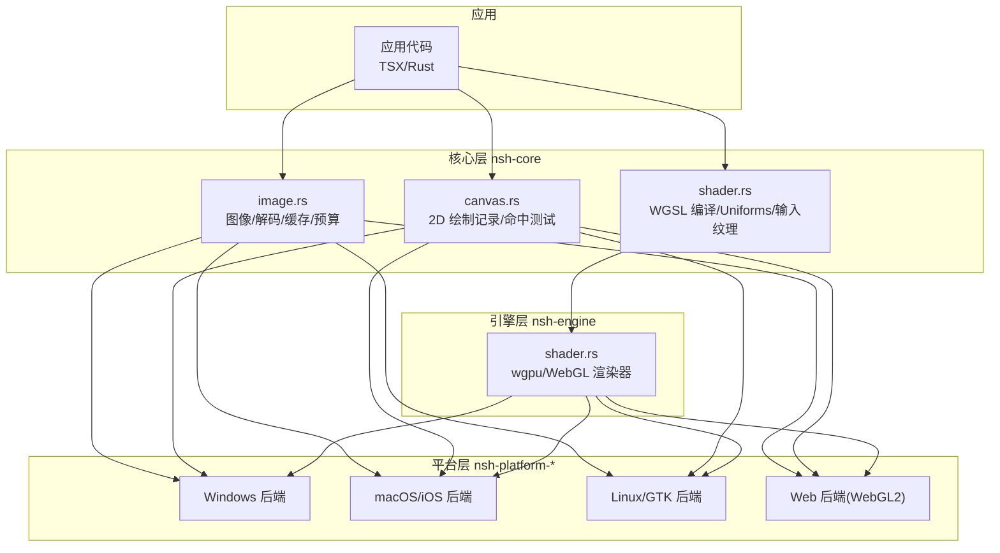
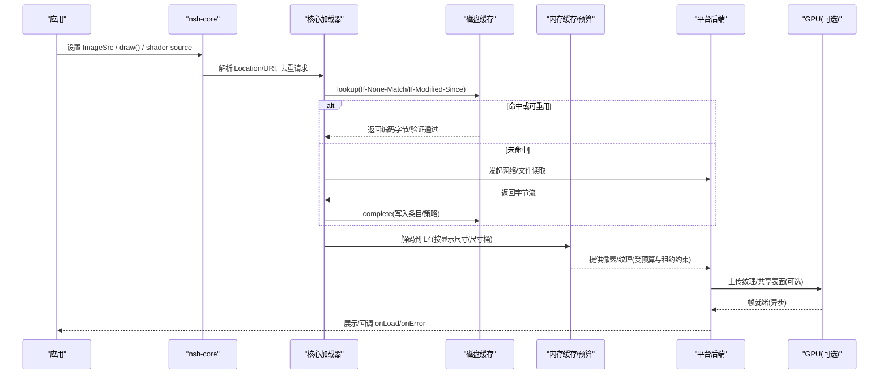
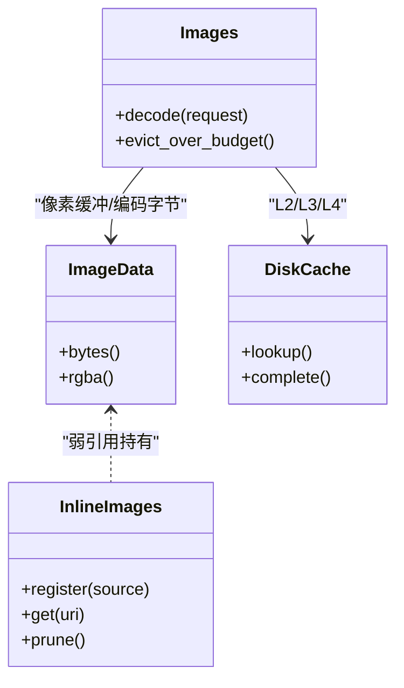
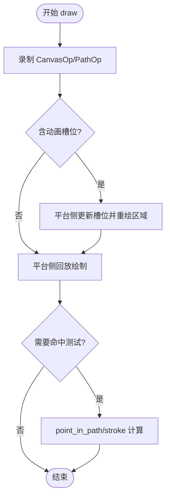
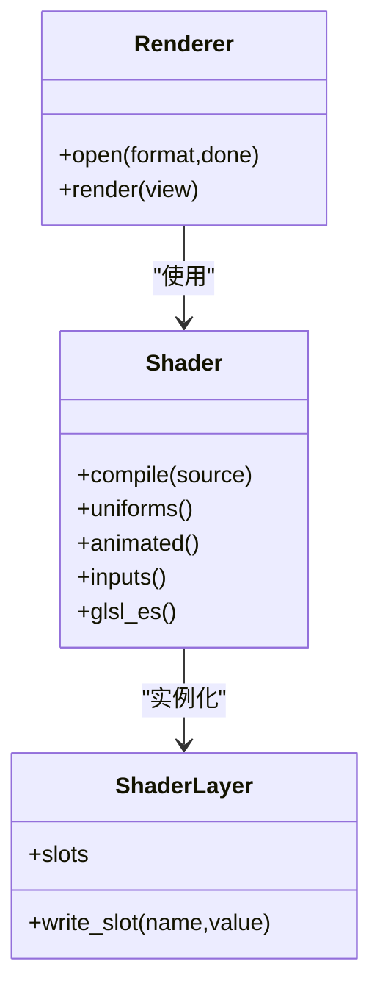
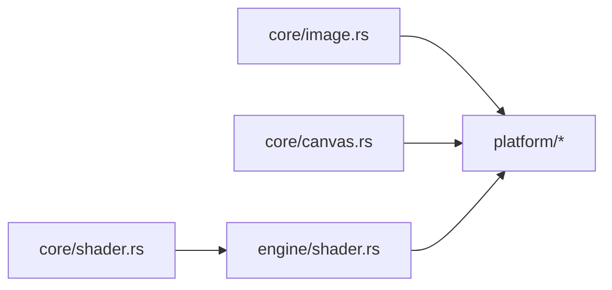

# 媒体组件演示

<cite>
**本文引用的文件**   
- [图片文档](file://docs/dev/images.md)
- [画布文档](file://docs/dev/canvas.md)
- [着色器文档](file://docs/dev/shaders.md)
- [图像加载设计](file://docs/dev/image-loading-design.md)
- [核心图像模块](file://crates/nsh-core/src/image.rs)
- [核心画布模块](file://crates/nsh-core/src/canvas.rs)
- [核心着色器模块](file://crates/nsh-core/src/shader.rs)
</cite>

## 目录
1. [简介](#简介)
2. [项目结构](#项目结构)
3. [核心组件](#核心组件)
4. [架构总览](#架构总览)
5. [详细组件分析](#详细组件分析)
6. [依赖关系分析](#依赖关系分析)
7. [性能与内存优化](#性能与内存优化)
8. [跨平台与移动端适配](#跨平台与移动端适配)
9. [故障排查指南](#故障排查指南)
10. [结论](#结论)
11. [附录：复杂应用场景](#附录复杂应用场景)

## 简介
本演示文档聚焦 NSH 的媒体相关组件，包括图片、视频、画布与着色器。内容覆盖：
- 媒体加载优化、格式支持、缓存策略与性能调优
- 复杂场景：图像编辑器、实时渲染、数据可视化
- WebGL 集成、GPU 加速与内存管理
- 跨平台兼容性与移动端优化方案

## 项目结构
NSH 的媒体能力由核心层（nsh-core）提供统一抽象，引擎层（nsh-engine）负责 GPU/渲染管线，平台层（nsh-platform-*）实现具体后端，JS 层（nsh-js）暴露 API 给应用。

图表来源
- [核心图像模块:1-557](file://crates/nsh-core/src/image.rs#L1-L557)
- [核心画布模块:1-800](file://crates/nsh-core/src/canvas.rs#L1-L800)
- [核心着色器模块:1-800](file://crates/nsh-core/src/shader.rs#L1-L800)

章节来源
- [图片文档:1-297](file://docs/dev/images.md#L1-L297)
- [画布文档:1-182](file://docs/dev/canvas.md#L1-L182)
- [着色器文档:1-503](file://docs/dev/shaders.md#L1-L503)

## 核心组件
- 图片子系统：统一的 ImageSrc、下载/解码管线、磁盘与内存缓存、按显示尺寸下采样、进程级预算与租约机制、像素缓冲与 data/blob 内联资源、SVG 矢量图。
- 画布子系统：HTML Canvas 2D 子集录制与原生回放、动画值槽位驱动重绘、OffscreenCanvas 导出、命中测试与节点标注。
- 着色器子系统：WGSL 程序校验与封装、Uniforms 打包与动画槽位、多平台 wgpu/WebGL2 渲染、效果/转场/屏幕着色器与页面导航着色器。

章节来源
- [核心图像模块:1-557](file://crates/nsh-core/src/image.rs#L1-L557)
- [核心画布模块:1-800](file://crates/nsh-core/src/canvas.rs#L1-L800)
- [核心着色器模块:1-800](file://crates/nsh-core/src/shader.rs#L1-L800)

## 架构总览
媒体处理的关键流程如下：

图表来源
- [图片文档:1-297](file://docs/dev/images.md#L1-L297)
- [图像加载设计:66-143](file://docs/dev/image-loading-design.md#L66-L143)
- [核心图像模块:1-557](file://crates/nsh-core/src/image.rs#L1-L557)

## 详细组件分析

### 图片组件
- 加载与缓存
  - 统一入口：ImageSrc 同时承载远程 URL、本地文件、asset:/、data:/blob 与 RGBA 像素缓冲。
  - 核心加载器：按源键去重、优先级队列（可见优先）、取消空闲请求、限制响应大小/超时/重定向。
  - 磁盘缓存：RFC 9111 私有缓存语义，默认开启，256 MiB，mtime LRU，支持 revalidation 与 stale-if-error。
  - 内存缓存：L3 编码字节小 LRU；L4 解码图像按显示尺寸下采样并进入进程级预算，使用租约保护在屏项。
  - 像素缓冲：ImageData::rgba 零拷贝直传 RGBA，按需生成 PNG 供仅编码路径的后端。
  - SVG：矢量解析与绘制，按视图尺寸栅格化，保留自然尺寸与 viewBox 布局。
- 格式与特性
  - 动图：iOS/macOS 序列帧播放；Android API 28+ AnimatedImageDrawable；Windows/Linux/GPUI 分帧流式解码与内存池。
  - 密度变体：@Nx 文件名自动选择最接近 pixel_ratio 的变体，prefetch/getSize 同样走该逻辑。
  - 选择器：Picker.pickImages/pickFiles 跨平台调用系统选择器，压缩/缩放与元数据处理。
- 关键数据结构与复杂度
  - 预算与租约：O(1) 插入/释放，LRU 淘汰 O(log N)。
  - 尺寸桶：将目标像素长边对齐到桶，减少重复解码，提升命中率。
  - 动画帧：每帧计入预算，受帧窗口限制，避免峰值膨胀。

图表来源
- [核心图像模块:1-557](file://crates/nsh-core/src/image.rs#L1-L557)
- [图片文档:99-185](file://docs/dev/images.md#L99-L185)

章节来源
- [图片文档:1-297](file://docs/dev/images.md#L1-L297)
- [核心图像模块:1-557](file://crates/nsh-core/src/image.rs#L1-L557)

### 画布组件
- 录制与回放
  - HTML Canvas 2D 子集：状态机、路径、渐变、阴影、字体与文本度量、drawImage 等。
  - 操作列表：CanvasOp/PathOp 以 JsOps 序列化，平台侧原生回放（CGContext/Android Canvas/Cairo/Direct2D/tiny-skia）。
  - 动画值：数字参数可为动画槽位，平台侧直接重绘，无需 JS 参与。
- OffscreenCanvas
  - 独立尺寸上下文，convertToBlob 触发渲染命令，平台侧回放并编码为 Blob。
  - 全清且无保存栈时复用录制，避免历史操作累积。
- 命中测试与节点
  - point_in_path/point_in_stroke 同步命中，基于已录制路径与样式。
  - Painter::node 将形状标记为可访问节点，辅助测试与无障碍。

图表来源
- [画布文档:1-182](file://docs/dev/canvas.md#L1-L182)
- [核心画布模块:1-800](file://crates/nsh-core/src/canvas.rs#L1-L800)

章节来源
- [画布文档:1-182](file://docs/dev/canvas.md#L1-L182)
- [核心画布模块:1-800](file://crates/nsh-core/src/canvas.rs#L1-L800)

### 着色器组件
- WGSL 编译与校验
  - 限制：源码大小、Uniforms 结构与大小、禁止自定义入口点/资源，naga 全量校验。
  - 封装：注入内置 uniform（size/time/scale/progress/overflow）、顶点/片段入口、纹理采样函数。
- Uniforms 与动画
  - 类型映射：标量/向量/颜色/数组，打包为字面 buffer。
  - 动画槽位：UniformValue::Animated 绑定到视图，平台侧逐帧写入，无需 JS 开销。
- 渲染管线
  - 原生后端：wgpu 设备/队列，延迟打开设备，后台编译管线，不阻塞主线程。
  - Web 后端：GLSL ES 翻译，WebGL2 共享上下文，OffscreenCanvas 共享画布，IntersectionObserver 控制可见性。
- 效果/转场/屏幕着色器
  - 输入纹理：content/backdrop/from/to，按需取样，溢出区域扩展。
  - 页面/对话框：transitionShader 接管进出动画，支持中断与降级。

图表来源
- [核心着色器模块:1-800](file://crates/nsh-core/src/shader.rs#L1-L800)
- [着色器文档:1-503](file://docs/dev/shaders.md#L1-L503)

章节来源
- [核心着色器模块:1-800](file://crates/nsh-core/src/shader.rs#L1-L800)
- [着色器文档:1-503](file://docs/dev/shaders.md#L1-L503)

## 依赖关系分析
- 耦合与内聚
  - image.rs 高内聚于“源→加载→解码→缓存→预算”的全链路，与平台解耦通过 Transport/Location/ImageSource。
  - canvas.rs 将绘制指令与平台回放分离，JsOps 保证跨语言一致性。
  - shader.rs 将 WGSL 校验与平台渲染解耦，Renderer 屏蔽 wgpu/WebGL2 差异。
- 外部依赖
  - naga/wgpu（原生），WebGL2（Web），平台图形库（CoreGraphics/Direct2D/GTK/tiny-skia）。
- 潜在循环
  - 核心层不反向依赖平台层；平台层依赖核心层接口，避免环依赖。

图表来源
- [核心图像模块:1-557](file://crates/nsh-core/src/image.rs#L1-L557)
- [核心画布模块:1-800](file://crates/nsh-core/src/canvas.rs#L1-L800)
- [核心着色器模块:1-800](file://crates/nsh-core/src/shader.rs#L1-L800)

## 性能与内存优化
- 图片
  - 按显示尺寸下采样与尺寸桶共享，避免全尺寸解码。
  - 进程级预算与租约：在屏项不被回收，滚动离开优先淘汰。
  - 磁盘缓存默认开启，减少冷启动与离线回退成本。
  - 动图分帧流式解码与内存池，限制并发与工作内存。
- 画布
  - 部分重绘：DamageScan 定位受影响区域，iOS/macOS/Windows 最小化重绘。
  - OffscreenCanvas 复用录制，避免历史操作累积。
- 着色器
  - 延迟打开 GPU 设备与后台编译管线，避免首帧卡顿。
  - 共享 WebGL2 上下文与共享画布，减少分配与切换。
  - 仅当读取 nsh.time 或 Uniforms 变化时持续刷新。

章节来源
- [图片文档:1-297](file://docs/dev/images.md#L1-L297)
- [画布文档:85-121](file://docs/dev/canvas.md#L85-L121)
- [着色器文档:114-176](file://docs/dev/shaders.md#L114-L176)
- [图像加载设计:111-143](file://docs/dev/image-loading-design.md#L111-L143)

## 跨平台与移动端适配
- 图片
  - iOS/macOS：ImageIO 缩略图、NSCache、GCD 队列烘焙效果；AVIF/HEIF/APNG/GIF/WebP 序列帧。
  - Android：BitmapFactory 采样、AnimatedImageDrawable、API 级别分支与错误捕获。
  - Windows/Linux/GPUI：WIC/GDK/tiny-skia 解码与纹理管理，流式动图与内存池。
- 画布
  - iOS/macOS：CGContext 回放与 IOSurface 输出；Windows：Direct2D 共享纹理；Linux：Cairo/GDK；GPUI：tiny-skia。
- 着色器
  - 原生：wgpu 多后端（Vulkan/Metal/GL/D3D12），IOSurface/共享纹理优化。
  - Web：GLSL ES 翻译，WebGL2 共享上下文，IntersectionObserver 控制可见性。
- 移动端优化
  - 低电量/后台裁剪未租约条目；内存压力事件清理 L3/L4。
  - 降低动图质量/帧率，按需预取与懒加载。

章节来源
- [图片文档:1-297](file://docs/dev/images.md#L1-L297)
- [画布文档:1-182](file://docs/dev/canvas.md#L1-L182)
- [着色器文档:177-373](file://docs/dev/shaders.md#L177-L373)
- [图像加载设计:154-163](file://docs/dev/image-loading-design.md#L154-L163)

## 故障排查指南
- 图片
  - 远端 4xx/5xx：失败在内存中短期缓存（TTL），避免频繁重试。
  - 重定向安全：HTTPS→HTTP 降级被拒绝；跳转链超限丢弃条目。
  - blob/data URI：无效 data: 显示空白；blob 撤销不影响已解析键。
- 画布
  - 超出平台限制：OffscreenCanvas 过大返回 TooLarge；浏览器侧可能静默失败。
  - 命中测试异常：动画值按 0 计算，确保交互逻辑考虑此行为。
- 着色器
  - 无 GPU/上下文丢失：自动降级为普通背景与子视图；Web 上 webglcontextlost/restored 恢复。
  - 首次帧为空：帧异步返回，不要以首帧作为结束条件。
  - 哈希噪声：避免浮点哈希导致接缝，改用整数哈希。

章节来源
- [图片文档:99-185](file://docs/dev/images.md#L99-L185)
- [画布文档:41-83](file://docs/dev/canvas.md#L41-L83)
- [着色器文档:469-503](file://docs/dev/shaders.md#L469-L503)

## 结论
NSH 的媒体子系统通过统一的核心抽象与平台后端解耦，实现了高性能、可控内存与跨平台一致的体验。图片子系统强调“按显示尺寸解码+预算+租约”，画布子系统强调“录制回放+动画槽位+部分重绘”，着色器子系统强调“WGSL 校验+多后端渲染+效果/转场”。结合磁盘缓存、内存预算与平台优化，可在复杂场景中保持流畅与稳定。

## 附录：复杂应用场景
- 图像编辑器
  - 使用 ImageSrc::rgba 零拷贝像素缓冲，配合画布进行图层合成与滤镜预览。
  - 利用 OffscreenCanvas 批量导出，结合图片磁盘缓存减少重复 I/O。
- 实时渲染
  - 着色器 uniforms 使用动画槽位驱动时间/速度/颜色，避免 JS 每帧开销。
  - 使用 effect/screen shader 叠加全局特效，注意输入纹理与溢出区域。
- 数据可视化
  - 画布绘制图表与交互热区，使用节点标注与命中测试实现点击/悬停。
  - 大表格/列表中使用图片懒加载与尺寸桶，结合 prefetch 预热热门资源。

[本节为概念性说明，不直接分析具体文件]