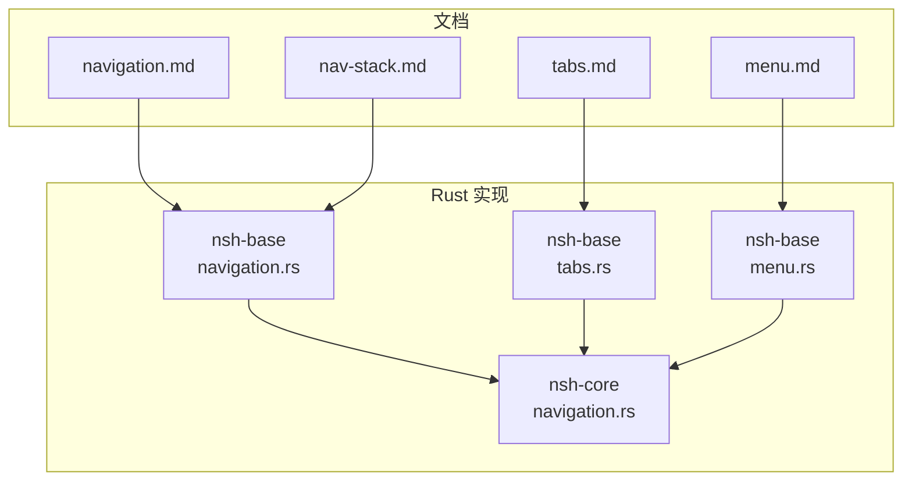
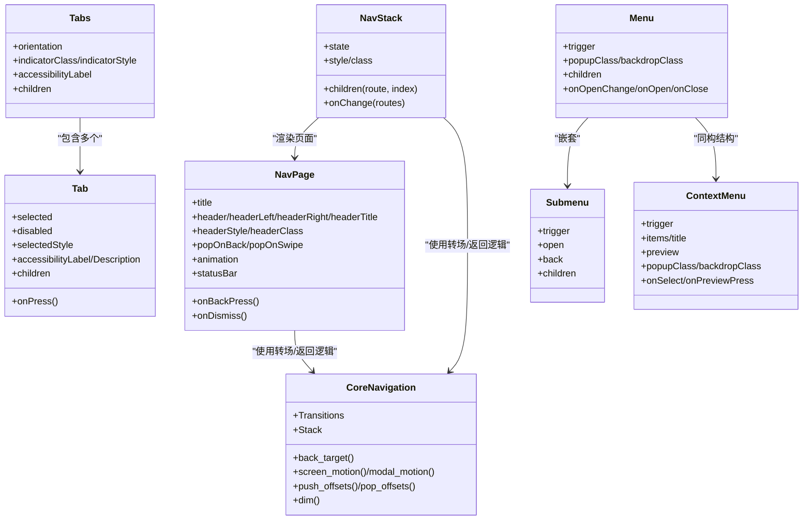
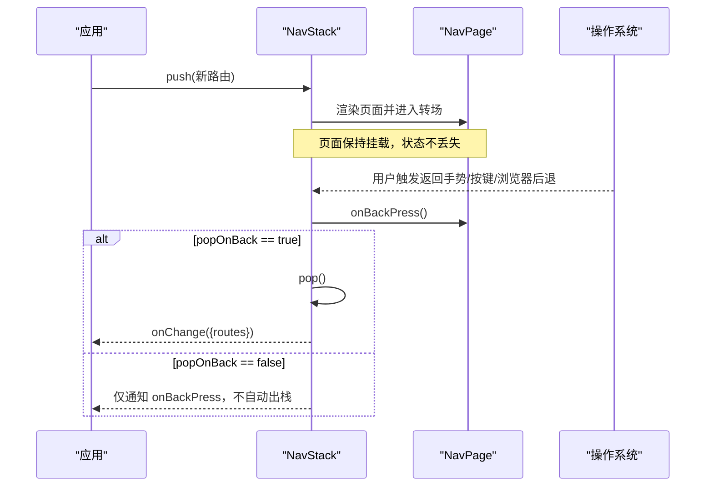
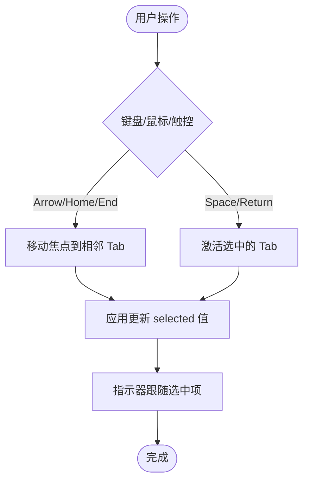
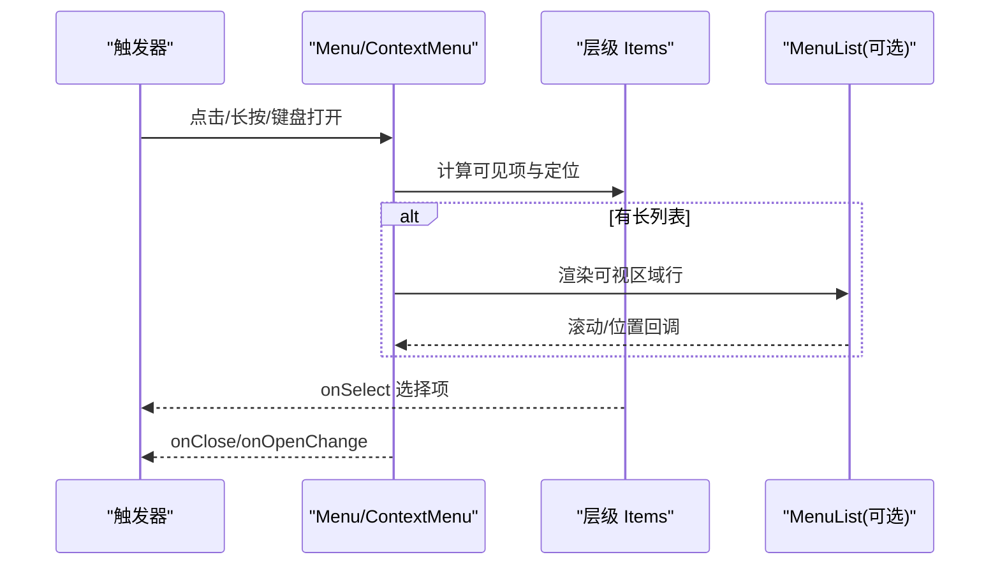
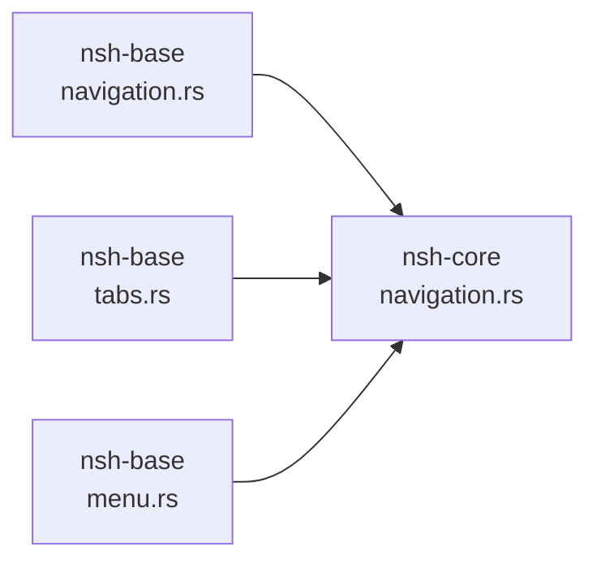

# 导航组件演示

<cite>
**本文引用的文件**   
- [navigation.md](file://website/docs/navigation.md)
- [nav-stack.md](file://website/elements/nav-stack.md)
- [tabs.md](file://website/elements/tabs.md)
- [menu.md](file://website/elements/menu.md)
- [navigation.rs（nsh-base）](file://crates/nsh-base/src/navigation.rs)
- [navigation.rs（nsh-core）](file://crates/nsh-core/src/navigation.rs)
- [tabs.rs（nsh-base）](file://crates/nsh-base/src/tabs.rs)
- [menu.rs（nsh-base）](file://crates/nsh-base/src/menu.rs)
</cite>

## 目录
1. [引言](#引言)
2. [项目结构](#项目结构)
3. [核心组件](#核心组件)
4. [架构总览](#架构总览)
5. [详细组件分析](#详细组件分析)
6. [依赖关系分析](#依赖关系分析)
7. [性能与体验优化](#性能与体验优化)
8. [故障排查指南](#故障排查指南)
9. [结论](#结论)
10. [附录：复杂应用的多级导航最佳实践](#附录复杂应用的多级导航最佳实践)

## 引言
本演示文档聚焦 NSH 的导航相关组件，包括标签页、菜单、原生导航栈（NavStack）、页面切换、状态保持、历史记录、移动端手势与键盘导航、无障碍访问，以及面向复杂应用的多级导航架构与最佳实践。NSH 将“导航行为”与“页面外观”解耦：导航栈负责转场、返回手势、页面生命周期；页面自身负责内容、标题栏和交互。

## 项目结构
围绕导航能力，仓库的关键位置如下：
- 文档层：网站文档与元素说明，提供 API 与用法示例
  - [navigation.md](file://website/docs/navigation.md)
  - [nav-stack.md](file://website/elements/nav-stack.md)
  - [tabs.md](file://website/elements/tabs.md)
  - [menu.md](file://website/elements/menu.md)
- Rust 实现层
  - nsh-base：面向应用的 UI 构建器（如 NavStack/NavPage/Dialog、Tab/Tabs、Menu/ContextMenu/Submenu）
    - [navigation.rs（nsh-base）](file://crates/nsh-base/src/navigation.rs)
    - [tabs.rs（nsh-base）](file://crates/nsh-base/src/tabs.rs)
    - [menu.rs（nsh-base）](file://crates/nsh-base/src/menu.rs)
  - nsh-core：平台无关的导航内核（转场时序、堆栈可见性、返回目标判定等）
    - [navigation.rs（nsh-core）](file://crates/nsh-core/src/navigation.rs)

**图表来源**
- [navigation.md:1-20](file://website/docs/navigation.md#L1-L20)
- [nav-stack.md:1-20](file://website/elements/nav-stack.md#L1-L20)
- [tabs.md:1-20](file://website/elements/tabs.md#L1-L20)
- [menu.md:1-20](file://website/elements/menu.md#L1-L20)
- [navigation.rs（nsh-base）:1-41](file://crates/nsh-base/src/navigation.rs#L1-L41)
- [tabs.rs（nsh-base）:1-20](file://crates/nsh-base/src/tabs.rs#L1-L20)
- [menu.rs（nsh-base）:1-35](file://crates/nsh-base/src/menu.rs#L1-L35)
- [navigation.rs（nsh-core）:1-28](file://crates/nsh-core/src/navigation.rs#L1-L28)

**章节来源**
- [navigation.md:1-20](file://website/docs/navigation.md#L1-L20)
- [nav-stack.md:1-20](file://website/elements/nav-stack.md#L1-L20)
- [tabs.md:1-20](file://website/elements/tabs.md#L1-L20)
- [menu.md:1-20](file://website/elements/menu.md#L1-L20)

## 核心组件
- 原生导航栈（NavStack / NavPage / createNavStack）
  - 职责：管理路由栈、转场动画、返回手势、页面状态保持、系统标题栏与桌面端自定义 header。
  - 关键能力：push/pop/replace/setRoutes、popOnBack/popOnSwipe、header/headerLeft/headerRight/headerTitle、onBackPress/onDismiss、onChange 同步 URL 或埋点。
- 标签页（Tabs / Tab）
  - 职责：一组可切换的分区视图；指示器跟随选中项；完整的键盘与无障碍支持。
- 菜单（Menu / ContextMenu / MenuItem / Submenu / MenuList）
  - 职责：统一的菜单数据结构，在桌面弹出、在移动侧呈现为底部面板；支持勾选、单选、子菜单、长列表虚拟化、类型首字母匹配、系统上下文菜单桥接。

**章节来源**
- [nav-stack.md:152-218](file://website/elements/nav-stack.md#L152-L218)
- [tabs.md:107-159](file://website/elements/tabs.md#L107-L159)
- [menu.md:104-124](file://website/elements/menu.md#L104-L124)

## 架构总览
NSH 的导航由两层构成：
- 表现层（nsh-base）：暴露给应用的组件 API（NavStack/NavPage、Tabs/Tab、Menu/ContextMenu/Submenu）。
- 内核层（nsh-core）：平台无关的导航逻辑（转场时长/缓动、屏幕偏移、遮罩透明度、转场队列、堆栈 reconcile、返回目标判定、尺寸与 insets 上报）。

**图表来源**
- [nav-stack.md:208-260](file://website/elements/nav-stack.md#L208-L260)
- [tabs.md:115-159](file://website/elements/tabs.md#L115-L159)
- [menu.md:482-563](file://website/elements/menu.md#L482-L563)
- [navigation.rs（nsh-core）:17-28](file://crates/nsh-core/src/navigation.rs#L17-L28)
- [navigation.rs（nsh-core）:122-204](file://crates/nsh-core/src/navigation.rs#L122-L204)
- [navigation.rs（nsh-core）:214-323](file://crates/nsh-core/src/navigation.rs#L214-L323)

## 详细组件分析

### 原生导航栈（NavStack / NavPage / createNavStack）
- 路由与状态
  - TSX：createNavStack 持有 routes，NavStack 渲染每个 route 为一个页面；页面在栈中保持挂载，保留滚动位置、输入框与信号状态。
  - Rust：routes 是 signal<Vec<Route>>，通过 each 渲染页面；on_dismiss 用于在用户原生返回时清理路由。
- 页面切换与历史
  - push/pop/popToRoot/replace/setRoutes/remove 控制路由栈。
  - onChange 可用于记录当前屏幕、持久化路由或设置浏览器地址（UrlScheme）。
- 离开页面保护
  - popOnBack=false 阻止所有返回方式触发自动出栈；onBackPress 处理确认逻辑后手动 pop。
  - popOnSwipe=false 仅关闭滑动返回手势，按钮仍有效。
- 标题栏与状态栏
  - iOS/Android：title、headerLeft/right/title、large title、statusBar。
  - 桌面/Web：header 插槽完全自定义。
- 平台差异
  - iOS：UINavigationController，支持滑动返回与大标题。
  - Android：带工具栏的栈，支持预测性返回。
  - 桌面/Web：每页显示 app 的 header，Esc/Alt+Left/鼠标后退键/浏览器后退均触发返回。

**图表来源**
- [nav-stack.md:152-218](file://website/elements/nav-stack.md#L152-L218)
- [nav-stack.md:314-388](file://website/elements/nav-stack.md#L314-L388)
- [navigation.md:156-175](file://website/docs/navigation.md#L156-L175)

**章节来源**
- [nav-stack.md:152-218](file://website/elements/nav-stack.md#L152-L218)
- [nav-stack.md:220-260](file://website/elements/nav-stack.md#L220-L260)
- [nav-stack.md:314-388](file://website/elements/nav-stack.md#L314-L388)
- [navigation.md:156-175](file://website/docs/navigation.md#L156-L175)

### 标签页（Tabs / Tab）
- 结构与职责
  - Tabs 是“tablist”，Tab 是单个“tab”。Tabs 不持值，也不渲染内容；选中态与应用状态绑定。
  - 指示器（underline/pill）由 Tabs 原生驱动，跟随选中项移动，无需 JS 布局事件。
- 键盘与无障碍
  - 遵循 WAI-ARIA tabs pattern：Tab/Shift+Tab 进入/离开，左右/上下箭头移动焦点，Home/End 跳转首尾，Space/Return 激活。
  - 支持 orientation（horizontal/vertical），无障碍读屏可获知方向。
- 禁用态与样式
  - disabled 禁止交互且读屏提示“已禁用”；selected/disabled/active/hover/focus 状态类可用。

**图表来源**
- [tabs.md:223-244](file://website/elements/tabs.md#L223-L244)
- [tabs.rs（nsh-base）:166-201](file://crates/nsh-base/src/tabs.rs#L166-L201)

**章节来源**
- [tabs.md:107-159](file://website/elements/tabs.md#L107-L159)
- [tabs.md:163-221](file://website/elements/tabs.md#L163-L221)
- [tabs.md:223-253](file://website/elements/tabs.md#L223-L253)
- [tabs.rs（nsh-base）:1-20](file://crates/nsh-base/src/tabs.rs#L1-L20)
- [tabs.rs（nsh-base）:166-201](file://crates/nsh-base/src/tabs.rs#L166-L201)

### 菜单（Menu / ContextMenu / MenuItem / Submenu / MenuList）
- 统一结构与多形态呈现
  - 桌面/iPad 常规宽度：弹出式菜单；子菜单级联展开。
  - 手机/紧凑窗口：底部面板（Sheet），子菜单以“返回行”形式展示。
- 交互与可达性
  - 键盘：Enter/Space/Down 打开，Up 打开最后一个；箭头键移动；PageUp/PageDown 分页；首字母匹配。
  - 无障碍：role 与 checked/radio 语义完整；子菜单触发有自己的 label/description。
- 长列表虚拟化
  - MenuList 按需渲染行，结合滚动与键盘导航，避免大量 DOM/节点开销。
- 系统菜单桥接
  - MenuButton：iOS/Android 调用系统菜单；ContextMenu：iOS/Android 长按触发系统上下文菜单。

**图表来源**
- [menu.md:104-124](file://website/elements/menu.md#L104-L124)
- [menu.md:326-354](file://website/elements/menu.md#L326-L354)
- [menu.rs（nsh-base）:75-120](file://crates/nsh-base/src/menu.rs#L75-L120)

**章节来源**
- [menu.md:104-124](file://website/elements/menu.md#L104-L124)
- [menu.md:167-256](file://website/elements/menu.md#L167-L256)
- [menu.md:261-325](file://website/elements/menu.md#L261-L325)
- [menu.md:326-354](file://website/elements/menu.md#L326-L354)
- [menu.md:356-419](file://website/elements/menu.md#L356-L419)
- [menu.md:420-480](file://website/elements/menu.md#L420-L480)
- [menu.md:482-572](file://website/elements/menu.md#L482-L572)
- [menu.rs（nsh-base）:1-35](file://crates/nsh-base/src/menu.rs#L1-L35)
- [menu.rs（nsh-base）:75-120](file://crates/nsh-base/src/menu.rs#L75-L120)

## 依赖关系分析
- nsh-base 对 nsh-core 的依赖
  - navigation.rs（nsh-base）：封装 nav_stack/nav_page/dialog，委托 core 的 Stack/Modal。
  - tabs.rs（nsh-base）：使用 core 的 LayoutTransition/Spring 驱动指示器跟随。
  - menu.rs（nsh-base）：使用 overlay、platform、keymap、popup 等 core 能力。
- nsh-core 提供的导航原语
  - Transitions：转场队列、进度与截止时间。
  - Stack：shown/popped 分离，reconcile 对齐应用路由与可见屏幕。
  - back_target：决定返回命中栈、模态还是应用级监听。
  - screen_motion/modal_motion：根据动画类型与减少动效偏好计算时长与是否淡入。
  - push/pop offsets 与 dim：滑入/滑出位移与遮罩透明度。

**图表来源**
- [navigation.rs（nsh-base）:1-41](file://crates/nsh-base/src/navigation.rs#L1-L41)
- [tabs.rs（nsh-base）:1-20](file://crates/nsh-base/src/tabs.rs#L1-L20)
- [menu.rs（nsh-base）:1-35](file://crates/nsh-base/src/menu.rs#L1-L35)
- [navigation.rs（nsh-core）:1-28](file://crates/nsh-core/src/navigation.rs#L1-L28)
- [navigation.rs（nsh-core）:122-204](file://crates/nsh-core/src/navigation.rs#L122-L204)
- [navigation.rs（nsh-core）:214-323](file://crates/nsh-core/src/navigation.rs#L214-L323)

**章节来源**
- [navigation.rs（nsh-base）:1-41](file://crates/nsh-base/src/navigation.rs#L1-L41)
- [navigation.rs（nsh-core）:17-28](file://crates/nsh-core/src/navigation.rs#L17-L28)
- [navigation.rs（nsh-core）:122-204](file://crates/nsh-core/src/navigation.rs#L122-L204)
- [navigation.rs（nsh-core）:214-323](file://crates/nsh-core/src/navigation.rs#L214-L323)

## 性能与体验优化
- 页面状态保持
  - 使用 NavStack 保持被覆盖页面的状态（滚动位置、输入、信号），避免重复初始化。
- 路由最小化
  - Route 只携带必要参数，避免大对象；必要时用唯一 key 区分重复路由。
- 长列表与虚拟滚动
  - 菜单中使用 MenuList 虚拟化行，减少渲染压力；配合键盘分页与首字母匹配提升可用性。
- 转场与动效
  - 合理选择 animation（default/slide/fade/none），在低性能设备上考虑 reduce motion。
- 安全区与标题栏
  - 透明/大标题场景下使用 safe-area-inset-* 或 safeAreaInsets() 避免内容遮挡。
- 移动端手势
  - 谨慎使用 popOnSwipe=false，避免破坏用户预期；仅在必要时关闭滑动返回。
- 键盘与无障碍
  - Tabs/Menu 遵循 ARIA 模式，确保角色、标签、描述正确；为图标提供 accessibilityLabel。

[本节为通用指导，不直接分析具体文件]

## 故障排查指南
- 返回行为异常
  - 检查 popOnBack 是否为 false；若为 false，需手动 pop。
  - 确认 onBackPress 是否正确消费返回事件，避免栈误判。
- 页面未销毁或状态残留
  - Rust 侧需在 on_dismiss 中 truncate 路由；TSX 侧由栈自动移除路由。
- 标题栏布局错乱
  - 透明/大标题场景下，确保内容从顶部开始并使用 safe area inset 留白。
- 菜单无法打开或焦点异常
  - 检查 trigger 是否可聚焦；键盘模式下确保 Return/Space/Down 能打开菜单。
- 长列表卡顿
  - 使用 MenuList 虚拟化行，并为列表设置高度；避免一次性渲染全部项。

**章节来源**
- [nav-stack.md:314-388](file://website/elements/nav-stack.md#L314-L388)
- [menu.md:261-325](file://website/elements/menu.md#L261-L325)
- [menu.md:326-354](file://website/elements/menu.md#L326-L354)

## 结论
NSH 的导航体系将“行为”与“外观”清晰分层：NavStack/NavPage 负责跨平台导航与状态保持，Tabs/Tab 提供可访问的分区切换，Menu/ContextMenu/Submenu 提供一致的数据结构与多形态呈现。配合 nsh-core 的转场与返回逻辑，开发者可在不同平台上获得一致的导航体验，并通过 popOnBack、safe area、虚拟化与键盘/无障碍支持，构建高质量的用户界面。

[本节为总结性内容，不直接分析具体文件]

## 附录：复杂应用的多级导航最佳实践
- 多级导航架构
  - 顶层：全局 createNavStack 管理主路由（如 Home/Dashboard/Settings）。
  - 功能域：每个模块维护自己的子栈或路由集合，通过 replace/popToRoot 进行域内导航。
  - 共享状态：使用全局 signal 或 store 保存跨页面数据，避免在 Route 中传递大对象。
- 页面切换与状态保持
  - 使用 NavStack 保持页面状态；对需要重绘的页面使用 key 区分。
  - 在 onChange 中同步 UrlScheme，使浏览器前进/后退与内部栈保持一致。
- 历史记录与深度链接
  - 首次启动从 UrlScheme.url() 恢复初始路由；后续变更通过 UrlScheme.setUrl 写入地址。
  - 对于非页面级参数（如筛选条件、Tab 选择），使用 history:"push" 创建独立历史条目。
- 移动端手势与键盘导航
  - 默认启用滑动返回；在编辑/表单场景使用 popOnBack=false 并在 onBackPress 中确认。
  - 为 Tabs/Menu 提供完整的键盘导航路径，确保 Tab/Arrow/Home/End/Space/Return 行为符合 ARIA。
- 无障碍访问
  - 为所有可交互元素设置 role/accessibilityLabel/accessibilityDescription。
  - 菜单/标签页遵循 ARIA 模式，确保读屏顺序与语义正确。
- 性能优化
  - 路由精简、页面懒加载、长列表虚拟化、减少不必要的重绘。
  - 在低端设备或弱网环境下，优先使用 fade 或 none 动画，降低转场开销。

[本节为概念性指导，不直接分析具体文件]