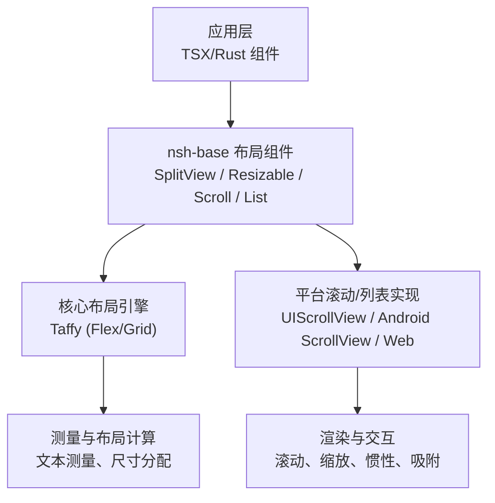
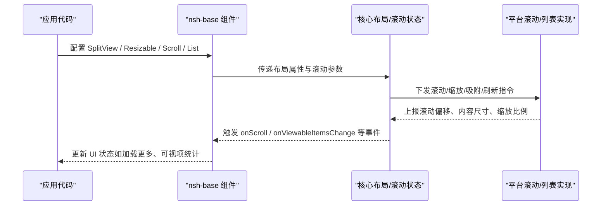
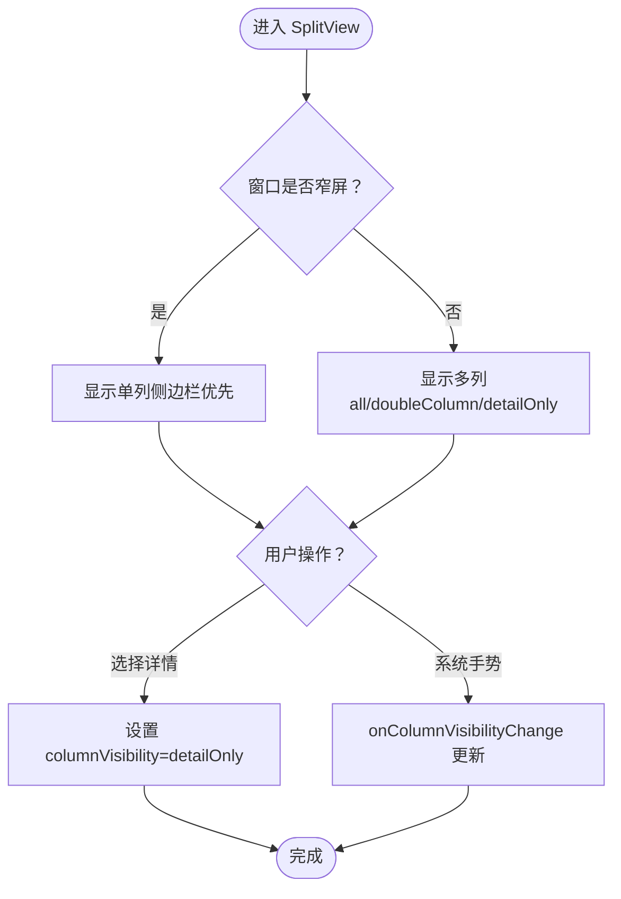
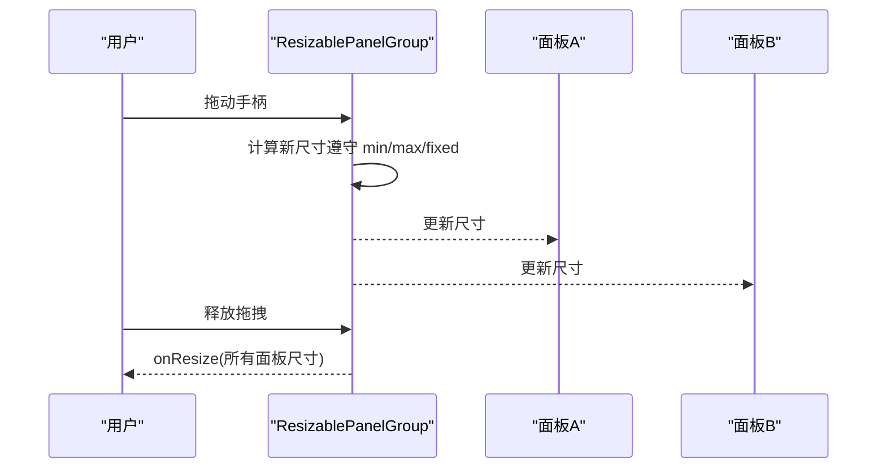
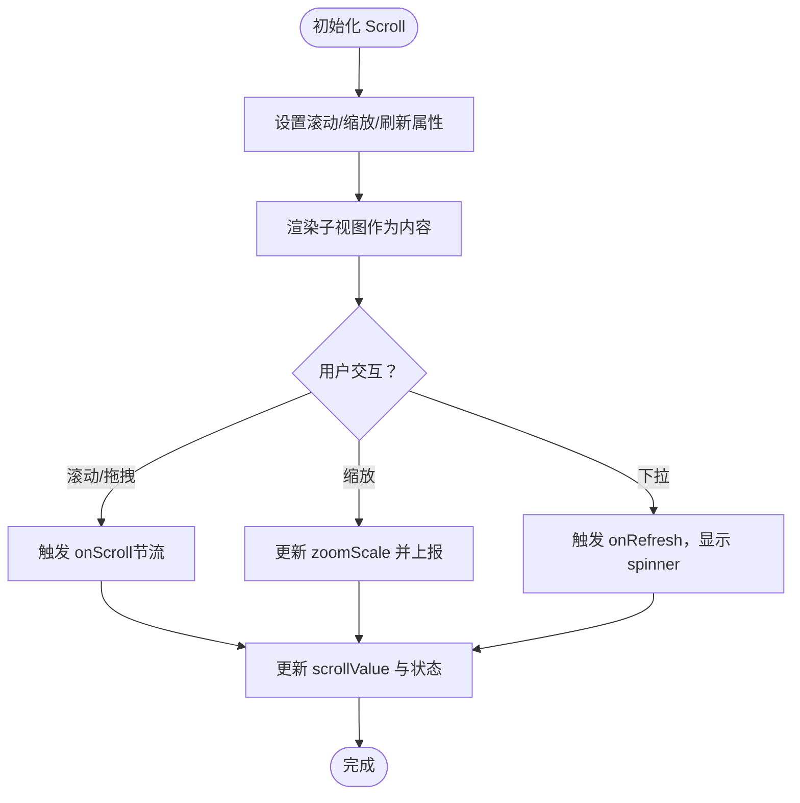
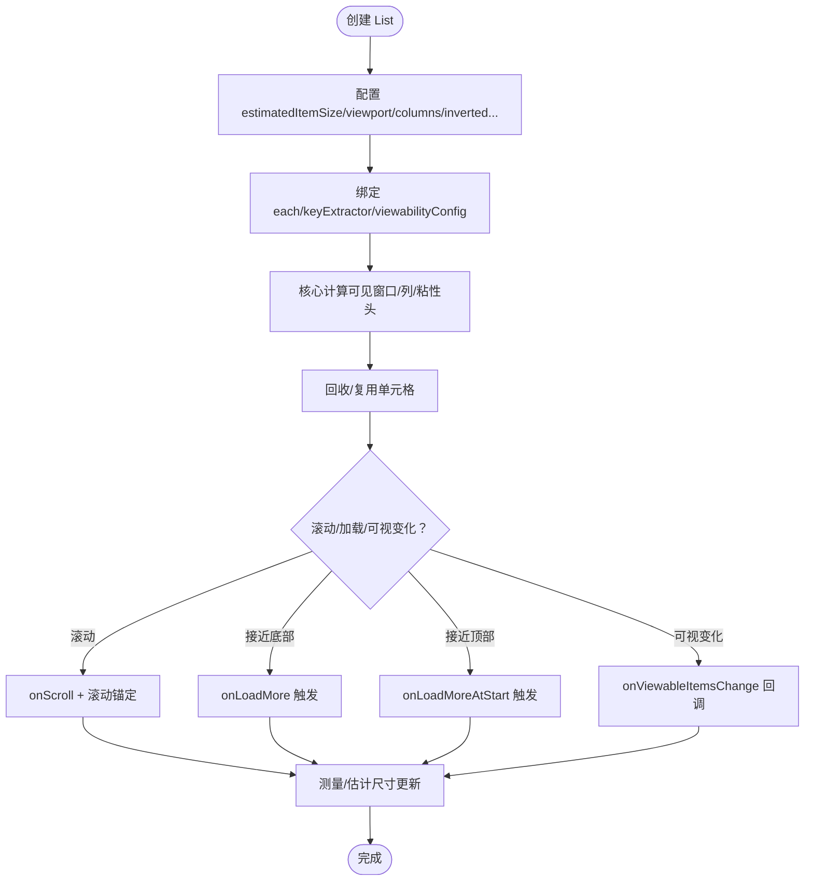
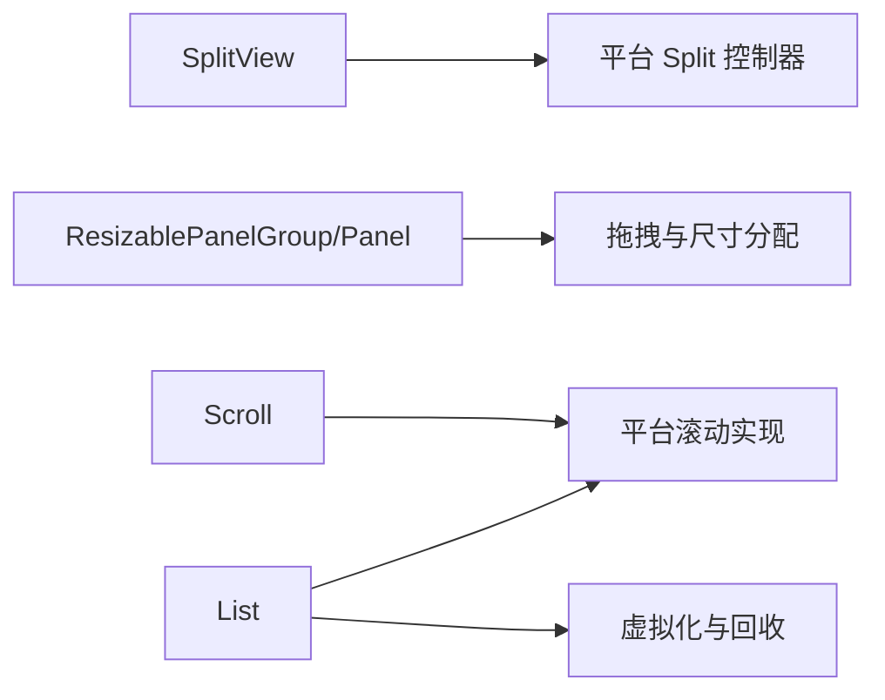

# 布局组件演示

<cite>
**本文引用的文件**   
- [分割视图文档](file://website/elements/split-view.md)
- [可调整大小容器文档](file://website/elements/resizable.md)
- [滚动容器文档](file://website/elements/scroll.md)
- [列表文档](file://website/elements/list.md)
- [滚动与列表（核心机制）](file://docs/dev/scrolling-and-lists.md)
- [布局总览文档](file://website/docs/layout.md)
</cite>

## 目录
1. [引言](#引言)
2. [项目结构](#项目结构)
3. [核心组件](#核心组件)
4. [架构总览](#架构总览)
5. [详细组件分析](#详细组件分析)
6. [依赖关系分析](#依赖关系分析)
7. [性能考虑](#性能考虑)
8. [故障排查指南](#故障排查指南)
9. [结论](#结论)
10. [附录](#附录)

## 引言
本演示文档聚焦 NSH 的布局相关组件，包括分割视图、可调整大小容器、滚动容器与列表。内容覆盖：
- 布局算法与响应式设计
- 滚动与虚拟化机制
- 触摸手势与滚动性能
- 移动端适配与桌面端优化
- 复杂界面示例（嵌套布局、动态调整、自适应设计）

## 项目结构
NSH 的布局能力由基础样式系统与平台原生滚动/列表实现共同构成：
- 布局系统基于 Taffy（Rust 实现的 Flexbox/Grid），在核心中运行，按帧增量更新。
- 滚动与列表通过平台原生控件（iOS/macOS 的 UIScrollView、Android 的 ScrollView 等）提供高性能滚动体验。
- 高级布局组件（SplitView、ResizablePanelGroup/Panel、Scroll、List）位于 nsh-base 与网站文档中，面向 TSX/Rust 开发者。

图表来源
- [布局总览文档:11-13](file://website/docs/layout.md#L11-L13)
- [滚动容器文档:11-13](file://website/elements/scroll.md#L11-L13)
- [列表文档:11-14](file://website/elements/list.md#L11-L14)

章节来源
- [布局总览文档:11-13](file://website/docs/layout.md#L11-L13)
- [滚动容器文档:11-13](file://website/elements/scroll.md#L11-L13)
- [列表文档:11-14](file://website/elements/list.md#L11-L14)

## 核心组件
- 分割视图 SplitView：多列导航栈组合，窄屏自动折叠为单列；支持受控列可见性。
- 可调整大小容器 ResizablePanelGroup/Panel：面板并排或堆叠，拖拽手柄共享空间，支持最小/最大尺寸、固定宽度、可见性控制。
- 滚动容器 Scroll：原生滚动视图，支持分页、吸附、缩放、下拉刷新、滚动事件与动画值绑定。
- 列表 List：虚拟化与回收的行列表，支持双向加载、粘性头部、倒序聊天列表、可视项回调、滚动命令与阅读位置保持。

章节来源
- [分割视图文档:10-17](file://website/elements/split-view.md#L10-L17)
- [可调整大小容器文档:10-15](file://website/elements/resizable.md#L10-L15)
- [滚动容器文档:11-13](file://website/elements/scroll.md#L11-L13)
- [列表文档:11-14](file://website/elements/list.md#L11-L14)

## 架构总览
以下图展示从应用到平台的调用链与数据流：

图表来源
- [滚动容器文档:146-158](file://website/elements/scroll.md#L146-L158)
- [列表文档:160-181](file://website/elements/list.md#L160-L181)
- [滚动与列表（核心机制）:8-25](file://docs/dev/scrolling-and-lists.md#L8-L25)

## 详细组件分析

### 分割视图 SplitView
- 功能要点
  - 三列（侧边栏、内容、详情）或两列，每列为独立 NavStack。
  - 窄屏（水平紧凑）时自动折叠为单列，用户可通过系统按钮或滑动手势切换。
  - 受控列可见性 columnVisibility，支持 automatic/all/doubleColumn/detailOnly。
- 响应式行为
  - iOS/iPadOS/Mac Catalyst 使用 UISplitViewController，窗口旋转/缩放时自动排列。
  - 其他平台侧边栏与内容列默认宽度 320pt，用户可拖拽边界调整。
- 最佳实践
  - 窄屏下选择详情时切换到 detailOnly；宽屏保留 all 或 doubleColumn。
  - 使用 horizontalSizeClass() 判断布局模式，配合 onColumnVisibilityChange 同步状态。

图表来源
- [分割视图文档:136-170](file://website/elements/split-view.md#L136-L170)

章节来源
- [分割视图文档:10-17](file://website/elements/split-view.md#L10-L17)
- [分割视图文档:136-170](file://website/elements/split-view.md#L136-L170)

### 可调整大小容器 ResizablePanelGroup/Panel
- 功能要点
  - 横向或纵向分组，面板间有拖拽手柄；组管理拖拽、尺寸分配、光标与无障碍标签。
  - 面板支持 size/minSize/maxSize/fixed/visible；未指定 size 的面板均分剩余空间。
- 交互流程
  - 拖拽过程中，组在核心内移动空间，不经过 JS；结束时报 onResize 返回所有可见面板尺寸。
  - 窗口缩放时，带 size 的面板保持其尺寸，无 size 的面板吸收差值。
- 手柄定制
  - handleClass/handleThumbClass 自定义指示器与拇指；renderHandle 提供上下文 index/axis/state。

图表来源
- [可调整大小容器文档:77-99](file://website/elements/resizable.md#L77-L99)
- [可调整大小容器文档:111-137](file://website/elements/resizable.md#L111-L137)

章节来源
- [可调整大小容器文档:10-15](file://website/elements/resizable.md#L10-L15)
- [可调整大小容器文档:77-99](file://website/elements/resizable.md#L77-L99)
- [可调整大小容器文档:111-137](file://website/elements/resizable.md#L111-L137)

### 滚动容器 Scroll
- 功能要点
  - 原生滚动视图，支持垂直/水平滚动、分页、吸附、弹性回弹、缩放、下拉刷新。
  - 提供 scrollValue 用于滚动联动动画；onScroll 事件节流；键盘交互与 inset 处理。
- 关键属性
  - pagingEnabled/snapToInterval/snapToOffsets/snapToAlignment/disableIntervalMomentum/decelerationRate
  - contentInset/scrollbarInset/contentOffset/keyboardDismissMode/keyboardShouldPersistTaps
  - zoom_range/zoom/bouncesZoom/zoomable/centerContent
- 事件与引用方法
  - onScroll/onScrollDragStart/End/onMomentumStart/End/onScrollEnd
  - scrollTo/zoomTo

图表来源
- [滚动容器文档:41-69](file://website/elements/scroll.md#L41-L69)
- [滚动容器文档:108-144](file://website/elements/scroll.md#L108-L144)
- [滚动容器文档:146-183](file://website/elements/scroll.md#L146-L183)

章节来源
- [滚动容器文档:11-13](file://website/elements/scroll.md#L11-L13)
- [滚动容器文档:41-69](file://website/elements/scroll.md#L41-L69)
- [滚动容器文档:108-144](file://website/elements/scroll.md#L108-L144)
- [滚动容器文档:146-183](file://website/elements/scroll.md#L146-L183)

### 列表 List
- 功能要点
  - 虚拟化与回收：仅视口附近行存在，滚动时复用单元格；数千条数据与二十条数据性能相近。
  - 双向加载：onLoadMore（底部）与 onLoadMoreAtStart（顶部）；支持初始滚动到底部 initialScrollAtEnd。
  - 粘性头部 stickyHeaderIndices；倒序聊天 inverted；可视项回调 onViewableItemsChange。
  - 滚动命令：scrollToIndex/scrollToEnd/measureScrollPosition；保持阅读位置。
- 核心机制
  - 锚点与滚动锚定：滚动超过起点时保持可见行位置；插入/删除前部时保持读者位置。
  - 键匹配与行复用：keyExtractor 决定行身份；相同 key 的行复用单元格与测量尺寸。
  - 父视口列表 viewport="parent"：列表以自身全长度嵌入父布局，滚动由外层滚动视图承担。

图表来源
- [列表文档:11-14](file://website/elements/list.md#L11-L14)
- [列表文档:100-143](file://website/elements/list.md#L100-L143)
- [列表文档:160-181](file://website/elements/list.md#L160-L181)
- [滚动与列表（核心机制）:8-25](file://docs/dev/scrolling-and-lists.md#L8-L25)

章节来源
- [列表文档:11-14](file://website/elements/list.md#L11-L14)
- [列表文档:100-143](file://website/elements/list.md#L100-L143)
- [列表文档:160-181](file://website/elements/list.md#L160-L181)
- [滚动与列表（核心机制）:8-25](file://docs/dev/scrolling-and-lists.md#L8-L25)

## 依赖关系分析
- 组件耦合
  - SplitView 依赖平台 split view 控制器（iOS）与自定义拖拽（其他平台）。
  - ResizablePanelGroup 与 ResizablePanel 强耦合于拖拽状态机与尺寸分配算法。
  - Scroll 与 List 共享滚动状态（offset、contentSize、zoomScale）与事件模型。
- 外部依赖
  - 布局引擎 Taffy（Flex/Grid）
  - 平台滚动控件（UIScrollView、Android ScrollView、Web 滚动）
- 潜在循环依赖
  - 列表与滚动容器通过核心状态解耦，避免直接循环依赖。

图表来源
- [分割视图文档:196-204](file://website/elements/split-view.md#L196-L204)
- [可调整大小容器文档:199-207](file://website/elements/resizable.md#L199-L207)
- [滚动容器文档:196-208](file://website/elements/scroll.md#L196-L208)
- [列表文档:250-257](file://website/elements/list.md#L250-L257)

章节来源
- [分割视图文档:196-204](file://website/elements/split-view.md#L196-L204)
- [可调整大小容器文档:199-207](file://website/elements/resizable.md#L199-L207)
- [滚动容器文档:196-208](file://website/elements/scroll.md#L196-L208)
- [列表文档:250-257](file://website/elements/list.md#L250-L257)

## 性能考虑
- 布局性能
  - 使用 Taffy 进行增量布局，仅变更帧发送到原生视图；文本测量在主线程完成，布局不阻塞主线程。
  - 合理设置 flex/minSize/auto，避免不必要的重排。
- 滚动性能
  - 长列表使用 List 虚拟化与回收；短列表使用 Scroll + Each。
  - 使用 estimatedItemSize 减少滚动抖动；合理使用 snap/paging 降低频繁重绘。
- 内存管理
  - 列表单元格复用，避免在行函数内创建持久信号；将每行状态放在数据源并按 id 索引。
  - 隐藏等待分配的单元格，确保屏幕阅读器与测试只遇到每个行一次。
- 缩放与重绘
  - 缩放结束时按缩放分辨率重绘文本与画布；避免在缩放过程中频繁更新状态。

章节来源
- [布局总览文档:11-13](file://website/docs/layout.md#L11-L13)
- [滚动容器文档:196-208](file://website/elements/scroll.md#L196-L208)
- [列表文档:77-99](file://website/elements/list.md#L77-L99)
- [滚动与列表（核心机制）:107-117](file://docs/dev/scrolling-and-lists.md#L107-L117)

## 故障排查指南
- 滚动卡顿
  - 检查是否误用 Scroll 承载超长数据；改用 List 并设置 estimatedItemSize。
  - 确认 onScroll 节流 scrollEventThrottle 合理，避免过多事件处理。
- 列表错位或闪烁
  - 检查 keyExtractor 是否稳定；确保行状态不在行函数内创建信号。
  - 对于倒序聊天，确认 inverted 与 onLoadMoreAtStart 配合使用。
- 缩放异常
  - 确认 minimumZoomScale < maximumZoomScale；必要时启用 bouncesZoom。
  - 注意平台差异：Android 缩放由 NSH 实现，iOS/macOS 使用原生缩放。
- 键盘遮挡
  - 在 Scroll 内输入框会自动避让键盘；外部内容使用 env(keyboard-inset-height)。

章节来源
- [滚动容器文档:185-208](file://website/elements/scroll.md#L185-L208)
- [列表文档:77-99](file://website/elements/list.md#L77-L99)
- [列表文档:250-257](file://website/elements/list.md#L250-L257)

## 结论
NSH 的布局体系以 Taffy 为核心，结合平台原生滚动与虚拟化技术，提供了高性能、跨平台的布局与滚动体验。SplitView 与 Resizable 满足复杂桌面/平板布局需求，Scroll 与 List 则覆盖从页面级滚动到大数据列表的全场景。通过合理的属性配置与事件处理，可实现响应式、可访问且流畅的用户界面。

## 附录
- 响应式断点与方向
  - 使用 Tailwind 断点（sm/md/...）与 portrait:/landscape: 快速适配不同设备。
  - 使用 safe-area-inset-* 适配刘海与底部安全区。
- 右到左布局
  - 使用 logical 属性（start/end）与 direction 样式，保证 RTL 下的对齐与镜像。

章节来源
- [布局总览文档:232-289](file://website/docs/layout.md#L232-L289)