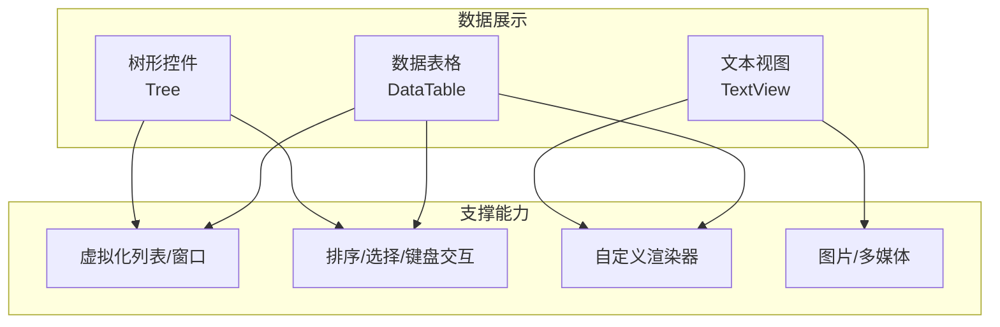
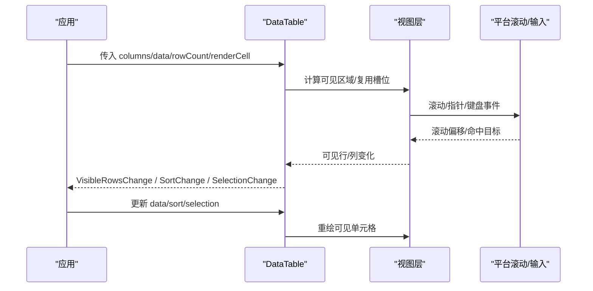
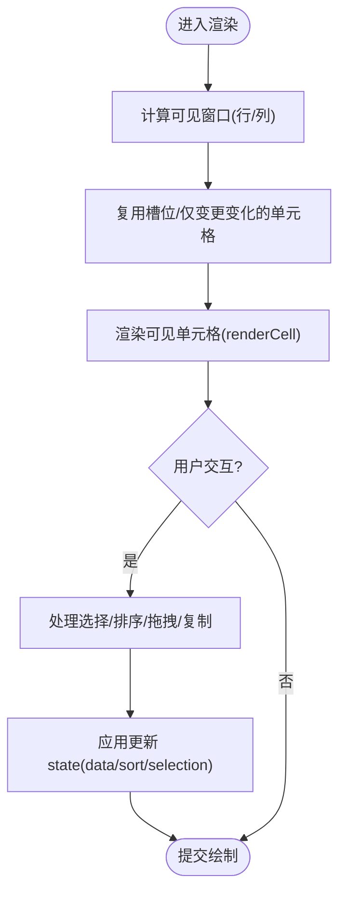
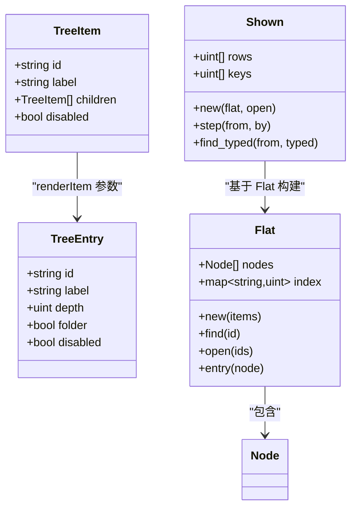
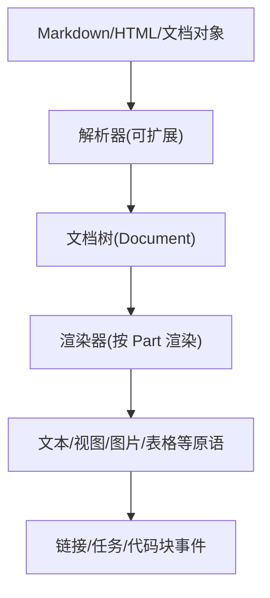
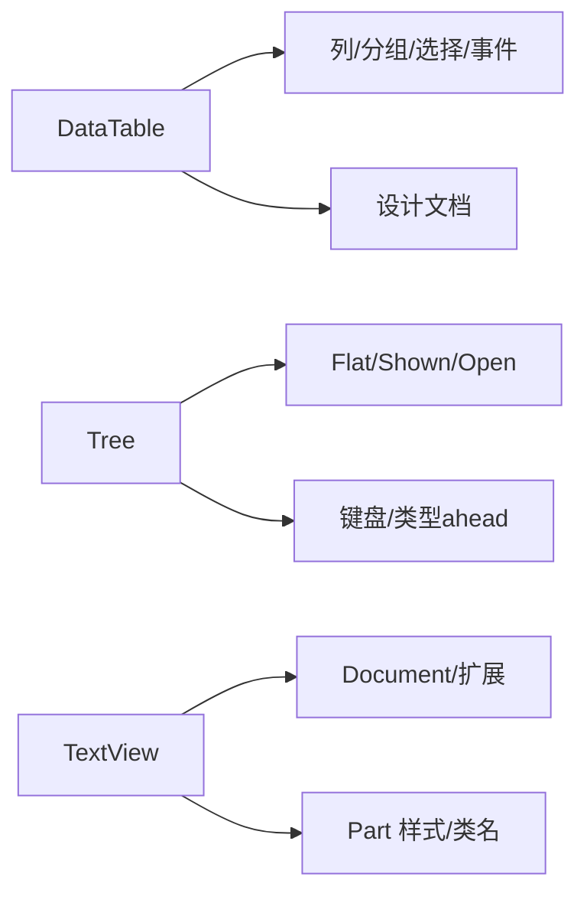

# 数据展示组件演示

<cite>
**本文引用的文件**   
- [data-table.md](file://docs/dev/data-table.md)
- [mod.rs](file://crates/nsh-base/src/data_table/mod.rs)
- [tree.rs](file://crates/nsh-base/src/tree.rs)
- [text_view_mod.rs](file://crates/nsh-base/src/text_view/mod.rs)
</cite>

## 目录
1. [简介](#简介)
2. [项目结构](#项目结构)
3. [核心组件](#核心组件)
4. [架构总览](#架构总览)
5. [详细组件分析](#详细组件分析)
6. [依赖关系分析](#依赖关系分析)
7. [性能考虑](#性能考虑)
8. [故障排查指南](#故障排查指南)
9. [结论](#结论)
10. [附录](#附录)

## 简介
本演示文档面向 NSH 数据展示相关组件，覆盖数据表格、树形控件、文本显示与图片展示等能力。重点说明：
- 数据绑定、格式化、排序、筛选与分页（虚拟滚动）
- 大数据量优化方案与虚拟滚动实现
- 富文本编辑、Markdown 渲染与多媒体内容展示
- 数据可视化集成与自定义渲染器开发指南

## 项目结构
NSH 的数据展示能力主要分布在以下模块：
- 数据表格：crates/nsh-base/src/data_table/
- 树形控件：crates/nsh-base/src/tree.rs
- 文本视图与 Markdown：crates/nsh-base/src/text_view/
- 设计文档：docs/dev/data-table.md

[本图为概念性结构图，不直接映射具体源码文件]

## 核心组件
- 数据表格 DataTable：双向滚动、行列选择、列宽调整/移动/固定、排序、分组标题、加载更多、可见行/列回调、上下文菜单、复制、导出等。
- 树形控件 Tree：层级展开/折叠、选中、类型ahead、键盘导航、可定制行渲染、动画展开收起。
- 文本视图 TextView：支持 Markdown、HTML、公式、代码高亮、链接点击、任务项、图片等，提供丰富的样式与扩展点。

章节来源
- [data-table.md:1-10](file://docs/dev/data-table.md#L1-L10)
- [tree.rs:1-39](file://crates/nsh-base/src/tree.rs#L1-L39)
- [text_view_mod.rs:1-17](file://crates/nsh-base/src/text_view/mod.rs#L1-L17)

## 架构总览
下图展示了数据展示组件的交互与职责边界：应用通过 props 提供数据与渲染函数；组件负责布局、虚拟化、交互与事件上报；平台层提供滚动、输入与渲染能力。

图表来源
- [mod.rs:378-513](file://crates/nsh-base/src/data_table/mod.rs#L378-L513)
- [mod.rs:515-570](file://crates/nsh-base/src/data_table/mod.rs#L515-L570)
- [mod.rs:572-675](file://crates/nsh-base/src/data_table/mod.rs#L572-L675)

章节来源
- [mod.rs:378-513](file://crates/nsh-base/src/data_table/mod.rs#L378-L513)
- [mod.rs:515-570](file://crates/nsh-base/src/data_table/mod.rs#L515-L570)
- [mod.rs:572-675](file://crates/nsh-base/src/data_table/mod.rs#L572-L675)

## 详细组件分析

### 数据表格 DataTable
- 数据绑定与分页
  - 通过 data、rowCount、dataStart 将“应用持有的任意行数”与“当前可见页”解耦。
  - 使用 onVisibleRowsChange 按需拉取并格式化新页数据，避免一次性处理全量数据。
- 格式化与展示
  - renderCell 仅对可见单元格调用；正负数/正负号前缀可通过 positiveClass/negativeClass 原生着色，无需逐格回调。
- 排序与列操作
  - sortable 列头触发 onSortChange，应用维护 sort 状态并回写至组件。
  - resizable/movable/fixed/grow/auto_fit 控制列宽、移动、固定与自适应。
- 选择与交互
  - row/column/cell 三种选择模式；selectOnModifierPress 控制修饰键行为；onRowPress/onColumnPress 供应用自行维护多选。
  - 键盘导航、Tab 焦点、Enter 激活行、Esc 取消、复制、导出 dump。
- 虚拟滚动与超大表
  - 仅渲染视口内及少量缓冲区的行/列；超过阈值时采用缩放滚动条映射逻辑坐标，保证滚动条比例正确且 scrollToRow 精准定位。
  - 行/列使用“槽位复用”，滚动时无需创建/销毁视图，极大降低开销。

图表来源
- [data-table.md:23-60](file://docs/dev/data-table.md#L23-L60)
- [data-table.md:61-84](file://docs/dev/data-table.md#L61-L84)
- [data-table.md:106-120](file://docs/dev/data-table.md#L106-L120)

章节来源
- [data-table.md:1-10](file://docs/dev/data-table.md#L1-L10)
- [data-table.md:23-60](file://docs/dev/data-table.md#L23-L60)
- [data-table.md:61-84](file://docs/dev/data-table.md#L61-L84)
- [data-table.md:85-105](file://docs/dev/data-table.md#L85-L105)
- [data-table.md:106-120](file://docs/dev/data-table.md#L106-L120)
- [data-table.md:121-136](file://docs/dev/data-table.md#L121-L136)
- [data-table.md:137-175](file://docs/dev/data-table.md#L137-L175)
- [mod.rs:95-169](file://crates/nsh-base/src/data_table/mod.rs#L95-L169)
- [mod.rs:378-513](file://crates/nsh-base/src/data_table/mod.rs#L378-L513)
- [mod.rs:515-570](file://crates/nsh-base/src/data_table/mod.rs#L515-L570)
- [mod.rs:572-675](file://crates/nsh-base/src/data_table/mod.rs#L572-L675)

### 树形控件 Tree
- 数据模型与扁平化
  - 将嵌套 items 一次扁平化为 Flat（含父节点、深度、子树结束索引），并按 id 建立索引。
  - Open 记录已展开节点集合；Shown 根据展开状态生成“实际显示的节点序列”。
- 虚拟化与渲染
  - 基于 viewport 的虚拟列表，仅渲染可见行；折叠节点的子树不会创建视图。
  - renderItem 接收 TreeEntry（id/label/depth/folder/disabled），行状态通过 CSS 类名表达（selected、aria-expanded、focus、disabled）。
- 交互与键盘
  - 上下左右键在可见行间移动；Right 展开并跳到首个可用子节点，Left 折叠并回到父节点；Home/End 跳转首尾；Return/Space 执行默认动作或展开/折叠。
  - 类型 ahead 快速定位匹配 label 的行。
- 展开/收起动画
  - reveal 开启后，使用弹簧阻尼动画平滑过渡，行级动画由平台侧驱动。

图表来源
- [tree.rs:76-147](file://crates/nsh-base/src/tree.rs#L76-L147)
- [tree.rs:149-279](file://crates/nsh-base/src/tree.rs#L149-L279)
- [tree.rs:317-428](file://crates/nsh-base/src/tree.rs#L317-L428)

章节来源
- [tree.rs:1-39](file://crates/nsh-base/src/tree.rs#L1-L39)
- [tree.rs:76-147](file://crates/nsh-base/src/tree.rs#L76-L147)
- [tree.rs:149-279](file://crates/nsh-base/src/tree.rs#L149-L279)
- [tree.rs:317-428](file://crates/nsh-base/src/tree.rs#L317-L428)
- [tree.rs:430-495](file://crates/nsh-base/src/tree.rs#L430-L495)
- [tree.rs:497-525](file://crates/nsh-base/src/tree.rs#L497-L525)
- [tree.rs:527-551](file://crates/nsh-base/src/tree.rs#L527-L551)
- [tree.rs:703-800](file://crates/nsh-base/src/tree.rs#L703-L800)

### 文本视图 TextView 与 Markdown
- 文档模型
  - 支持 Markdown、HTML、公式、代码块、表格、图片、脚注、列表等结构化元素。
  - 提供 MarkdownExtension/Plugins 扩展机制，允许注入自定义解析与渲染。
- 渲染与样式
  - 按部分（Part）提供样式与类名，支持代码高亮、数学公式、链接点击、任务项点击等。
  - 在 Web 运行时下，公式渲染通过特性门控加载对应 WASM 模块。
- 选择与交互
  - 提供选择格式与选项，支持链接点击事件、代码块操作事件等。

图表来源
- [text_view_mod.rs:1-17](file://crates/nsh-base/src/text_view/mod.rs#L1-L17)
- [text_view_mod.rs:19-41](file://crates/nsh-base/src/text_view/mod.rs#L19-L41)

章节来源
- [text_view_mod.rs:1-17](file://crates/nsh-base/src/text_view/mod.rs#L1-L17)
- [text_view_mod.rs:19-41](file://crates/nsh-base/src/text_view/mod.rs#L19-L41)

## 依赖关系分析
- DataTable 依赖
  - 列定义与分组：DataTableColumn/DataTableColumnGroup
  - 选择与范围：DataTableSelection/DataTableRange
  - 事件与 API：DataTableEvent/DataTableApi
  - 外部文档：docs/dev/data-table.md 中的设计说明
- Tree 依赖
  - 扁平化与可见行：Flat/Shown/Open
  - 交互：键盘导航、类型 ahead、展开/收起动画
- TextView 依赖
  - 文档模型与扩展：Document/MarkdownExtension/Plugins
  - 渲染与样式：PartStyle/Classes/Styles

图表来源
- [mod.rs:95-169](file://crates/nsh-base/src/data_table/mod.rs#L95-L169)
- [mod.rs:378-513](file://crates/nsh-base/src/data_table/mod.rs#L378-L513)
- [mod.rs:515-570](file://crates/nsh-base/src/data_table/mod.rs#L515-L570)
- [tree.rs:149-279](file://crates/nsh-base/src/tree.rs#L149-L279)
- [text_view_mod.rs:1-17](file://crates/nsh-base/src/text_view/mod.rs#L1-L17)

章节来源
- [mod.rs:95-169](file://crates/nsh-base/src/data_table/mod.rs#L95-L169)
- [mod.rs:378-513](file://crates/nsh-base/src/data_table/mod.rs#L378-L513)
- [mod.rs:515-570](file://crates/nsh-base/src/data_table/mod.rs#L515-L570)
- [tree.rs:149-279](file://crates/nsh-base/src/tree.rs#L149-L279)
- [text_view_mod.rs:1-17](file://crates/nsh-base/src/text_view/mod.rs#L1-L17)

## 性能考虑
- 大数据量表格
  - 仅渲染视口内及少量缓冲的单元格；行/列使用槽位复用，滚动时无视图创建/销毁。
  - 超大内容（千万级）采用缩放滚动条映射逻辑坐标，保持滚动条比例与 scrollToRow 精度。
  - 正负数/正负号前缀的原生着色避免逐格回调。
  - 参考基准：百万行/多列场景下，滚动帧稳定，增量更新开销极低。
- 树形控件
  - 扁平化+可见行计算，折叠子树不创建视图；选择移动仅通知受影响信号，减少重绘。
- 文本视图
  - 按需渲染文档片段；公式在 Web 运行时通过特性门控加载，避免不必要的体积。

章节来源
- [data-table.md:61-84](file://docs/dev/data-table.md#L61-L84)
- [data-table.md:106-120](file://docs/dev/data-table.md#L106-L120)
- [data-table.md:121-136](file://docs/dev/data-table.md#L121-L136)
- [tree.rs:1-39](file://crates/nsh-base/src/tree.rs#L1-L39)
- [text_view_mod.rs:19-23](file://crates/nsh-base/src/text_view/mod.rs#L19-L23)

## 故障排查指南
- 表格
  - 列宽异常：检查 auto_fit、fitPadding、grow 与 setColumnWidth/fitColumn 的使用顺序与限制。
  - 排序未生效：确认 onSortChange 回调中更新了 sort 状态并回写至组件。
  - 选择状态不一致：若关闭 selectOnModifierPress，需在 onRowPress/onColumnPress 中自行维护多选。
  - 滚动定位不准：超大表下确保使用 scrollToRow/scrollToColumn，并注意缩放滚动条映射。
- 树形控件
  - 展开/折叠无动画：确认 reveal 属性启用且系统未处于“减少动态效果”模式。
  - 类型 ahead 无效：检查 label 是否唯一且非空，必要时清理重复 id。
- 文本视图
  - 公式不显示：Web 运行时需安装 math 特性模块；确认特性门控已启用。
  - 链接/任务点击无响应：检查相应事件处理器是否正确注册。

章节来源
- [data-table.md:85-105](file://docs/dev/data-table.md#L85-L105)
- [data-table.md:137-175](file://docs/dev/data-table.md#L137-L175)
- [tree.rs:780-800](file://crates/nsh-base/src/tree.rs#L780-L800)
- [text_view_mod.rs:19-23](file://crates/nsh-base/src/text_view/mod.rs#L19-L23)

## 结论
NSH 的数据展示组件以“虚拟化+可组合渲染”为核心，提供高性能的大数据表格、灵活的树形控件与强大的文本/Markdown 渲染能力。通过清晰的 props/events 契约与可扩展的渲染器机制，开发者可以高效构建复杂的数据界面，并在大数据量场景下保持稳定流畅的体验。

## 附录
- 最佳实践
  - 表格：优先使用 visibleRowsChange 分页加载；用 positiveClass/negativeClass 做数值着色；谨慎使用 auto_fit，必要时手动 fitColumn。
  - 树：为每个节点设置稳定 id；合理使用 reveal 提升体验；类型 ahead 配合唯一 label。
  - 文本：按需启用公式模块；利用 Markdown 扩展注入业务语义；为链接/任务提供明确反馈。
- 可视化集成
  - 在 renderCell 中嵌入 Plot/Canvas/SVG 等可视化组件，结合 DataTable 的虚拟化与列固定能力，实现海量指标的高效呈现。
- 自定义渲染器
  - 表格：实现 renderCell/renderHeaderCell，结合 cellClasses/rowClasses 进行条件样式。
  - 树：实现 renderItem，依据 depth/folder/disabled 控制缩进与图标。
  - 文本：通过 MarkdownExtension/Plugins 注入自定义节点与渲染逻辑。