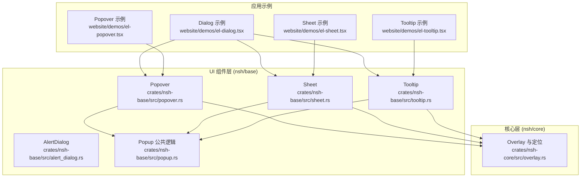
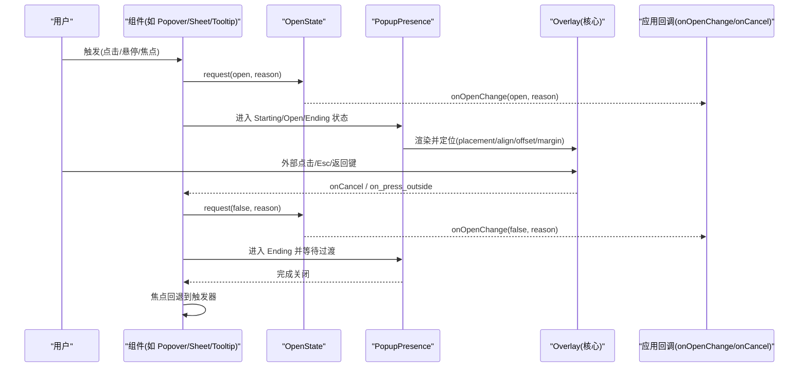
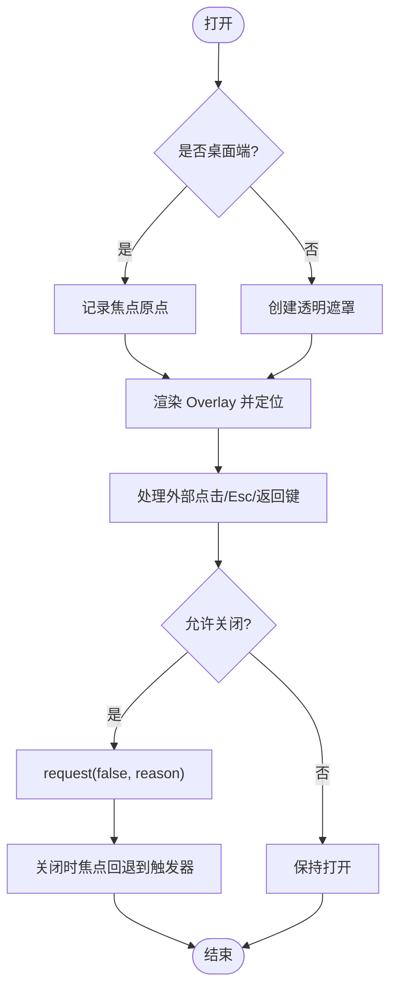
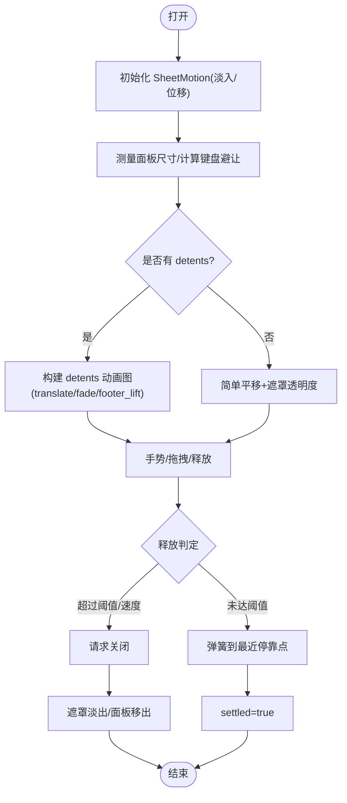
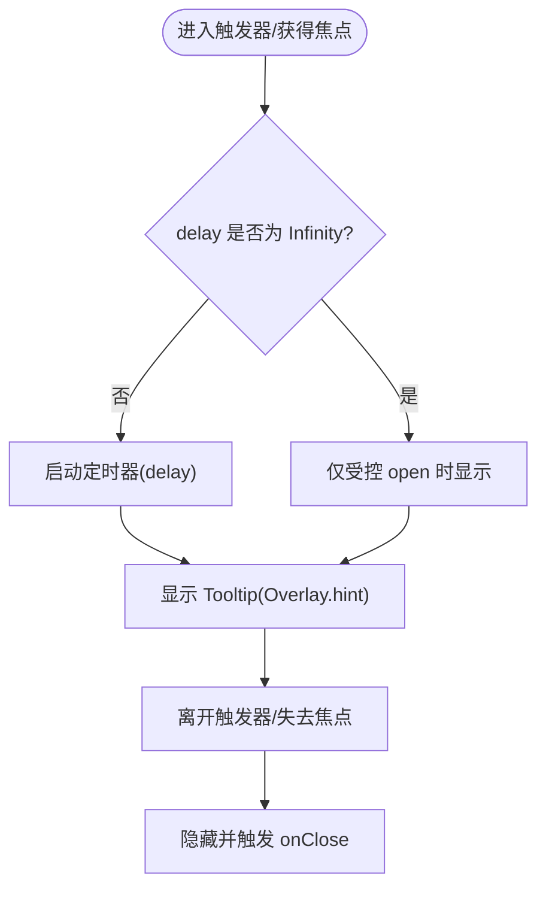
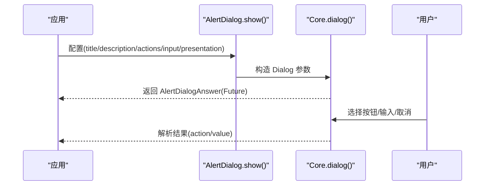
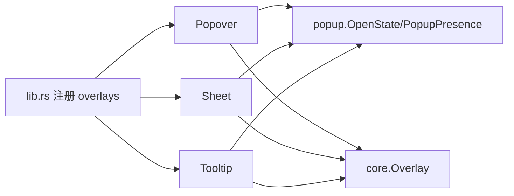

# 浮层组件演示

<cite>
**本文引用的文件**   
- [lib.rs](file://crates/nsh-base/src/lib.rs)
- [popover.rs](file://crates/nsh-base/src/popover.rs)
- [sheet.rs](file://crates/nsh-base/src/sheet.rs)
- [tooltip.rs](file://crates/nsh-base/src/tooltip.rs)
- [alert_dialog.rs](file://crates/nsh-base/src/alert_dialog.rs)
- [overlay.rs](file://crates/nsh-core/src/overlay.rs)
- [popup.rs](file://crates/nsh-base/src/popup.rs)
- [el-dialog.tsx](file://website/demos/el-dialog.tsx)
- [el-popover.tsx](file://website/demos/el-popover.tsx)
- [el-sheet.tsx](file://website/demos/el-sheet.tsx)
- [el-tooltip.tsx](file://website/demos/el-tooltip.tsx)
</cite>

## 目录
1. [简介](#简介)
2. [项目结构](#项目结构)
3. [核心组件](#核心组件)
4. [架构总览](#架构总览)
5. [详细组件分析](#详细组件分析)
6. [依赖关系分析](#依赖关系分析)
7. [性能与体验优化](#性能与体验优化)
8. [故障排查指南](#故障排查指南)
9. [结论](#结论)

## 简介
本演示文档聚焦 NSH 浮层相关组件，包括对话框、弹出层、提示框、抽屉等，系统讲解其使用方法、层级管理、焦点控制、遮罩效果与动画过渡，并提供复杂交互场景与最佳实践。同时解释模态与非模态交互设计模式，以及移动端手势支持（如下拉关闭、拖拽停靠），并给出性能优化与用户体验建议。

## 项目结构
NSH 的浮层能力由基础 UI 库（nsh/base）与核心渲染层（nsh/core）共同实现：
- nsh/base 提供 Popover、Sheet、Tooltip、AlertDialog 等组件及其行为
- nsh/core 提供 Overlay 定位、放置算法与提示（hint）机制
- 示例位于 website/demos，展示 Dialog、Popover、Sheet、Tooltip 的实际用法

**图表来源** 
- [lib.rs:392-443](file://crates/nsh-base/src/lib.rs#L392-L443)
- [popover.rs:1-239](file://crates/nsh-base/src/popover.rs#L1-L239)
- [sheet.rs:1-419](file://crates/nsh-base/src/sheet.rs#L1-L419)
- [tooltip.rs:1-235](file://crates/nsh-base/src/tooltip.rs#L1-L235)
- [overlay.rs:1-170](file://crates/nsh-core/src/overlay.rs#L1-L170)
- [popup.rs:1-120](file://crates/nsh-base/src/popup.rs#L1-L120)

**章节来源**
- [lib.rs:392-443](file://crates/nsh-base/src/lib.rs#L392-L443)

## 核心组件
- Popover：锚定触发器的弹出层，支持 placement/align/offset/margin、点击外部关闭、Esc/返回键关闭、入场/离场动画状态类
- Sheet：边缘面板（抽屉），支持四边侧边、遮罩、键盘避让、底部下拉关闭、停靠点（detents）、抓握条（grabber）
- Tooltip：元素提示气泡，支持悬停/焦点显示、延迟、终端适配、起始/结束样式
- AlertDialog：系统级弹窗或动作表，支持标题/描述/按钮角色/输入框/关闭策略

这些组件通过 nsh/core 的 overlay 进行定位与呈现，并通过 popup 模块统一开放状态、生命周期与焦点回退。

**章节来源**
- [popover.rs:10-103](file://crates/nsh-base/src/popover.rs#L10-L103)
- [sheet.rs:29-117](file://crates/nsh-base/src/sheet.rs#L29-L117)
- [tooltip.rs:26-77](file://crates/nsh-base/src/tooltip.rs#L26-L77)
- [alert_dialog.rs:14-40](file://crates/nsh-base/src/alert_dialog.rs#L14-L40)

## 架构总览
浮层组件的通用流程：
- 触发器事件（点击/悬停/焦点）→ 更新 OpenState → 使用 PopupPresence 管理挂载与状态类 → 通过 core.overlay 定位与渲染 → 处理外部点击/Esc/返回键 → 关闭时焦点回退到触发器

**图表来源**
- [popup.rs:61-128](file://crates/nsh-base/src/popup.rs#L61-L128)
- [popup.rs:273-467](file://crates/nsh-base/src/popup.rs#L273-L467)
- [overlay.rs:141-170](file://crates/nsh-core/src/overlay.rs#L141-L170)

**章节来源**
- [popup.rs:1-120](file://crates/nsh-base/src/popup.rs#L1-L120)
- [overlay.rs:1-170](file://crates/nsh-core/src/overlay.rs#L1-L170)

## 详细组件分析

### Popover（弹出层）
- 功能要点
  - 受控 open/default_open
  - placement/align/offset/margin 定位
  - close_on_escape/close_on_press_outside 关闭策略
  - 桌面端点击外部穿透到底层；移动端透明遮罩拦截
  - 入场/离场动画通过 starting_class/ending_class 与 transition 类驱动
  - 焦点在关闭时回退到触发器（桌面端）
- 典型用法
  - 将 trigger 作为触发区域，children 为内容面板
  - 监听 onOpenChange 同步 open 状态，记录 reason
- 交互细节
  - 在工具栏中作为菜单项时，trigger 属于 roving focus 范围，内容不在其中
  - 移动端 backdrop 拦截点击以关闭

**图表来源**
- [popover.rs:105-239](file://crates/nsh-base/src/popover.rs#L105-L239)

**章节来源**
- [popover.rs:10-103](file://crates/nsh-base/src/popover.rs#L10-L103)
- [popover.rs:105-239](file://crates/nsh-base/src/popover.rs#L105-L239)
- [el-popover.tsx:1-90](file://website/demos/el-popover.tsx#L1-L90)

### Sheet（抽屉/边缘面板）
- 功能要点
  - side 支持 top/left/right/bottom
  - backdrop 遮罩 + 面板滑入/滑出动画
  - close_on_backdrop_press/close_on_escape/close_on_swipe
  - detents 停靠点（高度/分数/固定值），grabber 可访问性抓手
  - 键盘抬起时自动避让（keyboard_lift），底部面板最大高度受限
  - 作为模态对话框，焦点与屏幕阅读器行为遵循对话框规范
- 手势与停靠
  - 底部面板支持下拉关闭（速度/距离阈值）
  - 多停靠点间弹簧动画，释放后根据速度与位置决定目标停靠点
- 复杂布局
  - footer 随面板移动，键盘抬起时保持在可视区域顶部

**图表来源**
- [sheet.rs:187-419](file://crates/nsh-base/src/sheet.rs#L187-L419)
- [sheet.rs:421-800](file://crates/nsh-base/src/sheet.rs#L421-L800)
- [popup.rs:469-715](file://crates/nsh-base/src/popup.rs#L469-L715)

**章节来源**
- [sheet.rs:29-117](file://crates/nsh-base/src/sheet.rs#L29-L117)
- [sheet.rs:187-419](file://crates/nsh-base/src/sheet.rs#L187-L419)
- [sheet.rs:421-800](file://crates/nsh-base/src/sheet.rs#L421-L800)
- [popup.rs:469-715](file://crates/nsh-base/src/popup.rs#L469-L715)
- [el-sheet.tsx:1-100](file://website/demos/el-sheet.tsx#L1-L100)

### Tooltip（提示框）
- 功能要点
  - 支持悬停/焦点显示，delay 控制延时，Infinity 表示仅受控打开
  - placement/align/offset/margin 定位
  - starting_class/ending_class 控制入场/离场样式
  - 终端模式下显示为状态行一行文本，无气泡
- 交互细节
  - 不拦截指针事件，不影响底层元素交互
  - 焦点进入立即显示，Escape 隐藏

**图表来源**
- [tooltip.rs:131-188](file://crates/nsh-base/src/tooltip.rs#L131-L188)
- [tooltip.rs:190-227](file://crates/nsh-base/src/tooltip.rs#L190-L227)

**章节来源**
- [tooltip.rs:26-77](file://crates/nsh-base/src/tooltip.rs#L26-L77)
- [tooltip.rs:131-188](file://crates/nsh-base/src/tooltip.rs#L131-L188)
- [tooltip.rs:190-227](file://crates/nsh-base/src/tooltip.rs#L190-L227)
- [el-tooltip.tsx:1-121](file://website/demos/el-tooltip.tsx#L1-L121)

### AlertDialog（系统对话框/动作表）
- 功能要点
  - presentation: alert/actionSheet
  - actions 列表，role: default/cancel/destructive
  - input 可选文本输入（仅 alert 模式）
  - close_on_escape/close_on_backdrop_press 默认值依 presentation 而定
- 返回值
  - show() 返回 Future，解析为 { action, value }

**图表来源**
- [alert_dialog.rs:150-159](file://crates/nsh-base/src/alert_dialog.rs#L150-L159)
- [alert_dialog.rs:252-296](file://crates/nsh-base/src/alert_dialog.rs#L252-L296)
- [alert_dialog.rs:321-343](file://crates/nsh-base/src/alert_dialog.rs#L321-L343)

**章节来源**
- [alert_dialog.rs:14-40](file://crates/nsh-base/src/alert_dialog.rs#L14-L40)
- [alert_dialog.rs:150-159](file://crates/nsh-base/src/alert_dialog.rs#L150-L159)
- [alert_dialog.rs:252-296](file://crates/nsh-base/src/alert_dialog.rs#L252-L296)
- [alert_dialog.rs:321-343](file://crates/nsh-base/src/alert_dialog.rs#L321-L343)

### Dialog（对话框）
- 示例展示了卡片式与 pageSheet 两种呈现方式，支持 backdrop 关闭策略与动画类型
- 适用于需要自定义外观与行为的模态窗口

**章节来源**
- [el-dialog.tsx:1-164](file://website/demos/el-dialog.tsx#L1-L164)

## 依赖关系分析
- 组件依赖
  - Popover/Tooltip/Sheet 均依赖 popup 模块的 OpenState、PopupPresence、SheetMotion
  - 所有浮层最终通过 nsh/core 的 overlay 进行定位与呈现
- 注册与导出
  - lib.rs 将 overlays 部分注册 Popover/HoverCard/Sheet/Tooltip
  - 测试断言确保导出稳定且无重复

**图表来源**
- [lib.rs:436-443](file://crates/nsh-base/src/lib.rs#L436-L443)
- [popup.rs:1-120](file://crates/nsh-base/src/popup.rs#L1-L120)
- [overlay.rs:1-170](file://crates/nsh-core/src/overlay.rs#L1-L170)

**章节来源**
- [lib.rs:436-443](file://crates/nsh-base/src/lib.rs#L436-L443)
- [popup.rs:1-120](file://crates/nsh-base/src/popup.rs#L1-L120)
- [overlay.rs:1-170](file://crates/nsh-core/src/overlay.rs#L1-L170)

## 性能与体验优化
- 动画与过渡
  - 使用 starting_class/ending_class 配合 transition 类，避免重绘抖动
  - 减少 motion 时（reduce_motion）直接跳过过渡，提升可访问性与性能
- 遮罩与事件
  - 移动端使用透明遮罩拦截点击，避免误触；桌面端点击外部穿透以提升效率
- 键盘与焦点
  - 关闭时焦点回退到触发器，保证键盘导航一致性
  - Sheet 在键盘抬起时自动避让，footer 跟随可视区域
- 定位与裁剪
  - 使用 place/place_fitted 确保浮层始终在安全区域内，必要时翻转 placement
- 资源与渲染
  - 按需注册 parts（如 overlays），减小二进制体积
  - 对长列表/复杂内容使用懒加载与虚拟化

[本节为通用指导，无需具体文件引用]

## 故障排查指南
- 浮层不显示
  - 检查 overlay 的定位参数（placement/align/offset/margin）是否合理
  - 确认组件已注册（overlays 部分）
- 点击外部无法关闭
  - 桌面端需启用 close_on_press_outside；移动端遮罩会拦截点击
- Sheet 手势异常
  - 确认 close_on_swipe 与 side=bottom；检查 detents 配置与键盘避让
- Tooltip 不消失
  - delay 设置为 Infinity 时不会自动隐藏，需受控 open
- AlertDialog 报错
  - 缺少 actions 或在 actionSheet 中使用 input 会抛出错误

**章节来源**
- [popover.rs:115-125](file://crates/nsh-base/src/popover.rs#L115-L125)
- [sheet.rs:349-379](file://crates/nsh-base/src/sheet.rs#L349-L379)
- [tooltip.rs:131-188](file://crates/nsh-base/src/tooltip.rs#L131-L188)
- [alert_dialog.rs:252-296](file://crates/nsh-base/src/alert_dialog.rs#L252-L296)

## 结论
NSH 的浮层体系以 Popover、Sheet、Tooltip、AlertDialog 为核心，依托 overlay 定位与 popup 状态管理，提供一致的交互模型与跨平台表现。通过合理的定位、遮罩、焦点与动画策略，可在桌面与移动端获得一致的用户体验。结合示例与最佳实践，开发者可以快速构建高质量、可访问、高性能的浮层界面。