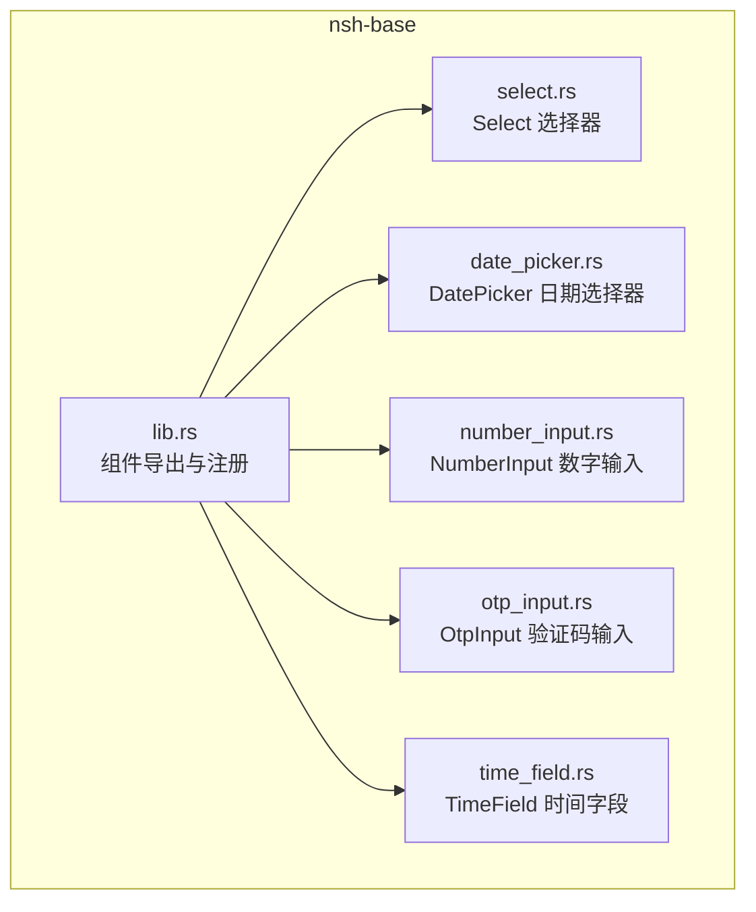
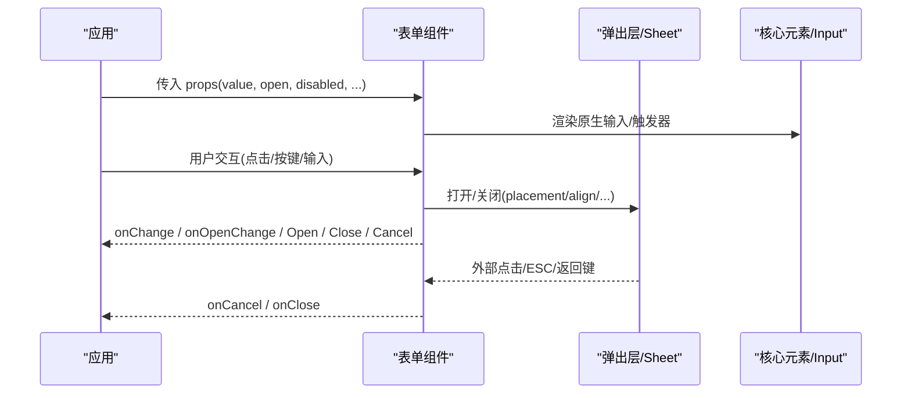
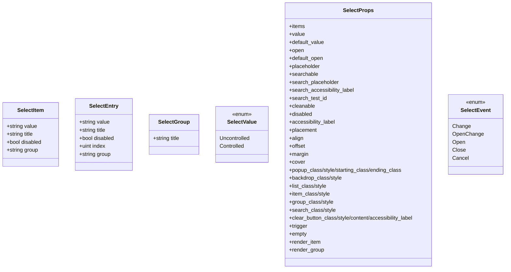
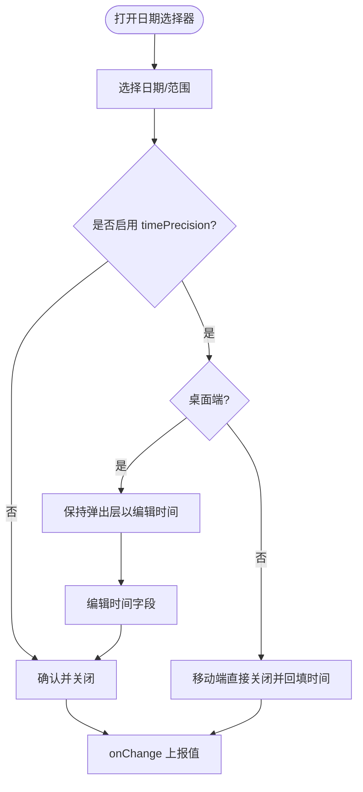
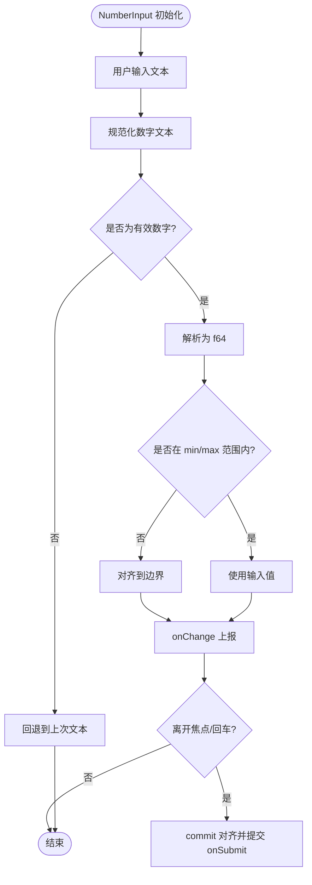
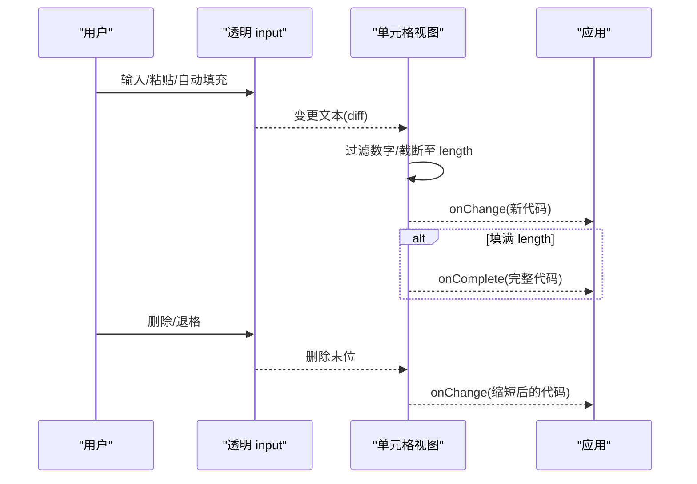
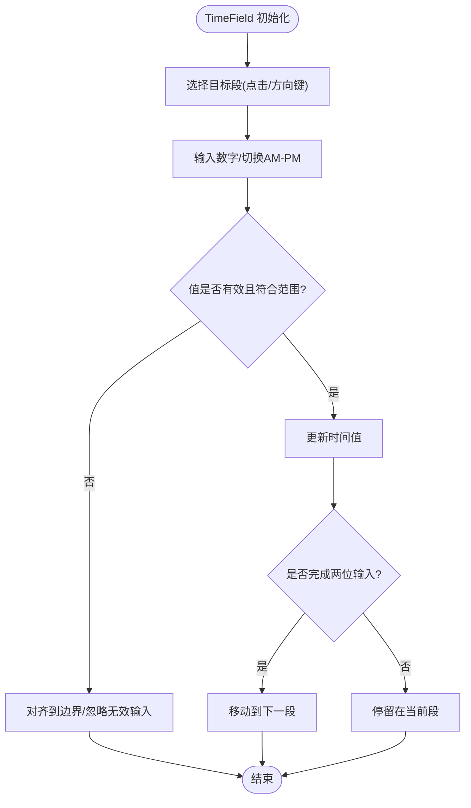
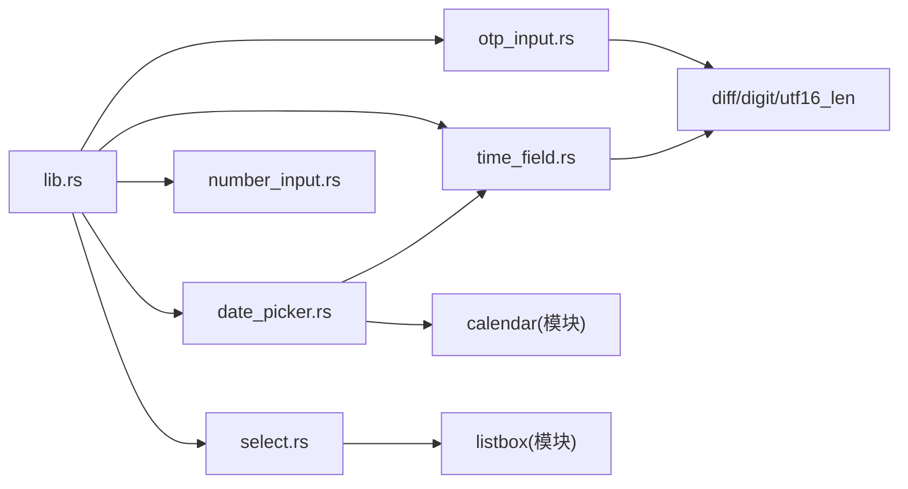

# 表单组件演示

<cite>
**本文引用的文件**   
- [lib.rs](file://crates/nsh-base/src/lib.rs)
- [select.rs](file://crates/nsh-base/src/select.rs)
- [date_picker.rs](file://crates/nsh-base/src/date_picker.rs)
- [number_input.rs](file://crates/nsh-base/src/number_input.rs)
- [otp_input.rs](file://crates/nsh-base/src/otp_input.rs)
- [time_field.rs](file://crates/nsh-base/src/time_field.rs)
</cite>

## 目录
1. [简介](#简介)
2. [项目结构](#项目结构)
3. [核心组件](#核心组件)
4. [架构总览](#架构总览)
5. [详细组件分析](#详细组件分析)
6. [依赖关系分析](#依赖关系分析)
7. [性能与体验优化](#性能与体验优化)
8. [故障排查指南](#故障排查指南)
9. [结论](#结论)

## 简介
本演示文档面向 NSH 表单相关组件，覆盖输入框、选择器、日期选择器、数字输入等常用表单控件。文档从系统架构、组件职责、数据流、键盘导航、无障碍访问、错误处理与用户反馈等方面展开，并提供完整的表单构建示例思路与最佳实践，帮助你在复杂布局与高级交互场景下高效使用这些组件。

## 项目结构
NSH 的 UI 基础库位于 crates/nsh-base，其中包含大量可复用组件（按钮、选择器、日期选择器、数字输入、OTP 输入、时间字段等）。这些组件以 Rust 实现，并通过注册表机制暴露给上层 JS/TS 应用使用。

图表来源
- [lib.rs:124-274](file://crates/nsh-base/src/lib.rs#L124-L274)

章节来源
- [lib.rs:1-104](file://crates/nsh-base/src/lib.rs#L1-L104)
- [lib.rs:124-274](file://crates/nsh-base/src/lib.rs#L124-L274)

## 核心组件
本节聚焦以下表单组件：
- Select 选择器：从列表中选择单项，支持搜索、分组、键盘导航与无障碍。
- DatePicker 日期选择器：单选/范围/带时间的日期选择，支持预设、日历配置与弹出层定位。
- NumberInput 数字输入：数值编辑、步进、范围约束、只读与禁用状态。
- OtpInput 验证码输入：固定长度数字单元格输入，支持掩码、分组与自动填充。
- TimeField 时间字段：按段编辑小时/分钟/秒/上午下午，支持精度与时制。

章节来源
- [select.rs:1-42](file://crates/nsh-base/src/select.rs#L1-L42)
- [date_picker.rs:1-27](file://crates/nsh-base/src/date_picker.rs#L1-L27)
- [number_input.rs:1-14](file://crates/nsh-base/src/number_input.rs#L1-L14)
- [otp_input.rs:1-36](file://crates/nsh-base/src/otp_input.rs#L1-L36)
- [time_field.rs:1-27](file://crates/nsh-base/src/time_field.rs#L1-L27)

## 架构总览
所有表单组件遵循统一模式：
- 受控与非受控值：通过 value/defaultValue 控制或内部维护 own 状态。
- 事件驱动：onChange/onOpenChange 等事件将用户操作上报给应用层。
- 弹出层/面板：Select/DatePicker 基于通用弹出层框架（placement/align/offset/margin/popupClass 等）在桌面端弹出，移动端以底部 Sheet 呈现。
- 键盘与无障碍：提供组合键、类型前置匹配、Tab 导航、屏幕阅读器标签与语义角色。

图表来源
- [select.rs:472-762](file://crates/nsh-base/src/select.rs#L472-L762)
- [date_picker.rs:564-713](file://crates/nsh-base/src/date_picker.rs#L564-L713)

## 详细组件分析

### Select 选择器
- 功能要点
  - 单项选择，支持 searchable 搜索、cleanable 清空、disabled 禁用。
  - 键盘：Down/Up/Enter/Space 打开并移动高亮；字母与数字进行 typeahead；Escape/Back/外部点击关闭。
  - 无障碍：trigger 作为 combobox，报告 expanded/hasPopup/disabled/value，activeDescendant 指向当前高亮项。
  - 终端适配：在终端中以单行触发器和标记显示。
- 关键数据结构
  - SelectItem：value/title/disabled/group。
  - SelectEntry：渲染条目时的静态信息（value/title/disabled/index/group）。
  - SelectGroup：分组标题。
  - SelectValue：Uncontrolled/Controlled(Option<String>)。
- 事件
  - Change(value?)、OpenChange(open, reason)、Open、Close、Cancel。
- 典型用法
  - 受控：设置 value 并在 onChange 中更新。
  - 非受控：设置 defaultValue，组件内部维护选择值。
  - 自定义渲染：renderItem/renderGroup 自定义行与分组展示。
  - 弹出层样式：popupClass/popupStyle/popupStartingClass 等。

图表来源
- [select.rs:62-81](file://crates/nsh-base/src/select.rs#L62-L81)
- [select.rs:112-147](file://crates/nsh-base/src/select.rs#L112-L147)
- [select.rs:149-207](file://crates/nsh-base/src/select.rs#L149-L207)
- [select.rs:209-362](file://crates/nsh-base/src/select.rs#L209-L362)
- [select.rs:364-385](file://crates/nsh-base/src/select.rs#L364-L385)

章节来源
- [select.rs:1-42](file://crates/nsh-base/src/select.rs#L1-L42)
- [select.rs:62-81](file://crates/nsh-base/src/select.rs#L62-L81)
- [select.rs:112-147](file://crates/nsh-base/src/select.rs#L112-L147)
- [select.rs:149-207](file://crates/nsh-base/src/select.rs#L149-L207)
- [select.rs:209-362](file://crates/nsh-base/src/select.rs#L209-L362)
- [select.rs:364-385](file://crates/nsh-base/src/select.rs#L364-L385)
- [select.rs:472-762](file://crates/nsh-base/src/select.rs#L472-L762)

### DatePicker 日期选择器
- 功能要点
  - 支持单选/范围/带时间（timePrecision），ISO 字符串或数组形式值。
  - 预设 presets 快速选择，cleanable 清空，disabled_matcher 禁用日期匹配。
  - 弹出层：桌面端 popup，移动端 sheet；支持 placement/align/offset/margin 及多种样式类。
  - 键盘：Return 打开/关闭，Delete/Backspace 清空。
- 关键数据结构
  - DateTime：Single/Range，封装 NaiveDateTime。
  - PickedDate：onChange 返回值，含 value 与 time_precision。
  - DateRangePreset：label/value。
  - DatePickerValue：Uncontrolled/Controlled(DateTime)。
- 事件
  - Change(PickedDate)、OpenChange(open, reason)、Open、Close、Cancel。
- 典型用法
  - 受控：value 为 ISO 字符串或数组，onChange 中更新。
  - 非受控：defaultValue 初始值。
  - 时间编辑：timePrecision 开启后，桌面端选中日期后保持弹出层以便编辑时间。

图表来源
- [date_picker.rs:136-186](file://crates/nsh-base/src/date_picker.rs#L136-L186)
- [date_picker.rs:564-713](file://crates/nsh-base/src/date_picker.rs#L564-L713)

章节来源
- [date_picker.rs:1-27](file://crates/nsh-base/src/date_picker.rs#L1-L27)
- [date_picker.rs:44-134](file://crates/nsh-base/src/date_picker.rs#L44-L134)
- [date_picker.rs:136-186](file://crates/nsh-base/src/date_picker.rs#L136-L186)
- [date_picker.rs:217-252](file://crates/nsh-base/src/date_picker.rs#L217-L252)
- [date_picker.rs:254-317](file://crates/nsh-base/src/date_picker.rs#L254-L317)
- [date_picker.rs:319-516](file://crates/nsh-base/src/date_picker.rs#L319-L516)
- [date_picker.rs:518-536](file://crates/nsh-base/src/date_picker.rs#L518-L536)
- [date_picker.rs:564-713](file://crates/nsh-base/src/date_picker.rs#L564-L713)

### NumberInput 数字输入
- 功能要点
  - 支持 min/max/step 约束，readonly/disabled 状态。
  - 键盘：WAI-ARIA Spinbutton 键（Up/Down/PageUp/PageDown），Home/End 保留光标行为。
  - 无障碍：role=Spinbutton，accessibility_value 提供 min/max/now/text，increment/decrement 动作。
  - 按钮位置：controls_right 控制左右按钮列。
- 关键数据结构
  - NumberInputProps：value/default_value/min/max/step/disabled/readonly/placeholder/accessibility_label/controls_right/input_class/style/decrement/increment/slots 等。
  - NumberInputEvent：Change/Submit/Focus/Blur。
  - NumberInputApi：focus() 方法。
- 典型用法
  - 受控：value 为 Option<f64>，onChange 中更新。
  - 非受控：defaultValue 初始值。
  - 提交：onSubmit 获取已对齐到 min/max 的值。

图表来源
- [number_input.rs:15-93](file://crates/nsh-base/src/number_input.rs#L15-L93)
- [number_input.rs:95-113](file://crates/nsh-base/src/number_input.rs#L95-L113)
- [number_input.rs:115-131](file://crates/nsh-base/src/number_input.rs#L115-L131)
- [number_input.rs:154-166](file://crates/nsh-base/src/number_input.rs#L154-L166)
- [number_input.rs:168-360](file://crates/nsh-base/src/number_input.rs#L168-L360)
- [number_input.rs:374-523](file://crates/nsh-base/src/number_input.rs#L374-L523)

章节来源
- [number_input.rs:1-14](file://crates/nsh-base/src/number_input.rs#L1-L14)
- [number_input.rs:15-93](file://crates/nsh-base/src/number_input.rs#L15-L93)
- [number_input.rs:95-113](file://crates/nsh-base/src/number_input.rs#L95-L113)
- [number_input.rs:115-131](file://crates/nsh-base/src/number_input.rs#L115-L131)
- [number_input.rs:154-166](file://crates/nsh-base/src/number_input.rs#L154-L166)
- [number_input.rs:168-360](file://crates/nsh-base/src/number_input.rs#L168-L360)
- [number_input.rs:374-523](file://crates/nsh-base/src/number_input.rs#L374-L523)

### OtpInput 验证码输入
- 功能要点
  - 固定长度数字单元格输入，支持 masked 掩码、groups 分组、caret 闪烁。
  - 编辑规则：仅接受数字（含全角数字映射），粘贴/自动填充时取前 length 位，光标始终保持在末尾。
  - 无障碍：隐藏单元格，由底层透明 input 向屏幕阅读器报告代码。
- 关键数据结构
  - OtpInputProps：length/value/default_value/masked/disabled/groups/accessibility_label/cell_class/style/group_class/style/caret_class/style。
  - OtpInputEvent：Change/Complete/Focus/Blur。
  - OtpInputApi：focus() 方法。
- 典型用法
  - 受控：value 为 Option<String>，onChange 中更新。
  - 非受控：defaultValue 初始值。
  - 完成回调：onComplete 当填满最后一格时触发。

图表来源
- [otp_input.rs:1-36](file://crates/nsh-base/src/otp_input.rs#L1-L36)
- [otp_input.rs:57-108](file://crates/nsh-base/src/otp_input.rs#L57-L108)
- [otp_input.rs:110-147](file://crates/nsh-base/src/otp_input.rs#L110-L147)
- [otp_input.rs:240-253](file://crates/nsh-base/src/otp_input.rs#L240-L253)
- [otp_input.rs:255-473](file://crates/nsh-base/src/otp_input.rs#L255-L473)

章节来源
- [otp_input.rs:1-36](file://crates/nsh-base/src/otp_input.rs#L1-L36)
- [otp_input.rs:57-108](file://crates/nsh-base/src/otp_input.rs#L57-L108)
- [otp_input.rs:110-147](file://crates/nsh-base/src/otp_input.rs#L110-L147)
- [otp_input.rs:240-253](file://crates/nsh-base/src/otp_input.rs#L240-L253)
- [otp_input.rs:255-473](file://crates/nsh-base/src/otp_input.rs#L255-L473)

### TimeField 时间字段
- 功能要点
  - 分段编辑：小时/分钟/秒/AM-PM，支持 precision(HH:MM 或 HH:MM:SS) 与 hour_cycle(h23/h12)。
  - 键盘：Up/Down 步进，Left/Right/Tab 切换段，a/p 切换 AM/PM，Backspace/Delete 重置段。
  - 约束：min/max 限制时间范围，步进取边界，输入完成后对齐范围。
- 关键数据结构
  - TimePrecision：Minute/Second。
  - HourCycle：H23/H12。
  - TimeSegment：Hour/Minute/Second/Period。
  - TimeOfDay：包装 NaiveTime。
  - SegmentEditor：编辑逻辑（步进、输入、范围约束、段切换）。
- 典型用法
  - 受控：value 为 TimeOfDay，onChange 中更新。
  - 非受控：defaultValue 初始值。
  - 自定义渲染：render_segment 自定义段内容。

图表来源
- [time_field.rs:39-94](file://crates/nsh-base/src/time_field.rs#L39-L94)
- [time_field.rs:96-145](file://crates/nsh-base/src/time_field.rs#L96-L145)
- [time_field.rs:147-164](file://crates/nsh-base/src/time_field.rs#L147-L164)
- [time_field.rs:166-396](file://crates/nsh-base/src/time_field.rs#L166-L396)
- [time_field.rs:398-468](file://crates/nsh-base/src/time_field.rs#L398-L468)
- [time_field.rs:470-800](file://crates/nsh-base/src/time_field.rs#L470-L800)

章节来源
- [time_field.rs:1-27](file://crates/nsh-base/src/time_field.rs#L1-L27)
- [time_field.rs:39-94](file://crates/nsh-base/src/time_field.rs#L39-L94)
- [time_field.rs:96-145](file://crates/nsh-base/src/time_field.rs#L96-L145)
- [time_field.rs:147-164](file://crates/nsh-base/src/time_field.rs#L147-L164)
- [time_field.rs:166-396](file://crates/nsh-base/src/time_field.rs#L166-L396)
- [time_field.rs:398-468](file://crates/nsh-base/src/time_field.rs#L398-L468)
- [time_field.rs:470-800](file://crates/nsh-base/src/time_field.rs#L470-L800)

## 依赖关系分析
- 组件注册与导出
  - lib.rs 集中导出各组件类型与函数，并通过 parts::ALL 注册到 Registry，供运行时服务。
- 组件间协作
  - DatePicker 依赖 Calendar 与 TimeField，复用其配置与渲染。
  - Select 与 Combobox 共享 Listbox 行为（键盘、typeahead、搜索、无障碍）。
  - OtpInput 与 TimeField 共用 diff/digit/utf16_len 等工具函数。

图表来源
- [lib.rs:124-274](file://crates/nsh-base/src/lib.rs#L124-L274)
- [date_picker.rs:38-42](file://crates/nsh-base/src/date_picker.rs#L38-L42)
- [select.rs:53-60](file://crates/nsh-base/src/select.rs#L53-L60)
- [otp_input.rs:39-45](file://crates/nsh-base/src/otp_input.rs#L39-L45)
- [time_field.rs:37-37](file://crates/nsh-base/src/time_field.rs#L37-L37)

章节来源
- [lib.rs:124-274](file://crates/nsh-base/src/lib.rs#L124-L274)
- [date_picker.rs:38-42](file://crates/nsh-base/src/date_picker.rs#L38-L42)
- [select.rs:53-60](file://crates/nsh-base/src/select.rs#L53-L60)
- [otp_input.rs:39-45](file://crates/nsh-base/src/otp_input.rs#L39-L45)
- [time_field.rs:37-37](file://crates/nsh-base/src/time_field.rs#L37-L37)

## 性能与体验优化
- 减少重绘
  - Select/DatePicker 使用 computed 与 stored 缓存中间状态，避免每次渲染重建。
  - OtpInput 使用 BlinkCursor 原生动画，避免频繁任务唤醒。
- 输入优化
  - NumberInput 对输入文本进行 normalize/parse/clamp，避免无效状态传播。
  - TimeField/OtpInput 使用 diff 计算最小变更，保持光标在末尾，提升一致性。
- 弹出层优化
  - Select/DatePicker 通过 DropdownFrame 控制 placement/align/offset/margin，减少溢出重排。
- 无障碍优化
  - 所有组件均提供 accessibility_label/role/state，确保屏幕阅读器可用。
  - Select 的 trigger 作为 combobox，报告 expanded/hasPopup/disabled/value。
- 键盘导航
  - Select：Down/Up/Enter/Space 打开并移动高亮，字母/数字 typeahead。
  - NumberInput：WAI-ARIA Spinbutton 键，PageUp/PageDown 大步长。
  - TimeField：Up/Down 步进，Left/Right/Tab 切换段，a/p 切换 AM/PM。
  - OtpInput：仅数字输入，粘贴/自动填充取前 length 位，光标保持在末尾。

[本节为通用指导，不直接分析具体文件]

## 故障排查指南
- 选择器无法打开
  - 检查 disabled 属性与 open 受控状态是否正确。
  - 确认 placement/align/offset/margin 未导致弹出层被遮挡。
- 日期选择器时间未生效
  - 确认 timePrecision 已启用，桌面端需再次点击选中日期以关闭弹出层。
- 数字输入值异常
  - 检查 min/max/step 配置，确认 onBlur/onSubmit 已对齐到范围。
- 验证码输入错位
  - 确认 length 与 groups 配置合理，粘贴/自动填充会截取前 length 位。
- 时间字段输入无效
  - 检查 precision/hour_cycle 配置，确认 a/p 仅在 H12 模式下有效。

章节来源
- [select.rs:472-762](file://crates/nsh-base/src/select.rs#L472-L762)
- [date_picker.rs:564-713](file://crates/nsh-base/src/date_picker.rs#L564-L713)
- [number_input.rs:374-523](file://crates/nsh-base/src/number_input.rs#L374-L523)
- [otp_input.rs:255-473](file://crates/nsh-base/src/otp_input.rs#L255-L473)
- [time_field.rs:470-800](file://crates/nsh-base/src/time_field.rs#L470-L800)

## 结论
NSH 表单组件在设计上强调可控性、可访问性与跨平台一致性。通过统一的 props/events 模型、完善的键盘导航与无障碍支持，以及灵活的弹出层与样式定制能力，开发者可以高效构建复杂的表单界面。建议在项目中优先采用受控模式管理状态，结合 onChange/onOpenChange 等事件进行校验与反馈，并利用组件提供的无障碍属性确保用户体验一致。

[本节为总结性内容，不直接分析具体文件]