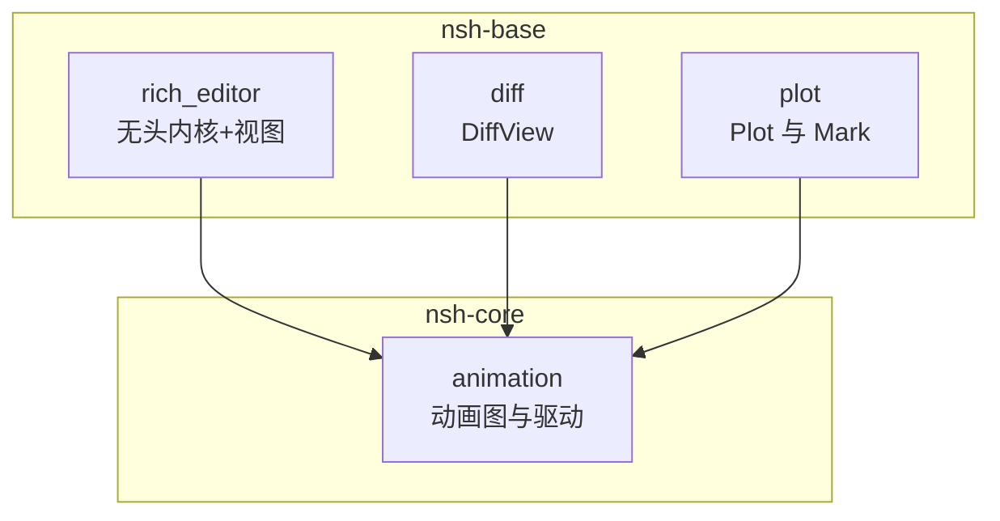
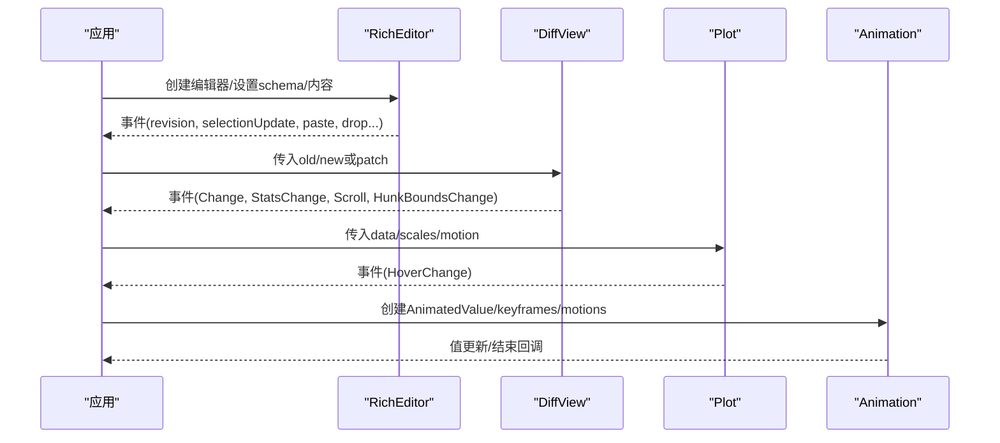
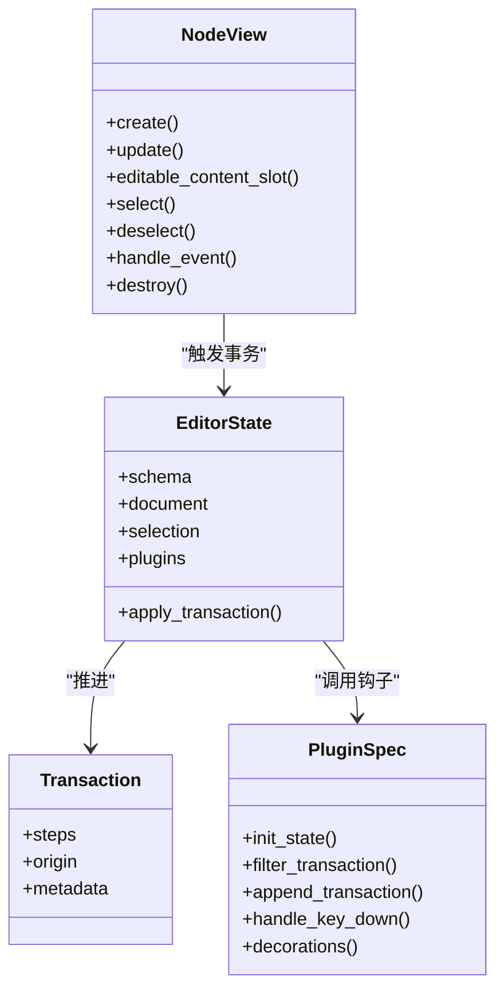
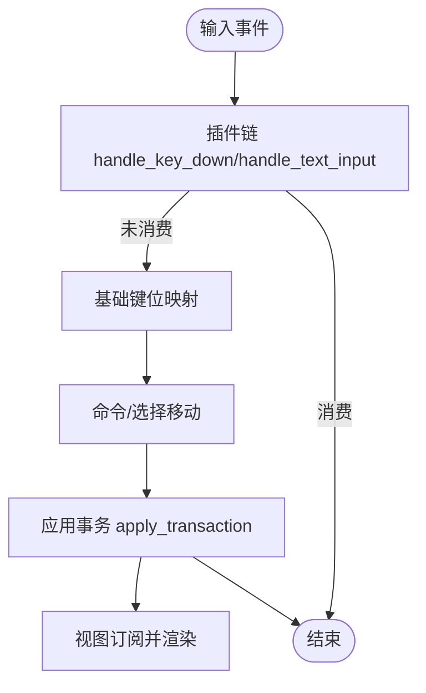
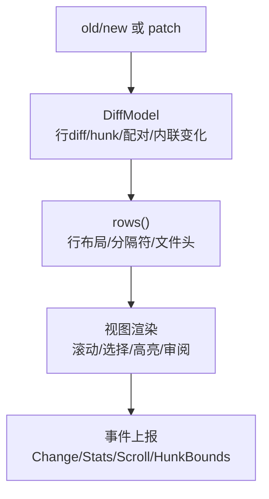
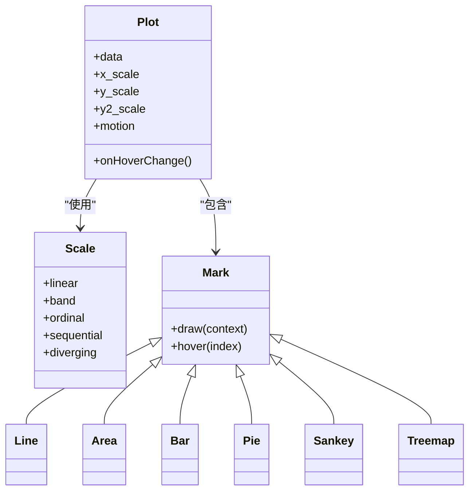
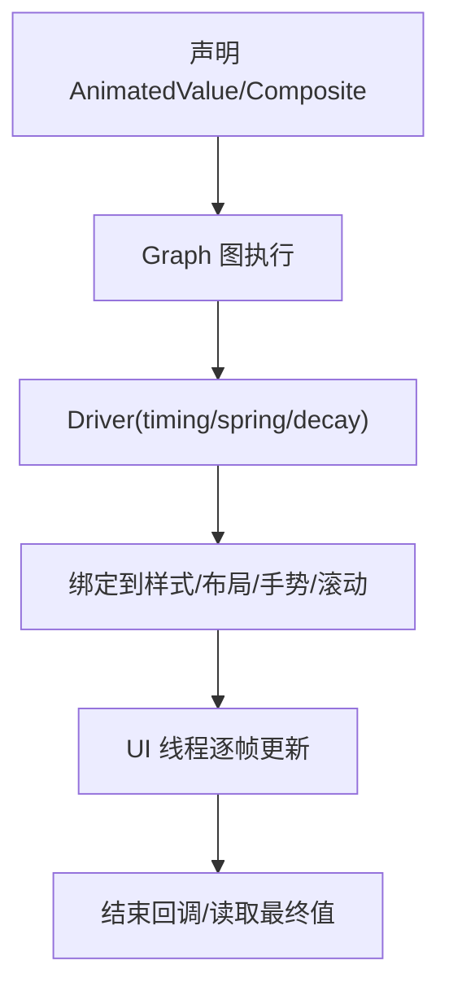
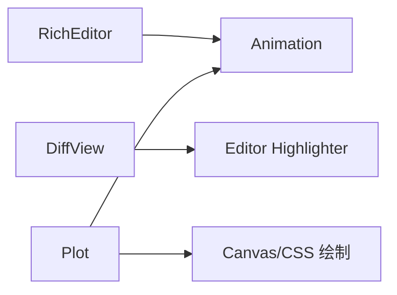

# 高级组件演示

<cite>
**本文引用的文件**   
- [crates/nsh-base/src/rich_editor/mod.rs](file://crates/nsh-base/src/rich_editor/mod.rs)
- [docs/dev/rich-editor.md](file://docs/dev/rich-editor.md)
- [crates/nsh-base/src/diff/mod.rs](file://crates/nsh-base/src/diff/mod.rs)
- [docs/dev/diff.md](file://docs/dev/diff.md)
- [crates/nsh-base/src/plot/mod.rs](file://crates/nsh-base/src/plot/mod.rs)
- [crates/nsh-core/src/animation/mod.rs](file://crates/nsh-core/src/animation/mod.rs)
- [docs/dev/animation.md](file://docs/dev/animation.md)
</cite>

## 目录
1. [引言](#引言)
2. [项目结构](#项目结构)
3. [核心组件](#核心组件)
4. [架构总览](#架构总览)
5. [详细组件分析](#详细组件分析)
6. [依赖关系分析](#依赖关系分析)
7. [性能与优化](#性能与优化)
8. [故障排查指南](#故障排查指南)
9. [结论](#结论)
10. [附录](#附录)

## 引言
本演示文档聚焦 NSH 的高级功能组件：富文本编辑器、差异对比、图表绘制与动画系统。目标是帮助读者理解这些组件的架构、数据流、扩展机制与企业级实践，包括插件化、自定义扩展、第三方库集成、复杂交互处理与调试技巧。

## 项目结构
NSH 将高级能力拆分为多个 crate 与模块：
- 富文本编辑器位于 nsh-base 的 rich_editor 子模块，采用无头内核 + 原生视图的分层设计。
- 差异对比 DiffView 位于 nsh-base 的 diff 子模块，提供行级与词级高亮、补丁解析与审阅交互。
- 图表绘制 Plot 位于 nsh-base 的 plot 子模块，提供多种 mark（折线、面积、柱状、饼图、桑基、树图等）与轴、刻度、颜色映射。
- 动画系统位于 nsh-core 的 animation 子模块，提供值图、关键帧、缓动、布局动画与平台后端驱动。

**图示来源**
- [crates/nsh-base/src/rich_editor/mod.rs:1-35](file://crates/nsh-base/src/rich_editor/mod.rs#L1-L35)
- [crates/nsh-base/src/diff/mod.rs:1-15](file://crates/nsh-base/src/diff/mod.rs#L1-L15)
- [crates/nsh-base/src/plot/mod.rs:1-27](file://crates/nsh-base/src/plot/mod.rs#L1-L27)
- [crates/nsh-core/src/animation/mod.rs:1-14](file://crates/nsh-core/src/animation/mod.rs#L1-L14)

**章节来源**
- [crates/nsh-base/src/rich_editor/mod.rs:1-35](file://crates/nsh-base/src/rich_editor/mod.rs#L1-L35)
- [crates/nsh-base/src/diff/mod.rs:1-15](file://crates/nsh-base/src/diff/mod.rs#L1-L15)
- [crates/nsh-base/src/plot/mod.rs:1-27](file://crates/nsh-base/src/plot/mod.rs#L1-L27)
- [crates/nsh-core/src/animation/mod.rs:1-14](file://crates/nsh-core/src/animation/mod.rs#L1-L14)

## 核心组件
- 富文本编辑器 RichEditor：基于 ProseMirror 架构的无头内核，支持 schema、步骤/事务、选择、插件、格式适配；原生视图负责渲染、输入与几何计算。
- 差异对比 DiffView：展示两段文本或统一补丁的差异，支持 split/unified 布局、行折叠、词级高亮、语法高亮、审阅操作。
- 图表绘制 Plot：以数据行为单位，通过 mark 组合出多种图表，内置轴、刻度、颜色映射、交互与动画。
- 动画系统 Animation：值图、关键帧、缓动、布局动画、手势与滚动联动，跨平台运行在 UI 线程。

**章节来源**
- [docs/dev/rich-editor.md:1-14](file://docs/dev/rich-editor.md#L1-L14)
- [docs/dev/diff.md:1-23](file://docs/dev/diff.md#L1-L23)
- [crates/nsh-base/src/plot/mod.rs:1-27](file://crates/nsh-base/src/plot/mod.rs#L1-L27)
- [docs/dev/animation.md:1-10](file://docs/dev/animation.md#L1-L10)

## 架构总览
四个子系统围绕“数据驱动 + 原生渲染”展开：
- RichEditor：模型/变换/状态/命令/插件/格式 → 原生视图（滚动、选择、几何、IME、粘贴、表格）。
- DiffView：文本/补丁 → 行级 diff → 行布局 → 视图（滚动、选择、高亮、审阅）。
- Plot：数据行 → 比例尺/映射 → mark 绘制 → 交互（指针、键盘、无障碍）→ 动画。
- Animation：JS 声明值/派生节点/动画 → 原生图执行 → 绑定到样式/布局/手势/滚动。

**图示来源**
- [docs/dev/rich-editor.md:286-316](file://docs/dev/rich-editor.md#L286-L316)
- [crates/nsh-base/src/diff/mod.rs:332-372](file://crates/nsh-base/src/diff/mod.rs#L332-L372)
- [crates/nsh-base/src/plot/mod.rs:344-357](file://crates/nsh-base/src/plot/mod.rs#L344-L357)
- [docs/dev/animation.md:1-10](file://docs/dev/animation.md#L1-L10)

## 详细组件分析

### 富文本编辑器 RichEditor
- 无头内核：定义 Schema、Node/Mark、Fragment、Step/Transform、Transaction、Selection、Plugins、Formats。
- 原生视图：渲染块/行/内联装饰、光标与选择框、长文档虚拟挂载、几何映射、输入与 IME、粘贴流程、触摸手势、气泡菜单、内容层、表格布局与交互。
- JS API：createRichEditor、SessionJs、命令与插件数据化、扩展注册、查询与坐标、拖拽手柄、事件。
- 扩展体系：Tiptap 风格 Extension/ExtensionManager，内置 starter kit，按优先级合并 keymap 与插件。

**图示来源**
- [docs/dev/rich-editor.md:36-87](file://docs/dev/rich-editor.md#L36-L87)
- [docs/dev/rich-editor.md:93-120](file://docs/dev/rich-editor.md#L93-L120)

**图示来源**
- [docs/dev/rich-editor.md:177-210](file://docs/dev/rich-editor.md#L177-L210)

企业级要点
- 使用 Extension 组织业务逻辑（Schema/命令/规则/插件），通过 ExtensionManager 控制优先级与合并顺序。
- 异步工作不直接修改存储状态，而是基于当前状态构建新事务，避免竞态。
- 长文档通过仅挂载可视区域附近块提升性能；几何计算复用平台文本引擎结果。
- 粘贴流程对 JS 钩子进行排队与重试，保证状态一致性。

**章节来源**
- [docs/dev/rich-editor.md:16-26](file://docs/dev/rich-editor.md#L16-L26)
- [docs/dev/rich-editor.md:28-64](file://docs/dev/rich-editor.md#L28-L64)
- [docs/dev/rich-editor.md:121-176](file://docs/dev/rich-editor.md#L121-L176)
- [docs/dev/rich-editor.md:286-316](file://docs/dev/rich-editor.md#L286-L316)
- [docs/dev/rich-editor.md:317-410](file://docs/dev/rich-editor.md#L317-L410)

### 差异对比 DiffView
- 模型：行级 diff（histogram + 启发式对齐）、hunk 划分、成对行、词级/字符级内联变化、接受/回滚 hunk。
- 布局：split/unified 两种模式，上下文行、折叠分隔符、文件头、软换行、标注区。
- 视图：垂直滚动 + 行窗口、左右同步横向滚动、行号选择、文本选择、导航、滚动位置与变更边界。
- 高亮：复用 Editor 的高亮管线，按文件分语言独立着色。

**图示来源**
- [docs/dev/diff.md:24-53](file://docs/dev/diff.md#L24-L53)
- [docs/dev/diff.md:86-115](file://docs/dev/diff.md#L86-L115)

API 概览（节选）
- Props：layout、inline、indicators、context_lines、expand_all、line_numbers、background、font_family/font_size/line_height、soft_wrap、annotations、render_* 等。
- 事件：Change、LineNumberPress、StatsChange、LineSelectionChange、FileToggle、Scroll、HunkBoundsChange。
- Ref 方法：hunks/stats/go_to_hunk/revert_hunk/accept_hunk/expand/collapse/selected_lines/next_hunk/previous_hunk/current_hunk/files/scroll_to_file/toggle_file/hunk_bounds/scroll_offset/set_scroll_offset。

**章节来源**
- [crates/nsh-base/src/diff/mod.rs:22-330](file://crates/nsh-base/src/diff/mod.rs#L22-L330)
- [crates/nsh-base/src/diff/mod.rs:332-525](file://crates/nsh-base/src/diff/mod.rs#L332-L525)
- [docs/dev/diff.md:55-85](file://docs/dev/diff.md#L55-L85)
- [docs/dev/diff.md:164-175](file://docs/dev/diff.md#L164-L175)

### 图表绘制 Plot
- 数据与比例尺：Rows 作为数据源，x/y/y2 比例尺（linear/band/ordinal/sequential/diverging），双轴对齐。
- Mark 集合：Line/Area/Bar/Rule/Dot/Cell/Grid/Pie/Arc/RadialLine/RadialGrid/Sankey/Treemap，均填充 Plot 画布并按序叠加。
- 交互：指针悬停（cross line、dot、tooltip）、键盘导航（Left/Right/Home/End/Escape）、无障碍值。
- 动画：appear/update/enter/exit/pointer 运动，scale domain 过渡，平台动画器驱动。

**图示来源**
- [crates/nsh-base/src/plot/mod.rs:58-127](file://crates/nsh-base/src/plot/mod.rs#L58-L127)
- [crates/nsh-base/src/plot/mod.rs:204-342](file://crates/nsh-base/src/plot/mod.rs#L204-L342)
- [crates/nsh-base/src/plot/mod.rs:779-800](file://crates/nsh-base/src/plot/mod.rs#L779-L800)

企业级要点
- 数据只读一次，Rust 侧完成缩放与绘制，避免每点 JS 开销。
- 指针驱动的交互在同一帧跟随指针，避免视觉拖尾；键盘/读屏走动画过渡。
- 颜色映射支持分类与连续色带，类别首次出现时保留颜色（隐式域）。
- 可访问性：Plot 作为单一元素，配合 accessibilityLabel/accessibilityValue 输出语义值。

**章节来源**
- [crates/nsh-base/src/plot/mod.rs:1-27](file://crates/nsh-base/src/plot/mod.rs#L1-L27)
- [crates/nsh-base/src/plot/mod.rs:130-167](file://crates/nsh-base/src/plot/mod.rs#L130-L167)
- [crates/nsh-base/src/plot/mod.rs:344-357](file://crates/nsh-base/src/plot/mod.rs#L344-L357)
- [crates/nsh-base/src/plot/mod.rs:779-800](file://crates/nsh-base/src/plot/mod.rs#L779-L800)

### 动画系统 Animation
- 值与派生：AnimatedValue、interpolate、math、diffClamp、offset。
- 驱动：timing/spring/decay，Composite 树（sequence/parallel/stagger/delay/loop），端点 Promise。
- 关键帧与 Motion：keyframes、MotionSpec、PRESETS，通道（opacity/translate/rotate/scale）并行。
- 布局动画：LayoutAnimation.configureNext、follow(target)、物理弹簧曲线。
- 平台后端：桌面/移动端/Web 分别实现，统一由 Animator 调度。

**图示来源**
- [docs/dev/animation.md:1-10](file://docs/dev/animation.md#L1-L10)
- [docs/dev/animation.md:18-47](file://docs/dev/animation.md#L18-L47)
- [docs/dev/animation.md:80-110](file://docs/dev/animation.md#L80-L110)
- [docs/dev/animation.md:111-142](file://docs/dev/animation.md#L111-L142)

企业级要点
- 所有动画在 UI 线程运行，不等待 JS；减少掉帧风险。
- 指针驱动的运动立即跟随，离散变化才走动画（进入/离开、释放、数据切换）。
- 降低动效模式（reduced motion）下自动退化为瞬时或零时长。
- 布局动画与列表转场分离，避免错位与重复布局。

**章节来源**
- [docs/dev/animation.md:18-47](file://docs/dev/animation.md#L18-L47)
- [docs/dev/animation.md:188-200](file://docs/dev/animation.md#L188-L200)
- [docs/dev/animation.md:202-227](file://docs/dev/animation.md#L202-L227)

## 依赖关系分析
- RichEditor 依赖 nsh-core 的动画系统用于光标/选择/装饰等微交互；其扩展与命令通过 ExtensionManager 管理。
- DiffView 复用 Editor 的高亮管线，自身不实现语法着色。
- Plot 依赖 Animation 驱动 appear/update/pointer 等动效，并通过 CanvasOp/CSS 属性绘制。
- Animation 是跨平台的底层能力，被上层组件共同消费。

**图示来源**
- [docs/dev/rich-editor.md:317-410](file://docs/dev/rich-editor.md#L317-L410)
- [docs/dev/diff.md:164-175](file://docs/dev/diff.md#L164-L175)
- [crates/nsh-base/src/plot/mod.rs:1-27](file://crates/nsh-base/src/plot/mod.rs#L1-L27)
- [crates/nsh-core/src/animation/mod.rs:1-14](file://crates/nsh-core/src/animation/mod.rs#L1-L14)

**章节来源**
- [docs/dev/rich-editor.md:317-410](file://docs/dev/rich-editor.md#L317-L410)
- [docs/dev/diff.md:164-175](file://docs/dev/diff.md#L164-L175)
- [crates/nsh-base/src/plot/mod.rs:1-27](file://crates/nsh-base/src/plot/mod.rs#L1-L27)
- [crates/nsh-core/src/animation/mod.rs:1-14](file://crates/nsh-core/src/animation/mod.rs#L1-L14)

## 性能与优化
- 富文本编辑器
  - 长文档仅挂载可视区域附近的块，减少 DOM/视图数量。
  - 几何计算复用平台文本引擎，避免重复排版。
  - 粘贴流程对 JS 钩子排队与重试，避免阻塞输入路径。
- 差异对比
  - 行窗口仅渲染可见行及其缓冲，时间复杂度与可见行数相关。
  - 多文件补丁各自高亮，共享一帧预算，避免互相干扰。
- 图表绘制
  - 数据只读一次，Rust 侧完成缩放与绘制，避免每点 JS 开销。
  - 指针交互同一帧跟随，键盘/读屏走动画过渡，减少重绘。
- 动画系统
  - 值图与 Composite 在 UI 线程运行，不等待 JS。
  - 布局动画与列表转场分离，避免多余布局。
  - 降低动效模式自动退化为瞬时或零时长。

[本节为通用指导，不直接分析具体文件]

## 故障排查指南
- RichEditor
  - 事务循环：插件 append_transaction 相互追加超过 64 轮会报错，需检查插件间依赖。
  - 粘贴失败：JS 钩子可能因状态变化而重试，确认目标位置仍存在。
  - 几何查询返回空：需要视图已挂载且位置有效，否则返回空而非 null。
- DiffView
  - 行选择异常：确保 gutter 点击与文本选择区域互斥，避免误选。
  - 高亮错乱：多文件场景下语言推断错误会导致高亮不一致，显式指定 language。
- Plot
  - 悬停抖动：指针驱动不应走动画，避免 pointer 动画导致拖尾。
  - 颜色异常：类别首次出现后颜色固定，若 scale.domain 变化需重新评估。
- Animation
  - 参数非法：stiffness/mass/damping/target 非正或 NaN 等会被修正或终止，检查输入。
  - 首帧跳变：确保启动动画前视图已布局，必要时延迟启动或使用 initial 值。

**章节来源**
- [docs/dev/rich-editor.md:73-91](file://docs/dev/rich-editor.md#L73-L91)
- [docs/dev/rich-editor.md:190-210](file://docs/dev/rich-editor.md#L190-L210)
- [docs/dev/rich-editor.md:371-383](file://docs/dev/rich-editor.md#L371-L383)
- [docs/dev/diff.md:117-137](file://docs/dev/diff.md#L117-L137)
- [docs/dev/diff.md:164-175](file://docs/dev/diff.md#L164-L175)
- [docs/dev/animation.md:38-47](file://docs/dev/animation.md#L38-L47)
- [docs/dev/animation.md:71-79](file://docs/dev/animation.md#L71-L79)

## 结论
NSH 的高级组件以“数据驱动 + 原生渲染”为核心，通过无头内核、可扩展插件、平台无关的动画系统与高效的视图渲染，为企业级应用提供了稳定、高性能、可定制的解决方案。遵循本文的最佳实践，可在富文本编辑、代码审阅、数据可视化与动效体验上获得一致的高质量表现。

[本节为总结性内容，不直接分析具体文件]

## 附录
- 富文本编辑器扩展开发
  - 使用 Extension 组织 Schema/命令/规则/插件，通过 ExtensionManager 控制优先级。
  - 使用 register_extension 暴露给 JS，JS 通过 richExtension(name, options) 使用。
- 差异对比审阅流程
  - 使用 revertHunk/acceptHunk 逐步合并补丁，onChange 同步 old/new。
  - 使用 renderHunkActions 放置应用自定义操作。
- 图表绘制最佳实践
  - 明确 x/y/y2 比例尺类型与 domain，避免隐式域导致的颜色不稳定。
  - 使用 motion.appear/update 控制入场与形态过渡，避免指针驱动动画。
- 动画系统使用建议
  - 优先使用 Motion/Keyframes 描述动效，减少每帧 JS 逻辑。
  - 在 reduced motion 环境下提供降级方案。

[本节为补充说明，不直接分析具体文件]