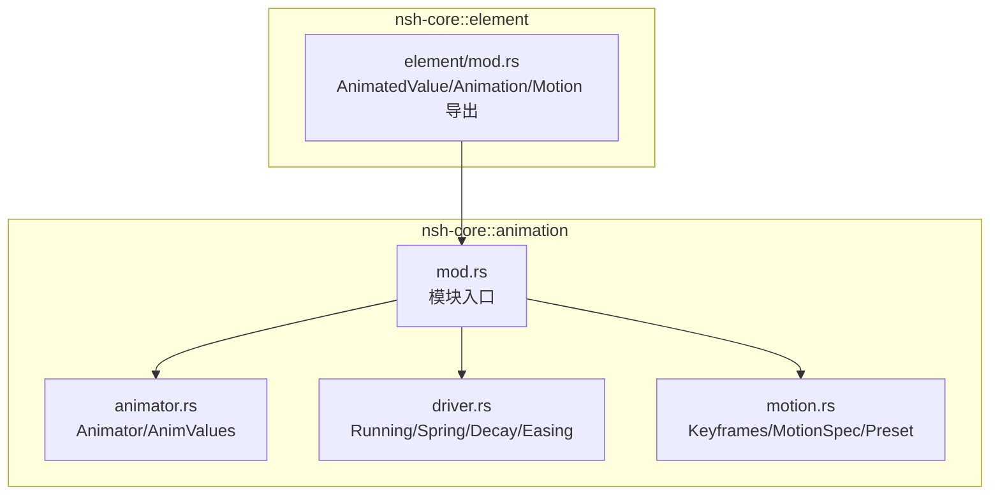
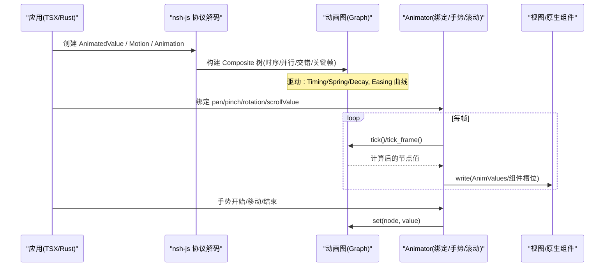
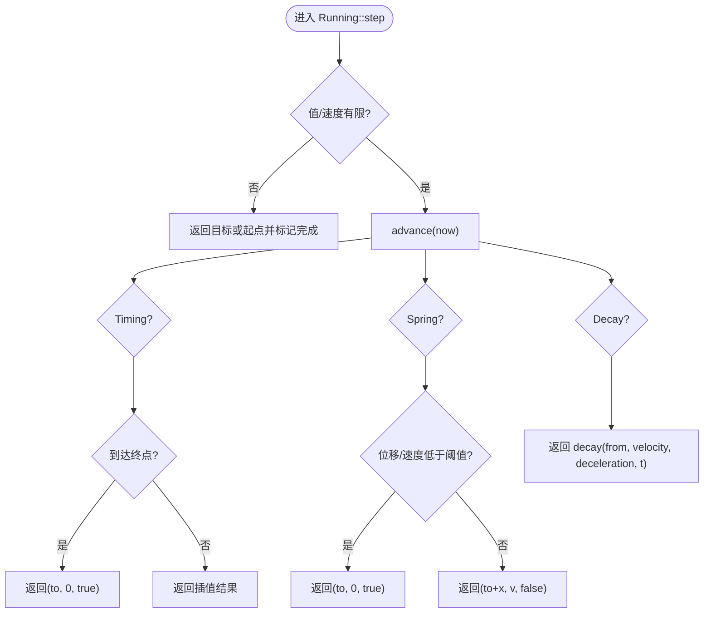
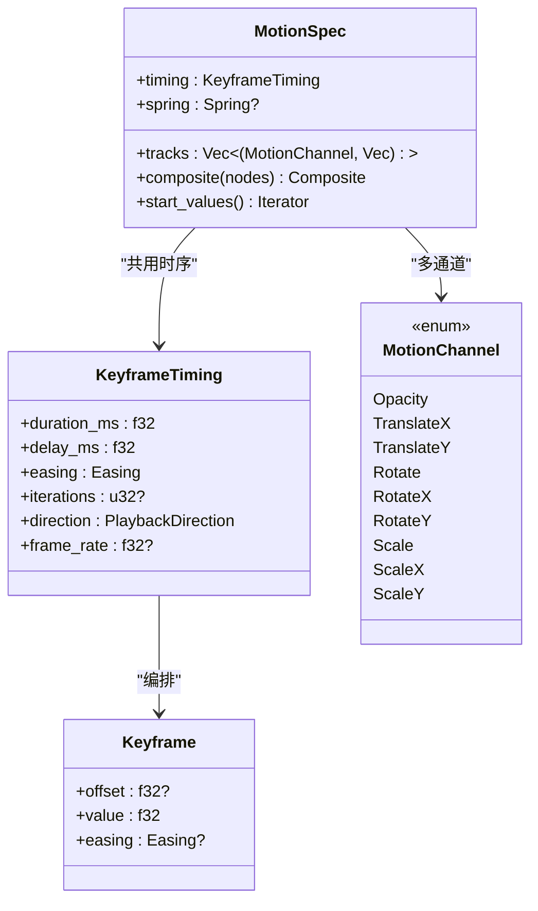
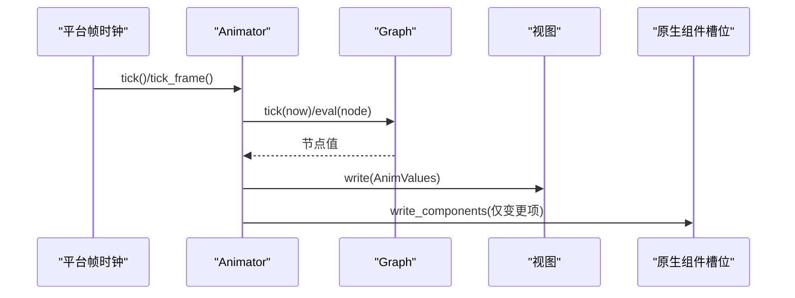
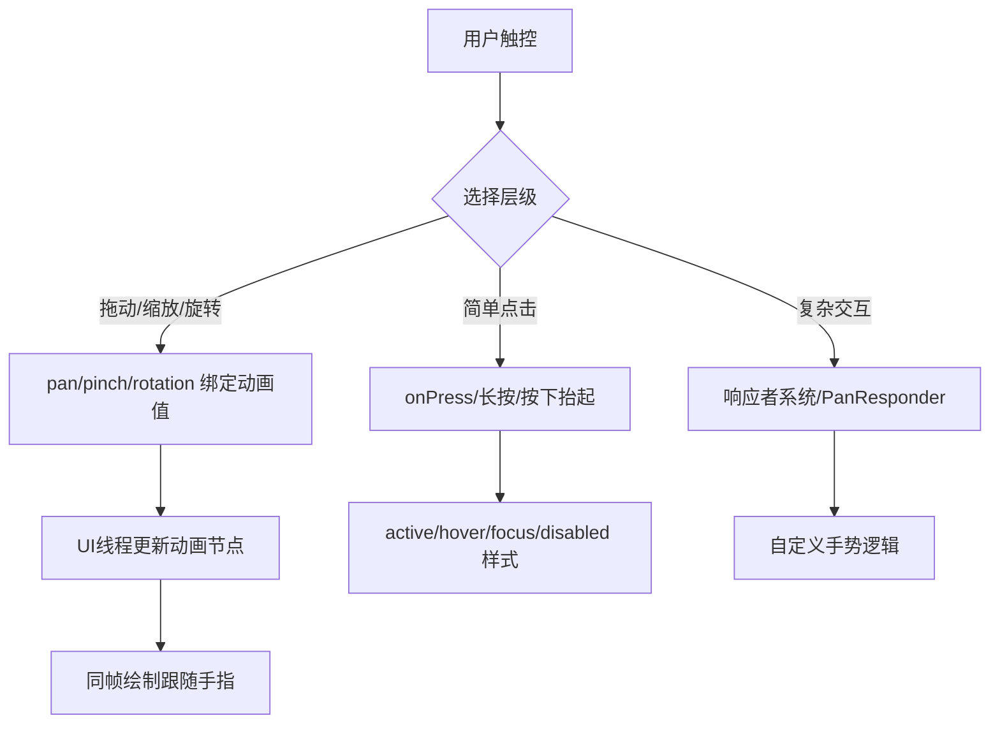
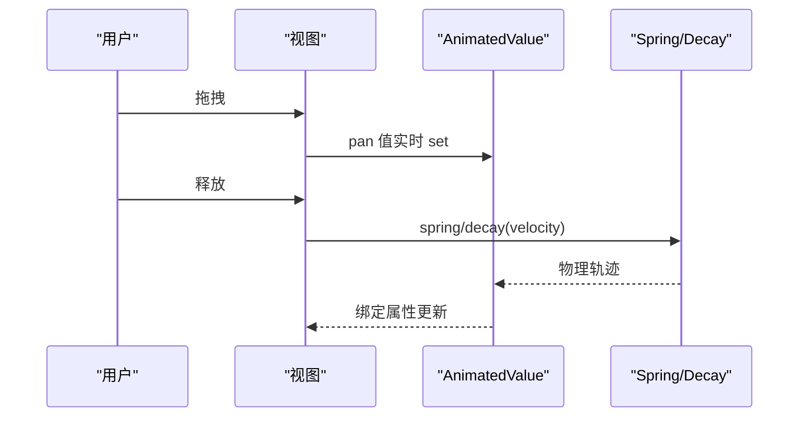
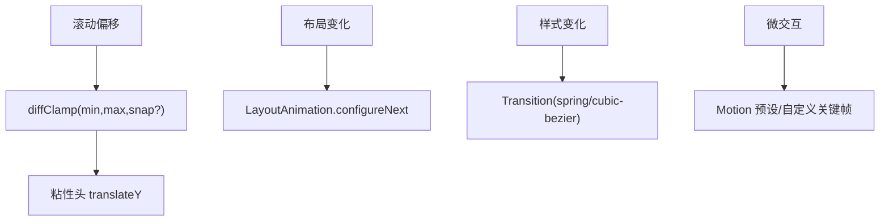
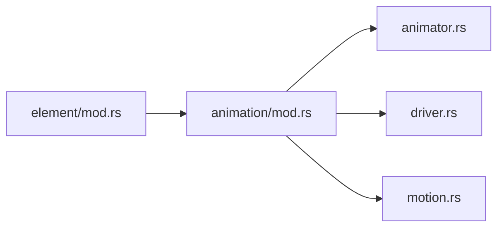

# 动画与手势

<cite>
**本文引用的文件**   
- [animation.md（开发文档）](file://docs/dev/animation.md)
- [animation.md（网站文档）](file://website/docs/animation.md)
- [touch-and-gestures.md（触摸与手势文档）](file://website/docs/touch-and-gestures.md)
- [mod.rs（动画模块入口）](file://crates/nsh-core/src/animation/mod.rs)
- [animator.rs（桌面端动画器）](file://crates/nsh-core/src/animation/animator.rs)
- [driver.rs（驱动与缓动采样）](file://crates/nsh-core/src/animation/driver.rs)
- [motion.rs（关键帧、交错与运动预设）](file://crates/nsh-core/src/animation/motion.rs)
- [element/mod.rs（元素与动画值导出）](file://crates/nsh-core/src/element/mod.rs)
</cite>

## 目录
1. [简介](#简介)
2. [项目结构](#项目结构)
3. [核心组件](#核心组件)
4. [架构总览](#架构总览)
5. [详细组件分析](#详细组件分析)
6. [依赖关系分析](#依赖关系分析)
7. [性能考虑](#性能考虑)
8. [故障排查指南](#故障排查指南)
9. [结论](#结论)
10. [附录](#附录)

## 简介
本文件系统性梳理 NSH 的动画与手势系统，覆盖以下主题：
- 动画框架：缓动函数、动画序列、并行动画、交错动画、关键帧与运动（Motion）
- 手势识别：捏合、旋转、按压状态、指针事件、原生手势（pan/pinch/rotation）
- 物理引擎：拖拽效果、弹簧动画与衰减（decay）模拟
- 复杂动画：折叠头部、页面过渡、微交互的实现方法
- 性能优化与调试技巧

NSH 的动画在 UI 线程运行，由 Rust 核心以数据描述一次、平台逐帧播放，避免 JS 阻塞导致掉帧。手势与滚动偏移可直接驱动动画值，布局动画与样式过渡也具备跨平台一致性。

## 项目结构
动画子系统位于 nsh-core 的 animation 模块，提供无平台的动画图（Graph）、驱动（Driver）、动画器（Animator）、关键帧与运动（Motion）等能力；元素层导出 AnimatedValue、Animation、Motion 等 API 供 TSX/Rust 使用。

图表来源
- [mod.rs:1-37](file://crates/nsh-core/src/animation/mod.rs#L1-L37)
- [animator.rs:1-65](file://crates/nsh-core/src/animation/animator.rs#L1-L65)
- [driver.rs:1-25](file://crates/nsh-core/src/animation/driver.rs#L1-L25)
- [motion.rs:1-16](file://crates/nsh-core/src/animation/motion.rs#L1-L16)
- [element/mod.rs:122-128](file://crates/nsh-core/src/element/mod.rs#L122-L128)

章节来源
- [mod.rs:1-37](file://crates/nsh-core/src/animation/mod.rs#L1-L37)
- [element/mod.rs:122-128](file://crates/nsh-core/src/element/mod.rs#L122-L128)

## 核心组件
- 动画图与调度：Graph 维护节点与驱动，Animator 负责与视图绑定、手势与滚动值注入、每帧写出 AnimValues。
- 驱动与曲线：Timing/Spring/Decay 三种驱动，Easing 曲线与采样，参数清洗与边界保护。
- 关键帧与运动：Keyframe/KeyframeTiming 组合为 Composite 树；MotionSpec 将多通道（透明度、平移、旋转、缩放）编排为并行或弹簧驱动。
- 元素层 API：AnimatedValue、Animation、Motion 暴露给 TSX/Rust 应用。

章节来源
- [animator.rs:17-65](file://crates/nsh-core/src/animation/animator.rs#L17-L65)
- [driver.rs:40-91](file://crates/nsh-core/src/animation/driver.rs#L40-L91)
- [motion.rs:20-68](file://crates/nsh-core/src/animation/motion.rs#L20-L68)
- [element/mod.rs:122-128](file://crates/nsh-core/src/element/mod.rs#L122-L128)

## 架构总览
动画从应用侧声明（TSX/Rust），经 nsh-js 解码为 Composite 树，交由 Animator 在 UI 线程按帧推进，最终写入视图属性或传递给原生组件槽位。手势与滚动值直接更新动画节点，实现“跟随手指”的即时反馈。

图表来源
- [mod.rs:1-14](file://crates/nsh-core/src/animation/mod.rs#L1-L14)
- [animator.rs:67-143](file://crates/nsh-core/src/animation/animator.rs#L67-L143)
- [animator.rs:292-327](file://crates/nsh-core/src/animation/animator.rs#L292-L327)
- [driver.rs:167-243](file://crates/nsh-core/src/animation/driver.rs#L167-L243)

## 详细组件分析

### 动画图与驱动（Timing/Spring/Decay）
- Timing：按 duration_ms/easing/delay 精确推进，支持零时长关键帧跳转。
- Spring：基于阻尼振子解析解，支持欠阻尼/临界阻尼/过阻尼，自动判定静止阈值。
- Decay：指数衰减，支持有界区间与回弹（bounce），帧内多次碰撞闭合形式求解。
- Easing：CSS 与 React Native 曲线集合，steps 与 cubic-bezier 求解稳定。

图表来源
- [driver.rs:167-243](file://crates/nsh-core/src/animation/driver.rs#L167-L243)
- [driver.rs:245-298](file://crates/nsh-core/src/animation/driver.rs#L245-L298)
- [driver.rs:541-580](file://crates/nsh-core/src/animation/driver.rs#L541-L580)
- [driver.rs:582-695](file://crates/nsh-core/src/animation/driver.rs#L582-L695)

章节来源
- [driver.rs:1-25](file://crates/nsh-core/src/animation/driver.rs#L1-L25)
- [driver.rs:167-243](file://crates/nsh-core/src/animation/driver.rs#L167-L243)
- [driver.rs:245-298](file://crates/nsh-core/src/animation/driver.rs#L245-L298)
- [driver.rs:541-695](file://crates/nsh-core/src/animation/driver.rs#L541-L695)

### 关键帧与运动（Keyframes/Motion）
- Keyframe/KeyframeTiming：按 Web Animations API 语义解析 offset、easing、iterations、direction，生成 Composite 时序。
- MotionSpec：多通道（opacity/translate/rotate/scale）统一编排，可走 keyframes 或 spring（保留中断时的速度与位置）。
- Preset：内置入场/离场/强调/循环预设，数据化定义，便于复用与校验。

图表来源
- [motion.rs:20-68](file://crates/nsh-core/src/animation/motion.rs#L20-L68)
- [motion.rs:124-201](file://crates/nsh-core/src/animation/motion.rs#L124-L201)
- [motion.rs:430-519](file://crates/nsh-core/src/animation/motion.rs#L430-L519)
- [motion.rs:521-654](file://crates/nsh-core/src/animation/motion.rs#L521-L654)

章节来源
- [motion.rs:203-371](file://crates/nsh-core/src/animation/motion.rs#L203-L371)
- [motion.rs:400-519](file://crates/nsh-core/src/animation/motion.rs#L400-L519)
- [motion.rs:521-654](file://crates/nsh-core/src/animation/motion.rs#L521-L654)

### 动画器与绑定（Animator/AnimValues）
- Animator 持有 Graph、视图绑定、手势状态、滚动配置与粘性单元格列表。
- 每帧调用 tick/tick_frame 推进图，write 将 AnimValues 写入视图，write_components 仅当值变化时通知原生组件槽位。
- 手势：pan_began/moved、transform_began/moved 直接 set 到动画节点，保证“跟随手指”的即时性。
- 滚动：scrolled/pulled/scroll_ended 驱动 scrollValue/diffClamp 等节点，支持吸附收敛。

图表来源
- [animator.rs:67-143](file://crates/nsh-core/src/animation/animator.rs#L67-L143)
- [animator.rs:292-327](file://crates/nsh-core/src/animation/animator.rs#L292-L327)
- [animator.rs:330-361](file://crates/nsh-core/src/animation/animator.rs#L330-L361)

章节来源
- [animator.rs:17-65](file://crates/nsh-core/src/animation/animator.rs#L17-L65)
- [animator.rs:67-143](file://crates/nsh-core/src/animation/animator.rs#L67-L143)
- [animator.rs:292-361](file://crates/nsh-core/src/animation/animator.rs#L292-L361)

### 手势系统与指针事件
- 按压与反馈：onPress/onLongPress/activeStyle 等，命中区域 hitSlop，pointerEvents 穿透控制。
- 原生手势：pan/pinch/rotation 绑定动画值，平台侧在 UI 线程更新，应用侧仅在 start/end 回调中做物理收尾。
- 响应者系统：claim_touches/on_responder_* 处理自定义手势；PanResponder 封装 gestureState。
- 滚动联动：scrollValue 与 diffClamp 实现粘性头、吸附等效果。

图表来源
- [touch-and-gestures.md:9-13](file://website/docs/touch-and-gestures.md#L9-L13)
- [touch-and-gestures.md:15-89](file://website/docs/touch-and-gestures.md#L15-L89)
- [touch-and-gestures.md:90-164](file://website/docs/touch-and-gestures.md#L90-L164)
- [touch-and-gestures.md:195-241](file://website/docs/touch-and-gestures.md#L195-L241)
- [touch-and-gestures.md:243-347](file://website/docs/touch-and-gestures.md#L243-L347)
- [touch-and-gestures.md:349-443](file://website/docs/touch-and-gestures.md#L349-L443)
- [touch-and-gestures.md:437-543](file://website/docs/touch-and-gestures.md#L437-L543)
- [touch-and-gestures.md:544-652](file://website/docs/touch-and-gestures.md#L544-L652)

章节来源
- [touch-and-gestures.md:9-13](file://website/docs/touch-and-gestures.md#L9-L13)
- [touch-and-gestures.md:195-241](file://website/docs/touch-and-gestures.md#L195-L241)
- [touch-and-gestures.md:243-347](file://website/docs/touch-and-gestures.md#L243-L347)
- [touch-and-gestures.md:349-543](file://website/docs/touch-and-gestures.md#L349-L543)
- [touch-and-gestures.md:544-652](file://website/docs/touch-and-gestures.md#L544-L652)

### 物理引擎与拖拽/弹簧/衰减
- 拖拽：pan 值直接驱动 translate，onPanEnd 用 velocity 启动 spring/decay，保持惯性。
- 弹簧：Spring 解析解决定收敛时间与过冲，支持质量、阻尼、刚度；Motion 也可用 spring 替代 keyframes。
- 衰减：decay/decay_within 支持区间与 bounce，帧内多次碰撞仍保持闭合形式稳定性。

图表来源
- [touch-and-gestures.md:243-347](file://website/docs/touch-and-gestures.md#L243-L347)
- [driver.rs:167-243](file://crates/nsh-core/src/animation/driver.rs#L167-L243)
- [driver.rs:245-298](file://crates/nsh-core/src/animation/driver.rs#L245-L298)

章节来源
- [touch-and-gestures.md:243-347](file://website/docs/touch-and-gestures.md#L243-L347)
- [driver.rs:167-298](file://crates/nsh-core/src/animation/driver.rs#L167-L298)

### 复杂动画效果实践
- 折叠头部（粘性头）：scrollValue 驱动 diffClamp，结合 snap 吸附，滚动停止后继续完成隐藏/显示。
- 页面过渡：LayoutAnimation 对下一帧布局变化进行过渡；Transition 对颜色/变换/阴影等进行样式过渡。
- 微交互：Motion 预设（shake/pulse/bounce 等）用于错误提示、强调、加载态；结合 stagger 实现列表入场。

图表来源
- [animation.md（网站文档）:624-654](file://website/docs/animation.md#L624-L654)
- [animation.md（网站文档）:796-800](file://website/docs/animation.md#L796-L800)
- [animation.md（网站文档）:279-342](file://website/docs/animation.md#L279-L342)
- [animation.md（网站文档）:86-148](file://website/docs/animation.md#L86-L148)

章节来源
- [animation.md（网站文档）:624-654](file://website/docs/animation.md#L624-L654)
- [animation.md（网站文档）:796-800](file://website/docs/animation.md#L796-L800)
- [animation.md（网站文档）:279-342](file://website/docs/animation.md#L279-L342)
- [animation.md（网站文档）:86-148](file://website/docs/animation.md#L86-L148)

## 依赖关系分析
- Animator 依赖 Graph 进行求值与调度，依赖 MountItem 接收动画操作、手势与滚动配置。
- driver.rs 提供 Running/Spring/Decay/Easing 等基础能力，被 motion.rs 与 animator.rs 共同使用。
- element/mod.rs 导出 AnimatedValue/Animation/Motion，使上层应用能直接调用。

图表来源
- [element/mod.rs:122-128](file://crates/nsh-core/src/element/mod.rs#L122-L128)
- [mod.rs:15-36](file://crates/nsh-core/src/animation/mod.rs#L15-L36)

章节来源
- [element/mod.rs:122-128](file://crates/nsh-core/src/element/mod.rs#L122-L128)
- [mod.rs:15-36](file://crates/nsh-core/src/animation/mod.rs#L15-L36)

## 性能考虑
- 所有动画在 UI 线程运行，JS 不介入每帧，避免主线程繁忙导致卡顿。
- 首帧补偿：若 UI 线程长时间阻塞，首个可见帧会延迟计数起点，避免跳过动画开头。
- 帧率控制：各驱动/关键帧可声明所需最高帧率，未设置则取屏幕最高；平台在无其他动画时可降低帧率。
- 死线调度：对无明确终点的动画（如弹簧、带回弹的衰减）周期性检查收敛，确保时间准确。
- 布局动画作用域：通过 animate_layout 限定范围，减少不必要的重绘。

章节来源
- [animation.md（开发文档）:11-11](file://docs/dev/animation.md#L11-L11)
- [animation.md（开发文档）:57-70](file://docs/dev/animation.md#L57-L70)
- [animation.md（开发文档）:179-186](file://docs/dev/animation.md#L179-L186)
- [animation.md（开发文档）:111-127](file://docs/dev/animation.md#L111-L127)

## 故障排查指南
- 参数越界告警：当 stiffness/mass 非正、damping/to 非有限、duration 为 NaN/无穷、easing 数值非法等，驱动会被安全替换或立即结束；首次启动时记录一次警告。
- 溢出保护：若中间计算溢出，Timing/Spring 停在目标，Decay 回到起点，避免崩溃。
- diffClamp 吸附：滚动结束时，吸附型 diffClamp 会在 200ms 内平滑收敛到最近边界，需确保 scroll_ended 被正确触发。
- 手势与动画冲突：优先绑定动画值而非响应者系统，避免频繁回调造成抖动；必要时使用 panActivation 区分方向与边缘。

章节来源
- [driver.rs:300-382](file://crates/nsh-core/src/animation/driver.rs#L300-L382)
- [driver.rs:414-475](file://crates/nsh-core/src/animation/driver.rs#L414-L475)
- [animator.rs:216-225](file://crates/nsh-core/src/animation/animator.rs#L216-L225)
- [touch-and-gestures.md:621-652](file://website/docs/touch-and-gestures.md#L621-L652)

## 结论
NSH 的动画与手势系统以“数据驱动 + UI 线程执行”为核心，提供高一致性与高性能的跨平台体验。通过 Animator/Graph/Driver 的分层设计，结合 Motion/Keyframes/Composite 的组合能力，以及 pan/pinch/rotation 的原生手势绑定，开发者可以高效实现从微交互到复杂页面过渡的各类效果。配合 diffClamp、LayoutAnimation 与 Transition，既能满足日常需求，也能支撑高级场景。

## 附录
- 常用 API 路径参考：
  - 动画值与复合动画：[element/mod.rs:122-128](file://crates/nsh-core/src/element/mod.rs#L122-L128)
  - 驱动与采样：[driver.rs:505-537](file://crates/nsh-core/src/animation/driver.rs#L505-L537)
  - 关键帧与运动：[motion.rs:310-371](file://crates/nsh-core/src/animation/motion.rs#L310-L371), [motion.rs:521-654](file://crates/nsh-core/src/animation/motion.rs#L521-L654)
  - 手势与滚动联动：[animator.rs:194-225](file://crates/nsh-core/src/animation/animator.rs#L194-L225), [animator.rs:227-290](file://crates/nsh-core/src/animation/animator.rs#L227-L290)
  - 网站文档示例：[animation.md（网站文档）:398-517](file://website/docs/animation.md#L398-L517), [animation.md（网站文档）:680-748](file://website/docs/animation.md#L680-L748)
  - 触摸与手势文档：[touch-and-gestures.md:243-347](file://website/docs/touch-and-gestures.md#L243-L347)