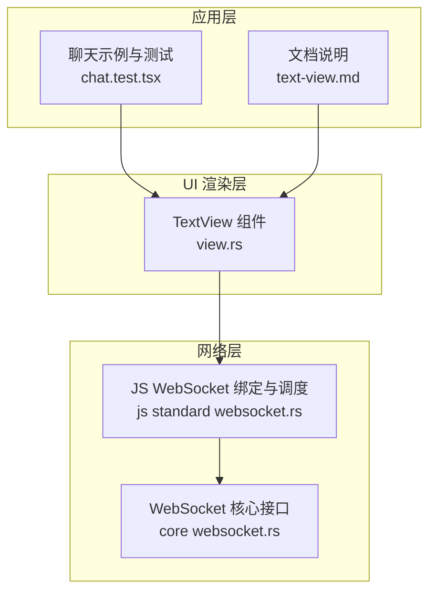
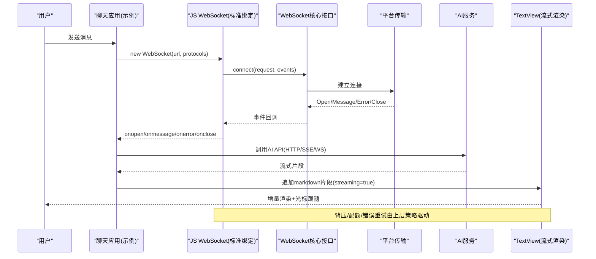
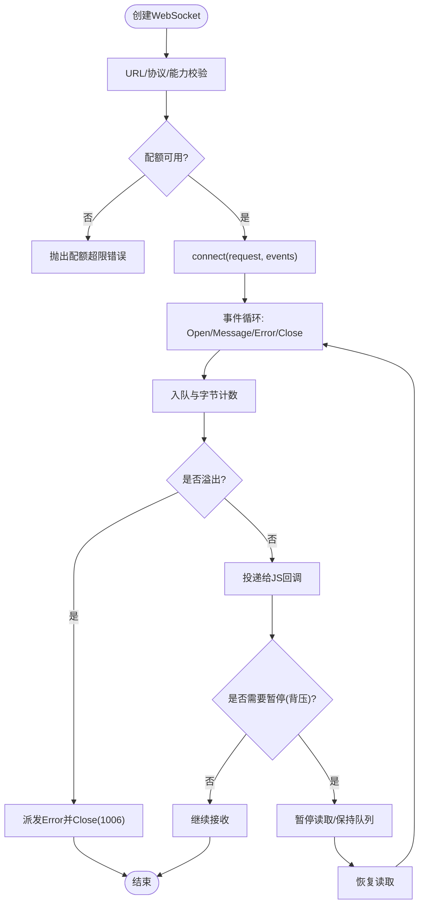
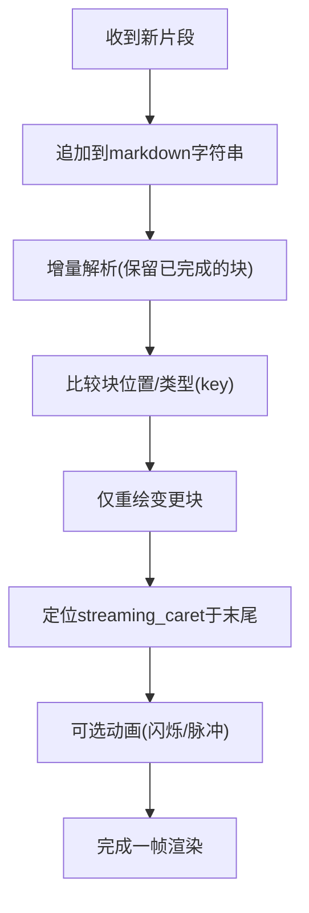
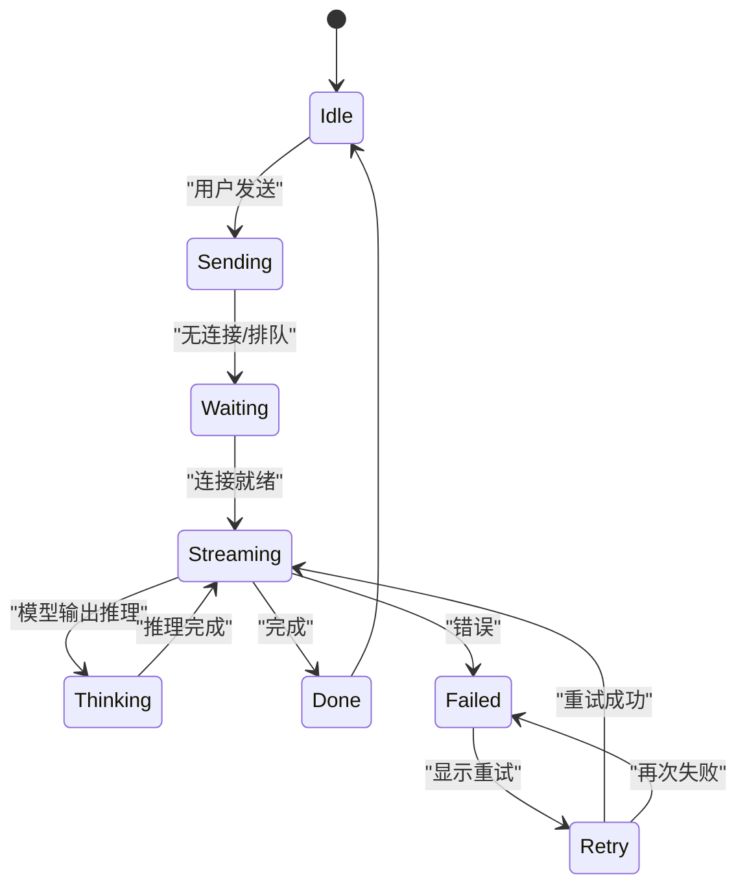
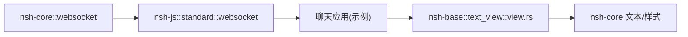

# AI聊天应用

<cite>
**本文引用的文件**   
- [chat.test.tsx](file://examples/gallery-rs/chat.test.tsx)
- [websocket.rs（核心接口）](file://crates/nsh-core/src/websocket.rs)
- [websocket.rs（JS绑定与传输）](file://crates/nsh-js/src/standard/websocket.rs)
- [text-view.md（文档）](file://website/elements/text-view.md)
- [view.rs（TextView组件实现）](file://crates/nsh-base/src/text_view/view.rs)
</cite>

## 目录
1. [简介](#简介)
2. [项目结构](#项目结构)
3. [核心组件](#核心组件)
4. [架构总览](#架构总览)
5. [详细组件分析](#详细组件分析)
6. [依赖关系分析](#依赖关系分析)
7. [性能考量](#性能考量)
8. [故障排查指南](#故障排查指南)
9. [结论](#结论)
10. [附录](#附录)

## 简介
本文件为 NSH AI 聊天应用的系统化技术文档，围绕以下目标展开：消息流处理、流式响应渲染、对话状态管理；WebSocket 连接管理、消息队列与背压、错误重试机制；流式文本渲染的增量更新、光标动画与性能优化；AI 服务集成（API 封装、请求拦截、响应解析）；复杂交互（输入校验、自动补全、快捷键）；界面响应式、主题适配与可访问性。

## 项目结构
该仓库采用多 crate 的 Rust 工程组织，前端以 TSX 组件为主，WebView/平台桥接由 nsh-core 与 nsh-js 提供。与 AI 聊天相关的关键位置包括：
- WebSocket 能力与传输抽象：nsh-core::websocket
- JS 层 WebSocket 全局对象与事件分发：nsh-js::standard::websocket
- 流式 Markdown 渲染与 UI 组件：nsh-base::text_view::view.rs
- 示例与端到端测试：examples/gallery-rs/chat.test.tsx
- 文档说明：website/elements/text-view.md

**图示来源**
- [chat.test.tsx:1-70](file://examples/gallery-rs/chat.test.tsx#L1-L70)
- [text-view.md:1-120](file://website/elements/text-view.md#L1-L120)
- [view.rs:292-446](file://crates/nsh-base/src/text_view/view.rs#L292-L446)
- [websocket.rs（JS绑定与传输）:143-172](file://crates/nsh-js/src/standard/websocket.rs#L143-L172)
- [websocket.rs（核心接口）:71-100](file://crates/nsh-core/src/websocket.rs#L71-L100)

**章节来源**
- [chat.test.tsx:1-70](file://examples/gallery-rs/chat.test.tsx#L1-L70)
- [text-view.md:1-120](file://website/elements/text-view.md#L1-L120)
- [view.rs:292-446](file://crates/nsh-base/src/text_view/view.rs#L292-L446)
- [websocket.rs（JS绑定与传输）:143-172](file://crates/nsh-js/src/standard/websocket.rs#L143-L172)
- [websocket.rs（核心接口）:71-100](file://crates/nsh-core/src/websocket.rs#L71-L100)

## 核心组件
- WebSocket 核心接口：定义数据、事件、任务与传输抽象，统一跨平台行为。
- JS WebSocket 绑定：在 VM 中暴露全局 WebSocket，负责 URL 校验、权限检查、配额控制、入队与背压、事件投递与关闭语义。
- TextView 组件：面向 AI 回复的流式 Markdown 渲染器，支持增量更新、流式光标、部分重绘、链接与代码块扩展等。
- 聊天示例与测试：覆盖离线等待、思考折叠、失败重试等典型场景。

**章节来源**
- [websocket.rs（核心接口）:9-100](file://crates/nsh-core/src/websocket.rs#L9-L100)
- [websocket.rs（JS绑定与传输）:1-172](file://crates/nsh-js/src/standard/websocket.rs#L1-L172)
- [view.rs:292-446](file://crates/nsh-base/src/text_view/view.rs#L292-L446)
- [chat.test.tsx:1-70](file://examples/gallery-rs/chat.test.tsx#L1-L70)

## 架构总览
下图展示从用户输入到 AI 回复渲染的主流程，以及 WebSocket 连接、消息队列与错误处理的协作关系。

**图示来源**
- [websocket.rs（JS绑定与传输）:143-172](file://crates/nsh-js/src/standard/websocket.rs#L143-L172)
- [websocket.rs（核心接口）:71-100](file://crates/nsh-core/src/websocket.rs#L71-L100)
- [text-view.md:283-336](file://website/elements/text-view.md#L283-L336)
- [view.rs:292-446](file://crates/nsh-base/src/text_view/view.rs#L292-L446)

## 详细组件分析

### WebSocket 连接管理与消息队列
- 连接生命周期：URL 校验、协议白名单、能力与配额检查、拒绝策略、事件投递、清理释放。
- 消息队列与背压：入队上限、字节上限、溢出触发 error/close；pause/resume 用于上游限速。
- 错误与关闭：错误事件后可能跟随 close；非正常关闭码 1006；协议不匹配时主动关闭。
- 资源配额：每 VM 最大并发数限制，超出抛出配额超限错误；销毁时释放宿主 socket 与配额。

**图示来源**
- [websocket.rs（JS绑定与传输）:174-443](file://crates/nsh-js/src/standard/websocket.rs#L174-L443)
- [websocket.rs（核心接口）:71-100](file://crates/nsh-core/src/websocket.rs#L71-L100)

**章节来源**
- [websocket.rs（JS绑定与传输）:30-125](file://crates/nsh-js/src/standard/websocket.rs#L30-L125)
- [websocket.rs（JS绑定与传输）:174-443](file://crates/nsh-js/src/standard/websocket.rs#L174-L443)
- [websocket.rs（核心接口）:9-100](file://crates/nsh-core/src/websocket.rs#L9-L100)

### 流式文本渲染与光标动画
- 流式模式：通过 options.streaming=true 启用，未闭合语法会按“最终形态”显示，避免中间态污染阅读体验。
- 增量更新：基于位置的块缓存，仅重绘正在写入的块，长回复更新成本低。
- 光标跟随：streaming_caret 随文档末尾移动，可自定义闪烁/脉冲动画。
- 选择与复制：selectable 模式下整篇文档连贯选择，生成标记不参与选择。

**图示来源**
- [text-view.md:283-336](file://website/elements/text-view.md#L283-L336)
- [view.rs:292-446](file://crates/nsh-base/src/text_view/view.rs#L292-L446)

**章节来源**
- [text-view.md:283-336](file://website/elements/text-view.md#L283-L336)
- [view.rs:292-446](file://crates/nsh-base/src/text_view/view.rs#L292-L446)

### 对话状态管理与复杂交互
- 离线等待：无连接时排队消息，连接就绪后继续发送。
- 思考折叠：模型先输出推理过程，完成后折叠/展开。
- 失败重试：错误消息旁显示“重试”，成功后替换原错误内容。
- 这些行为由应用层状态机与 UI 组合实现，测试用例覆盖了关键路径。

**图示来源**
- [chat.test.tsx:38-69](file://examples/gallery-rs/chat.test.tsx#L38-L69)

**章节来源**
- [chat.test.tsx:24-69](file://examples/gallery-rs/chat.test.tsx#L24-L69)

### AI 服务集成（API 封装、请求拦截、响应解析）
- 建议将 HTTP/SSE/WS 调用封装为异步迭代器或流，逐段追加至 TextView 的 markdown。
- 请求拦截：可在封装层注入鉴权头、重试策略、超时与取消逻辑。
- 响应解析：对 SSE chunk 进行安全解码与边界处理，必要时合并 token 再渲染。
- 错误处理：捕获网络/业务错误，转为 UI 上的错误提示与重试入口。

（本节为通用集成方案，不涉及具体源码行号）

### 输入验证、自动补全与快捷键
- 输入校验：在发送前对长度、格式、敏感词等进行校验，阻止非法提交。
- 自动补全：结合编辑器/输入框的补全列表，支持 Tab/Enter 确认。
- 快捷键：Enter 发送、Shift+Enter 换行、Ctrl/Cmd+/ 命令面板等，需与系统键盘事件协调。

（本节为通用交互方案，不涉及具体源码行号）

### 响应式设计、主题适配与可访问性
- 响应式：TextView 基于 Text 元素，遵循平台排版与缩放；配合 Scroll/List 适配长文档。
- 主题：使用主题 tokens（foreground/muted/primary/destructive），支持明暗外观。
- 可访问性：标题 role、链接 role、屏幕阅读器朗读；selection 与 copy 行为符合无障碍规范。

**章节来源**
- [text-view.md:1-21](file://website/elements/text-view.md#L1-L21)
- [text-view.md:338-396](file://website/elements/text-view.md#L338-L396)
- [view.rs:274-291](file://crates/nsh-base/src/text_view/view.rs#L274-L291)

## 依赖关系分析
- nsh-core::websocket 提供跨平台抽象，nsh-js::standard::websocket 在其之上实现 JS 全局对象与事件分发。
- TextView 依赖 nsh-core 的文本与样式体系，并通过 props/options 暴露流式能力。
- 聊天示例与测试位于 examples/gallery-rs，作为上层应用演示典型交互。

**图示来源**
- [websocket.rs（核心接口）:71-100](file://crates/nsh-core/src/websocket.rs#L71-L100)
- [websocket.rs（JS绑定与传输）:143-172](file://crates/nsh-js/src/standard/websocket.rs#L143-L172)
- [view.rs:292-446](file://crates/nsh-base/src/text_view/view.rs#L292-L446)

**章节来源**
- [websocket.rs（核心接口）:71-100](file://crates/nsh-core/src/websocket.rs#L71-L100)
- [websocket.rs（JS绑定与传输）:143-172](file://crates/nsh-js/src/standard/websocket.rs#L143-L172)
- [view.rs:292-446](file://crates/nsh-base/src/text_view/view.rs#L292-L446)

## 性能考量
- WebSocket 入队与字节上限：防止内存暴涨；溢出时派发错误并关闭连接。
- 流式渲染增量更新：仅重绘变更块，减少长文档重排成本。
- 代码高亮与公式渲染：按需加载，避免首屏阻塞；大代码块优先纯文本再高亮。
- 背压与暂停：当应用消费慢时暂停底层读取，降低峰值压力。

**章节来源**
- [websocket.rs（JS绑定与传输）:30-125](file://crates/nsh-js/src/standard/websocket.rs#L30-L125)
- [websocket.rs（JS绑定与传输）:351-443](file://crates/nsh-js/src/standard/websocket.rs#L351-L443)
- [text-view.md:283-336](file://website/elements/text-view.md#L283-L336)

## 故障排查指南
- 连接被拒或未授权：检查 URL 协议、主机白名单与 capabilities.network.hosts 配置。
- 配额超限：每 VM 最大并发数限制，确保及时关闭不再使用的 socket。
- 入队溢出：监控 bufferedAmount 与 onerror/onclose，必要时限流上游或扩容消费。
- 协议不匹配：服务端选择的 protocol 不在请求列表中，将触发错误并关闭。
- 流式渲染异常：确认 streaming 选项与 streaming_caret 的生命周期；检查增量追加是否正确。

**章节来源**
- [websocket.rs（JS绑定与传输）:67-125](file://crates/nsh-js/src/standard/websocket.rs#L67-L125)
- [websocket.rs（JS绑定与传输）:397-443](file://crates/nsh-js/src/standard/websocket.rs#L397-L443)
- [text-view.md:283-336](file://website/elements/text-view.md#L283-L336)

## 结论
NSH AI 聊天应用通过清晰的 WebSocket 抽象与 JS 绑定实现了可靠的连接与事件通道，借助 TextView 的流式渲染能力提供了低开销、高流畅度的 AI 回复体验。结合示例中的离线等待、思考折叠与失败重试等状态管理，能够覆盖真实场景下的主要交互路径。建议在应用层完善请求拦截、重试策略与错误可视化，并在输入侧强化校验、补全与快捷键支持，以获得更完整的用户体验。

## 附录
- 术语
  - 流式渲染：边接收边渲染，逐步呈现完整内容。
  - 背压：下游消费慢时反向抑制上游速率。
  - 配额：系统级并发/资源上限保护。
- 参考
  - WebSocket 核心接口与 JS 绑定实现
  - TextView 流式渲染文档与组件实现
  - 聊天示例与端到端测试