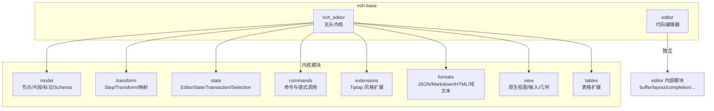
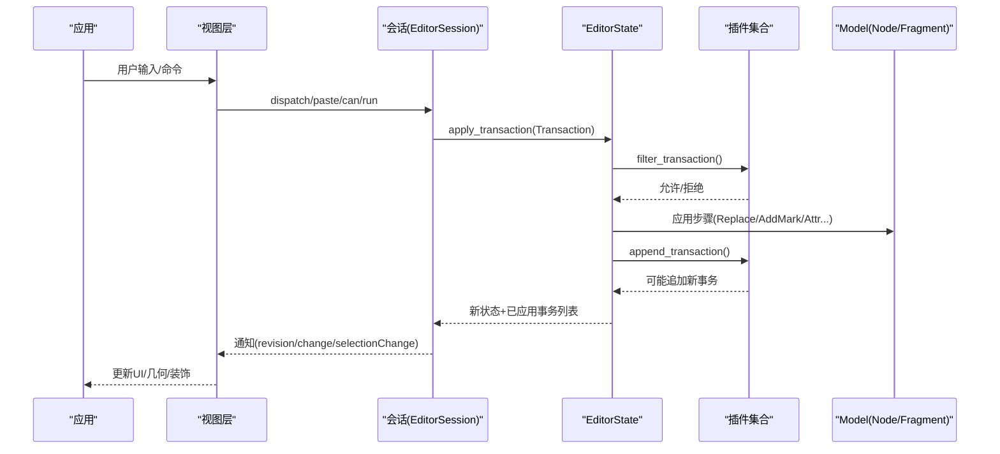
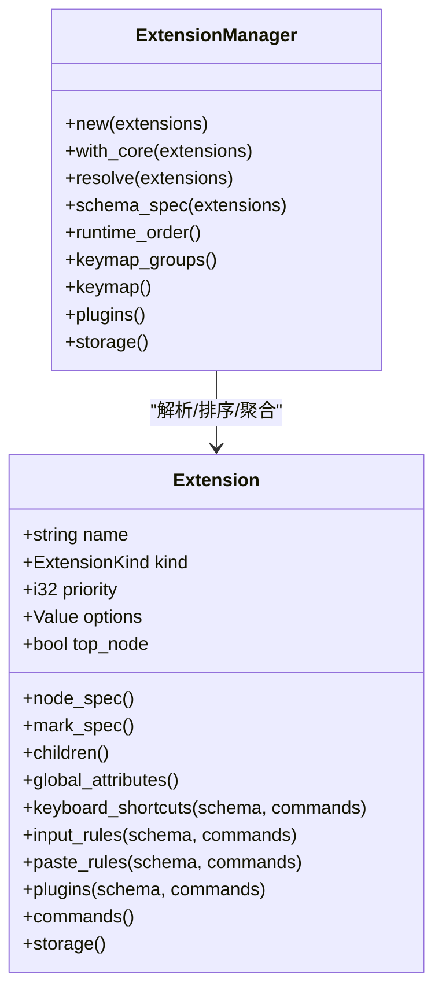
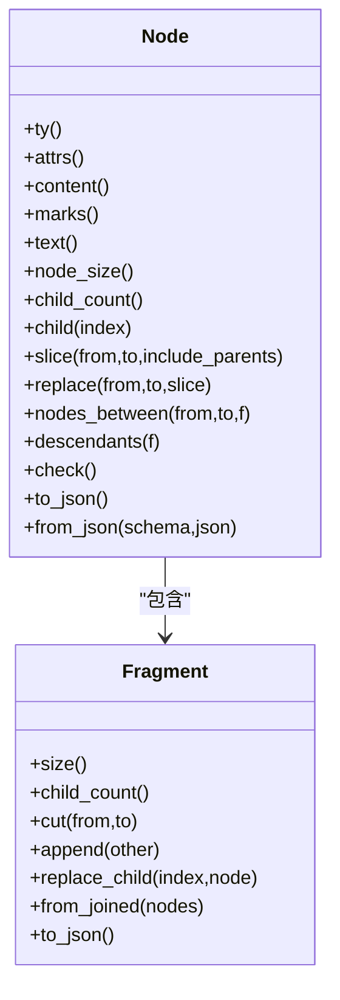
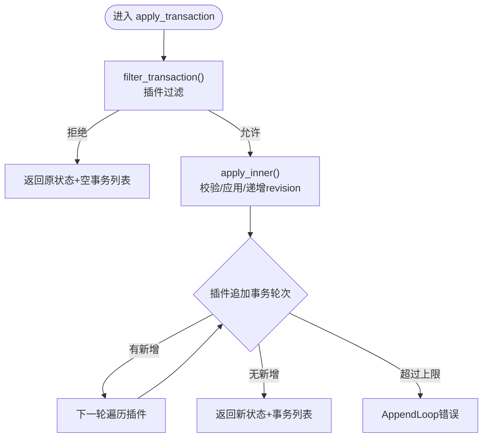
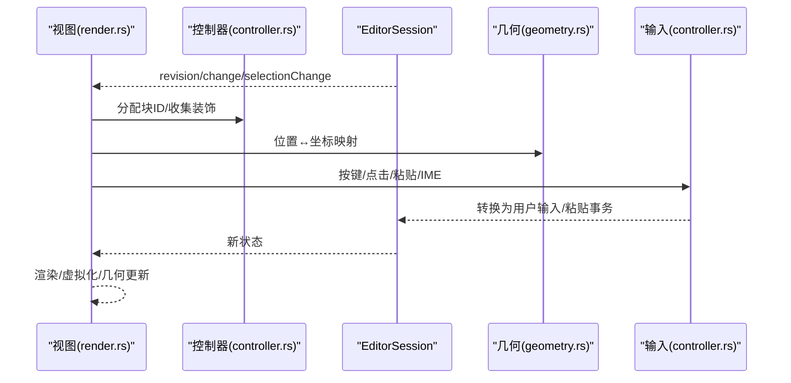
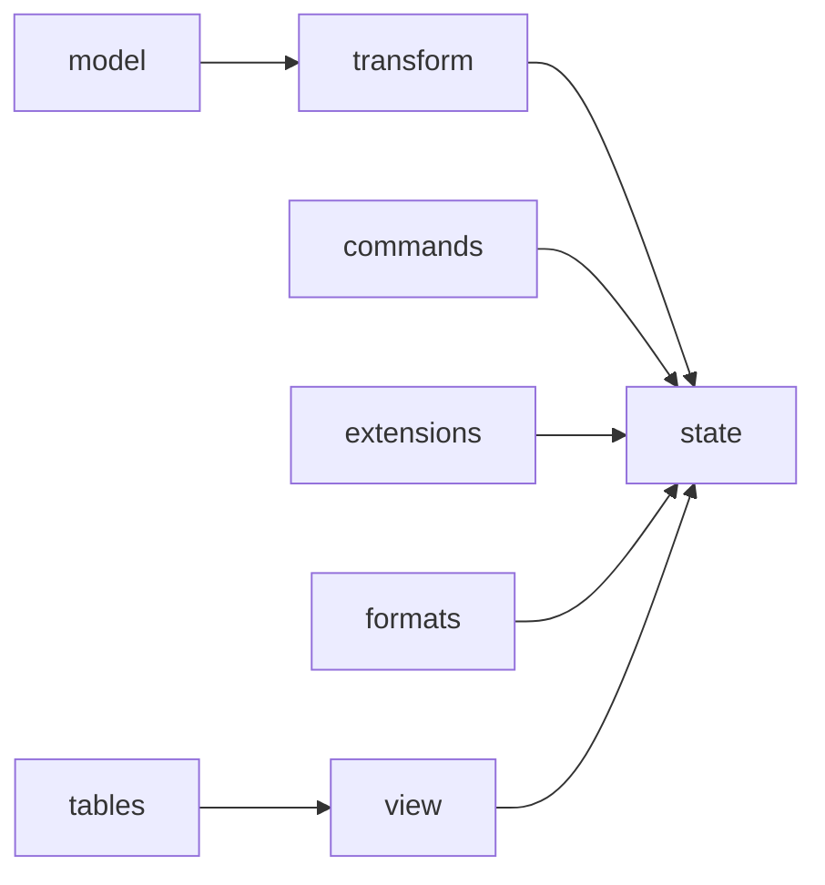

# 块编辑器应用

<cite>
**本文引用的文件**   
- [rich_editor.md](file://docs/dev/rich-editor.md)
- [editor.md](file://docs/dev/editor.md)
- [rich_editor/mod.rs](file://crates/nsh-base/src/rich_editor/mod.rs)
- [rich_editor/extensions/extension.rs](file://crates/nsh-base/src/rich_editor/extensions/extension.rs)
- [rich_editor/model/node.rs](file://crates/nsh-base/src/rich_editor/model/node.rs)
- [rich_editor/state/editor_state.rs](file://crates/nsh-base/src/rich_editor/state/editor_state.rs)
</cite>

## 目录
1. [引言](#引言)
2. [项目结构](#项目结构)
3. [核心组件](#核心组件)
4. [架构总览](#架构总览)
5. [详细组件分析](#详细组件分析)
6. [依赖关系分析](#依赖关系分析)
7. [性能与可扩展性](#性能与可扩展性)
8. [故障排查指南](#故障排查指南)
9. [结论](#结论)
10. [附录](#附录)

## 引言
本文件面向 NSH 块编辑器（富文本编辑器）的架构与实现，围绕以下目标展开：
- 块注册系统与内容模型
- 渲染管道与视图层
- 块类型扩展机制（自定义块、属性配置、事件处理）
- 富文本编辑核心能力（撤销重做、选择操作、格式化命令）
- 工具栏动态生成、快捷键绑定与上下文菜单
- 复杂编辑场景（拖拽排序、批量操作、版本管理）
- 协作编辑同步机制、冲突解决与数据持久化策略

该文档以仓库中的“RichEditor”和“Editor”两套子系统为依据，前者基于 ProseMirror/Tiptap 语义，后者为代码编辑器。二者共同构成 NSH 的编辑能力基座。

## 项目结构
NSH 的富文本编辑器位于 `crates/nsh-base/src/rich_editor`，采用无头内核 + 原生视图的分层设计；代码编辑器位于 `crates/nsh-base/src/editor`，提供语法高亮、折叠、查找替换等能力。

图表来源
- [rich_editor/mod.rs:1-35](file://crates/nsh-base/src/rich_editor/mod.rs#L1-L35)
- [rich_editor.md:16-26](file://docs/dev/rich-editor.md#L16-L26)

章节来源
- [rich_editor/mod.rs:1-35](file://crates/nsh-base/src/rich_editor/mod.rs#L1-L35)
- [rich_editor.md:1-15](file://docs/dev/rich-editor.md#L1-L15)

## 核心组件
- 无头内核：定义文档 Schema、不可变节点树、可逆步骤与事务、命令系统、插件机制、格式适配器。
- 扩展层（Tiptap 风格）：以 Extension 为单位组合 Schema、命令、快捷键、输入规则、粘贴规则与插件。
- 状态机：EditorState 是不可变快照，通过 Transaction 推进，支持过滤、追加事务与插件状态。
- 视图层：将 EditorState 渲染为 UI，处理输入、IME、触摸、几何定位、气泡菜单、内容层叠加、表格交互等。
- 代码编辑器：提供行级缓冲、显示映射、语法高亮、搜索、诊断、补全、折叠、多光标等能力。

章节来源
- [rich_editor.md:16-26](file://docs/dev/rich-editor.md#L16-L26)
- [editor.md:1-10](file://docs/dev/editor.md#L1-L10)

## 架构总览
RichEditor 遵循 ProseMirror 架构：文档由 Schema 定义，变更以 Step 组成 Transform，EditorState 不可变且可克隆，命令与插件在事务生命周期中参与。视图层负责把状态渲染到平台 UI，并把平台输入转换为事务。

图表来源
- [rich_editor.md:36-47](file://docs/dev/rich-editor.md#L36-L47)
- [rich_editor.md:121-134](file://docs/dev/rich-editor.md#L121-L134)
- [rich_editor/state/editor_state.rs:209-268](file://crates/nsh-base/src/rich_editor/state/editor_state.rs#L209-L268)

## 详细组件分析

### 块注册系统与扩展机制
Extension 是行为单元，可声明节点/标记类型、全局属性、子扩展、键盘快捷键、输入规则、粘贴规则、ProseMirror 插件、命名命令与存储。ExtensionManager 负责解析扩展列表：扁平化、按优先级排序、去重、构建 Schema、合并命令与键位图，并产出运行时顺序。

图表来源
- [rich_editor/extensions/extension.rs:126-156](file://crates/nsh-base/src/rich_editor/extensions/extension.rs#L126-L156)
- [rich_editor/extensions/extension.rs:491-540](file://crates/nsh-base/src/rich_editor/extensions/extension.rs#L491-L540)
- [rich_editor/extensions/extension.rs:550-613](file://crates/nsh-base/src/rich_editor/extensions/extension.rs#L550-L613)
- [rich_editor/extensions/extension.rs:635-723](file://crates/nsh-base/src/rich_editor/extensions/extension.rs#L635-L723)

要点
- 扩展优先级决定 Schema 构建、命令覆盖与键位图合并顺序。
- 通过 `register_extension` 与 `extension_named` 支持按名解析扩展。
- 内置 StarterKit 提供常用节点/标记与命令，可通过 `starter_kit()` 装配。

章节来源
- [rich_editor/extensions/extension.rs:1-17](file://crates/nsh-base/src/rich_editor/extensions/extension.rs#L1-L17)
- [rich_editor/extensions/extension.rs:126-156](file://crates/nsh-base/src/rich_editor/extensions/extension.rs#L126-L156)
- [rich_editor/extensions/extension.rs:491-540](file://crates/nsh-base/src/rich_editor/extensions/extension.rs#L491-L540)
- [rich_editor/extensions/extension.rs:550-613](file://crates/nsh-base/src/rich_editor/extensions/extension.rs#L550-L613)
- [rich_editor/extensions/extension.rs:635-723](file://crates/nsh-base/src/rich_editor/extensions/extension.rs#L635-L723)
- [rich_editor.md:317-364](file://docs/dev/rich-editor.md#L317-L364)

### 内容模型与不可变文档
Node 表示不可变的文档节点树，使用共享引用降低复制成本。所有变更通过 replace/slice/replace_step 等算法构造新节点，旧节点保持有效，便于历史、差异与视图增量更新。

图表来源
- [rich_editor/model/node.rs:42-54](file://crates/nsh-base/src/rich_editor/model/node.rs#L42-L54)
- [rich_editor/model/node.rs:102-182](file://crates/nsh-base/src/rich_editor/model/node.rs#L102-L182)
- [rich_editor/model/node.rs:341-363](file://crates/nsh-base/src/rich_editor/model/node.rs#L341-L363)
- [rich_editor/model/node.rs:554-611](file://crates/nsh-base/src/rich_editor/model/node.rs#L554-L611)

要点
- 位置系统采用 UTF-16 单位，跨平台一致。
- 节点检查确保内容、属性、标记合法，禁止空文本节点。
- JSON 序列化/反序列化遵循 ProseMirror 形状。

章节来源
- [rich_editor/model/node.rs:1-11](file://crates/nsh-base/src/rich_editor/model/node.rs#L1-L11)
- [rich_editor/model/node.rs:51-63](file://crates/nsh-base/src/rich_editor/model/node.rs#L51-L63)
- [rich_editor/model/node.rs:523-552](file://crates/nsh-base/src/rich_editor/model/node.rs#L523-L552)
- [rich_editor.md:28-34](file://docs/dev/rich-editor.md#L28-L34)

### 事务与状态机
EditorState 是不可变快照，持有 Schema、文档、选择、存储标记与插件状态。apply_transaction 执行过滤、应用步骤、插件追加事务，直至稳定或达到上限。

图表来源
- [rich_editor/state/editor_state.rs:209-268](file://crates/nsh-base/src/rich_editor/state/editor_state.rs#L209-L268)

要点
- 插件可拒绝事务或追加后续事务，最多 64 轮防止死循环。
- 状态可 JSON 序列化/反序列化，保留插件状态。
- 选择、存储标记随事务更新，仅在光标处保留。

章节来源
- [rich_editor/state/editor_state.rs:17-34](file://crates/nsh-base/src/rich_editor/state/editor_state.rs#L17-L34)
- [rich_editor/state/editor_state.rs:114-148](file://crates/nsh-base/src/rich_editor/state/editor_state.rs#L114-L148)
- [rich_editor/state/editor_state.rs:209-268](file://crates/nsh-base/src/rich_editor/state/editor_state.rs#L209-L268)
- [rich_editor/state/editor_state.rs:342-421](file://crates/nsh-base/src/rich_editor/state/editor_state.rs#L342-L421)

### 渲染管道与视图层
视图订阅 EditorSession，收到 revision 后按需读取文档，分配块 ID，收集装饰，报告内容与选择变化。渲染流程包括滚动容器、选择框、占位符、光标、长文档虚拟化、几何映射、输入与 IME、触摸手势、气泡菜单、内容层叠加与表格交互。

图表来源
- [rich_editor.md:121-134](file://docs/dev/rich-editor.md#L121-L134)
- [rich_editor.md:136-175](file://docs/dev/rich-editor.md#L136-L175)
- [rich_editor.md:177-222](file://docs/dev/rich-editor.md#L177-L222)
- [rich_editor.md:224-252](file://docs/dev/rich-editor.md#L224-L252)
- [rich_editor.md:254-284](file://docs/dev/rich-editor.md#L254-L284)

要点
- 长文档虚拟化：超过阈值仅挂载可视区域附近块，提升性能。
- 几何映射基于真实字体与样式，避免重排。
- 输入路径统一：按键、粘贴、IME、触摸均归一为事务。
- 气泡菜单与内容层叠加支持浮动工具栏与块句柄。

章节来源
- [rich_editor.md:121-134](file://docs/dev/rich-editor.md#L121-L134)
- [rich_editor.md:136-175](file://docs/dev/rich-editor.md#L136-L175)
- [rich_editor.md:177-222](file://docs/dev/rich-editor.md#L177-L222)
- [rich_editor.md:224-252](file://docs/dev/rich-editor.md#L224-L252)
- [rich_editor.md:254-284](file://docs/dev/rich-editor.md#L254-L284)

### 富文本编辑核心功能
- 撤销重做：history 扩展维护事务分组，跳过远程变更，映射本地历史。
- 选择操作：文本选择、节点选择、全部选择、自定义选择（如单元格），支持映射与书签。
- 格式化命令：加粗、斜体、下划线、链接、对齐、标题、列表等，通过命令注册表与扩展提供。
- 粘贴与剪贴板：HTML/文本解析、上下文适配、JS 钩子排队异步处理。
- 表格：行列增删、合并拆分、列宽/行高调整、单元格选择、Tab 导航。

章节来源
- [rich_editor.md:23-26](file://docs/dev/rich-editor.md#L23-L26)
- [rich_editor.md:66-71](file://docs/dev/rich-editor.md#L66-L71)
- [rich_editor.md:317-364](file://docs/dev/rich-editor.md#L317-L364)
- [rich_editor.md:411-458](file://docs/dev/rich-editor.md#L411-L458)
- [rich_editor.md:460-518](file://docs/dev/rich-editor.md#L460-L518)

### 工具栏、快捷键与上下文菜单
- 工具栏动态生成：基于当前选择与活跃命令状态，结合扩展提供的命令与查询接口。
- 快捷键绑定：ExtensionManager 合并各扩展键位图，保证 Shift 显式绑定优先于字符绑定。
- 上下文菜单：桌面端右键、移动端长按/双击触发，提供剪切/复制/粘贴/全选等动作。

章节来源
- [rich_editor.md:317-364](file://docs/dev/rich-editor.md#L317-L364)
- [rich_editor.md:224-246](file://docs/dev/rich-editor.md#L224-L246)

### 复杂编辑场景
- 拖拽排序：块句柄拖拽选择块或选中范围，移动插入点，释放时作为单步撤销。
- 批量操作：命令链式调用、多选择编辑、表格批量增删改。
- 版本管理：EditorState 不可变，revision 计数，JSON 序列化用于快照与回滚。

章节来源
- [rich_editor.md:384-394](file://docs/dev/rich-editor.md#L384-L394)
- [rich_editor.md:393-396](file://docs/dev/rich-editor.md#L393-L396)
- [rich_editor.md:520-532](file://docs/dev/rich-editor.md#L520-L532)

### 协作编辑、冲突解决与持久化
- 协作基础：Step 可序列化、映射与重基线；Remote 来源的事务被 history 跳过；未来可接入 CRDT 或中心权威。
- 冲突解决：基于步骤映射与重基线，结合插件过滤与追加事务协调。
- 持久化：EditorState 可 JSON 序列化，保存 doc/selection/storedMarks 与插件状态。

章节来源
- [rich_editor.md:528-532](file://docs/dev/rich-editor.md#L528-L532)
- [rich_editor/state/editor_state.rs:342-421](file://crates/nsh-base/src/rich_editor/state/editor_state.rs#L342-L421)

### 代码编辑器（Editor）补充
Editor 提供代码编辑体验：语法高亮、折叠、查找替换、诊断、补全、多光标、触摸选择、布局与滚动等，与 RichEditor 互补。

章节来源
- [editor.md:1-10](file://docs/dev/editor.md#L1-L10)
- [editor.md:42-77](file://docs/dev/editor.md#L42-L77)
- [editor.md:78-119](file://docs/dev/editor.md#L78-L119)
- [editor.md:121-174](file://docs/dev/editor.md#L121-L174)
- [editor.md:175-245](file://docs/dev/editor.md#L175-L245)
- [editor.md:247-303](file://docs/dev/editor.md#L247-L303)
- [editor.md:305-363](file://docs/dev/editor.md#L305-L363)
- [editor.md:365-383](file://docs/dev/editor.md#L365-L383)

## 依赖关系分析
RichEditor 内核模块之间耦合清晰：model 提供数据结构，transform 提供变更原子性，state 管理状态与事务，commands 提供高层操作，extensions 注入行为，formats 提供格式适配，view 负责渲染与输入。

图表来源
- [rich_editor/mod.rs:26-34](file://crates/nsh-base/src/rich_editor/mod.rs#L26-L34)

章节来源
- [rich_editor/mod.rs:26-34](file://crates/nsh-base/src/rich_editor/mod.rs#L26-L34)

## 性能与可扩展性
- 不可变状态与共享节点：减少复制开销，利于历史与差异。
- 长文档虚拟化：仅挂载可视区域附近块，避免 DOM 爆炸。
- 几何映射复用：基于真实排版结果，避免重复整形。
- 插件流水线：过滤与追加事务限制轮数，防止无限循环。
- 扩展优先级：可控的命令覆盖与键位图合并，便于第三方扩展。

[本节为通用指导，不直接分析具体文件]

## 故障排查指南
- 插件键冲突：创建状态时报 DuplicatePluginKey，需确保插件键唯一。
- 文档非法：apply 时报 Invalid，检查 Schema 约束与属性合法性。
- 追加事务死循环：超过最大轮次报 AppendLoop，检查插件逻辑是否互相追加。
- 位置越界：查询坐标/位置时报 RangeError，确保位置在文档范围内。
- 命令/类型未知：run/can 抛 TypeError，确认扩展已注册且名称正确。

章节来源
- [rich_editor/state/editor_state.rs:97-107](file://crates/nsh-base/src/rich_editor/state/editor_state.rs#L97-L107)
- [rich_editor/state/editor_state.rs:278-286](file://crates/nsh-base/src/rich_editor/state/editor_state.rs#L278-L286)
- [rich_editor/state/editor_state.rs:267-268](file://crates/nsh-base/src/rich_editor/state/editor_state.rs#L267-L268)
- [rich_editor.md:370-383](file://docs/dev/rich-editor.md#L370-L383)

## 结论
NSH 的块编辑器以 ProseMirror/Tiptap 语义为基础，通过 Extension 体系实现高度可扩展的块类型与行为，配合不可变状态与事务机制保障一致性、可撤销与协作友好。视图层将内核状态高效渲染为平台 UI，并提供丰富的输入与交互能力。代码编辑器则补齐了开发者常用的编辑体验。整体架构清晰、模块化程度高，适合构建复杂的富文本与协作编辑应用。

[本节为总结，不直接分析具体文件]

## 附录
- 快速上手：使用 createRichEditor 与 <RichEditor> 组合扩展与命令。
- 扩展开发：通过 register_extension 注册自定义扩展，声明节点/标记、命令与规则。
- 协作接入：基于 Step 序列化与映射，结合插件过滤与追加事务，逐步引入 CRDT 或中心化方案。

[本节为补充说明，不直接分析具体文件]