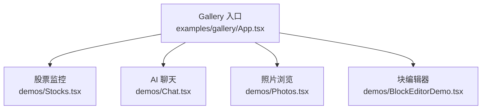
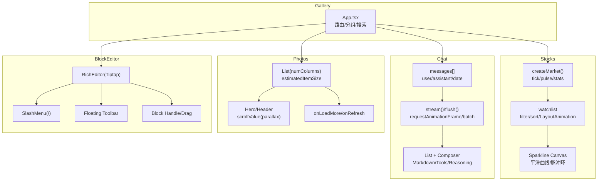
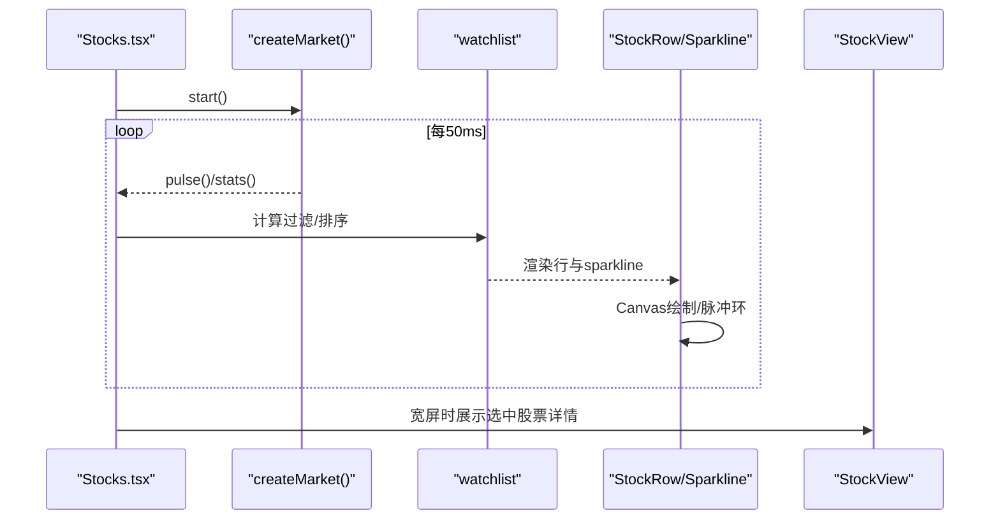
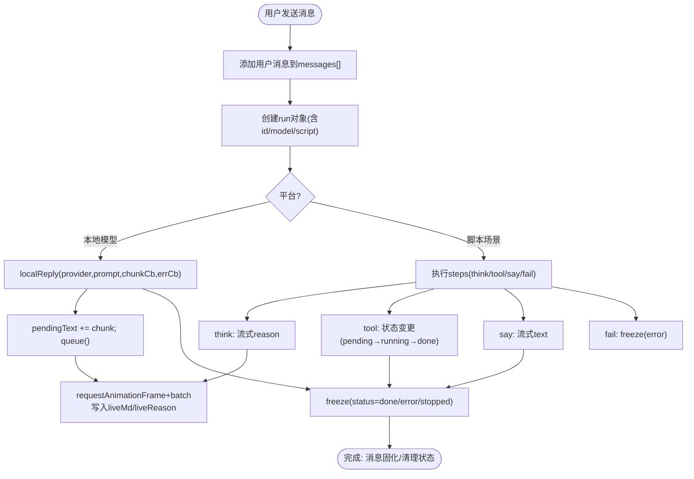
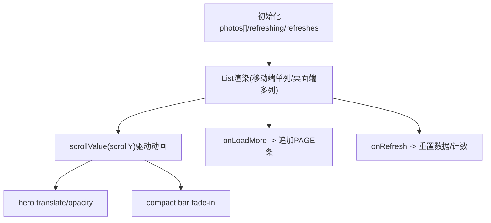
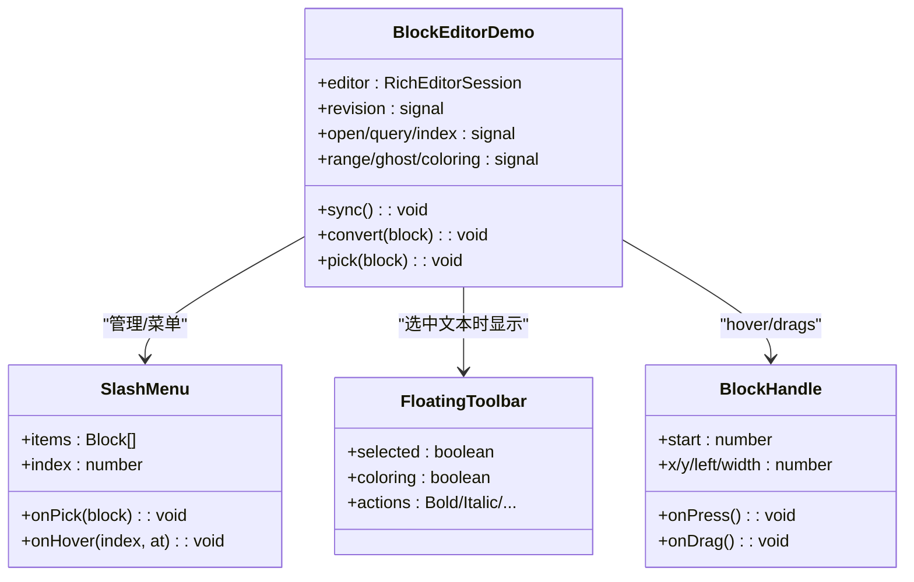
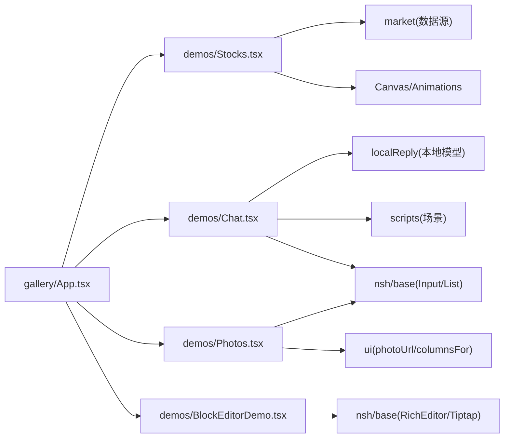

# 完整应用示例

<cite>
**本文引用的文件**   
- [examples/gallery/App.tsx](file://examples/gallery/App.tsx)
- [examples/gallery/demos/Stocks.tsx](file://examples/gallery/demos/Stocks.tsx)
- [examples/gallery/demos/Chat.tsx](file://examples/gallery/demos/Chat.tsx)
- [examples/gallery/demos/Photos.tsx](file://examples/gallery/demos/Photos.tsx)
- [examples/gallery/demos/BlockEditorDemo.tsx](file://examples/gallery/demos/BlockEditorDemo.tsx)
</cite>

## 目录
1. [引言](#引言)
2. [项目结构](#项目结构)
3. [核心组件](#核心组件)
4. [架构总览](#架构总览)
5. [详细组件分析](#详细组件分析)
6. [依赖关系分析](#依赖关系分析)
7. [性能考量](#性能考量)
8. [故障排查指南](#故障排查指南)
9. [结论](#结论)
10. [附录](#附录)

## 引言
本文件围绕 NSH 仓库中的四个“完整应用示例”展开：股票监控、AI 聊天、照片浏览与块编辑器。目标是帮助读者理解每个应用的业务逻辑、数据流架构、状态管理模式与用户交互设计，并深入解析实时数据更新、流式响应处理、虚拟列表优化等复杂功能的实现原理。同时总结可复用到实际项目的最佳实践，包括组件拆分、模块组织与性能优化策略。

## 项目结构
NSH Gallery 作为示例聚合入口，集中展示了多个独立演示应用。四个目标应用位于 examples/gallery/demos 目录下，由 gallery 的 App.tsx 统一注册与路由加载。

**图表来源**
- [examples/gallery/App.tsx:120-132](file://examples/gallery/App.tsx#L120-L132)

**章节来源**
- [examples/gallery/App.tsx:120-132](file://examples/gallery/App.tsx#L120-L132)

## 核心组件
- 股票监控（Stocks）
  - 业务目标：模拟市场实时行情，展示大盘指数、板块涨跌、个股分时图与价格变化；支持筛选与排序，桌面端提供分栏详情视图。
  - 关键能力：高频 tick 驱动、Canvas 绘制 sparkline、布局动画重排、平台自适应布局。
- AI 聊天（Chat）
  - 业务目标：本地 Claude/Codex 或脚本化场景的对话助手，支持 Markdown 渲染、工具调用、思考过程、附件与图片。
  - 关键能力：流式文本累积与帧级批量更新、消息列表滚动跟随、键盘与手势交互、错误与停止状态管理。
- 照片浏览（Photos）
  - 业务目标：长列表图片浏览，支持下拉刷新与触底加载更多，移动端为单列，桌面端为多列网格。
  - 关键能力：虚拟列表、视口联动动画（parallax）、分页加载、刷新状态与统计展示。
- 块编辑器（BlockEditorDemo）
  - 业务目标：Notion 风格的文档编辑器，基于 RichEditor 与 Tiptap 扩展，支持 / 菜单插入块、悬浮工具栏、块拖拽与合并、代码高亮内边距等。
  - 关键能力：自定义节点类型、命令系统、建议插件、选择范围与块操作、撤销/重做感知。

**章节来源**
- [examples/gallery/demos/Stocks.tsx:1-18](file://examples/gallery/demos/Stocks.tsx#L1-L18)
- [examples/gallery/demos/Chat.tsx:1-16](file://examples/gallery/demos/Chat.tsx#L1-L16)
- [examples/gallery/demos/Photos.tsx:1-19](file://examples/gallery/demos/Photos.tsx#L1-L19)
- [examples/gallery/demos/BlockEditorDemo.tsx:1-36](file://examples/gallery/demos/BlockEditorDemo.tsx#L1-L36)

## 架构总览
四个应用共享 Gallery 的导航与主题体系，各自维护独立的状态与渲染管线。整体采用“轻量状态 + 声明式 UI + 原生渲染”的模式：
- 状态层：使用信号（signal）、计算值（computed）、副作用（effect）构建细粒度响应式状态。
- 渲染层：JSX 描述 UI，底层由 NSH 引擎进行原生绘制与事件分发。
- 数据流：外部数据（模拟市场、本地模型、远程图片）通过回调或异步流程更新状态，触发最小化重绘。

**图表来源**
- [examples/gallery/App.tsx:120-132](file://examples/gallery/App.tsx#L120-L132)
- [examples/gallery/demos/Stocks.tsx:374-493](file://examples/gallery/demos/Stocks.tsx#L374-L493)
- [examples/gallery/demos/Chat.tsx:46-253](file://examples/gallery/demos/Chat.tsx#L46-L253)
- [examples/gallery/demos/Photos.tsx:111-267](file://examples/gallery/demos/Photos.tsx#L111-L267)
- [examples/gallery/demos/BlockEditorDemo.tsx:610-800](file://examples/gallery/demos/BlockEditorDemo.tsx#L610-L800)

## 详细组件分析

### 股票监控应用（Stocks）
- 业务逻辑
  - 创建模拟市场实例，启动 tick 循环，按固定间隔更新报价与统计。
  - 顶部 MarketStrip 显示综合指数、时间与暂停控制；展开后显示板块涨跌条。
  - 列表行包含股票代码、名称、sparkline 与价格变化；桌面端右侧展示 StockView 详情。
- 数据流架构
  - createMarket() 暴露 stocks 数组与 stats/composite/breadth 等计算接口。
  - effect 监听 filter 变化，结合 market.pulse() 计算排序结果，使用 LayoutAnimation 平滑过渡。
  - Sparkline 在 Canvas 中根据 stock.minutes() 与最新 quote 绘制平滑曲线与脉冲环。
- 状态管理
  - signal 管理 filter、shown 股票、wide 布局判断。
  - computed 派生 counts、ordered 列表与宽度条件。
- 用户交互
  - 点击行打开详情（窄屏 push，宽屏侧栏）。
  - Segmented 切换筛选（全部/涨幅/跌幅/活跃），每行支持 hover/active 反馈。
- 复杂功能要点
  - 高频 tick：stats().ms 与 quotes/s 用于性能观测。
  - 布局动画：relayout 配置 spring/easeInEaseOut，保证展开/收起与重排流畅。
  - Canvas 绘制：二次贝塞尔曲线、渐变填充、虚线参考线与脉冲环动画。

**图表来源**
- [examples/gallery/demos/Stocks.tsx:374-493](file://examples/gallery/demos/Stocks.tsx#L374-L493)
- [examples/gallery/demos/Stocks.tsx:171-289](file://examples/gallery/demos/Stocks.tsx#L171-L289)

**章节来源**
- [examples/gallery/demos/Stocks.tsx:1-18](file://examples/gallery/demos/Stocks.tsx#L1-L18)
- [examples/gallery/demos/Stocks.tsx:171-289](file://examples/gallery/demos/Stocks.tsx#L171-L289)
- [examples/gallery/demos/Stocks.tsx:374-493](file://examples/gallery/demos/Stocks.tsx#L374-L493)

### AI 聊天应用（Chat）
- 业务逻辑
  - 支持本地 Claude/Codex 或脚本化场景（reason/tool/say/fail）。
  - 消息类型为 user/assistant/date，assistant 支持 reasoning、tools、md 内容。
  - 输入框支持多行、附件与图片；桌面端居中列布局，移动端全屏。
- 数据流架构
  - messages[] 存储历史消息；liveId/liveMd/liveReason/liveTools 表示正在生成的回复。
  - stream() 以 token 为单位追加 pendingText/pendingReason，通过 requestAnimationFrame + batch 批量写入信号，避免频繁重绘。
  - freeze() 将临时回复冻结为最终消息，清理运行状态。
- 状态管理
  - signal 管理 draft、attachment、following、menu、banner 等 UI 状态。
  - computed 派生 streaming、canSend 等派生状态。
- 用户交互
  - 发送消息、选择场景、复制内容、重新生成、评分、停止生成。
  - 列表滚动跟随：maintainVisibleContentPosition 与 following 标志协同。
- 复杂功能要点
  - 流式响应：token 级别增量更新，帧级批处理，抖动速率模拟真实输出。
  - 工具调用：pending/running/done/cancelled 状态机，配合布局动画。
  - 离线/在线横幅：bannerKind 与 banner 状态驱动 UI 提示。

**图表来源**
- [examples/gallery/demos/Chat.tsx:87-132](file://examples/gallery/demos/Chat.tsx#L87-L132)
- [examples/gallery/demos/Chat.tsx:140-253](file://examples/gallery/demos/Chat.tsx#L140-L253)

**章节来源**
- [examples/gallery/demos/Chat.tsx:1-16](file://examples/gallery/demos/Chat.tsx#L1-L16)
- [examples/gallery/demos/Chat.tsx:46-253](file://examples/gallery/demos/Chat.tsx#L46-L253)
- [examples/gallery/demos/Chat.tsx:358-492](file://examples/gallery/demos/Chat.tsx#L358-L492)

### 照片浏览应用（Photos）
- 业务逻辑
  - 移动端单列列表，桌面端多列网格；支持下拉刷新与触底加载更多。
  - Hero 区域展示统计信息，随滚动产生 parallax 与淡入效果。
- 数据流架构
  - photos[] 信号持有当前图片数据；refresh/loadMore 更新数据长度与分页。
  - scrollValue 绑定到 AnimatedValue，驱动 header 的 translate/opacity 动画。
- 状态管理
  - signal 管理 refreshing、refreshes、columns 等。
  - computed 派生 columns 数量与 tile 尺寸。
- 用户交互
  - 下拉刷新按钮（桌面端）与 pull-to-refresh（移动端）。
  - 滚动到底部自动加载下一页。
- 复杂功能要点
  - 虚拟列表：estimatedItemSize 与 numColumns 提升长列表性能。
  - 视口联动：scrollValue 驱动 hero 与 compact bar 的动画，减少 JS 每帧开销。
  - 响应式布局：columnsFor 计算列数，适配不同屏幕宽度。

**图表来源**
- [examples/gallery/demos/Photos.tsx:111-267](file://examples/gallery/demos/Photos.tsx#L111-L267)

**章节来源**
- [examples/gallery/demos/Photos.tsx:1-19](file://examples/gallery/demos/Photos.tsx#L1-L19)
- [examples/gallery/demos/Photos.tsx:111-267](file://examples/gallery/demos/Photos.tsx#L111-L267)

### 块编辑器应用（BlockEditorDemo）
- 业务逻辑
  - 基于 RichEditor 与 Tiptap 扩展，支持 / 菜单插入多种块（标题、引用、列表、表格、分隔线、callout、columns、toggle 等）。
  - 悬浮工具栏对选中文本提供加粗、斜体、下划线、删除线、代码、高亮等操作。
  - 块手柄（handle）支持拖拽、菜单与块转换；相邻同类型列表自动合并。
- 数据流架构
  - editor.revision 驱动 sync()，同步 slash 建议、选择范围、工具栏状态。
  - 自定义节点（callout/columns/toggle）通过 defineExtension 注册。
  - 命令系统：command/setNode/wrapIn/insertContent 等组合操作。
- 状态管理
  - signal 管理 open/query/index/range/ghost/coloring 等编辑态。
  - 插件（slash/blockRange/blockKeys）优先级控制键位与行为。
- 用户交互
  - / 菜单：键盘上下移动、Enter/Tab 选择，鼠标悬停预览。
  - 悬浮工具栏：选择文本时出现，颜色选择时替换按钮为色板。
  - 块手柄：hover 显示 handle，press 打开菜单，drag 移动块并调整缩进。
- 复杂功能要点
  - 建议插件：Suggestion 捕获 / 字符与方向键，原生处理 Enter/Tab。
  - 列表合并：遍历文档块，合并相邻同类型列表，保持序号连续。
  - 代码内边距：markRuns 扫描 code mark，插入 widget 装饰左右内边距。

**图表来源**
- [examples/gallery/demos/BlockEditorDemo.tsx:610-800](file://examples/gallery/demos/BlockEditorDemo.tsx#L610-L800)
- [examples/gallery/demos/BlockEditorDemo.tsx:198-205](file://examples/gallery/demos/BlockEditorDemo.tsx#L198-L205)
- [examples/gallery/demos/BlockEditorDemo.tsx:307-322](file://examples/gallery/demos/BlockEditorDemo.tsx#L307-L322)

**章节来源**
- [examples/gallery/demos/BlockEditorDemo.tsx:1-36](file://examples/gallery/demos/BlockEditorDemo.tsx#L1-L36)
- [examples/gallery/demos/BlockEditorDemo.tsx:198-205](file://examples/gallery/demos/BlockEditorDemo.tsx#L198-L205)
- [examples/gallery/demos/BlockEditorDemo.tsx:307-322](file://examples/gallery/demos/BlockEditorDemo.tsx#L307-L322)
- [examples/gallery/demos/BlockEditorDemo.tsx:610-800](file://examples/gallery/demos/BlockEditorDemo.tsx#L610-L800)

## 依赖关系分析
- Gallery 入口负责分组与懒加载各 demo 模块，降低初始包体积。
- Stocks 依赖 market 模块（未在本节列出具体文件）提供数据源与统计；依赖 Canvas 与 LayoutAnimation。
- Chat 依赖 localReply（本地模型）与 scripts（场景定义），使用 List/Input/Markdown 等基础组件。
- Photos 依赖 List/Image 与 ui 工具函数（photoUrl/photoNames/columnsFor）。
- BlockEditorDemo 依赖 RichEditor/Tiptap 扩展与 nsh/base 的命令系统。

**图表来源**
- [examples/gallery/App.tsx:120-132](file://examples/gallery/App.tsx#L120-L132)
- [examples/gallery/demos/Stocks.tsx:1-8](file://examples/gallery/demos/Stocks.tsx#L1-L8)
- [examples/gallery/demos/Chat.tsx:1-16](file://examples/gallery/demos/Chat.tsx#L1-L16)
- [examples/gallery/demos/Photos.tsx:1-6](file://examples/gallery/demos/Photos.tsx#L1-L6)
- [examples/gallery/demos/BlockEditorDemo.tsx:1-25](file://examples/gallery/demos/BlockEditorDemo.tsx#L1-L25)

**章节来源**
- [examples/gallery/App.tsx:120-132](file://examples/gallery/App.tsx#L120-L132)
- [examples/gallery/demos/Stocks.tsx:1-8](file://examples/gallery/demos/Stocks.tsx#L1-L8)
- [examples/gallery/demos/Chat.tsx:1-16](file://examples/gallery/demos/Chat.tsx#L1-L16)
- [examples/gallery/demos/Photos.tsx:1-6](file://examples/gallery/demos/Photos.tsx#L1-L6)
- [examples/gallery/demos/BlockEditorDemo.tsx:1-25](file://examples/gallery/demos/BlockEditorDemo.tsx#L1-L25)

## 性能考量
- 股票监控
  - 高频 tick（50ms）需关注 JS/tick 与每秒报价数；stats().ms 与 stats().updates 用于监控。
  - Sparkline 使用 Canvas 直接绘制，避免 DOM 开销；脉冲环通过 AnimatedValue 原生动画。
  - 列表重排使用 LayoutAnimation，减少闪烁与重绘成本。
- AI 聊天
  - 流式文本通过 requestAnimationFrame + batch 合并更新，避免逐 token 触发重绘。
  - 列表使用 estimatedItemSize 与 maintainVisibleContentPosition，提升滚动性能。
  - 工具调用与思考过程的布局动画使用 LayoutAnimation.Presets.easeInEaseOut，保证流畅。
- 照片浏览
  - 虚拟列表（estimatedItemSize、numColumns）显著降低长列表渲染压力。
  - scrollValue 驱动动画，减少 JS 每帧计算；header 与 compact bar 使用 interpolate 映射滚动位置。
  - onLoadMore 分页加载，避免一次性加载大量数据。
- 块编辑器
  - 自定义节点与命令系统通过 Tiptap 扩展，避免重复实现。
  - 列表合并与代码内边距通过文档遍历与 decorations 优化，减少额外 DOM。
  - 建议插件优先级设置确保键盘交互的原生体验。

[本节为通用性能指导，不直接分析具体文件]

## 故障排查指南
- 股票监控
  - 若 sparkline 无更新，检查 stock.quote().changedAt 与 effect 的 seen 标记是否递增。
  - 若 tick 卡顿，查看 stats().ms 与 stats().updates，确认 market.start/stop 生命周期。
- AI 聊天
  - 若流式文本不显示，检查 pendingText/pendingReason 是否在 flush 中被清空，以及 frameQueued 是否被正确设置。
  - 若本地模型报错，查看 freeze(r, error) 的错误信息与 provider 配置。
- 照片浏览
  - 若加载更多无效，检查 onLoadMore 是否被触发与 photos.set([...current, ...new]) 是否正确拼接。
  - 若动画卡顿，确认 scrollValue 与 interpolate 的范围是否合理。
- 块编辑器
  - 若 / 菜单无法选择，检查 suggestion 插件的 captureKeys 与 index/reveal 逻辑。
  - 若列表未合并，检查 joinLists 的遍历与 deleteRange 调用时机。

**章节来源**
- [examples/gallery/demos/Stocks.tsx:171-289](file://examples/gallery/demos/Stocks.tsx#L171-L289)
- [examples/gallery/demos/Chat.tsx:87-132](file://examples/gallery/demos/Chat.tsx#L87-L132)
- [examples/gallery/demos/Photos.tsx:111-267](file://examples/gallery/demos/Photos.tsx#L111-L267)
- [examples/gallery/demos/BlockEditorDemo.tsx:198-205](file://examples/gallery/demos/BlockEditorDemo.tsx#L198-L205)
- [examples/gallery/demos/BlockEditorDemo.tsx:307-322](file://examples/gallery/demos/BlockEditorDemo.tsx#L307-L322)

## 结论
四个完整应用示例展示了 NSH 在不同业务场景下的能力边界与实践路径：
- 股票监控强调高频数据与高性能渲染，适合金融类应用的实时看板。
- AI 聊天体现流式响应与复杂交互，适合智能助手与内容创作工具。
- 照片浏览聚焦长列表与视口联动，适合媒体与内容消费型应用。
- 块编辑器展示富文本与文档编辑的最佳实践，适合知识管理与协作平台。

将这些示例应用到实际项目中时，建议：
- 采用信号与计算值构建细粒度状态，避免全局状态膨胀。
- 使用虚拟列表与原生动画优化长列表与高频更新场景。
- 将复杂交互拆分为独立组件与插件，提高可维护性与复用性。
- 通过 stats 与日志监控性能瓶颈，持续迭代优化。

[本节为总结性内容，不直接分析具体文件]

## 附录
- 推荐实践清单
  - 组件拆分：按职责划分（如 Stocks 的 MarketStrip/StockRow/Sparkline）。
  - 模块组织：将数据源、命令系统与 UI 分离，便于测试与维护。
  - 性能优化：优先使用原生动画与 Canvas，减少 JS 计算与 DOM 操作。
  - 用户体验：提供清晰的反馈（loading、error、success）与无障碍标签。

[本节为补充性内容，不直接分析具体文件]