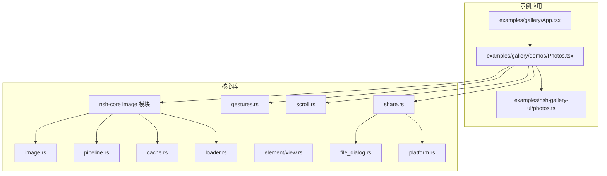
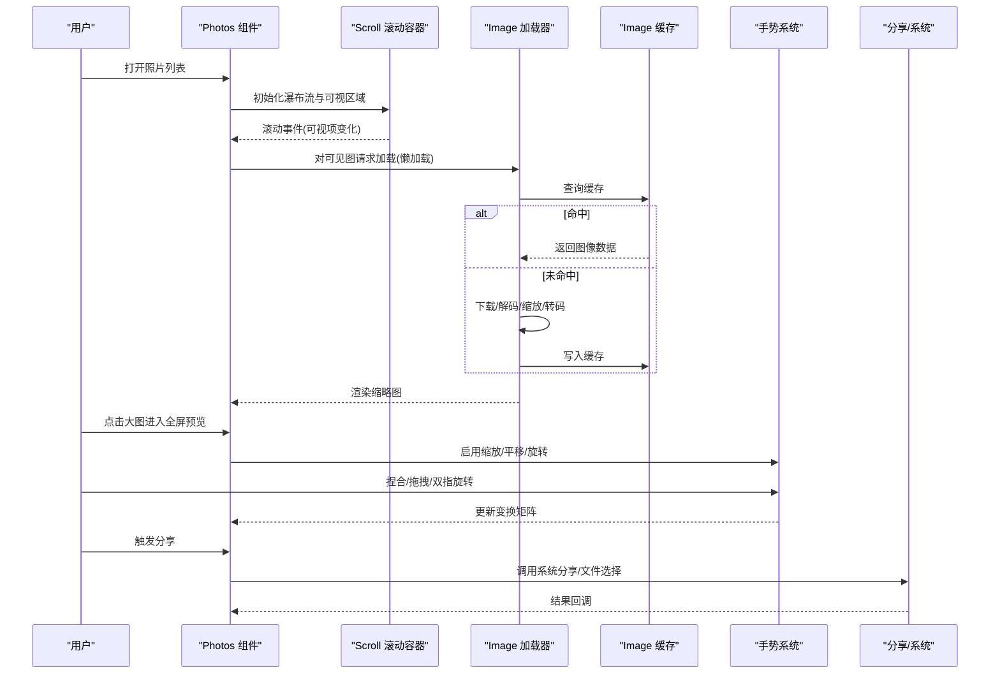
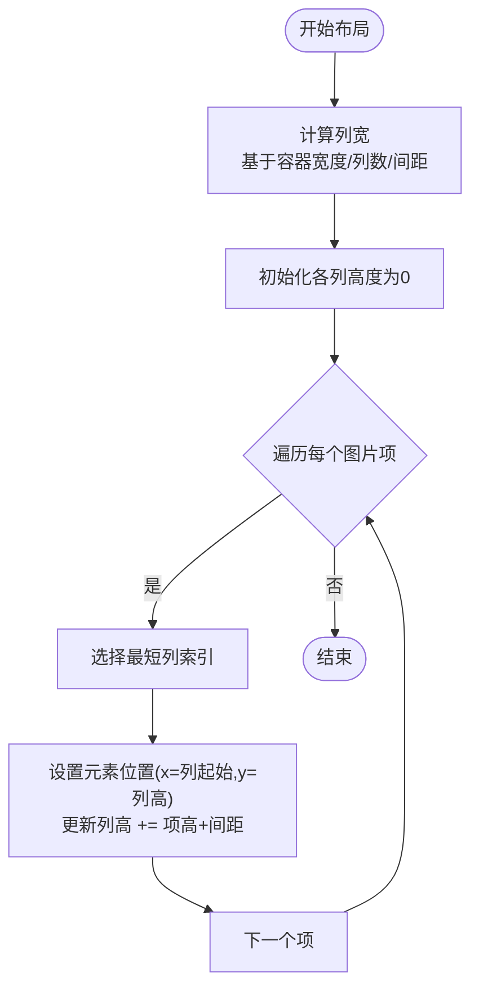
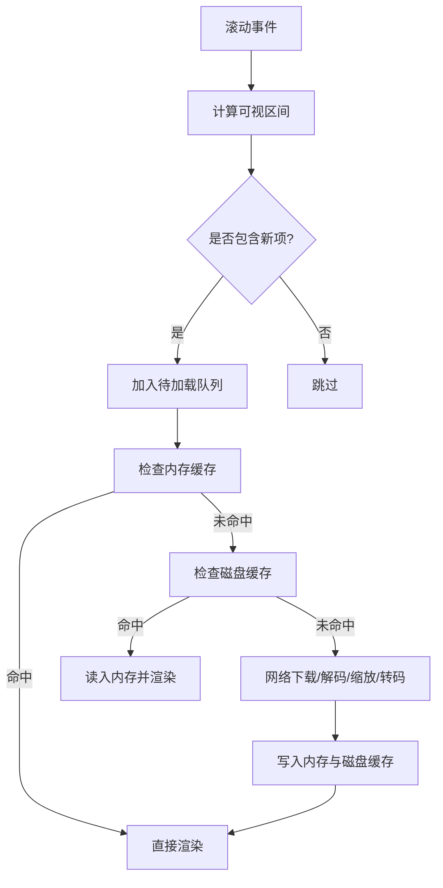
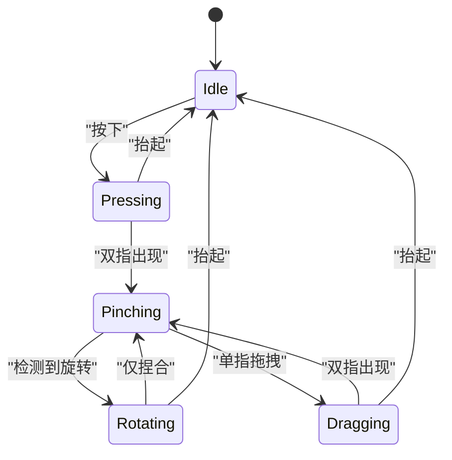
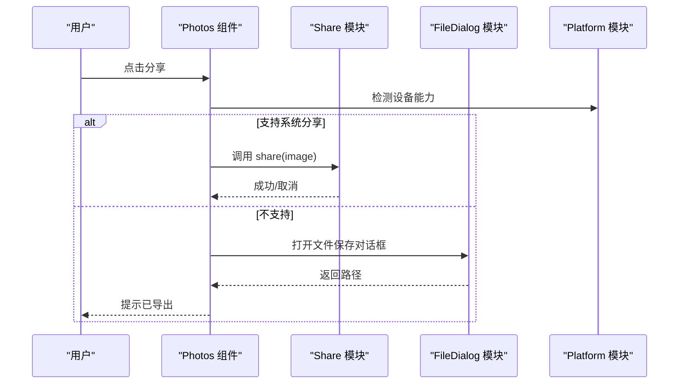
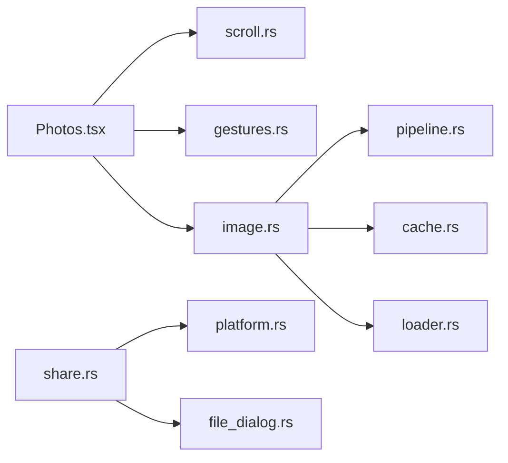

# 照片浏览应用

<cite>
**本文引用的文件**   
- [examples/gallery/demos/Photos.tsx](file://examples/gallery/demos/Photos.tsx)
- [examples/nsh-gallery-ui/photos.ts](file://examples/nsh-gallery-ui/photos.ts)
- [crates/nsh-core/src/image.rs](file://crates/nsh-core/src/image.rs)
- [crates/nsh-core/src/image/mod.rs](file://crates/nsh-core/src/image/mod.rs)
- [crates/nsh-core/src/image/pipeline.rs](file://crates/nsh-core/src/image/pipeline.rs)
- [crates/nsh-core/src/image/cache.rs](file://crates/nsh-core/src/image/cache.rs)
- [crates/nsh-core/src/image/loader.rs](file://crates/nsh-core/src/image/loader.rs)
- [crates/nsh-core/src/gestures.rs](file://crates/nsh-core/src/gestures.rs)
- [crates/nsh-core/src/element/view.rs](file://crates/nsh-core/src/element/view.rs)
- [crates/nsh-core/src/scroll.rs](file://crates/nsh-core/src/scroll.rs)
- [crates/nsh-core/src/share.rs](file://crates/nsh-core/src/share.rs)
- [crates/nsh-core/src/file_dialog.rs](file://crates/nsh-core/src/file_dialog.rs)
- [crates/nsh-core/src/platform.rs](file://crates/nsh-core/src/platform.rs)
- [crates/nsh-engine/src/cache.rs](file://crates/nsh-engine/src/cache.rs)
- [crates/nsh-engine/src/storage.rs](file://crates/nsh-engine/src/storage.rs)
- [examples/gallery/App.tsx](file://examples/gallery/App.tsx)
</cite>

## 目录
1. [简介](#简介)
2. [项目结构](#项目结构)
3. [核心组件](#核心组件)
4. [架构总览](#架构总览)
5. [详细组件分析](#详细组件分析)
6. [依赖关系分析](#依赖关系分析)
7. [性能考量](#性能考量)
8. [故障排查指南](#故障排查指南)
9. [结论](#结论)
10. [附录](#附录)

## 简介
本文件为 NSH 照片浏览应用的完整技术文档，聚焦以下能力：
- 瀑布流布局与 Masonry 算法（列宽计算、元素定位、动态调整）
- 图片懒加载与预取策略（含缓存管理与内存控制）
- 手势识别系统（缩放、平移、旋转的数学模型）
- 图片处理管道（格式转换、尺寸优化、质量调整）
- 响应式网格布局、全屏预览模式与分享功能

该文档以仓库中的示例应用与核心库为依据，提供从 UI 到渲染管线、从交互到平台能力的端到端说明。

## 项目结构
NSH 照片浏览应用位于 examples/gallery 下的 Photos 演示中，并复用 nsh-gallery-ui 的图片资源与 URL 生成工具；底层由 nsh-core 提供的 Image、Gestures、Scroll、Share 等模块支撑。

图表来源
- [examples/gallery/App.tsx:120-132](file://examples/gallery/App.tsx#L120-L132)
- [examples/gallery/demos/Photos.tsx](file://examples/gallery/demos/Photos.tsx)
- [examples/nsh-gallery-ui/photos.ts:1-30](file://examples/nsh-gallery-ui/photos.ts#L1-L30)
- [crates/nsh-core/src/image.rs](file://crates/nsh-core/src/image.rs)
- [crates/nsh-core/src/image/pipeline.rs](file://crates/nsh-core/src/image/pipeline.rs)
- [crates/nsh-core/src/image/cache.rs](file://crates/nsh-core/src/image/cache.rs)
- [crates/nsh-core/src/image/loader.rs](file://crates/nsh-core/src/image/loader.rs)
- [crates/nsh-core/src/gestures.rs](file://crates/nsh-core/src/gestures.rs)
- [crates/nsh-core/src/element/view.rs](file://crates/nsh-core/src/element/view.rs)
- [crates/nsh-core/src/scroll.rs](file://crates/nsh-core/src/scroll.rs)
- [crates/nsh-core/src/share.rs](file://crates/nsh-core/src/share.rs)
- [crates/nsh-core/src/file_dialog.rs](file://crates/nsh-core/src/file_dialog.rs)
- [crates/nsh-core/src/platform.rs](file://crates/nsh-core/src/platform.rs)

章节来源
- [examples/gallery/App.tsx:120-132](file://examples/gallery/App.tsx#L120-L132)
- [examples/nsh-gallery-ui/photos.ts:1-30](file://examples/nsh-gallery-ui/photos.ts#L1-L30)

## 核心组件
- 照片数据源与 URL 生成：集中管理图片名称与多尺寸 URL 构造，便于懒加载与预取。
- 瀑布流列表：基于可回收列表实现长列表滚动，结合 Masonry 布局算法进行列宽与位置计算。
- 图片加载器与缓存：按视口可见性触发加载，支持预取、去重、LRU 与内存上限控制。
- 手势系统：在图片预览层实现捏合缩放、拖拽平移、双指旋转，统一事件分发与状态机。
- 图片处理管道：解码、缩放、裁剪、转码、质量压缩，输出最优尺寸与格式。
- 分享与系统集成：调用系统分享面板或文件选择器，完成导出与分享。

章节来源
- [examples/nsh-gallery-ui/photos.ts:1-30](file://examples/nsh-gallery-ui/photos.ts#L1-L30)
- [examples/gallery/demos/Photos.tsx](file://examples/gallery/demos/Photos.tsx)
- [crates/nsh-core/src/image.rs](file://crates/nsh-core/src/image.rs)
- [crates/nsh-core/src/image/pipeline.rs](file://crates/nsh-core/src/image/pipeline.rs)
- [crates/nsh-core/src/image/cache.rs](file://crates/nsh-core/src/image/cache.rs)
- [crates/nsh-core/src/image/loader.rs](file://crates/nsh-core/src/image/loader.rs)
- [crates/nsh-core/src/gestures.rs](file://crates/nsh-core/src/gestures.rs)
- [crates/nsh-core/src/scroll.rs](file://crates/nsh-core/src/scroll.rs)
- [crates/nsh-core/src/share.rs](file://crates/nsh-core/src/share.rs)

## 架构总览
照片浏览应用采用“UI 层 + 渲染管线 + 平台能力”的分层架构：
- UI 层：Photos 组件负责瀑布流展示、手势交互与全屏预览。
- 渲染管线：Image 模块负责解码、缩放、转码与缓存。
- 平台能力：Share/FileDialog/Platform 提供系统级分享与设备信息。

图表来源
- [examples/gallery/demos/Photos.tsx](file://examples/gallery/demos/Photos.tsx)
- [crates/nsh-core/src/image.rs](file://crates/nsh-core/src/image.rs)
- [crates/nsh-core/src/image/cache.rs](file://crates/nsh-core/src/image/cache.rs)
- [crates/nsh-core/src/image/loader.rs](file://crates/nsh-core/src/image/loader.rs)
- [crates/nsh-core/src/gestures.rs](file://crates/nsh-core/src/gestures.rs)
- [crates/nsh-core/src/scroll.rs](file://crates/nsh-core/src/scroll.rs)
- [crates/nsh-core/src/share.rs](file://crates/nsh-core/src/share.rs)

## 详细组件分析

### 瀑布流布局与 Masonry 算法
- 目标：在多列不等高图片中实现紧凑排列，避免垂直方向浪费空间。
- 关键步骤：
  - 列宽计算：根据容器宽度、列数、间距计算每列宽度。
  - 元素定位：维护每列当前高度，将新元素放置于最短列下方，更新该列高度。
  - 动态调整：当容器宽度变化或列数变化时，重新计算列宽并对所有元素重定位。
- 复杂度：单次插入 O(c)，c 为列数；整体布局 O(n·c)。

图表来源
- [examples/gallery/demos/Photos.tsx](file://examples/gallery/demos/Photos.tsx)

章节来源
- [examples/gallery/demos/Photos.tsx](file://examples/gallery/demos/Photos.tsx)

### 图片懒加载与预取策略
- 懒加载：仅在图片进入可视区域时发起加载，减少首屏开销。
- 预取：在滚动方向上提前加载若干张，提升滑动流畅度。
- 缓存管理：
  - 内存缓存：LRU 策略，限制最大条目数与单条大小。
  - 磁盘缓存：持久化解码后的图像，跨会话复用。
- 内存控制：
  - 解码后图像及时释放，避免重复解码。
  - 大尺寸原图按需缩放至显示尺寸，降低显存占用。

图表来源
- [crates/nsh-core/src/image/cache.rs](file://crates/nsh-core/src/image/cache.rs)
- [crates/nsh-core/src/image/loader.rs](file://crates/nsh-core/src/image/loader.rs)
- [crates/nsh-core/src/image/pipeline.rs](file://crates/nsh-core/src/image/pipeline.rs)

章节来源
- [crates/nsh-core/src/image/cache.rs](file://crates/nsh-core/src/image/cache.rs)
- [crates/nsh-core/src/image/loader.rs](file://crates/nsh-core/src/image/loader.rs)
- [crates/nsh-core/src/image/pipeline.rs](file://crates/nsh-core/src/image/pipeline.rs)

### 手势识别系统（缩放、平移、旋转）
- 输入抽象：统一指针/触摸事件，跟踪多点坐标、速度、时间戳。
- 状态机：
  - Idle：无操作
  - Pressing：按下态
  - Pinching：双指捏合，计算缩放比例与中心点
  - Rotating：双指旋转，计算角度差
  - Dragging：单指拖拽，计算位移增量
- 数学模型：
  - 缩放：scale = currentDistance / lastDistance
  - 平移：delta = currentPoint - lastPoint
  - 旋转：angle = atan2(dy, dx) 差值归一化到 [-π, π]
- 合成变换：T = Translate · Rotate · Scale，逐帧应用到预览视图。

图表来源
- [crates/nsh-core/src/gestures.rs](file://crates/nsh-core/src/gestures.rs)
- [crates/nsh-core/src/element/view.rs](file://crates/nsh-core/src/element/view.rs)

章节来源
- [crates/nsh-core/src/gestures.rs](file://crates/nsh-core/src/gestures.rs)
- [crates/nsh-core/src/element/view.rs](file://crates/nsh-core/src/element/view.rs)

### 图片处理管道（格式转换、尺寸优化、质量调整）
- 输入：原始字节流或 URL。
- 阶段：
  - 解码：原生解码器读取像素数据。
  - 尺寸优化：根据显示尺寸与 DPR 计算目标宽高，必要时下采样。
  - 裁剪/填充：保持比例或适配容器。
  - 转码：转换为 Web 友好格式（如 JPEG/WebP），按质量参数压缩。
  - 输出：生成适合显示的图像对象，供渲染与缓存使用。
- 配置：目标尺寸、质量、格式、是否保留元数据等。

图表来源
- [crates/nsh-core/src/image/pipeline.rs](file://crates/nsh-core/src/image/pipeline.rs)
- [crates/nsh-core/src/image.rs](file://crates/nsh-core/src/image.rs)

章节来源
- [crates/nsh-core/src/image/pipeline.rs](file://crates/nsh-core/src/image/pipeline.rs)
- [crates/nsh-core/src/image.rs](file://crates/nsh-core/src/image.rs)

### 响应式网格布局与全屏预览
- 响应式网格：根据屏幕宽度与密度自适应列数与间距，保证在不同设备上的一致性。
- 全屏预览：点击缩略图进入全屏模式，禁用滚动，启用手势交互，支持双击放大、长按菜单。
- 导航与状态：记录上次缩放/平移状态，退出全屏时恢复。

章节来源
- [examples/gallery/demos/Photos.tsx](file://examples/gallery/demos/Photos.tsx)

### 分享功能与系统集成
- 分享入口：在全屏预览或列表项提供“分享”按钮。
- 系统调用：通过 Share 模块调用系统分享面板；若不可用则回退到文件选择器导出。
- 权限与环境：检测平台能力与权限，给出相应提示。

图表来源
- [crates/nsh-core/src/share.rs](file://crates/nsh-core/src/share.rs)
- [crates/nsh-core/src/file_dialog.rs](file://crates/nsh-core/src/file_dialog.rs)
- [crates/nsh-core/src/platform.rs](file://crates/nsh-core/src/platform.rs)

章节来源
- [crates/nsh-core/src/share.rs](file://crates/nsh-core/src/share.rs)
- [crates/nsh-core/src/file_dialog.rs](file://crates/nsh-core/src/file_dialog.rs)
- [crates/nsh-core/src/platform.rs](file://crates/nsh-core/src/platform.rs)

## 依赖关系分析
- UI 层依赖：
  - Photos 依赖 Scroll 提供滚动与可视区计算。
  - Photos 依赖 Gestures 提供手势事件与状态机。
  - Photos 依赖 Image 模块进行加载、解码与缓存。
- 平台层依赖：
  - Share 依赖 Platform 判断能力，File Dialog 作为回退方案。
- 引擎层依赖：
  - Engine Cache/Storage 用于全局缓存与持久化存储（例如上次打开的 demo）。

图表来源
- [examples/gallery/demos/Photos.tsx](file://examples/gallery/demos/Photos.tsx)
- [crates/nsh-core/src/scroll.rs](file://crates/nsh-core/src/scroll.rs)
- [crates/nsh-core/src/gestures.rs](file://crates/nsh-core/src/gestures.rs)
- [crates/nsh-core/src/image.rs](file://crates/nsh-core/src/image.rs)
- [crates/nsh-core/src/image/pipeline.rs](file://crates/nsh-core/src/image/pipeline.rs)
- [crates/nsh-core/src/image/cache.rs](file://crates/nsh-core/src/image/cache.rs)
- [crates/nsh-core/src/image/loader.rs](file://crates/nsh-core/src/image/loader.rs)
- [crates/nsh-core/src/share.rs](file://crates/nsh-core/src/share.rs)
- [crates/nsh-core/src/file_dialog.rs](file://crates/nsh-core/src/file_dialog.rs)
- [crates/nsh-core/src/platform.rs](file://crates/nsh-core/src/platform.rs)

章节来源
- [examples/gallery/demos/Photos.tsx](file://examples/gallery/demos/Photos.tsx)
- [crates/nsh-core/src/scroll.rs](file://crates/nsh-core/src/scroll.rs)
- [crates/nsh-core/src/gestures.rs](file://crates/nsh-core/src/gestures.rs)
- [crates/nsh-core/src/image.rs](file://crates/nsh-core/src/image.rs)
- [crates/nsh-core/src/share.rs](file://crates/nsh-core/src/share.rs)

## 性能考量
- 列表渲染：
  - 使用可回收列表，避免创建大量视图对象。
  - 仅渲染可视区内的缩略图，延迟非可视项构建。
- 图片加载：
  - 按视口边界触发加载，避免全量加载。
  - 预取相邻图片，减少等待抖动。
  - 解码后图像及时释放，防止内存峰值过高。
- 缓存策略：
  - 内存 LRU 限制条目数量与总大小。
  - 磁盘缓存避免重复下载与解码。
- 手势与动画：
  - 手势计算在 UI 线程轻量执行，避免阻塞。
  - 变换矩阵合成尽量合并，减少绘制次数。
- 网络与带宽：
  - 根据设备 DPR 与显示尺寸选择合适分辨率。
  - 优先使用 WebP/JPEG 等高效格式。

[本节为通用指导，不直接分析具体文件]

## 故障排查指南
- 图片不显示或白屏：
  - 检查 URL 生成是否正确（参考 photoUrl）。
  - 确认网络可达与 CORS 策略。
  - 查看解码与转码阶段是否抛出异常。
- 滚动卡顿：
  - 检查可视区计算与懒加载触发条件。
  - 确认缓存命中率与磁盘 IO 是否正常。
- 手势异常：
  - 校验多点触控事件是否被正确捕获。
  - 检查变换矩阵合成顺序与数值范围。
- 分享失败：
  - 检查平台能力与权限。
  - 确认文件导出路径与权限。

章节来源
- [examples/nsh-gallery-ui/photos.ts:23-29](file://examples/nsh-gallery-ui/photos.ts#L23-L29)
- [crates/nsh-core/src/image/pipeline.rs](file://crates/nsh-core/src/image/pipeline.rs)
- [crates/nsh-core/src/gestures.rs](file://crates/nsh-core/src/gestures.rs)
- [crates/nsh-core/src/share.rs](file://crates/nsh-core/src/share.rs)

## 结论
NSH 照片浏览应用通过清晰的层次化架构与模块化设计，实现了高性能的瀑布流展示、智能的懒加载与缓存、稳定的手势交互以及可靠的系统分享能力。Masonry 算法确保布局紧凑，图片处理管道保障显示质量与体积平衡，手势系统提供自然的交互体验。建议在后续迭代中继续优化缓存命中率、手势响应延迟与分享兼容性。

[本节为总结性内容，不直接分析具体文件]

## 附录
- 图片资源与 URL 生成：
  - 图片名映射与多尺寸 URL 构造见 photos.ts。
- Gallery 入口与路由：
  - App.tsx 中注册 Photos 演示，并在桌面/手机布局中切换。

章节来源
- [examples/nsh-gallery-ui/photos.ts:1-30](file://examples/nsh-gallery-ui/photos.ts#L1-L30)
- [examples/gallery/App.tsx:120-132](file://examples/gallery/App.tsx#L120-L132)