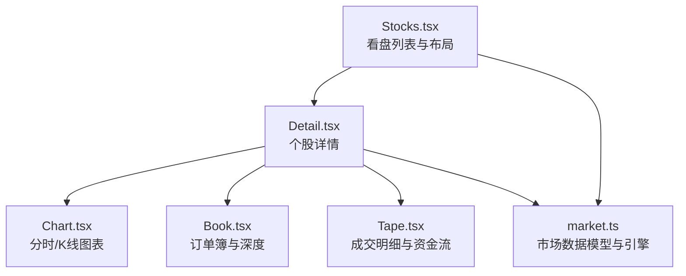
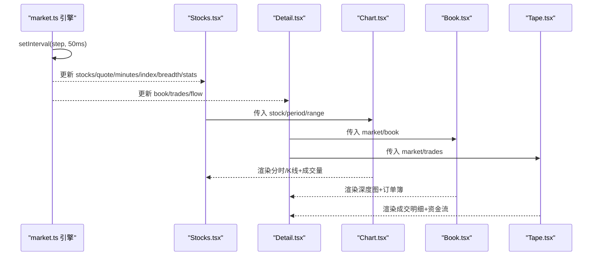
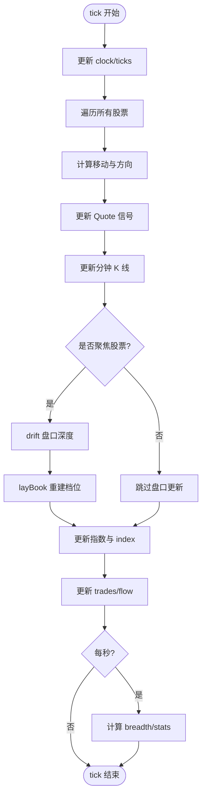
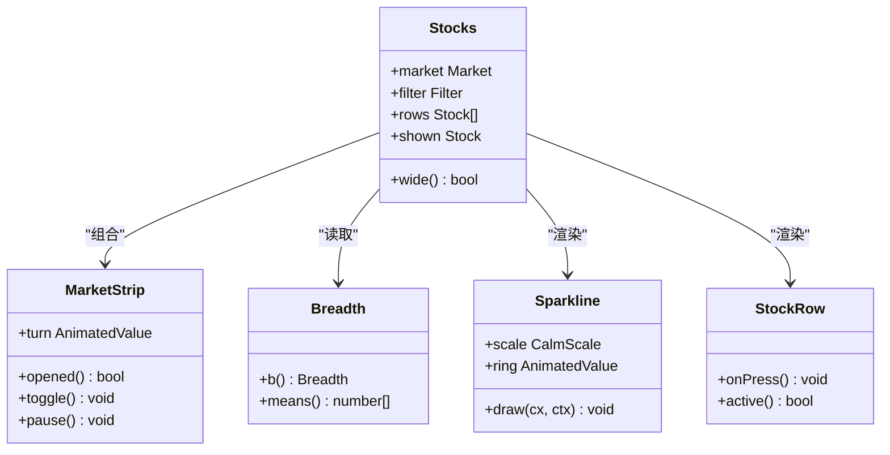
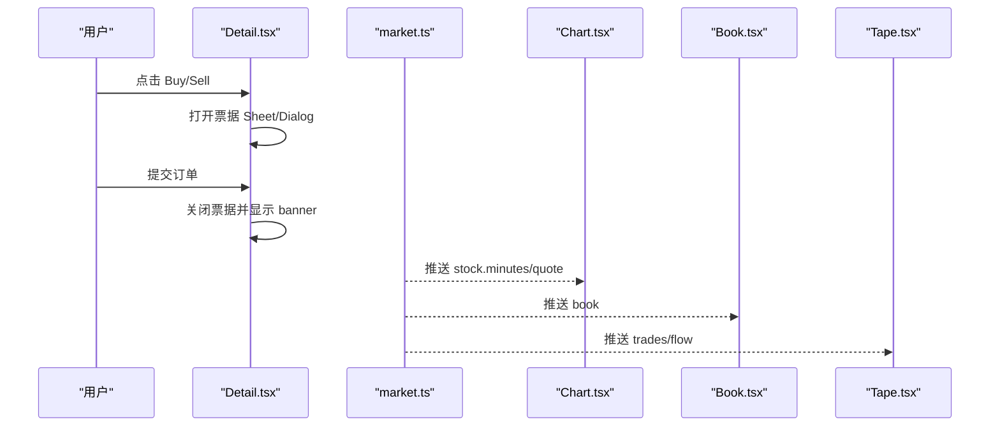
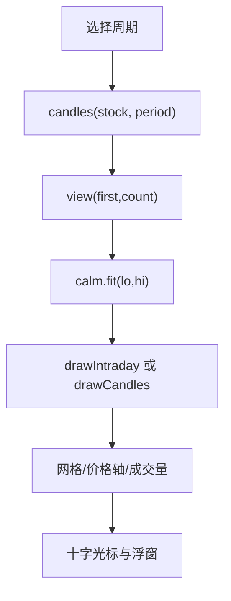
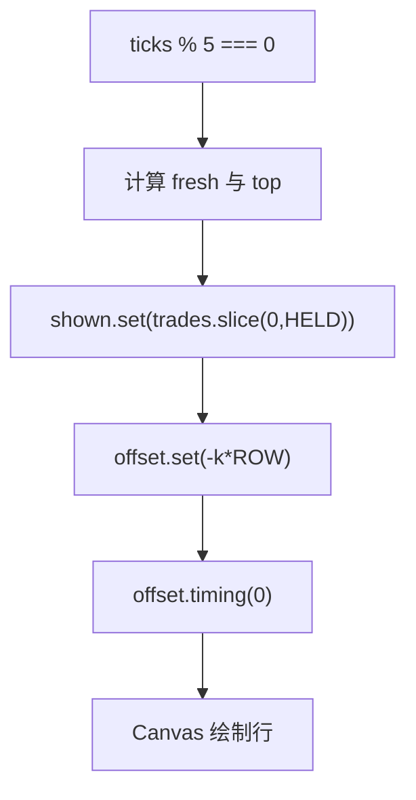
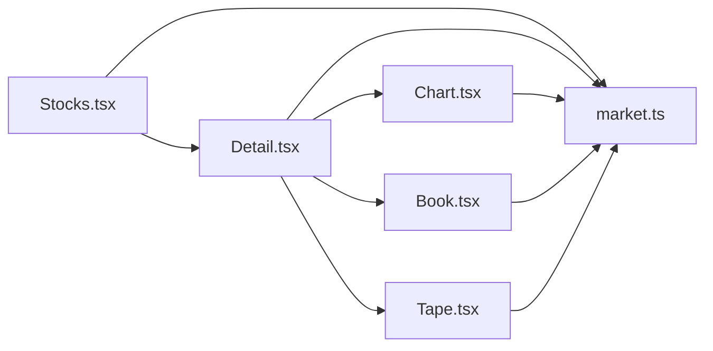

# 股票监控应用

<cite>
**本文引用的文件**   
- [Stocks.tsx](file://examples/gallery/demos/Stocks.tsx)
- [Detail.tsx](file://examples/gallery/demos/stocks/Detail.tsx)
- [Chart.tsx](file://examples/gallery/demos/stocks/Chart.tsx)
- [Book.tsx](file://examples/gallery/demos/stocks/Book.tsx)
- [Tape.tsx](file://examples/gallery/demos/stocks/Tape.tsx)
- [market.ts](file://examples/gallery/demos/stocks/market.ts)
- [stocks.test.tsx](file://examples/gallery-rs/stocks.test.tsx)
</cite>

## 目录
1. [简介](#简介)
2. [项目结构](#项目结构)
3. [核心组件](#核心组件)
4. [架构总览](#架构总览)
5. [详细组件分析](#详细组件分析)
6. [依赖关系分析](#依赖关系分析)
7. [性能与优化](#性能与优化)
8. [故障排查指南](#故障排查指南)
9. [结论](#结论)

## 简介
本文件为 NSH 股票监控应用的完整技术文档，围绕以下目标展开：
- 实时数据模拟：基于固定频率的行情引擎驱动价格、K线、盘口、成交明细与资金流向。
- 虚拟列表优化：通过滚动可视区域裁剪与稳定键渲染，避免全量重绘。
- Canvas 图表绘制：专业金融图表（分时、K线、深度图、时间销售）使用原生动画与平滑曲线。
- 响应式布局：桌面端分栏、移动端全屏滚动，终端模式下的紧凑排版。
- 复杂状态管理：信号系统、计算值、副作用与清理机制的最佳实践。

该应用位于示例画廊中，包含一个完整的“股票”演示页面，涵盖看盘、交易下单、图表交互等典型功能。

## 项目结构
股票监控相关代码集中在 gallery 示例的 demos 目录下，采用“按功能域拆分”的组织方式：
- 顶层入口 Stocks.tsx：组合市场条、筛选器、看盘列表与详情视图。
- 详情页 Detail.tsx：个股报价、图表、订单簿、深度、成交明细、资金流向与下单票据。
- 图表 Chart.tsx：Canvas 绘制的分时与 K 线图，含均线、成交量、十字光标。
- 盘口 Book.tsx：订单簿与累计深度图。
- 成交 Tape.tsx：时间与销售明细、大单高亮、资金流向柱状图。
- 市场模型 market.ts：模拟交易所、随机游走价格、分钟级 K 线、指数合成、广度统计、盘口与成交流。



**图示来源**
- [Stocks.tsx:1-493](file://examples/gallery/demos/Stocks.tsx#L1-L493)
- [Detail.tsx:1-457](file://examples/gallery/demos/stocks/Detail.tsx#L1-L457)
- [Chart.tsx:1-452](file://examples/gallery/demos/stocks/Chart.tsx#L1-L452)
- [Book.tsx:1-225](file://examples/gallery/demos/stocks/Book.tsx#L1-L225)
- [Tape.tsx:1-201](file://examples/gallery/demos/stocks/Tape.tsx#L1-L201)
- [market.ts:1-537](file://examples/gallery/demos/stocks/market.ts#L1-L537)

**章节来源**
- [Stocks.tsx:1-493](file://examples/gallery/demos/Stocks.tsx#L1-L493)
- [Detail.tsx:1-457](file://examples/gallery/demos/stocks/Detail.tsx#L1-L457)

## 核心组件
- 市场数据模型与引擎（market.ts）
  - 定义 Quote、Candle、Level、Book、Trade、Flow、Breadth、Stock、Market 等类型。
  - 提供 createMarket() 工厂函数，维护 stocks、clock、composite、index、breadth、book、trades、flow、stats 等信号。
  - 每 50ms 一次 tick，批量更新价格、分钟 K 线、指数、盘口、成交明细与资金流向；每秒聚合广度与性能指标。
- 看盘列表与布局（Stocks.tsx）
  - 顶部市场条：综合指数、涨跌分布、板块均值条形图。
  - 筛选器：全部、涨幅、跌幅、活跃，带布局动画。
  - 列表行：迷你 Sparkline（Canvas）、价格与涨跌幅；桌面端右侧展示 StockView。
- 个股详情（Detail.tsx）
  - 报价区：当日区间、方向箭头动画、关键指标。
  - 图表区：委托 Chart 组件绘制。
  - 订单簿、深度、成交明细、资金流向、多周期范围。
  - 底部交易条：买入/卖出打开票据 Sheet/Dialog。
- 图表（Chart.tsx）
  - 支持 intraday、1m、5m、15m、1D 周期切换。
  - 分时面积图 + 均价线 + 成交量柱；K 线 + MA5/10/20 + 成交量。
  - 十字光标与浮窗读值，原生动画驱动横竖线与圆点。
- 盘口（Book.tsx）
  - 累计深度图：买卖两侧阶梯填充，价差区域阴影，中间价虚线。
  - 订单簿表格：可切换 5/10 档，带平衡条与 spread 显示。
- 成交明细（Tape.tsx）
  - 最近成交滑动动画，大单高亮，统计买/卖/大单数量。
  - 资金流向：按订单大小分桶的买卖对比柱状图。

**章节来源**
- [market.ts:49-244](file://examples/gallery/demos/stocks/market.ts#L49-L244)
- [Stocks.tsx:23-149](file://examples/gallery/demos/Stocks.tsx#L23-L149)
- [Detail.tsx:19-148](file://examples/gallery/demos/stocks/Detail.tsx#L19-L148)
- [Chart.tsx:40-103](file://examples/gallery/demos/stocks/Chart.tsx#L40-L103)
- [Book.tsx:15-119](file://examples/gallery/demos/stocks/Book.tsx#L15-L119)
- [Tape.tsx:13-115](file://examples/gallery/demos/stocks/Tape.tsx#L13-L115)

## 架构总览
整体采用“数据层 + UI 层”分离：
- 数据层（market.ts）：独立于 UI，仅暴露信号与方法，负责模拟交易所行为。
- UI 层（Stocks.tsx、Detail.tsx、Chart.tsx、Book.tsx、Tape.tsx）：订阅数据信号，渲染界面并处理用户交互。
- 渲染层：大量使用 Canvas 绘制金融图表，结合 nsh 的原生动画 API 实现流畅动效。
- 状态管理：以 signal/computed/effect 为核心，配合 cleanup 管理生命周期。



**图示来源**
- [market.ts:350-452](file://examples/gallery/demos/stocks/market.ts#L350-L452)
- [Stocks.tsx:374-493](file://examples/gallery/demos/Stocks.tsx#L374-L493)
- [Detail.tsx:305-457](file://examples/gallery/demos/stocks/Detail.tsx#L305-L457)
- [Chart.tsx:103-452](file://examples/gallery/demos/stocks/Chart.tsx#L103-L452)
- [Book.tsx:150-225](file://examples/gallery/demos/stocks/Book.tsx#L150-L225)
- [Tape.tsx:18-201](file://examples/gallery/demos/stocks/Tape.tsx#L18-L201)

## 详细组件分析

### 市场数据模型与引擎（market.ts）
- 数据模型
  - Quote：最新价、开盘、最高、最低、昨收、成交量、成交额、方向、变更时间戳。
  - Candle：开高低收与成交量、均价；用于分钟 K 线与历史日 K。
  - Level/Book：买卖档位与挂单量。
  - Trade：逐笔成交，含时间、价格、数量、方向。
  - Flow：按订单大小分桶的买卖量。
  - Breadth：上涨/下跌/平盘家数与排序后的涨跌幅数组。
  - Stock：基础信息、Quote 信号、分钟 K 线信号、历史日 K、波动率 sigma、锚点 anchor。
  - Market：统一的数据总线，包含 start/stop/focus 等方法。
- 价格生成与 K 线更新
  - 使用 Box–Muller 正态采样与 Mulberry32 种子随机，保证可重复性。
  - 价格步进 round(last + move, tick)，anchor 漂移引入趋势。
  - 每分钟闭合当前分钟 K 线，追加新分钟或更新当前分钟 OHLCV/A。
- 指数与广度
  - composite 为成分股平均涨跌幅映射到基准 INDEX_BASE。
  - breadth 每秒重新计算上涨/下跌/平盘家数与排序变化。
- 盘口与成交
  - focus(stock) 启动对某只股票的盘口维护：restingSize/target 漂移、layBook 重建档位。
  - trades 保留最近 TAPE 条数，flow 按 buckets 统计买卖量。
- 性能统计
  - stats 每秒输出 JS/tick 耗时与 quotes/s 更新速率。



**图示来源**
- [market.ts:350-452](file://examples/gallery/demos/stocks/market.ts#L350-L452)

**章节来源**
- [market.ts:49-244](file://examples/gallery/demos/stocks/market.ts#L49-L244)
- [market.ts:246-496](file://examples/gallery/demos/stocks/market.ts#L246-L496)

### 看盘列表与布局（Stocks.tsx）
- 市场条 MarketStrip
  - 显示综合指数、百分比变化、时钟、暂停/播放按钮。
  - 展开后显示 Breadth 与板块均值条形图，带动画旋转箭头。
- 迷你 Sparkline
  - 取最近 SPARK_POINTS 个点的移动平均收盘价，最后一点用最新成交价。
  - 使用二次贝塞尔曲线平滑，渐变填充，左侧淡出遮罩，前收盘虚线，最新点脉冲环。
- 列表行 StockRow/TerminalStockRow
  - 桌面端宽屏时右侧展示 StockView；窄屏或移动端点击打开 Detail 页。
  - 筛选器 options 使用 Segment 控件，计数为 getter 以避免频繁重算。
- 布局与动画
  - 使用 LayoutAnimation 配置展开/折叠、排序时的过渡。
  - 使用 computed 判断 wide 与 split，决定桌面端分栏宽度与细节面板。



**图示来源**
- [Stocks.tsx:23-149](file://examples/gallery/demos/Stocks.tsx#L23-L149)
- [Stocks.tsx:171-290](file://examples/gallery/demos/Stocks.tsx#L171-L290)
- [Stocks.tsx:295-362](file://examples/gallery/demos/Stocks.tsx#L295-L362)
- [Stocks.tsx:374-493](file://examples/gallery/demos/Stocks.tsx#L374-L493)

**章节来源**
- [Stocks.tsx:23-149](file://examples/gallery/demos/Stocks.tsx#L23-L149)
- [Stocks.tsx:171-290](file://examples/gallery/demos/Stocks.tsx#L171-L290)
- [Stocks.tsx:295-362](file://examples/gallery/demos/Stocks.tsx#L295-L362)
- [Stocks.tsx:374-493](file://examples/gallery/demos/Stocks.tsx#L374-L493)

### 个股详情（Detail.tsx）
- 报价区 Quote
  - 大号价格与方向箭头动画，当日区间 DayRange 滑块。
  - 关键指标：Open、Prev close、Avg price、Amplitude、Volume、Turnover、120d high/low。
- 图表区 Chart
  - 委托 Chart 组件，支持多种周期与均线。
- 订单簿 OrderBook、深度 Depth、成交明细 Tape、资金流 Flow、多周期范围 Ranges
  - 均通过 market 信号订阅实时更新。
- 交易条与票据 Ticket
  - 底部悬浮交易条，Buy/Sell 打开 Sheet/Dialog 票据。
  - 票据提交后显示 banner 提示。



**图示来源**
- [Detail.tsx:83-148](file://examples/gallery/demos/stocks/Detail.tsx#L83-L148)
- [Detail.tsx:305-457](file://examples/gallery/demos/stocks/Detail.tsx#L305-L457)
- [Chart.tsx:103-452](file://examples/gallery/demos/stocks/Chart.tsx#L103-L452)
- [Book.tsx:150-225](file://examples/gallery/demos/stocks/Book.tsx#L150-L225)
- [Tape.tsx:18-201](file://examples/gallery/demos/stocks/Tape.tsx#L18-L201)

**章节来源**
- [Detail.tsx:83-148](file://examples/gallery/demos/stocks/Detail.tsx#L83-L148)
- [Detail.tsx:305-457](file://examples/gallery/demos/stocks/Detail.tsx#L305-L457)

### 图表（Chart.tsx）
- 周期与数据准备
  - candles(stock, period) 将分钟 K 合并为 5m/15m，或将 days 拼接今日。
  - average(data, i, n) 计算移动均线。
- 几何与缩放
  - Frame 封装 first/count/lo/hi/mainH/volTop/volH/plotW。
  - calm(0.06) 平滑缩放范围，避免跳动；intraday 使用全天范围，K 线滚动时范围缓变。
- 绘制逻辑
  - drawIntraday：面积图 + 均价线 + 成交量柱 + 最后点脉冲环 + 时间轴标签。
  - drawCandles：K 线实体与影线 + 成交量 + MA5/10/20 + 时间标签。
  - 网格与价格轴：百分比刻度（分时）或绝对价格（K 线）。
- 交互
  - scrub(pick) 横向拖拽十字光标，中心线与水平线由 createAnimatedValue 驱动。
  - 浮窗读值：根据光标位置显示 O/H/L/V 或 avg/vol。



**图示来源**
- [Chart.tsx:40-103](file://examples/gallery/demos/stocks/Chart.tsx#L40-L103)
- [Chart.tsx:171-278](file://examples/gallery/demos/stocks/Chart.tsx#L171-L278)
- [Chart.tsx:306-452](file://examples/gallery/demos/stocks/Chart.tsx#L306-L452)

**章节来源**
- [Chart.tsx:40-103](file://examples/gallery/demos/stocks/Chart.tsx#L40-L103)
- [Chart.tsx:171-278](file://examples/gallery/demos/stocks/Chart.tsx#L171-L278)
- [Chart.tsx:306-452](file://examples/gallery/demos/stocks/Chart.tsx#L306-L452)

### 盘口（Book.tsx）
- 深度图 Depth
  - 累计深度：买卖两侧阶梯填充，价差区域 hatch 阴影，中间价虚线。
  - 坐标轴：±SPAN ticks 固定跨度，Y 轴动态扩展并使用 calm 平滑。
- 订单簿 OrderBook
  - 5/10 档切换，带布局动画。
  - 平衡条 SpringBar 展示买卖占比，spread 显示价差。
  - 累计总量 sums 使用 computed 且 equals:false，避免不必要的重算。

```mermaid
classDiagram
class Depth {
+frame Signal
+book() Book
+totals() {bids,asks,imbalance}
+draw(cx,ctx) void
}
class OrderBook {
+depth Signal
+book() Book
+sums() {bids,asks}
+toggle() void
}
Depth --> OrderBook : "共享 market.book"
```

**图示来源**
- [Book.tsx:15-119](file://examples/gallery/demos/stocks/Book.tsx#L15-L119)
- [Book.tsx:150-225](file://examples/gallery/demos/stocks/Book.tsx#L150-L225)

**章节来源**
- [Book.tsx:15-119](file://examples/gallery/demos/stocks/Book.tsx#L15-L119)
- [Book.tsx:150-225](file://examples/gallery/demos/stocks/Book.tsx#L150-L225)

### 成交明细（Tape.tsx）
- 最近成交 Tape
  - 每 5 ticks 刷新 shown 列表，使用 offset 动画实现新行滑入。
  - 大单 BLOCK 高亮，统计 buys/sells/blocks。
- 资金流 Flow
  - 按 buckets 分桶展示买卖量对比，净流量与大单净额。



**图示来源**
- [Tape.tsx:18-36](file://examples/gallery/demos/stocks/Tape.tsx#L18-L36)
- [Tape.tsx:62-115](file://examples/gallery/demos/stocks/Tape.tsx#L62-L115)
- [Tape.tsx:177-201](file://examples/gallery/demos/stocks/Tape.tsx#L177-L201)

**章节来源**
- [Tape.tsx:18-36](file://examples/gallery/demos/stocks/Tape.tsx#L18-L36)
- [Tape.tsx:62-115](file://examples/gallery/demos/stocks/Tape.tsx#L62-L115)
- [Tape.tsx:177-201](file://examples/gallery/demos/stocks/Tape.tsx#L177-L201)

## 依赖关系分析
- 模块耦合
  - Stocks.tsx 依赖 market.ts 提供数据，依赖 Detail.tsx 展示详情。
  - Detail.tsx 依赖 Chart.tsx、Book.tsx、Tape.tsx 进行可视化。
  - Chart.tsx、Book.tsx、Tape.tsx 均依赖 market.ts 的类型与工具函数。
- 外部依赖
  - nsh 框架：signal/computed/effect/cleanup、Canvas、LayoutAnimation、createAnimatedValue。
  - ui 组件库：colors、Button、Segmented、Stat、Block、Head、Legend 等。
- 循环依赖
  - 未见直接循环导入；UI 组件仅消费 market.ts 暴露的信号与方法。



**图示来源**
- [Stocks.tsx:1-8](file://examples/gallery/demos/Stocks.tsx#L1-L8)
- [Detail.tsx:1-12](file://examples/gallery/demos/stocks/Detail.tsx#L1-L12)
- [Chart.tsx:1-5](file://examples/gallery/demos/stocks/Chart.tsx#L1-L5)
- [Book.tsx:1-5](file://examples/gallery/demos/stocks/Book.tsx#L1-L5)
- [Tape.tsx:1-5](file://examples/gallery/demos/stocks/Tape.tsx#L1-L5)
- [market.ts:1-2](file://examples/gallery/demos/stocks/market.ts#L1-L2)

**章节来源**
- [Stocks.tsx:1-8](file://examples/gallery/demos/Stocks.tsx#L1-L8)
- [Detail.tsx:1-12](file://examples/gallery/demos/stocks/Detail.tsx#L1-L12)
- [Chart.tsx:1-5](file://examples/gallery/demos/stocks/Chart.tsx#L1-L5)
- [Book.tsx:1-5](file://examples/gallery/demos/stocks/Book.tsx#L1-L5)
- [Tape.tsx:1-5](file://examples/gallery/demos/stocks/Tape.tsx#L1-L5)
- [market.ts:1-2](file://examples/gallery/demos/stocks/market.ts#L1-L2)

## 性能与优化
- 实时数据模拟
  - 使用 batch 包裹批量信号更新，减少多次 re-render。
  - 指数 index 每 4 ticks 更新一次，降低图表重绘频率。
  - breadth 每秒计算一次，避免高频排序开销。
- 虚拟列表优化
  - 列表项使用 Each of={rows()} 渲染，Scroll 容器仅可见区域触发布局。
  - 行高度固定（桌面 64pt，终端 TERMINAL_ROW），便于高效滚动。
  - 宽屏模式下右侧 StockView 复用同一 market 实例，避免重复订阅。
- Canvas 绘制优化
  - Sparkline 与 Chart 使用 calm 平滑缩放，避免数值跳变导致的重绘抖动。
  - 十字光标与脉冲环使用 createAnimatedValue，GPU 加速原生动画。
  - Tape 使用 offset 动画平移行，JS 不参与每一帧位移计算。
- 内存管理
  - minutes 信号使用 equals:false，确保每次分钟 K 变更都触发更新。
  - book/trades/flow 使用 equals:false，保证图表与明细及时重绘。
  - cleanup(() => market.stop()) 在组件卸载时停止定时器，防止泄漏。
- 计算值优化
  - counts 使用 computed 并在 Segmented 选项中以 getter 形式访问，避免频繁重算。
  - data(computed(..., {equals:false})) 在 Chart 中针对分钟数组突变场景优化。

**章节来源**
- [market.ts:350-452](file://examples/gallery/demos/stocks/market.ts#L350-L452)
- [Stocks.tsx:374-493](file://examples/gallery/demos/Stocks.tsx#L374-L493)
- [Chart.tsx:103-170](file://examples/gallery/demos/stocks/Chart.tsx#L103-L170)
- [Tape.tsx:18-36](file://examples/gallery/demos/stocks/Tape.tsx#L18-L36)

## 故障排查指南
- 行情不更新
  - 检查 market.start()/stop() 调用是否正确，cleanup 是否在组件卸载时执行。
  - 确认 market.running() 状态与 UI 按钮状态一致。
- 图表无数据或闪烁
  - 检查 period 切换后 data(computed(..., {equals:false})) 是否生效。
  - 确认 calm 缩放 reset 在 effect 中正确调用。
- 盘口异常
  - focus(stock) 是否正确设置 depth/targets 初始状态。
  - layBook 是否基于 last 与 tick 正确重建档位。
- 成交明细卡顿
  - 确认 shown 列表长度 HELD 合理，offset 动画未阻塞主线程。
  - 检查 blocks 统计与 compact 格式化是否引发额外开销。
- 测试断言失败
  - 参考 stocks.test.tsx 中的手动时钟与断言步骤，验证 watchlist 跳动、筛选、打开股票、订单簿层级切换与票据下单流程。

**章节来源**
- [Stocks.tsx:374-378](file://examples/gallery/demos/Stocks.tsx#L374-L378)
- [Chart.tsx:131-135](file://examples/gallery/demos/stocks/Chart.tsx#L131-L135)
- [market.ts:477-494](file://examples/gallery/demos/stocks/market.ts#L477-L494)
- [Tape.tsx:18-36](file://examples/gallery/demos/stocks/Tape.tsx#L18-L36)
- [stocks.test.tsx:1-73](file://examples/gallery-rs/stocks.test.tsx#L1-L73)

## 结论
NSH 股票监控应用通过清晰的数据层与 UI 层分离，实现了高性能的实时行情模拟与专业的金融图表渲染。借助 nsh 的信号系统与 Canvas 原生动画，应用在滚动、重绘与交互方面表现出色。其虚拟列表、平滑缩放、批量化更新与生命周期清理等最佳实践，为构建大规模实时数据可视化应用提供了可靠范式。