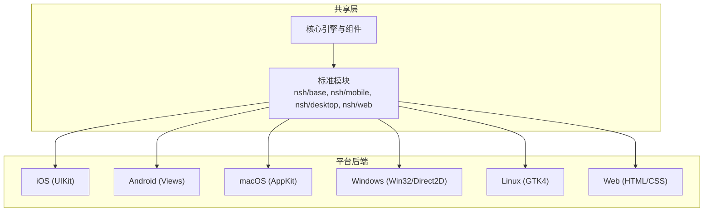
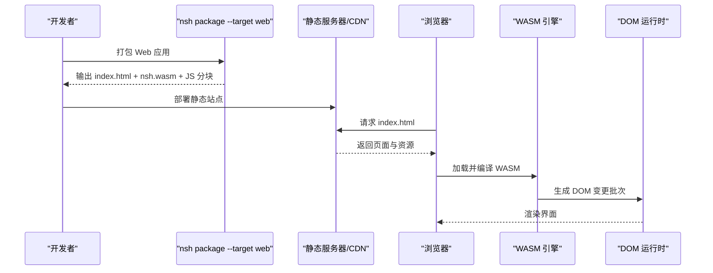
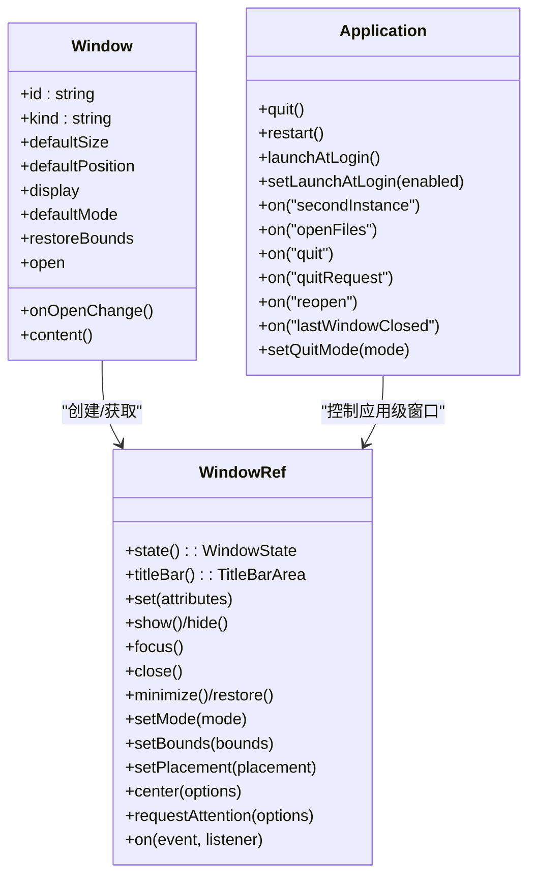
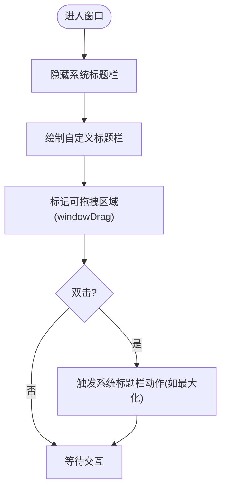
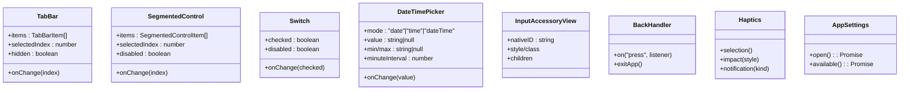
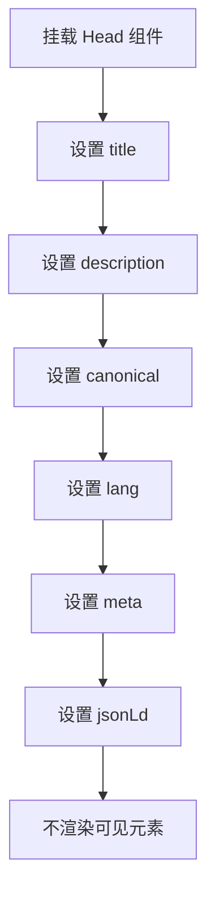
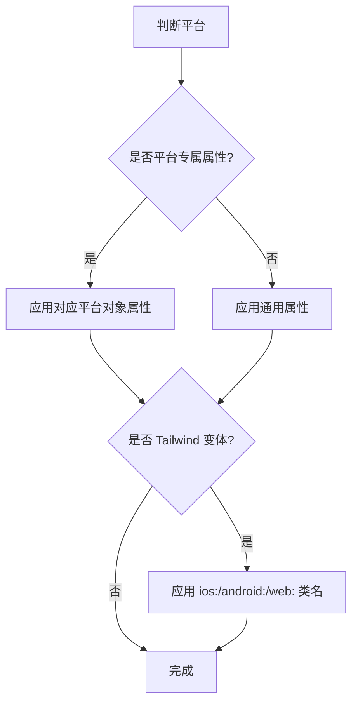
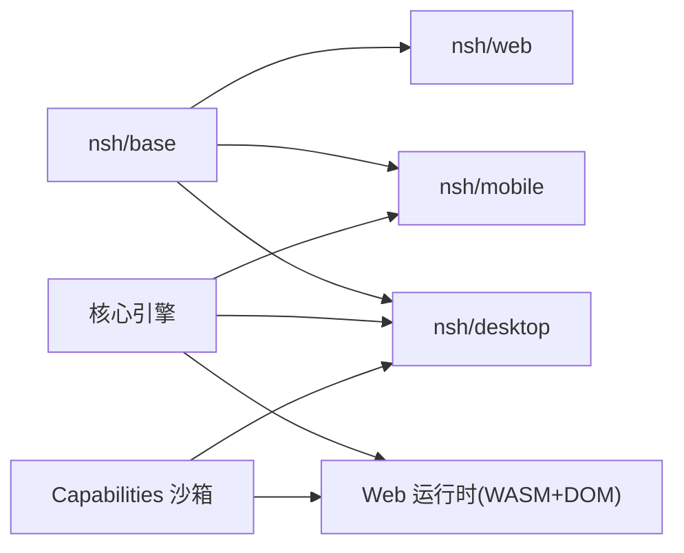

# 平台特定功能

<cite>
**本文引用的文件**   
- [platforms.md](file://website/docs/platforms.md)
- [web.md](file://website/docs/web.md)
- [platform-specific.md](file://website/docs/platform-specific.md)
- [nsh-desktop.md](file://website/modules/nsh-desktop.md)
- [nsh-mobile.md](file://website/modules/nsh-mobile.md)
- [nsh-web.md](file://website/modules/nsh-web.md)
</cite>

## 目录
1. [简介](#简介)
2. [项目结构](#项目结构)
3. [核心组件](#核心组件)
4. [架构总览](#架构总览)
5. [详细组件分析](#详细组件分析)
6. [依赖分析](#依赖分析)
7. [性能考虑](#性能考虑)
8. [故障排查指南](#故障排查指南)
9. [结论](#结论)
10. [附录](#附录)

## 简介
本文件面向 NSH 平台的“平台特定功能”，系统性梳理跨平台能力与桌面、移动、Web 三大类特性的差异与最佳实践。内容覆盖：
- 系统通知、本地存储、应用更新、URL Scheme 等原生能力的统一抽象与平台实现差异
- 桌面平台特性：窗口管理、托盘图标、全局快捷键、系统集成（菜单、登录项、单实例、打开文件）
- 移动平台特性：权限引导、传感器/输入辅助、触觉反馈、系统控件（TabBar、SegmentedControl、Switch、DateTimePicker）、返回键处理
- Web 平台特性：HTML/CSS 渲染、浏览器 API 桥接、SEO 与页面元信息、网络与安全策略、嵌入与宿主函数
- 跨平台开发的最佳实践与兼容性处理方案

## 项目结构
NSH 将“共享逻辑”与“平台后端”解耦：上层组件、样式、布局在所有平台一致，底层由各自后端提供 UI 绘制与系统能力。文档侧重点如下：
- 平台概览与运行目标
- 平台特定代码的组织方式（属性、模块、Tailwind 变体）
- 各平台专属模块的 API 与行为差异

图表来源
- [platforms.md:10-32](file://website/docs/platforms.md#L10-L32)

章节来源
- [platforms.md:10-32](file://website/docs/platforms.md#L10-L32)

## 核心组件
本节聚焦平台相关的关键模块与能力边界：
- nsh/mobile：移动端专属能力（TabBar、SegmentedControl、Switch、DateTimePicker、InputAccessoryView、BackHandler、Haptics、AppSettings）
- nsh/desktop：桌面端专属能力（Window、Menu、Tray、全局快捷键、登录项、单实例、打开文件、Quit 生命周期）
- nsh/web：Web 页头与 SEO（Head），以及 Web 运行时特性（DOM 渲染、浏览器 API、CSP、Host 函数）

章节来源
- [nsh-mobile.md:1-18](file://website/modules/nsh-mobile.md#L1-L18)
- [nsh-desktop.md:1-10](file://website/modules/nsh-desktop.md#L1-L10)
- [nsh-web.md:1-11](file://website/modules/nsh-web.md#L1-L11)

## 架构总览
NSH 在 Web 上以 HTML/CSS 渲染界面，Rust 引擎通过 WebAssembly 驱动状态与布局；TSX 在浏览器 JS 引擎执行。Web 构建产物包含 WASM、JS 运行时、按需加载的分块与资源。

图表来源
- [web.md:13-36](file://website/docs/web.md#L13-L36)
- [web.md:132-167](file://website/docs/web.md#L132-L167)

章节来源
- [web.md:13-36](file://website/docs/web.md#L13-L36)
- [web.md:132-167](file://website/docs/web.md#L132-L167)

## 详细组件分析

### 桌面平台：窗口管理与系统集成（nsh/desktop）
- 窗口模型：每个窗口是独立场景，共享应用上下文；支持多种窗口类型（normal/dialog/panel/popup/overlay）
- 窗口属性：标题、尺寸、层级、透明度、阴影、任务栏进度等
- 窗口事件：关闭、焦点变化、模式变化、位置变化、显示器变化
- 应用生命周期：quit/restart、quitRequest、lastWindowClosed、reopen
- 系统集成：应用菜单、上下文菜单、托盘、全局快捷键、登录项、单实例、打开文件

图表来源
- [nsh-desktop.md:49-162](file://website/modules/nsh-desktop.md#L49-L162)
- [nsh-desktop.md:241-302](file://website/modules/nsh-desktop.md#L241-L302)
- [nsh-desktop.md:372-402](file://website/modules/nsh-desktop.md#L372-L402)

章节来源
- [nsh-desktop.md:49-162](file://website/modules/nsh-desktop.md#L49-L162)
- [nsh-desktop.md:241-302](file://website/modules/nsh-desktop.md#L241-L302)
- [nsh-desktop.md:372-402](file://website/modules/nsh-desktop.md#L372-L402)

#### 自定义标题栏与拖拽区域
- 隐藏系统标题栏后，应用可绘制自己的标题栏，并通过 windowDrag 标记可拖拽区域
- 可自定义窗口按钮（最小化/最大化/关闭）与边缘调整大小区域

图表来源
- [nsh-desktop.md:673-740](file://website/modules/nsh-desktop.md#L673-L740)

章节来源
- [nsh-desktop.md:673-740](file://website/modules/nsh-desktop.md#L673-L740)

### 移动平台：系统控件与交互（nsh/mobile）
- TabBar：系统级标签栏，iOS 使用 UITabBar，Android 使用 Material 3 导航栏
- SegmentedControl：系统分段控制器（iOS）
- Switch：系统开关（iOS/Android）
- DateTimePicker：系统日期时间选择器
- InputAccessoryView：键盘上方附加视图（iOS）
- BackHandler：Android 返回键处理
- Haptics：触觉反馈
- AppSettings：跳转到系统设置页

图表来源
- [nsh-mobile.md:64-182](file://website/modules/nsh-mobile.md#L64-L182)
- [nsh-mobile.md:183-240](file://website/modules/nsh-mobile.md#L183-L240)
- [nsh-mobile.md:242-287](file://website/modules/nsh-mobile.md#L242-L287)
- [nsh-mobile.md:288-349](file://website/modules/nsh-mobile.md#L288-L349)
- [nsh-mobile.md:350-437](file://website/modules/nsh-mobile.md#L350-L437)
- [nsh-mobile.md:439-502](file://website/modules/nsh-mobile.md#L439-L502)
- [nsh-mobile.md:503-558](file://website/modules/nsh-mobile.md#L503-L558)
- [nsh-mobile.md:560-615](file://website/modules/nsh-mobile.md#L560-L615)

章节来源
- [nsh-mobile.md:64-182](file://website/modules/nsh-mobile.md#L64-L182)
- [nsh-mobile.md:183-240](file://website/modules/nsh-mobile.md#L183-L240)
- [nsh-mobile.md:242-287](file://website/modules/nsh-mobile.md#L242-L287)
- [nsh-mobile.md:288-349](file://website/modules/nsh-mobile.md#L288-L349)
- [nsh-mobile.md:350-437](file://website/modules/nsh-mobile.md#L350-L437)
- [nsh-mobile.md:439-502](file://website/modules/nsh-mobile.md#L439-L502)
- [nsh-mobile.md:503-558](file://website/modules/nsh-mobile.md#L503-L558)
- [nsh-mobile.md:560-615](file://website/modules/nsh-mobile.md#L560-L615)

### Web 平台：页面元信息与 SEO（nsh/web）
- Head：设置文档标题、描述、规范链接、语言、meta 与 JSON-LD
- 多 Head 共存时，最后挂载的生效，未设置的字段回退到前一个或默认值

图表来源
- [nsh-web.md:21-59](file://website/modules/nsh-web.md#L21-L59)

章节来源
- [nsh-web.md:21-59](file://website/modules/nsh-web.md#L21-L59)

### 平台特定代码组织与 Tailwind 变体
- 平台专属属性：TSX 中使用 ios/android/macos/windows/desktop/web 对象包裹平台特有属性
- 平台模块：nsh/mobile 与 nsh/desktop 可在任意平台导入，不可用时 isAvailable 为 false
- Tailwind 变体：ios:/android:/web: 用于按平台应用样式

图表来源
- [platform-specific.md:25-109](file://website/docs/platform-specific.md#L25-L109)
- [platform-specific.md:321-337](file://website/docs/platform-specific.md#L321-L337)

章节来源
- [platform-specific.md:25-109](file://website/docs/platform-specific.md#L25-L109)
- [platform-specific.md:321-337](file://website/docs/platform-specific.md#L321-L337)

## 依赖分析
- 平台模块依赖关系：nsh/mobile 与 nsh/desktop 均依赖共享核心（nsh/base 与平台环境）
- Web 运行时依赖：WASM 引擎、DOM 运行时、浏览器 API（fetch、WebSocket、IndexedDB 等）
- 安全与能力：capabilities 控制应用菜单、托盘、全局快捷键、quit/restart、登录项等

图表来源
- [platforms.md:10-32](file://website/docs/platforms.md#L10-L32)
- [nsh-desktop.md:1-10](file://website/modules/nsh-desktop.md#L1-L10)
- [web.md:478-486](file://website/docs/web.md#L478-L486)

章节来源
- [platforms.md:10-32](file://website/docs/platforms.md#L10-L32)
- [nsh-desktop.md:1-10](file://website/modules/nsh-desktop.md#L1-L10)
- [web.md:478-486](file://website/docs/web.md#L478-L486)

## 性能考虑
- Web 构建体积：WASM 与 JS 运行时按需加载，首屏仅加载必要模块，后续分块后台下载
- 预压缩与缓存：服务端应启用 Brotli/Gzip 预压缩，并对非入口文件设置长期缓存
- 字体测量与文本布局：在 Rust 中完成，避免浏览器布局抖动
- 动画与交互：在 requestAnimationFrame 中推进，减少 JS 每帧参与

章节来源
- [web.md:193-227](file://website/docs/web.md#L193-L227)
- [web.md:30-36](file://website/docs/web.md#L30-L36)

## 故障排查指南
- Web 网络限制：CORS、Cookie 同域、重定向策略、受限响应头
- CSP 严格策略：需允许 wasm-unsafe-eval、blob/data URL、host 白名单
- 嵌入 iframe：跨源需注册 hostPlayerFrame，否则弹窗/对话框可能无法覆盖视口
- 剪贴板与媒体：HTTPS 安全上下文要求；视频自动播放需用户手势

章节来源
- [web.md:478-486](file://website/docs/web.md#L478-L486)
- [web.md:253-276](file://website/docs/web.md#L253-L276)
- [web.md:377-389](file://website/docs/web.md#L377-L389)
- [web.md:582-590](file://website/docs/web.md#L582-L590)

## 结论
NSH 通过“共享核心 + 平台后端”的架构，使同一份业务逻辑能在 iOS、Android、macOS、Windows、Linux 与 Web 上运行。针对平台差异，提供了清晰的组织方式（平台属性、平台模块、Tailwind 变体）与丰富的原生能力封装（窗口、菜单、托盘、全局快捷键、系统控件、触觉反馈、设置页跳转、Web 元信息等）。在实际开发中，建议优先使用共享能力，仅在必要时进行平台分支，并结合 capabilities 与 CSP 做好安全与权限控制。

## 附录
- 平台概览与运行目标、开发与打包命令
- 平台特定代码编写指南与示例
- Web 平台特性、网络与安全策略、嵌入与宿主函数

章节来源
- [platforms.md:34-67](file://website/docs/platforms.md#L34-L67)
- [platform-specific.md:10-23](file://website/docs/platform-specific.md#L10-L23)
- [web.md:277-355](file://website/docs/web.md#L277-L355)