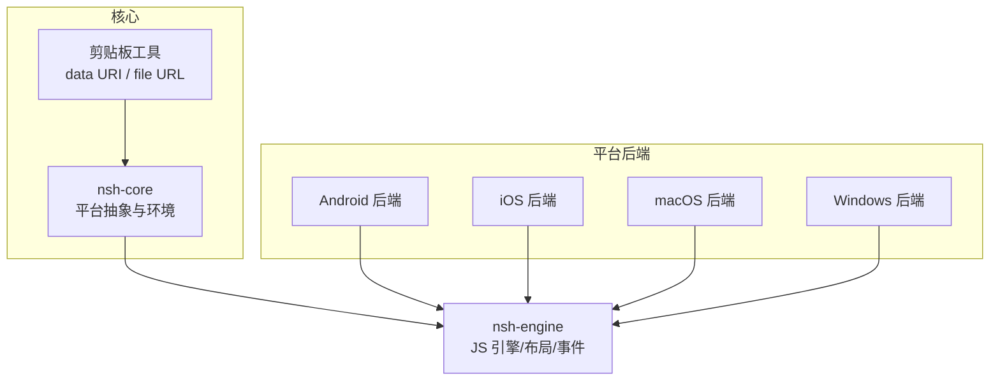
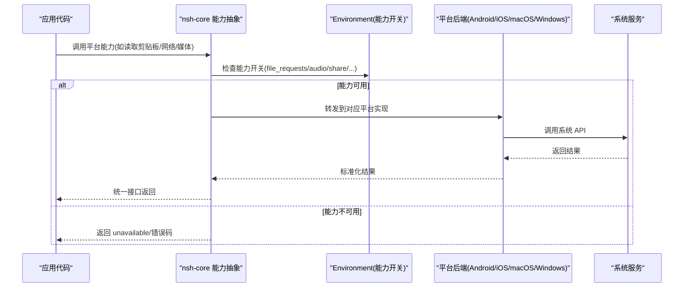
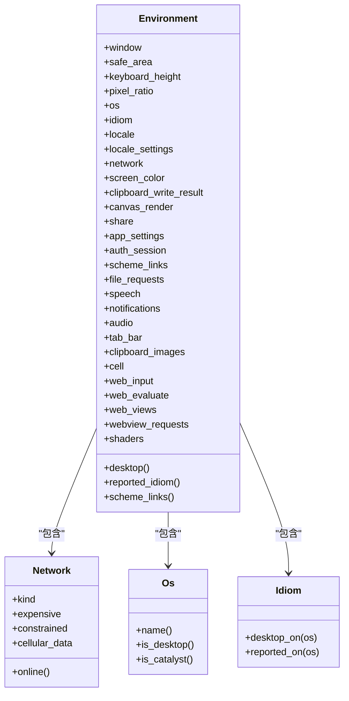
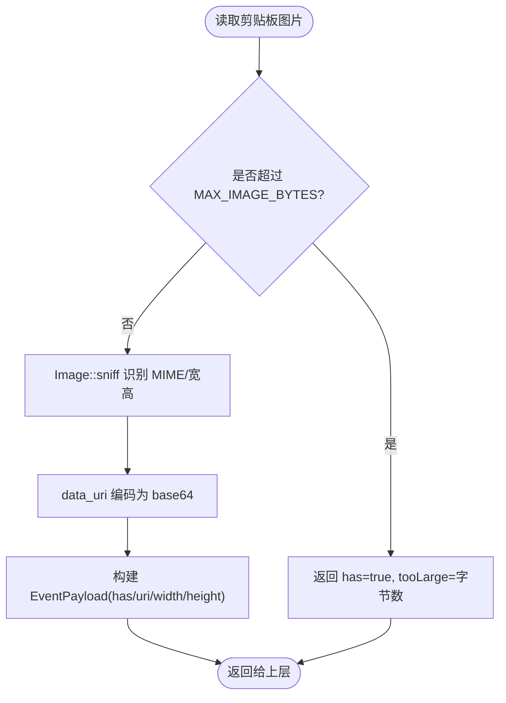
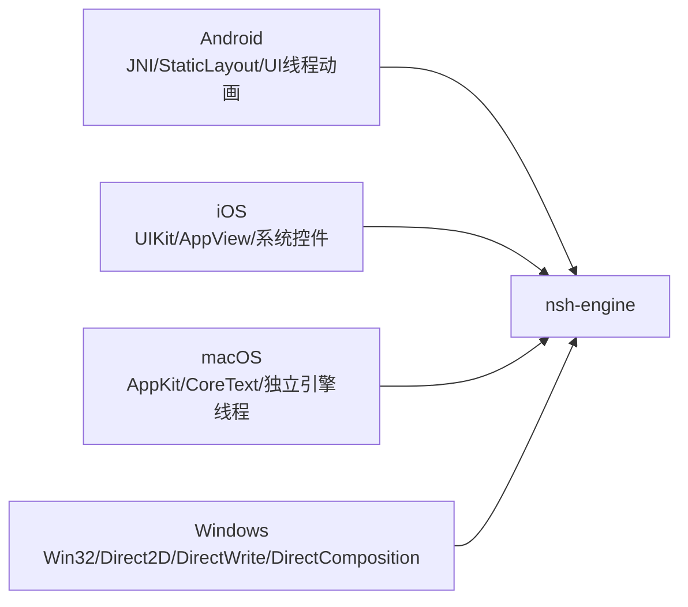
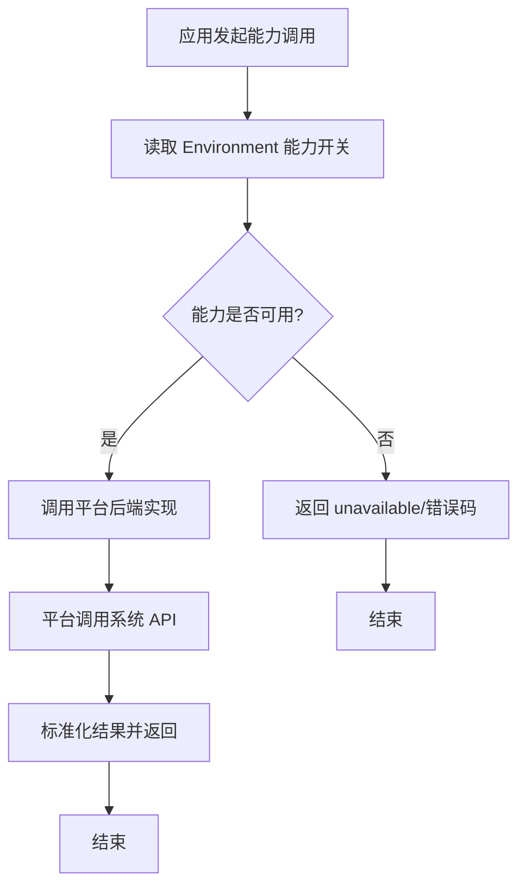
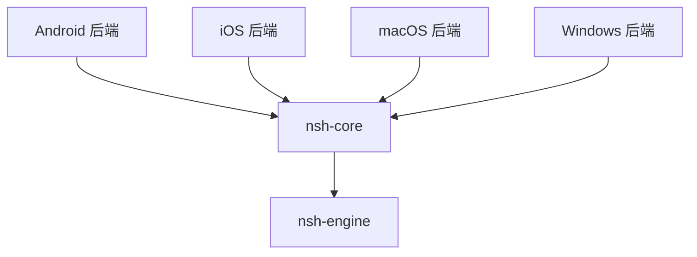

# 平台能力

<cite>
**本文引用的文件**   
- [platform.rs](file://crates/nsh-core/src/platform.rs)
- [clipboard.rs](file://crates/nsh-core/src/platform/clipboard.rs)
- [lib.rs（Android）](file://crates/nsh-platform-android/src/lib.rs)
- [lib.rs（iOS）](file://crates/nsh-platform-ios/src/lib.rs)
- [lib.rs（macOS）](file://crates/nsh-platform-macos/src/lib.rs)
- [lib.rs（Windows）](file://crates/nsh-platform-windows/src/lib.rs)
</cite>

## 目录
1. [简介](#简介)
2. [项目结构](#项目结构)
3. [核心组件](#核心组件)
4. [架构总览](#架构总览)
5. [详细组件分析](#详细组件分析)
6. [依赖关系分析](#依赖关系分析)
7. [性能考量](#性能考量)
8. [故障排查指南](#故障排查指南)
9. [结论](#结论)
10. [附录：API参考与使用示例](#附录api参考与使用示例)

## 简介
本文件系统性梳理 NSH 平台的“原生能力”抽象与实现，覆盖文件系统访问、网络请求、媒体处理、设备信息、剪贴板、通知、语音、Web 视图等。文档重点包括：
- 平台能力检测与特性开关
- 不同平台的能力差异与适配策略
- 运行时动态调整功能实现的模式
- 平台特定的最佳实践与性能优化建议
- 完整的 API 参考与使用示例（以路径引用形式给出）

## 项目结构
NSH 将“平台无关的核心能力”与“各平台的具体实现”解耦：
- nsh-core：定义跨平台能力模型与环境元数据（如 Environment、Network、Os、Idiom、LocaleSettings 等），并提供通用工具（如剪贴板编解码）。
- nsh-platform-*：各平台后端（Android、iOS、macOS、Windows）实现具体能力（窗口、输入、渲染、网络、媒体、系统服务等）。
- nsh-engine：引擎层负责 JS 运行、布局、事件循环、资源管理等。

**图表来源** 
- [platform.rs:1-120](file://crates/nsh-core/src/platform.rs#L1-L120)
- [clipboard.rs:1-40](file://crates/nsh-core/src/platform/clipboard.rs#L1-L40)
- [lib.rs（Android）:1-45](file://crates/nsh-platform-android/src/lib.rs#L1-L45)
- [lib.rs（iOS）:1-37](file://crates/nsh-platform-ios/src/lib.rs#L1-L37)
- [lib.rs（macOS）:1-22](file://crates/nsh-platform-macos/src/lib.rs#L1-L22)
- [lib.rs（Windows）:1-22](file://crates/nsh-platform-windows/src/lib.rs#L1-L22)

**章节来源**
- [platform.rs:1-120](file://crates/nsh-core/src/platform.rs#L1-L120)
- [lib.rs（Android）:1-45](file://crates/nsh-platform-android/src/lib.rs#L1-L45)
- [lib.rs（iOS）:1-37](file://crates/nsh-platform-ios/src/lib.rs#L1-L37)
- [lib.rs（macOS）:1-22](file://crates/nsh-platform-macos/src/lib.rs#L1-L22)
- [lib.rs（Windows）:1-22](file://crates/nsh-platform-windows/src/lib.rs#L1-L22)

## 核心组件
- 环境与环境元数据
  - Os/Idiom/LocaleSettings/Network 等描述操作系统、设备形态、区域设置与网络状态。
  - Environment 聚合所有平台能力开关（如 share、audio、notifications、web_views、canvas_render、file_requests 等）。
- 剪贴板工具
  - data URI/base64 编解码、file URL 构造、图片类型与尺寸嗅探、HTML 片段 Windows CF_HTML 包装。
- 平台后端
  - Android/iOS/macOS/Windows 各自提供 UI 宿主、文本排版、输入、渲染、网络、媒体、系统服务等的具体实现。

**章节来源**
- [platform.rs:100-210](file://crates/nsh-core/src/platform.rs#L100-L210)
- [platform.rs:239-386](file://crates/nsh-core/src/platform.rs#L239-L386)
- [platform.rs:417-620](file://crates/nsh-core/src/platform.rs#L417-L620)
- [clipboard.rs:10-165](file://crates/nsh-core/src/platform/clipboard.rs#L10-L165)

## 架构总览
下图展示从应用到平台后端的调用链路与能力分发方式。

**图表来源** 
- [platform.rs:417-620](file://crates/nsh-core/src/platform.rs#L417-L620)
- [lib.rs（Android）:1-45](file://crates/nsh-platform-android/src/lib.rs#L1-L45)
- [lib.rs（iOS）:1-37](file://crates/nsh-platform-ios/src/lib.rs#L1-L37)
- [lib.rs（macOS）:1-22](file://crates/nsh-platform-macos/src/lib.rs#L1-L22)
- [lib.rs（Windows）:1-22](file://crates/nsh-platform-windows/src/lib.rs#L1-L22)

## 详细组件分析

### 环境与能力检测
- 操作系统与设备形态
  - Os：ios/android/macos/windows/linux/web；is_desktop/is_catalyst 用于区分桌面行为与 Catalyst 场景。
  - Idiom：phone/pad/mac/tv/desktop/terminal；desktop_on/reported_on 决定“桌面行为”的判定与对外报告。
- 网络状态
  - Network：kind(expensive/constrained/cellularData)、online() 判断是否在线。
- 环境聚合
  - Environment：包含窗口尺寸、安全区域、键盘高度、像素比、无障碍、语言区域、生命周期、唤醒计数、各类能力布尔开关（share/audio/notifications/web_views/shaders/file_requests 等）。
- 区域与时区
  - Locale/Languages/TimeZone/HourCycle/MeasurementSystem/TemperatureUnit 等，提供国际化与本地化所需元数据。

**图表来源** 
- [platform.rs:100-210](file://crates/nsh-core/src/platform.rs#L100-L210)
- [platform.rs:239-386](file://crates/nsh-core/src/platform.rs#L239-L386)
- [platform.rs:417-620](file://crates/nsh-core/src/platform.rs#L417-L620)

**章节来源**
- [platform.rs:100-210](file://crates/nsh-core/src/platform.rs#L100-L210)
- [platform.rs:239-386](file://crates/nsh-core/src/platform.rs#L239-L386)
- [platform.rs:417-620](file://crates/nsh-core/src/platform.rs#L417-L620)

### 剪贴板与媒体数据
- 图片读取与大小限制
  - MAX_IMAGE_BYTES：限制剪贴板图片最大字节数，超出时返回 tooLarge 而非完整数据。
  - Image::sniff：根据文件头识别 MIME 与宽高。
- data URI 与 base64
  - data_uri/decode_data_uri：在 Rust 侧高效编解码，避免额外分配。
- file URL
  - file_url：对绝对路径进行规范化与百分号编码，兼容 Windows UNC 路径。
- HTML 片段（Windows）
  - cf_html：生成 Windows CF_HTML 格式，便于粘贴到支持的应用。

**图表来源** 
- [clipboard.rs:10-17](file://crates/nsh-core/src/platform/clipboard.rs#L10-L17)
- [clipboard.rs:27-53](file://crates/nsh-core/src/platform/clipboard.rs#L27-L53)
- [clipboard.rs:88-139](file://crates/nsh-core/src/platform/clipboard.rs#L88-L139)
- [clipboard.rs:141-165](file://crates/nsh-core/src/platform/clipboard.rs#L141-L165)

**章节来源**
- [clipboard.rs:10-165](file://crates/nsh-core/src/platform/clipboard.rs#L10-L165)
- [clipboard.rs:167-245](file://crates/nsh-core/src/platform/clipboard.rs#L167-L245)
- [clipboard.rs:247-268](file://crates/nsh-core/src/platform/clipboard.rs#L247-L268)

### 平台后端概览与差异
- Android
  - 通过 JNI 与 Java 层交互；UI 线程执行动画与选择；文本测量走 StaticLayout。
  - 暴露 run_root/set_runtime 等入口；组件注册与 UI sets 管理。
- iOS
  - UIKit 后端；AppView/Surface 作为宿主；硬件键盘、焦点、手势、系统菜单/日期时间选择器/TabBar 等。
  - 共享 Apple 平台的 audio/notifications/speech。
- macOS
  - AppKit 视图 + CoreText；独立引擎线程；主线程仅绘制；支持全局快捷键、登录项、托盘等。
- Windows
  - Win32 + Direct2D/DirectWrite；每表面一个窗口；DirectComposition 合成 WebView；帧计时基于 DwmFlush。

**图表来源** 
- [lib.rs（Android）:1-45](file://crates/nsh-platform-android/src/lib.rs#L1-L45)
- [lib.rs（iOS）:1-37](file://crates/nsh-platform-ios/src/lib.rs#L1-L37)
- [lib.rs（macOS）:1-22](file://crates/nsh-platform-macos/src/lib.rs#L1-L22)
- [lib.rs（Windows）:1-22](file://crates/nsh-platform-windows/src/lib.rs#L1-L22)

**章节来源**
- [lib.rs（Android）:1-45](file://crates/nsh-platform-android/src/lib.rs#L1-L45)
- [lib.rs（iOS）:1-37](file://crates/nsh-platform-ios/src/lib.rs#L1-L37)
- [lib.rs（macOS）:1-22](file://crates/nsh-platform-macos/src/lib.rs#L1-L22)
- [lib.rs（Windows）:1-22](file://crates/nsh-platform-windows/src/lib.rs#L1-L22)

### 平台能力检测与动态适配流程
- 步骤
  1) 读取 Environment 中的能力开关（如 file_requests、audio、share、web_views、shaders 等）。
  2) 若能力可用，则调用对应平台后端实现；否则返回“不可用”错误。
  3) 对于可选能力（如 clipboard_images、scheme_links），按 Option<bool> 分支处理。
  4) 针对网络状态（Network.online/expensive/constrained）做降级策略（如低带宽下减少请求或禁用大媒体）。

**图表来源** 
- [platform.rs:417-620](file://crates/nsh-core/src/platform.rs#L417-L620)

**章节来源**
- [platform.rs:417-620](file://crates/nsh-core/src/platform.rs#L417-L620)

## 依赖关系分析
- 耦合与内聚
  - nsh-core 保持高内聚的平台抽象；平台后端通过 Environment 的能力开关与核心解耦。
- 外部依赖
  - Android：JNI/Java 层；iOS/macOS：Objective-C/Swift 桥接；Windows：Win32/DirectX。
- 潜在循环依赖
  - 核心不直接依赖平台后端，避免循环；平台后端依赖核心与引擎。

**图表来源** 
- [platform.rs:1-120](file://crates/nsh-core/src/platform.rs#L1-L120)
- [lib.rs（Android）:1-45](file://crates/nsh-platform-android/src/lib.rs#L1-L45)
- [lib.rs（iOS）:1-37](file://crates/nsh-platform-ios/src/lib.rs#L1-L37)
- [lib.rs（macOS）:1-22](file://crates/nsh-platform-macos/src/lib.rs#L1-L22)
- [lib.rs（Windows）:1-22](file://crates/nsh-platform-windows/src/lib.rs#L1-L22)

**章节来源**
- [platform.rs:1-120](file://crates/nsh-core/src/platform.rs#L1-L120)
- [lib.rs（Android）:1-45](file://crates/nsh-platform-android/src/lib.rs#L1-L45)
- [lib.rs（iOS）:1-37](file://crates/nsh-platform-ios/src/lib.rs#L1-L37)
- [lib.rs（macOS）:1-22](file://crates/nsh-platform-macos/src/lib.rs#L1-L22)
- [lib.rs（Windows）:1-22](file://crates/nsh-platform-windows/src/lib.rs#L1-L22)

## 性能考量
- 剪贴板图片
  - 使用 MAX_IMAGE_BYTES 限制内存占用，避免 VM 堆溢出；超大图片只返回尺寸字段。
  - 优先使用零拷贝/最小分配的数据流（base64 编码采用紧凑表驱动）。
- 文本与渲染
  - macOS：CoreText 在引擎线程排版，主线程仅绘制；Windows：DirectWrite 排版，主线程绘制；Android：StaticLayout 测量，UI 线程提交。
- 网络
  - 依据 Network.expensive/constrained 降低请求频率、禁用大媒体或启用缓存策略。
- 动画与帧率
  - 平台后端在显示刷新或合成器节拍上驱动动画（如 macOS 的 display link、Windows 的 DwmFlush）。

[本节为通用指导，不直接分析具体文件]

## 故障排查指南
- 常见错误
  - ERR_FEATURE_UNAVAILABLE_ON_PLATFORM：当 Environment 中某能力为 false 时触发（如 canvas_render、share、web_views 等）。
  - ERR_NSH_QUOTA_EXCEEDED：剪贴板图片过大导致 VM 堆配额不足。
- 诊断要点
  - 检查 Environment 中相关布尔开关与 Network 状态。
  - 确认平台后端是否正确初始化（Android/JNI、iOS/UIKit、macOS/AppKit、Windows/Win32）。
  - 对媒体能力，验证图片头解析与 MIME 识别是否成功。

**章节来源**
- [platform.rs:417-620](file://crates/nsh-core/src/platform.rs#L417-L620)
- [clipboard.rs:10-17](file://crates/nsh-core/src/platform/clipboard.rs#L10-L17)

## 结论
NSH 通过 Environment 的能力开关与平台后端的解耦设计，实现了跨平台的一致 API 与灵活的差异化实现。开发者可在运行时检测平台特性并动态调整功能，结合网络状态与设备形态做出更稳健的适配决策。遵循本文的最佳实践与性能建议，可显著提升多端一致性与用户体验。

[本节为总结性内容，不直接分析具体文件]

## 附录：API参考与使用示例

- 环境与能力
  - 读取操作系统与设备形态：Os.name()/is_desktop()/is_catalyst()、Idiom.desktop_on()/reported_on()
  - 网络状态：Network.kind/expensive/constrained/cellular_data、online()
  - 能力开关：Environment.file_requests/audio/share/web_views/shaders/...
  - 参考路径
    - [platform.rs:100-210](file://crates/nsh-core/src/platform.rs#L100-L210)
    - [platform.rs:239-386](file://crates/nsh-core/src/platform.rs#L239-L386)
    - [platform.rs:417-620](file://crates/nsh-core/src/platform.rs#L417-L620)

- 剪贴板与媒体
  - 图片读取与限制：MAX_IMAGE_BYTES、Image::sniff、image_answer
  - data URI/base64：data_uri/decode_data_uri
  - file URL：file_url
  - Windows HTML 片段：cf_html
  - 参考路径
    - [clipboard.rs:10-17](file://crates/nsh-core/src/platform/clipboard.rs#L10-L17)
    - [clipboard.rs:27-53](file://crates/nsh-core/src/platform/clipboard.rs#L27-L53)
    - [clipboard.rs:88-139](file://crates/nsh-core/src/platform/clipboard.rs#L88-L139)
    - [clipboard.rs:141-165](file://crates/nsh-core/src/platform/clipboard.rs#L141-L165)
    - [clipboard.rs:167-245](file://crates/nsh-core/src/platform/clipboard.rs#L167-L245)
    - [clipboard.rs:247-268](file://crates/nsh-core/src/platform/clipboard.rs#L247-L268)

- 平台后端入口与能力
  - Android：run_root/set_runtime、组件注册、UI sets
    - 参考路径：[lib.rs（Android）:44-187](file://crates/nsh-platform-android/src/lib.rs#L44-L187)
  - iOS：AppView/Surface、系统控件、音频/通知/语音共享
    - 参考路径：[lib.rs（iOS）:1-37](file://crates/nsh-platform-ios/src/lib.rs#L1-L37), [lib.rs（iOS）:121-223](file://crates/nsh-platform-ios/src/lib.rs#L121-L223)
  - macOS：AppView/run_app、CoreTextEngine、全局快捷键/登录项/托盘
    - 参考路径：[lib.rs（macOS）:1-22](file://crates/nsh-platform-macos/src/lib.rs#L1-L22), [lib.rs（macOS）:72-91](file://crates/nsh-platform-macos/src/lib.rs#L72-L91)
  - Windows：AppView/run_app、DWriteTextEngine、DirectComposition/Web 视图合成
    - 参考路径：[lib.rs（Windows）:1-22](file://crates/nsh-platform-windows/src/lib.rs#L1-L22), [lib.rs（Windows）:78-102](file://crates/nsh-platform-windows/src/lib.rs#L78-L102)

- 使用示例（以路径引用代替代码）
  - 检测平台特性并动态调整
    - 读取 Environment.desktop()/reported_idiom() 与能力开关，决定是否启用桌面专属功能
      - 参考路径：[platform.rs:635-660](file://crates/nsh-core/src/platform.rs#L635-L660)
  - 剪贴板图片读取
    - 调用 image_answer 构建响应，注意 tooLarge 分支
      - 参考路径：[clipboard.rs:55-76](file://crates/nsh-core/src/platform/clipboard.rs#L55-L76)
  - 网络降级策略
    - 根据 Network.expensive/constrained 控制请求频率与媒体质量
      - 参考路径：[platform.rs:239-386](file://crates/nsh-core/src/platform.rs#L239-L386)